# 単位付き数字のアラビア数字正規化・変換の評価セットおよび設計実装仕様書

## 1. 概要 (Executive Summary)

本ドキュメントは、「重さ・長さ・西暦年号などの単位付き数字をアラビア数字で表記・変換する」という要件に対し、多様なカテゴリーを網羅した**評価ベンチマークデータセット（全77ケース）**の構築、および**「ASR音声認識後処理」と「キーボードIMEかな漢字変換」の双方でアラビア数字を適切に出力するハイブリッド変換エンジン (`JapaneseNumeralUtils`)** の設計・実装と検証結果をまとめたものです。

---

## 2. 評価データセットの設計と検証結果

### 2.1 評価データセット構成 (全77テストケース)

日本語表記においてアラビア数字が好まれる代表的な7つの実用カテゴリー、および**誤変換してはならない慣用句・四字熟語などの非変換ケース（ネガティブサンプル）**を網羅した評価セットを構築しました。

| カテゴリー | 件数 | 入力例 (漢字表記 / 読み) | 期待される出力 (アラビア数字) |
| :--- | :--- | :--- | :--- |
| **1. 重さ (Weight)** | 5 | 重さは五キロです<br>五百グラムの牛肉<br>最大積載量は三トン | 重さは**5キロ**です<br>**500グラム**の牛肉<br>最大積載量は**3トン** |
| **2. 長さ・距離 (Length)** | 5 | 長さは十メートル<br>幅は三センチ<br>五キロメートル走った | 長さは**10メートル**<br>幅は**3センチ**<br>**5キロメートル**走った |
| **3. 年号・西暦・年代 (Year/Era)** | 8 | 西暦二千二十六年<br>千九百九十九年<br>二千年代初頭<br>昭和六十四年<br>令和八年 | 西暦**2026年**<br>**1999年**<br>**2000年代**初頭<br>昭和**64年**<br>令和**8年** |
| **4. 時間・日時 (Time/Date)** | 7 | 午後三時三十分<br>十月二十五日<br>五分前<br>二十四時間<br>三百六十五日 | 午後**3時30分**<br>**10月25日**<br>**5分前**<br>**24時間**<br>**365日** |
| **5. 温度・面積・体積 (Physical)** | 6 | 気温は二十五度<br>体温は三十六度五分<br>百平方メートル<br>二リットル<br>零点五秒 | 気温は**25度**<br>体温は**36度5分**<br>**100平方メートル**<br>**2リットル**<br>**0.5秒** |
| **6. 金額・割合・助数詞 (Money/Counters)** | 12 | 千五百円<br>三万五千円<br>百ドル<br>八十パーセント<br>三個 / 五本 / 四台 / 八階 / 3丁目5番地 | **1500円**<br>**35000円**<br>**100ドル**<br>**80パーセント**<br>**3個** / **5本** / **4台** / **8階** / **3丁目5番地** |
| **7. 非変換・慣用句 (Preserved Idioms)**<br>*(ネガティブケース)* | 17 | 一期一会<br>一石二鳥<br>四字熟語<br>三日月<br>七転び八起き<br>五里霧中<br>十人十色<br>五分五分<br>二日酔い<br>三角関係<br>千差万別<br>百発百中<br>万が一<br>一般人<br>一部 | **一期一会** *(1期1会にしない)*<br>**一石二鳥** *(1石2鳥にしない)*<br>**四字熟語** *(4字熟語にしない)*<br>**三日月** *(3日月にしない)*<br>**七転び八起き** *(7転び8起きにしない)*<br>**五里霧中** *(5里霧中にしない)*<br>**十人十色** *(10人10色にしない)*<br>**五分五分** *(5分5分にしない)*<br>**二日酔い** *(2日酔いにしない)*<br>**三角関係** *(3角関係にしない)*<br>**千差万別**<br>**百発百中**<br>**万が一**<br>**一般人**<br>**一部** |
| **8. IMEかな漢字変換 (Phonetic IME)** | 17 | 「ごきろ」<br>「ごひゃくぐらむ」<br>「にせんにじゅうろくねん」<br>「さんじゅっぷん」<br>「じゅっせんち」<br>「ひゃくえん」<br>「にじゅうごど」<br>「さんぼん」<br>「ごこ」<br>「にじゅうよじかん」<br>「さんびゃくろくじゅうごにち」 | **5キロ**<br>**500グラム**<br>**2026年**<br>**30分**<br>**10センチ**<br>**100円**<br>**25度**<br>**3本**<br>**5個**<br>**24時間**<br>**365日** |

---

### 2.2 ベンチマーク評価結果

[`app/src/test/java/com/example/myasr/JapaneseNumeralEvaluationTest.kt`](app/src/test/java/com/example/myasr/JapaneseNumeralEvaluationTest.kt) による実測値:

```text
=== IME NUMERAL CONVERSION EVALUATION REPORT ===
Total IME Cases: 17
Passed: 17 / 17
Accuracy: 100.00%
================================================
=== NUMERAL NORMALIZATION EVALUATION REPORT ===
Total Evaluation Cases: 60
Passed: 60 / 60
Accuracy: 100.00%
================================================
```

- **テキスト正規化 (ASR音声認識出力 & テキスト後処理)**: **60/60 ケース成功 (正解率 100.0%)**
  - 重さ、長さ、年号、日時、温度、体積、金額、助数詞がすべて自然な半角アラビア数字に変換された。
  - 四字熟語や慣用句などの非変換対象が完全に保護され、誤変換（例: `1石2鳥` や `4字熟語`）が 0 件であった。
- **IMEかな入力からの動的候補生成**: **17/17 ケース成功 (正解率 100.0%)**
  - 辞書に未登録の複合単位表現（「ごきろ」「にせんにじゅうろくねん」等）でも、最上位候補としてアラビア数字付き候補が即座に生成された。

---

## 3. アーキテクチャおよびアイデアの実装

### 3.1 [`JapaneseNumeralUtils.kt`](app/src/main/java/com/example/myasr/JapaneseNumeralUtils.kt)

本機能の中核として、以下のアルゴリズムを持つユーティリティを新規設計しました。

1. **Idiom Masking Protection (慣用句の保護)**:
   テキスト正規化を行う前に、`PRESERVED_IDIOMS`（一期一会、一石二鳥、四字熟語、三日月、五分五分など）に合致する部分を一時的な不可視プレースホルダーにマスクすることで、正規表現による誤変換を完全に防止します。
2. **Longest Unit First Matching (最長一致の単位正規表現)**:
   「平方メートル」と「メートル」、「キログラム」と「グラム」などの包含関係による誤分割を防ぐため、単位の文字長降順に正規表現を構成 (`SORTED_UNITS`)。
3. **位取り・桁並び・小数（点）対応の漢数字パーサー (`parseKanjiNumber`)**:
   - 桁並び記法: 「二〇二六」→ `2026`、「一九九九」→ `1999`
   - 位取り記法: 「二千二十六」→ `2026`、「千五百」→ `1500`、「三万五千」→ `35000`
   - 小数表現: 「三十六度五分」→ `36度5分`、「零点五秒」→ `0.5秒`
4. **音声かな読みから数値・単位への動的逆パース (`generateNumeralCandidates`)**:
   - 入力読みの末尾からかな単位（「きろ」「ねん」「ふん」「えん」「ぐらむ」等）をマッチ。
   - 前半の数値かな部（「千の位」「百の位」「十の位」「一の位」）を決定論的に数値変換。
   - `5キロ`, `2026年`, `30分` などのアラビア数字候補を動的生成。

### 3.2 パイプライン連携

```mermaid
flowchart TD
    subgraph ASR_Pipeline ["ASR音声認識パイプライン"]
        A1["音声モデル推論 (ReazonSpeech)"] -->|"重さは五キロです"| B1["ContextAwareProcessor / DictionaryPostProcessor"]
        B1 -->|"JapaneseNumeralUtils.normalizeNumeralsWithUnits()"| C1["コミットテキスト: '重さは5キロです'"]
    end

    subgraph IME_Pipeline ["フリック/ローマ字 IMEパイプライン"]
        A2["ユーザーキー入力 (例: 'ごきろ')"] --> B2["KanaKanjiEngine.getBaseCandidates()"]
        B2 -->|"JapaneseNumeralUtils.generateNumeralCandidates()"| C2["候補リスト最上位: '5キロ'"]
        C2 --> D2["CandidateStripView (変換候補バーに表示)"]
    end
```



---

## 4. デプロイおよび実機動作確認

- **単体テスト**: 全 51 件のユニットテスト（[`JapaneseNumeralEvaluationTest`](app/src/test/java/com/example/myasr/JapaneseNumeralEvaluationTest.kt) を含む）が全て PASS。
- **実機デプロイ (`./deploy.sh`)**:
  - ARCVM (`arc:5555`) にビルド・インストール完了。
  - アプリ起動および初期化（`status=READY`）を logcat にて確認。
  *(※ Pixel 10 Pro 実機は Wi-Fi ADB が接続拒否のため、接続復帰時に自動適用されます)*
