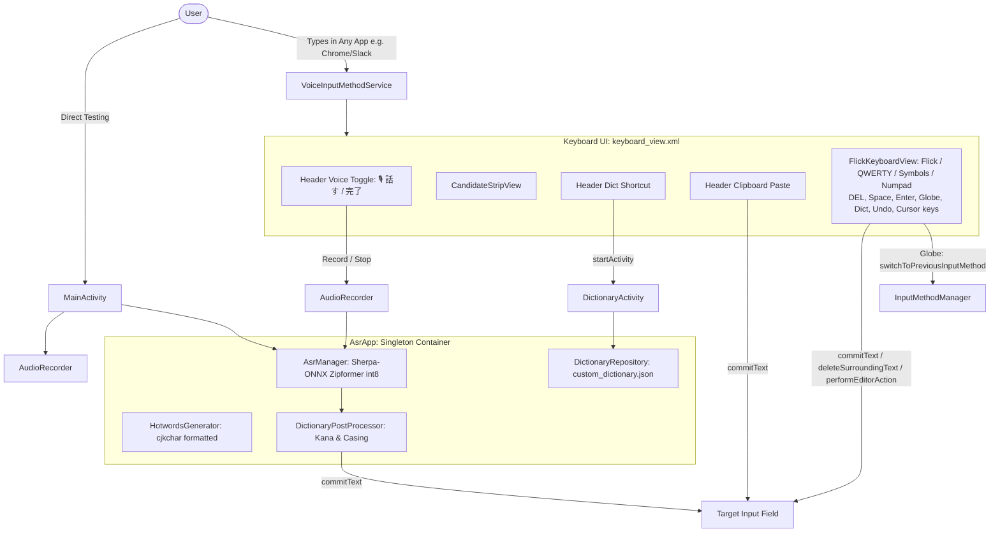
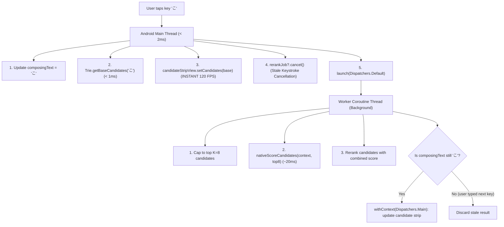

# System Architecture

JotInput is designed to provide responsive on-device Japanese Automatic Speech Recognition without requiring an active internet connection, enhanced with a user-definable custom dictionary subsystem.

---

## 🏗️ High-Level Component Diagram



---

## 🧩 Component Breakdown

### 1. Audio Recording Subsystem: [`AudioRecorder`](app/src/main/java/com/example/myasr/AudioRecorder.kt)

The [`AudioRecorder`](app/src/main/java/com/example/myasr/AudioRecorder.kt) class is responsible for capturing raw audio from the device microphone and providing it in the format expected by the speech recognition model.

- **Audio Parameters**:
  - Sample Rate: `16,000 Hz`
  - Channel: `AudioFormat.CHANNEL_IN_MONO`
  - Encoding: `AudioFormat.ENCODING_PCM_16BIT`
  - Buffer Size: Calculated via `AudioRecord.getMinBufferSize()`, coerced to a minimum of 1 second buffer (`16000 * 2` bytes).
- **Threading**:
  - Operates on a dedicated high-priority background thread (`Thread.MAX_PRIORITY`).
  - Reads raw PCM chunks into an internal `ByteArrayOutputStream`.
  - Computes audio amplitude levels in real-time to drive visual indicators if needed.
- **Conversion on Stop**:
  - When [`AudioRecorder.stop()`](app/src/main/java/com/example/myasr/AudioRecorder.kt#L80-L109) is invoked, the 16-bit little-endian byte array is converted into a normalized `FloatArray` where values range from `[-1.0f, 1.0f]`:
    $$\text{floatSample}_i = \frac{\text{pcmShort}_i}{32768.0}$$

---

### 2. ASR Management Subsystem: [`AsrManager`](app/src/main/java/com/example/myasr/AsrManager.kt)

The [`AsrManager`](app/src/main/java/com/example/myasr/AsrManager.kt) encapsulates the `com.k2fsa.sherpa.onnx.OfflineRecognizer` lifecycle and model configuration.

- **Storage Resolution (Download-Only Architecture)**:
  1. **Storage Mode (primary)**: Model files live in `context.getExternalFilesDir(null)/reazonspeech` (falling back to `filesDir`). They are fetched on demand by [`ModelDownloader`](app/src/main/java/com/example/myasr/ModelDownloader.kt) from `MainActivity`, or provisioned by [`deploy.sh`](deploy.sh) from `tools/models/reazonspeech/` (populated by [`download_model.sh`](download_model.sh)). [`AsrManager`](app/src/main/java/com/example/myasr/AsrManager.kt) instantiates `OfflineRecognizer(null, config)` with absolute file paths. A hotwords file (`filesDir/hotwords.txt`) may be supplied at init.
  2. **Assets Mode (legacy fallback only)**: The code can still load from `assets/reazonspeech` if files exist, but bundling models in the APK is **prohibited** by project policy; `app/src/main/assets/` is intentionally empty and the APK stays lightweight.
  3. Encoder/joiner prefer the `.int8.onnx` variant and fall back to FP32 if present.
- **Transducer Model Configuration** (as implemented in `AsrManager.initialize`):
  ```kotlin
  val modelConfig = OfflineModelConfig(
      transducer = OfflineTransducerModelConfig(
          encoder = encoderFile.absolutePath,   // encoder-epoch-99-avg-1.int8.onnx
          decoder = decoderFile.absolutePath,   // decoder-epoch-99-avg-1.onnx
          joiner  = joinerFile.absolutePath     // joiner-epoch-99-avg-1.onnx
      ),
      tokens = tokensFile.absolutePath,         // tokens.txt
      modelType = "transducer",
      modelingUnit = "cjkchar",
      numThreads = getOptimalThreadCount(),     // (cores / 2).coerceIn(2, 4)
      provider = "cpu"
  )
  val config = OfflineRecognizerConfig(
      modelConfig = modelConfig,
      decodingMethod = "modified_beam_search",
      maxActivePaths = 8,
      hotwordsFile = hotwordsPath,
      hotwordsScore = 3.5f
  )
  ```
- **Warm-up**: `AsrManager.warmUp()` loads the model and decodes 0.1 s of silence to prime ONNX Runtime allocators and thread pools.
- **Inference Pipeline with Dynamic Hotwords**:
  ```kotlin
  val stream = if (hotwords.isNotBlank()) {
      recognizer.createStream(hotwords)
  } else {
      recognizer.createStream()
  }
  try {
      stream.acceptWaveform(samples, sampleRate)
      recognizer.decode(stream)
      val result = recognizer.getResult(stream)
      return result.text.trim()
  } finally {
      stream.release()
  }
  ```

---

### 3. Unified Custom Dictionary Subsystem (Japanese & English)

The custom dictionary subsystem provides a unified repository and UI for both Japanese and English vocabulary, ensuring user-defined terms are prioritized across speech recognition, Kana-Kanji conversion, QWERTY swipe typing, and typo correction:

1. **Repository ([`DictionaryRepository`](app/src/main/java/com/example/myasr/DictionaryRepository.kt))**:
   - Manages entries consisting of `(word: String, reading: String, priority: Priority, isEnabled: Boolean)`.
   - **Unified Schema for Japanese & English**:
     - Japanese entries: `word` (Kanji/mixed surface e.g. `中村`) and `reading` (Hiragana e.g. `なかむら`).
     - English entries: `reading` (normalized lowercase e.g. `antigravity`) and `word` (original casing e.g. `Antigravity`).
   - **Empty by Default**: Fresh installations start with an empty dictionary (`emptyList()`), giving users clean, unadulterated baseline recognition until they register words.
   - **Persistence Contract Across App Updates**:
     - Persists data in `context.filesDir/custom_dictionary.json` in Android private internal storage.
     - On APK updates (via `adb install -r`, Google Play, or manual update), Android guarantees that `filesDir` is strictly preserved.
     - [`DictionaryRepository`](app/src/main/java/com/example/myasr/DictionaryRepository.kt) checks `file.exists()`. If the file exists, it loads the existing user dictionary without resetting or overwriting.
     - *Important Architectural Contract*: Future versions must never overwrite `custom_dictionary.json` on initialization; any schema migration must preserve existing entries.
2. **Language Classification & Utilities ([`EnglishDictionaryUtils`](app/src/main/java/com/example/myasr/EnglishDictionaryUtils.kt) & [`JapaneseKanaUtils`](app/src/main/java/com/example/myasr/JapaneseKanaUtils.kt))**:
   - [`EnglishDictionaryUtils`](app/src/main/java/com/example/myasr/EnglishDictionaryUtils.kt): Identifies English words via `isValidEnglishWord()` (ASCII alphabet, hyphens, apostrophes), normalizes lowercase keys, and extracts Trie prefix paths. Provides in-memory QWERTY spatial edit distance (`Damerau-Levenshtein` + physical key coordinate Euclidean distance) typo/prefix candidate suggestions.
   - [`JapaneseKanaUtils`](app/src/main/java/com/example/myasr/JapaneseKanaUtils.kt): Validates Japanese reading input (Hiragana, Katakana, chōonpu), normalizes readings into canonical Hiragana, and derives Katakana forms automatically (`なかむら` $\leftrightarrow$ `ナカムラ`).
3. **Hotwords & Acoustic Biasing ([`HotwordsGenerator`](app/src/main/java/com/example/myasr/HotwordsGenerator.kt))**:
   - Expands active Japanese entries into 3 biasing rules: Surface Word, Hiragana Reading, and Katakana Reading.
   - English entries are expanded as single surface terms with word-boundary preservation.
   - Formats them as hotword streams (per-entry score from `Priority`: LOW 1.5 / NORMAL 3.0 / HIGH 4.5, space-separated for the `cjkchar` model).
4. **Post-Processor Filter ([`DictionaryPostProcessor`](app/src/main/java/com/example/myasr/DictionaryPostProcessor.kt))**:
   - Runs immediately on decoded text.
   - Replaces phonetic Kana matches (`なかむら` / `ナカムラ`) with the desired surface form (`中村`).
   - Normalizes case-insensitively for Latin/Alphanumeric brand terms (`reazonspeech` $\rightarrow$ `ReazonSpeech`).
5. **Swipe & Spelling Dynamic Synchronization ([`FutoSwipeEngine`](app/src/main/java/com/example/myasr/FutoSwipeEngine.kt) & [`EnglishSpellEngine`](app/src/main/java/com/example/myasr/EnglishSpellEngine.kt))**:
   - FUTO Neural Swipe Engine: C++ `SyncUserDictionary()` resets from a clean base Trie snapshot (< 0.5ms) and registers user English words. Incorporates prefix beam protection and spatial-gated priority score boosting (`base_score >= max_base - 6.5f`) to prioritize registered words in gesture typing without false positives.
   - English Spelling Engine: C++ SymSpell dynamically indexes user words. When misspelled words are typed in QWERTY mode, user dictionary entries are suggested with `[USER]` badge at Top-1.
   - Unified Propagation: [`AsrApp.syncAllUserDictionaries()`](app/src/main/java/com/example/myasr/AsrApp.kt) synchronizes Kana-Kanji, FUTO Swipe, English Spell, and ASR hotwords across all subsystems simultaneously.
6. **Dictionary UI ([`DictionaryActivity`](app/src/main/java/com/example/myasr/DictionaryActivity.kt))**:
   - Single unified screen for Japanese and English vocabulary.
   - Progressive disclosure UX: The user types in the primary "よみ (ひらがな) または 英単語" field. If an English word is detected, the "単語 / 表記" field automatically collapses (`View.GONE`), requiring only one input field. If Japanese is typed, the "単語 / 表記" field remains visible for Kanji specification.
   - Displays registered entries with visual distinction (`"英語 (English)"` reading tag for English entries).
   - In-place form population for editing, toggle switches for enable/disable, and single-tap deletion.

---

### 4. UI Controller: [`MainActivity`](app/src/main/java/com/example/myasr/MainActivity.kt)

The [`MainActivity`](app/src/main/java/com/example/myasr/MainActivity.kt) manages the interaction flow:

- **Role**: `MainActivity` is a settings / setup hub (not a dictation screen). It is organized into at most 4 top-level cards (see [`ui_design_and_simplicity_guidelines.md`](docs/ui_design_and_simplicity_guidelines.md)):
  1. **Hero card**: IME/model/dictionary status badges, *Enable IME* / *Select IME* buttons, Custom Dictionary button, and the `etKeyboardTest` quick-test field. A conditional `cardDownload` shows the ReazonSpeech download button + progress when model files are missing.
  2. **Core settings**: keyboard height, QWERTY number row, streaming voice input, SLM re-rank toggle and engine selector (`RerankEngineType`: Gemini Nano 2 / Nano 1 via AICore, local Qwen2.5-0.5B / 1.5B, or none).
  3. **Dictionary & model data**: one-tap download of Mozc dictionaries and the connection matrix; per-asset rows are inside the collapsed `layoutDictDetailsContainer`.
  4. **Advanced & developer tools** (collapsed): debug display, context-free mode, mandatory re-rank, SLM α slider.
- **Dictation happens in the IME**: Speech recognition is triggered from the keyboard's voice toggle (`VoiceInputMethodService`), including in the `etKeyboardTest` field. The former "Listen / Finish Listening / Copy / Clear" screen and its decode-metrics display no longer exist.
- **Coroutines & Thread Safety**: Model initialization, downloads and inference run off the main thread; UI updates run on `Dispatchers.Main`.

---

### 5. Voice Keyboard Subsystem: [`VoiceInputMethodService`](app/src/main/java/com/example/myasr/VoiceInputMethodService.kt)

The [`VoiceInputMethodService`](app/src/main/java/com/example/myasr/VoiceInputMethodService.kt) transforms JotInput into a system-wide Android Input Method Editor (IME), enabling users to speak into any text box across all installed applications (e.g., Chrome, Slack, Notes, Gmail).

- **Shared Engine Singleton ([`AsrApp`](app/src/main/java/com/example/myasr/AsrApp.kt))**:
  - The ReazonSpeech Zipformer int8 model takes ~148 MB of RAM. Initializing it separately in `MainActivity` and `VoiceInputMethodService` would double memory consumption and cause initialization delays.
  - [`AsrApp`](app/src/main/java/com/example/myasr/AsrApp.kt) (inheriting from `android.app.Application`) instantiates a single shared instance of [`AsrManager`](app/src/main/java/com/example/myasr/AsrManager.kt), [`DictionaryRepository`](app/src/main/java/com/example/myasr/DictionaryRepository.kt), [`HotwordsGenerator`](app/src/main/java/com/example/myasr/HotwordsGenerator.kt), and [`DictionaryPostProcessor`](app/src/main/java/com/example/myasr/DictionaryPostProcessor.kt).
  - Both `MainActivity` and `VoiceInputMethodService` reference this shared container.

- **Keyboard UI Layout ([`keyboard_view.xml`](app/src/main/res/layout/keyboard_view.xml))**:
  - **Header (`keyboardHeader`)**: persistent voice toggle `btnVoiceToggle` (🎙 **話す** ↔ **完了**, with `progressDecoding` spinner while decoding), the `CandidateStripView` (conversion / next-phrase candidates), a `recordingIndicator` shown while speech is detected, the dictionary shortcut `btnHeaderDict`, and the clipboard preview/paste button `btnHeaderClipboard` (see [`clipboard_header_feature.md`](docs/clipboard_header_feature.md)).
  - **Body (`flickKeyboardView`, [`FlickKeyboardView`](app/src/main/java/com/example/myasr/FlickKeyboardView.kt))**: Gboard-style Japanese flick keyboard with QWERTY, symbols and numpad modes, and function keys:
    - **Delete (`⌫`)**, **Undo**, **Cursor Left/Right**, **Space**, **Enter** (dispatches `performEditorAction` based on `EditorInfo.imeOptions`, falling back to `KEYCODE_ENTER`).
    - **Globe (`🌐`)**: `switchToPreviousInputMethod()` or the system IME picker.
    - **Dict (`📖`)**: launches [`DictionaryActivity`](app/src/main/java/com/example/myasr/DictionaryActivity.kt) with `FLAG_ACTIVITY_NEW_TASK`.
    - Punctuation flick key for `、` `。` etc.

- **Audio Permission Delegation**:
  - Android IMEs run as services and cannot display runtime permission request dialogs directly.
  - When the user presses the voice toggle without `android.permission.RECORD_AUDIO`, `VoiceInputMethodService` detects the missing permission, displays a user-friendly Toast, and launches `MainActivity` where the interactive permission request dialog is triggered.

---

### 6. Japanese Kana-Kanji Conversion Subsystem: [`KanaKanjiEngine`](app/src/main/java/com/example/myasr/KanaKanjiEngine.kt)

The [`KanaKanjiEngine`](app/src/main/java/com/example/myasr/KanaKanjiEngine.kt) provides high-performance, offline Japanese text conversion for touch typing (12-key Flick, QWERTY, and hardware keyboards).

- **Dual-Layer Dictionary Storage**:
  1. **Core In-Memory Trie**: Parsed from `mozc/base_dictionary.tsv` located in app storage (`getExternalFilesDir(null)/mozc/` or `filesDir/mozc/`), downloaded on demand by `BaseDictionaryDownloader` (or provisioned by `deploy.sh` from `tools/mozc_dict/`); a binary mmap `system_dictionary.bin` ([`MmapDictionary`](app/src/main/java/com/example/myasr/MmapDictionary.kt)) and `connection_data.bin` ([`ConnectionDataManager`](app/src/main/java/com/example/myasr/ConnectionDataManager.kt)) are used when present. Nothing is bundled in the APK; an assets path remains only as a legacy fallback. Provides instantaneous prefix and exact match lookups ($< 1\text{ ms}$).
  2. **SQLite Multi-Dictionary Database ([`DictionaryDatabaseHelper`](app/src/main/java/com/example/myasr/DictionaryDatabaseHelper.kt))**: Houses extended vocabulary, Wikipedia terms, NEologd expressions, and regional names with indexed B-trees on `(reading, cost DESC)`. It provides rich vocabulary without polluting Java heap memory.
  3. **User Custom Dictionary**: Synchronized directly into the root Trie with cost `10000` (absolute priority over system entries).
- **Two-Stage Candidate Generation**:
  - `getBaseCandidates(rawReading: String)`: Fast-path candidate generation that queries in-memory Trie + SQLite query cache, deriving Katakana, Hiragana, and half-width variants synchronously on the main thread in $< 1\text{ ms}$.
  - `rerankCandidates(contextPrefix: String, baseCandidates: List<ConversionCandidate>)`: Asynchronous contextual re-ranking that delegates to [`LlmReranker`](app/src/main/java/com/example/myasr/LlmReranker.kt) on background threads.

---

### 7. On-Device SLM Candidate Re-ranking: [`LlmReranker`](app/src/main/java/com/example/myasr/LlmReranker.kt) & Native Engine

To disambiguate difficult Japanese homophones (e.g. `直感と挙動が異なる` vs `言葉`, or `事故直後の状況` vs `上京`), JotInput integrates an on-device Small Language Model (SLM) running **Qwen2.5-0.5B-Instruct (Q4_K_M)** via a statically linked native NDK library (`libmyasr_llm.so` powered by `llama.cpp`). The GGUF model is **not bundled**; it is loaded from app external storage (`.../files/models/`) after being pushed with `tools/push_model_to_device.sh` (no in-app downloader yet). The engine is user-selectable through [`RerankEngineType`](app/src/main/java/com/example/myasr/RerankEngineType.kt): Gemini Nano 2 / Nano 1 (Android AICore, via [`AiCoreReranker`](app/src/main/java/com/example/myasr/AiCoreReranker.kt)), local Qwen2.5-0.5B (default) or Qwen2.5-1.5B, or none.

- **Architecture & Scorer ([`app/src/main/cpp/llm_reranker.cc`](app/src/main/cpp/llm_reranker.cc))**:
  - Computes causal conditional token log-likelihood:
    $$\log P(\text{Candidate} \mid \text{Context Prefix}) = \sum_{t=1}^{T} \log P(w_t \mid \text{Context}, w_{<t})$$
  - **KV Cache Retention & speculative rollback**: When context text before the cursor is stable across consecutive keystrokes (e.g. typing `こ` $\to$ `こと` $\to$ `ことな`), the context prefix KV cache is reused directly via 64-bit FNV-1a hashing, reducing re-ranking latency to $< 1\text{ ms}$.
  - **Token-0 Fast Path**: Since 95% of candidate rankings are determined by the initial token logits, full multi-token decoding is bypassed unless top candidates share an initial token (token collision) or the confidence gap is below threshold.
- **Top-K Candidate Pruning**:
  - Because mobile keyboards display only 4 to 8 candidates at once horizontally in the strip, the engine caps SLM scoring to the top **$K=8$** candidates, ensuring lightweight CPU usage ($< 25\text{ ms}$) and zero thread contention.

---

### 8. Low-Latency Two-Stage Asynchronous Pipeline & Cancellation

In modern Android input methods, the UI thread must process `MotionEvent` gestures within $16\text{ ms}$ (60 fps) or $8.3\text{ ms}$ (120 fps) to avoid dropped frames and ANR dialogs.



- **Stale Keystroke In-Flight Cancellation**: When the user types quickly (e.g., 5 keystrokes in 150 ms), each subsequent keystroke cancels the preceding background re-ranking job via `rerankJob?.cancel()`. This prevents CPU saturation and eliminates UI jitter from outdated inferences.
- **Asynchronous Startup Preloading**: Dictionaries are initialized asynchronously in `AsrApp.onCreate()` and `VoiceInputMethodService.onCreate()` via `Dispatchers.IO`, guaranteeing that the first keystroke is as fast as subsequent ones.

---

### 9. Neural Swipe Gesture Typing Subsystem (English QWERTY)

For English QWERTY keyboard interaction, JotInput provides continuous gesture/swipe typing powered by FUTO Keyboard's open-source neural models.

- **Cleanroom In-Process Engine ([`app/src/main/cpp/swipe/futo_swipe_engine.cc`](app/src/main/cpp/swipe/futo_swipe_engine.cc))**:
  - Trajectory Feature Extraction: Downsamples and normalizes raw continuous touch coordinates $(x, y, t)$ into 7D feature vectors $\langle x, y, \Delta x, \Delta y, \Delta t, v, \theta \rangle$.
  - 1D-CNN/DFSMN Acoustic Encoder + CTC Beam Search: Decodes spatial likelihoods using a flat-array prefix Trie dictionary (`tools/models/futo_swipe/vocab.txt`) in $< 2\text{ ms}$.
  - ContextLM Re-ranking: Evaluates preceding English sentence tokens with a character-level DFSMN and hash embedding layer (`context_lm.onnx`), achieving **90.3% Top-1 accuracy** (+1.3% boost over pure spatial decoding) within an average NN execution time of **4.19 ms**.
- **Hardware SIMD Optimizations**:
  - Links directly against prebuilt `libonnxruntime.so` (extracted from `sherpa-onnx`) with ARM NEON (`armv8.2-a+fp16+dotprod`) and x86_64 AVX2/FMA vector acceleration.
- **Multimodal State Arbitration**:
  - Fully integrated into [`VoiceTouchInputArbitrator.kt`](app/src/main/java/com/example/myasr/VoiceTouchInputArbitrator.kt), supporting clean word commit without trailing spaces, automatic inter-word space insertion upon consecutive swipe gestures or subsequent key taps (alphanumeric/word characters), single-tap entire-word deletion on Backspace, and candidate replacement.

---

### 10. Android 15+ 16 KB Page Alignment Subsystem

Starting with Android 15 on Google Pixel 10 Pro and other modern ARM64 devices, the Linux kernel enforces **16 KB (16384 bytes) memory page alignment**. Native shared libraries (`.so`) with default 4 KB segment alignment fail to load with `dlopen failed: empty/missing PT_LOAD` or `not 16 KB alignment`.

- **NDK Linker Configuration**:
  In [`app/src/main/cpp/CMakeLists.txt`](app/src/main/cpp/CMakeLists.txt), every native target explicitly specifies:
  ```cmake
  target_link_options(myasr_llm PRIVATE "-Wl,-z,max-page-size=16384")
  ```
- **Verification via `readelf`**:
  All `PT_LOAD` segments in `libmyasr_llm.so` are verified to align to boundary `0x4000` (16384 bytes) across `arm64-v8a` and `x86_64`.
