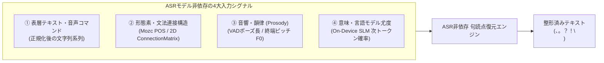
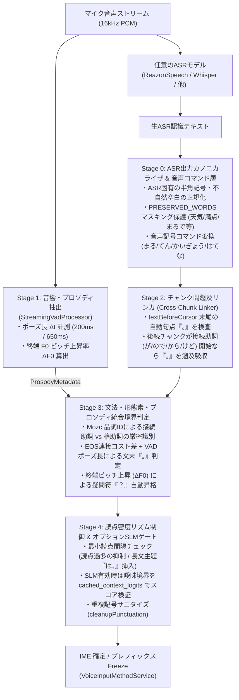

# ASRモデル非依存の自動句読点挿入アーキテクチャ・アイデア提案書
(ASR-Model-Agnostic Automatic Punctuation Restoration: Ideas & System Design)

## 1. 背景と課題 (Background & Problem Statement)

音声認識（ASR）を用いたテキスト入力において、適切な句読点（「、」「。」「？」「！」および改行）の自動挿入は、出力テキストの可読性と入力効率を決定づける最重要要素の一つです。しかし、ASRモデルの種類やアーキテクチャによって出力特性は大きく異なります。

| ASRモデル種別 | 代表例 | 出力テキストの句読点特性と課題 |
| :--- | :--- | :--- |
| **CTC / RNN-T / Transducer 系** | ReazonSpeech (`k2-v2` Zipformer), Kaldi, Vosk | 原則として**句読点を一切出力しない**（平仮名・漢字・片仮名の連続文字列のみ）。後処理なしでは長文がベタ書きになる。 |
| **Seq2Seq / Encoder-Decoder 系** | Whisper, Kotoba-Whisper, SenseVoice | 学習コーパス由来の句読点を出力するが、**表記揺れ**（半角 `,` `.`、全角 `，` `．`、スペース区切り）や、短文での句点欠落・幻覚（`...` の連発）が頻発し、制御が困難。 |
| **OS標準 / クラウドストリーミングAPI** | Android `SpeechRecognizer`, Cloud Speech | ポーズ位置に空白のみを挿入するものや、文脈を無視して息継ぎごとに機械的に読点・句点を打つものが混在する。 |

### 本設計の目的
いかなるASRモデル（句読点を全く出さないモデル、不安定な句読点を出すモデル、将来差し替えられる新規モデル）が前段に配置されても、**100%一貫した品質・低遅延（サブミリ秒〜数ミリ秒）・誤変換ゼロ（偽陽性ゼロ）で自然な日本語句読点を自動挿入する「ASRモデル非依存（ASR-Agnostic）句読点復元パイプライン」**のアイデアを体系化し、JotInputの既存資産（[`JapanesePunctuationEngine`](app/src/main/java/com/example/myasr/JapanesePunctuationEngine.kt)、[`StreamingVadProcessor`](app/src/main/java/com/example/myasr/StreamingVadProcessor.kt)、[`ConnectionMatrix`](app/src/main/java/com/example/myasr/ConnectionMatrix.kt)、[`LlmReranker`](app/src/main/java/com/example/myasr/LlmReranker.kt)）を最大限に活かした設計を定義します。

---

## 2. ASRモデルに依存せず利用できる「4つの普遍的シグナル」

ASRモデルの内部実装（デコーダ構造や語彙トークン）に依存せず、任意の音声入力IMEパイプラインで普遍的に取得・活用できるシグナルは以下の4つに分類されます。



1. **表層テキスト・音声記号コマンドシグナル (Surface & Explicit Command Signal)**:
   - ユーザーが明示的に発声した「まる」「てん」「かいぎょう」「はてな」や、定型挨拶・終止形語尾。
2. **形態素・品詞連接コストシグナル (Morphological & Syntactic Signal)**:
   - 文節境界、活用形（終止形 vs 連用形中止法 vs 連体形）、助詞の品詞細分類（接続助詞「から」vs 格助詞「から」）、および文末（`EOS`）連接コスト。
3. **音響・韻律シグナル (Acoustic & Prosodic Signal)**:
   - マイク入力（PCM音声）とVADから直接得られる**無音ポーズ長（$\Delta t_{\text{pause}}$）**、**文末の基本周波数（$F_0$）の上昇/下降イントネーション**、**語尾エネルギー減衰**。これらはASRモデルを通さず音響層から直接抽出できるため、完全にASR非依存です。
4. **文脈・因果言語モデル尤度シグナル (Semantic & Causal LM Signal)**:
   - オンデバイスSLM（`llama.cpp` / Qwen2.5）による、境界候補位置での句読点トークン生成確率 $P(\text{`、`}, \text{`。`}, \text{`？`} \mid \text{Context})$。

---

## 3. 自動句読点挿入の6つのコア・アイデア

### アイデア 1: ASR出力の正規化（カノニカライザ）＋ 形態素・連接行列駆動の文法境界エンジン
*(Zero-Latency Morphological & Mozc ConnectionMatrix Engine)*

#### 概要
前段のASRモデルがどのようなテキストを出力しても、まず「句読点カノニカライザ」で半角記号や不自然な空白・重複記号を一度クリーンな状態に正規化した上で、JotInputにバンドルされている **Mozc 2次元品詞連接コスト行列（`connection_data.bin`, $2672 \times 2672$）** と形態素ラティスを用いて文法的に正確な句読点位置を決定します。

#### 技術的仕組み
1. **ASR出力の事前正規化（Pre-Normalization）**:
   - Whisper等が勝手に出力した半角 `,` `.` や全角 `，` `．`、ピリオド連打 `...`、日本語文字間の不要スペースを正規化・除去し、全ASRモデルの出力を同一のクリーンな文字列空間に揃えます。
   - 音声記号コマンド（「まる」「くてん」「てん」「とうてん」「かいぎょう」等）を、保護語彙リスト（`PRESERVED_WORDS`: 天気、満点、交差点、まるで、日の丸等）でガードしつつ最優先で確定します。
2. **品詞ID（POS ID）による同形助詞の厳密な識別**:
   - 表層文字列だけでは区別が難しい「〜から」「〜で」「〜と」「〜し」を、形態素解析の品詞IDで判定します。
   - 例: 「東京**から**出発します」（格助詞 $\to$ 読点なし） vs 「雨が降る**から**出発を見合わせます」（用言＋接続助詞 $\to$ `雨が降るから、`）。
   - 例: 「検討**し**報告します」（サ変連用形中止法 $\to$ `検討し、報告します。`） vs 「新しい**し**綺麗です」（接続助詞「し」 $\to$ `新しいし、綺麗です。`）。
3. **`EOS`（文末）連接コスト差による文境界スコアリング**:
   - 連続発話中で句点「。」を入れるべきか否かを、直前形態素 $m_i$ の右文脈IDと文末（`EOS`, ID=0）との連接コスト、および次形態素 $m_{i+1}$ との直接連接コストの対数オッズ差 $\Delta C_{\text{EOS}}$ で判定します：
     $$\Delta C_{\text{EOS}}(i) = \text{ConnCost}(m_i.\text{rightId}, m_{i+1}.\text{leftId}) - \Big(\text{ConnCost}(m_i.\text{rightId}, \text{EOS}) + \text{ConnCost}(\text{BOS}, m_{i+1}.\text{leftId})\Big)$$
   - $\Delta C_{\text{EOS}}(i)$ が正に大きい箇所は、「文を一度切って新しい文を開始した方が文法的に自然である」ことを意味し、正規表現の網から漏れる多様な終止表現（形容詞終止、助動詞複合形など）にも汎用的に「。」を挿入できます。

---

### アイデア 2: 音響・プロソディ（VADポーズ長・終端ピッチ $F_0$）とのマルチモーダル融合
*(Acoustic-Prosodic & Pitch Contour Fusion)*

#### 概要
テキスト情報だけでは原理的に解けない2つの問題があります：
1. **「明日の予定は10時です？」vs「明日の予定は10時です。」**（語尾が同じでイントネーションのみで疑問を表す発話、または「本当？」「もう帰るの？」のような終助詞「か」を伴わない疑問文）
2. **「体言止め（名詞終了の文末）」vs「発話途中の息継ぎ」**

マイクPCM波形と [`StreamingVadProcessor`](app/src/main/java/com/example/myasr/StreamingVadProcessor.kt) はASRモデルとは完全に独立して動作するため、音響特徴量を直接句読点エンジンへ渡すことでこれらを解決できます。

#### 技術的仕組み
1. **VADポーズ長の階層的マッピング (Pause Duration Tiering)**:
   - 音声チャンク境界の無音継続時間 $\Delta t_{\text{pause}}$ を句読点エンジンにメタデータとして付与します。
   - **Tier 0 ($\Delta t_{\text{pause}} < 120\text{ms}$)**: 促音（「っ」）の閉鎖区間または単語内遷移 $\to$ 句読点挿入を禁止。
   - **Tier 1 ($150\text{ms} \le \Delta t_{\text{pause}} < 450\text{ms}$, マイクロポーズ)**: 息継ぎ境界 $\to$ 直前が接続助詞・連用形・副詞・主題助詞（「〜は」で長文節の後）である場合に「、」を挿入。一方、格助詞（「〜を」「〜の」「〜に」）直後の短い息継ぎでは読点を抑制し、細切れ文になるのを防ぎます。
   - **Tier 2 ($\Delta t_{\text{pause}} \ge 500\text{ms}$, フルポーズ)**: 文完結境界 $\to$ 終止形だけでなく、名詞終了（体言止め、例: `本日の議題は以上` + 650ms無音）や挨拶表現にも自信を持って句点「。」または改行を付与。
2. **終端ピッチ勾配（$\Delta F_0$）による疑問符「？」の自動付与**:
   - 有声チャンク末尾の最後の有声区間（約 $150\text{〜}250\text{ms}$）に対し、軽量な時間領域ピッチ推定（YIN または正規化相互相関法、計算時間 $< 0.2\text{ms}$）を実行します。
   - 末尾に向かって基本周波数 $F_0$ が急上昇（例: $\Delta F_0 \ge +3.5\text{ semitones}$ かつ末尾モーラ伸長あり）している場合、かつ文末が疑問詞（「何」「どこ」「いつ」「どう」等）を含むか終助詞（「か」「の」「ね」「かな」）または体言である場合に、句点「。」の代わりに**疑問符「？」**へ自動昇格させます。

---

### アイデア 3: オンデバイス SLM (`llama.cpp`) の次トークン対数尤度プロービング
*(Zero-Shot Causal SLM Logit Probing via Cached Context Logits)*

#### 概要
JotInputには既に `llama.cpp` ベースのオンデバイス因果言語モデル（[`LlmReranker`](app/src/main/java/com/example/myasr/LlmReranker.kt) / Qwen2.5-0.5B・1.5B）と、高速なKVキャッシュ巻き戻し機構（`llama_memory_seq_rm()` および `cached_context_logits_`）が統合されています。このSLMを「句読点オラクル」として活用します。

#### 技術的仕組み
1. **ゼロ追加フォワードパスの境界ロジット参照**:
   - 文脈テキスト $w_{1:i}$ をSLMに評価させた直後の出力ロジットベクトル $\mathbf{z}_i \in \mathbb{R}^{|V|}$ から、以下の4つのトークン（集合）の条件付き確率を直接比較します：
     $$P(\text{`、`}\mid w_{1:i}), \quad P(\text{`。`}\mid w_{1:i}), \quad P(\text{`？`}\mid w_{1:i}), \quad P(\text{句読点なし（次単語トークン）}\mid w_{1:i})$$
   - これにより、ルールベースでは判定が難しい**長い連体修飾節の境界**（例: `昨日私が会議で提案した新しいプロジェクトの計画書を` $\to$ `昨日私が会議で提案した、新しいプロジェクトの計画書を`）や**文脈依存の読点**を、SLMの言語事前分布によって自然に挿入できます。
2. **2トークン先読み双方向スコアリング (Lookahead Log-Likelihood Comparison)**:
   - 後続チャンクのテキスト $w_{i+1:k}$ が既に得られている場合（連続発話時）、境界候補位置に $p \in \{\emptyset, \text{`、`}, \text{`。`}\}$ を仮挿入した3パターンの対数尤度をKVキャッシュ分岐で比較します：
     $$p^* = \arg\max_{p \in \{\emptyset, \text{`、`}, \text{`。`}\}} \left[ \log P_{\text{SLM}}(p \mid w_{1:i}) + \log P_{\text{SLM}}(w_{i+1:k} \mid w_{1:i}, p) - \lambda_p \right]$$
   - ここで $\lambda_p$ は過剰な句読点挿入を抑えるしきい値マージン（バイアス項）です。候補箇所を形態素境界の2〜3箇所に絞ることで、わずか数ミリ秒のレイテンシで高精度な文脈判断が可能になります。

---

### アイデア 4: ストリーミング・チャンク間の遡及的境界リライト（Retroactive Boundary Splice）
*(Cross-Chunk Retroactive Upgrade & Downgrade via `textBeforeCursor`)*

#### 概要
ポーズなし即時確定（マイクロポーズ $\le 200\text{ms}$ や $2400\text{ms}$ ペーシング確定）を行うストリーミング音声入力では、**1つの文が複数の音声チャンクに分割されて順次コミットされる**ことが頻繁に起きます。チャンク単体だけを見て句読点を打つと、以下のような不整合が発生します：
- **過早句点（Premature Period）**: チャンク1が「確認しました」で終わり `確認しました。` とコミットされた直後、ユーザーがチャンク2で「がまだ課題があります」と続けた場合、そのまま連結すると `確認しました。が、まだ課題があります。` という不自然な文頭「。が」になってしまう。
- **不完全節での句読点欠落**: チャンク1が「明日は雨が降る」で終わり（終止形だが連体修飾の可能性もあるため保留）、チャンク2が「ので傘を持っていきます」と続いた場合、チャンク結合部で初めて「降るので、」という従属節境界が成立する。

#### 技術的仕組み
1. **`InputConnection.getTextBeforeCursor()` を用いたクロスチャンク結合判定**:
   - 新しいチャンク $C_{\text{new}}$ を整形する際、カーソル直前の確定済みテキスト $T_{\text{prev}}$（末尾15文字程度）を取得します。
2. **後続接続助詞による遡及的句点ダウングレード（Retroactive Period-to-Null / Comma Rewrite）**:
   - $T_{\text{prev}}$ が自動付与された `。` で終わっており、かつ直後の $C_{\text{new}}$ が**付属語・接続助詞・引用助詞**（「が」「ので」「から」「けれど」「けれども」「し」「と」「という」「ため」「よう」等）で始まる場合：
   - `InputConnection.deleteSurroundingText(1, 0)` で直前の `。` を遡及削除し、`$T_{\text{prev}}$（句点除去） + $C_{\text{new}}$` として再結合した上で句読点ルールを再適用します。
   - 例:
     - Chunk 1 コミット時: `確認しました。`
     - Chunk 2 (`が修正が必要です`) 到着時: 直前の `。` を吸収し $\to$ `確認しましたが、修正が必要です。` へシームレスに修復！
3. **跨ぎ形態素の結合評価**:
   - Chunk 1 末尾が動詞終止形（`降る`）で Chunk 2 先頭が `ので` の場合、結合文字列 `降るので` に対して従属節読点ルールを発火させ、`降るので、` を生成します。

---

### アイデア 5: 読点密度・文節距離予算モデル（Comma Spacing & Syntactic Depth Budget）
*(Anti-Overpunctuation Budget & Rhythm Control)*

#### 概要
接続助詞や接続詞ごとに無条件で読点「、」を挿入すると、「しかし、明日は、雨が降るので、私は、傘を、持参します。」のように**読点過多（チョッピーな悪文）**になりがちです。逆に長すぎる文では、接続助詞がなくても息継ぎ位置に読点が必要です。

#### 技術的仕組み
1. **最小読点間隔（Minimum Inter-Comma Distance $D_{\min}$）制約**:
   - 直前の句読点（「、」「。」または文頭）からの経過文字数 $d_{\text{chars}}$（またはモーラ数 $d_{\text{moras}}$）を追跡します。
   - **文頭接続詞の例外**: 文頭の「しかし、」「また、」「まず、」等は $d_{\text{chars}}$ に関わらず許容。
   - **文中の従属節読点**: 直前の読点から $d_{\text{chars}} < 6$ 文字（例: `雨が降るので、寒いので、帰ります` の2つ目）のように極端に接近している場合は、強いポーズ（$\Delta t_{\text{pause}} \ge 250\text{ms}$）がない限り2つ目の読点を抑制します。
2. **長文節の主題助詞「は」・連用中止への読点解禁（Long-Span Breathing Comma）**:
   - 直前の句読点から $d_{\text{chars}} \ge 18$ 文字以上読点が打たれていない長文状態に入った場合、通常は読点を打たない主題助詞「〜は」や複合助詞「〜については」「〜においては」「〜に関して」の直後に読点挿入を解禁し、一文の視覚的リズムを整えます。

---

### アイデア 6: 超軽量 ONNX トークン分類器（Sequence Tagging Model）のオンデマンド追加オプション
*(Optional Lightweight BiLSTM / Transformer Sequence Tagger)*

#### 概要
将来さらなる高精度化（特に話し言葉の複雑な倒置やフィラー除去後の文境界復元）を目指す場合の拡張オプションとして、テキストとポーズ長を入力とする超軽量な系列ラベリングモデル（INT8量子化 ONNX、サイズ $3\text{〜}8\text{MB}$）をオンデマンドダウンロード資産として構成するアイデアです。

- **入力**: 文字（またはサブワード）ID列 $x_1, \dots, x_n$ ＋ 各文字境界の量子化ポーズ長バケット $b_1, \dots, b_n \in \{0, 1, 2, 3\}$
- **出力**: 各位置の句読点ラベル $y_t \in \{\text{`NONE`}, \text{`、`}, \text{`。`}, \text{`？`}, \text{`\n`}\}$
- **JotInput ポリシーとの整合性**:
  - 「モデル＆辞書デカップリング契約（APK内へのモデル同梱禁止）」に従い、APKには一切同梱せず、必要な場合のみ外部ストレージからロードするプラグイン型として設計します。
  - ただし、JotInputには既に **Mozc 連接コスト行列（アイデア1）** と **オンデバイスSLM（アイデア3）** が存在するため、まずは新規モデルを増やさず既存資産の組み合わせ（アイデア1＋2＋3＋4＋5）で実装するのがメモリ・保守性の両面で最も合理的です。

---

## 4. 各アイデアの比較評価マトリクス

| アイデア | 追加メモリ / APKサイズ影響 | 推論レイテンシ | ASR非依存性 | 解決できる主な課題 | 実装優先度 |
| :--- | :---: | :---: | :---: | :--- | :---: |
| **1. 正規化 + Mozc品詞・連接行列** | **0 MB** (既存資産) | **$< 0.3\text{ms}$** | ◎ 完全非依存 | ASRごとの記号揺れ吸収、「から/で」の格助詞・接続助詞識別、多様な文末の句点判定 | **P0 (最優先)** |
| **2. 音響・VADポーズ長 & ピッチ $F_0$** | **0 MB** (PCM直接解析) | **$< 0.2\text{ms}$** | ◎ 完全非依存 | 語尾上げ疑問文への「？」自動付与、体言止め文末の句点確定、不要な息継ぎ読点の抑制 | **P0 (最優先)** |
| **3. チャンク間遡及リライト (`textBeforeCursor`)** | **0 MB** | **$< 0.1\text{ms}$** | ◎ 完全非依存 | ポーズなし逐次確定時の「確認しました。が、〜」等のチャンク跨ぎ文分断の自動修復 | **P0 (最優先)** |
| **4. 読点密度・文節距離予算制御** | **0 MB** | **$< 0.05\text{ms}$** | ◎ 完全非依存 | 短文での読点過多（チョッピー化）防止と、長文での主題「〜は、」への自然な読点付与 | **P1 (高)** |
| **5. オンデバイスSLM ロジットプロービング** | **0 MB** (既存SLM共有) | **$1\text{〜}5\text{ms}$** (KVキャッシュ活用) | ◎ 完全非依存 | 長い連体修飾節や意味的曖昧境界における文脈考慮の読点・句点挿入 | **P1 (高 / SLM有効時)** |
| **6. 専用軽量ONNX系列ラベリングモデル** | 3〜8 MB (外部DL必須) | $2\text{〜}8\text{ms}$ | ◎ 完全非依存 | 話し言葉特有の崩れた構文・倒置文への統計的句読点復元 | **P2 (将来拡張)** |

---

## 5. 推奨統合アーキテクチャ：5段階ハイブリッド・カスケード設計

JotInputのトップライン非リグレッション契約（[`JapanesePunctuationEvaluationTest`](app/src/test/java/com/example/myasr/JapanesePunctuationEvaluationTest.kt) 100%パス、語彙保護の完全維持、マイクロポーズ $\le 200\text{ms}$・連続ペーシング $\le 2400\text{ms}$ の即時確定レイテンシ厳守）を満たしつつ、任意のASRモデルに対応する推奨パイプラインは以下の5段階カスケードです。



### 各ステージのインターフェース設計案

```kotlin
/**
 * ASRモデルに依存しない音響・プロソディ境界メタデータ
 */
data class ProsodyBoundaryMetadata(
    val trailingPauseMs: Long = 0L,          // チャンク末尾の無音ポーズ長 (ms)
    val isPacingForcedFlush: Boolean = false, // 2400ms連続発話ペーシングによる強制分割か
    val terminalPitchSlopeSemitones: Float = 0f, // 末尾200msのF0ピッチ変化量 (半音単位)
    val precedingCommittedTail: String = ""  // カーソル直前の確定済みテキスト末尾
)

/**
 * チャンク間遡及書き換えを含む句読点整形結果
 */
data class PunctuationFormatResult(
    val deletePrecedingChars: Int = 0, // 直前チャンク末尾の「。」等を遡及削除する文字数
    val formattedText: String          // 挿入する整形済みテキスト
)
```

### 具体動作シミュレーション例

1. **ケースA：音声コマンドと保護語彙が混在する発話（全ASRモデル共通）**
   - ASR出力: `"明日の天気は晴れです まる テストで10点満点を取りました"`
   - Stage 0: `天気`、`10点`、`満点` を保護マスクした上で `まる` $\to$ `。` に変換し、文末 `ました` に `。` を付与。
   - 出力: `"明日の天気は晴れです。テストで10点満点を取りました。"`

2. **ケースB：ポーズなし即時確定で文が2チャンクに跨った発話（Retroactive Linker）**
   - Chunk 1 (`"資料を確認しました"`, $\Delta t_{\text{pause}} = 200\text{ms}$):
     - 一旦 `"資料を確認しました。"` として入力欄へ即時コミット（ユーザーを待たせない）。
   - Chunk 2 (`"が一部修正が必要です"`, 直後に発話継続):
     - Stage 2 が `precedingCommittedTail = "資料を確認しました。"` と先頭付属語 `"が"` を検知。
     - `deletePrecedingChars = 1`（直前の `。` を削除）を発行し、結合文として `"が、一部修正が必要です。"` をコミット。
     - 入力欄の最終結果: `"資料を確認しましたが、一部修正が必要です。"`

3. **ケースC：終助詞「か」を伴わない語尾上げ疑問文（Acoustic-Prosodic Fusion）**
   - Chunk (`"明日の会議は10時からですね"`, $\Delta F_0 = +4.2\text{ semitones}$):
   - テキスト単体では「ですね。」と平叙文になり得るが、Stage 1 の終端ピッチ急上昇シグナルにより Stage 3 が疑問文と判定。
   - 出力: `"明日の会議は10時からですね？"`

---

## 6. まとめと段階的導入ロードマップ

本ドキュメントで提案したアーキテクチャにより、前段のASRエンジンが ReazonSpeech（句読点なし）であっても、Whisper系（句読点揺れあり）であっても、一切のモデル固有チューニングを必要とせず、統一された高品質な日本語句読点挿入が実現できます。

- **Phase 1 (即時導入可能・純粋テキスト＆履歴連携)**:
  - Stage 0 の ASR出力カノニカライザ強化（不規則な半角記号・スペースの正規化）と、Stage 2 の `textBeforeCursor` を用いたチャンク間遡及句点リライト（`確認しました。` + `が...` $\to$ `確認しましたが、...`）の導入。
- **Phase 2 (形態素・音響プロソディ統合)**:
  - `ProsodyBoundaryMetadata` を `StreamingVadProcessor` から [`JapanesePunctuationEngine`](app/src/main/java/com/example/myasr/JapanesePunctuationEngine.kt) へ接続し、ポーズ長連動の読点密度制御（Stage 4）および終端ピッチ $F_0$ による疑問符自動判定を導入。
- **Phase 3 (Mozc連接行列 & SLMロジット連携)**:
  - 長文連続発話における曖昧な節境界に対し、Mozc `ConnectionMatrix` の `EOS` コスト差および `LlmReranker` のキャッシュ済みロジットを用いた文脈句読点スコアリングを統合。
