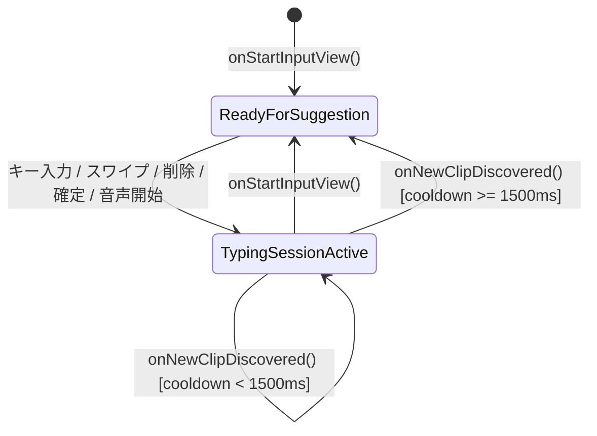

# PRD & DD: クリップボード履歴＆新鮮クリップ候補表示（ホリスティック表示タイミング設計）

## 1. PRD (Product Requirements Document)

### 1.1 背景と課題
JotInput には、クリップボードを活用するための 2 つの UI 導線が存在する：
1. **ヘッダーの履歴パネルボタン (`btnHeaderClipboard`: `📋`)**:
   - タップするとキーボード領域にインプレースでクリップボード履歴パネル（`ClipboardHistoryView`、最大 30 件・60 分 TTL ＋ 現在の OS プライマリクリップ例外保持）を展開する。いつでもオンデマンドで利用可能。
2. **候補バー (`CandidateStripView`) の新鮮クリップボード候補チップ (`clipboard_recent`)**:
   - 直近 60 秒以内にコピーされた新鮮なテキストがある場合、候補バーに `[📋 テキスト…]` ピルを提示し、1 タップで貼り付けできるようにするプロアクティブなショートカット。

**課題（タイプ中への割り込み）**:
- 従来の実装では、文節確定や候補選択の直後に呼ばれる `showNextPhrasePredictions()` が、無条件に `fastPredictions` の先頭（index 0）へ `clipboard_recent` を挿入していた。
- その結果、ユーザーが日本語の文章を入力している最中（「タイプ中」）に、1 文節を確定するたびに候補バーの先頭へクリップボード候補が割り込み、本来の次句予測（「。」「、」「が」「を」や文脈予測）を押し退けてしまい、極めて使いにくくなっていた。
- また、QWERTY（英語）モードでは `arbitrator.isKeyboardComposing()` が `false`（直接コミット方式）であるため、バックグラウンドのポーリング等で `onHistoryChanged` が発火した際に `checkAndRenderClipboardSuggestion()` が英語の入力中状態を検知できず、候補バーを上書きし得る構造になっていた。
- さらに、`showNextPhrasePredictions()` の経路で `clipboard_recent` が SLM リランキング対象に混入する不整合も存在した。

### 1.2 ホリスティック設計原則：いつ新鮮なクリップボードを表示すべきか

候補バーは限られた 1 行の領域であり、「変換・予測・スペル補正」という**タイピング中の主要タスク**と「貼り付け」という**補助タスク**が空間を共有する。ユーザー体験を最大化するため、以下の 4 原則を定める：

1. **原則 1 —「入力の開始点（Idle Entry）」でプロアクティブに提示する**:
   - ユーザーが他アプリやブラウザでテキストをコピーし、入力欄をタップしてキーボードを開いた瞬間（`onStartInputView`）は、これから貼り付けたい可能性が最も高い。この「まだ 1 文字もタイプしていない初期状態」では、候補バーに新鮮なクリップボードチップを即座に表示する。
2. **原則 2 —「タイプ中（Active Typing Session）」には絶対に表示しない**:
   - ユーザーが 1 文字でもキー入力・スワイプ・削除・確定・スペース・カーソル移動・音声入力を開始したら、そのセッションは「タイプ中」とみなす。
   - タイプ中は、文字入力中・変換候補表示中・**確定直後の次句予測表示中（`showNextPhrasePredictions`）**・英語スペル/GEC 候補表示中・数字/記号入力中・音声録音/デコード中のいずれであっても、候補バーに `clipboard_recent` を表示・挿入しない。
   - タイプ中にクリップボードを使いたくなった場合は、ヘッダー右端に常設された `📋` ボタンから 1 タップで履歴パネルを開けるため、候補バーは純粋に変換・予測専用として振る舞う。
3. **原則 3 — キーボード表示中の「新規コピー」は完全アイドル時のみ提示する**:
   - キーボードを開いたまま同じ画面内でテキストを新しくコピーした場合（`onNewClipDiscovered`）、現在タイプ中でなく（未確定文字なし・音声アイドル・非クリップ候補表示なし）、かつ直近のキー操作から十分なクールダウン（1500ms 以上）が経過している完全アイドル状態に限り、新規クリップチップを提示してよい。
4. **原則 4 — 貼付済み抑止とプロセス再起動耐性**:
   - 候補チップまたは履歴パネルから貼り付けられたアイテムは `dismissedFromStrip = true` として再提示を抑止する。
   - プロセス再起動時のディスク復元（`loadFromDisk`）では、既に保存済みの OS プライマリクリップを「新規コピー」と誤認して `discoveredAtMs` を現在時刻にリセットしない。

### 1.3 要求仕様 (Requirements)
- **FR-1**: 新鮮なクリップ（発見から `60秒` 以内、かつ `dismissedFromStrip == false`）は、`onStartInputView` 時にタイピングセッションが未開始の場合に限り候補バーに表示する。
- **FR-2**: `showNextPhrasePredictions()` には `clipboard_recent` を一切挿入せず、SLM リランキング対象にも含めない。
- **FR-3**: フリック入力、QWERTY 英語入力、FUTO スワイプ、数字・記号入力、音声入力、削除・確定・スペース・カーソル移動・アンドゥのいずれの操作中も、新鮮なクリップボードチップを候補バーに表示しない。
- **FR-4**: キーボード表示中に新規コピーが検知された場合、完全アイドル状態かつクールダウン（1500ms）経過後のみ表示を許可する。
- **FR-5**: ヘッダー右端の `btnHeaderClipboard`（`📋`）による 60 分 TTL 履歴パネルは、タイプ中・アイドル中を問わず常時 1 タップで利用可能とする。
- **FR-6**: 既存の句読点・音声境界回帰テスト（`JapanesePunctuationEvaluationTest`）を含む全単体テストが 100% パスすること。

---

## 2. DD (Design Document)

### 2.1 UI・レイアウト仕様

#### 2.1.1 ヘッダーボタン (`btnHeaderClipboard`)
- **配置**: `keyboardHeader` の右端（辞書ショートカット `btnHeaderDict` の右隣）
- **表示**: `📋` アイコンボタン（タップで `ClipboardHistoryView` をインプレース開閉）

#### 2.1.2 候補バーチップ (`CandidateStripView` 内の `clipboard_recent`)
- **表示形式 (`ClipboardUtils.formatCandidateChipPreview`)**:
  - 改行・連続空白を半角スペース 1 文字に正規化し、先頭 `14文字` ＋ `…` で省略（例: `📋 https://exampl…`）。
- **外観**: `@drawable/bg_candidate_pill`（他候補と統一された Gboard スタイルピル）。

#### 2.1.3 履歴パネル (`ClipboardHistoryView`)
- **保持ポリシー (`ClipboardHistoryRepository`)**:
  - `HISTORY_TTL_MS = 60分`（過去のクリップ）
  - `CANDIDATE_SUGGEST_TTL_MS = 60秒`（候補バーチップの鮮度上限）
  - `MAX_HISTORY_ITEMS = 30件`
  - **例外ルール**: 現在の OS プライマリクリップと一致するテキストは 60 分経過後も無期限保持（`"現在のクリップ"` ラベル表示）。
- **機密クリップ保護**: `ClipDescription.EXTRA_IS_SENSITIVE` が `true` のクリップは履歴・候補のいずれにも記録しない。

---

### 2.2 表示タイミング状態マシン (`ClipboardSuggestionPolicy`)

候補バーへの `clipboard_recent` 表示可否を一元管理するため、純粋 Kotlin クラス `ClipboardSuggestionPolicy` を導入する。

#### 2.2.1 判定条件 (`shouldShowSuggestion`)
以下の**すべて**を満たす場合のみ `true` を返す：
1. `isInputViewShown == true`（キーボード表示中）
2. `isVoiceIdle == true`（`State.IDLE`：録音中・デコード中でない）
3. `!isClipboardHistoryShowing`（履歴パネルが閉じている）
4. `!isKeyboardComposing`（かな漢字変換の未確定文字がない）
5. `!isStreamingComposing`（音声ストリーミングの未確定文字がない）
6. `!isTypingSessionActive`（この入力セッションでまだタイピング・操作を開始していない）
7. `!hasActiveNonClipboardCandidates`（候補バーに通常の変換・予測・英語スペル・スワイプ候補が表示されていない）

#### 2.2.2 状態遷移イベント
- **`onStartInputView()`**:
  - `isTypingSessionActive = false` にリセットし、入力欄を開いた直後の「アイドル起点」としてフレッシュなクリップの提示を許可する。
- **`onUserTypingOrVoiceAction(nowUptimeMs)`**:
  - `isTypingSessionActive = true`、`lastTypingActionUptimeMs = nowUptimeMs` を記録。
  - 呼び出し元：`onTextChar`（カナ/QWERTY/数字/記号）、`onModifierPressed`、`onDeletePressed`、`onSpacePressed`、`onEnterPressed`、`onCursorLeft`、`onCursorRight`、`onUndoPressed`、`onSwipeInput`、`onCandidateClick`（非クリップ候補）、`startListening`。
- **`onNewClipDiscovered(nowUptimeMs)`**:
  - `nowUptimeMs - lastTypingActionUptimeMs >= TYPING_COOLDOWN_MS (1500ms)` の場合のみ `isTypingSessionActive = false` に戻す。タイプ直後の場合は `isTypingSessionActive = true` を維持し、タイピングを妨害しない。

---

### 2.3 コンポーネント変更詳細

1. **`ClipboardSuggestionPolicy.kt` (新規)**:
   - 上記の状態保持・遷移・`shouldShowSuggestion()` 判定ロジックを実装。Android 依存を排除し、単体テスト可能とする。
2. **`ClipboardHistoryRepository.kt`**:
   - `onHistoryChanged: ((hasNewClip: Boolean) -> Unit)?` へシグネチャを更新し、新規/再コピー発生時（`hasNewClip = true`）と TTL 期限切れ/削除時（`hasNewClip = false`）を区別して通知する。
   - `loadFromDisk()` で先頭アイテムが現在の OS プライマリクリップと一致する場合、`lastObservedTextHash` と `lastObservedClipTimestamp` を復元してプロセス再起動時の誤った鮮度リセットを防止する。
3. **`VoiceInputMethodService.kt`**:
   - `clipboardSuggestionPolicy` インスタンスを保持。
   - `showNextPhrasePredictions()` から `clipboard_recent` 挿入ロジックおよび `checkAndRenderClipboardSuggestion()` フォールバックを完全に削除。
   - `onStartInputView`、各種キー/音声操作、`onHistoryChanged` へポリシー呼び出しを統合。
   - `checkAndRenderClipboardSuggestion()` 内で `clipboardSuggestionPolicy.shouldShowSuggestion(...)` を検証し、条件を満たさない場合は何もしない（既に `clipboard_recent` が表示中で期限切れになった場合のみクリアする）。
   - `pasteTextFromHistory()` 実行時に、対象テキストが直近のサジェスト候補と一致する場合は `markDismissedFromStrip` を呼び出す。

---

### 2.4 テスト・検証戦略

1. **単体テスト (`ClipboardSuggestionPolicyTest.kt`, `ClipboardHistoryRepositoryTest.kt`)**:
   - `onStartInputView` 直後は表示許可されること。
   - 日本語フリック入力・確定後の次句予測（タイプ中）で表示されないこと。
   - QWERTY 英語入力中・スペース後で表示されないこと。
   - 音声録音中・デコード中で表示されないこと。
   - 非クリップ候補表示中に上書きされないこと。
   - キーボード表示中の新規コピーはクールダウン（1500ms）経過後かつ完全アイドル時のみ許可されること。
2. **回帰テスト**:
   - `./gradlew testDebugUnitTest`（`JapanesePunctuationEvaluationTest` 含む全テスト 100% パス）。
3. **実機デュアルデプロイ検証 (`./deploy.sh`)**:
   - Pixel 10 Pro および ARCVM にデプロイし、コピー直後のキーボード起動時表示と、タイプ中の非割り込み動作を確認。
