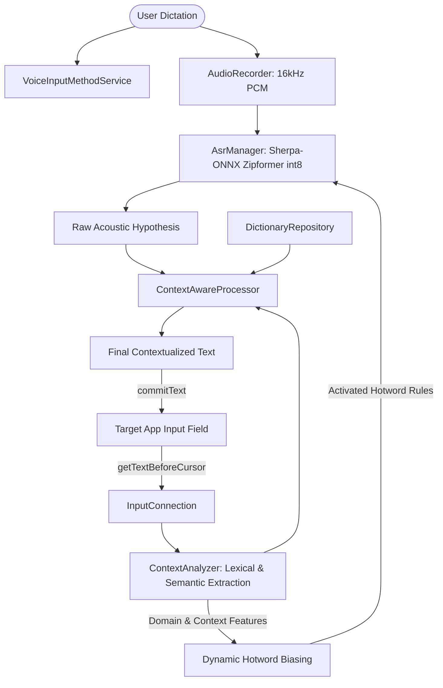

# Context-Aware Speech Recognition & Keyboard Enhancement Plan

This document details the architectural design, implementation plan, and dedicated evaluation framework for **Context-Aware Speech Recognition** in JotInput.

---

## 1. 🎯 Objectives & Motivation

In traditional ASR keyboards, recognition runs in isolation: each spoken utterance is decoded as if it were the very first sentence ever uttered. However, in real-world usage, speech input is almost always part of an ongoing conversation or document:
- An email reply: *"お世話になっております。先日の件ですが、[speech input]"*
- A code review on Slack: *"PR #42のTypeScriptのリファクタについて、[speech input]"*
- A note about a colleague: *"プロジェクトリーダーの渡邊さんと打ち合わせを行い、[speech input]"*

By leveraging Android's `InputConnection.getTextBeforeCursor(500, 0)`, JotInput can inspect the text preceding the cursor and achieve:
1. **Kanji Variant & Person Name Resolution**: Disambiguating acoustic ties (e.g. `渡辺` vs. `渡邊`, `斉藤` vs. `齋藤`, `高橋` vs. `髙橋`) when the user or conversation has already established the target spelling.
2. **Contextual Homophone Disambiguation**: Selecting the correct homophone (e.g. `貴社` vs. `記者` vs. `帰社`) based on semantic topic keywords in the preceding sentences.
3. **Context-Driven Hotword Activation & Dynamic Boosting**: Automatically elevating custom dictionary terms that share semantic, lexical, or domain affinity with the surrounding text.
4. **Smart Punctuation & Clause Boundary Joining**: Formatting transitions cleanly (e.g., prepending spaces for English, commas after subordinate clauses, avoiding duplicate punctuation).

---

## 2. 🏗️ System Architecture & Data Flow

---

## 3. 🧩 Core Components to Implement

### A. Context Analyzer (`ContextAnalyzer.kt`)
Inspects up to 500 characters of `textBeforeCursor`:
1. **Topic & Entity Extraction**: Identifies keywords, entities, and mentions already in the text box.
2. **Grammar & Boundary Detection**:
   - Detects whether the preceding text ends in a complete sentence (`。`, `！`, `？`, newline), an incomplete clause (`、`, `が`, `けど`, `ので`), or mid-word.
   - Detects whether the preceding text ends in Latin/Alphanumeric script (requiring a space delimiter before English words).
3. **Contextual Affinity Scoring**:
   - Computes lexical overlap with custom dictionary entries.
   - If an entry's surface form, reading, or related keywords appear in context, marks it as **Contextually Active**.

### B. Context-Aware Processor (`ContextAwareProcessor.kt`)
Enhances post-processing beyond simple Kana string matching:
1. **Variant Disambiguation**: When an entry represents an orthographic variant (e.g. `渡邊` for reading `わたなべ`, where ASR often defaults to `渡辺`), checks if the context has established the variant. If so, normalizes the competing surface form to the preferred dictionary entry.
2. **Semantic Homophone Disambiguation**:
   - For homophones sharing identical readings (e.g. `きしゃ`), matches semantic context clues:
     - Business / Customer service cues (`お世話`, `御中`, `ご発展`, `提案`) $\rightarrow$ `貴社`
     - Journalism cues (`新聞`, `記事`, `取材`, `会見`, `週刊`) $\rightarrow$ `記者`
     - Commute / Office cues (`出張`, `会社`, `外出`, `戻り`) $\rightarrow$ `帰社`
     - Transportation cues (`蒸気`, `線路`, `乗車`) $\rightarrow$ `汽車`
3. **Smart Clause Punctuation**:
   - If the previous text has no terminal punctuation and the incoming transcription starts a new sentence, intelligently appends or formats punctuation.

---

## 4. 📊 Dedicated Evaluation Plan

### A. Context Generation for the 1,000-Utterance Benchmark
To rigorously evaluate the impact of context, we generate realistic preceding contexts for each of the 1,000 tricky benchmark sentences across all 5 categories:

1. **People Names (250 cases)**:
   - Preceding text simulates an ongoing message mentioning the person, department, or greeting (e.g. *"昨日のミーティングの件で、"* or *"営業部の渡邊リーダーに確認したところ、"*).
2. **Homophones (250 cases)**:
   - Preceding text contains realistic business, news, or daily communication context that provides semantic cues for disambiguation (e.g. for `貴社`: *"いつも大変お世話になっております。来期の契約について、"*).
3. **Place Names (150 cases)**:
   - Preceding text contains travel, transit, or appointment context (e.g. *"次の出張の行き先ですが、"* or *"小田急線で移動して、"*).
4. **Technical Terms (200 cases)**:
   - Preceding text provides software development or engineering conversation context (e.g. *"今回のモバイルアプリ開発では、"* or *"モデルの推論を高速化するために、"*).
5. **Negative Controls (150 cases)**:
   - Preceding text contains ordinary daily conversation completely unrelated to dictionary terms to verify that context does not induce false positives.

### B. Comparative Evaluation Metrics
We compare four distinct configurations on the exact same audio test set:

| Configuration | Description |
| :--- | :--- |
| **M1: Baseline** | Raw ASR without dictionary, without context |
| **M2: Current Fixed Hotwords** | Space-separated `cjkchar` FST hotwords, without context |
| **M3: Current Hybrid** | In-beam hotwords + basic phonetic post-processor, without context |
| **M4: Context-Aware Hybrid** | In-beam hotwords + Context Analyzer + Context-Aware Processor (with preceding text box context) |

**Metrics Measured**:
- **Target Word Recall Rate (TWRR)**: $\frac{\text{TP}}{\text{TP} + \text{FN}}$ overall and by category.
- **Precision**: $\frac{\text{TP}}{\text{TP} + \text{FP}}$.
- **Accuracy**: $\frac{\text{TP} + \text{TN}}{\text{Total}}$.
- **False Positive Rate (FPR)** on negative controls.
- **Disambiguation Gain**: Specific recall improvement on difficult People Name variants (`渡辺` $\rightarrow$ `渡邊`) and ambiguous Homophones (`貴社` vs. `記者`).
- **Real-Time Factor (RTF) & Latency Overhead**: Ensuring context processing overhead is $\le 2\text{ms}$.
