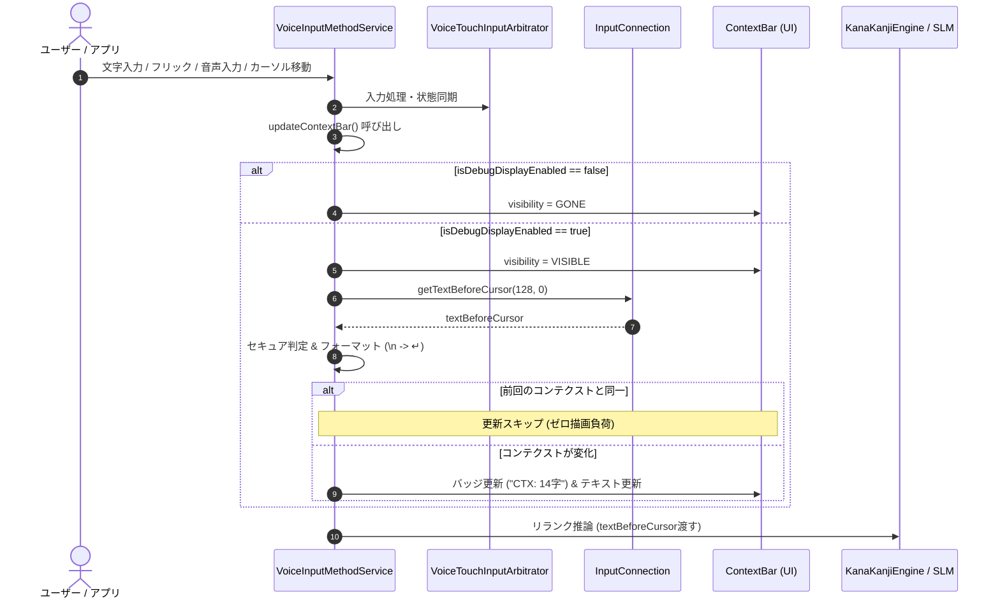

# デバッグ用「コンテクストバー (Context Bar)」システム＆UI設計仕様書

## 1. 概要 (Overview)

本設計は、JotInput の設定画面で「デバッグ表示 (`debug_display`)」が有効化（ON）されている場合に、ソフトウェアキーボードの**候補バー（`keyboardHeader`）の直上**に、リアルタイムにアクセス可能な入力文脈（Context）を可視化する「**コンテクストバー（Context Bar）**」を提供するものである。

JotInput では、以下の主要コンポーネントがアクティブな入力文脈（`InputConnection.getTextBeforeCursor` 等）を活用して高度な変換・補正・認識を行っている：
1. **オンデバイス SLM / Gemini Nano リランカー (`KanaKanjiEngine` / `LlmReranker` / `AiCoreReranker`)**:
   - カーソル直前の入力文脈を参照し、同音異義語（例: 「きしゃ」「いなか」「こうせい」等）の文脈適合度（Causal Log-Likelihood）を計算して候補順位を動的に再ランク付けする。
2. **音声認識ポストプロセッサ (`ContextAwareProcessor`)**:
   - 確定済みの前文テキストから固有名詞・ユーザー辞書語・同音異義語の手がかりを抽出し、ASR誤認識を補正する。
3. **文脈アウェア次句予測エンジン (`NextPhrasePredictor`)**:
   - 直前に確定したフレーズおよび先行文脈から、次に入力される蓋然性の高い句を推論・提示する。

開発者およびユーザーが「**現在システムがどの文脈を認識・把握して推論しているか**」を一目で把握できるようにすることで、デバッグ効率、コンテキスト連動精度の検証性、およびユーザーへの安心感を飛躍的に高める。

---

## 2. 課題と設計方針の自己レビュー (Self-Review & Decisions)

### 2.1 課題分析
1. **レイアウトと画面占有のトレードオフ**:
   - キーボードの上部に新しいバーを追加すると、全体のキーボード高さが増加し、アプリ側のコンテンツ領域（入力フォームなど）を圧迫する可能性がある。
   - 特にランドスケープ（横画面）表示時は垂直解像度が極めてタイトである。
2. **更新頻度とパフォーマンス**:
   - カーソル移動（`onUpdateSelection`）、キータッチ、文字入力・削除のたびに `getTextBeforeCursor` を呼び出すため、メインスレッドへの負荷や不要な GC（Garbage Collection）プレッシャーを回避する必要がある。
3. **視覚的認知性（UI/UX）**:
   - 単なるテキストダンプでは「どれが文脈で、どれが未確定入力か」が分からない。
   - 文脈の長さ（文字数）や、文脈が空（None）の場合のステータス表示が明瞭である必要がある。
4. **プライバシーと安全性**:
   - パスワードフィールド（`InputType.TYPE_TEXT_VARIATION_PASSWORD` 等）では、デバッグバーであっても入力内容を不用意に露出させない配慮（またはマスク表示）が望ましい。
5. **アーキテクチャ・契約遵守 (`AGENTS.md` / `GEMINI.md`)**:
   - デバッグ表示が OFF の時は `View.GONE` となり、UI・メモリ・CPUオーバヘッドを完全にゼロにする（Zero-cost abstraction when disabled）。
   - キーボードのインセット計算（`onComputeInsets`）が正しく連動し、ターゲットアプリのコンテンツが適切に押し上げられること。

### 2.2 改善策・決定事項
1. **超コンパクトな高さ設計 (Compact Density)**:
   - ポートレート時: 高さ `20dp`（文字サイズ `10.5sp`）のミニマルな 1 行バー。
   - ランドスケープ時: 高さ `16dp`（文字サイズ `9.5sp`）に自動スケール。
   - デバッグ表示 OFF 時は `View.GONE` に設定し、`0dp` として既存のキーボード配置・高さを 100% 厳密に維持。
2. **インテリジェントな文脈フォーマット**:
   - バッジ表示: `[CTX: {文字数}字]`（例: `[CTX: 14字]`、空なら `[CTX: (空)]`）。
   - 直近文脈の末尾優先表示（`ellipsize="start"`）: LLM やリランカーにとって最も重要なのは「カーソルの直前の数文字〜数十文字」であるため、長い文章の場合は左側を `...` で省略し、カーソル直前末尾を表示。
   - 改行文字（`\n`）の視覚化: 改行は `↵` 等の可視記号に置換して 1 行に収める。
3. **パスワード・セキュアフィールドの自動マスク**:
   - `EditorInfo.inputType` がパスワード関連の場合、テキストを `••••••••` とマスクし、ログや画面収録でのパスワード漏洩を防止。
4. **差分更新による描画負荷最小化**:
   - 取得した `textBeforeCursor` が前回と同一である場合は `setText` をスキップし、不要なレイアウト再計算（requestLayout）を防止。

---

## 3. UI/UX デザイン仕様 (UI Specification)

### 3.1 キーボード配置構造 (View Hierarchy)

```
[keyboardRoot] (LinearLayout, vertical)
  │
  ├── [contextBarContainer] (LinearLayout, horizontal, height: 20dp, GONE when debug OFF)
  │     ├── [tvContextBadge] (TextView: "CTX: 12字", pill-style background)
  │     ├── [tvDebugSlmBadge] (TextView: "SLM" / "n2", pill-style background, GONE when SLM unused)
  │     └── [tvContextContent] (TextView: "〜いつもお世話になっております。", ellipsize=start, singleLine=true)
  │
  ├── [keyboardHeader] (LinearLayout, horizontal, height: 36dp)
  │     ├── [btnVoiceToggle] (30dp)
  │     ├── [candidateStripView] (CandidateStripView)
  │     ├── [recordingIndicator]
  │     ├── [btnHeaderDict]
  │     └── [btnHeaderClipboard]
  │
  └── [flickKeyboardView] (Flick & QWERTY Surface)
```

### 3.2 カラー＆タイポグラフィ
- **背景 (`contextBarContainer`)**: `@color/background` または `@color/keyboard_background` と調和する透過グレー（ライト: `#E3E7EB`, ダーク: `#18191B`）。下部に 0.5dp の区切り線（Divider）。
- **バッジ (`tvContextBadge`)**:
  - 背景: 角丸 4dp ピル（`@drawable/badge_background` または専用形状）
  - 文字色: `@color/primary`（Google Blue）
  - 文字サイズ: 10sp (Bold)
- **テキスト本体 (`tvContextContent`)**:
  - 文字色: `@color/text_secondary`（中間グレー）
  - 文字サイズ: 10.5sp
  - フォント: モノスペース（`monospace`）またはサンセリフ。単一行・左側省略（`ellipsize="start"`）。

---

## 4. システムアーキテクチャ・データフロー (System Design)



---

## 5. 実装コンポーネント詳細

### 5.1 `keyboard_view.xml`
- `keyboardHeader` の直前に `contextBarContainer`（`LinearLayout`）を追加。
- デフォルトで `android:visibility="gone"`。
- 子要素として `tvContextBadge` と `tvContextContent` を配置。

### 5.2 `KeyboardHeightManager.kt`
- デバッグ表示 ON 時、キーボード全体の高さを計算する `calculateKeyboardHeightPx` にコンテクストバーの高さ（ポートレート: 20dp, ランドスケープ: 16dp）を自動加算するオプション・ロジックを提供。

### 5.3 `VoiceInputMethodService.kt`
- `updateContextBar()` メソッドを新設。
  - `KeyboardHeightManager.isDebugDisplayEnabled(this)` を判定。
  - OFF なら `contextBarContainer?.visibility = View.GONE`。
  - ON なら `contextBarContainer?.visibility = View.VISIBLE`。
  - `currentInputEditorInfo` を検査し、パスワード欄であれば `••••••` を表示。
  - `currentInputConnection?.getTextBeforeCursor(128, 0)` を取得し、改行を置換して表示。
- 呼び出しフック箇所:
  1. `onStartInputView`
  2. `onUpdateSelection`
  3. `updateCandidates` (フリック・タイピング時)
  4. `commitComposingText` (確定時)
  5. `syncKeyboardState` / `applyKeyboardDimensions`
  6. `SharedPreferences` の変更リスナー (MainActivityでデバッグ表示がトグルされた瞬間に反映)

---

## 6. テスト・検証戦略

1. **単体テスト (`DebugDisplayTest.kt`)**:
   - コンテクスト文字列のフォーマット処理（改行の可視化、最大文字数省略、パスワードマスク）のロジックテスト。
   - デバッグ表示 ON/OFF 時のプロパティ整合性。
2. **句読点・音声境界 100% 回帰テスト**:
   - `./gradlew testDebugUnitTest` で `JapanesePunctuationEvaluationTest` 含む全テスト 100% 合格確認。
3. **実機デュアルデプロイ検証 (`./deploy.sh`)**:
   - Pixel 10 Pro および ARCVM (ChromeOS) にデプロイ。
   - デバッグ表示 ON/OFF 切り替え時のレイアウト変化、カーソル移動や文字入力時のリアルタイム更新を実機確認。
