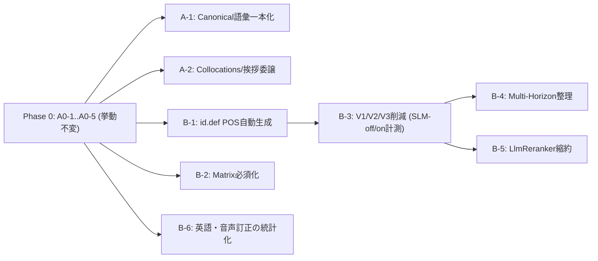

# 詳細設計書 (Detailed Design Document): ヒューリスティクス削減計画 (Tier A0 / A / B)

- **作成日**: 2026-11-20
- **ステータス**: 詳細設計完了・実装対象
- **上位文書**: [コードベース内ヒューリスティクス網羅リスト＆削減ロードマップ (`docs/heuristics_inventory_and_reduction_plan.md`)](docs/heuristics_inventory_and_reduction_plan.md)
- **関連ポリシー**:
  - `AGENTS.md` / `GEMINI.md`（Anti-Anecdotal Tuning Policy、Top-Line Quality Contract、Model & Lexicon Decoupling Contract、DDD/Konsist 境界契約）

---

## 1. 実装スコープと基本原則

本詳細設計書（DD）は、[heuristics_inventory_and_reduction_plan.md](docs/heuristics_inventory_and_reduction_plan.md) で特定された **Tier A0 / Tier A / Tier B** のヒューリスティクスを、品質・レイテンシ・アーキテクチャ境界を損なわずに削減するための具体的な実装仕様を定義します。

### 1.1 設計原則
1. **SLM-off 品質の非回帰を必須条件とする**: Model & Lexicon Decoupling Contract により SLM はオンデマンドダウンロードであり、未導入端末が存在します。Viterbi / 予測側のヒューリスティクスを削除・簡素化する際は、**SLM-on だけでなく SLM-off でも** ベースラインからの劣化が許容範囲内であることを確認します。
2. **1 PR = 1 サブタスク（独立した A/B 計測）**: Tier A/B を一括で変更すると回帰原因の切り分けが不可能になるため、Phase 0 → Phase 1 → Phase 2 の各サブタスク（`A0-*`, `A-*`, `B-*`）を独立した PR として実装・計測します。
3. **Anti-Anecdotal Tuning Policy 遵守**: ハードコード語彙やアドホック定数を削除した結果として個別ケースが劣化しても、特定単語のコストを手書きで補填せず、コーパス統計・POS 体系・交差検証で解決します。
4. **DDD / Konsist 境界の維持**: `shared/domain/`, `context/*/domain/` から `infrastructure/` や `android.view.*` への依存を追加しません。共有定数を追加する場合は各コンテキストの境界ルール（[`docs/ddd/context_map.md`](docs/ddd/context_map.md)）に従います。

### 1.2 共通検証ゲート（各サブタスクの完了条件）

| ゲート | 実行コマンド / ツール | 合格基準 |
| :--- | :--- | :--- |
| **G1: JVM ユニット / DDD / Alloy** | `./gradlew testDebugUnitTest` | 100% パス（`JapanesePunctuationEvaluationTest`, `DddArchitectureKonsistTest`, `AlloyVerificationTest`, `EisRegressionTest` 等） |
| **G2: 仮名漢字 (SLM-off)** | `EisRegressionTest` + `eval/evaluate_flick_headroom_100.py`（SLM 無効） | Top-1 / Top-3 低下 **0.5pt 以内**（初回計測時に分散を見て確定）、EIS 閾値維持（CUJ-2 `>= 110 chars/min`, 削減率 `>= 35%`） |
| **G3: 仮名漢字 (SLM-on)** | `LmFirstJointEvaluationTest` + `eval/tune_and_eval_lm_first.py` + `eval/evaluate_slm_mandatory_rerank.py` | Top-1 / Top-3 / MRR 非劣化（ベースライン: 247件 Top-1 `90.28%`, Top-3 `99.19%`） |
| **G4: ゼロクエリ予測** | `EisRegressionTest` (Zero-query) + `ReferencePredictionEvaluationTest` | Zero-query EIS `>= 250 chars/min`、Golden Set Hit@3 非劣化 |
| **G5: 英語入力 / 音声訂正** | `EnglishTypoRerankTest`, `EnglishSpellEngineTest`, `UnifiedEnglishDictionaryTest`, `eval/futo_swipe/run_futo_swipe_eval.py`, `eval/evaluate_voice_correction_learning.py` | 各テスト 100% パス、Swipe Top-1 (`>= 90.3%`) 非劣化 |
| **G6: 実機検証** | `./deploy.sh` | ARCVM + Pixel の両端末で `AsrManager` ロード・変換動作正常 |

---

## 2. Phase 0 (Tier A0): 挙動不変リファクタリング詳細設計

出力を 1 ビットも変えずに重複定義と死蔵定数を解消し、Phase 1/2 の差分を見通し良くします。**必須ゲート: G1**。

### A0-1: 未使用定数の削除
- **対象**: [`tools/mozc_dict/build_base_dictionary.py`](tools/mozc_dict/build_base_dictionary.py#L20) の `MAX_COST_THRESHOLD = 5500`
- **変更**: 定数定義行を削除。スクリプト全体で参照が 0 件であることは確認済み。

### A0-2: `Idea V1` 二重実装の単一純粋関数への統一
- **現状**: [`KanaKanjiEngine.kt`](app/src/main/java/com/example/myasr/context/kanakanji/domain/KanaKanjiEngine.kt) 内の [`singleViterbiCost`](app/src/main/java/com/example/myasr/context/kanakanji/domain/KanaKanjiEngine.kt#L796-L814) と [ラティス探索内ループ](app/src/main/java/com/example/myasr/context/kanakanji/domain/KanaKanjiEngine.kt#L1857-L1894) にほぼ同一の長さボーナス・境界ガード・希少語ヒンジロジックが重複しています。ただし前者は先頭助詞境界判定が無く、後者は EOS コストを最後に一括加算する差異があります。
- **変更**: `internal fun computeWordSpanAdjustment(...)` を `KanaKanjiEngine` 内に抽出し、既存の差異は引数（`checkLeadingParticle: Boolean`, `prevIsFunctional: Boolean`）で明示して挙動を完全保存します。
- **検証**: 抽出前後の候補リストとスコアが主要クエリ群で完全一致するユニットテストを追加。

### A0-3: 英語空間編集距離の定数統一
- **現状**: `EnglishDictionaryUtils.editAndSpatialCost` ([`EnglishDictionaryUtils.kt:93-112`](app/src/main/java/com/example/myasr/context/english/domain/EnglishDictionaryUtils.kt#L93-L112)) と C++ `EditAndSpatialCost` ([`english_spell_engine.cc`](app/src/main/cpp/spelling/english_spell_engine.cc)) に同一係数（境界 `1.5f`, 削除/挿入 `1.2f`, 置換 `0.8f + 0.3f * min(kd, 2.0f)`, 転置 `0.6f`）が二重定義されています。
- **変更**: Kotlin 側に `object SpatialEditCostParams` を切り出し、C++ 側は `constexpr` 定数構造体へ集約した上で、ユニットテスト（`EnglishSpellEngineTest`）で Kotlin 実装と C++ 実装（JNI 経由）の編集距離がテストケース群で完全一致することをアサートする契約テストを追加します（将来的な値変更時の乖離防止）。

### A0-4: `LlmReranker.muSpan` 重複定義の統一
- **対象**: [`LlmReranker.kt`](app/src/main/java/com/example/myasr/context/reranking/infrastructure/LlmReranker.kt) L222 と L1295。
- **変更**: `companion object` に `private const val MU_SPAN_JA = 2.20f` / `MU_SPAN_EN = 1.40f` を定義し、両箇所から参照。

### A0-5: VAD 打鍵抑制・ASR 重複・IME タイムアウト定数の集約
- **対象**:
  1. `VoiceInputMethodService.kt` 内の `notifyUserTyping(350L)`（約 13 箇所）および `500L`（1 箇所）を `TYPING_VAD_SUPPRESS_MS = 350L` / `TYPING_VAD_SUPPRESS_LONG_MS = 500L` に統一し、`StreamingVadProcessor.notifyUserTyping` のデフォルト引数（未使用の `300L`）も実効値 `350L` に揃えます。
  2. `AsrManager.kt` L132-134 と L166-168 の `maxActivePaths = 8`, `hotwordsScore = 3.5f` を定数化。
  3. `VoiceInputMethodService.kt` の `withTimeout(2500L)` / `3000L` 等をファイル先頭の `companion object` 定数に集約。

---

## 3. Phase 1 (Tier A): ハードコード語彙・フォールバックの評価付き削除

**必須ゲート: G1 + G2 + G3 (+ G4)**。

### A-1: `registerCanonicalVocabulary()` と `essential_conjugations` のコーパス一本化
- **現状と課題**:
  - [`tools/mozc_dict/build_base_dictionary.py`](tools/mozc_dict/build_base_dictionary.py#L94-L123) に 29 個の `essential_conjugations`（手書きコスト `0, 43, 50, 100` 等）が存在。
  - [`KanaKanjiEngine.registerCanonicalVocabulary()`](app/src/main/java/com/example/myasr/context/kanakanji/domain/KanaKanjiEngine.kt#L440-L560) に約 75 語の助詞・助動詞・活用語幹（固定 `cost = 50`）と括弧ペアがハードコード登録されている。
  - これらは本来システム辞書 (`base_dictionary.tsv` / `system_dictionary.bin`) にコーパス由来コストで含まれているべき語彙です。
- **詳細設計**:
  1. **カバレッジ監査スクリプト作成**: `tools/mozc_dict/audit_canonical_coverage.py` を作成し、`registerCanonicalVocabulary()` と `essential_conjugations` の全 `(reading, surface, lid, rid)` ペアが、現在の `base_dictionary.tsv`（または Mozc OSS 元辞書）に存在するか、コスト差がどの程度かを一覧出力する。
  2. **不足語彙のコーパス正規ルート補完**: 監査で `base_dictionary.tsv` に欠落していた活用形・助動詞があれば、手書きコストを移植するのではなく、`build_base_dictionary.py` の Mozc OSS 展開ロジック（活用展開ルール・頻度閾値フィルタ）側を修正して正規のコーパスコストで収録する。
  3. **`KanaKanjiEngine` からの撤廃**:
     - `registerCanonicalVocabulary()` から一般語彙・助詞・助動詞の登録ループを削除する。
     - 括弧ペア (`openingBrackets` / `closingBrackets` / `kakkoPairs`) のみ、機能仕様（対括弧補完）として最小限の `registerStructuralBrackets()` に分離して残す（コストは辞書登録ではなく構造補完候補として扱う）。
     - `base_dictionary.tsv` を使わない単体ユニットテストで canonical 語彙が必要な場合は、テスト側フィクスチャから注入する。
- **検証手順**: `build_base_dictionary.py` 再実行 → `MmapDictionary` 再コンパイル → **G1, G2, G3, G6** 実行。

### A-2: `NextPhrasePredictor` の固定コロケーション・時間帯挨拶の委譲
- **現状と課題**:
  - [`NextPhrasePredictor.kt`](app/src/main/java/com/example/myasr/context/kanakanji/domain/NextPhrasePredictor.kt#L56-L449) の `CANONICAL_STEM_READINGS` / `CANONICAL_COLLOCATIONS`（約 55 語幹 × 2〜8 フレーズ）。
  - 同 L741-752 の時間帯挨拶（`5..10時` おはようございます、常時 6 種固定挿入）。
- **詳細設計**:
  1. **挨拶ヒューリスティクスの撤廃**: 時間帯判定 (`Calendar.getInstance()`) と固定 6 種の強制挿入を削除し、文頭ゼロクエリ予測は **ユーザー確定履歴 (Unigram 頻度 × 時間減衰)** と **SLM `predictNextPhrases(context="")`** に一本化する。完全に履歴が空かつ SLM 未導入の初回起動時のみ、既定の履歴シードではなく空（またはユーザーが最初に入力した履歴から即時学習）とする。
  2. **`CANONICAL_COLLOCATIONS` のデータ外部化 / 統計 Bigram 化**:
     - `ReferencePredictionEvaluationTest` / `EisRegressionTest` (Zero-query EIS `>= 250 chars/min`) が求めるコロケーション予測を、Kotlin コード内のハードコード Map ではなく、辞書ビルド時にコーパス（または既存の `NextPhrasePredictor` 接続ペア）から生成する軽量バイナリ/TSV ビグラムテーブル（外部ストレージ配置）またはユーザー履歴インデックスへ移行する。
     - これによりコード上のハードコード語彙を 0 にしつつ、SLM-off 時の Zero-query EIS を維持する。
- **検証手順**: **G1 + G4**（Zero-query EIS `>= 250 chars/min` 維持を確認）。

---

## 4. Phase 2 (Tier B): 統計・モデル置換詳細設計

**必須ゲート: G1〜G5 全て（該当サブシステムのベンチマーク含む）**。

### B-1: Mozc `id.def` からの POS カテゴリ自動生成 & `isVerbStem` フォールバック評価
- **現状**: `KanaKanjiEngine.kt` L1659-1682 に `1841..2195`, `434..1840`, `29..433` 等の POS ID 範囲が直書きされており、さらに L2358-2363 の `isVerbStem` が末尾ひらがな文字（`っ/い/め/り/き/ぎ/し/ち`）で語幹を推測しています。
- **詳細設計**:
  1. `tools/mozc_dict/generate_pos_table.py` を作成し、Mozc OSS `id.def` をパースして `app/src/main/java/com/example/myasr/context/kanakanji/domain/MozcPosTable.kt` を生成する。
     - 各 POS ID (`0..2671`) に対してビットフラグ（`FLAG_CONTENT_WORD`, `FLAG_SUFFIX`, `FLAG_FUNCTIONAL`, `FLAG_AUXILIARY_VERB`, `FLAG_PREDICATE`, `FLAG_PROPER_NOUN`, `FLAG_SAHEN_NOUN`, `FLAG_VERB_STEM`）を持つ `IntArray(2672)` をコンパイル時定数として保持し、`O(1)` 判定にする。
  2. `KanaKanjiEngine` の全 POS 判定ヘルパーを `MozcPosTable` 参照に置き換える（この時点では既存の範囲と等価性をテストで保証）。
  3. `isVerbStem` の末尾文字フォールバックを除去した状態で **G1〜G3** および `DynamicMultiBunsetsuTailRolloutTest` を実行し、出力・精度に劣化がなければフォールバックを削除する。

### B-2: `connectionMatrix == null` フォールバックの契約整理
- **現状**: APK に `connection_data.bin` (~14.28 MB) が常時同梱されているにもかかわらず、`KanaKanjiEngine` 内に `matrix != null` 分岐が 7 箇所以上あり、null 時専用のヒューリスティクス（単一カタカナ・古語「之」`lid == 385` に `+3000`）が残存しています。一方、一部のユニットテスト（`EisRegressionTest` 等）は `setConnectionMatrix` を呼ばずに実行しています。
- **詳細設計**:
  1. テスト共通ヘルパー `TestDictionaryLoader.loadDefaultConnectionMatrix()` を用意し、`setConnectionMatrix` 未呼び出しの全ユニットテストで `app/src/main/assets/mozc/connection_data.bin` をロードするよう統一する。
  2. 本番パス (`MainActivity` / `VoiceInputMethodService`) でも `ConnectionMatrix` ロード完了を前提とし、`KanaKanjiEngine` 内の `matrix == null` 専用ペナルティ（L1881-1885）を削除する。null 安全のため `matrix?.getTransitionCost(...) ?: 0` の簡潔なガードのみ残すか、`ConnectionMatrix.EMPTY`（全遷移 0）の Null Object パターンへ置換して分岐を消滅させる。
- **検証**: **G1 + G2**（`EisRegressionTest` の数値変化を記録）。

### B-3: Viterbi 内アドホック補正 (`Idea V1 / V2 / V3`) の段階的削減
- **方針**: 本項目は SLM-off 品質への影響が最も大きいため、**2 軸（SLM-off vs SLM-on）** で必ず計測します。
- **Step B-3a: 長さボーナス (`Idea V1`: `(spanLen - 1) * 2000`) の係数スイープ**
  1. A0-2 で抽出した関数に `lengthBonusPerChar: Int`（現行 `2000`）を設定可能にし、$\{0, 500, 1000, 1500, 2000\}$ で **G2 (SLM-off 100件フリック評価 + EisRegressionTest)** および **G3 (SLM-on)** を計測する。
  2. Mozc Unigram + ConnectionMatrix のみ（係数 `0`）で誤分割が多発する場合は、境界ガード (`boundaryChars`, `isRiskyOverSpan`) を残した最小係数に落とすか、後述の「SLM-off 専用フォールバック」へ隔離する。
- **Step B-3b: `Idea V2`（希少語ヒンジ・助詞後固有名詞・並列協調ボーナス）& `Idea V3`（2D 多様性）の SLM-on 時バイパス**
  1. `KanaKanjiEngine.getCandidates` に `slmAvailable: Boolean` 引数（またはモード）を追加する。
  2. `slmAvailable == true` のとき、`Idea V2`（`rarityDelta`, `properAfterParticlePen`, `coordBonus`）および `Idea V3`（Viterbi 側 2D 多様性ペナルティ）をバイパスし、純粋な Viterbi N-best を `LlmReranker` へ渡す設定で **G3** を計測する。
  3. G3 が非劣化であれば、`slmAvailable == true` 時のバイパスをデフォルト化する。さらに SLM-off (G2) でも不要と判明した項から完全に削除する。

### B-4: Multi-Horizon Prefix / 短読みインターリーブの二重制御解消
- **現状**: `KanaKanjiEngine` 側の `branchBonus` (階段関数 `2400/1800/1200/600`)・`interleavePredictiveCandidates` と、`LlmReranker` 側の EIS 効用・Strata 配置が重複しています。
- **詳細設計**:
  - B-3b と同様、`slmAvailable == true` の場合はインターリーブ配列の固定スロット強制をスキップし、`topPool` 構築に必要な raw 候補集合（Full / Prefix / Chunk）を返すのみにする。
  - インターリーブと `branchBonus` は `slmAvailable == false`（SLM 未ロード時の UI 表示用フォールバック）に限定する。
- **検証**: **G1 + G2 + G3**。

### B-5: `LlmReranker` パラメータ縮約 & 二重コスト補正の一本化
- **現状**:
  1. Viterbi 側 `Idea R1`（L2075-2078: `maxWordCost - 4500` の半額等）と `LlmReranker` 側 `dictCostPenalty`（L398-404: `c/3000 + 0.45 * rareExcess^2`）が二重に非線形変換している。
  2. Hybrid-6b 履歴融合（L360-386）に 10 個以上の経験定数（`thetaGate`, 温度 `0.6f`, `shortTerm=2.2`, `longTerm=1.8`, `c1Damp=0.30`, `eta` 上限等）が存在する。
- **詳細設計**:
  1. `ConversionCandidate` に生の `rawViterbiScore`（または `rawWordCost + rawTransCost`）を保持させ、`LlmReranker` 側の非線形 `rareExcess^2` 項との二重適用を解消する（線形射影 $\alpha \cdot \text{dictCostNorm} + \beta \cdot \text{hinge}(c - \theta)$ のみへ簡素化）。
  2. Hybrid-6b を「対数線形融合 + 単一シグモイドゲート（`thetaGate`, `alphaHist`, `decayHours`, `c1Damp` の 4 パラメータ）」へ縮約し、`eval/tune_and_eval_lm_first.py` および `HistorySlmRerankEvaluationTest` で 5-fold CV 最適化・非回帰検証を行う。

### B-6: 英語入力・音声訂正の統計化
- **対象と変更**:
  1. **英語辞書照合 (`EnglishDictionaryUtils.kt` / `english_spell_engine.cc`)**: ユーザー辞書優先度ごとの固定擬似スコア (`22.0/19.5/17.5` や `50M/30M/15M`) を、語長・頻度分布に基づく正規化スコアへ置換。受理閾値 (`normCost <= 0.38`) は `eval/futo_swipe/swipe_eval_1000.jsonl` および `EnglishTypoRerankTest` 上でグリッドサーチ検証。
  2. **文境界判定 (`SentenceBoundaryDetector.kt`)**: ハードコード確率 (`0.98 / 0.95 / 0.25 / 0.10 / 0.05`) を英語コーパス（Wikipedia / OpenSubtitles 等の文境界統計）から最尤推定した値へ置換し、`EnglishCapitalizationAnalyzerTest` / `EnglishTruecasingEvaluationTest` で検証。
  3. **音声訂正スコアリング (`VoiceCorrectionScoring.kt`)**: `1.5`, `0.8`, `2.0`, `gate >= 0.35`, `ctxScore >= 2.2` を `eval/evaluate_voice_correction_learning.py` 上でロジスティック回帰により推定した重みへ置換。
  4. **敬称リスト (`ContextAwareProcessor.kt:275`)**: 固定リスト (`さん/様/くん/君/氏/ちゃん`) を `MozcPosTable` の人名接尾辞 POS 判定へ委譲。

---

## 5. 実行スケジュール・依存関係とロールバック方針

- **ロールバック方針**: 各サブタスクは独立した PR とし、Phase 2 の数理変更（`B-3`〜`B-6`）は原則フィーチャーフラグまたは定数差分で切り戻せる構造に保ちます。G1〜G5 のいずれかが基準未達の場合はマージせず、計測結果を PR / `docs/findings_and_decisions.md` に記録してパラメータ・方針を再設計します。
