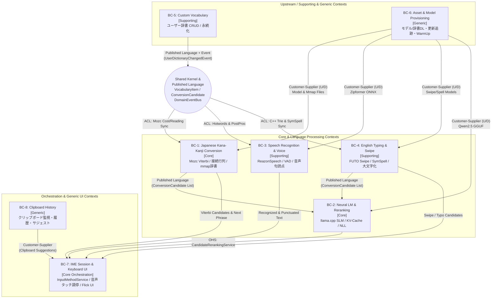

# JotInput Context Map

本ドキュメントは、JotInput における 8 つの Bounded Context と、それらの戦略的関係性（Context Map Patterns）を定義する。

---

## 1. Strategic Context Map（全体図）

---

## 2. コンテキスト間関係パターン詳細（Integration Patterns）

### 2.1 Shared Kernel & Published Language (`shared.domain`, `shared.event`)
- **参加コンテキスト**: 全コンテキスト
- **共有内容**:
  - `InputLanguage` (`JAPANESE`, `ENGLISH`, `OTHER`)
  - `VocabularyItem`（外部公開された軽量な語彙 DTO：`word`, `reading`, `priorityLevel`, `isEnabled`, `isEnglish`）
  - `ConversionCandidate`（`surface`, `reading`, `lmScore`, `acousticOrSpatialCost`, `source`）
  - `DomainEvent` インターフェースおよび `DomainEventBus`（スレッドセーフなインメモリ同期・非同期イベントディスパッチャ）
- **ガバナンス**: 最小限の値オブジェクト・DTO のみを配置し、いかなるコンテキストの内部実装（ONNX、Mozcラティスノード、llama.cpp KVハンドル等）も含めない。

---

### 2.2 `BC-5: Custom Vocabulary` $\to$ `BC-1 / BC-3 / BC-4`
- **パターン**: **Published Language + Domain Event + Anti-Corruption Layer (ACL)**
- **上流 (Upstream)**: `Custom Vocabulary`
- **下流 (Downstream)**: `Japanese Kana-Kanji Conversion`, `Speech Recognition`, `English Typing & Swipe`
- **契約**:
  - `Custom Vocabulary` は語彙の追加・更新・削除・有効化切替時に `UserDictionaryChangedEvent(activeItems: List<VocabularyItem>)` を発行する。
  - 各下流コンテキストは自身のモデル都合に合わせて **ACL（腐敗防止層）** で変換する：
    - **BC-1 (Kana-Kanji)**: `VocabularySyncAdapter` が `VocabularyItem` をひらがな読み正規化＋Mozc品詞ID/低コスト辞書エントリへ変換。
    - **BC-3 (Speech)**: 日本語では `HotwordsGenerator` が `表層/ひらがな/カタカナ` の `cjkchar` スペース区切り形式へ変換し、`DictionaryPostProcessor` が決定論的置換ルールへ変換。英語では `EnglishVoiceUserDictionaryResolver` と `EnglishUserDictDecisionModel` がカタカナ/ひらがな読みを含む ASCII 表層エントリも含めて有効語彙を取り込み、一般英単語の誤爆を防ぎつつ（コーパス頻度＋SLM文脈整合性ゲート＋1タップ提案チップ）Parakeet CTC 出力をユーザー辞書表記へ解決する。
    - **BC-4 (English)**: `EnglishTyping` が英語エントリのみを抽出し、C++ JNI 経由で FUTO Swipe Trie と SymSpell 辞書へ同期。また、`SwipeVocabularyJudgement` の DMN 規則に基づき Compact CSR Dual-Trie 拡張 68k+ 語彙（OTA 連動）および独立ストア `SwipeAdaptiveCacheRepository`（最大 500 語 LRU）を管理し、`custom_dictionary.json` を完全に隔離する。

---

### 2.3 `BC-6: Asset & Model Provisioning` $\to$ `BC-1 / BC-2 / BC-3 / BC-4`
- **パターン**: **Customer-Supplier (Upstream / Downstream)**
- **契約**:
  - 上流である `Provisioning` コンテキストは、Android 外部ストレージ（`externalFilesDir` / `filesDir`）への HTTPS ダウンロード、展開、整合性検証、更新追跡を担当する。
  - 準備完了時に `AssetProvisionedEvent(assetType, directoryOrFile)` を通知し、`ModelWarmUpManager` が日英各エンジン（`KanaKanjiEngine`・`NextPhrasePredictor`・`EnglishSpellEngine`・`FutoSwipeEngine`・`LlmReranker`・`AsrManager` JA/EN）の並列バックグラウンド・ウォームアップを調停する。
  - 下流エンジンは「ファイルがストレージ上に存在するかどうか」のみに依存し、HTTP 通信や ZIP/BZ2 解凍ロジックを一切持たない。

---

### 2.4 `BC-1 (Kana-Kanji)` / `BC-4 (English)` $\leftrightarrow$ `BC-2 (Neural LM & Reranking)`
- **パターン**: **Open Host Service (OHS) + Published Language**
- **詳細**:
  - `Neural LM & Reranking` コンテキストは `CandidateRerankingService` として Open Host Service を公開する。
  - 入力は `RerankRequest(contextBeforeCursor, candidates: List<ConversionCandidate>, engineType, alpha)`、出力は `RerankResult(rankedCandidates, isComplete, latencyMs)` というコンテキスト中立の Published Language を用いる。
  - これにより、`KanaKanjiEngine` や `VoiceInputMethodService` は `llama.cpp` の JNI 詳細や KV キャッシュロールバック（`llama_memory_seq_rm`）を意識せずにリランキングを利用できる。

---

### 2.5 `BC-7: IME Session & Keyboard UI` $\leftarrow$ All Processing Contexts
- **パターン**: **Application Orchestrator / Anti-Corruption Layer**
- **詳細**:
  - `VoiceInputMethodService` および `VoiceTouchInputArbitrator` は Android の `InputConnection` とシステムライフサイクルを隠蔽し、音声入力ストリームとタッチ/フリック/スワイプ入力の競合を調停する。
  - `BC-8: Clipboard History` からは `ClipboardSuggestionPolicy` による判定結果（Customer-Supplier）を受け取り、候補ストリップの先頭表示可否を決定する。

---

## 3. 主要ドメインイベント一覧（Domain Events）

| イベント名 | 発行元 (Producer) | 購読先 (Consumers) | ペイロード概要 |
|---|---|---|---|
| `UserDictionaryChangedEvent` | `BC-5: Custom Vocabulary` | `BC-1`, `BC-3`, `BC-4` | 有効な `List<VocabularyItem>` |
| `AssetProvisionedEvent` | `BC-6: Provisioning` | `BC-1`, `BC-2`, `BC-3`, `BC-4` | `AssetType`, `File` パス |
| `TextCommittedEvent` | `BC-7: IME Session` | `BC-1` (`UserHistorySyncManager`) | 確定表層・読み・タイムスタンプ |
| `VoiceUtteranceFinalizedEvent` | `BC-3: Speech Recognition` | `BC-7: IME Session` | 句読点付与・後処理済み確定テキスト |
| `RerankCompletedEvent` | `BC-2: Neural Reranking` | `BC-7: IME Session` | リランク済み候補リスト・レイテンシ |
