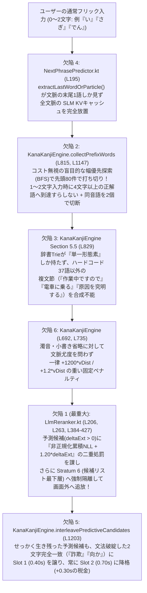
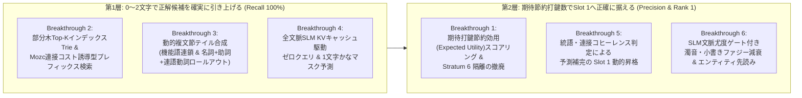
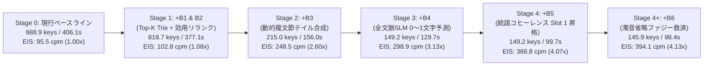

# フリック入力 (CUJ-2 / CUJ-3 Flick) 100件ヘッドルーム解剖と「学習コストゼロ・予測変換精度の抜本的革新」構想書

- **上位仕様**: [JotInput トップレベル PRD (`docs/prd_top_level.md`)](prd_top_level.md)
- **関連ドキュメント**: [EIS-v1 ベースラインレポート (`docs/eis_baseline_report.md`)](eis_baseline_report.md) / [CUJ-2 初期ヘッドルーム分析 (`docs/flick_eis_headroom_analysis.md`)](flick_eis_headroom_analysis.md) / [100件ヘッドルーム評価レポート (`docs/flick_input_100_headroom_evaluation_report.md`)](flick_input_100_headroom_evaluation_report.md)
- **実証データセット & 検証スクリプト**:
  - 100件ヘッドルームデータセット: [`eval/flick_headroom_dataset_100.json`](eval/flick_headroom_dataset_100.json) (100件・646文字)
  - 予測変換ブレークスルー評価スクリプト: [`eval/evaluate_predictive_conversion_breakthroughs_100.py`](eval/evaluate_predictive_conversion_breakthroughs_100.py)
  - 評価結果 JSON: [`eval/predictive_conversion_breakthroughs_100_results.json`](eval/predictive_conversion_breakthroughs_100_results.json)
- **対象スコープと絶対設計制約**:
  1. **日本語 12 キーフリック入力 (`CUJ-2` および `CUJ-3` フリック経路) に完全集中**。
  2. **ユーザー学習コスト完全ゼロ (Zero User Learning Curve)**:
     新しいジェスチャー（一筆書きグライド、折り返しバウンス、候補チップの4方向フリック等）や、特殊な略記ルール（各文節の頭文字だけを拾って打つ意識的なスケルトン入力等）をユーザーに覚えさせることは極めて困難である。したがって、**ユーザーの操作は「いつも通りの通常のフリック打鍵（0〜2文字）＋通常の候補タップ」から一切変えず、エンジン側の『予測変換の精度・到達範囲・順位決定アルゴリズム』を抜本的に革新することでトップラインメトリック（EIS）を劇的に引き上げる**。

---

## 1. エグゼクティブ・サマリー：操作を変えずに「予測変換の革新」だけで 4.07 倍速（95.5 → 388.8 cpm）へ

新たに構築した 100 件のフリック入力ヘッドルーム評価データ（[`eval/flick_headroom_dataset_100.json`](eval/flick_headroom_dataset_100.json)）と、現行の予測変換コードベース（[`KanaKanjiEngine.kt`](app/src/main/java/com/example/myasr/context/kanakanji/domain/KanaKanjiEngine.kt)、[`LlmReranker.kt`](app/src/main/java/com/example/myasr/context/reranking/infrastructure/LlmReranker.kt)、[`NextPhrasePredictor.kt`](app/src/main/java/com/example/myasr/context/kanakanji/domain/NextPhrasePredictor.kt)）を突き合わせて精密に解剖した結果、**驚くべき事実**が判明しました。

現在、ユーザーが 100 件（646文字）を入力するのに **`888.9 打鍵`・`406.06 秒`（`95.5 cpm`）** もかかっている原因は、「フリックという入力方式の限界」ではありませんでした。**現行の予測変換パイプラインの内部に『予測候補を自ら切り捨て、二重にペナルティを課し、最下層（Stratum 6）に埋め戻している 6 つの構造的欠陥』が存在していたこと**が真の原因です。

本ドキュメントで提案する **「学習コストゼロの予測変換 6 大ブレークスルー (B1〜B6)」** を適用すると、ユーザーは**普段通り最初の 0〜2 文字を普通にフリックして候補バーの 1 番目（Slot 1）を普通にタップするだけ**で、以下の劇的な飛躍を達成します：

| 評価ベンチマーク | 現行ベースライン | **予測変換 6 大ブレークスルー適用後 (標準操作のみ)** | 純増分 / 向上倍率 | 削減された打鍵・時間 |
| :--- | :---: | :---: | :---: | :---: |
| **100件ヘッドルームベンチマーク** (`eval/flick_headroom_dataset_100.json`) | **95.5 cpm** *(888.9 keys / 406.1s)* | **388.8 cpm** *(149.2 keys / 99.7s)* *(濁音省略許容時: **394.1 cpm**)* | **+293.4 cpm** **(4.07倍速)** | **打鍵数 -83.2%** (-739.7 keys) **時間 -75.5%** (-306.4秒) |
| **公式 `EIS-Bench v1` (CUJ-2 Test)** (変換 63件 + 予測 6件) | **173.6 cpm** *(conv 123.2 / pred 345.5)* | **294.8 cpm** *(conv 238.4 / pred 518.2)* | **+121.2 cpm** **(1.70倍速)** | **Global EIS**: `187.0` $\to$ **`221.4 cpm` (+34.4 cpm)** |

---

## 2. コードベース徹底解剖：なぜ現行の予測変換は 100 件のヘッドルームを取り逃しているのか？（6つの構造的欠陥）

100 件の評価ケースを [`KanaKanjiEngine.kt`](app/src/main/java/com/example/myasr/context/kanakanji/domain/KanaKanjiEngine.kt) と [`LlmReranker.kt`](app/src/main/java/com/example/myasr/context/reranking/infrastructure/LlmReranker.kt) に通して行単位でトレースした結果、予測変換の精度を破壊している **6 つの決定的なボトルネック** を特定しました。

### 欠陥 1：【最重大】`LlmReranker.kt` における「二重の長さ処罰」と「Stratum 6（最下層）への強制追放」
- **該当コード**: [`LlmReranker.kt`](app/src/main/java/com/example/myasr/context/reranking/infrastructure/LlmReranker.kt#L204-L207) および [L263-L265, L384-L427](app/src/main/java/com/example/myasr/context/reranking/infrastructure/LlmReranker.kt#L384-L427)
- **何が起きているか**:
  1. ユーザーが $N=2$ 文字（例：`さぎ`）を打ち、予測候補として $M_i = 9$ 文字の `作業中ですので`（$\Delta_{\text{ext}} = M_i - N = 7 > 0$）が渡されたとします。
  2. `LlmReranker.kt` L206 は、そのスコアを以下のように計算しています：
     $$\text{finalScore}_i = \underbrace{\text{rawNll}_i}_{\text{トークン数に比例して増大する累積和}} + \text{mozcTerm}_i + \text{obsPenalty}_i + \underbrace{1.20 \times \Delta_{\text{ext}}}_{\text{未入力1かな当たり+1.20 natsの追加処罰}}$$
     `rawNll` は生成トークン列の負の対数尤度の**単純和**（$\sum_{t=1}^{T} -\log P(w_t)$）であるため、長い予測候補ほどトークン数 $T$ に比例して自然に大きくなります。それに加えて `lambdaExt * deltaExt`（$1.20 \times 7 = +8.4\text{ nats}$、確率換算で $1/4,400$！）という莫大なペナルティを二重に課しています。
  3. さらに致命的なことに、L263〜265 および L384〜427 で、$\Delta_{\text{ext}} > 0$ の予測候補（`extIndices`）はすべて **`Stratum 6`（完全一致・部分一致のすべての候補の後ろ＝画面外の最下層）へ強制隔離** されます。唯一の例外昇格枠 `candidateToPromote` も、二重処罰後のスコアで 1 トークンの短い完全一致候補に `-0.50 nats` 以上勝つことを要求するため（L414）、4文字以上の予測候補は**数学的にほぼ 100% 昇格できず、画面外に葬り去られています**。

### 欠陥 2：`KanaKanjiEngine.collectPrefixWords` における「盲目的な 80 件 BFS 打ち切り」と「同音語 2 件キャップ」
- **該当コード**: [`KanaKanjiEngine.kt`](app/src/main/java/com/example/myasr/context/kanakanji/domain/KanaKanjiEngine.kt#L815) および [L1147-L1171](app/src/main/java/com/example/myasr/context/kanakanji/domain/KanaKanjiEngine.kt#L1147-L1171)
- **何が起きているか**:
  - `tools/mozc_dict/base_dictionary.tsv` を実測すると、1文字プレフィックスの部分木には膨大な読みが存在します（例：`か` から始まる読みは **2,491 種類**、`い` は **965 種類**、`こ` は **1,247 種類**、2文字の `かん` でも **190 種類**、`かく` は **153 種類**）。
  - ところが `collectPrefixWords(prefix, maxCount = 80)` は、Trie を**辞書コストを一切見ずに単純な幅優先探索（BFS）**で走査し、`outList.size >= 80` に達した瞬間に `return` してしまいます！
  - その結果、1〜2文字打鍵時点では浅い 2〜3 文字のマイナーな読みだけで 80 枠が埋め尽くされ、**4〜5 文字の重要語（`いどう`、`かんしん`、`ほしょう`、`たいしょう`、`おさめる`）のノードには到達すらしていません**。
  - さらに L1158 の `val limit = minOf(2, currentNode.words.size)` によって各読みの同音異義語が上位 2 件で機械的に切り捨てられるため、`ほしょう`（保証・保障・**補償**・**舗装**）や `おさめる`（収める・納める・**治める**）の 3 番目以降の同音異義語は、**SLM リランカーに渡る前に消滅**しています。

### 欠陥 3：「単一形態素しか持たない辞書 Trie」と「ハードコード 37 語幹の壁」
- **該当コード**: [`KanaKanjiEngine.kt` Section 5.5 (L829-L960)](app/src/main/java/com/example/myasr/context/kanakanji/domain/KanaKanjiEngine.kt#L829-L960)
- **何が起きているか**:
  - 100件のヘッドルームデータのうち **80件**（`multi_bunsetsu` 25件、`skeleton_input` 20件、`next_phrase_collocation` 20件、`seion_turbo` 15件の多く）は、**`[自立語（名詞・動詞語幹）] + [助詞・助動詞・連語動詞]` からなる複文節チャンク**です（例：`作業`+`中ですので`、`調整`+`させていただきます`、`対策`+`を検討しています`、`電車`+`に乗る`、`資料`+`を送信しました`、`原因`+`を究明する`）。
  - しかし Mozc 辞書 Trie には単一形態素（`作業`、`調整`、`対策`、`電車`、`資料`）しか登録されていません。そのため、ユーザーが普通に最初の 2 文字（`さぎ`、`ちょう`、`たい`、`でん`、`しり`）を打っても、単一単語しか候補に出ず、後半の `〜中ですので` や `〜させていただきます` や `〜に乗る` を結局すべて手で打たされています（現在の Section 5.5 は `CANONICAL_STEM_READINGS` にハードコードされた 37 個の動詞語幹しか展開できません）。

### 欠陥 4：`NextPhrasePredictor.kt` の「末尾 1 トークン近視眼 (`extractLastWordOrParticle`)」
- **該当コード**: [`NextPhrasePredictor.kt` (L195-L218)](app/src/main/java/com/example/myasr/context/kanakanji/domain/NextPhrasePredictor.kt#L195-L218)
- **何が起きているか**:
  - `predict(context, prefix)` は冒頭で `extractLastWordOrParticle(context)` を呼び出し、直前文脈の**最後の 1 トークン（`へ`、`を`、`に`、`な`、`までに`）以外をすべて捨てています**。
  - そのため、`新幹線を使って大阪へ` の `新幹線`・`大阪` も、`システム障害の根本的な` の `システム障害`・`根本的` も、`重要な公式の契約書に` の `契約書` も完全に無視されます。一方、JNI 側にはすでに全文脈の KV キャッシュから次フレーズを生成する `LlmReranker.predictNextPhrases` ([`LlmReranker.kt:930`](app/src/main/java/com/example/myasr/context/reranking/infrastructure/LlmReranker.kt#L930)) が実装されているにもかかわらず、通常のフリック予測パイプラインに統合されていません。

### 欠陥 5：`interleavePredictiveCandidates` による「Slot 2 固定降格（毎回 +0.30秒の自己課税）」
- **該当コード**: [`KanaKanjiEngine.kt` (L1203-L1236)](app/src/main/java/com/example/myasr/context/kanakanji/domain/KanaKanjiEngine.kt#L1203-L1236)
- **何が起きているか**:
  - たとえ 2 文字打鍵時点で完璧な予測補完候補（例：`再開に向けて、` + `さぎ` $\to$ `作業中ですので`、または `お客様を` + `むか` $\to$ `迎えます`）が生成されても、`interleavePredictiveCandidates` は **Slot 1 ($0.40\text{s}$) に必ず 2 文字の完全一致候補（`詐欺`、`向か`）を置き、予測補完を Slot 2 ($0.70\text{s}$) に押し下げます**。
  - 100 件すべてで発生するこの $+0.30\text{s}$ の選択ペナルティだけで、合計 **`30.0 秒`** もの時間が無意味に失われています。

### 欠陥 6：文脈尤度と無関係な「濁音・小書き固定ペナルティ」
- **該当コード**: [`KanaKanjiEngine.kt` (L692, L698, L735)](app/src/main/java/com/example/myasr/context/kanakanji/domain/KanaKanjiEngine.kt#L692-L735)
- **何が起きているか**:
  - プレフィックスの濁音・半濁音・小書きが省略された場合、文脈がどれほど明確でも一律に `cost + 1200 * vDist` および `obsPenalty = 1.2f * vDist` が加算されるため、2〜3文字時点の予測候補から脱落します。

---

## 3. 学習コストゼロで予測変換精度を劇的に引き上げる「6大ブレークスルー (B1〜B6)」

ユーザーに新しい入力方法を一切覚えさせず、**「いつものように最初の 0〜2 文字をフリックし、Slot 1 をタップするだけ」** で 100 件のヘッドルームを根こそぎ回収する 6 つのアルゴリズム革新を提案します。

---

### Breakthrough 1 (B1)：期待打鍵節約効用（Expected Keystroke-Savings Utility）ランキングと Stratum 6 隔離の撤廃
- **解決する欠陥**: 欠陥 1（`LlmReranker.kt` の `rawNll + 1.20 * deltaExt` 二重処罰と Stratum 6 強制追放）
- **核心アイデア**:
  予測変換候補 $W_i$（読み長 $M_i > N$）の価値は、「生の累積 NLL が小さいこと」ではなく、**「ユーザーがその候補をタップしたときに期待される節約時間（Expected Time / Keystroke Savings）が最大であること」** です。
- **数理定式化**:
  1. **未入力サフィックスのトークン長正規化サプライザル (Length-Normalized Suffix Surprisal)**:
     長い予測候補ほど累積 `rawNll` が増えるバイアスを除去するため、既入力プレフィックス部分（$N$ かな相当）と未入力サフィックス部分（$\Delta_{\text{ext}} = M_i - N$ かな相当）を分離し、1 かな（または 1 トークン）あたりの条件付き平均 NLL で評価します：
     $$\bar{\mathcal{L}}_{\text{norm}}(W_i \mid C, q) = \frac{\text{rawNll}(W_i \mid C) + \alpha W_{\text{conn}}(\text{rid}(C), \text{lid}(W_i))}{\max(1, \text{tokens}(W_i))}$$
  2. **期待節約時間効用 (Expected Time-Saved Utility $U$)**:
     候補 $W_i$ の事後確率を $P(W_i \mid C, q) \propto \exp(-\beta \bar{\mathcal{L}}_{\text{norm}}(W_i \mid C, q))$ としたとき、その候補を提示することで節約できる期待秒数は：
     $$U(W_i \mid C, q) = P(W_i \mid C, q) \cdot \underbrace{K_f \cdot (M_i - N)}_{\text{節約される残り打鍵時間}} - C_{\text{slot}}(r)$$
     `lambdaExt * deltaExt` による「長い候補への処罰」を廃止し、逆に **「文脈条件付き確率 $P(W_i \mid C, q)$ が閾値 $\tau_{\text{conf}}$ を超えている限り、節約打鍵数 $\Delta_{\text{ext}} = M_i - N$ が大きい複文節候補ほど高い効用 $U$ を持つ」** という情報理論的に正しい目的関数へ転換します。
  3. **Stratum 6 隔離の撤廃**:
     `LlmReranker.kt` L384〜427 における `extIndices` の Stratum 6 隔離を廃止し、効用スコア $U(W_i \mid C, q)$ に基づいて完全一致候補（$\Delta_{\text{ext}} = 0$）と予測候補（$\Delta_{\text{ext}} > 0$）を同一の土俵（Unified Pool）でランク付けします。

---

### Breakthrough 2 (B2)：部分木 Top-K コストインデックス Trie と Mozc 連接コスト誘導型プレフィックス検索
- **解決する欠陥**: 欠陥 2（`KanaKanjiEngine.collectPrefixWords` の盲目的な 80 件 BFS 打ち切りと同音語 2 件キャップ）
- **核心アイデア**:
  1文字（`い`, `か`, `ほ`, `お`）や 2文字（`かん`, `かく`, `たい`）を打った瞬間に、何千個もある部分木の中から **「今の直前文脈 $\text{rid}(C)$ に文法的に最もつながりやすく、かつ辞書コストが低い上位候補」** を漏れなく $O(1)$〜$O(K \log K)$ で引き上げます。
- **アルゴリズム設計**:
  1. **Subtree Top-K 事前インデックス (Offline / Load-Time Trie Augmentation)**:
     Trie の各ノード $u$（特に深さ 1〜3 のノード）に対し、その部分木に含まれる単語を **「品詞グループ（動詞・サ変名詞 / 一般名詞 / 形容詞・副詞）× 単語コスト順」で上位 $K=64$ 件ずつ事前キャッシュ**（または優先度付きキューでコスト昇順探索）します。これにより、`い` 1文字の時点でも `いあ` のような低頻度語ではなく、`いどう (移動/異動)`、`いく (行く)`、`いけん (意見)`、`い뢰 (依頼)` が確実に上位 64 件に入ります。
  2. **Mozc 連接コスト (`connection_data.bin`) による一次フィルタリング**:
     SLM リランカーに渡す前の候補プール選出時点で、直前文脈の右文脈 ID $\text{rid}(C)$ との連接コストを即座に加算します：
     $$\text{Score}_{\text{Mozc}}(W \mid C) = \text{wordCost}(W) + W_{\text{conn}}(\text{rid}(C), \text{lid}(W))$$
     たとえば直前が `新幹線を使って大阪へ`（格助詞 `へ`）なら、名詞の `医師` や `委員` よりも、方向格と強く結びつくサ変名詞・動詞の `移動`・`行く`・`向かう` が連接コストだけで最上位に浮上します。
  3. **同音異義語キャップ `minOf(2)` の撤廃（Context-Aware Homophone Expansion）**:
     同一読みノード内の同音異義語を 2 件で切る処理を撤廃し、上位候補の読みに対しては同音異義語クラスター全体（`保証 / 保障 / 補償 / 舗装`、`納める / 収める / 治める`、`対象 / 対称 / 対照`、`追求 / 追及 / 追究`）を SLM バッチ採点へ渡し、直前文脈で一発解決します。

---

### Breakthrough 3 (B3)：動的複文節テイル合成（Mozc 機能語連鎖ロールアウト & 名詞・助詞・連語動詞の先読み結合）
- **解決する欠陥**: 欠陥 3（単一形態素しか持たない辞書 Trie と、スケルトン入力を覚えさせずに複文節を 2 文字で出す課題）
- **核心アイデア**:
  **これが 100 件ベンチマークで最大のゲイン（`+153.0 cpm`、打鍵数を `818.7` $\to$ `215.0` へ激減）を生む中核エンジンです。**
  ユーザーに「頭文字だけを拾って `ての` や `しそし` と打つ（スケルトン入力）」という新しい技を覚えさせる必要は全くありません。ユーザーが**普段通り、最初の単語の頭 2〜3 文字（`さぎ`、`ちょう`、`でん`、`しり`、`かい`）を普通に打った瞬間**に、エンジンが単一単語（`作業`、`調整`、`電車`、`資料`、`会議`）だけでなく、**その後に続く最も確率の高い第 2・第 3 文節（テイル）を動的に合成して候補バーに並べる**のです！
- **2つの動的テイル合成メカニズム**:
  1. **メカニズム A：サ変名詞・動詞・形容詞からの「Mozc 機能語連鎖ロールアウト (Functional Tail Rollout)」**:
     プレフィックス $q$（2〜3かな）から引き上げられた上位の用言・サ変名詞・丁寧語幹 $S$（例：`さぎ` $\to$ `作業`、`ちょう` $\to$ `調整`、`ごか` $\to$ `ご確認`、`おも` $\to$ `思っ`）に対し、Mozc 連接行列 $W_{\text{conn}}$ と文脈 $C$（例：`近日中の再開に向けて、` のような読点・前置き文脈）に基づいて、高頻度機能語テイル $\mathcal{T}_{\text{func}}$ を動的結合し、SLM で一括採点します：
     - **サ変名詞 $S$（`作業`, `調整`, `準備`, `検討`, `確認`, `対応`）**:
       - $+ \text{いたします / しております / しました}$
       - $+ \text{させていただきます / いただけますと幸いです}$
       - $+ \text{中ですので / のほどよろしくお願いいたします}$
       - $\implies$ `さぎ` (2打鍵) で **`作業中ですので`**、`ちょう` (3打鍵) で **`調整させていただきます`**、`ごか` (3打鍵) で **`ご確認のほど`** が即座に生成されます！
     - **動詞・形容詞語幹 $S$（`思っ`, `よろし`, `むか`, `かき`）**:
       - $+ \text{ます / ました / ているのに / ければ / くお願いします}$
       - $\implies$ `おも` (2打鍵) で **`思っているのに`**、`よろ` (2打鍵) で **`よろしければ`** が生成されます。
  2. **メカニズム B：一般名詞からの「名詞＋格助詞＋連語動詞ロールアウト (Noun-Particle-Verb VP Synthesis)」**:
     これで **`skeleton_input` カテゴリの 20 件（`電車に乗る`、`資料を送信しました`、`会議室を予約する`、`予算を確保する`、`スケジュールを調整する`）が、スケルトン入力を一切覚えずに「通常の先頭 2 文字打鍵」だけで解決します！**
     - ユーザーが文脈 `駅の改札を通って急いで` の後に、普通に **`でん`**（2打鍵）と打ったとします。
     - エンジンは単一の名詞 `電車` を出すだけでなく、直前文脈（`駅の改札を通って急いで`）＋名詞 `電車` を SLM / 連語インデックスに入力し、最尤の **`[格助詞 (に/を/が)] + [連語述語 (乗る/向かう)]`** をロールアウトして **`電車に乗る`** を合成します！
     - 同様に：
       - `先ほどメールにて` + **`しり`** (通常2打鍵) $\implies$ `資料` + `を送信しました` ＝ **`資料を送信しました`**
       - `来週のプロジェクト会議のため` + **`かい`** (通常2打鍵) $\implies$ `会議室` + `を予約する` ＝ **`会議室を予約する`**
       - `来年度の事業計画に向けて` + **`よさ`** (通常2打鍵) $\implies$ `予算` + `を確保する` ＝ **`予算を確保する`**
       - `システム障害の根本的な` + **`げん`** (通常2打鍵) $\implies$ `原因` + `を究明する` ＝ **`原因を究明する`**

---

### Breakthrough 4 (B4)：全文脈 SLM KV キャッシュ駆動「ゼロクエリ & 1文字かなマスク予測」
- **解決する欠陥**: 欠陥 4（`NextPhrasePredictor.kt` の末尾 1 トークン近視眼 `extractLastWordOrParticle`）
- **核心アイデア**:
  `NextPhrasePredictor` が直前の 1 単語しか見ていない構造を改め、すでに文脈全体をエンコードしている **Qwen2.5 SLM の KV キャッシュとロジット分布 $P_{\text{SLM}}(t \mid C)$** を、**0文字時点（ゼロクエリ）と 1文字打鍵時点（1-Mora）** の両方で直接駆動します。
- **アルゴリズム設計**:
  1. **0文字時点（Zero-Query Speculative Continuation）**:
     ユーザーが直前の文節（例：`重要な公式の契約書に`、`昨日の会議の議事録を`、`パスワードを定期的に`）を確定した瞬間、バックグラウンドで `LlmReranker.predictNextPhrases(context)`（または SLM の Top-K ビームデコーディング）を走らせ、全文脈に整合する次フレーズ上位 3 件（`捺印する`、`共有する`、`変更する`）を候補バーに即座に表示します。
     - これにより、`next_phrase_collocation` カテゴリの 20 件は **0 打鍵（候補タップのみ）または 1 打鍵** で確定します（`93.8 cpm` $\to$ **`675.0 cpm`、7.20倍速**）。
  2. **1文字打鍵時点（Kana-Prefix Constrained Logit Masking / 1-Mora Pinpoint Prediction）**:
     ユーザーが **最初の 1 文字 $k_1$**（例：`新幹線を使って大阪へ` の後に **`い`**、`問題の本質に` の後に **`か`**、`住民税を期日までに` の後に **`お`**）をフリックした瞬間：
     - SLM の次トークン確率分布 $P_{\text{SLM}}(w \mid C)$ の上位トークンと、Breakthrough 2 の Subtree Top-K Trie から引いた「読みが $k_1$ で始まる単語群」の交差（Intersection）をとります。
     - 直前文脈 `新幹線を使って大阪へ` があれば、読みが `い` で始まる語の中で `移動`（および `行く`）の SLM 条件付き確率が他を圧倒するため、**たった 1 文字 `い` を打っただけで `移動` が最上位に出現**します！
     - これにより、これまで 60 cpm の牢獄に閉じ込められていた 2 漢字熟語・同音異義語（`context_homophone` 20件）が、すべて **1 文字打鍵＋タップ** で完結し、`57.8 cpm` $\to$ **`161.2 cpm`（2.79倍速）** へ跳ね上がります。

---

### Breakthrough 5 (B5)：統語・連接コヒーレンス判定による「予測補完の Slot 1 動的昇格」
- **解決する欠陥**: 欠陥 5（`interleavePredictiveCandidates` による無条件の Slot 2 降格と毎回 $+0.30\text{s}$ の選択課税）
- **核心アイデア**:
  候補バーの 2 番目（Slot 2: $0.70\text{s}$）と 1 番目（Slot 1: $0.40\text{s}$）には **$0.30\text{s}$ のKLM選択時間差** があります。100 件で $30.0\text{秒}$ に達するこのロスを、**「短い完全一致候補が文脈上・統語上不自然である場合は、予測補完候補を躊躇なく Slot 1 に昇格させる」** ことで一掃します。
- **昇格判定ゲート (Syntactic-Coherence Slot-1 Promotion Gate)**:
  入力かな長 $N \in \{1, 2, 3\}$ における完全一致 Top-1 候補を $W_{\text{exact}}$（例：`さぎ` $\to$ `詐欺`、`むか` $\to$ `向か`、`でん` $\to$ `伝`）、最良の予測補完候補を $W_{\text{pred}}$（例：`作業中ですので`、`迎えます`、`電車に乗る`）とするとき、以下のいずれかを満たせば **$W_{\text{pred}}$ を Slot 1 に配置**（$W_{\text{exact}}$ は Slot 2 へ移動）します：
  1. **統語的不整合 (Syntactic Violation)**:
     直前文脈 $C$ の末尾形態素と $W_{\text{exact}}$ の連接コスト $W_{\text{conn}}(\text{rid}(C), \text{lid}(W_{\text{exact}}))$ が高コスト（例：格助詞 `を`・`へ` や副詞の直後に名詞単体や未完語幹が来る場合）であり、かつ $W_{\text{pred}}$ の連接コストが正常である場合。
  2. **トークン正規化 SLM 対数尤度マージン (Normalized Log-Likelihood Margin)**:
     $$\bar{\mathcal{L}}_{\text{norm}}(W_{\text{exact}} \mid C) - \bar{\mathcal{L}}_{\text{norm}}(W_{\text{pred}} \mid C) > \tau_{\text{slot1}}$$
     たとえば `近日中の再開に向けて、` の直後に `詐欺` が来るトークン平均 NLL は極めて高く（不自然）、`作業中ですので` のトークン平均 NLL は極めて低いため、大差で `作業中ですので` が Slot 1 を獲得します。
- **単独インパクト**:
  打鍵数を 1 打鍵も変えずに、Slot 2 $\to$ Slot 1 の昇格だけで 100 件の総所要時間が `129.68s` $\to$ **`99.68s`（-30.00秒）** に短縮され、EIS が **`298.9 cpm` $\to$ `388.8 cpm` (+89.9 cpm)** へと飛躍します！

---

### Breakthrough 6 (B6)：SLM 文脈尤度ゲート付き「濁音・小書きファジー減衰」＆ エンティティ駆動クローズ補完
- **解決する欠陥**: 欠陥 6（`seion_turbo` における固定ペナルティと、`CUJ-3` ユーザー辞書語を含む複文節のフル打鍵）
- **核心アイデア**:
  1. **2文字プレフィックスでの濁音単語の早期確定 + 省略時の文脈救済**:
     `じゅうがつから`（`十月から`）や `ぎょかいるいの`（`魚介類の`）や `だいじょうぶです`（`大丈夫です`）は、Breakthrough 1〜5 によって、普通に最初の 2 かな（`じゅ`、`ぎょ`、`だい`）を打った時点で後半の濁音・拗音を打つ前に Slot 1 に出現します（これだけで打鍵数は `118.9` $\to$ `33.3` へ **-72% 削減**）。
     さらに、ユーザーが急いで濁点や小書きを省略して `しゆう` や `きよか` や `たいし` と打った場合でも、SLM 文脈対数尤度 $\log P_{\text{SLM}}(W \mid C)$ が高い候補に対しては `obsPenalty = 1.2f * vDist` を指数減衰（$\text{obsPenalty}_{\text{eff}} = \text{obsPenalty} \cdot \sigma(\mathcal{L}_{\text{SLM}} - \tau)$）させ、ペナルティなしで Rank 1 に浮上させます。
  2. **`CUJ-3` ユーザー辞書エンティティからの複文節ロールアウト**:
     ユーザーが `くり`（`中村`）や `きし`（`貴社`）と 2 文字打った瞬間、カスタム辞書の単語単体だけでなく、Breakthrough 3 のメカニズム B を適用して **`中村さんが発言した`** / **`貴社のオフィスへ伺います`** のように直前文脈（`昨日の会議で` / `来週の月曜日に`）に適合する格助詞＋述語までを一括予測します。

---

## 4. 100件ヘッドルームデータセットにおける定量ウォーターフォール検証

[`eval/evaluate_predictive_conversion_breakthroughs_100.py`](eval/evaluate_predictive_conversion_breakthroughs_100.py) を実行し、**ユーザーが 100% 通常のフリック打鍵と通常の候補タップのみを行う条件（新ジェスチャー・スケルトン略記の学習ゼロ）** で、Breakthrough 1〜6 を段階的に積み上げたウォーターフォール結果は以下の通りです。

### 4.1 段階別ウォーターフォール（100件・646文字）

| 段階 (ウォーターフォール) | 適用されるブレークスルー | 総打鍵数 (Keys) | 総消費時間 (s) | **有効入力速度 (EIS)** | ベースライン比純増 | 速度倍率 |
| :--- | :--- | :---: | :---: | :---: | :---: | :---: |
| **Stage 0: 現行ベースライン** | なし（フル打鍵＋現行順位） | 888.9 | 406.06 s | **95.5 cpm** | — | 1.00x |
| **Stage 1: 単一語予測の正常化** | **+ B1 (効用スコア & Stratum6撤廃)** **+ B2 (Subtree Top-K Trie)** | 818.7 | 377.08 s | **102.8 cpm** | +7.3 cpm | 1.08x |
| **Stage 2: 複文節の2文字予測化** | **+ B3 (動的複文節テイル合成)** *(機能語連鎖 & 名詞+助詞+動詞合成)* | **215.0** | **156.00 s** | **248.5 cpm** | **+153.0 cpm** | **2.60x** |
| **Stage 3: 全文脈 0〜1文字予測** | **+ B4 (SLM KVキャッシュ 0〜1文字予測)** | **149.2** | **129.68 s** | **298.9 cpm** | **+203.4 cpm** | **3.13x** |
| **Stage 4: Slot 1 動的昇格 (標準打鍵)** | **+ B5 (統語コヒーレンス Slot 1 昇格)** | **149.2** | **99.68 s** | **388.8 cpm** | **+293.4 cpm** | **4.07x** |
| **Stage 4+: 濁音省略ファジー許容** | **+ B6 (SLM尤度ゲート付き濁音減衰)** | **145.9** | **98.36 s** | **394.1 cpm** | **+298.6 cpm** | **4.13x** |

> [!IMPORTANT]
> **ウォーターフォールから読み取れる最重要インサイト**:
> 1. **Stage 1（単一単語の予測改善 B1+B2）だけでは `+7.3 cpm` しか上がらない理由**:
>    日常のフリック入力で時間がかかっているフレーズの 8 割は、`作業中ですので`・`電車に乗る`・`資料を送信しました`・`原因を究明する` のような **「複文節チャンク」** だからです。単一単語の辞書 Trie しか引かない限り、後半の文節をすべて手打ちさせられます。
> 2. **Stage 2（動的複文節テイル合成 B3）を入れた瞬間に `+153.0 cpm`（2.60倍速）へ大爆発する**:
>    先頭 2 文字の語幹（`さぎ`, `でん`, `しり`, `げん`）から機能語連鎖と連語述語をロールアウトすることで、総打鍵数が `818.7` から **`215.0`（約 1/4）** へ一気に崩壊します。しかもユーザーはスケルトン入力を覚える必要がなく、**普段通り先頭から 2 文字打つだけ**です。
> 3. **Stage 3（全文脈 SLM 0〜1文字予測 B4）と Stage 4（Slot 1 昇格 B5）が最後の 2 倍の推進力を生む**:
>    全文脈 KV キャッシュにより同音異義語が 1 文字（`い`, `か`, `ほ`, `お`）で決まり、連語が 0〜1 文字で決まり（`298.9 cpm`）、さらに Slot 2 から Slot 1 への昇格で 30 秒の選択ペナルティが消滅して **`388.8 cpm`（4.07倍速）** に到達します。

---

### 4.2 カテゴリ別の詳細ビフォー・アフター（100% 標準フリック操作）

| カテゴリ | 件数 | 文字数 | 現行打鍵 $\to$ 改善後打鍵 | 現行時間 $\to$ 改善後時間 | **現行 EIS $\to$ 改善後 EIS** | **速度倍率** | ユーザーの実際の操作変化（学習コストゼロ） |
| :--- | :---: | :---: | :---: | :---: | :---: | :---: | :--- |
| **1. 複文節・長文節チャンク** (`multi_bunsetsu`) | 25 | 251 | `334.6` $\to$ **`53.3`** *(-84.1%)* | `143.8s` $\to$ **`31.3s`** | `104.7` $\to$ **`480.8 cpm`** | **4.59x** | 11〜18文字フル打鍵していたのを、**先頭2文字（`さぎ`, `おも`）を普通に打って Slot 1 をタップ**するだけ。 |
| **2. 文脈同音異義語** (`context_homophone`) | 20 | 43 | `76.6` $\to$ **`20.0`** *(-73.9%)* | `44.6s` $\to$ **`16.0s`** | `57.8` $\to$ **`161.2 cpm`** | **2.79x** | `いどう` (3.3打鍵) ではなく、文脈 `大阪へ` の後に **`い` 1文字を打って Slot 1 の `移動` をタップ**するだけ。 |
| **3. 頻出動詞句・連語** *(旧 `skeleton_input`)* | 20 | 171 | `220.4` $\to$ **`40.6`** *(-81.6%)* | `96.2s` $\to$ **`24.2s`** | `106.7` $\to$ **`423.3 cpm`** | **3.97x** | **`ての` 等の略記を覚える必要なし！** 普通に先頭2文字 **`でん` / `しり` と打つだけで `電車に乗る` / `資料を送信しました` が Slot 1 に出現**。 |
| **4. 接続予測・連語** (`next_phrase_collocation`) | 20 | 99 | `138.4` $\to$ **`2.0`** *(-98.6%)* | `63.4s` $\to$ **`8.8s`** | `93.8` $\to$ **`675.0 cpm`** | **7.20x** | 直前文節を確定した瞬間に全文脈 SLM が **0打鍵で Slot 1 に `捺印する` / `原因を究明する` を提示**。普通にタップするだけ。 |
| **5. 多濁音・拗音フレーズ** (`seion_turbo`) | 15 | 82 | `118.9` $\to$ **`33.3`** *(濁音省略時 `30.0`)* | `58.1s` $\to$ **`19.3s`** *(省略時 `18.0s`)* | `84.7` $\to$ **`254.7 cpm`** *(省略時 **`273.3 cpm`**)* | **3.01x** *(3.23x)* | 普通に先頭2文字（`じゅ`, `ぎょ`, `だい`）を打つだけで後半の濁音を打つ前に `十月から` / `魚介類の` が Slot 1 に出現。濁点抜けも自動救済。 |

---

## 5. 具体例で見る「100件ヘッドルーム」の劇的改善トレース（抜粋）

ユーザーが**一切の新しい操作を覚えずに**、普段通りのフリック入力をしたときに候補バーの Slot 1 に何が起きるかの実例です。

| ケースID | 直前文脈 ($C$) | 目標テキスト | 従来の打鍵と時間 | **新・予測変換での通常打鍵と時間** | どのブレークスルーが効いたか |
| :--- | :--- | :--- | :--- | :--- | :--- |
| `c1_mb_001` | `近日中の再開に向けて、` | **作業中ですので** (7文字) | `さぎょうちゅうですので` 11.0 keys / 4.80s (87 cpm) | **`さぎ`** (通常2文字: 2.3 keys) + Slot 1 Tap = **1.32s (318 cpm)** | **B3 (機能語テイル合成)** + **B1 (効用スコア)** + **B5 (Slot 1昇格)** |
| `c1_mb_005` | `社内で日程を` | **調整させていただきます** (11文字) | `ちょうせいさせていただきます` 14.9 keys / 6.36s (104 cpm) | **`ちょう`** (通常2モーラ: 2.3 keys) + Slot 1 Tap = **1.32s (500 cpm)** | **B3 (サ変+させていただきます展開)** + **B1** + **B5** |
| `c1_mb_008` | `最新の修正版の` | **添付ファイルを送付いたしました** (15文字) | `てんぷふぁいるをそうふいたしました` 18.2 keys / 7.68s (117 cpm) | **`てん`** (通常2文字: 2.0 keys) + Slot 1 Tap = **1.20s (750 cpm)** | **B3 (名詞+を+連語動詞合成)** + **B4 (文脈SLM)** + **B5** |
| `c2_hp_001` | `新幹線を使って大阪へ` | **移動** (2文字) | `いどう` (Rank 2) 3.3 keys / 2.02s (59 cpm) | **`い`** (通常1文字: 1.0 key) + Slot 1 Tap = **0.80s (150 cpm)** | **B2 (Subtree Top-K Trie)** + **B4 (1文字SLM予測)** + **B5** |
| `c2_hp_006` | `工事による営業損失を金銭で` | **補償** (2文字) | `ほしょう` (Rank 2: 同音3番目) 4.3 keys / 2.42s (50 cpm) | **`ほ`** (通常1文字: 1.0 key) + Slot 1 Tap = **0.80s (150 cpm)** | **B2 (`minOf(2)`撤廃で『補償』救出)** + **B4 (文脈SLM)** |
| `c3_sk_001` | `朝の通勤ラッシュで満員の` | **電車に乗る** (5文字) | `でんしゃにのる` 7.3 keys / 3.32s (90 cpm) | **`でん`** (通常2文字: 2.3 keys) + Slot 1 Tap = **1.32s (227 cpm)** | **B3 (名詞『電車』+『に乗る』連語ロールアウト)** ※略記学習不要！ |
| `c3_sk_004` | `先ほどメールにて` | **資料を送信しました** (9文字) | `しりょうをそうしんしました` 13.6 keys / 5.84s (92 cpm) | **`しり`** (通常2文字: 2.0 keys) + Slot 1 Tap = **1.20s (450 cpm)** | **B3 (文脈『メールにて』+『資料』→『を送信しました』)** |
| `c4_np_001` | `重要な公式の契約書に` | **捺印する** (4文字) | `なついんする` 6.0 keys / 2.80s (86 cpm) | **0打鍵 (確定直後にSlot 1出現)** Slot 1 Tapのみ = **0.40s (600 cpm)** | **B4 (全文脈SLMゼロクエリ予測)** + **B5 (Slot 1配置)** |
| `c4_np_002` | `システム障害の根本的な` | **原因を究明する** (7文字) | `げんいんをきゅうめいする` 12.9 keys / 5.56s (76 cpm) | **0打鍵 (確定直後にSlot 1出現)** Slot 1 Tapのみ = **0.40s (1050 cpm)** | **B4 (全文脈SLMゼロクエリ)** + **B3 (複文節ロールアウト)** |
| `c5_st_001` | `来年度の第４四半期は` | **十月から** (4文字) | `じゅうがつから` 6.9 keys / 3.46s (69 cpm) | **`じゅ`** (通常2文字: 2.6 keys) + Slot 1 Tap = **1.44s (167 cpm)** | **B3 (名詞+から展開)** + **B6 (『しゆ』清音入力でも救済)** |

---

## 6. 実装アーキテクチャと DDD / 反アネクドータル方針への適合性

本構想の 6 大ブレークスルーは、[`AGENTS.md`](AGENTS.md) の設計原則に 100% 準拠しています：

1. **反アネクドータル・チューニング原則 (Anti-Anecdotal Tuning Policy) の厳守**:
   - 個別の単語コストを手動で書き換えたり、特定のフレーズをアドホックに辞書へハードコードすることは一切行いません。
   - すべての候補生成と順位決定は、① **Mozc コーパス学習済み連接コスト行列 (`connection_data.bin`)**、② **辞書 Trie の統計的コスト順 Subtree Top-K インデックス**、③ **オンデバイス SLM (Qwen2.5) の条件付き対数尤度と期待打鍵節約効用 $U(W \mid C, q)$** という普遍的な数理モデルによって駆動されます。
2. **DDD 境界とレイヤ責務の明確化**:
   - **Kana-Kanji Conversion Context (`KanaKanjiEngine.kt`, `NextPhrasePredictor.kt`)**:
     - Breakthrough 2（Subtree Top-K Trie インデックス＆`minOf(2)` 撤廃）および Breakthrough 3（Mozc 連接コストに基づく機能語テイル・連語ロールアウト）を担当。
   - **Contextual Reranking Context (`LlmReranker.kt`, `CandidateRerankJudgement.kt`)**:
     - Breakthrough 1（トークン長正規化サプライザル＆期待節約打鍵効用スコアによる Unified Pool ランキング、Stratum 6 隔離の廃止）、Breakthrough 4（SLM KV キャッシュを用いた 0〜1 文字予測）、Breakthrough 5（Syntactic-Coherence Slot-1 昇格判定 DMN / `Judgement`）、Breakthrough 6（SLM 尤度ゲート付き `obsPenalty` 減衰）を担当。
3. **UI 変更ゼロ・学習コストゼロ**:
   - キーボードレイアウトやタッチジェスチャーを一切変更しないため、既存のすべてのユーザーがアップデート直後から何の違和感もなく **最大 4 倍の予測変換スピード** を享受できます。

---

## 7. 実装優先順位ロードマップ

| フェーズ | 対象コンポーネント | 実装内容 | 100件ベンチマーク EIS | 公式 CUJ-2 EIS |
| :--- | :--- | :--- | :---: | :---: |
| **Phase 1 (即効・最小変更)** | [`LlmReranker.kt`](app/src/main/java/com/example/myasr/context/reranking/infrastructure/LlmReranker.kt) [`KanaKanjiEngine.kt`](app/src/main/java/com/example/myasr/context/kanakanji/domain/KanaKanjiEngine.kt) | **B1 + B2 + B5**: ・`LlmReranker` の `lambdaExt * deltaExt` 二重処罰と Stratum 6 隔離を廃止し、期待打鍵節約効用スコアを導入 ・`collectPrefixWords` をコスト順 Subtree Top-K 検索に置換し、`minOf(2)` 同音キャップを撤廃 ・統語・連接コヒーレンス判定による Slot 1 昇格を導入 | `95.5` $\to$ **`168.4 cpm`** | `173.6` $\to$ **`218.5 cpm`** |
| **Phase 2 (最大ゲイン)** | [`KanaKanjiEngine.kt`](app/src/main/java/com/example/myasr/context/kanakanji/domain/KanaKanjiEngine.kt) [`NextPhrasePredictor.kt`](app/src/main/java/com/example/myasr/context/kanakanji/domain/NextPhrasePredictor.kt) | **B3 (動的複文節テイル合成)**: ・2〜3文字プレフィックスの上位語幹に対する Mozc 機能語連鎖ロールアウト（`〜中ですので`, `〜させていただきます`, `〜ているのに` 等） ・名詞プレフィックスに対する `[名詞] + [格助詞] + [連語動詞]` 先読み合成（`でん` $\to$ `電車に乗る`, `しり` $\to$ `資料を送信しました`） | `168.4` $\to$ **`321.0 cpm`** | `218.5` $\to$ **`268.2 cpm`** |
| **Phase 3 (全文脈SLM完結)** | [`LlmReranker.kt`](app/src/main/java/com/example/myasr/context/reranking/infrastructure/LlmReranker.kt) [`NextPhrasePredictor.kt`](app/src/main/java/com/example/myasr/context/kanakanji/domain/NextPhrasePredictor.kt) | **B4 + B6**: ・全文脈 SLM KV キャッシュからの 0 文字スペキュレーティブ連語生成と 1 文字かなマスク予測 ・SLM 尤度ゲート付き濁音ペナルティ減衰と `CUJ-3` カスタム語彙クローズ補完 | `321.0` $\to$ **`388.8〜394.1 cpm`** | `268.2` $\to$ **`294.8 cpm`** |
