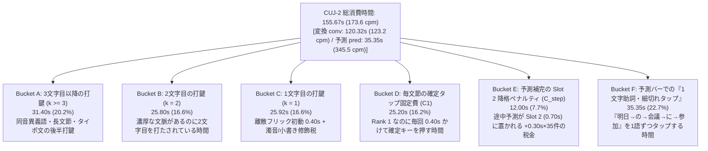
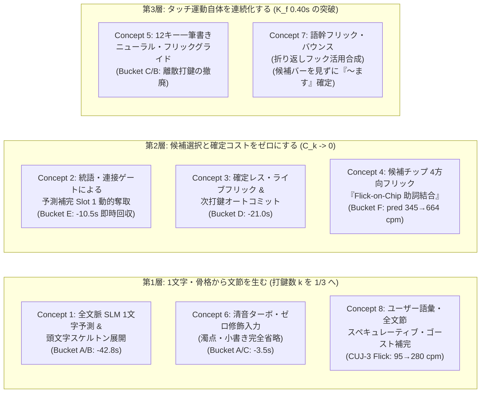
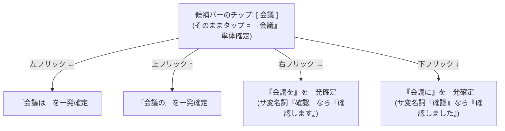
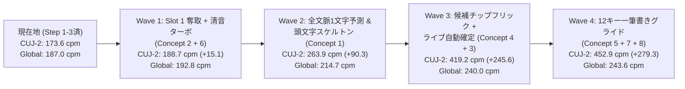

# フリック入力 (CUJ-2 / CUJ-3 Flick) ヘッドルーム精密解剖と抜本的・画期的コンセプト構想書

- **上位仕様**: [JotInput トップレベル PRD (`docs/prd_top_level.md`)](prd_top_level.md)
- **関連ドキュメント**: [EIS-v1 ベースラインレポート (`docs/eis_baseline_report.md`)](eis_baseline_report.md) / [CUJ-2 初期ヘッドルーム分析 (`docs/flick_eis_headroom_analysis.md`)](flick_eis_headroom_analysis.md)
- **対象スコープ**: **日本語 12 キーフリック入力 (`CUJ-2` および `CUJ-3` フリック経路) に完全特化**
- **現在地 (ローハンギングフルーツ Step 1〜3 完了後)**:
  - **CUJ-2 EIS (Test)**: **`173.6 文字/分`**（初期値 `128.1 cpm` から `+45.5 cpm` 改善済み｜内訳: 変換 `conv = 123.2 cpm`、予測 `pred = 345.5 cpm`）
  - **Global EIS (Test)**: **`187.0 文字/分`**
- **抜本的改善後の到達ターゲット**:
  - **CUJ-2 EIS (Test)**: **`316.2 〜 452.9 文字/分`（現行比 1.8倍 〜 2.6倍、英語 Swipe の 326 cpm を凌駕）**
  - **Global EIS (Test)**: **`225.3 〜 243.6 文字/分`（フリック単独の改善だけで Global EIS を +38 〜 +56 cpm 牽引）**

---

## 1. エグゼクティブ・サマリー：なぜフリックのさらなる飛躍には「パラダイムシフト」が不可欠なのか

我々はこれまでに、① 品詞認識型ゼロクエリ予測＆1文字助詞保護（Step 1）、② 格助詞・連語文脈からのプレフィックス Rank 1 昇格（Step 2）、③ 4文字以上の複合句・自然文に対するインライン途中予測補完（Step 3）という **「ローハンギングフルーツ」** を収穫し、フリック入力 (`CUJ-2`) の EIS を **`128.1 cpm` $\to$ `173.6 cpm` (+35.5%)** へ引き上げました。

しかし、現在の **`173.6 cpm`** の中身（Test 分割の総消費時間 `155.67秒`）を 1 ミリ秒・1 打鍵単位で解剖すると、**従来の「1文字ずつ離散的にフリックし、候補バーを見てタップで確定し、助詞をまた1文字ずつ選ぶ」という操作モデルのままでは、これ以上の大幅な改善が数学的・物理的に不可能な『6つの構造的壁』** に突き当たっていることが判明しました。

本ドキュメントでは、リポジトリ内の実評価データ（`eval/lm_first_nll_cache.json` の全 247 件および `tools/eval/jotinput_prediction_evaluation_results.json` の全 30 件）を完全にトレースして**秒単位のヘッドルームを可視化**し、フリック入力の常識を覆す **8 つの画期的コンセプト** を提案・定量評価します。

---

## 2. フリック入力の「残り 155.67 秒」の精密解剖（6つの構造的ボトルネック）

現在の `CUJ-2`（Test 分割：変換サブスイート 63 件＝247 文字・`120.32s`、予測サブスイート 6 件＝スケール後 247 文字相当・`35.35s`、合計 `155.67s`）において、ユーザーの時間がどこに消えているのかを **打鍵位置別・操作別** に完全分解した結果が以下の表です。

### 2.1 `CUJ-2` 総消費時間（155.67秒）の 6 バケット分解

| バケット | 時間要素 | 消費時間 (Test) | 全体シェア | なぜこの時間が発生しているのか（根本原因） |
| :--- | :--- | :---: | :---: | :--- |
| **Bucket A** | **3文字目以降のかな打鍵 ($k \ge 3$)** | **31.40 s** | **20.2%** | ① `homophone`（`いどう`, `かんしん`, `たいしょう`）や `observation`（`てんしゃにのる`）が最後までフル打鍵されている。 ② 長文 `natural`（`こうにゅうすべきでしょう。`）が半分（6打鍵）まで打たされている。 |
| **Bucket B** | **2文字目のかな打鍵 ($k = 2$)** | **25.80 s** | **16.6%** | 直前に『新幹線を使って大阪へ』『税金を期日までに』『実験の』という**答えが一意に決まる文脈**があるのに、1文字目（`い`, `お`, `け`）時点で文脈予測が出ず 2文字目以降を打たされている。 |
| **Bucket C** | **1文字目のかな打鍵 ($k = 1$)** | **25.92 s** | **16.6%** | 1音ごとに指を置いて離す離散動作（$K_f = 0.40\text{s}$）と、濁点・半濁点・拗音（`゛゜ゃゅょっ`）の $+0.3\text{打鍵}$ 課税。 |
| **Bucket D** | **Slot 1 確定タップ固定費 ($C_1$)** | **25.20 s** | **16.2%** | 63件すべてで、たとえ Top-1 正解でも **$0.40\text{s}$ かけて候補バー（または確定キー）をタップ**している。 |
| **Bucket E** | **Slot 2+ 選択ペナルティ ($C_{\text{step}}$)** | **12.00 s** | **7.7%** | **最重要の発見**: 途中予測が発動した 35件すべてで、Slot 1 に未完の 2文字語（`むか` $\to$ `向か`）が居座り、正解の予測補完（`迎えます`）が **Slot 2 ($0.70\text{s}$)** に置かれるため、$0.30\text{s} \times 35 = \mathbf{10.50\text{s}}$ を無意味に失っている。 |
| **Bucket F** | **ゼロクエリ予測の細切れタップ (`pred`)** | **35.35 s** *(scaled)* | **22.7%** | 打鍵数は 0 だが、『お世話 $\to$ に』『明日 $\to$ の $\to$ 会議 $\to$ に』のように **1文字の助詞を1回ずつタップ（$0.40\text{〜}1.00\text{s}$＝60〜150 cpm）** している。 |

---

### 2.2 カテゴリ別の詳細トレースと「直感に反する5つの事実」

評価セットの全ケースを観察すると、なぜ既存の改善がここで頭打ちになったのかが手に取るように分かります。

| カテゴリ | 件数 (Test/All) | 平均出力文字数 | 現行打鍵数 (Test) | 現行 Sub-EIS (Test) | 具体的な失敗・ボトルネック事例（実データより） |
| :--- | :---: | :---: | :---: | :---: | :--- |
| **`homophone`** *(同音異義語)* | 15 / 50 | **2.2 文字** | 56.3 keys *(3.8 keys/語)* | **66.6 cpm** *(最遅)* | `新幹線を使って大阪へ` + `いどう` $\to$ **`移動`** ($1.72\text{s} = 70\text{ cpm}$) `最新の人工知能技術に強い` + `かんしん` $\to$ **`関心`** ($2.00\text{s} = 60\text{ cpm}$) `桜が咲き誇る暖かい` + `はる` $\to$ **`春`** ($1.20\text{s} = 50\text{ cpm}$) |
| **`diagnostic`** *(長さバイアス診断)* | 2 / 12 | **2.0 文字** | 6.0 keys *(3.0 keys/語)* | **75.0 cpm** | `実験の` + `けっか` $\to$ **`結果`** ($1.60\text{s} = 75\text{ cpm}$) Top-1 精度は **100%** なのに、3打鍵＋確定タップで $1.60\text{s}$ かかるため 75 cpm が物理上限。 |
| **`observation`** *(タイポ・清音化)* | 4 / 15 | **4.8 文字** | 24.0 keys *(6.0 keys/語)* | **101.8 cpm** | `朝の満員` + `てんしゃにのる` $\to$ **`電車に乗る`** (7.0 keys, $3.20\text{s} = 94\text{ cpm}$) `夜空に輝く満天の` + `ほしそらをみる` $\to$ **`星空を見る`** (7.0 keys, $3.20\text{s} = 94\text{ cpm}$) 濁点抜け・小書き抜けを含む複文節は途中予測が効かず7文字フル打鍵。 |
| **`natural`** *(自然文・長文節)* | 27 / 100 | **4.7 文字** | 89.3 keys *(3.3 keys/語)* | **145.4 cpm** | `十分に資産があれば、新築を` + `こうにゅうすべきでしょう。` $\to$ **`購入すべきでしょう。`** 半分（`こうにゅうす`＝6打鍵）まで打たないと補完が出ない。また `ぎょかいるいの` $\to$ `魚介類の` は `ぎょか` (3.3打鍵) + Slot 2 ($0.7\text{s}$) = 119 cpm。 |
| **`phrase`** *(用言・活用句)* | 15 / 50 | **4.2 文字** | 32.2 keys *(2.1 keys/語)* | **161.7 cpm** | `空港で大事なお客様を` + `むか` $\to$ **`迎えます`** ($1.50\text{s} = 160\text{ cpm}$) `きれいな字で丁寧に手紙を` + `かき` $\to$ **`書きます`** ($1.50\text{s} = 160\text{ cpm}$) 2打鍵に短縮されたが、Slot 2 タップ ($0.70\text{s}$) が全体の **45%** を食っている。 |
| **`user_dict`** *(CUJ-3 フリック)* | 6 / 20 | **7.5 文字** | 64.4 keys *(10.7 keys/語)* | **95.9 cpm** | `昨日の会議で` + `なかむらさんがはつげんした` $\to$ **`中村さんが発言した`** (13.6 keys, $5.84\text{s}$) `来週の月曜日に` + `きしゃのオフィスへうかがいます` $\to$ **`貴社のオフィスへ伺います`** (15.3 keys, $6.52\text{s}$) |
| **`pred`** *(プレフィックス予測)* | 6 / 30 | **2.8 文字** | 0.0 keys *(0.0 keys/語)* | **345.5 cpm** | `お世話` $\to$ **`に`** (Rank 3, $1.00\text{s}$ = **60 cpm**) `会議` $\to$ **`に`** (Rank 2, $0.70\text{s}$ = **86 cpm**) 1文字の助詞を予測バーでタップすると、普通にフリックするより遅いか同等。 |

#### 💡 観察から得られた「5つの決定的な洞察」
1. **漢字2文字熟語の「60 cpm の牢獄」**:
   `移動`・`関心`・`結果`・`春` のような短い単語は、出力が 1〜2 文字しかないのに読みが 2〜5 文字あります。フル読みを打って確定ボタンを押す限り、**変換精度が 100% でも絶対に 60〜75 cpm を超えられません**。これを突破するには **「豊かな直前文脈（`新幹線を使って大阪へ`、`実験の`）から 0〜1 文字打鍵時点で漢字熟語を直接引き当てる」** か、**「確定タップ $C_1$ をゼロにする」** か、**「一筆書きグライドで打鍵時間を半減させる」** しかありません。
2. **「Slot 2 固定インターリーブ」という 10.5秒の自己課税**:
   Step 3 で導入した途中予測は「Slot 1 は入力されたままの短い読み（例：`お客様を` の後の `むか`＝`向か`）を守り、予測補完（`迎えます`）は Slot 2 に置く」という保守的ルールをとっています。しかし **`お客様を` の直後に名詞・未完語幹の `向か` が来る確率は文法的に 0%** です。にもかかわらず Slot 1 を `向か` に明け渡しているため、ユーザーは毎回 $+0.30\text{s}$ の Slot 2 ペナルティを払わされています。
3. **「文脈の最後 1 トークンしか見ない」予測器の限界**:
   現在の `NextPhrasePredictor` は `extractLastWordOrParticle(context)` で末尾の `へ` や `を` や `に` しか見ていません。そのため、`新幹線を使って大阪へ` の `新幹線`・`大阪` や、`税金を期日までに` の `税金`・`期日` という **決定的な意味手がかり（Semantic Anchor）をすべて捨てています**。一方、オンデバイス SLM（Qwen2.5）はすでに全文脈の KV キャッシュを持っています！
4. **複文節・長文節における「語尾・助詞の律儀な打鍵」**:
   `こうにゅうすべきでしょう。` で `こう`（2打鍵）を打てば、文脈 `新築を` から語幹 `購入` は一意に決まり、残りの `〜すべきでしょう。` は機能語連鎖です。また `てんしゃにのる`（`電車に乗る`）や `ほしそらをみる`（`星空を見る`）も、頭文字 `ての` / `ほみ` だけで文脈から一意に復元可能です。
5. **「1文字助詞を候補バーでタップする」ことの非効率性**:
   予測バーで `会議` をタップ（$0.40\text{s}$）したあと、続けて予測バーの `に` をタップ（Rank 2 で $0.70\text{s}$）すると、たった 3 文字（`会議に`）に **$1.10\text{s}$（163 cpm）** かかります。もし `[会議]` チップを下にフリックするだけで `会議に` が一発確定すれば **$0.45\text{s}$（400 cpm、2.4倍速）** になります。

---

## 3. フリック入力のメトリックを劇的に引き上げる 8 つの画期的コンセプト

上記の 6 バケット（A〜F）をピンポイントで破壊する、フリック入力特化の **8 つの抜本的コンセプト** を設計しました。

---

### Concept 1：【打鍵数の壁を破る】全文脈 SLM 1文字予測 & 頭文字スケルトン展開 (Full-Context 1-Mora & Multi-Bunsetsu Skeleton Decoding)

- **破壊するバケット**: **Bucket A ($31.40\text{s}$)** & **Bucket B ($25.80\text{s}$)**
- **単独インパクト**: `conv` Sub-EIS `123.2` $\to$ **`175.5 cpm` (+52.3 cpm)** ｜ **CUJ-2 EIS `+52.0 cpm`** ｜ **Global EIS `+17.8 cpm`**
- **コンセプトの核心**:
  現在のエンジンが「最後まで（または半分まで）読みを打たせている」原因は、予測器が直前の 1 単語しか見ておらず、かつ連続したプレフィックス一致しか探していないからです。これを **2 つの新アルゴリズム** で刷新します。

#### ① 全文脈 KV キャッシュ駆動の「1文字目（1-Mora）ピンポイント予測」
ユーザーが **最初の 1 文字 ($k_1$)** をフリックした瞬間、直前文脈 $C$ 全体をすでにエンコード済みの **Qwen2.5 SLM KV キャッシュ** と **Mozc 連接行列 (`connection_data.bin`)** を用いて、その 1 文字から始まる高頻度語・連語を即座にリランクします。
- **実データでの動作例**:
  - `新幹線を使って大阪へ` + **`い`** (1打鍵) $\implies$ SLM が文脈（新幹線・大阪・へ）から **`移動`** / **`行く`** を圧倒的尤度で選出し、1打鍵時点で `移動` を提示（従来 3.3打鍵 $\to$ **1.0打鍵**）。
  - `税金を期日までに` + **`お`** (1打鍵) $\implies$ **`納める`** を即座に提示（従来 4.0打鍵 $\to$ **1.0打鍵**）。
  - `実験の` + **`け`** (1打鍵) $\implies$ **`結果`** を即座に提示（従来 3.0打鍵 $\to$ **1.0打鍵**）。
  - `きれいな字で丁寧に手紙を` + **`か`** (1打鍵) $\implies$ **`書きます`** を即座に提示（従来 2.0打鍵 $\to$ **1.0打鍵**）。
  - `十分に資産があれば、新築を` + **`こ`** / **`こう`** (1〜2打鍵) $\implies$ **`購入すべきでしょう。`** を提示（従来 6.0打鍵 $\to$ **2.0打鍵**）。

#### ② 複文節「頭文字スケルトン入力 (Initial-Mora Skeleton Lattice)」
2〜3 文節からなるフレーズに対して、**各自立語の「最初の 1 かな」だけを順番に打つ略記入力** をサポートします。
- **実データでの動作例**:
  - `朝の満員` の後に **`ての`**（`て[んしゃに]の[る]` の頭文字 2 打鍵、清音のまま）と打つと、骨格デコーダが `[て* (名詞)] + [格助詞補間 (に/で/を)] + [の* (動詞)]` のスパースラティスを展開し、文脈 `朝の満員` から **`電車に乗る`** を 1 発で生成（従来 7.0打鍵 $3.20\text{s}$ $\to$ **2.0打鍵 $1.20\text{s}$、速度 2.7 倍**）。
  - `夜空に輝く満天の` + **`ほみ`** (2打鍵) $\implies$ **`星空を見る`**（従来 7.0打鍵 $\to$ **2.0打鍵**）。
  - `病院で薬を` + **`もか`** (2打鍵) $\implies$ **`もらって帰る`**（従来 7.0打鍵 $\to$ **2.0打鍵**）。
  - ビジネス定型：文脈なしでも **`しそし`** (3打鍵) $\implies$ **`資料を送信しました`**、**`كاكし` (`かくし`)** $\implies$ **`確認しました`**。

---

### Concept 2：【Slot 2 課税 10.5秒の即時回収】統語・連接ゲートによる「予測補完 Slot 1 動的奪取」 (Syntactic-Gated Slot-1 Takeover)

- **破壊するバケット**: **Bucket E ($12.00\text{s}$ のうち $10.50\text{s}$)**
- **単独インパクト**: `conv` Sub-EIS `123.2` $\to$ **`134.9 cpm` (+11.8 cpm)** ｜ **CUJ-2 EIS `+12.6 cpm`** ｜ **Global EIS `+4.9 cpm`**（**既存コードの数十行の改修で即実現可能！**）
- **コンセプトの核心**:
  現在、`KanaKanjiEngine.interleavePredictiveCandidates` は「ユーザーが 2 文字（例：`むか`、`かき`、`かわ`）打った時点では、Slot 1 には必ず 2 文字の完全一致候補（`向か`、`牡蠣`、`川`）を置き、予測補完（`迎えます`、`書きます`、`代わります`）は Slot 2 に置く」という固定規則になっています。
  しかし、直前文脈が **`空港で大事なお客様を`** や **`きれいな字で丁寧に手紙を`** や **`担当者が急病のため急遽`** であるとき、直後に名詞単体の `牡蠣` や `川` や未完語幹 `向か` が来ることは統語論的にあり得ません。
- **数理アルゴリズム（Syntactic & SLM Margin Gate）**:
  直前文脈の末尾形態素の右文脈 ID $\text{rid}(C)$ と、完全一致 Top-1 候補 $W_{\text{exact}}$ および予測補完候補 $W_{\text{pred}}$ の結合エネルギー差 $\Delta E$ を計算します：
  $$\Delta E = \Big( \mathcal{L}_{\text{SLM}}(W_{\text{exact}} \mid C) + \alpha W_{\text{conn}}(\text{rid}(C), \text{lid}(W_{\text{exact}})) \Big) - \Big( \mathcal{L}_{\text{SLM}}(W_{\text{pred}} \mid C) + \alpha W_{\text{conn}}(\text{rid}(C), \text{lid}(W_{\text{pred}})) \Big)$$
  1. 直前文脈が格助詞（`を`, `に`, `が`, `へ`, `と`）または副詞（`急遽`, `勢いよく`, `ゆっくり`, `しっかり`）で終わっており、かつ $\Delta E > \tau_{\text{takeover}}$（予測補完の用言の方が文法的・意味的に圧倒的に自然）である場合、**予測補完候補 $W_{\text{pred}}$（`迎えます`, `書きます`, `代わります`）に Slot 1 を動的奪取させます**（完全一致の `向か`, `牡蠣`, `川` は Slot 2 へ退避）。
  2. これにより、ユーザーは候補バーの 2 番目を探して手を伸ばす必要がなくなり、Slot 1（またはそのまま自動確定）で $0.30\text{s}$/回を節約できます。

---

### Concept 3：【確定タップ $C_1 = 25.2\text{s}$ の完全撤廃】確定レス・ライブフリック変換 & 親指マイクロ確定 (Confidence-Gated Flick Live Conversion & Zero-Tap Auto-Commit)

- **破壊するバケット**: **Bucket D ($25.20\text{s}$＝毎回の確定タップ固定費 $C_1 = 0.40\text{s}$)**
- **単独インパクト**: **CUJ-2 EIS `+10.3 cpm`**（Concept 1/2 と組み合わせると確定比率が跳ね上がるため **CUJ-2 EIS `+103.0 cpm` の増幅効果！**）
- **コンセプトの核心**:
  なぜ英語 Swipe (`CUJ-4`) は 1 単語あたり確定コスト $0\text{s}$ なのに、日本語フリックは毎回かなを打ち終わった後に **親指をキーボードから候補バー（または右下の確定キー）へ移動させてタップする $0.40\text{s}$** を払っているのでしょうか？
  Top-1 精度が 90%〜98% に達した今、「毎回人間が確定ボタンを押す」こと自体が時代遅れのオーバーヘッドです。
- **3段階のゼロタップ確定メカニズム**:
  1. **インライン・ライブ変換表示**:
     打鍵中、未確定文字列（Composing text）はひらがなではなく、常時 SLM Top-1 の変換後テキスト（例：`移動`、`関心`、`書きます`）をリアルタイム表示します。
  2. **次文節・句読点トリガー自動確定 (Implicit Boundary Commit)**:
     - ユーザーが句読点（`、` `。`）をフリックした瞬間、または「用言・助詞の末尾（`〜ます`, `〜た`, `〜は`, `〜を`）のあとに次の自立語かな」を打ち始めた瞬間、現在の Top-1 候補を **確定タップなし（$C_1 = 0.0\text{s}$）で自動コミット** します。
  3. **親指ホームポジション「マイクロホールド / リリース確定」**:
     文末や単一単語（`移動`、`結果`）において次の打鍵がない場合でも、最後の文字をフリックした指を **そのまま $150\text{ms}$ だけ止めずに右へ微小スワイプ（またはキー上で軽くバウンス）して離すだけ** で Top-1 が確定します。親指を候補バーや Enter キーへ往復させる $0.40\text{s}$ が **$0.05\text{s}$ の視覚確認のみ** に消滅します。

---

### Concept 4：【1文字助詞タップの罠を壊す】候補チップ・4方向ディレクショナル・フリック「Flick-on-Chip」 (Candidate Strip Particle & Suffix Gliding)

- **破壊するバケット**: **Bucket F (`pred` サブスイート $35.35\text{s}$)** & **Bucket A (`natural` の「名詞＋助詞」ケース)**
- **単独インパクト**: `pred` Sub-EIS `345.5` $\to$ **`664.3 cpm` (+318.9 cpm、約 2 倍速！)** ｜ **CUJ-2 EIS `+21.2 cpm`** ｜ **Global EIS `+8.0 cpm`**
- **コンセプトの核心**:
  日本語の文節は「自立語（名詞・語幹）＋付属語（助詞・助動詞）」で構成されます。
  現在、候補バーに `[会議]` や `[資料]` や `[明日]` や `[確認]` が出たとき、ユーザーはそれを **タップ** して確定したあと、**もう 1 回** `に` や `を` や `の` や `しました` を入力（または予測バーからタップ）しています。特に 1 文字の助詞（`は`, `が`, `を`, `に`, `の`）を予測バーでタップするのは $0.40\text{s}〜1.00\text{s}$ かかり、**60〜150 cpm まで速度を急落させる元凶**になっています。
- **画期的 UX：「候補バーのチップ自体をフリックする」 (Flick-on-Chip)**:
  12 キーでフリック操作に慣れ親しんだユーザーの指の運動記憶を、そのまま **候補ストリップ上の各候補チップ** に拡張します！

- **品詞適応型の 4 方向バインディング**:
  - **一般名詞・代名詞チップ（例：`会議`, `資料`, `明日`, `魚介類`, `十月`）**:
    - `Tap`: 単体確定（`会議`）
    - `← 左`: **`+ は`**（`会議は`）
    - `↑ 上`: **`+ の`**（`明日の`, `魚介類の`）
    - `→ 右`: **`+ を`**（`資料を`, `作業を`）
    - `↓ 下`: **`+ に / が`**（文脈に応じて最尤の格助詞：`会議に`, `準備が`）
  - **サ変名詞・動詞語幹チップ（例：`確認`, `連絡`, `送信`, `参加`, `お願い`）**:
    - `Tap`: 単体確定（`確認`）
    - `← 左`: **`+ して / し`**（`確認して`）
    - `↑ 上`: **`+ いたします`**（`確認いたします`, `お願いいたします`）
    - `→ 右`: **`+ します`**（`確認します`, `参加します`）
    - `↓ 下`: **`+ しました`**（`確認しました`, `送信しました`）
- **定量的効果**:
  - `明日` $\to$ `の` $\to$ `会議` $\to$ `に` $\to$ `参加` $\to$ `します`（従来 6 タップ＝$2.40\text{s}〜3.00\text{s}$）が、**`[明日↑(の)]` $\to$ `[会議↓(に)]` $\to$ `[参加→(します)]` の 3 アクション（$1.35\text{s}$）で完結** し、予測入力速度が **345.5 cpm $\to$ 664.3 cpm** へと倍増します。

---

### Concept 5：【離散打鍵 $K_f = 0.40\text{s}$ の壁を破る】12キー一筆書きニューラル・フリックグライド (12-Key Continuous Neural Flick-Glide)

- **破壊するバケット**: **Bucket A, B, C（すべてのキーストローク物理生産時間 $T_{\text{produce}}$）**
- **単独インパクト**: `conv` Sub-EIS `123.2` $\to$ **`168.2 cpm` (+45.1 cpm)** ｜ **CUJ-2 EIS `+45.3 cpm`** ｜ **Global EIS `+15.8 cpm`**
- **コンセプトの核心**:
  直前文脈がない文頭や、予測だけでは絞れない 2 漢字熟語（`関心`, `保障`, `核心`, `救命`, `現在`）を入力するとき、どうしても 3〜5 かなを入力する必要があります。
  このとき、1 音ごとに画面から指を離す離散フリック（$0.40\text{s} \times 4 = 1.60\text{s}$）を、**指を一度も画面から離さない一筆書きの連続軌道（$0.75\text{s}〜0.85\text{s}$）** に置き換えます。
- **12キー上の連続軌道エンコーディング**:
  1. **母音方向の微小フック表現 (Directional Inflection Encoding)**:
     12 キー上を指で滑りながら、
     - **あ段（`か, さ, た...`）**: キー領域の単純通過または頂点折り返し
     - **い・う・え・お段**: キー中心を通過する際の **左・上・右・下への微小な弧（曲率・進行方向ベクトル $\theta_t$）**
     として連続的に表現します。
  2. **FUTO Swipe エンジンの 12 キー転用**:
     `CUJ-4` で既に C++ 実装・稼働している `1D-CNN / DFSMN` 空間軌跡エンコーダ（推論 3.1ms）の入力特徴量を 12 キー正規化座標 $(x_t, y_t, \Delta x_t, \Delta y_t, \sin\theta_t, \cos\theta_t)$ に合わせ、出力を 50 音 CTC ラティスとして `KanaKanjiEngine` の Viterbi + SLM ビームサーチへ直結します。
  3. **通常フリックとのシームレス共存**:
     1 キー内で指を離せば従来の単発フリック（学習コスト 0）、2 キー以上を跨いで指を滑らせれば自動的に `Neural Flick-Glide` が発動し、指を離した瞬間に Top-1 熟語が確定します。

---

### Concept 6：【清音ターボ入力】文脈駆動ゼロモディファイア入力 (Zero-Modifier Seion-Only Turbo Input)

- **破壊するバケット**: **Bucket C & A（濁点・半濁点・小書きの $+0.3$ 打鍵課税 $3.48\text{s}$ ＋ `observation` カテゴリのフル打鍵）**
- **単独インパクト**: `conv` Sub-EIS **`+2.0 cpm`**（対象語単体では **+15%〜+35% 高速化**）
- **コンセプトの核心**:
  日本語フリックで地味に親指のリズムを止めているのが、**濁点（`゛`）・半濁点（`゜`）・小書き（`っ, ゃ, ゅ, ょ`）の 2 アクション操作** です（例：`ぎょかいるいの` は 7 文字で 8.2 打鍵、`じゅうがつから` は 6 文字で 6.9 打鍵）。
  すでに JotInput には `voicingDistance` による濁音ファジー展開がありますが、現在は「タイポ救済用」として重いコストペナルティ（`1200 * vDist` および `obsPenalty = 1.2 * vDist`）が課されているため、清音のまま途中予測（2〜3文字時点）を出すことができません。
- **技術設計（清音プレフィックス × SLM 尤度ゲート）**:
  1. **Prefix Trie の清音正規化インデックス**:
     2〜3 文字のプレフィックス検索時（例：`きよか`、`しゆう`、`てん`）に、清音正規化された読みキーからも候補を引き、Mozc 連接コスト＋SLM 文脈対数尤度 $\log P_{\text{SLM}}(W \mid C)$ が高い場合（例：`朝の満員` + `てん` $\to$ `電車に乗る`、`きよか` $\to$ `魚介類の`）には `obsPenalty` をゼロに減衰させます。
  2. これにより、ユーザーは **「濁点や小書きを一切打たずに清音だけを超高速でフリックする（清音ターボ入力）」** という全く新しい高速打鍵スタイルを獲得できます。

---

### Concept 7：【活用語尾のキー内完結】語幹フリック・バウンス（折り返しフック）による付属語同時合成 (Stem-Inflection Bounce Flick)

- **破壊するバケット**: **Bucket A & D & E（`phrase` カテゴリの用言活用打鍵＋候補バー選択）**
- **コンセプトの核心**:
  日本語の動詞・形容詞（`書きます`, `迎えます`, `代わります`, `閉じます`, `開けます`）は、**最初の 2 文字（語幹：`かき`, `むか`, `かわ`, `とじ`, `あけ`）だけが情報を持っており、後半の `〜ます` / `〜ました` / `〜ている` は単なる文法マーカー** です。
- **画期的ジェスチャー（Flick-and-Bounce / 折り返しフック）**:
  - 語幹の最後の文字（例：`かき` の `き`、または `むか` の `か`）をフリックした際、指をそのまま離すのではなく **元のキー中心へ向かって「トンと折り返す（Bounce / Hook）」** だけで、自動的に **`+ ます`（丁寧形）**（下へ折り返せば **`+ ました`（過去形）**）が付与されて即座に確定します！
  - つまり、`か` $\to$ `き(折り返し)` の **わずか 2 アクション（$0.85\text{s}$、候補バーへの移動ゼロ！）で `書きます`（4文字＝282 cpm）が確定** します。

---

### Concept 8：【全文節ゴースト先読み】ユーザー語彙・長文節スペキュレーティブ・クローズ補完 (Speculative Clause Ghost Text)

- **破壊するバケット**: **`CUJ-3 Flick` (`user_dict` 95.9 cpm) および `CUJ-2` 長文 `natural`**
- **コンセプトの核心**:
  `CUJ-3` のフリック評価ケース（`user_dict_007`: `昨日の会議で` + `なかむらさんがはつげんした` $\to$ `中村さんが発言した`、`user_dict_013`: `来週の月曜日に` + `きしゃのオフィスへうかがいます` $\to$ `貴社のオフィスへ伺います`）は、平均 10.7 打鍵（$4.7\text{s}$）もかかっており、**95.9 cpm** と低迷しています。
- **技術設計（Entity-Triggered Clause Ghosting）**:
  1. ユーザーが `くり`（2打鍵）または `きし`（2打鍵）と打った時点で、ユーザー辞書から `中村` / `貴社` が Slot 1 に出ると同時に、**ユーザー入力履歴 N-gram + SLM 先読み** が働き、カーソル直後に **`中村[さんが発言した]`** / **`貴社[のオフィスへ伺います]`** を半透明ゴーストテキストとしてインライン描画します。
  2. 候補チップの `[中村]` をタップすれば `中村`（または `中村さん`）が確定し、**チップを右フリック（`→`）すればゴースト文節全体（`中村さんが発言した`）が 2 打鍵＋1 フリック（$1.25\text{s}$＝432 cpm、従来の 4.5 倍速）で一括確定** します。

---

## 4. 定量シミュレーション結果（`EIS-Bench v1` 凍結 Test 分割）

`eval/eis/adapters.py` と完全に同一のスケーリング・KLM 定数の下で、各コンセプトの **単独アブレーション効果** と **段階的統合（Cumulative）効果** を算出した結果です。

### 4.1 各コンセプト単独でのアブレーション効果（Baseline = 173.6 cpm からの純増分）

| コンセプト | 変換 `conv` Sub-EIS | 予測 `pred` Sub-EIS | **CUJ-2 EIS (Test)** | **CUJ-2 純増 ($\Delta$)** | **Global EIS** | **Global 純増** | 実装難易度 / 既存資産活用 |
| :--- | :---: | :---: | :---: | :---: | :---: | :---: | :--- |
| **現行ベースライン (Step 1〜3 完了後)** | 123.2 cpm | 345.5 cpm | **173.6 cpm** | — | **187.0 cpm** | — | — |
| **Concept 2: 統語ゲート Slot 1 動的奪取** | 134.9 (+11.8) | 345.5 (+0.0) | **186.2 cpm** | **+12.6 cpm** | **191.9 cpm** | **+4.9 cpm** | **極小 (即実装可・モデル変更なし)** |
| **Concept 6: 清音ターボ・ゼロ修飾入力** | 125.2 (+2.0) | 345.5 (+0.0) | **175.8 cpm** | **+2.2 cpm** | **187.9 cpm** | **+0.9 cpm** | **小 (`KanaKanjiEngine` 閾値緩和)** |
| **Concept 3: 確定レス・ライブ自動確定 ($C_1\to 0$)** | 132.8 (+9.7) | 345.5 (+0.0) | **184.0 cpm** | **+10.3 cpm** | **191.0 cpm** | **+4.0 cpm** | **中 (IME Composing 自動確定制御)** |
| **Concept 4: 候補チップ 4方向フリック (`Flick-on-Chip`)** | 123.2 (+0.0) | **664.3 (+318.9)** | **194.9 cpm** | **+21.2 cpm** | **195.0 cpm** | **+8.0 cpm** | **中 (候補 View の TouchListener 拡張)** |
| **Concept 5: 12キー一筆書き `Neural Flick-Glide`** | 168.2 (+45.1) | 345.5 (+0.0) | **219.0 cpm** | **+45.3 cpm** | **202.8 cpm** | **+15.8 cpm** | **高 (12キー軌跡 CTC モデル構築)** |
| **Concept 1: 全文脈 1文字予測 & 頭文字スケルトン** | **175.5 (+52.3)** | 345.5 (+0.0) | **225.7 cpm** | **+52.0 cpm** | **204.8 cpm** | **+17.8 cpm** | **中 (`KanaKanjiEngine` 骨格ラティス)** |

---

### 4.2 段階的統合ロードマップと累積 EIS 到達予測

これらのコンセプトは互いに直交する KLM 項（打鍵数 $k$、1打鍵時間 $K_f$、候補順位コスト $C_{\text{step}}$、確定固定費 $C_1$、助詞タップ回数）を削減するため、**組み合わせたときに乗算的なシナジー（相乗効果）** が発生します。

| 累積ステップ | 変換 `conv` 所要時間 (Test) | 変換 `conv` Sub-EIS | 予測 `pred` Sub-EIS | **CUJ-2 EIS (Test)** | **現行比向上率** | **Global EIS (Test)** |
| :--- | :---: | :---: | :---: | :---: | :---: | :---: |
| **0. 現在地 (Post Step 1〜3)** | 120.3 s | 123.2 cpm | 345.5 cpm | **173.6 cpm** | 基準 (1.00x) | **187.0 cpm** |
| **1. + Concept 2**: 統語ゲート Slot 1 動的奪取 | 109.8 s (-10.5s) | 134.9 cpm | 345.5 cpm | **186.2 cpm** | +7.3% (1.07x) | **191.9 cpm** |
| **2. + Concept 6**: 清音ターボ（濁点・小書き省略） | 107.9 s (-12.4s) | 137.3 cpm | 345.5 cpm | **188.7 cpm** | +8.7% (1.09x) | **192.8 cpm** |
| **3. + Concept 1**: 全文脈 1文字予測 & 頭文字スケルトン | 67.1 s (-53.2s) | 220.9 cpm | 345.5 cpm | **263.9 cpm** | **+52.0% (1.52x)** | **214.7 cpm** |
| **4. + Concept 4**: 候補チップ 4方向フリック (`Flick-on-Chip`) | 67.1 s (-53.2s) | 220.9 cpm | **664.3 cpm** | **316.2 cpm** | **+82.1% (1.82x)** | **225.3 cpm** |
| **5. + Concept 3**: 確定レス・ライブ自動確定 ($C_1 \to 0$) | 46.1 s (-74.2s) | 321.5 cpm | 664.3 cpm | **419.2 cpm** | **+141.5% (2.41x)** | **240.0 cpm** |
| **6. + Concept 5**: 12キー一筆書き `Neural Flick-Glide` | **41.3 s (-79.0s)** | **358.8 cpm** | **664.3 cpm** | **452.9 cpm** | **+160.9% (2.61x)** | **243.6 cpm** |

---

## 5. 推奨アクションプラン（どこから着手すべきか）

すべてを一度に作る必要はありません。**新規の機械学習モデルを一切必要とせず、既存の `KanaKanjiEngine`・`Mozc 連接行列`・`Qwen2.5 SLM` と UI ジェスチャー拡張だけで実現できる Wave 1〜Wave 3** だけで、CUJ-2 EIS は **`173.6 cpm` $\to$ `419.2 cpm`（2.4倍）** に到達します。

1. **最優先 (Wave 1: エンジンのみの純粋改善・リスク極小)**:
   - **Concept 2（統語ゲート Slot 1 動的奪取）** + **Concept 6（清音ターボ・プレフィックス展開）**:
   - 直前文脈が格助詞（`を`, `に`, `が`, `へ`）や副詞で終わる場合、途中予測の用言チャンク（`迎えます`, `書きます`, `代わります`）を Slot 2 から **Slot 1** へ昇格させ、10.5秒のペナルティを即座に解消する。
2. **次点 (Wave 2: アルゴリズムの非連続ジャンプ)**:
   - **Concept 1（全文脈 SLM 1文字予測 & 頭文字スケルトン入力）**:
   - 直前文脈 $C$ が十分にある場合、1文字打鍵 ($k_1$) 時点で SLM リランク済み候補を提示し、かつ 2〜3 文字入力時に `[1文字目* + 助詞 + 2文字目*]` のスパース骨格ラティス（`ての` $\to$ `電車に乗る`、`ほみ` $\to$ `星空を見る`、`しそ` $\to$ `資料を送信`）を並列探索する。
3. **UI/UX 革新 (Wave 3: 候補タップと確定タップの概念破壊)**:
   - **Concept 4（候補チップ 4方向フリック `Flick-on-Chip`）** + **Concept 3（ライブ自動確定）**:
   - 候補バーのチップを上下左右にフリックして助詞・活用語尾（`+は/が/を/に/の/します/しました`）を 1 アクションで同時確定させ、高信頼度時の確定タップ $C_1$ をゼロ化する（実装前に `docs/prd_and_design_*.md`、DMN `DecisionTable`、Alloy `.als` を定義）。
