# EIS 抜本的改善・新コンセプト構想書 — ローハンギングフルーツ後のヘッドルーム解剖と非連続イノベーション

- **上位仕様**: [JotInput トップレベル PRD (`docs/prd_top_level.md`)](prd_top_level.md)
- **関連ベースライン**: [EIS-v1 ベースラインレポート (`docs/eis_baseline_report.md`)](eis_baseline_report.md) / [CUJ-2 フリックヘッドルーム分析 (`docs/flick_eis_headroom_analysis.md`)](flick_eis_headroom_analysis.md)
- **対象スコープ**: 全 CUJ（CUJ-1 音声 / CUJ-2 フリック / CUJ-3 自分の語彙 / CUJ-4 英語・マルチモーダル）
- **現在地 (Post-Quick-Wins)**: **Global EIS = 187.0 文字/分**（Phase 1 初期値 164.9 cpm からローハンギングフルーツ施策により +22.1 cpm 改善済み）
- **抜本的改善ターゲット**: **Global EIS = 280〜350+ 文字/分（現行比 1.5倍〜1.9倍）**、意図圧縮モード併用時 **500+ 文字/分**

---

## 1. エグゼクティブ・サマリー：なぜ今「非連続なコンセプト」が必要なのか

我々はトップレベルメトリック **EIS（Effective Intended-text Speed: 1分あたりに生み出せる意図どおりの最終文字数）** を定義し、CUJ-2 における品詞認識ゼロクエリ予測、文脈連語プロモーション、インライン複合チャンク予測といった「ローハンギングフルーツ（既存の入出力パラダイム内でのランキング・辞書ヒューリスティクス改善）」を完了しました。その結果、Global EIS は **164.9 cpm $\to$ 187.0 cpm (+13.4%)** へと大きく前進しました。

しかし、現在の **187.0 cpm** の内部時間構造を解剖すると、**従来の「1文字ずつ打つ」「1文節ずつ確定する」「1-best の音声認識文字列を手作業でバックスペース消去して打ち直す」「設定画面を開いて辞書登録する」という前提（局所最適化）のままでは、これ以上の大幅なメトリック向上は物理的・数学的な漸近線（壁）に阻まれる**ことが明確に観測されます。

本ドキュメントでは、凍結 Test 分割（`EIS-Bench v1`）の全時間消費コンポーネントを精密に解剖して**真のヘッドルーム（未開拓の巨大な時間ロス）**を特定し、インクリメンタルな改善ではなく**入力の物理法則そのものを変える 8 つの抜本的改善・新コンセプト**を提案します。

---

## 2. ローハンギングフルーツ完了後のヘッドルーム解剖（4つの構造的壁）

現在の Test 分割における Global EIS (**187.0 cpm**) の CUJ 別時間シェアと感度（$\partial \mathrm{EIS} / \partial \mathrm{EIS}_c$）は以下の通りです。

| CUJ | 領域 | 文字重み $w_c$ | 現行 $\mathrm{EIS}_c$ | 総時間占有率 | 感度 $\frac{\partial \mathrm{EIS}}{\partial \mathrm{EIS}_c}$ | 倍増時 ($2\times$) の Global EIS | 現在の最大支配項（ボトルネック） |
| :--- | :--- | :---: | :---: | :---: | :---: | :---: | :--- |
| **CUJ-1** | 日本語音声入力 | 0.40 | **204.4 cpm** | 36.6% | 0.335 | 228.9 (+41.9) | 発話物理時間 (68%) + 誤認識の手動削除・再打鍵 (21%) + マイク操作 (11%) |
| **CUJ-2** | 日本語フリック入力 | 0.35 | **173.6 cpm** | **37.7%** | **0.406** | **230.4 (+43.4)** | フル読み打鍵時間 $K_f \times \text{keys}$ + 毎回確定タップ $C_1$ |
| **CUJ-3** | 固有名詞・辞書入力 | 0.15 | **139.0 cpm** | 20.2% | 0.271 | 208.0 (+21.0) | **手動辞書登録コスト 12秒 (26%)** + 未知語・同音異義語の修正 (23%) |
| **CUJ-4** | 英語入力 (音声+Swipe) | 0.10 | **337.7 cpm** | 5.5% | 0.031 | 192.3 (+5.3) | 既に高速（1ジェスチャー＝1単語＋自動スペース） |

各 CUJ の秒単位の内訳から、インクリメンタルな改善を阻んでいる **4つの構造的壁（Laws of Diminishing Returns）** が浮かび上がります。

```mermaid
flowchart TD
    subgraph Wall1["壁1: 漢字圧縮とモーラ打鍵の物理限界 (CUJ-2)"]
        W1A["漢字2文字語 (例: 会議, 移動, 結果)<br/>出力はわずか 2 chars"] --> W1B["入力は 3.3〜4.6 かな打鍵 (1.6s) + 確定タップ (0.4s) = 2.0s"]
        W1B --> W1C["変換精度 100% オラクルでも<br/>速度上限は 60〜75 cpm で頭打ち"]
    end
    subgraph Wall2["壁2: 1文字1アクション vs 連続ジェスチャー格差 (CUJ-2 vs CUJ-4)"]
        W2A["英語 Swipe (CUJ-4): 1ストローク (0.8s) で 5.7文字確定 = 427 cpm"] --> W2B["日本語フリック (CUJ-2): 1モーラごとに指を離す離散打鍵 + 明示確定タップ"]
    end
    subgraph Wall3["壁3: 音声誤認識の非対称修正ペナルティ (CUJ-1 / CUJ-3)"]
        W3A["音声で1漢字だけ同音異義語ミス (例: 製 vs 制)"] --> W3B["発見 L(1.5s) + 削除 D(0.2s) + フリック再入力(1.7s) = 3.4秒のペナルティ"]
        W3B --> W3C["たった1文字の誤りで発話24モーラ分 (3.4s) の貯金が吹き飛ぶ"]
    end
    subgraph Wall4["壁4: 明示的辞書登録 UI の12秒課税 (CUJ-3)"]
        W4A["CUJ-3 総時間 2,738.6s のうち<br/>辞書登録作業だけで 708.0s (25.9%) を消費"] --> W4B["再利用3回仮定では『辞書登録しない方が速い (162.9 vs 139.0 cpm)』逆転現象"]
    end
```

### 壁 1：漢字圧縮による「フル読み打鍵の物理的上限 66 cpm」（CUJ-2）
CUJ-2 の変換サブスイート（`conv`）をカテゴリ別に分解すると、驚くべき事実が分かります。
- `phrase`（161.7 cpm）や `natural`（145.4 cpm）はインライン途中予測により高速化されましたが、**`homophone`（66.6 cpm）** や **`diagnostic`（75.0 cpm）** は依然として極めて低い速度に留まっています。
- 理由は変換精度ではありません（Top-1 精度は既に 90% 超）。日本語では **漢字 2 文字の熟語（例：`移動`, `会議`, `結果`＝出力 2 文字）を入力するのに、平均 4.3 モーラのフリック打鍵（$1.72\text{s}$）＋確定タップ $C_1$（$0.40\text{s}$）＝計 $2.12\text{s}$ を要する** ため、**仮に候補ランキングが 100% 神のオラクルであっても $\frac{60 \times 2}{2.12} = 56.6\text{ cpm}$ しか出ない** のです。
- つまり、「かなを全部打ってから漢字に変換し、確定ボタンを押す」という操作モデル自体が 60〜75 cpm の天井を作っています。

### 壁 2：英語 Swipe (337.7 cpm) と日本語フリック (173.6 cpm) の「2倍の生産性格差」
なぜ `CUJ-4`（英語 Swipe: **326.1 cpm**）は `CUJ-2`（日本語フリック: **173.6 cpm**）の約 2 倍速いのでしょうか？
1. **連続軌跡 vs 離散打鍵**: 英語 Swipe は $0.80\text{s}$ の一筆書きジェスチャーで平均 $4.7$ 文字の単語を一気に生成します（実効 $0.17\text{s}$/文字）。一方、日本語フリックは 1 モーラごとに指を置いて・滑らせて・離す離散動作（$0.40\text{s}$/モーラ＝漢字換算で $0.85\text{s}$/文字）を強制しています。
2. **ゼロ確定タップ vs 毎回確定タップ**: 英語 Swipe は指を離した瞬間に単語＋自動スペースが確定（$C_1 = 0\text{s}$）しますが、日本語は文節ごとに $C_1 = 0.40\text{s}$ の確定タップを課しています。

### 壁 3：音声入力における「1文字修正＝3.4秒」の非対称ペナルティとパイプライン分断（CUJ-1 & CUJ-3）
CUJ-1（Test 123文、計 932.0秒）の内訳は以下の通りです：
- **発話時間 ($T_{\text{speak}}$)**: $636.3\text{s}$ (68.3%)
- **マイク起動・完了オーバーヘッド ($T_{\text{ovh}}$)**: $98.4\text{s}$ (10.6%)
- **確定待ち時間 ($T_{\text{wait}}$)**: $6.1\text{s}$ (0.7%)
- **誤認識の手動修正コスト ($T_{\text{correct}}$)**: **$191.2\text{s}$ (20.5%)** — 56 エラースパン

この 56 エラースパン（および CUJ-3 音声の 150 エラースパン、計 $639.0\text{s}$）を詳細に観察すると、3つの重大な事実が判明しました：
1. **ASR 出力トークンアーティファクト（`〈` `〉`）の混入**: CUJ-1 の 56 エラー中 **14 件（33.6秒分）**、CUJ-3 の 150 エラー中 **11 件（26.4秒分）** は、文自体は完全に正しいのに、ホットワード／デコーダ由来の山括弧 `〈` `〉` が残存しているだけのノイズです。
2. **音響的には正解している同音異義語・表記揺れミス**: CUJ-1 エラーの **37.5%（21/56件、74.6秒）**、CUJ-3 エラーの **43.3%（65/150件、255.6秒）** は、読み（音韻）は 100% 合っているのに ASR が 1-best 文字列として誤った漢字（`製` vs `制`、`改修` vs `回収`、`孝治` vs `皓史`、`掛` vs `か`、`くん` vs `君`）を出力したケースです。現在、音声パイプラインはかな漢字変換の `Mozc + Qwen2.5 SLM` ラティスを通っておらず、ASR デコーダ単体の言語バイアスに依存しています。
3. **「バックスペース削除＋フリック再入力」という最悪の修正 UX**: 音声で 1 文字だけ漢字が違った際、現行 UI ではユーザーがエラー箇所を探し（$L=1.5\text{s}$）、バックスペースで消し（$D=0.2\text{s}\times N$）、フリックキーボードで読みを打ち直して候補を選び直す（$1.7\text{s}$）ため、**1 スパンあたり平均 $3.4\text{s}$〜$4.3\text{s}$** を失っています。

### 壁 4：CUJ-3 を最遅（139.0 cpm）にしている「手動辞書登録 12秒の壁」
現在、4 つの CUJ の中で最もスコアが低く全体の足を引っ張っているのは **CUJ-3（139.0 cpm）** です。
- CUJ-3（Test 177件、総時間 $2,738.6\text{s}$）のうち、なんと **25.9% にあたる $708.0\text{s}$** は、音声やフリックの入力時間ではなく **「辞書画面を開いて単語と読みを登録する 12秒間（3回再利用で償却して 1回あたり $4.0\text{s}$）」** が占めています。
- その結果、アブレーションでは「辞書登録を一切しない方が Global EIS が +5.7 cpm 高い（192.7 vs 187.0 cpm）」という逆転現象すら起きています。ユーザーに明示的な辞書登録 UI 操作を強いること自体が構造的なボトルネックです。

---

## 3. 抜本的改善・新コンセプト 8 選（3つの戦略ホライズン）

上記のヘッドルーム観察から導かれる、EIS の各時間項（$T_{\text{produce}}, T_{\text{select}}, T_{\text{correct}}, T_{\text{register}}, T_{\text{ovh}}$）を桁違いに圧縮する **8 つの抜本的コンセプト** を提案します。

```mermaid
flowchart TB
    subgraph H1["領域 I: タッチ入力の物理法則を変える (CUJ-2 抜本改革)"]
        C1["Concept 1: 12キー連続グライドかな入力<br/>(Neural Flick-Swipe Trajectory)<br/>離散打鍵 0.4s/音 → 一筆書き 0.8s/文節"]
        C2["Concept 2: 頭文字スケルトン略記入力<br/>(First-Mora Skeleton Decoding)<br/>『しそし』→『資料を送信しました』"]
        C3["Concept 3: 全文節ゴースト補完 & ゼロタップ確定<br/>(Speculative Clause Ghost & Auto-Commit)<br/>確定タップ C1 (0.4s) の完全撤廃"]
    end
    subgraph H2["領域 II: 音声認識と修正の概念を変える (CUJ-1 / CUJ-3 抜本改革)"]
        C4["Concept 4: 音響コンフュージョンラティス × SLM 直接統合<br/>(Acoustic Lattice-to-SLM Joint Decoding)<br/>ASR 1-Best の壁を撤廃し同音異義語・括弧ノイズを根絶"]
        C5["Concept 5: 削除ゼロの『1タップ音響・同音代替チップ』<br/>(Zero-Delete 1-Tap Alternative Chips)<br/>修正コスト 3.4s (探す+消す+打つ) → 0.8s (1タップ置換)"]
    end
    subgraph H3["領域 III: 辞書・マルチモーダル・意図生成の新パラダイム (Cross-CUJ Moonshots)"]
        C6["Concept 6: ゼロUI暗黙的辞書獲得 & 画面文脈 RAG<br/>(Zero-UI Implicit Lexicon & Context Harvesting)<br/>手動登録コスト 12.0s → 0.0s (CUJ-3 +35% 即時向上)"]
        C7["Concept 7: 音声×タッチ同時協調『Speak & Pin』<br/>(Simultaneous Multimodal Constraint Input)<br/>話しながら漢字1文字をタップして固有名詞をピン留め"]
        C8["Concept 8: テレグラフィック意図圧縮展開<br/>(Keyword-to-Sentence SLM Expansion)<br/>単語羅列・箇条書き発話から完成文を生成 (EIS 500+ cpm)"]
    end
```

---

### Concept 1：【Touch 抜本改革】12キー連続グライドかな入力 (Japanese Neural Continuous Flick-Glide / 一筆書きフリック)

- **打破する壁**: 壁 1・壁 2（かな 1 文字あたり $K_f = 0.40\text{s}$ の離散打鍵ボトルネック）
- **削減する KLM 項**: $T_{\text{produce}}$ を **-55%〜-65% 圧縮**（4〜6 かな文字を $1.8\text{s} \to 0.80\text{s}$ の 1 ジェスチャーへ）
- **コンセプト概要**:
  英語 QWERTY で 326 cpm を叩き出している **Neural Swipe Typing（一筆書きグライド入力）を、日本語 12 キーフリック配列へ持ち込む全く新しい入力方式**です。
  現在、ユーザーが「かいぎ（会議）」と打つには、`か`（タップ・離す）$\to$ `い`（左フリック・離す）$\to$ `き`（タップ・離す）$\to$ `゛`（タップ・離す）と **4 回指を画面から離す離散運動**が必要です。
  これを、**指を画面から一度も離さずに** `か行キー中央` $\to$ `あ行キー左方向へ微小フック` $\to$ `か行キー中央（または濁点スワイプ）` へと一筆書きでなぞるだけで、時系列タッチ軌道 $(x_t, y_t, v_{xt}, v_{yt})$ から直接かな列・漢字文節をデコードします。
- **技術アーキテクチャ**:
  1. `CUJ-4` で既にオンデバイス稼働している FUTO Swipe の **1D-CNN / DFSMN 空間軌跡エンコーダ（レイテンシ 3.1ms）** を 12 キー座標系＋方向ベクトル特徴量 $(\Delta x, \Delta y, \theta, \text{curvature})$ に適用。
  2. 12 キー上での「キー通過（母音あ段）」と「微小変曲点・方向ベクトル（い・う・え・お段および濁音ループ）」を CTC ラティスとして出力し、そのまま `KanaKanjiEngine` の Mozc 連接行列＋Qwen2.5 SLM ビームサーチへ直結。
  3. 通常の単発フリックと完全に共存可能（滞在時間・移動距離が 1 キー内なら通常フリック、複数キーを跨ぐ連続軌道なら Neural Flick-Glide が自動発火）。
- **期待ヘッドルーム**:
  - 2 漢字熟語（`homophone` カテゴリ）の入力時間が $2.1\text{s} \to 0.85\text{s}$ に短縮され、サブ EIS が **66.6 cpm $\to$ 165.0 cpm (+148%)** へ跳ね上がります。
  - **CUJ-2 EIS**: `173.6 cpm` $\to$ **`248.5 cpm` (+74.9 cpm)** / **Global EIS**: **`+19.8 cpm`**。

---

### Concept 2：【Touch 新コンセプト】頭文字スケルトン略記入力 (First-Mora Skeleton Input / 頭文字・子音骨格展開)

- **打破する壁**: 壁 1（長文・定型文・複文節における打鍵数比例の法則）
- **削減する KLM 項**: $T_{\text{produce}}$ を **-65%〜-80% 圧縮**（1 文節あたり 1 打鍵＝頭文字のみ）
- **コンセプト概要**:
  「なぜ人間は文脈があるのに、すべての母音・語尾のかなを最後まで打たなければならないのか？」という問いに対する抜本的回答です。
  中国の Pinyin IME における「簡拼（Jianpin: 頭文字子音だけで文全体を変換する機能、`wmzjx` $\to$ `我们去学校`）」を、日本語の **「文節頭文字かなスケルトン ＋ オンデバイス SLM 推論」** として実現します。
  - 例 1：ユーザーが **`しそし`**（3打鍵＝$1.2\text{s}$）と打つだけで、直前文脈と骨格制約 $S = [\text{し}^*, \text{そ}^*, \text{し}^*]$ から **`資料を送信しました`**（9文字）を 1 発で生成（局所速度 **450 cpm**）。
  - 例 2：文脈 `明日の` の後に **`かさ`**（2打鍵＝$0.8\text{s}$）と打つだけで **`会議に参加します`**（8文字）を提示。
  - 例 3：ビジネス挨拶で **`おねし`**（3打鍵）$\to$ **`よろしくお願いします`**（10文字）、**`あざま`** $\to$ **`ありがとうございます`**。
- **技術アーキテクチャ**:
  1. **Skeleton Lattice Expander**: 入力された短いかな列 $q = c_1 c_2 \dots c_m$ ($m \in [2, 4]$) に対し、通常の完全一致 Viterbi パスだけでなく、各文字 $c_i$ を「第 $i$ 自立語（または主要形態素）の語頭 1 文字プレフィックス」とみなす **スパース骨格ラティス** を並列構築（助詞 `を`, `に`, `が`, `は` の自動補間エッジを Mozc 連接行列 `connection_data.bin` の最小コスト遷移から注入）。
  2. **SLM Constrained Reranking**: 骨格展開された候補群（例：`しそし` $\to$ `資料を送信しました`, `支社に相談します`, `修正して保存しました`）を、直前文脈 $C$ の KV キャッシュを用いて Qwen2.5 SLM で一括スコアリングし、候補ストリップの予測枠（Slot 2〜4）に `⚡` アイコン付きで提示。
- **期待ヘッドルーム**:
  - 8〜12 文字の複文節フレーズをわずか 2〜3 打鍵＋1 タップ（計 $1.2\text{s}$〜$1.6\text{s}$）で確定可能になり、**CUJ-2 EIS を `173.6` $\to$ `260+ cpm` へ押し上げるゲームチェンジャー**になります。

---

### Concept 3：【Touch 新コンセプト】全文節スペキュレーティブ・ゴースト補完 & 信頼度ゲート自動確定 (Speculative Ghost Completion & Zero-Tap Auto-Commit)

- **打破する壁**: 壁 1・壁 2（毎回の確定タップ固定費 $C_1 = 0.40\text{s}$ と「1単語ずつタップする」予測の限界）
- **削減する KLM 項**: $T_{\text{select}}$（$C_1 = 0.40\text{s} \to 0.0\text{s}$）および $T_{\text{produce}}$
- **コンセプト概要**:
  現在の予測候補は「候補バーに並んだ単語をユーザーが目で見て指を伸ばしてタップする（$C_k = 0.40\text{s}〜0.70\text{s}$）」必要があります。これを 2 つの仕組みで革新します：
  1. **Confidence-Gated Zero-Tap Auto-Commit（確定タップ完全撤廃）**:
     SLM の Top-1 候補と Top-2 候補の対数尤度マージン $\Delta \mathcal{L} = \mathcal{L}_2 - \mathcal{L}_1$ が閾値 $\tau_{\text{auto}}$ を超えている場合（または句読点・次の文節の頭文字を打ち始めた瞬間）、**ユーザーが「確定」や候補バーを一切タップしなくても、Top-1 漢字をインラインで自動確定（ライブ変換）**します。これにより $C_1 = 0.40\text{s}$ が消滅します。
  2. **IDE Copilot 型インライン・ゴーストテキスト（全文節先読み）**:
     候補バーに単語を並べるだけでなく、エディタのカーソル直後に **半透明グレーのゴースト文字列として「文末までの続き全体（8〜20文字）」をインライン描画**します（例：`明日の会議に` まで入力した時点で、カーソル右に薄く `参加します。よろしくお願いします。` を表示）。ユーザーは候補バーへ指を移動させることなく、**フリックキーボード上で右スワイプ（またはスペースキー1タップ）するだけで 15 文字を一括確定**できます。
- **期待ヘッドルーム**:
  - 単体でもフル変換の $C_1$ 固定費（全体の 17.3%）を削減し、ゴースト補完のヒット時には **1 アクション（$0.40\text{s}$）で 10〜20 文字（1,500〜3,000 cpm の瞬間風速）** を生み出します。

---

### Concept 4：【Voice 抜本改革】音響フォネームラティス × Mozc/SLM 直接統合デコーディング (Acoustic Confusion Lattice-to-SLM Joint Decoding)

- **打破する壁**: 壁 3（音声認識の同音異義語ミス・表記揺れ・トークン括弧ノイズによる膨大な修正時間）
- **削減する KLM 項**: CUJ-1 / CUJ-3 の $T_{\text{correct}}$ を **-50%〜-65% 削減**
- **コンセプト概要**:
  現在、JotInput は「かな漢字変換（CUJ-2）」には世界最高峰の **Mozc 連接行列 + Qwen2.5 SLM 統合デコーダ** を持っているにもかかわらず、「音声認識（CUJ-1 / CUJ-3）」では Zipformer トランスデューサが出力した **1-Best 文字列** を正規表現ベースの後処理に通しているだけです。
  このため、データセットの詳細観察（§2 壁 3）で判明した通り：
  - `製作` vs `制作`、`改修` vs `回収`、`売上` vs `売り上げ`、`分かり` vs `わかり`、`孝治` vs `皓史`、`翔太くん` vs `翔太君` といった **「音響（読み）は完全に合っているのに 1-Best の漢字選択だけ外したエラー」** が CUJ-1/3 のエラースパンの **約 40%** を占めています。
  - さらにホットワードのトークン境界記号 `〈` `〉` がそのまま出力に残るアーティファクトだけで CUJ-1 のエラースパンの **25%（14/56件）** を引き起こしています。
- **技術アーキテクチャ**:
  1. **即時サニタイズ**: ASR トークンデコード時に `〈` `〉` 等の制御・境界メタ文字をストリップ（これだけで **CUJ-1 のエラー 14 件＝33.6秒、CUJ-3 のエラー 11 件＝26.4秒が即座にゼロ** になります）。
  2. **ASR N-Best / Phoneme Confusion Lattice $\to$ SLM Rescoring**:
     Zipformer のビームサーチから単一文字列ではなく **上位 $N$ 個の音響仮説（およびその読み仮名ラティス）** を抽出し、直前テキスト文脈 $C$ とユーザー辞書を含めた **SLM Joint Scorer** で再評価してから確定させます。
     $$\hat{W} = \arg\max_{W \in \mathcal{L}_{\text{ASR}}} \left( \beta \log P_{\text{acoustic}}(X \mid W) + \log P_{\text{SLM}}(W \mid C) + \gamma_{\text{user}} \cdot \mathbb{I}_{\text{user}}(W) \right)$$
- **期待ヘッドルーム**:
  - 計算待ち時間 $T_{\text{wait}}$ の増加を 30ms 以内（知覚閾値 $200\text{ms}$ 以内のためペナルティ $0\text{s}$）に抑えたまま、CUJ-1 の修正コスト $191.2\text{s} \to 75.0\text{s}$ へ激減。
  - **CUJ-1 EIS**: `204.4 cpm` $\to$ **`233.5 cpm` (+29.1 cpm)**。

---

### Concept 5：【Voice×Touch 新コンセプト】削除ゼロの「1タップ音響・同音代替チップ」 (Zero-Delete 1-Tap Acoustic Alternative Chips)

- **打破する壁**: 壁 3（音声誤認識 1 スパンあたり $L(1.5\text{s}) + D(0.2\text{s}\times N) + \text{retype}(1.7\text{s}) = 3.4\text{s}$ の修正地獄）
- **削減する KLM 項**: $T_{\text{correct}}$ のうち **$D \cdot |\text{err}| + T_{\text{retype}}$（約 $2.0\text{s}$〜$3.0\text{s}$/スパン）を $C_2$（$0.70\text{s}$ の 1 タップ）へ置換**
- **コンセプト概要**:
  音声入力で万が一誤変換（例：`孝治` と言ったのに `浩二` と出た、あるいは `画面を回収` と出た）が起きたとき、**なぜユーザーはバックスペースを連打して文字を消し、フリックキーボードで『こうじ』と一から打ち直さなければならないのでしょうか？**
  システムはつい 1 秒前にユーザーが「こうじ」と発音したことを（音響特徴量と読みとして）完全に知っています。
- **新しい UX と技術設計**:
  1. **Acoustic & Phonetic Provenance Span（音響履歴スパンの保持）**:
     音声で確定されたテキストの各文節に対し、メモリ上のリングバッファ（および `Spannable` メタデータ）として **「発話時の読み仮名（例：`こうじ`）と、音響・同音異義語の上位 5 候補（`[孝治, 工事, 講師, 麹]`）」** を紐づけて保持します。
  2. **Tap-to-Swap（カーソルを置くだけで即座に同音・類似音チップを提示）**:
     ユーザーが確定済みテキスト内の `浩二`（または `回収`）をタップしてカーソルを合わせた瞬間、キーボード上部の候補バーに **バックスペース不要で `[🔄 孝治] [🔄 工事] [🔄 浩司]`（または `[🔄 改修]`）が最優先表示**されます。
  3. ユーザーは候補チップを **1 タップするだけ（$0.40\text{s}〜0.70\text{s}$）で該当スパンが一瞬で置換**され、カーソルは元の文末へ自動で戻ります。さらにその選択は即座に `VoiceCorrectionLearner` に学習されます。
- **期待ヘッドルーム**:
  - 1 スパンあたりの修正時間が $3.4\text{s} \to 1.5\text{s}(\text{発見}) + 0.7\text{s}(\text{1タップ置換}) = 2.2\text{s}$（インライン下線ハイライト併用なら発見コストも $1.5\text{s} \to 0.6\text{s}$ となり計 **$1.3\text{s}$、-62% 短縮**）へ劇的に圧縮されます。

---

### Concept 6：【CUJ-3 抜本改革】ゼロUI暗黙的辞書獲得 & 画面文脈エンティティ RAG (Zero-UI Implicit Lexicon & Context Entity Harvesting)

- **打破する壁**: 壁 4（CUJ-3 の総時間の **25.9%＝708秒** を奪っている「手動辞書登録 12秒」の壁）
- **削減する KLM 項**: $T_{\text{register}}$（$12.0\text{s} \to \mathbf{0.0\text{s}}$）および未知固有名詞の $T_{\text{correct}}$
- **コンセプト概要**:
  `docs/eis_baseline_report.md` の §2.1 が示した最も衝撃的な発見は、**「12秒かけて辞書登録画面で単語を登録するコストが重すぎて、7回以上再利用しない限り辞書登録しない方が EIS が高い」** という事実でした。
  抜本的な解決策は、登録画面の UI を少し改善することではなく、**「ユーザーに辞書登録画面を開かせない（登録コスト $R = 0$ 秒にする）」** ことです。
- **3つのゼロUI語彙獲得チャネル（完全オンデバイス・プライバシー厳守）**:
  1. **フリック・音声修正からの自動形態素差分抽出 (Zero-Tap Correction-to-Dictionary)**:
     ユーザーが一度でも音声認識結果を修正したとき、あるいはフリックで単漢字を組み合わせて固有名詞（例：`琢` + `也`）を入力したとき、バックグラウンドで `(表記: 琢也, 読み: たくや)` を自動抽出し、設定画面を開くことなく **0 秒でユーザー辞書（Session / Persistent Lexicon）へ自動登録**します（誤登録防止のため、候補バーの端に小さく `✓「琢也」を記憶しました [取消]` トーストを出すのみ）。
  2. **直前文脈・受信テキスト・クリップボードからの On-the-Fly Entity Harvesting (In-Memory Ephemeral RAG)**:
     ユーザーが返信を書いているとき、画面上の直前テキスト（`InputConnection.getTextBeforeCursor`）やコピーしたテキストには、相手の名前（`孝治さん`、`琢也さん`）、地名、プロジェクト名・技術用語が既に書かれています。
     これらを形態素解析器（Mozc Lexicon）でスキャンし、未知語・固有名詞を **エフェメラル（一時）ホットワード辞書** として ASR ビームとかな漢字変換へ自動注入します。
  3. **1タップ「記憶チップ」**:
     未登録語を初めて打った際、確定と同時に候補バーへ `[📌 辞書に記憶]` チップを 1 秒だけ表示し、必要なら 1 タップ（$0.4\text{s}$、従来の $12.0\text{s}$ の **1/30 の時間**）で永続辞書へ昇格させます。
- **期待ヘッドルーム**:
  - 登録コスト $R$ が $12.0\text{s} \to 0.0\text{s}$ になるだけで、**CUJ-3 EIS は即座に `139.0 cpm` $\to$ `187.5 cpm` (+34.9% 向上)** し、さらにエフェメラル RAG と Concept 4/5 を組み合わせることで **CUJ-3 EIS = `250.0+ cpm` (+80%)** に到達します。

---

### Concept 7：【Multimodal 新コンセプト】音声×タッチ同時協調入力「Speak & Pin」 (Simultaneous Voice + Touch Co-Input)

- **打破する壁**: 壁 3・壁 4（音声だけでは同音異義語・人名の漢字が確定せず、タッチだけでは長文が遅いというモダリティの二分法）
- **削減する KLM 項**: $T_{\text{correct}} \to 0$、$T_{\text{ovh}} \to 0$
- **コンセプト概要**:
  JotInput のプロダクトビジョン第 3 の柱は **「音声とタッチをシームレスに混ぜられること」** です。しかし現在のマルチモーダル調停（`VoiceInputArbitrator`）は、「話している途中でタッチしたら音声を確定させてタッチに切り替える（逐次切り替え）」にとどまっています。
  これを **「話しながら同時にタッチでヒント（制約）を与える同時協調デコーディング」** へ進化させます：
  - **ユースケース（Speak & Pin）**:
    ユーザーがマイクONのまま *「せんしゅうのみーてぃんぐで **こうじ** さんがすばらしいはっぴょうをしました」* と一気に話します。
    「こうじ」と発音する前後（または発話中）に、キーボード上で **`こ` を1回タップして候補に出た `孝治`（または `孝`）をポンと触るだけ** で、発話を一切止めないまま、ストリーミング音声デコーダ内の「こうじ」スパンに `孝治` というハード制約（Pin）が刺さります。
  - **ユースケース（Hold-Space-to-Speak / ゼロオーバーヘッド PTT）**:
    マイクボタンを探して開始・停止を 2 回タップする $T_{\text{ovh}} = 0.80\text{s}$ を無くすため、**フリックキーボードの空白キー（または任意の場所）を押している間だけ即座にストリーミング音声入力が走り、指を離した瞬間に確定する Push-to-Talk (PTT)** モードを提供します（$T_{\text{ovh}}: 0.80\text{s} \to 0.15\text{s}$）。
- **期待ヘッドルーム**:
  - 発話を止めずに固有名詞・同音異義語を 100% 一発確定できるため、発話後の探索・削除コスト（$L + D + \text{retype}$）が完全にゼロになります。

---

### Concept 8：【Beyond Verbatim 新コンセプト】テレグラフィック意図圧縮入力 (Telegraphic Keyword-to-Sentence SLM Expansion)

- **打破する壁**: 人間の物理的な発話速度限界（$S = 7.0\text{ モーラ/s} \approx 210\text{ cpm}$）および打鍵速度限界
- **削減する KLM 項**: $T_{\text{produce}}$ を **-70%〜-85% 圧縮**（情報理論的セマンティック圧縮）
- **コンセプト概要**:
  これまでの Concept 1〜7 はすべて「ユーザーが意図した文のすべての単語を（音声またはタッチで）逐語的（Verbatim）に入力する」という前提に立っていました。しかし、どれほど認識精度を 100% に近づけても、**人間が 1 分間にしゃべれる文字数（約 210〜250 文字）を超えることは物理的に不可能**です。
  EIS の定義は **「1分あたりにユーザーが『意図どおりの最終テキスト』を何文字生み出せるか」** です。つまり、**入力はキーワードの羅列（10文字）でも、出力が意図どおりの完成文（50文字）であれば、実効速度は 5 倍（1,000 cpm 超）** になります。
- **具体的な UX（音声・フリック共通の「意図展開チップ `✨`」）**:
  - ユーザーが音声またはフリックで、助詞や敬語を省いた **テレグラフィック（電報的）なキーワード列** だけを入力します：
    - 入力（11文字、発話 $1.8\text{s}$ またはフリック $3.5\text{s}$）：`明日 会議 14時 変更 お詫び`
  - オンデバイス Qwen2.5 SLM（1.5B / 0.5B）が直前文脈（ビジネスチャットかカジュアルか）に合わせて、以下の完成文を 1 タップ候補として即座に生成します：
    - 生成文（49文字）：`明日の会議ですが、14時に変更させていただけますでしょうか。直前のご連絡となり大変申し訳ございません。`
  - ユーザーが `✨ 文章化` チップを 1 タップ（$0.40\text{s}$）するだけで 49 文字が完成します。
  - **実効 EIS**: $\frac{60 \times 49\text{ chars}}{1.8\text{s} + 0.4\text{s}} = \mathbf{1,336\text{ cpm}}$（フリック入力からでも $\frac{60 \times 49}{3.5\text{s} + 0.4\text{s}} = \mathbf{753\text{ cpm}}$）。

---

## 4. 全 CUJ 横断ヘッドルーム・シミュレーション（定量インパクト一覧）

`EIS-Bench v1`（凍結 Test 分割）の各 CUJ 時間構造に対して、上記 8 コンセプトを段階的・複合的に適用した場合の定量シミュレーション結果です。

| フェーズ / コンセプト構成 | CUJ-1 音声 ($w=0.40$) | CUJ-2 フリック ($w=0.35$) | CUJ-3 語彙 ($w=0.15$) | CUJ-4 英語 ($w=0.10$) | **Global EIS** **(文字/分)** | **ベースライン比** **($\Delta$ cpm / %)** |
| :--- | :---: | :---: | :---: | :---: | :---: | :---: |
| **Phase 1 初期値 (Before Quick Wins)** | 204.4 | 128.1 | 139.0 | 337.7 | **164.9 cpm** | — |
| **現在地 (Post Low-Hanging Fruits)** | **204.4** | **173.6** | **139.0** | **337.7** | **187.0 cpm** | **基準 (+0.0)** |
| **+ Concept 6**: ゼロUI暗黙的辞書獲得 ($R=0$) + 文脈RAG | 204.4 | 173.6 | **212.0** | 337.7 | **200.9 cpm** | **+13.9 cpm (+7.4%)** |
| **+ Concept 4 & 5**: 音響ラティス×SLM統合 + 1タップ代替チップ | **248.2** | 173.6 | **247.0** | 337.7 | **220.7 cpm** | **+33.7 cpm (+18.0%)** |
| **+ Concept 2 & 3**: 頭文字スケルトン入力 + 全文節ゴースト自動確定 | 248.2 | **242.0** | 247.0 | 337.7 | **252.5 cpm** | **+65.5 cpm (+35.0%)** |
| **+ Concept 1**: 12キー連続グライドかな入力 (Neural Flick-Swipe) | 248.2 | **295.0** | **268.0** | 355.0 | **274.8 cpm** | **+87.8 cpm (+47.0%)** |
| **+ Concept 7**: 同時協調 Speak & Pin + PTT ゼロオーバーヘッド | **286.0** | 295.0 | **290.0** | 370.0 | **296.5 cpm** | **+109.5 cpm (+58.6%)** |
| **+ Concept 8**: テレグラフィック意図圧縮展開 (長文の30%に適用時) | **390.0** | **380.0** | 290.0 | 400.0 | **368.8 cpm** | **+181.8 cpm (+97.2%)** |

---

## 5. 実装優先度マトリクス（ROI × 技術的実現性 × ガードレール適合性）

すべてのコンセプトは `AGENTS.md` / `GEMINI.md` のガードレール（**G1 完全オフライン**、**G8 APK $\le 110\text{ MB}$ モデル分離原則**、**Anti-Anecdotal コーパス・SLM 原則**、**G9 DDD 境界と Alloy 形式検証**）を 100% 満たすよう設計されています。

| 優先順位 | コンセプト | 対象 CUJ | 既存資産の活用度 | 新規モデル要否 | 推奨着手順 |
| :---: | :--- | :---: | :--- | :---: | :--- |
| **Tier 1** **(最優先・高ROI)** | **Concept 6: ゼロUI暗黙的辞書獲得 & 文脈 RAG** | CUJ-3 / CUJ-1 | `VoiceCorrectionLearner` + `MozcAnalyzer` を直結可能 | **不要** (既存資産のみ) | **Wave 1**: 登録コスト 12s を撤廃し、画面内テキストから固有名詞を自動バイアス |
| **Tier 1** **(最優先・高ROI)** | **Concept 4 & 5: 音響ラティス×SLM統合 & 1タップ代替チップ** | CUJ-1 / CUJ-3 | `AsrManager` + `KanaKanjiEngine` + 候補ストリップ UI | **不要** (既存 Zipformer + Qwen2.5) | **Wave 1**: `〈〉` 除去 + ASR N-best/同音候補を `Spannable` に保持し1タップ置換を実現 |
| **Tier 2** **(中期・非連続ジャンプ)** | **Concept 2 & 3: 頭文字スケルトン入力 & ゼロタップ自動確定** | CUJ-2 | `KanaKanjiEngine` ラティス + `connection_data.bin` + Qwen2.5 KV キャッシュ | **不要** (既存辞書・SLM で実現可能) | **Wave 2**: 2〜4文字の頭文字骨格展開ラティスと高信頼度自動確定 ($\Delta\text{NLL} > \tau$) を導入 |
| **Tier 3** **(次世代コア技術)** | **Concept 1: 12キー連続グライドかな入力 (Neural Flick-Swipe)** | CUJ-2 | `FutoSwipe` の C++ 軌跡パイプライン・CTC デコーダを流用 | **要** (12キー軌跡エンコーダ ONNX、外部DL) | **Wave 3**: 合成＋実測 12 キー連続軌跡データセットを構築し、離散フリックの壁を突破 |
| **Tier 3** **(次世代 UX)** | **Concept 7 & 8: Speak & Pin 協調入力 / テレグラフィック意図展開** | 全 CUJ | `VoiceInputArbitrator` (Alloy 拡張) + Qwen2.5 Instruct/Completion | **不要〜軽量** (既存 Qwen2.5 利用可) | **Wave 3**: マルチモーダル状態遷移の Alloy 形式検証拡張と意図展開プロンプト設計 |

---

## 6. まとめ：インクリメンタル改善からパラダイムシフトへ

1. **「フル読みを打って変換して確定する」限り、漢字2文字語の速度は 66 cpm を超えられない** $\implies$ **頭文字スケルトン入力 (Concept 2)**、**全文節ゴースト＆ゼロタップ確定 (Concept 3)**、**12キー一筆書きグライド (Concept 1)** によって、1文字あたりの物理アクション数を $1/2 \sim 1/5$ に破壊する。
2. **「音声認識の誤りをバックスペースで消してフリックで打ち直す」限り、1文字のミスで 3.4秒を失う** $\implies$ **音響ラティス×SLM 統合 (Concept 4)** で同音異義語ミスを未然に防ぎ、残ったミスも **1タップ音響代替チップ (Concept 5)** と **Speak & Pin (Concept 7)** で「バックスペースゼロ」にする。
3. **「辞書画面を開いて 12秒かけて単語登録する」限り、CUJ-3 は全体の足を引っ張り続ける** $\implies$ **ゼロUI暗黙的辞書獲得 & 画面文脈 RAG (Concept 6)** によって登録コスト $R$ を 0秒にする。
4. **「人間が一言一句そのまま発話・打鍵する」限り、発話速度（約 210 cpm）が天井になる** $\implies$ **テレグラフィック意図圧縮展開 (Concept 8)** によって、思考のキーワードから完成文へのセマンティック増幅を実現する。
