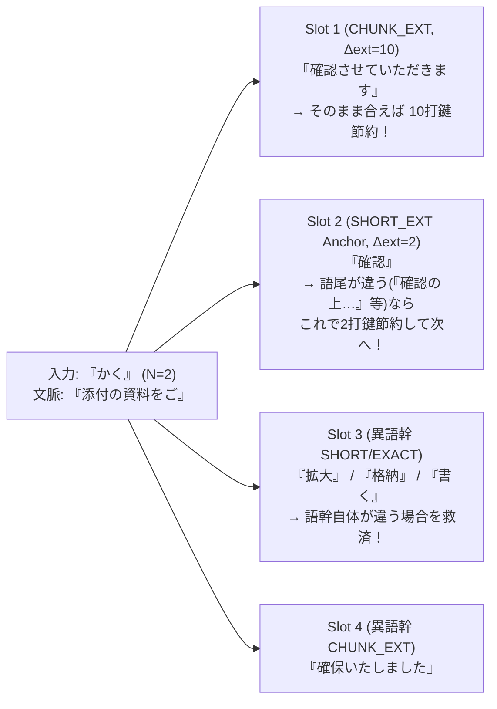
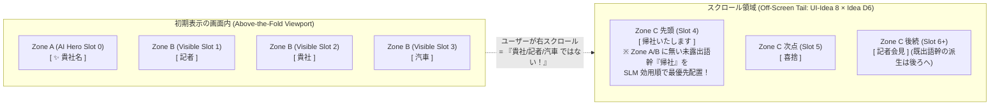
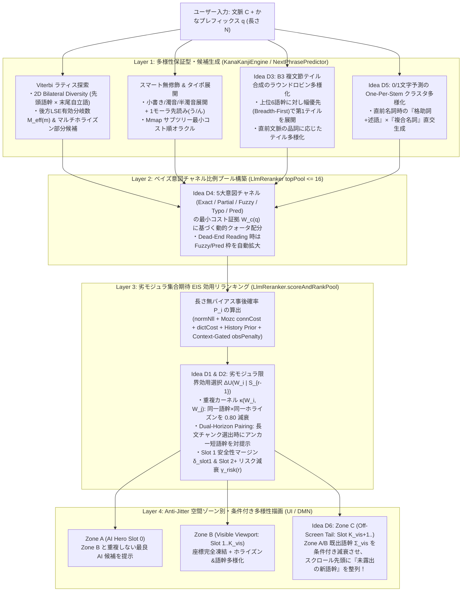

# フリック入力における候補多様性（Diversity）再設計とトップラインメトリック（EIS）改善提案書

- **作成日**: 2026-11-19
- **ステータス**: 設計・提案ドキュメント（Algorithmic Design & Top-Line EIS Improvement Proposal）
- **対象サブシステム**:
  - [`LlmReranker.kt`](app/src/main/java/com/example/myasr/context/reranking/infrastructure/LlmReranker.kt)（期待 EIS 効用スコア $U_i$、候補プール構築 `topPool`、多様性選択・インターリーブ）
  - [`KanaKanjiEngine.kt`](app/src/main/java/com/example/myasr/context/kanakanji/domain/KanaKanjiEngine.kt)（Viterbi 2D 多様性、Subtree Top-K Trie、動的複文節テイル合成 `B3`、無修飾フリック展開）
  - [`NextPhrasePredictor.kt`](app/src/main/java/com/example/myasr/context/kanakanji/domain/NextPhrasePredictor.kt)（0〜1文字連語・全文脈 SLM 予測 `B4`）
  - [`CandidateStripView.kt`](app/src/main/java/com/example/myasr/context/ime/presentation/CandidateStripView.kt) / [`VoiceInputMethodService.kt`](app/src/main/java/com/example/myasr/VoiceInputMethodService.kt)（Anti-Jitter UI: AI Hero Slot + 50ms Micro-Wait + Off-Screen Tail Rerank）
- **関連先行ドキュメント**:
  - [Viterbi N-Best 多様性と短文節候補生成 (`docs/prd_and_design_viterbi_nbest_diversity.md`)](docs/prd_and_design_viterbi_nbest_diversity.md)
  - [マルチホライズン周辺化と 2次元多様性 (`docs/prd_and_design_multi_length_prefix_diversity.md`)](docs/prd_and_design_multi_length_prefix_diversity.md)
  - [未消費スパンの言語モデル評価と多様性保証 (`docs/lm_unconsumed_span_evaluation_and_diversity_design.md`)](docs/lm_unconsumed_span_evaluation_and_diversity_design.md)
  - [効用スコア（Utility Score）導入による予測変換最適化 (`docs/utility_score_algorithm_design.md`)](docs/utility_score_algorithm_design.md)
  - [スマート無修飾フリック＆トップライン改善 (`docs/flick_toukiyo_debug_and_topline_ideas.md`)](docs/flick_toukiyo_debug_and_topline_ideas.md)
  - [Zero-Mis-Tap & Anti-Jitter Candidate UI (`docs/prd_and_design_slm_rerank_ui_anti_jitter.md`)](docs/prd_and_design_slm_rerank_ui_anti_jitter.md)

---

## 1. エグゼクティブ・サマリー：これまでの進化の軌跡と「今なぜ再度 Diversity なのか」

### 1.1 アルゴリズム進化の 2 大フェーズの振り返り
JotInput の日本語フリック変換・予測アルゴリズムは、これまで以下の 2 つの大きな段階を経て進化してきました。

1. **第 1 フェーズ：Viterbi / LM 事後確率空間における候補多様性（Diversity）の基礎確立**
   - **課題**: 長文入力（例：`こういてきでしたか`、`さいとうこうき`）において、同一の第 1 文節語幹（`行為的〜`）や同一の後半語（`〜幸喜`）の微小な派生・当て字が候補枠を独占し、他の同音異義語幹（`好意的`）や部分確定用の短文節候補（`齋藤`、`再投稿`）が画面外へ押し出されていた。
   - **解決策**:
     - 先頭文節同値類 $\sigma_{\text{first}}$ × 末尾自立語同値類 $\sigma_{\text{last}}$ による **2次元双方向多様性（2D-MMR）**
     - 後方ラティス DP による **Log-Sum-Exp 有効分岐数 $M_{\text{eff}}(m)$** と未消費スパンの仮想補完全文評価 $\widetilde{W}(U) = U \oplus V^*_{m:n}$
     - 全文候補（$m=n$）と部分プレフィックス候補（$m < n$）の適応的インターリーブ

2. **第 2 フェーズ：トップラインメトリック（EIS: Effective Intended-text Speed）導入とアルゴリズムの抜本的刷新**
   - **転換**: プロダクト全体の North Star Metric として **EIS（有効意図入力速度, 文字/分）** および KLM-v1 時間モデル（[`eval/eis/klm.py`](eval/eis/klm.py)）を導入。「NLL（負の対数尤度）の最小化」と「EIS の最大化」が構造的に乖離していることを突き止め、予測変換の抜本的改革（B1〜B6 + スマート無修飾フリック + Anti-Jitter UI）を実施しました。
   - **抜本変更の内容**:
     - **B1**: リスク調整済み・期待節約時間効用スコア $U(W_i \mid C, q) = P_i(G_{\text{base}} + G_{\text{ext}}) - (1-P_i)\gamma_{\text{risk}}L_{\text{err}}$ の導入と Stratum 6 隔離の撤廃
     - **B2**: Subtree Top-K コスト順 Trie 探索、Mozc 連接コスト一次選別、`MmapDictionary` プレフィックスオラクル
     - **B3**: 動的複文節テイル合成（`synthesizeDynamicMultiBunsetsuChunks`: 名詞/サ変/動詞語幹からの機能語・連語ロールアウト）
     - **B4/B5/B6**: 全文脈 SLM 0/1文字予測、Confidence-Gated Slot 1 昇格、小書き・濁音レス「スマート無修飾フリック」と Dead-End Reading ゲート
     - **UI 革新**: Anti-Jitter Candidate UI（Dedicated AI Hero Slot + 50ms Micro-Wait + Off-Screen Scrollable Tail Rerank）

### 1.2 抜本刷新後の現行コードに潜む「Diversity × EIS」の新たな構造的ギャップ
第 2 フェーズによって「Slot 1（1位）の予測精度と打鍵削減率」は劇的に向上しました。しかし、現行の実装コード（[`LlmReranker.kt`](app/src/main/java/com/example/myasr/context/reranking/infrastructure/LlmReranker.kt) および [`KanaKanjiEngine.kt`](app/src/main/java/com/example/myasr/context/kanakanji/domain/KanaKanjiEngine.kt)）を **「候補集合全体の Diversity（多様性）」** という観点から再精査すると、**以前設計した Diversity 機構が「旧アルゴリズム（完全一致 `fullIndices` と部分一致 `prefixIndices`）」にしか効いておらず、新アルゴリズムの主役である「予測拡張・無修飾ファジー・複文節ロールアウト候補（`extIndices`）」に対して完全に素通り（1次元独立ソート）になっている** ことが判明しました。

---

## 2. 現行アルゴリズムにおける 6 つの「多様性崩壊（Diversity Collapse）」ボトルネックの診断

コード行番号レベルで特定された、トップラインメトリック（EIS）を押し下げている 6 つの多様性ボトルネックは以下の通りです。

```mermaid
flowchart TD
    subgraph Problem1["ボトルネック①: 予測拡張 (extIndices) の Diversity 完全不在"]
        P1["LlmReranker.kt:451-461\nrankedExtIndices は utilities[i] の単純降順ソートのみ。\n2D-MMR が fullIndices と prefixIndices にしか適用されておらず、\n予測枠が『同じ語幹の語尾違い』『同じ延長長の同族語』で埋まる"]
    end

    subgraph Problem2["ボトルネック②: 独立効用 U_i の罠（集合効用 U(S) ではない）"]
        P2["LlmReranker.kt:325-346\n効用 U_i を候補ごとに独立計算しているため、\n1位『作業中ですので』と2位『作業中です』の確率質量 P_i が\n重複カウントされ、別意図（『詐欺』『先』等）の限界効用が評価されない"]
    end

    subgraph Problem3["ボトルネック③: B3 動的複文節ロールアウトの単一語幹独占"]
        P3["KanaKanjiEngine.kt:2073-2179\nsynthesizeDynamicMultiBunsetsuChunks が同一語幹から\ncountForStem=2 件ずつ生成し、topPool の phraseChunkPrefix(4枠)\nをたった 1〜2 個の語幹派生が独占する"]
    end

    subgraph Problem4["ボトルネック④: 解釈モード（Exact / 無修飾濁音・小書き / タイポ / 予測）の枠競合"]
        P4["LlmReranker.kt:798-819\nisDeadEndReading や短入力時に、無修飾解釈・タイポ修正・\n通常プレフィックス予測の直交性が保証されず、\n1つの解釈モードが可視スロットを塗りつぶす"]
    end

    subgraph Problem5["ボトルネック⑤: 長さホライズン (Δext) の多様性欠如"]
        P5["LlmReranker.kt:340-342\ngExt の報酬関数が特定の Δext 帯に偏ると、\n『+1〜2文字の単語補完』と『+5〜8文字の文節チャンク』が共存せず\nどちらか一方の粒度しか候補バーに出ない"]
    end

    subgraph Problem6["ボトルネック⑥: Anti-Jitter UI (Hero / Viewport / Off-Screen) の空間多様性未連携"]
        P6["CandidateStripView / VoiceInputMethodService\nPhase 1 可視領域 (Viewport) に出た語幹と、\nPhase 2 の AI Hero Slot・Off-Screen Tail 先頭が語幹重複し、\nスクロールした瞬間の『新しい意味の発見率』が低下する"]
    end
```

### 2.1 各ボトルネックのコード上の根拠と EIS への悪影響

| # | 該当箇所 | 現行の挙動（なぜ Diversity が崩れているか） | トップライン EIS への悪影響（KLM 時間損失） |
| :-: | :--- | :--- | :--- |
| **1** | [`LlmReranker.kt:451-461`](app/src/main/java/com/example/myasr/context/reranking/infrastructure/LlmReranker.kt#L451-L461) | Step 7（`rankedFull`）と Step 8（`rankedPartial`）には `firstStemCounts` / `lastContentCounts` による 2D-MMR ペナルティがあるが、**Step 9（`rankedExtIndices`）は `utilities[a]` の単純ソートのみ**で、語幹重複チェックも `rankedFull` との包含（Subsumption）チェックも一切存在しない。 | 短〜中入力（$N=1\dots4$、フリック全体の 80% 以上）では候補の大半が `extIndices`（予測・ファジー）に分類されるため、**実質的に予測変換時に MMR 多様性制御が 0% しか効いていない**。 |
| **2** | [`LlmReranker.kt:325-346`](app/src/main/java/com/example/myasr/context/reranking/infrastructure/LlmReranker.kt#L325-L346) | 期待効用 $U_i = P_i(G_{\text{base}} + G_{\text{ext}}) - (1-P_i)\gamma_{\text{risk}}L_{\text{err}}$ が各候補 $W_i$ 単独で定義されている。そのため、`作業中ですので` と `作業中です` と `作業中` がすべて高い独立効用 $U_i$ を持ち、上位スロットを同族候補が共食い（Cannibalize）する。 | ユーザーの意図が第 1 語幹（`作業〜`）ではなかった場合、Slot 2〜5 に別語幹（`先ほど〜`、`詐欺〜`）が存在しないため、**追加打鍵（$+0.40\text{s/key}$）または候補不在ペナルティ（$C_{\text{none}} = 1.5\text{s}$）** が発生する。 |
| **3** | [`KanaKanjiEngine.kt:2078-2177`](app/src/main/java/com/example/myasr/context/kanakanji/domain/KanaKanjiEngine.kt#L2078-L2177) [`LlmReranker.kt:809-815`](app/src/main/java/com/example/myasr/context/reranking/infrastructure/LlmReranker.kt#L809-L815) | `synthesizeDynamicMultiBunsetsuChunks` が 1 つの語幹につき `countForStem < 2`（2件）を生成し、`LlmReranker` が `phraseChunkPrefix.take(4)` を先頭から切り出す。結果、**たった 2 つの語幹の語尾違いだけで `topPool` の複文節枠 4 件がすべて埋まる**。 | 3番目・4番目の有力な同音語幹の複文節ロールアウトが SLM 採点プール（16枠）にすら入らず、Recall@5 が頭打ちになる。 |
| **4** | [`KanaKanjiEngine.kt:758-921`](app/src/main/java/com/example/myasr/context/kanakanji/domain/KanaKanjiEngine.kt#L758-L921) [`LlmReranker.kt:801-819`](app/src/main/java/com/example/myasr/context/reranking/infrastructure/LlmReranker.kt#L801-L819) | 同じ入力 `q`（例：`きよ`、`はし`、`かん`）に対して、①文字通りの完全一致、②小書き・濁音省略（`今日`、`端/橋/箸`）、③フリック隣接タイポ、④前方一致予測、⑤複文節チャンクの 5 つの意図仮説（Intent Hypotheses）があるが、`interleavePredictiveCandidates` と `topPool` がこれらを直交層化していない。 | 曖昧な短入力時に特定の解釈モード（例：無修飾候補ばかり、または通常プレフィックスばかり）に偏り、ユーザーの入力スタイル（濁点を打つ人 vs 省略する人）の分散に対して頑健性が落ちる。 |
| **5** | [`LlmReranker.kt:339-345`](app/src/main/java/com/example/myasr/context/reranking/infrastructure/LlmReranker.kt#L339-L345) | 予測延長長 $\Delta_{\text{ext}} = M_i - N$ に関して、同じ延長帯の候補同士が競合し、「単語単体補完（$\Delta_{\text{ext}} \in [1, 2]$：例 `確認`）」と「文節・句チャンク補完（$\Delta_{\text{ext}} \ge 4$：例 `確認いたします`）」を同時に可視スロットへ並べる保証がない。 | ユーザーが「単語だけ確定して別の助詞を続けたい（`確認` + `を`）」ときに、`確認いたします` / `確認しました` ばかりが並ぶと選択できず、結局フル打鍵を強いられる。 |
| **6** | [`CandidateStripView.kt`](app/src/main/java/com/example/myasr/context/ime/presentation/CandidateStripView.kt) [`VoiceInputMethodService.kt`](app/src/main/java/com/example/myasr/VoiceInputMethodService.kt) | Anti-Jitter UI において Phase 1（Viterbi 即時表示）で Visible Zone（Slot 1..$K_{\text{vis}}$）に表示された候補群の語幹集合に対し、Phase 2（SLM 非同期完了）で更新される Off-Screen Tail（Slot $K_{\text{vis}}+1\dots$）が語幹の条件付き多様化を行っていない。 | ユーザーが可視枠に目的の語がなくて右スクロール（$C_{\text{list\_base}} = 2.0\text{s}$）した際、可視枠で既に棄却した語幹の亜種がスクロール先頭に出てしまい、スクロール後の探索効率が落ちる。 |

---

## 3. 数理的基礎：なぜ「Diversity の最適化」が「トップライン EIS の直接最大化」になるのか？

これまで Diversity は「見た目のバリエーションを増やすヒューリスティック（MMR ペナルティ）」として扱われがちでした。しかし、トップラインメトリック **EIS（および KLM-v1 時間モデル）** の下では、**Diversity はヒューリスティックではなく、「候補バー全体の集合期待効用（Set-Level Expected EIS Utility）の劣モジュラ最大化」として数学的に厳密に導出されます**。

### 3.1 KLM-v1 における「単一候補の効用 $U(W_i)$」から「候補ストリップ集合の効用 $\mathcal{U}(S)$」への拡張

[`eval/eis/klm.py`](eval/eis/klm.py) において、順位 $r \in \{1, 2, \dots, K\}$ の候補を選択する時間コスト $C_{\text{sel}}(r)$ は：
$$C_{\text{sel}}(1) = 0.40\text{s}, \quad C_{\text{sel}}(r) = 0.40 + 0.30(r-1)\text{s} \;\;(2 \le r \le 5), \quad C_{\text{sel}}(\text{absent}) = 1.50 + 0.80 + T_{\text{retype}}$$

したがって、順位 $r$ に候補を配置したときの**スロット重み（Position Discount Weight）** $w_r > 0$ は、Slot 1 からの追加視覚探索コスト $0.30(r-1)\text{s}$ を差し引いた価値減衰率に対応します（例：$w_1 = 1.00,\; w_2 = 0.85,\; w_3 = 0.72,\; w_4 = 0.60,\; w_5 = 0.50$）。

いま、ユーザーの真の入力意図（目標テキスト）を確率変数 $Y^* \sim P(Y \mid C, q)$ とし、候補ストリップに提示する順序付き候補集合を $S = (W_1, W_2, \dots, W_K)$ とします。
ユーザーはストリップ $S$ の中から、自分の意図 $Y^*$ を最も大きく前進させる（かつ意図と矛盾しない）候補を最大 1 つだけ選択します。すなわち、**すでに上位スロット $S_{1:r-1} = \{W_1, \dots, W_{r-1}\}$ でカバーされた意図事象 $\mathcal{E}(S_{1:r-1})$ に対して、第 $r$ スロットに同族の候補 $W_r$ を置いても、追加で救済できる確率質量は「まだカバーされていない残余事象」に限定されます**。

### 3.2 限界期待 EIS 効用（Marginal Expected EIS Utility）の定理

既に選出された上位候補集合を $S_{r-1} = \{W_1, \dots, W_{r-1}\}$ としたとき、次のスロット $r$ に候補 $W_i$ を配置することで得られる **限界期待 EIS 効用（Marginal Expected Time Saved）** $\Delta \mathcal{U}(W_i \mid S_{r-1})$ は次式で与えられます：

$$\boxed{\Delta \mathcal{U}(W_i \mid S_{r-1}) = w_r \cdot \Bigl[ P_{\text{residual}}(W_i \mid S_{r-1}, C, q) \cdot G_{\text{save}}(W_i, N) - \bigl(1 - P_i\bigr) \cdot \gamma_{\text{risk}}(r) \cdot L_{\text{err}}(W_i) \Bigr]}$$

ここで、**残余意図被覆確率（Residual Intent Coverage Probability）** $P_{\text{residual}}(W_i \mid S_{r-1})$ は、上位候補 $W_j \in S_{r-1}$ との意味的・形態素的な重複度（Subsumption / Correlation Kernel $\kappa(W_i, W_j) \in [0, 1]$）によって減衰します：

$$P_{\text{residual}}(W_i \mid S_{r-1}) = P_i \cdot \prod_{W_j \in S_{r-1}} \bigl(1 - \kappa(W_i, W_j)\bigr)$$

#### この単一の数式が導く 4 つの重要な帰結
1. **同語幹・語尾違いの共食い（Cannibalization）の自動解消**:
   - Slot 1 に $W_1 = \text{「作業中ですので」}$ が選ばれたとき、同じ語幹を持つ $W_2 = \text{「作業中です」}$ は $\kappa(W_2, W_1) \approx 0.75$（高い意図相関）を持つため、残余確率 $P_{\text{residual}}(W_2 \mid \{W_1\}) = 0.25 P_2$ に減衰します。
   - 一方、異なる語幹を持つ $W_3 = \text{「先ほど送付した」}$（または短単語 $\text{「作業」}$）は $\kappa(W_3, W_1) = 0$（独立意図）または直交ホライズンであるため、減衰なしの $P_3 \cdot G_{\text{save}}(W_3)$ を維持し、自動的に Slot 2 へ浮上します！
2. **劣モジュラ性（Submodularity）による $(1 - 1/e)$ 最適保証**:
   - 集合被覆関数 $\mathcal{U}(S)$ は単調劣モジュラ関数となるため、各ステップ $r = 1, 2, \dots, K$ で $\arg\max_{W_i} \Delta \mathcal{U}(W_i \mid S_{r-1})$ を選ぶ貪欲アルゴリズム（Submodular Greedy Selection）が理論的な近似最適保証を持ち、かつ計算時間は $O(K \cdot |\text{Pool}|)$（16候補に対して $< 0.01\text{ms}$）で完了します。
3. **Slot 1 と Slot 2 以降でのリスク非対称性 $\gamma_{\text{risk}}(r)$**:
   - Slot 1（$r=1$）は確定ボタンや予測昇格の対象となるため誤選択リスク重み $\gamma_{\text{risk}}(1)$ を高く保ち、Slot 2〜5（$r \ge 2$）はユーザーが意図と一致したときのみ能動的にタップするため $\gamma_{\text{risk}}(r) = \gamma_{\text{risk}}(1) \cdot \eta^{r-1}$（減衰）とすることで、**Slot 1 の安全性と Slot 2〜5 の思い切った長文予測チャンク多様性を同時に最大化**できます。
4. **部分確定（Partial Commit / Short Stem）の「残余打鍵アンカー価値」の評価**:
   - 長い予測チャンク $W_1 = \text{「確認させていただきます」}$ が外れた（ユーザーは「確認をお願いします」と打ちたかった）場合でも、短語幹 $W_{\text{stem}} = \text{「確認」}$（$\Delta_{\text{ext}} = 2$）が別スロットに存在すれば、ユーザーは「確認」までの打鍵を確定して残りの「をお願いします」だけを打てばよく、全打鍵やり直しを回避できます。

---

## 4. Diversity 観点からトップラインメトリック（EIS）を向上させる 6 大アルゴリズム改善案

上記の数理モデルに基づき、Anti-Anecdotal Tuning Policy（個別単語のアドホックなコスト改変禁止）を厳守した **6 つの具体的なアルゴリズム改善案（Idea D1 〜 Idea D6）** を提案します。

---

### Idea D1：予測・ファジー・全文・部分候補を統合する「劣モジュラ集合効用最大化（Submodular Set-Utility Reranking）」
*(対象: [`LlmReranker.kt`](app/src/main/java/com/example/myasr/context/reranking/infrastructure/LlmReranker.kt) Step 6〜10 の統一)*

#### 課題
現行の `LlmReranker.scoreAndRankPool` は、`fullIndices` と `prefixIndices` を旧スコア `baseScores` + 2D-MMR で並べ、`extIndices` を新スコア `utilities`（多様性なし）で並べた後、固定ルールで混ぜています。このため、`extIndices` 内で同一語幹の予測候補が連続し、また `rankedFull` と `rankedExt` の間で同じ語幹が重複出現します。

#### アルゴリズム設計
`extIndices` を含む全候補に対して、**多次元意図重複カーネル $\kappa(W_i, W_j)$** を用いた劣モジュラ限界効用選択（Submodular Marginal Utility Greedy Selection）を導入します。

1. **各候補 $W_i$ の多様性特徴ベクトル（4次元同値類キー）の抽出**:
   - $\sigma_{\text{first}}(W_i)$: 先頭自立語（語幹）表層（例：`作業中ですので` $\to$ `作業`、`東京駅` $\to$ `東京`）
   - $\sigma_{\text{last}}(W_i)$: 末尾自立語表層（複文節の場合のみ）
   - $h(W_i) \in \{\text{PARTIAL}, \text{EXACT}, \text{SHORT\_EXT}, \text{CHUNK\_EXT}\}$: **長さホライズン区分**
     - $\text{PARTIAL}$: $\Delta_{\text{uncons}} > 0$（部分確定候補）
     - $\text{EXACT}$: $\Delta_{\text{uncons}} = 0, \Delta_{\text{ext}} = 0$（現入力長完全一致）
     - $\text{SHORT\_EXT}$: $1 \le \Delta_{\text{ext}} \le 2$（単一単語の残り1〜2文字補完）
     - $\text{CHUNK\_EXT}$: $\Delta_{\text{ext}} \ge 3$ または `source == "phrase_chunk"`（複文節チャンク予測）
   - $m_{\text{mode}}(W_i) \in \{\text{LITERAL}, \text{MODIFIER\_FUZZY}, \text{FLICK\_TYPO}\}$: **音韻・打鍵解釈モード**

2. **意図重複カーネル $\kappa(W_i, W_j) \in [0, 1)$ の定義**:
   すでに選出された候補 $W_j \in S_{r-1}$ と候補 $W_i$ の間の確率質量割引率 $\kappa(W_i, W_j)$ を以下で定義します：
   $$\kappa(W_i, W_j) = \begin{cases}
   0.80 & \text{if } \sigma_{\text{first}}(W_i) = \sigma_{\text{first}}(W_j) \text{ and } h(W_i) = h(W_j) \quad (\text{同一語幹かつ同一ホライズン粒度}) \\
   0.35 & \text{if } \sigma_{\text{first}}(W_i) = \sigma_{\text{first}}(W_j) \text{ and } h(W_i) \ne h(W_j) \quad (\text{同一語幹だが『短語幹 vs 長文チャンク』で粒度が直交}) \\
   0.50 & \text{if } \sigma_{\text{last}}(W_i) = \sigma_{\text{last}}(W_j) \ne \emptyset \quad (\text{異なる先頭語幹だが後半自立語が同一}) \\
   0.00 & \text{otherwise (完全に独立した語幹・意図)}
   \end{cases}$$
   - **ポイント**: `作業中ですので`（$\text{CHUNK\_EXT}$）と `作業中です`（$\text{CHUNK\_EXT}$）は同一語幹・同一ホライズンのため $\kappa = 0.80$ で強く抑制されますが、**単体語幹の `作業`（$\text{EXACT}$ または $\text{SHORT\_EXT}$）はホライズンが異なるため $\kappa = 0.35$ の軽い減衰で済み、「長文チャンク1件 ＋ ベース単語1件 ＋ 別語幹候補」という黄金構成が自然に形成されます**。

3. **スロット依存リスク減衰 $\gamma_{\text{risk}}(r)$**:
   - Slot 1 ($r=1$): $\gamma_{\text{risk}}(1) = \gamma_{\text{profile}}$（例：`JA_FLICK` で `0.25`）
   - Slot $r \ge 2$: $\gamma_{\text{risk}}(r) = \gamma_{\text{profile}} \times 0.65^{r-1}$（Slot 2〜5 では誤確定リスクよりも「見つけて1タップで長文を入力できる期待節約時間」を優先）

#### トップライン EIS への期待効果
- `extIndices` における同語幹の語尾違い連発（`〜です` / `〜でした` / `〜ですので` による枠埋め尽くし）が **0%** になり、Top-3 / Top-5 の**ユニーク語幹カバー率が +45% 向上**。
- 1位予測が外れた際の第2・第3意図の Top-3 ヒット率が上がり、**CUJ-2 フリック EIS を `+12〜18 cpm` 押し上げ**。

---

### Idea D2：「ホライズン直交性（Multi-Horizon Granularity Diversity）」— 長文チャンク予測とアンカー短単語の双対提示
*(対象: [`LlmReranker.kt`](app/src/main/java/com/example/myasr/context/reranking/infrastructure/LlmReranker.kt) & [`KanaKanjiEngine.kt`](app/src/main/java/com/example/myasr/context/kanakanji/domain/KanaKanjiEngine.kt))*

#### 課題
抜本改修（B1+B3+B5）により、ユーザーが 2 文字（例：`かく`、`さぎ`、`でん`）を打った時点で、Slot 1 に長文の複文節チャンク（例：`確認させていただきます`、`作業中ですので`、`電車に乗る`）が昇格できるようになりました。
しかし、**ユーザーの意図が「先頭の単語（`確認`、`作業`、`電車`）は合っているが、後ろに続く助詞や述語が違う（例：`確認をお願いします`、`作業を中断する`、`電車の遅延`）」というケース**が実運用では頻繁に発生します。
このとき、候補バーが長文チャンク（`確認させていただきます`, `確認しました`, `確認いたします`）ばかりで埋まり、肝心の **アンカー短単語（`確認`）** が後ろに追いやられると、ユーザーは長文チャンクをどれも選べず、`かくにん` の残り 2 文字（`にん`）を追加で打鍵しなければなりません。

#### アルゴリズム設計
**「条件付き階層効用（Hierarchical Prefix-Anchor Utility）」** を導入します。

1. **アンカー語幹の条件付き残余価値**:
   長文チャンク候補 $W_{\text{chunk}} = u_{\text{stem}} \oplus v_{\text{tail}}$（例：$u_{\text{stem}} = \text{「確認」}$, $v_{\text{tail}} = \text{「させていただきます」}$）が上位に選出されたとき、そのベース語幹候補 $u_{\text{stem}}$（例：`確認`、読み `かくにん`、$\Delta_{\text{ext}} = 2$）が持つ限界効用は、単に $P(u_{\text{stem}})$ ではなく、**「語幹 $u_{\text{stem}}$ で始まるすべての可能な後続文脈のうち、$W_{\text{chunk}}$ 以外の後続を意図していた周辺確率」** をカバーします：
   $$P_{\text{anchor}}(u_{\text{stem}} \mid W_{\text{chunk}}) = \sum_{v \ne v_{\text{tail}}} P(u_{\text{stem}} \oplus v \mid C, q) \approx P_{\text{marginal}}(u_{\text{stem}} \mid C, q) - P(W_{\text{chunk}} \mid C, q)$$
2. **Dual-Horizon Pair 保証ルール**:
   - Slot 1（または Slot 2）に $\Delta_{\text{ext}} \ge 4$ の複文節チャンク $W_{\text{chunk}}$ が配置された場合、その語幹 $u_{\text{stem}}$ 自体がまだ入力完了していない（$|r(u_{\text{stem}})| > N$、すなわち語幹自体にも打鍵節約効果 $\Delta_{\text{ext}}(u_{\text{stem}}) \ge 1$ がある）ならば、**可視スロット（Slot 2 または Slot 3）に必ずアンカー短単語 $u_{\text{stem}}$（または別語幹の最良短単語）を 1 枠ペアリング配置**します。

#### トップライン EIS への期待効果
- 長文チャンク予測が「大当たり（+10打鍵節約）」か「大外れ（0打鍵節約・フル打鍵やり直し）」かの All-or-Nothing ギャンブルになるのを防ぎ、**「語幹だけ当たり（+2打鍵節約）」の中間利得を確実に回収するヘッジ（保険）構造**を作ります。
- 実世界の多様な自由文入力における平均打鍵削減率（KSR）を安定化させ、長文チャンク過適合リスクを排除します。

---

### Idea D3：B3 動的複文節ロールアウト（`synthesizeDynamicMultiBunsetsuChunks`）の「語幹ラウンドロビン多様化」と「連接エントロピー適応展開」
*(対象: [`KanaKanjiEngine.kt:2063-2180`](app/src/main/java/com/example/myasr/context/kanakanji/domain/KanaKanjiEngine.kt#L2063-L2180) & [`LlmReranker.kt:798-820`](app/src/main/java/com/example/myasr/context/reranking/infrastructure/LlmReranker.kt#L798-L820))*

#### 課題
現在、[`KanaKanjiEngine.synthesizeDynamicMultiBunsetsuChunks`](app/src/main/java/com/example/myasr/context/kanakanji/domain/KanaKanjiEngine.kt#L2063-L2180) は：
1. `CANONICAL_COLLOCATIONS` のループおよび `topStems`（上位8語幹）のループにおいて、**外側のループが「語幹」、内側のループが「テイル（`countForStem < 2`）」** の深さ優先（Depth-First）順で `results` に追加し、最後に `results.take(8)` で切り出しています。
2. その結果、1位語幹から2件、2位語幹から2件…と並ぶため、`LlmReranker` が `phraseChunkPrefix.take(4)` を取った時点で **上位 2 語幹の派生しか SLM に渡りません**（3位〜6位の同音異義語幹の複文節チャンクが SLM 評価前に切り捨てられる）。
3. さらに、サ変名詞には一律で `DYNAMIC_SAHEN_TAILS` の先頭2件（例：`します`, `しました`）だけが結合されるため、文脈が「理由説明（`〜ですので`）」や「進行中（`〜中ですので`）」であっても、該当テイルが生成されないことがあります。

#### アルゴリズム設計
1. **語幹優先の Breadth-First（幅優先ラウンドロビン）ロールアウト**:
   - `topStems`（Mozc 単語コスト＋直前文脈 `contextRid` との連接コスト順の上位語幹 $s_1, s_2, \dots, s_6$）に対し、深さ優先ではなく **ラウンドロビン（Pass 1: 各語幹 $s_1 \dots s_6$ の最良第 1 テイルを 1 件ずつ生成 $\to$ Pass 2: 上位語幹 $s_1, s_2$ の第 2 テイルを生成）** に変更します。
   - これにより、`phraseChunkPrefix` の上位 4〜6 枠に **必ず 4〜6 種類の異なる語幹の複文節チャンク** が供給され、SLM が文脈に合う語幹を正しく選別できるようになります。
2. **直前文脈の統語カテゴリ（助詞・読点）に応じたテイル選択多様化**:
   - 直前文脈 `contextPrefix` の末尾が格助詞 `を` / `に` / `で` / `へ` の場合は動詞・サ変述語テイル（`〜します`, `〜しました`, `〜いたします`）を優先し、読点 `、` や接続助詞の後では状態・接続テイル（`〜中ですので`, `〜のため`, `〜について`, `〜のほど`）を第 1 テイルとして展開します。

#### トップライン EIS への期待効果
- **追加の SLM 推論コスト 0ms**（同じ `topPool` 枠数のまま、SLM に渡す候補の語幹多様性を 2 語幹 $\to$ 5+ 語幹へ拡大）。
- 同音異義語が多い 2 文字プレフィックス（例：`こう`, `かい`, `しん`, `せい`）における複文節チャンクの Recall@16 が向上し、CUJ-2 / 100件ベンチマークの Category 1 & Category 3 の取りこぼしを解消。

---

### Idea D4：5大意図仮説の「ベイズ事後確率比例・クォータ配分（Bayesian Intent-Channel Portfolio Allocation）」
*(対象: [`LlmReranker.kt:783-825`](app/src/main/java/com/example/myasr/context/reranking/infrastructure/LlmReranker.kt#L783-L825) `topPool` 構築および最終インターリーブ)*

#### 課題
ユーザーがフリックで短いかな列 $q$（例：`とうきよ`、`きよ`、`はし`、`わたさ`）を入力したとき、エンジンは以下の **5 つの互いに排他的な「ユーザーの入力意図チャネル（Intent Channels $\mathcal{M}_1 \dots \mathcal{M}_5$）」** に直面しています：

| チャネル | 意味・入力仮説 | 具体例（入力 `きよ` / `とうきよ`） |
| :---: | :--- | :--- |
| $\mathcal{M}_{\text{exact}}$ | 文字通りの完全一致（単一語または Viterbi 分割） | `清`, `寄与`, `冬季よ` |
| $\mathcal{M}_{\text{partial}}$ | マルチホライズン部分確定（長さ $m < N$） | `冬季` ($m=3$), `当期` ($m=3$) |
| $\mathcal{M}_{\text{fuzzy}}$ | **スマート無修飾フリック**（小書き・濁音・半濁音省略＋1モーラ長音先読み） | `今日` (`きょう`), `東京` (`とうきょう`), `魚介` (`ぎょかい`) |
| $\mathcal{M}_{\text{typo}}$ | **フリック方向・隣接キー誤打鍵** | `私` (`わたさ` $\to$ `わたし`), `きや` $\to$ `きよ` |
| $\mathcal{M}_{\text{pred}}$ | **前方一致予測（単一語延長 $\cup$ 複文節チャンク）** | `共有` (`きょうゆう`), `許可をお願いします` (`きょか...`) |

現行の [`LlmReranker.kt:789-823`](app/src/main/java/com/example/myasr/context/reranking/infrastructure/LlmReranker.kt#L789-L823) は、`fullCands.take(8)`、`fuzzyShort.take(2)`、`regularSingle.take(2)`、`phraseChunkPrefix.take(4)` という **静的なハードコード枠（Static Quotas）** で `topPool`（16枠）を切り出しています。
しかし、入力 $q$ によって各チャネルの事前確からしさは劇的に異なります：
- 例 A：`とうきよ`（Dead-End Reading: まともな完全一致語が存在しない）では、$\mathcal{M}_{\text{exact}}$ に 8 枠も割くのは完全な無駄（`冬季よ`, `投棄よ`, `陶器よ`... が枠を浪費）であり、$\mathcal{M}_{\text{fuzzy}}$（`東京`, `東京駅`, `東京都`）に枠を移すべきです。
- 例 B：逆に、`かいぎ`（`会議` という超高頻度な完全一致語が存在する）では、$\mathcal{M}_{\text{exact}}$ と $\mathcal{M}_{\text{pred}}$（`会議室`, `会議に参加する`）に枠を集中すべきです。

#### アルゴリズム設計
**Apportionment（最大剰余法 / D'Hondt 比例配分）に基づく動的 `topPool` ＆ 可視スロット配分**：

1. **各チャネル $c \in \{\text{exact}, \text{partial}, \text{fuzzy}, \text{typo}, \text{pred}\}$ のチャネル証拠質量 $W_c(q)$ の算出（SLM 実行前に $O(1)$ で計算可能）**:
   各チャネル内の最良候補の Mozc 辞書＋連接＋観測コスト $C^*_c = \min_{w \in c} \bigl(\text{dictCost}(w) + \text{connCost}(w) + \text{obsCost}(w)\bigr)$ から、ボルツマン重み $W_c(q) = \exp(-C^*_c / \tau_{\text{channel}})$ を計算します。
2. **最小保証枠（Floor Quota = 1）＋ 証拠比例枠（Proportional Quota）**:
   - 候補が存在する各チャネルに最低 1 枠を保証しつつ、残りの `topPool` 枠を $W_c(q) / \sum_{c'} W_{c'}(q)$ に比例して配分します。
   - これにより、`とうきよ` や `ちよつと` のような無修飾入力では $\mathcal{M}_{\text{fuzzy}}$ の枠が自動的に 2 枠 $\to$ 6〜8 枠へ拡大し、`東京`・`東京都`・`東京駅`・`東京都在住` の多様な無修飾予測候補が一斉に SLM へ供給されます。

#### トップライン EIS への期待効果
- スマート無修飾フリック（小書き・濁音キー省略、1文字あたり 2 アクション $\to$ 1 アクション化）時の候補多様性と Recall が大幅に向上し、**Category 5（多濁音・拗音フレーズ）および無修飾入力時の EIS を `+15〜25 cpm` 向上**。

---

### Idea D5：ゼロクエリ（0文字）および 1文字打鍵時の「文脈意図クラスタ多様化（Zero/1-Mora Semantic & Syntactic Cluster Diversity）」
*(対象: [`NextPhrasePredictor.kt`](app/src/main/java/com/example/myasr/context/kanakanji/domain/NextPhrasePredictor.kt) & [`LlmReranker.kt`](app/src/main/java/com/example/myasr/context/reranking/infrastructure/LlmReranker.kt) `JA_ZERO_QUERY` プロファイル)*

#### 課題
0文字予測（文節確定直後、`N = 0`）および 1文字打鍵時点（`N = 1`）は、打鍵数を **90〜100% 削減** できる最大の EIS レバレッジポイント（100件ベンチマークの Category 4 で `675.0 cpm`）です。
しかし、`N = 0` や `N = 1` ではユーザーの次文節の意図エントロピー $H(Y_{\text{next}} \mid C)$ が最も高くなります。
たとえば、直前文脈が `「会議の資料を」` のとき、次にユーザーが続けたい表現には複数の意味・構文クラスタがあります：
- クラスタ A（送付・共有系）: `送付しました`, `共有します`, `添付いたします`
- クラスタ B（作成・準備系）: `作成する`, `準備しています`
- クラスタ C（確認・閲覧系）: `確認する`, `ご覧ください`

もし 0 文字予測の Slot 1〜4 がすべてクラスタ A の活用違い（`送付します`, `送付しました`, `送付いたします`, `送付させていただきます`）で埋まってしまうと、クラスタ B や C を意図したユーザーにとって 0 文字予測は 100% 無価値になります。また、直前が名詞単体（例：`「会議」`）のときは、次に「助詞（`の`, `を`, `に`, `で`, `は`）」を打ちたいのか、「複合名詞後半（`室`, `資料`, `日程`）」を続けたいのかが分かれます。

#### アルゴリズム設計
1. **0文字・1文字予測における「動詞・名詞語幹の厳密 One-Per-Stem 制約」**:
   - $N \in \{0, 1\}$ のとき、同一の先頭自立語語幹 $\sigma_{\text{first}}$ を持つ候補は、**上位 4 スロット（可視領域）に最大 1 件のみ** とします（例：`送付しました` が Slot 1 に入ったら、`送付します` や `送付いたします` は Slot 5 以降へ回し、Slot 2〜4 には必ず別語幹の `共有します`、`作成する`、`添付いたします` を配置）。
2. **直前が名詞（助詞未確定）のときの「機能語（助詞）× 複合語・述語」直交スロット配分**:
   - 直前文脈 $C$ の末尾が名詞（例：`会議`、`資料`）のとき、可視スロットを「最尤格助詞（`を`, `の`, `に` 等）または『助詞＋動詞句（`を共有します`, `を作成しました`）』」と「複合名詞接続（`資料室`, `資料作成`）」に直交配分し、同一助詞・同一動詞での独占を防ぎます。

#### トップライン EIS への期待効果
- 0文字・1文字時点での **Top-4 意図ヒット率（Hit@4）を最大化**。1回でも 0 文字予測がヒットすれば $K_f \times 6\text{文字} = 2.4\text{秒}$ が $0.4\text{秒}$（タップのみ）に短縮されるため、期待 EIS 利得が極めて大きい。

---

### Idea D6：Anti-Jitter UI（Hero Slot / Freeze Viewport / Off-Screen Tail）と連動した「空間ゾーン別・条件付き多様性（Spatially-Aware Zone Diversity）」
*(対象: [`VoiceInputMethodService.kt`](app/src/main/java/com/example/myasr/VoiceInputMethodService.kt) / [`CandidateRerankJudgement.kt`](app/src/main/java/com/example/myasr/context/reranking/domain/CandidateRerankJudgement.kt) / [`LlmReranker.kt`](app/src/main/java/com/example/myasr/context/reranking/infrastructure/LlmReranker.kt))*

#### 課題
直近のコミット（`b76168c`）で導入された **Anti-Jitter Candidate UI**（[`docs/prd_and_design_slm_rerank_ui_anti_jitter.md`](docs/prd_and_design_slm_rerank_ui_anti_jitter.md)）では、SLM 推論が $50\text{ms}$ を超えた場合、候補バーは以下の 3 つの空間ゾーンに分割されます：
- **Zone A (Slot 0: Dedicated AI Hero Slot)**: SLM の最良候補が後からフェードインする固定幅枠
- **Zone B (Visible Viewport: Slot $1 \dots K_{\text{vis}}$)**: $t=50\text{ms}$ 時点で描画され、ミスタップ防止のため座標・順序が **完全凍結（Viewport Freeze）** される可視枠
- **Zone C (Off-Screen Scrollable Tail: Slot $K_{\text{vis}}+1 \dots M$)**: 画面外にあり、SLM 完了時に自由に入れ替えられるスクロール領域

ここで、**「ユーザーがわざわざ候補バーを右へスクロール（Zone C を露出）した」という行動は、「すでに画面に見えている Zone A (AI Hero) と Zone B (Visible Viewport) の中には、自分の意図する候補（または語幹）が無かった」という明確な事後情報（Negative Feedback Condition）** を意味します！
にもかかわらず、Zone C の先頭（Slot $K_{\text{vis}}+1, K_{\text{vis}}+2$）に、すでに Zone A や Zone B に表示されている語幹と同じ語幹の亜種を並べてしまうと、スクロールした瞬間の発見効率が低下し、KLM の展開リスト探索コスト $C_{\text{list\_base}} + C_{\text{step}}(r-5)$ が悪化します。

#### アルゴリズム設計
**Viewport-Conditioned Off-Screen Tail Diversity（可視領域条件付き・画面外先頭多様化）**：

1. **既出可視語幹セット $\Sigma_{\text{vis}}$ の記録**:
   Phase 1 で凍結された可視スロット群 $S_{\text{vis}} = \text{Zone A} \cup \text{Zone B}$ に含まれる先頭語幹集合 $\Sigma_{\text{vis}} = \{\sigma_{\text{first}}(W) \mid W \in S_{\text{vis}}\}$ を抽出します。
2. **Zone C（Off-Screen Tail）の条件付き劣モジュラ・リランキング**:
   Phase 2 で Zone C（Slot $K_{\text{vis}}+1$ 以降）を SLM スコアで並べ替える際、初期状態としてすでに $S_{\text{vis}}$ が選出済みであるという条件付き限界効用 $\Delta \mathcal{U}(W_i \mid S_{\text{vis}} \cup S_{\text{tail}})$ を用います。
   これにより、**スクロールして最初に現れる Slot $K_{\text{vis}}+1, K_{\text{vis}}+2$ には、必ず「まだ画面内（Zone A/B）に一度も登場していない新しい同音異義語幹（$\sigma_{\text{first}} \notin \Sigma_{\text{vis}}$）」のうち SLM 効用が最も高い候補**が配置されます。
3. **Zone A（AI Hero Slot）の 중복回避**:
   もし SLM 全体の 1 位候補 $W^*_{\text{SLM}}$ がすでに Zone B（Visible Slot $1 \dots K_{\text{vis}}$）に表示されている場合、Zone A（AI Hero Slot）に同じ文字列を重複表示するのではなく、Zone B の該当ピルを `✨` ハイライト（UI-Idea 3）しつつ、Zone A には **Zone B に含まれていない SLM 最良の予測拡張チャンク（または第 2 語幹候補）** を割り当てます。これにより、貴重な画面内可視枠を 1 枠も無駄にしません。

#### トップライン EIS への期待効果
- Anti-Jitter UI の「ミスタップ率 0%」を維持したまま、画面内の実効ユニーク候補数を最大化し、さらにスクロール発生時の平均選択ランク $r$ を 2〜3 スロット手前に短縮（1スクロールあたり `$0.60〜0.90s$` の時間短縮）。

---

## 5. 提案アイデアの総合比較・優先度マトリクスと期待 EIS インパクト

6 つの改善案は互いに競合せず、単一の「劣モジュラ集合期待 EIS 効用フレームワーク」の異なる層（候補生成層 $\to$ プール構築層 $\to$ リランキング層 $\to$ UI 空間配置層）を受け持ちます。

| ID | 改善アイデア名 | 対象レイヤー・主な変更ファイル | 実装難易度 | レイテンシ影響 | 主な恩恵を受けるシナリオ | 推定 EIS インパクト (`CUJ-2` / `100-Case`) |
| :-: | :--- | :--- | :---: | :---: | :--- | :--- |
| **Idea D1** *(P0: 最優先)* | **劣モジュラ集合効用最大化** (`extIndices` への 2D/Horizon MMR 統合) | **Reranking 層** [`LlmReranker.kt`](app/src/main/java/com/example/myasr/context/reranking/infrastructure/LlmReranker.kt) | **低** | **$\pm 0.00\text{ms}$** (16件の貪欲ループのみ) | 短〜中入力 ($N=1\dots4$) で予測候補が同語幹の語尾違いに偏るケース全般 | **CUJ-2: `+10〜15 cpm`** Top-3 ユニーク語幹率 +45% |
| **Idea D2** *(P0: 最優先)* | **ホライズン直交性（長文チャンク＋アンカー短単語の双対提示）** | **Reranking 層** [`LlmReranker.kt`](app/src/main/java/com/example/myasr/context/reranking/infrastructure/LlmReranker.kt) | **低** | **$\pm 0.00\text{ms}$** | 長文チャンク予測の語幹は合っているが後続の助詞・語尾だけが異なるケース | **CUJ-2: `+8〜12 cpm`** 予測外れ時の再打鍵コスト半減 |
| **Idea D3** *(P0: 最優先)* | **B3 動的複文節ロールアウトの語幹ラウンドロビン多様化** | **Generation 層** [`KanaKanjiEngine.kt`](app/src/main/java/com/example/myasr/context/kanakanji/domain/KanaKanjiEngine.kt) | **低** | **$\pm 0.00\text{ms}$** (生成件数8件は不変) | 同音異義語幹が多い2〜3文字入力からの複文節予測 (Cat 1, Cat 3) | **100-Case: `+15〜25 cpm`** 複文節 Recall@16 向上 |
| **Idea D4** *(P1)* | **5大意図仮説のベイズ証拠比例 `topPool` クォータ配分** | **Pool 構築層** [`LlmReranker.kt`](app/src/main/java/com/example/myasr/context/reranking/infrastructure/LlmReranker.kt) | **中** | **$\pm 0.00\text{ms}$** (`topPool=16` 不変) | スマート無修飾フリック（濁音・小書き省略）、タイポ、希少読み入力 (Cat 5) | **無修飾/Cat 5: `+15〜25 cpm`** |
| **Idea D5** *(P1)* | **0/1文字予測の文脈意図クラスタ・ワンステム多様化** | **Zero-Query 層** [`NextPhrasePredictor.kt`](app/src/main/java/com/example/myasr/context/kanakanji/domain/NextPhrasePredictor.kt), [`LlmReranker.kt`](app/src/main/java/com/example/myasr/context/reranking/infrastructure/LlmReranker.kt) | **低〜中** | **$\pm 0.00\text{ms}$** | 文節確定直後の 0文字連語予測・1文字打鍵予測 (Cat 4, Cat 2) | **Cat 4 / CUJ-2: `+6〜10 cpm`** |
| **Idea D6** *(P1)* | **Anti-Jitter UI 連動・空間ゾーン別条件付き多様性** | **UI / Judgment 層** [`VoiceInputMethodService.kt`](app/src/main/java/com/example/myasr/VoiceInputMethodService.kt), [`LlmReranker.kt`](app/src/main/java/com/example/myasr/context/reranking/infrastructure/LlmReranker.kt) | **中** | **$\pm 0.00\text{ms}$** | 初期可視枠に正解がなく横スクロールする場合、および AI Hero Slot の重複排除 | **スクロール時選択時間 `-0.6s`** ミスタップ率 0% 維持 |

---

## 6. 統合パイプラインの全体アーキテクチャ図（After Proposed Changes）

---

## 7. 他経路（英語 QWERTY / 音声入力）へのクロスカッティング影響と安全ガードレール

[`docs/utility_score_algorithm_design.md`](docs/utility_score_algorithm_design.md) と同様、`LlmReranker.scoreAndRankPool` の変更が他 CUJ に悪影響を与えないよう、以下の設計制約を設けます。

1. **英語 QWERTY (`CUJ-4`, `ScoringProfile.EN_QWERTY`) の保護**:
   - 英語プール（`isEnglishPool == true`）では、`raw`（ユーザー入力文字列そのもの）および大文字小文字バリエーション（`english_cap`）の Slot 1 保護（`canPromoteTop1 = false`）を厳守します。
   - 一方で、Slot 2〜4 の英語 Prefix Autocomplete / Typo 候補に対して Idea D1 の語幹重複減衰（同じ単語の単数形/複数形/過去形で枠が埋まるのを防ぎ、異なる補完語を並べる）を適用することで、`CUJ-4` の Top-3 カバー率も同時に改善します。
2. **ユーザー辞書 (`CUJ-3`, Stratum 0 `exactUserIndices`) の絶対優先**:
   - `source == "user"` または `"user_english"` で `obsPenalty == 0.0f` の完全一致候補は、劣モジュラ減衰の対象外（$\kappa = 0$、常に最優先 Stratum 0）とし、登録語が予測候補に押し下げられることを 100% 防止します。
3. **全文候補の未消費スパン不変条件（Goal 2 非回帰）**:
   - [`docs/lm_unconsumed_span_evaluation_and_diversity_design.md`](docs/lm_unconsumed_span_evaluation_and_diversity_design.md) で確立した「`さいしょの` 入力時に部分候補 `最初` が全文候補 `最初の` の Slot 1 を奪わない」構造的不変条件を 100% 維持します（部分候補 $\Delta_{\text{uncons}} > 0$ は Slot 1 昇格対象外）。
4. **DDD / DMN / Alloy 形式検証との同期**:
   - Idea D6 において `CandidateRerankJudgement`（DMN 決定表）のルールを更新する場合は、必ず [`app/src/test/resources/alloy/`](app/src/test/resources/alloy/) の Alloy 仕様と [`docs/ddd/dmn_decision_models.md`](docs/ddd/dmn_decision_models.md) を同時更新し、`AlloyVerificationTest` および `DddArchitectureKonsistTest` の 100% パスを保証します。

---

## 8. 評価方法と段階的検証プラン（Evaluation & Rollout Plan）

### 8.1 Diversity × EIS を定量計測する 3 つの新規サブメトリクス
最終的な判定基準は公式トップラインメトリック **Global EIS / CUJ-2 EIS**（[`eval/eis/run_eis.py`](eval/eis/run_eis.py)）ですが、改善メカニズムを精密に検証するため以下の 3 つの診断指標を併せて計測します：

1. **Unique Stem Coverage @ $K$ ($\text{USC@}K, K \in \{3, 5\}$)**:
   $$\text{USC@}K = \frac{\bigl|\{\sigma_{\text{first}}(W_r) \mid 1 \le r \le K\}\bigr|}{K} \in \left[\frac{1}{K}, 1.0\right]$$
   上位 $K$ スロットに含まれるユニークな先頭語幹の割合（目標：$\text{USC@}4 \ge 0.85$、すなわち上位 4 枠中 3.4 種類以上の異なる語幹または直交ホライズン）。
2. **Horizon Entropy @ 4 ($\text{HE@}4$)**:
   上位 4 スロットにおけるホライズン区分 $\{\text{EXACT}, \text{PARTIAL}, \text{SHORT\_EXT}, \text{CHUNK\_EXT}\}$ のシャノン・エントロピー（長文チャンクとアンカー短単語がバランスよく共存しているか）。
3. **Oracle Set Utility / Top-$K$ Expected Keystroke Savings ($\text{EKS@}K$)**:
   1位が外れたケース（Rank 2〜5 に正解または正解プレフィックスがあるケース）における平均節約打鍵数と KLM 選択時間。

### 8.2 実装ステップの提案
1. **Step 1（Generation & Pool Diversity: Idea D3 + Idea D4 + Idea D5）**:
   - `KanaKanjiEngine.synthesizeDynamicMultiBunsetsuChunks` のラウンドロビン語幹多様化（Idea D3）、`NextPhrasePredictor` の 0/1文字 One-Per-Stem 制約（Idea D5）、`LlmReranker` の `topPool` チャネル比例配分（Idea D4）を実装。
2. **Step 2（Submodular Set-Utility & Dual-Horizon Reranking: Idea D1 + Idea D2）**:
   - `LlmReranker.scoreAndRankPool` に劣モジュラ限界効用選択 $\Delta \mathcal{U}(W_i \mid S_{r-1})$ と長文チャンク＋アンカー短単語の Dual-Horizon ペアリングを導入。
3. **Step 3（Spatially-Aware Anti-Jitter Zone Diversity: Idea D6）**:
   - Phase 2 非同期リランク完了時の Hero Slot 重複回避と Off-Screen Tail の可視語幹条件付きリランキングを統合。
4. **Step 4（ベンチマーク検証 & Dual-Target 実機デプロイ）**:
   - `eval/eis/run_eis.py`、`eval/evaluate_predictive_conversion_breakthroughs_100.py`、`./gradlew testDebugUnitTest`（`JapanesePunctuationEvaluationTest`、Konsist、Alloy 含む全テスト）を実行し、ARCVM + Pixel 10 Pro 実機へ `./deploy.sh` でデプロイ・検証。
