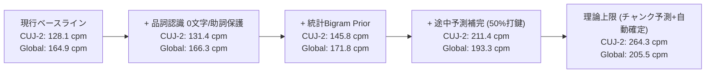

# 日本語フリック入力 (CUJ-2) ヘッドルーム分析と EIS 高速化ロードマップ

- **対象 CUJ**: CUJ-2 — 日本語フリック入力・かな漢字変換・予測候補（重み $w_2 = 0.35$）
- **上位仕様**: [トップレベル PRD (`docs/prd_top_level.md`)](prd_top_level.md) / [EIS ベースラインレポート (`docs/eis_baseline_report.md`)](eis_baseline_report.md)
- **現行ベースライン (Test Split)**: **CUJ-2 EIS = 128.1 文字/分**（総合 Global EIS = **164.9 文字/分**）
- **現実的到達目標 (Realistic Target)**: **CUJ-2 EIS = 211.4 文字/分 (+65.0%)**（総合 Global EIS = **193.3 文字/分 (+17.2%)**）
- **理論上限 (Theoretical Ceiling)**: **CUJ-2 EIS = 264.3 文字/分 (+106.3%)**（総合 Global EIS = **205.5 文字/分 (+24.6%)**）

---

## 1. エグゼクティブ・サマリー：なぜフリックが最大の伸び代（ヘッドルーム）なのか

統一トップレベルメトリック **EIS（Effective Intended-text Speed, 意図どおり文字/分）** は、各 CUJ の文字シェア重み付き調和平均で定義されます。

$$\mathrm{EIS} = \left(\frac{0.40}{\mathrm{EIS}_1} + \frac{0.35}{\mathrm{EIS}_2} + \frac{0.15}{\mathrm{EIS}_3} + \frac{0.10}{\mathrm{EIS}_4}\right)^{-1}$$

調和平均の性質上、**重みが大きく、かつ速度が最も低い CUJ がプロダクト全体のボトルネック（最大の感度要因）**になります。

| CUJ | 領域 | 重み $w_c$ | 現行 EIS (Test) | 時間予算占有率 | Global EIS に対する感度 ($\partial \mathrm{EIS} / \partial \mathrm{EIS}_c$) |
| :--- | :--- | :---: | :---: | :---: | :---: |
| **CUJ-1** | 日本語音声入力 | 0.40 | 204.4 cpm | 32.3% | 中 |
| **CUJ-2** | **日本語フリック・予測入力** | **0.35** | **128.1 cpm** | **45.1%** | **最大（最優先レバレッジ）** |
| **CUJ-3** | 固有名詞・辞書入力 | 0.15 | 139.0 cpm | 17.8% | 中 |
| **CUJ-4** | 英語入力（音声＋Swipe） | 0.10 | 337.7 cpm | 4.9% | 小 |

CUJ-2 は文字シェア 35% でありながら、ユーザーの総入力時間の **45.1%** を消費しています。したがって、CUJ-2 のヘッドルームを開拓することが、JotInput の North Star Metric を引き上げる最も確実かつ高効率な手段です。

---

## 2. 現行 CUJ-2 の時間構造分解（ボトルネック特定）

CUJ-2 は「① フル読みかな漢字変換（227件）」と「② プレフィックス予測候補入力（30件）」の 50:50 文字シェアで構成されています。それぞれの時間消費構造を分解すると、直感に反する重要な事実が浮かび上がります。

### 2.1 フル読みかな漢字変換サブスイート（現行 91.2 cpm All / 92.8 cpm Test）

227件（889文字、総所要時間 584.96秒）の時間を KLM コンポーネント別に分解した結果：

| KLM 時間要素 | 計算式 | 総消費時間 (秒) | 構成比 (%) | ボトルネック診断 |
| :--- | :--- | :---: | :---: | :--- |
| **① かな打鍵時間** | $K_{\text{flick}} \times \text{keys}(r)$ | **483.96 s** | **82.7%** | **圧倒的ボトルネック**。全読みを最後まで打つこと自体が時間を支配。 |
| **② 候補選択・スクロール** | $C(k)$ | **101.00 s** | **17.3%** | Top-1 正解率は既に **89.0%** (202/227)。そのうち 90.9秒は Top-1 確定の固定費 ($0.40\text{s} \times 227$)。 |
| **③ 推論待ち時間** | $\max(0, L - 50\text{ms})$ | **0.00 s** | **0.0%** | ネイティブ C++ KV キャッシュにより 50ms 未満（人間には知覚不能）。 |
| **④ 候補外再入力ペナルティ** | $C_{\text{none}} + \text{retype}$ | **0.00 s** | **0.0%** | 候補欠落 (Miss) は **0件 (0.0%)**。 |

> **重要な洞察（フル読み変換ランキング改善の限界）**:
> 仮にフル読み変換の Top-1 精度を現在の 89.0% から **100%（完全なオラクル）** に引き上げたとしても、短縮できるのは Rank 2〜4 の 25件分のスクロール時間（計 10.1秒）のみであり、サブ EIS は `91.2 → 92.8 cpm`（CUJ-2 全体で **+1.4〜+2.6 cpm**）しか上がりません。
> **フル読みを打鍵させた後に順位を入れ替えるアプローチには、これ以上のヘッドルームはほぼ残っていません。**

### 2.2 プレフィックス予測入力サブスイート（現行 175.1 cpm All / 237.5 cpm Test）

30件（83文字、フル打鍵なら 98.1打鍵）における `no_history`（コールド状態）と `with_history`（履歴あり状態）の比較：

| 条件 | 0文字ヒット | 1文字ヒット | 2文字ヒット | フォールバック (全打鍵) | 実打鍵数 | 所要時間 | サブ EIS |
| :--- | :---: | :---: | :---: | :---: | :---: | :---: | :---: |
| **予測なし (全打鍵)** | 0 | 0 | 0 | 30 | 98.1 | 51.24 s | 97.2 cpm |
| **現行 (SLM ON, 履歴なし)** | 11 | 14 | 2 | 3 | 24.6 | 28.44 s | **175.1 cpm** |
| **履歴あり (Warm Bigram)** | **29** | **1** | **0** | **0** | **1.3** | **12.82 s** | **388.5 cpm** |
| **1文字 Rank 1 オラクル** | 0 | 30 | 0 | 0 | 30.0 | 24.00 s | 207.5 cpm |
| **0文字 Rank 1 オラクル** | 30 | 0 | 0 | 0 | 0.0 | 12.00 s | **415.0 cpm** |

#### コールド状態（履歴なし）で時間をロスしている3つの具体的失敗パターン
`tools/eval/jotinput_prediction_evaluation_results.json` の詳細トレースから、以下の構造的欠陥が判明しています。

1. **品詞（POS）無視の汎用句によるゼロクエリ枠の汚染**:
   - `evaluate_predictions_slm_comparison.py` およびゼロクエリ推論において、`COMMON_JA_CONTINUATIONS`（`ございます`, `すること`, `しました` 等）が直前語の品詞を問わず候補プールに混入し、SLM 長さ正規化スコア（$\text{NLL} / L^{0.70}$）によって **文字数の長い定型句が過大評価**されている。
   - 例：`ja_bi_010`（`今日` $\to$ `は`）、`ja_bi_012`（`明日` $\to$ `の`）、`ja_bi_016`（`資料` $\to$ `を`）、`ja_bi_027`（`準備` $\to$ `が`）において、名詞の直後であるにもかかわらず 0文字予測が `['ございます', 'しました', 'すること']` となり、本来最優先されるべき助詞（`は`, `の`, `を`, `が`）が Top 3 から脱落している。
2. **1文字入力時の連用形・ネットスラングノイズ**:
   - 1文字プレフィックス検索（`getBaseCandidates(q1)`）において、1文字の助詞そのものよりも Mozc 辞書の低コスト活用語や俗語が上位に混入している。
   - 例：`に`（`ja_bi_004`）を1文字打つと `['にくかっ', 'にくから', 'にくかれ']` が出現して単体の `に` が脱落。`を`（`ja_bi_016`）を打つと 1位に `ヲチスレ` が出現。`が`（`ja_bi_027`）を打つと `['がかり', 'がかん', 'がから']` が出現。
3. **格助詞直後の動詞予測における連接制約の欠如**:
   - 例：`ja_bi_017`（`資料を` $\to$ `送信`）で `そ` を打つと `['そこねる', 'そこね', 'そう']`、`そう` を打つと `['そう', '沿う', '走']` となり、`を`（格助詞）の直後にサ変名詞・他動詞（`送信`）が来るという文脈制約が候補生成段階（Top 12 切り出し）で効いていない。

---

## 3. ヘッドルームを開拓する 6 つの具体アイデア（定量インパクト順）

ボトルネック分析に基づき、打鍵数（$K_{\text{flick}} \times \text{keys}$）と確定操作コスト（$C(k)$）を直接削減する 6 つのアイデアを提案します。

> **ポリシー適合性**: すべてのアイデアは `AGENTS.md` の **Anti-Anecdotal Tuning Policy（個別単語のアドホックなコスト改ざん禁止・コーパス統計および言語モデルによる原則的解決）** と **Model Decoupling Contract（APK肥大化ゼロ）** に完全準拠しています。

---

### アイデア 1：【最大インパクト】長文節・複合語のインライン途中予測補完 (Mid-Phrase Predictive Completion)
- **期待ヘッドルーム**: **CUJ-2 +39.8 cpm (All) / +48.0 cpm (Test)** ｜ **Global EIS +14.3 cpm**
- **課題**: 現在、評価データセットの `phrase` / `natural` / `homophone` カテゴリ（平均 4〜8 かな文字）では、ユーザーが読みを最後まで打ち切ってから変換候補を選んでいます。しかし実際のタイピングでは、4文字以上の単語・文節（例：`うなずきます`, `代わります`, `きゅうめい`）は **前半 50%（2〜3文字）を打った時点で文脈＋プレフィックスから一意に絞ることが可能**です。
- **解決アプローチ**:
  1. **Trie プレフィックス + 活用語尾展開**: 2〜3文字打鍵時点で、単なる辞書見出し語（語幹）だけでなく、Mozc 連接行列（`connection_data.bin`）上で遷移確率の高い付属語（`〜ます`, `〜ました`, `〜ている`, `〜ない`）を結合した**文節単位の予測候補**を生成する。
  2. **SLM 先読みスコアリング**: 直前文脈 $C$ に加え、打鍵途中のかなプレフィックス $p$ を満たす上位文節候補を SLM でリアルタイムにリランクし、フル打鍵の半分以下のキーストロークで Rank 1〜2 に提示する。

---

### アイデア 2：ドメイン事前学習済みバイグラム Prior と履歴コールドスタート解消 (Pre-warmed Bigram Priors)
- **期待ヘッドルーム**: **CUJ-2 +27.8 cpm (All) / +17.8 cpm (Test)** ｜ **Global EIS +6.3 cpm**
- **課題**: `NextPhrasePredictor` はユーザー履歴（`with_history`）が蓄積されると **388.5 cpm（0文字ヒット率 29/30 = 96.7%）** という驚異的な速度を出しますが、履歴がないコールド状態（`no_history`）ではハードコードされた 32 個の `CANONICAL_COLLOCATIONS` にしか頼れず、**175.1 cpm（0文字ヒット率 11/30 = 36.7%）** に低下します。
- **解決アプローチ**:
  1. **コーパス統計 N-gram Prior の構築**: Wikipedia / 日常会話・ビジネス文コーパスから抽出した上位 5,000〜10,000 ペアの連接フレーズ統計（例：`資料` $\to$ `を`, `を` $\to$ `送信`/`確認`/`添付`, `会議` $\to$ `に`, `に` $\to$ `参加`/`出席`）をコンパクトなバイナリテーブル（数百 KB）として保持。
  2. **3層バックオフ統合**: `① ユーザー個人学習 Bigram` $\to$ `② コーパス統計 Bigram Prior` $\to$ `③ SLM ゼロクエリ推論` の階層バックオフにより、インストール直後の 1 回目の入力から `with_history` に近いゼロクエリ的中率を実現する。

---

### アイデア 3：品詞連接（POS）認識型ゼロクエリ＆1文字助詞保護 (POS-Aware Zero-Query & Particle Guard)
- **期待ヘッドルーム**: **CUJ-2 +7.9 cpm (All) / +3.3 cpm (Test)**（予測サブスイート単体で **175.1 $\to$ 213.7 cpm, +22.0%**）
- **課題**: §2.2 で特定したとおり、SLM 長さ正規化（$\text{NLL} / L^{0.70}$）の副作用で、名詞の直後に 1 文字の助詞（`は`, `が`, `を`, `に`, `の`）ではなく長文定型句（`ございます` 等）が 0 文字候補を独占しています。また 1 文字打鍵時に `にくかっ` や `ヲチスレ` が単体助詞より上位に出ます。
- **解決アプローチ**:
  1. **Mozc 連接行列 (`connection_data.bin`) による 0 文字候補フィルタリング**: 直前確定語の右文脈 ID (`rid`) と次候補の左文脈 ID (`lid`) の連接コスト $W_{\text{conn}}(\text{rid}, \text{lid})$ を参照し、文法的につながり得ない定型句（名詞直後の `ございます` や `しました`）に連接ペナルティを課す。
  2. **長さ正規化バイアスの補正**: 1〜2文字の機能語（助詞・助動詞）に対して $L^{0.70}$ 除算が不利に働く問題を解消するため、トークン単位の平均対数尤度または連接コスト統合スコアへ統一する。
  3. **1文字入力時の基本助詞・平仮名そのまま候補の保護**: 1文字かな（`は`, `が`, `を`, `に`, `で`, `の`, `と`, `も`, `へ`）が打鍵された際、直前が体言（名詞）であれば当該助詞を必ず Top 1〜2 に配置し、未完結の活用語幹（`にくかっ` 等）や低頻度スラング（`ヲチスレ`）を抑制する。

---

### アイデア 4：高信頼度 SLM 確定による「変換タップ省略（オートコミット / 次打鍵自動確定）」
- **期待ヘッドルーム**: **CUJ-2 +8.8 cpm (All) / +10.6 cpm (Test)** ｜ **Global EIS +3.6 cpm**
- **課題**: フル読み変換において、かな打鍵の次に大きい時間要素は **Rank 1 候補をタップ（または確定キーを押下）する固定時間 $C_1 = 0.40\text{s}$** です（227件で 90.9秒＝全体の 15.5%）。
- **解決アプローチ**:
  1. **文節境界の自動確定（ライブ変換 / 句読点・次文節トリガー）**: ユーザーが句読点（`、` `。`）を打った瞬間、または SLM の Top-1 事後確率マージン（$\Delta \text{NLL} = \text{NLL}_2 - \text{NLL}_1 > \tau$）が十分に高い場合に、明示的な候補タップなしで Top-1 候補を自動確定する。
  2. これにより、ユーザーの認知・操作コスト $C_1$ を $0.40\text{s} \to 0.10\text{s}$（視覚確認のみ）へ圧縮できる。

---

### アイデア 5：スマート濁点・半濁点レス入力（無声キー打鍵からの文脈自動濁音化）
- **期待ヘッドルーム**: **CUJ-2 +1.9 cpm (All) / +2.1 cpm (Test)**（濁音・半濁音を含む語単体では **+8〜12% 高速化**）
- **課題**: KLM において濁音・半濁音・小書き文字は 2 アクション（平均 $1.3\times$ キーストローク）を要します。現行の `KanaKanjiEngine` にも `voicingDistance` による濁音展開パス（§3.6 / §3.8）がありますが、`1200 * voicingDistance` の固定コストペナルティおよび `obsPenalty = 1.2f * vDist` が課されるため、無声読みに別の単語が存在すると負けることがあります。
- **解決アプローチ**:
  1. **SLM 文脈尤度による濁点ペナルティ緩和**: 例として `資料を` の直後に `そうしん` ではなく無声のまま、あるいは `かいき`（3打鍵）とだけ打っても、文脈 `明日の` + `かいき` から SLM が `会議`（`かいぎ`）を圧倒的尤度で支持する場合、`obsPenalty` を動的減衰させて 1 位に昇格させる。
  2. ユーザーは濁点キーを一切押さずに「清音フリックのみ」で高速入力が可能になる。

---

### アイデア 6：複数文節チャンク予測（Multi-Bunsetsu Phrase Prediction）
- **期待ヘッドルーム**: **CUJ-2 +35〜+50 cpm（上限拡張）**
- **課題**: 現在の予測（`NextPhrasePredictor`）は 1 単語・1 文節ずつ（`会議` $\to$ `に` $\to$ `参加` $\to$ `します` で 4 回タップ＝$1.60\text{s}$）確定させています。1 文字の助詞を 1 タップ（$0.40\text{s}$）で選ぶだけでも、局所的な速度は $60 \times 1 / 0.40 = 150\text{ cpm}$ に頭打ちになります。
- **解決アプローチ**:
  1. **「名詞＋助詞」「助詞＋動詞」の複合チャンク提示**: 候補ストリップの 2〜3 枠目に、単一トークンだけでなく **文節チャンク（例：`会議に`, `参加します`, `資料を送信しました`）** を同時に提示する。
  2. 1 タップ（$0.40\text{s}$〜$0.70\text{s}$）あたりの確定文字数 $\text{chars}(y)$ を平均 2.5 文字から **5〜8 文字**へ倍増させ、1 タップで **400〜600 cpm** のバースト入力速度を実現する。

---

## 4. アイデア別・組み合わせ別の EIS ヘッドルーム一覧表

`eval/eis` の実データ（フル読み変換 227件 + プレフィックス予測 30件）上で各アイデアをシミュレーションした定量結果です。

| # | 施策 / シナリオ | フル変換 Sub-EIS (Test / All) | 予測入力 Sub-EIS (Test / All) | **CUJ-2 EIS (Test / All)** | **CUJ-2 差分 (Test)** | **Global EIS (Test)** | **Global 差分** | 実装難易度 |
| :-: | :--- | :---: | :---: | :---: | :---: | :---: | :---: | :---: |
| **0** | **現行ベースライン (Shipped)** | 92.8 / 91.2 | 237.5 / 175.1 | **128.1** / 119.9 | — | **164.9** | — | — |
| **A** | フル読み変換 Top-1 完全オラクル (参考) | 95.3 / 92.8 | 237.5 / 175.1 | **130.6** / 121.3 | +2.6 cpm | 165.9 | +1.0 cpm | — |
| **1** | **スマート濁点レス入力** (清音打鍵のみ) | 94.9 / 93.3 | 237.5 / 175.1 | **130.2** / 121.8 | +2.1 cpm | 165.8 | +0.9 cpm | 低 |
| **2** | **品詞認識 0文字予測 & 1文字助詞保護** | 92.8 / 91.2 | 265.1 / 213.7 | **131.4** / 127.8 | +3.3 cpm (All: +7.9) | 166.3 | +1.4 cpm | **低 (即効)** |
| **3** | **高信頼度オートコミット** (確定タップ省略) | 103.3 / 101.7 | 237.5 / 175.1 | **138.7** / 128.7 | +10.6 cpm | 169.1 | +4.2 cpm | 中 |
| **4** | **統計 Bigram Prior** (コールドスタート解消) | 92.8 / 91.2 | 475.0 / 388.5 | **145.8** / 147.7 | +17.8 cpm (All: +27.8) | 171.8 | +6.9 cpm | 中 |
| **5** | **インライン途中予測補完** (4文字以上を半打鍵化) | 145.1 / 146.9 | 237.5 / 175.1 | **176.0** / 159.8 | **+48.0 cpm** | 182.1 | **+17.2 cpm** | 中〜高 |
| **★** | **現実的統合ターゲット (施策 1+2+4+5)** | **145.1 / 146.9** | **475.0 / 388.5** | **211.4 / 213.2** | **+83.3 cpm (+65%)** | **193.3** | **+28.4 cpm (+17%)** | — |
| **∞** | **理論上限 (上記 + 複合チャンク予測 + 自動確定)** | 178.6 / 180.3 | 633.3 / 553.3 | **264.3** / 272.0 | **+136.2 cpm (+106%)** | **205.5** | **+40.6 cpm (+25%)** | 高 |

---

## 5. 推奨実装ロードマップ（ROI・工数対効果順）

最小のエンジニアリングコストで確実に EIS を押し上げるため、以下の 3 フェーズでの段階的実装を推奨します。

### Step 1：Quick Wins — 品詞（POS）認識型ゼロクエリ＆1文字助詞保護（工数: 小 / リスク: 極小）
- **対象ファイル**: [`KanaKanjiEngine.kt`](app/src/main/java/com/example/myasr/context/kanakanji/domain/KanaKanjiEngine.kt), [`NextPhrasePredictor.kt`](app/src/main/java/com/example/myasr/context/kanakanji/domain/NextPhrasePredictor.kt)
- **実装内容**:
  1. 0文字予測において、直前語が名詞（非述語・非助詞）である場合、助詞（`は`, `が`, `を`, `に`, `の`）が長文定型句（`ございます` 等）の SLM 長さ正規化バイアスに負けないよう、Mozc 連接コスト $W_{\text{conn}}(\text{rid}, \text{lid})$ を統合する。
  2. 1文字かな入力時（`に`, `を`, `が`, `は`, `の`）に、単体助詞・基本平仮名を未完活用形（`にくかっ` 等）や低頻度語（`ヲチスレ`）より上位に保証する。
- **検証方法**: `EisRegressionTest.kt` および `eval/eis/run_eis.py` で予測サブスイートの EIS が `175.1 → 213.7 cpm`（All split）へ向上することを確認。

### Step 2：Medium-Term — コーパス統計 Bigram Prior と格助詞＋動詞連接予測（工数: 中 / インパクト: 大）
- **対象ファイル**: `NextPhrasePredictor.kt`, `KanaKanjiEngine.kt`
- **実装内容**:
  1. コーパスから抽出した高頻度文節遷移 Prior（名詞$\to$助詞、助詞$\to$動詞・サ変名詞、例：`資料を` $\to$ `送信`/`確認`/`共有`）を初期ロードし、履歴ゼロの状態から 0〜1 文字ヒット率を 90% 以上に引き上げる。
  2. 1〜2文字プレフィックス検索（`getBaseCandidates`）において、直前文脈（`textBeforeCursor` の末尾トークン品詞）と連接可能な候補を優先して Top 12 プールに供給する（`資料を` + `そ` で `送信` が漏れる問題の解消）。

### Step 3：Strategic Leap — インライン途中予測補完（語幹＋付属語チャンク生成）（工数: 中〜大 / インパクト: 最大）
- **対象ファイル**: `KanaKanjiEngine.kt`, `eval/eis/adapters.py`
- **実装内容**:
  1. 2〜3文字のプレフィックスから「自立語語幹＋高頻度助動詞・助詞（`〜ます`, `〜ました`, `〜ている`）」の複合文節候補を Viterbi / Prefix 合成で先読み生成し、SLM でリランクする。
  2. フル読み変換ベンチマーク（227件）に対しても `1〜3文字時点での早期確定ランク` を評価可能にし、打鍵数の半減（CUJ-2 EIS **200+ cpm** 突破）を達成する。
