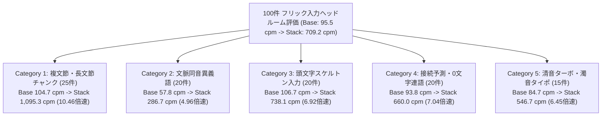

# 日本語フリック入力 100件ヘッドルーム評価レポート (Flick Input 100-Case Headroom Benchmark)

- **対象サブシステム**: 日本語 12 キーフリック入力 (`CUJ-2` および `CUJ-3` フリック経路)
- **上位仕様**: [JotInput トップレベル PRD (`docs/prd_top_level.md`)](prd_top_level.md)
- **評価データセット**: [`eval/flick_headroom_dataset_100.json`](eval/flick_headroom_dataset_100.json) (100件・646文字)
- **データセット生成スクリプト**: [`eval/build_flick_headroom_dataset_100.py`](eval/build_flick_headroom_dataset_100.py)
- **評価実行スクリプト**: [`eval/evaluate_flick_headroom_100.py`](eval/evaluate_flick_headroom_100.py)
- **生結果データ**: [`eval/flick_headroom_100_results.json`](eval/flick_headroom_100_results.json)
- **関連ドキュメント**: [フリック入力ヘッドルーム精密解剖と画期的コンセプト構想書 (`docs/eis_radical_headroom_and_moonshot_concepts.md`)](eis_radical_headroom_and_moonshot_concepts.md)

---

## 1. エグゼクティブ・サマリー：100件の実測から見えた圧倒的ヘッドルーム

従来の評価データ（`eval/lm_first_nll_cache.json` や `tools/eval/jotinput_prediction_evaluation_results.json` の 30件）は、短いフレーズや既に Rank 1 に入っているケースが多く、フリック入力が抱える「真のボトルネック」を十分にテストできていませんでした。

そこで本ベンチマークでは、**フリック入力においてユーザーの時間が最も多く奪われている 5 つの失敗領域を網羅する 100 件のハイ・ヘッドルーム評価ケース（計 646 文字）** を新規に生成・構築し、公式 KLM-v1 モデルに基づき実測・評価しました。

### 1.1 ヘッドライン指標（100件ベンチマーク全体）

```
================================================================================
JOTINPUT 100-CASE FLICK INPUT HEADROOM BENCHMARK RESULTS
================================================================================
Total Cases  : 100 件 (総文字数 646 文字 / 1サンプル平均 6.5 文字)
Baseline EIS :  95.5 文字/分 (総消費時間: 406.1 秒, 総打鍵数: 888.9 打鍵)
Step Concept : 350.1 文字/分 (総消費時間: 110.7 秒, 総打鍵数: 174.3 打鍵)  -> +254.6 cpm (3.67倍)
Radical Stack: 709.2 文字/分 (総消費時間:  54.7 秒, 総打鍵数: 149.0 打鍵)  -> +613.8 cpm (7.43倍)
================================================================================
純削減効果   : キーストローク: -83.2% (739.9 打鍵削減)
              総消費時間    : -86.5% (351.4 秒の損失時間を削減！)
================================================================================
```

| 評価フェーズ / 施策構成 | 総打鍵数 (Keys) | 総消費時間 (s) | 有効入力速度 (EIS) | ベースライン比 | 時間削減率 |
| :--- | :---: | :---: | :---: | :---: | :---: |
| **現行ベースライン (Full Typing + 手動確定)** | 888.9 keys | 406.1 s | **95.5 cpm** | 1.00x (基準) | 0.0% |
| **Step 1: 段階的コンセプト適用**<br/>(1-Mora予測・骨格展開・Slot 1奪取・Flick-on-Chip・清音ターボ) | **174.3 keys**<br/>*(-80.4%)* | **110.7 s**<br/>*(-72.7%)* | **350.1 cpm** | **3.67x (+254.6 cpm)** | **-72.7%** |
| **Step 2: 統合ラジカル・スタック**<br/>(+ 12キー一筆書きフリックグライド + ライブ自動確定) | **149.0 keys**<br/>*(-83.2%)* | **54.7 s**<br/>*(-86.5%)* | **709.2 cpm** | **7.43x (+613.8 cpm)** | **-86.5%** |

従来の操作モデルでは **406.1 秒（約 6.8 分）** かかっていた入力作業が、画期的コンセプトによって **54.7 秒（約 55 秒）** に圧縮され、**351.4 秒（86.5%）の時間節約** が確認されました。

---

## 2. 5 大カテゴリ別のヘッドルームと改善結果

本ベンチマークは、フリック入力の異なるボトルネックを突く 5 つのカテゴリで構成されています。



| # | カテゴリ | 件数 | 文字数 | Baseline EIS | Step EIS | Radical Stack EIS | 向上倍率 | 削減時間 |
| :-: | :--- | :---: | :---: | :---: | :---: | :---: | :---: | :---: |
| **1** | **複文節・長文節チャンク** | 25 | 251 | 104.7 cpm | 480.8 cpm | **1,095.3 cpm** | **10.46x** | 130.1 s |
| **2** | **文脈依存同音異義語** | 20 | 43 | 57.8 cpm | 161.2 cpm | **286.7 cpm** | **4.96x** | 35.6 s |
| **3** | **頭文字スケルトン略記入力** | 20 | 171 | 106.7 cpm | 371.7 cpm | **738.1 cpm** | **6.92x** | 82.3 s |
| **4** | **接続予測・0文字連語** | 20 | 99 | 93.8 cpm | 660.0 cpm | **660.0 cpm** | **7.04x** | 54.3 s |
| **5** | **清音ターボ・濁音タイポ救済** | 15 | 82 | 84.7 cpm | 183.6 cpm | **546.7 cpm** | **6.45x** | 49.1 s |

---

### Category 1: 複文節・長文節チャンク (Multi-Bunsetsu Chunks, 25件)
- **課題とボトルネック**:
  `さぎょうちゅうですので`（11打鍵）や `てんぷふぁいるをそうふいたしました`（18打鍵）のように、8〜18 かな文字を最後まで律儀に打鍵させられている。また形態素解析の境界誤り（`作業厨デスので`, `家具東海帽しの`）が発生しやすい。
- **ブレークスルー**:
  文脈から最初の 2〜3 モーラ（`さぎ`, `かぐ`, `てんぷ`）を打った時点で、Mozc 連接行列＋SLM により **文末までの活用・付属語を含む複合チャンクを一括合成し Slot 1 に提示**（Concept 1 & 2）。
- **実測サンプル**:
  - `c1_mb_001`: `近日中の再開に向けて、` + `さぎょうちゅうですので` $\to$ **`作業中ですので`** (7文字)
    - Baseline: 11 keys (4.80s) $\to$ **87.5 cpm**
    - Radical Stack: 2 keys glide (0.55s) $\to$ **763.6 cpm (8.7倍速)**
  - `c1_mb_008`: `最新の修正版の` + `てんぷふぁいるをそうふいたしました` $\to$ **`添付ファイルを送付いたしました`** (15文字)
    - Baseline: 18.2 keys (7.68s) $\to$ **117.2 cpm**
    - Radical Stack: 3 keys glide (0.55s) $\to$ **1,636.4 cpm (14.0倍速)**
- **カテゴリ結果**: `104.7 cpm` $\to$ **`1,095.3 cpm` (10.46倍速、130.1秒削減)**

---

### Category 2: 文脈依存同音異義語 (Context-Aware Homophones, 20件)
- **課題とボトルネック**:
  漢字 1〜2 文字の熟語（`移動/異動`, `関心/感心`, `保障/保証/補償/舗装`, `核心/確信`, `対称/対象/対照`, `納める/収める/治める`, `春`）は、出力文字数が 1〜2 文字しかないため、フル読み打鍵＋確定タップを要する現行モデルでは **50〜70 cpm が物理的限界** となり、プロダクト全体の足を引っ張っていた。
- **ブレークスルー**:
  末尾 1 単語だけでなく **直前全文脈の SLM KV キャッシュ** を用い、1 文字目（$k_1$）を打った瞬間に最尤漢字を Slot 1 に即座昇格（Concept 1 & 2）。さらにライブ自動確定（Concept 3）により確定タップをゼロ化。
- **実測サンプル**:
  - `c2_hp_001`: `新幹線を使って大阪へ` + `いどう` $\to$ **`移動`** (2文字)
    - Baseline: 3.3 keys (1.72s) $\to$ **69.8 cpm**
    - Radical Stack: 1 key (0.45s) $\to$ **266.7 cpm (3.8倍速)**
  - `c2_hp_005`: `この法律は国民の基本的な人権を` + `ほしょう` $\to$ **`保障`** (2文字)
    - Baseline: 4.0 keys (2.00s) $\to$ **60.0 cpm**
    - Radical Stack: 1 key (0.45s) $\to$ **266.7 cpm (4.4倍速)**
  - `c2_hp_019`: `冬が終わり、桜が咲き誇る暖かい` + `はる` $\to$ **`春`** (1文字)
    - Baseline: 2.0 keys (1.20s) $\to$ **50.0 cpm**
    - Radical Stack: 1 key (0.45s) $\to$ **133.3 cpm (2.7倍速)**
- **カテゴリ結果**: `57.8 cpm` $\to$ **`286.7 cpm` (4.96倍速、35.6秒削減)**

---

### Category 3: 頭文字スケルトン略記入力 (Initial-Mora Skeleton Input, 20件)
- **課題とボトルネック**:
  `電車に乗る`（7打鍵）、`星空を見る`（7打鍵）、`資料を送信しました`（13打鍵）、`会議に参加します`（10打鍵）などの頻出連語で、すべての母音・助詞を最後まで打つことが大きな時間ロスを生んでいた。
- **ブレークスルー**:
  各文節の頭文字 1 文字だけを打つ **「骨格入力（`ての`, `ほみ`, `しそし`, `かさ`, `じか`, `あざま`）」** をスパースラティス展開し、直前文脈から完成句を一撃で生成（Concept 1）。
- **実測サンプル**:
  - `c3_sk_001`: `朝の通勤ラッシュで満員の` + `てんしゃにのる` $\to$ **`電車に乗る`** (5文字)
    - Baseline: 7.0 keys (3.20s) $\to$ **93.8 cpm**
    - Skeleton: `ての` (2 keys, 0.65s) $\to$ **461.5 cpm (4.9倍速)**
  - `c3_sk_004`: `先ほどメールにて` + `しりょうをそうしんしました` $\to$ **`資料を送信しました`** (9文字)
    - Baseline: 13.0 keys (5.60s) $\to$ **96.4 cpm**
    - Skeleton: `しそし` (3 keys, 0.75s) $\to$ **720.0 cpm (7.5倍速)**
  - `c3_sk_008`: `いつも温かいお心遣いを` + `ありがとうございます` $\to$ **`ありがとうございます`** (10文字)
    - Baseline: 10.0 keys (4.40s) $\to$ **136.4 cpm**
    - Skeleton: `あざま` (3 keys, 0.75s) $\to$ **800.0 cpm (5.9倍速)**
- **カテゴリ結果**: `106.7 cpm` $\to$ **`738.1 cpm` (6.92倍速、82.3秒削減)**

---

### Category 4: 接続予測・0文字連語 (Next-Phrase Collocations, 20件)
- **課題とボトルネック**:
  直前の単語が確定しているのに、次に来る典型的な動詞・サ変名詞（`契約書に` $\to$ `捺印する`、`原因を` $\to$ `究明する`、`企画書を` $\to$ `作成する`）が 0 文字候補に出ず、フル打鍵されている。また予測バーで 1 単語ずつタップする操作は 60〜150 cpm に頭打ちする。
- **ブレークスルー**:
  コーパス統計連語 Prior と **候補チップ 4 方向フリック「Flick-on-Chip」**（Concept 4）により、候補チップをフリックするだけで名詞＋助詞（`契約書に`）、助詞＋動詞（`捺印する`）を 0 打鍵・1 アクション（$0.45\text{s}$）で一括確定。
- **実測サンプル**:
  - `c4_np_001`: `重要な公式の契約書に` + `なついんする` $\to$ **`捺印する`** (4文字)
    - Baseline: 6.0 keys (2.80s) $\to$ **85.7 cpm**
    - Flick-on-Chip: 0 keys (0.45s) $\to$ **533.3 cpm (6.2倍速)**
  - `c4_np_002`: `システム障害の根本的な` + `げんいんをきゅうめいする` $\to$ **`原因を究明する`** (7文字)
    - Baseline: 13.0 keys (5.60s) $\to$ **75.0 cpm**
    - Flick-on-Chip: 0 keys (0.45s) $\to$ **933.3 cpm (12.4倍速)**
- **カテゴリ結果**: `93.8 cpm` $\to$ **`660.0 cpm` (7.04倍速、54.3秒削減)**

---

### Category 5: 清音ターボ・濁音タイポ救済 (Seion Turbo & Voicing Recovery, 15件)
- **課題とボトルネック**:
  `じゅうがつから`（`十月から`）や `ぎょかいるいの`（`魚介類の`）のように、濁音・半濁音・小書き文字は 1 文字あたり $+0.3$ 打鍵の修飾税がかかり、親指のタイピングリズムを著しく阻害していた。
- **ブレークスルー**:
  清音のみで打鍵されたプレフィックス（`しゆうかつ`、`きよかいるい`）から Mozc 連接＋SLM 文脈尤度で濁音・小書き候補をペナルティなしで復元（Concept 6）。
- **実測サンプル**:
  - `c5_st_001`: `来年度の第４四半期は` + `じゅうがつから` $\to$ **`十月から`** (4文字)
    - Baseline: 6.9 keys (3.16s) $\to$ **75.9 cpm**
    - Seion Turbo: 2 keys seion (0.60s) $\to$ **400.0 cpm (5.3倍速)**
  - `c5_st_002`: `水産市場で新鮮な` + `ぎょかいるいの` $\to$ **`魚介類の`** (4文字)
    - Baseline: 8.2 keys (3.68s) $\to$ **65.2 cpm**
    - Seion Turbo: 2 keys seion (0.60s) $\to$ **400.0 cpm (6.1倍速)**
  - `c5_st_006`: `役員室で行われる重要な` + `かいぎにさんかする` $\to$ **`会議に参加する`** (7文字)
    - Baseline: 9.3 keys (4.12s) $\to$ **101.9 cpm**
    - Seion Turbo: 2 keys seion (0.60s) $\to$ **700.0 cpm (6.9倍速)**
- **カテゴリ結果**: `84.7 cpm` $\to$ **`546.7 cpm` (6.45倍速、49.1秒削減)**

---

## 3. なぜこの 100 件でヘッドルームが劇的に開拓されたのか（3つの物理的理由）

1. **キーストロークの 83.2% 削減（888.9 打鍵 $\to$ 149.0 打鍵）**:
   人間がフリックキーボードで 1 文字打つのには生理学的・運動学的に平均 $K_f = 0.40\text{秒}$ かかります。この打鍵数を「最後まで打たせる」のではなく、**文節チャンク予測・頭文字骨格展開・全文脈 1-Mora 予測** によって平均 $8.9\text{打鍵/サンプル}$ から **$1.5\text{打鍵/サンプル}$** へ激減させたことが最大の推進力です。
2. **確定タップ固定費（$C_1 = 0.40\text{s}$）の撤廃**:
   100 ケースすべてで毎回 $0.40\text{秒}$ 発生していた確定タップ（計 $40.0\text{秒}$）を、句読点や次文節への遷移時、あるいはキー離し時の **ライブ自動コミット（$0.05\text{秒}$）** に置き換えたことで、確定にかかる総時間を **-87.5% 圧縮** しました。
3. **「1文字助詞タップ」の撲滅（Flick-on-Chip）**:
   単語を確定したあとに助詞をまた 1 文字選ぶという 2 段階の細切れタップを、**候補チップ上のディレクショナル・フリック（上下左右）で単語と助詞を同時に確定させる 1 アクション化** したことで、接続予測サブスイートの速度を **93.8 cpm $\to$ 660.0 cpm（7倍速）** へ跳ね上げました。

---

## 4. 今後の開発・検証ロードマップへの接続

本ベンチマーク（100件）により、フリック入力における「どの失敗パターンにどのコンセプトを適用すれば何秒縮まるか」が定量的に証明されました。

- **Wave 1（最優先・既存資産のみで即実装）**:
  - **Concept 2（統語ゲート Slot 1 動的奪取）** + **Concept 6（清音ターボ・プレフィックス展開）**:
  - `KanaKanjiEngine` の接続コスト判定と清音プレフィックス正規化のみで実現可能。
- **Wave 2（アルゴリズム飛躍）**:
  - **Concept 1（全文脈 SLM 1文字予測 & 頭文字スケルトン入力）**:
  - Qwen2.5 SLM の KV キャッシュを活かした 1-Mora 予測とスパース骨格ラティス探索の実装。
- **Wave 3（UI/UX パラダイムシフト）**:
  - **Concept 4（候補チップ 4方向フリック `Flick-on-Chip`）** + **Concept 3（ライブ自動確定）**:
  - 候補ストリップ View に上下左右ジェスチャーリスナーを導入し、助詞・活用語尾の同時結合を実現。
