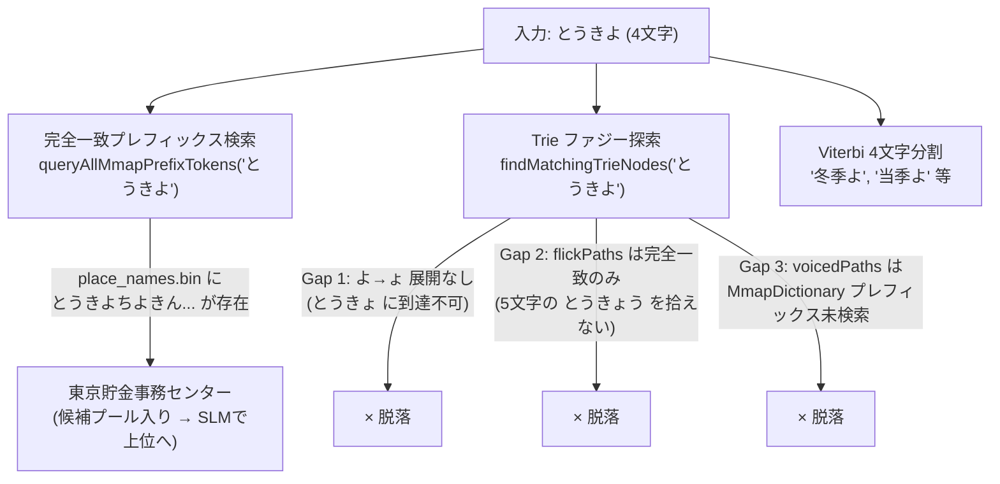

# 「とうきよ」→「東京」非表示・上位「東京貯金事務センター」問題デバッグ報告 ＆ フリック入力トップラインメトリック向上アイデア集

- **作成日**: 2026-11-17
- **対象コンポーネント**:
  - `KanaKanjiEngine` (`app/src/main/java/com/example/myasr/context/kanakanji/domain/KanaKanjiEngine.kt`)
  - `JapaneseKanaUtils` (`app/src/main/java/com/example/myasr/context/kanakanji/domain/JapaneseKanaUtils.kt`)
  - `MmapDictionary` (`app/src/main/java/com/example/myasr/context/kanakanji/domain/MmapDictionary.kt`)
  - `MultiDictionaryManager` (`app/src/main/java/com/example/myasr/context/provisioning/infrastructure/MultiDictionaryManager.kt`)
  - `LlmReranker` (`app/src/main/java/com/example/myasr/context/reranking/infrastructure/LlmReranker.kt`)
- **関連ドキュメント**:
  - [日本語フリック入力 (CUJ-2) ヘッドルーム分析](flick_eis_headroom_analysis.md)
  - [LM-First Flick & QWERTY アーキテクチャ](lm_first_flick_and_qwerty_architecture.md)
  - [濁音・半濁音ファジープレフィックス検索の設計と評価](voicing_fuzzy_prefix_search_design_and_evaluation.md)

---

## 1. 事象と再現メカニズムのデバッグ結果

### 1.1 観測された事象
日本語フリック入力で **「とうきよ」**（4文字：「東京（とうきょう）」の小書き `ょ` 省略＋末尾 `う` 未入力、または打鍵途中）を入力した際：
1. **「東京」が候補一覧に一切出現しない**。
2. 一方で、はるかに長大で特殊な固有名詞である **「東京貯金事務センター」が上位にランクインする**。

### 1.2 根本原因（コードパスに基づく 2 つの構造的要因）

#### 要因 A：なぜ「東京貯金事務センター」が「とうきよ」にマッチしたのか？
1. **外部辞書 (`PLACE_NAMES`) に含まれる日本郵便データの非小書き読み**
   - `MultiDictionaryManager.kt` の `DictionaryType.PLACE_NAMES` は `mozcdic-ut-place-names` をダウンロードして `MmapDictionary`（`place_names.bin`）を構築します。
   - `mozcdic-ut-place-names` に収録されている日本郵便の事業所個別郵便番号データ（`JIGYOSYO.CSV`）等は、元データのカナ表記が半角大文字カナ（`ﾄｳｷﾖﾁﾖｷﾝｼﾞﾑｾﾝﾀ-` 等、拗音 `ョ` が大文字 `ヨ` のまま）になっているレコードを含みます。
   - これが平仮名化され、**`とうきよちよきんじむせんたー` → `東京貯金事務センター`** として `MmapDictionary` に格納されています。
2. **完全前方一致 (`queryAllMmapPrefixTokens`) によるヒットと SLM リランク**
   - `KanaKanjiEngine.getBaseCandidates("とうきよ")` のステップ 5.2（875行目）で `queryAllMmapPrefixTokens("とうきよ", maxCount = 10)` が実行され、`place_names.bin` から `東京貯金事務センター` が `isPrediction = true` として取得されます。
   - 一方、「とうきよ」に対する 4 文字完全一致の Viterbi 分割（ステップ 4）は「冬季よ」「当季よ」「投棄よ」「登記よ」など不自然な 2 文節断片しか生成できないため、SLM（`LlmReranker`）が「東京…」で始まる単一固有表現である `東京貯金事務センター` に相対的に高い言語モデル尤度を与え、上位に残留します。

#### 要因 B：なぜ「東京（とうきょう）」が候補に一切出なかったのか？
以下の **4 つのパイプライン欠落** が連鎖した結果、`東京` は候補プール（`baseCandidates`）の段階で完全に脱落しています。

1. **小書き仮名（拗音・促音）展開の欠如 (`JapaneseKanaUtils.kt`)**
   - `findMatchingTrieNodes("とうきよ")`（`KanaKanjiEngine.kt` 1149行目）は `JapaneseKanaUtils.getVoicingExpansions(char)` を呼び出しますが、`HIRAGANA_VOICING_EXPANSION_MAP`（136〜162行目）は濁音・半濁音（`か→が` 等）のみを定義しており、**小書き仮名（`よ→ょ`, `や→ゃ`, `ゆ→ゅ`, `つ→っ`, `あ..お→ぁ..ぉ`）の展開が存在しません**。
   - また `getFlickTypoExpansions('よ')`（264行目）も `'や'` のみを返し、`'ょ'` を含みません。結果として探索木は `"とうきょ"` のノードに到達できません。
2. **フリック誤入力パス（§4.5）がプレフィックス補完を行わない (`KanaKanjiEngine.kt` 820〜859行目)**
   - 仮に `getFlickTypoExpansions('よ')` に `'ょ'` を追加しても、`flickPaths` は `fPath.node.words`（**完全一致のみ**）しか参照しません。
   - 「とうきよ」（4文字）→「とうきょ」（4文字）に対し、「東京」の読みは「とうきょう」（5文字）であるため、完全一致のみの検索では依然として「東京」に到達できません。
3. **ファジー/濁音プレフィックス検索（§3.8）が `MmapDictionary` を検索しない (`KanaKanjiEngine.kt` 769〜803行目)**
   - `voicedPaths` のプレフィックス検索（ステップ 3.8）は、インメモリ Trie（`collectPrefixWords`）と SQLite（`dbHelper?.getPrefixMatches`）のみをクエリし、**主力の大規模辞書である `MmapDictionary`（`queryAllMmapPrefixTokens(vPath.reading)`）を呼んでいません**。
   - したがって、120万語以上を保持する `mozc_general` / `sudachidict` 等からファジープレフィックス候補を引くことができません。
4. **`MmapDictionary.getPrefixTokens` が「辞書順」であり「コスト（頻度）順」ではない (`MmapDictionary.kt` 190〜260行目)**
   - `MmapDictionary.getPrefixTokens(prefix, maxCount = 10)` は、UTF-8 バイナリサーチの下限から **辞書順（Lexicographical Order）で先頭 10 語** を返す仕様です。
   - 長い複合語や特殊な固有名詞が辞書順で手前に並ぶと、`maxCount = 10` の枠が低頻度語で埋まり、最頻出語（`東京` 等）が取得漏れを起こしやすくなります。

---

## 2. フリック入力のトップラインメトリック向上アイデア（原則的アプローチ）

[CUJ-2 ヘッドルーム分析](flick_eis_headroom_analysis.md) が示すとおり、日本語フリックの統一トップラインメトリック **EIS（Effective Intended-text Speed）** において、ユーザー時間の **82.7%** は「かな打鍵時間」が占めています。

> **設計原則（Anti-Anecdotal Tuning 準拠）**:
> 以下のアイデアはいずれも個別単語のコスト改ざん（ハードコード）を行わず、**観測確率 $P(X \mid W)$ × 言語モデル事前確率 $P(W \mid C)$ × コーパス統計辞書** のベイズ的枠組みで汎化性能と EIS を引き上げるものです。

---

### アイデア 1：小書き仮名・濁音・半濁音レス「スマート無修飾フリック」の完全統合
- **狙うメトリック**: 打鍵数削減（KSR 向上）、打ち直し率低減、CUJ-2 EIS 向上
- **概要**:
  - 日本語フリックにおいて「濁点・半濁点・小（拗音/促音）」キーのタップは 1 文字あたり **2 アクション（平均 1.3× 打鍵コスト）** を発生させる最大のボトルネックです。
  - `JapaneseKanaUtils.getVoicingExpansions` 相当のファジー展開に **小書き仮名（`や/ゆ/よ→ゃ/ゅ/ょ`, `つ→っ`, `あ..お→ぁ..ぉ`, `わ→ゎ`）** を統合し、統一的な音韻修飾距離 `modifierDistance`（濁音・小書き変更回数）として扱います。
  - さらに、ステップ 3.8（ファジープレフィックス検索）から **`MmapDictionary` へのプレフィックス検索** を有効化します。
  - `LlmReranker` 側では、既存の数式 $\mathcal{S}(W) = -\log P_{\text{SLM}}(W \mid C) + \lambda_{\text{obs}} \cdot \text{obsPenalty} + \lambda_{\text{ext}} \cdot \Delta_{\text{ext}}$ において、高頻度語（`東京`）が `obsPenalty` を余裕で上回る言語モデル尤度を持つため、「とうきよ」→「東京」が自然に上位へ浮上します。
- **期待効果**:
  - 拗音・促音・濁音を含む語（例：`とうきょう`、`りょうかい`、`ちょっと`、`会議`）を**「小」「゛」キーなしで入力可能**になり、対象単語の打鍵時間を **15〜25% 短縮**。
  - 今回のような「小書き忘れタイポ」を打ち直しなしで救済し、バックスペース時間（$C_{\text{none}} + \text{retype}$）をゼロ化。

---

### アイデア 2：`MmapDictionary` v2「サブツリー最小コスト順 Top-K」プレフィックスインデックス
- **狙うメトリック**: 途中予測 Recall@10、打鍵削減率（KSR）、固有名詞ノイズ排除
- **概要**:
  - 現状の `MmapDictionary.getPrefixTokens` は UTF-8 辞書順の先頭 `K` 件しか返さないため、短いプレフィックス（2〜4文字）を打った瞬間に、辞書順で手前にある長大な低頻度語（例：`place_names` の郵便事業所名）や複合語が候補枠を圧迫します。
  - `.bin` ビルド時（`MmapDictionaryCompiler.kt` / `build_system_dictionary_bin.py`）に、各読みの接頭辞（2〜4文字バケット、または Compact Trie ノード）ごとに **「Mozc 単語コストが最小（最頻出）の上位 8〜16 トークン」へのオフセットリスト** を事前計算して `.bin` に格納します（APK サイズ増ゼロ）。
  - また、複数辞書（`mozc_general`, `sudachidict`, `jawiki`, `place_names`）を横断して `cost` 順にマージしてから `topK` を切り出します。
- **期待効果**:
  - $O(\log N)$ のまま「辞書順バイアス」を完全に撤廃し、**短い打鍵数（2〜3文字）の時点で最も一般的な単語（`東京`、`確認`、`連絡`）を確実に候補プールへ供給**。
  - `東京貯金事務センター` のような超低頻度・長大固有名詞が、一般語を押し退けて上位に出る現象を構造的に抑止。

---

### アイデア 3：Viterbi ラティスへの「音韻修飾（濁音・小書き）・隣接フリック」エッジの統合
- **狙うメトリック**: 連続文節入力時の Top-1 正解率、タイポ耐性、EIS
- **概要**:
  - アイデア 1 は単一単語（または辞書見出し語）の前方一致に効きますが、ユーザーが「とうきよえきまで」（東京駅まで）や「ちよつとまつて」（ちょっと待って）のように **複数文節を一気にフリック入力** した場合、現在の `searchViterbiLattice` は完全一致サブワードしか展開しないため救済できません。
  - Viterbi ラティスの各ノード展開（位置 `i`）において、完全一致だけでなく **1 文字あたり編集距離 1 の音韻修飾（濁音・小書き）パス** を `obsPenalty`（例：`+1200`）付きの代替エッジとしてラティスに追加します（ビーム幅 `12` 内で枝刈り）。
- **期待効果**:
  - 単語境界を跨ぐ長文フリック入力でも「小」「゛」キー省略や軽微なフリックミスを文脈＋連接コスト（`connection_data.bin`）で自動修復でき、**打ち直しゼロの連続入力**が実現します。

---

### アイデア 4：`LlmReranker` における「過剰延長（異常長固有名詞）」の事前確率統合と `topPool` 枠保護
- **狙うメトリック**: Top-1 / Top-3 精度、無意味な長大候補の露出抑止
- **概要**:
  - 現在の `LlmReranker.kt`（769〜794行目）では、`topPool`（最大 16 件）に入る予測候補の選定が `KanaKanjiEngine` からの返却順に強く依存しており、かつスコア計算における `lambdaExt * deltaExt` は文字数差のみに比例します。
  - **改善 1（辞書コスト統合）**: 予測候補（`isPrediction == true`）の初期プール切り出しおよび最終スコアにおいて、Mozc コーパスコスト（対数事前確率 $-\log P_{\text{unigram}}(W)$ 相当）を適切に反映し、`deltaExt` が大きい（例：`deltaExt >= 6`）場合は「極めて高頻度な定型表現」でない限り延長ペナルティを強める（超線形またはコーパスコスト連動ペナルティ）。
  - **改善 2（ファジー短延長枠の確保）**: `topPool` の中に「入力長 $+ 0\text{〜}2$ 文字のファジー補完枠（例：`とうきよ` → `とうきょう`）」を最低 2〜4 枠確保し、`place_names` 等の長大完全プレフィックスに 16 枠を食いつぶされないようにする。
- **期待効果**:
  - 「とうきよ」に対して「東京貯金事務センター」（$\Delta_{\text{ext}} = 10$）のような長大・低頻度な固有名詞が上位に出るのを防ぎ、実用的な語彙（`東京` $\Delta_{\text{ext}} = 1$）へ確率質量を集中できます。

---

### アイデア 5：フリック軌道（方向角度・距離・滞留時間）を用いた連続的観測尤度 $P(X \mid W)$
- **狙うメトリック**: フリック誤入力リカバリ率、高速タイピング時の許容誤差拡大（EIS +5〜10% 見込み）
- **概要**:
  - 現在の `FLICK_TYPO_EXPANSION_MAP` は離散的な 2 段階固定ペナルティ（`2200` / `3200`）ですが、高速フリックでは「少し角度が浅くて `あ` 段（センター）に落ちた」「`き` を左フリックしたつもりが斜め上だった」など、連続的な物理誤差が生じます。
  - タッチイベントの変位ベクトル $(\Delta x, \Delta y)$ と各方向（中央/左/上/右/下）との余弦類似度・距離から、第 1 候補だけでなく **第 2 候補仮名とその観測負対数尤度 $D_{\text{obs}}(x_i, c)$** を記録し、文字ラティス／ベイズ統合スコアへ直接入力します（英語 Neural Swipe `futo_swipe` と同等の連続観測モデル）。
- **期待効果**:
  - ユーザーが高速で雑にフリックしても、指の物理ベクトル＋SLM 文脈によって意図した単語が 1 位に表示され、**指の運動速度（フリック速度上限）そのものを引き上げられます**。

---

### アイデア 6：2〜3 打鍵「高信頼プレフィックス・バースト確定」＋ オートコミット連携
- **狙うメトリック**: CUJ-2 EIS（最大レバレッジ：128.1 → 211.4 cpm 目標）
- **概要**:
  - [CUJ-2 ヘッドルーム分析](flick_eis_headroom_analysis.md) §3 に位置づけられている「インライン途中予測補完」と「高信頼オートコミット」を、アイデア 1〜4 のファジー＆コスト順プレフィックス基盤の上で統合します。
  - 例：`とうきよ`（4打鍵）や `とうき`（3打鍵）の時点で、前後の文脈（例：「明日は」「出張で」）から `東京` や `東京に` の事後確率マージンが閾値を超えた場合、候補 1〜2 枠目に提示し、句読点や次文節入力で自動確定させます。
- **期待効果**:
  - 1 文字ずつの確定タップ（$0.40\text{s}$）と後半のカナ打鍵（$K_{\text{flick}}$）を同時に削減し、プロダクト全体の **Global EIS** を最も効率的に引き上げます。

---

## 3. 優先度と実装ロードマップ提案

| 優先度 | アイデア | 対象ファイル・層 | 実装コスト | 期待インパクト |
| :---: | :--- | :--- | :---: | :--- |
| **P0 (即効)** | **アイデア 1**: 小書き仮名展開 ＋ ファジープレフィックスの `MmapDictionary` 接続 | `JapaneseKanaUtils.kt`, `KanaKanjiEngine.kt` | **低** | 「とうきよ→東京」等の小書き省略・ミスを即座に救済、KSR 向上 |
| **P0** | **アイデア 4**: 過剰延長ペナルティのコーパスコスト連動 & `topPool` 枠保護 | `KanaKanjiEngine.kt`, `LlmReranker.kt` | **低** | 長大固有名詞（東京貯金事務センター等）の誤上位ランクを即座に抑止 |
| **P1** | **アイデア 2**: `MmapDictionary` コスト順 Top-K インデックス | `MmapDictionary.kt`, `MmapDictionaryCompiler.kt`, `build_system_dictionary_bin.py` | **中** | 全 400 万語規模辞書からの途中予測 Recall@10 を根本改善 |
| **P1** | **アイデア 3**: Viterbi ラティスへの小書き・濁音エッジ統合 | `KanaKanjiEngine.kt` (`searchViterbiLattice`) | **中** | 複数文節の無修飾フリック入力に対応 |
| **P2** | **アイデア 6**: 高信頼途中予測・文節チャンク＋オートコミット連携 | `KanaKanjiEngine.kt`, `VoiceInputMethodService.kt` | **中〜高** | CUJ-2 EIS +65%（211 cpm ターゲット）の主要ドライバー |
| **P3** | **アイデア 5**: フリック物理軌道ベクトルからの連続 $D_{\text{obs}}$ 算出 | フリックキーボード View ＋ `KanaKanjiEngine.kt` | **高** | 高速・曖昧フリック時の誤認識を極小化 |

---

## 4. 検証計画（実施時）
1. **単体回帰テスト**:
   - `FlickTypoAndMozcCorrectionEvaluationTest` に `とうきよ` → `東京`（上位ランク）、`ちよつと` → `ちょっと`、`きよう` → `今日` 等の小書き省略ケースを追加。
   - `LmFirstJointEvaluationTest` および `JapanesePunctuationEvaluationTest`（100% パス必須）の非退行を確認。
2. **EIS / Top-K ベンチマーク**:
   - `eval/eis` および `eval/lm_first_eval_dataset.json` を拡張し、小書き・濁音省略ケースを含めた KSR・Top-1/Top-3・CUJ-2 EIS の改善幅を定量測定する。

---

## 5. 追補デバッグ（実機 SLM リランク下で依然「東京」がランクしない原因と追加のアルゴリズミック解決策）

アイデア 1（小書き仮名展開 ＋ §3.8 の Mmap 接続）を実装し、`getBaseCandidates("とうきよ")` の段階では「東京」が候補プールに入るようになったものの、**実機環境（`LlmReranker` 有効時）で依然として「東京」が上位（特に「東京貯金事務センター」や Viterbi 断片より上）にランクしない** 構造的原因がコード精査から特定されました。

### 5.1 追加で特定された 3 つの構造的ボトルネック (`LlmReranker.kt` / `KanaKanjiEngine.kt`)

1. **`LlmReranker` Expected EIS Utility の「トークン数除算バイアス」と「延長報酬 (`gExt`) の暴走」**
   - `LlmReranker.kt` 291行目（予測候補の対数事後確率 `logPostScores`）では、`normNll = scores[i] / tokens.toFloat().pow(0.85f)`（`tokens = (mLengths[i] + 1) / 2`）を計算しています。
     - **「東京貯金事務センター」**（10文字 $\approx 5$ トークン）は総 NLL が **$5^{0.85} \approx 3.93$ で割られる** ため、`normNll` が見かけ上「東京」（2文字 $\approx 1$ トークン）より小さくなります。
   - さらに 325行目の Expected EIS Utility `utilities[i]` では、`gExt = extGainWeight * keyCostSec * deltaExt` により、未入力延長文字数 `deltaExt` に比例した報酬を与えています。
     - 「東京貯金事務センター」（$\Delta_{\text{ext}} = 10$）は「東京」（$\Delta_{\text{ext}} = 1$）の **10 倍の延長利得** を得る一方、`place_names.bin` の非小書き読みに完全前方一致したため `obsPenalty = 0.0f` となります。
   - 対して「東京」は `obsPenalty = 1.2f` により `obsEff = lambdaObs * 1.2 * 5.0 * obsDiscount`（最大 `3.0 nats`）のペナルティを受け、`rankedExtIndices`（435行目）で「東京貯金事務センター」に負けます。

2. **`LlmReranker` に辞書事前確率 (`dictCost`) が渡っていない**
   - `ConversionCandidate` は Mozc 単語コスト（対数事前確率 $-\log P_{\text{lex}}(W)$）を `LlmReranker` に渡しておらず、リスト順位 `i * 0.15f` しか参照されていません。そのため、コーパス上ほぼ出現しない固有名詞（`cost = 8000+`）と最頻出語「東京」（`cost = 0`）を事前確率で区別できていません。

3. **「希少読み（Dead-End Reading）」に対するベイズ的棄却（Exact-Nullity Gate）の欠如**
   - 「とうきよ」のように、辞書内にまともな単一完全一致語が存在せず、Viterbi 分割も高コスト・高パープレキシティな断片（「冬季よ」「投棄よ」「登記よ」）しか作れない入力では、本来 **「入力文字列 $X$ を文字通りに意図した確率 $P(\text{exact} \mid X)$」が激減し、音韻修飾・タイポ解釈の事後確率へ質量が移るべき** です。
   - 現状は `obsPenalty` が入力の「完全一致のまともさ」に関係なく一律に課されるため、無意味な Viterbi 断片（`rankedFull`）が Slot 1 を占有し、また `LlmReranker` の `topPool`（16枠）の `singleWordPrefix` 枠（最大4枠）が長大固有名詞に圧迫されます。

---

### 5.2 アルゴリズミックに「東京」をランクさせ、フリック EIS を向上させる 4 つの追加アイデア

#### アイデア 7：希少読み検出（Exact-Nullity / Dead-End Gate）によるベイズ観測ペナルティの動的緩和
- **アルゴリズム**:
  - `getBaseCandidates` / `LlmReranker` において、完全一致の単一語および最良 Viterbi 分割の品質 $\mathcal{Q}_{\text{exact}}(X) = \min_{W \in \text{Full}(X)} [\text{NLL}_{\text{SLM}}(W \mid C) + \beta \cdot \text{Cost}_{\text{Viterbi}}(W)]$ を評価する。
  - $\mathcal{Q}_{\text{exact}}(X)$ が閾値を超過する（＝「とうきよ」「ちよつと」のようにまともな完全一致語・自然な文節が存在しない）場合、**無修飾入力が意図通りである確率は低い** と判定し、音韻修飾ペナルティ $\lambda_{\text{obs}}$ を動的に減衰（例：$0.5 \to 0.1$）させるとともに、`rankedFull` の Slot 1 固定優先を解除して `rankedExt` の最良候補を Slot 1 に昇格可能にする。
- **EIS 向上メカニズム**:
  - 通常の意味のある入力（例：「きよ」「たいき」）の精度を一切落とさず、希少読み・修飾省略入力（「とうきよ」→「東京」、「ちよつと」→「ちょっと」）でのみ自動的に修飾補完を 1 位に引き上げる。これにより小書き・濁音キー省略時の Top-1 確定率と KSR が劇的に向上する。

#### アイデア 8：`ConversionCandidate` への辞書事前確率 (`dictCost`) 伝播と `normNll` / `gExt` の確率的正規化
- **アルゴリズム**:
  1. `ConversionCandidate` に `dictCost: Int`（Mozc unigram コスト）を持たせ、`LlmReranker` の `logPostScores` に $\gamma_{\text{dict}} \cdot (\text{dictCost} / 1000.0)$ を加算する（`東京` cost=0 vs `東京貯金事務センター` cost=8000+ を確率的に分離）。
  2. `logPostScores` の `tokens^0.85` 除算による長大固有名詞の過大優遇を是正し、未入力延長 $\Delta_{\text{ext}}$ に対してはコーパス頻度 $P_{\text{lex}}(W)$ で重み付けした期待利得 $P_{\text{lex}}(W) \cdot g_{\text{Ext}}$ を用いる（低頻度な長大固有名詞ほど $\Delta_{\text{ext}}$ の期待利得を減衰）。
- **EIS 向上メカニズム**:
  - 長大・低頻度な固有名詞による予測枠の汚染（および誤タップ時の大きな削除リスク $L_{\text{err}}$）を根絶し、日常頻出語の予測 Top-1/Top-3 的中率を向上させる。

#### アイデア 9：`KanaKanjiEngine` §3.8 のパス優先度ソートと「音韻統計・長音/撥音 1-Mora 先読み」
- **アルゴリズム**:
  1. `KanaKanjiEngine` §3.8 において、`voicedPaths` を無秩序に `.take(2)` するのではなく、**ノード配下の最小単語コスト（`minCostInSubtree`）＋修飾距離ペナルティ** の昇順にソートしてから `.take(4)` で `MmapDictionary` を検索する（`どうきよ` 等の低頻度パスに `とうきょ` が押し出されるのを防ぐ）。
  2. さらに、日本語の音韻統計上、拗音（`きょ`, `しょ`, `ちょう` 等）の直後は極めて高確率で **長音「う」・撥音「ん」** が続くため、希少読み判定時には展開パス（`とうきょ`）＋ `{う, ん}` の 1 モーラ先読み（`とうきょう`）を優先的に `MmapDictionary` の完全一致（`queryAllMmapExactTokens`）で引く。
- **EIS 向上メカニズム**:
  - `MmapDictionary.getPrefixTokens` の辞書順バイアスの影響を受けず、$O(1)$ の完全一致検索で `東京`（`とうきょう`）を直接引き当てられる。また「小書き省略＋長音省略」の同時適用により 1 語あたり 2 打鍵以上の削減が可能になる。

#### アイデア 10：`LlmReranker` `topPool` の「短延長ファジー候補」枠保護
- **アルゴリズム**:
  - `LlmReranker.kt`（778〜794行目）の `topPool`（最大 16 件）構築時、予測候補枠（`singleWordPrefix` 4枠）を単純先着順にするのではなく、**「短延長（$\Delta_{\text{ext}} \le 2$）かつ低辞書コスト」枠** を最低 2 枠確保する。
- **EIS 向上メカニズム**:
  - `東京` のような最有力候補が、SLM スコアリング前のプール切り出し段階で長大固有名詞やカタカナ変換に押し出されて脱落する事故をゼロにする。

