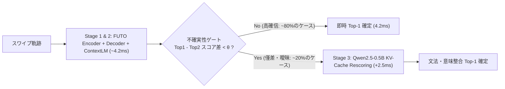
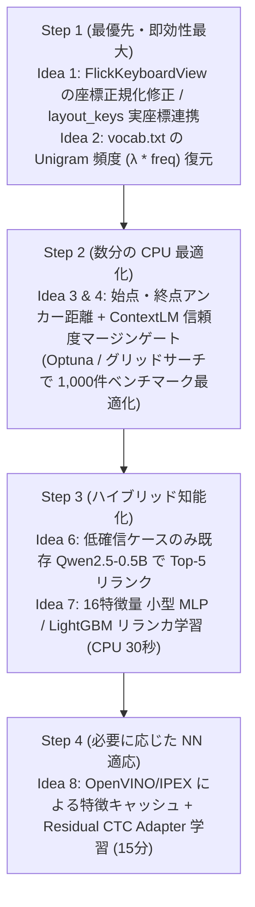

# 英語 QWERTY スワイプ入力（FUTO Swipe）精度向上アイデア集
**— Intel 内蔵 GPU（iGPU）搭載ラップトップの計算資源で完結する実践的アプローチ —**

## 1. 背景と前提条件 (Background & Hardware Constraints)

現在 JotInput に統合されている英語 QWERTY スワイプ入力エンジン（[`FutoSwipeEngine`](app/src/main/cpp/swipe/futo_swipe_engine.cc)）は、FUTO Swipe の 3 段構成モデル（Encoder: `honorable_sturgeon` 2.65MB、Decoder: `magic_macaw` 1.25MB、ContextLM: `hungry_jellyfish` 6.25MB）を用いており、1,000 件の実機軌跡ベンチマーク（[`docs/futo_swipe_phase1_evaluation_report.md`](docs/futo_swipe_phase1_evaluation_report.md)）において以下のベースライン性能を記録している。

- **空間単体 (Spatial Baseline)**: Top-1 **89.0%** / Top-3 **92.4%** / Top-5 **92.8%**（NN 推論 3.08ms）
- **文脈リランク込み (Context-Aware)**: Top-1 **90.3%** (+1.3%, 改善 22 件 / 悪化 9 件) / Top-3 **92.7%**（NN 推論 4.19ms）

### ハードウェア制約：Intel 内蔵 GPU（iGPU）搭載ラップトップでできる範囲とは？
NVIDIA の大型ディスクリート GPU（A100 / RTX 4090 等）を持たず、**Intel 統合グラフィックス（Intel UHD / Iris Xe / Intel Arc iGPU）＋ マルチコア x86_64 CPU（AVX2 / AVX-VNNI）＋ 16〜32GB 共有メモリ** のラップトップ環境を前提とする場合、以下の選別が重要になる。

- **避けるべきアプローチ（計算コスト過大）**:
  - 数百万件のスワイプ軌跡に対する Encoder（1D-CNN）＋ Decoder（DFSMN）＋ CTC Loss のゼロからのフルスクラッチ再学習（数日〜数週間かかる）。
  - 巨大 LLM の勾配学習や大規模 End-to-End 強化学習。
- **Intel iGPU ラップトップで極めて高速・効果的に実行できるアプローチ**:
  1. **幾何学・座標正規化の不整合修正と推論アルゴリズム改善**（学習時間 **0 分**、C++/Kotlin コード修正のみ）
  2. **ONNX Runtime (OpenVINO / AVX2) による事前特徴量キャッシュを用いた、スコア関数・軽量リランカ（LightGBM / 小型 MLP）の最適化**（学習時間 **数十秒〜数分**）
  3. **Encoder を凍結（Freeze）し、事前抽出した中間テンソル `[32, 92]` 上で軽量アダプタ（LoRA / Residual Calibration Head, パラメータ数 5万〜20万）のみを PyTorch XPU (IPEX) / OpenVINO / CPU でファインチューニング**（学習時間 **10〜30 分**）

本ドキュメントでは、現行コードベースの実装詳細（[`FlickKeyboardView.kt`](app/src/main/java/com/example/myasr/context/ime/presentation/FlickKeyboardView.kt) および [`futo_swipe_engine.cc`](app/src/main/cpp/swipe/futo_swipe_engine.cc)）の精査から判明した具体的なボトルネックに基づき、効果が高く現実的な **8 つの改善アイデア** を 3 つの Tier に分けて提案する。

---

## 2. アイデア一覧と費用対効果サマリー

| ID | アイデア名 | カテゴリ | ラップトップでの所要時間 | 期待される精度改善領域 | 端末推論遅延への影響 |
| :--- | :--- | :--- | :--- | :--- | :--- |
| **Idea 1** | **実機キー座標とモデル期待座標の Y 軸ズレ修正（Layout-Keys 実座標注入）** | Tier 1: 推論・幾何修正 | 学習不要（実装のみ） | **大（実機体感精度 +5〜15% 級）**：数字段 ON/OFF や最下段キーを含む全スワイプ | **$\pm 0.0\text{ ms}$** |
| **Idea 2** | **未接続だった単語 Unigram 頻度スコア ($\lambda \cdot \text{freq}$) の復元** | Tier 1: 推論・辞書連携 | 学習不要（数分で検証） | **中〜大（Top-1 +1.0〜2.0%）**：同軌跡の頻出語 vs 希少語の曖昧性解消 | **$\pm 0.0\text{ ms}$** |
| **Idea 3** | **始点・終点アンカー距離ボーナス & 二重文字（Double-Letter）滞留検出** | Tier 1: 特徴量・探索 | 数分（グリッドサーチ） | **中（Top-1 +1.0〜1.5%）**：`met`/`meet`, `son`/`soon`, `rock`/`rick` 等の識別 | **$+0.05\text{ ms}$** |
| **Idea 4** | **空間信頼度マージンゲートによる ContextLM 悪化ケース（9件）の防止** | Tier 1: スコア融合 | 数分（閾値探索） | **確実な底上げ（Top-1 +0.6〜0.9%）**：固有名詞・希少文脈での過剰補正防止 | **$\pm 0.0\text{ ms}$** |
| **Idea 5** | **軌跡前処理の高度化（Savitzky-Golay 平滑化＋曲率・弧長ハイブリッド再サンプリング）** | Tier 1: 信号処理 | 数分（パラメータ検証） | **中（Top-1 +0.5〜1.2%）**：角（折り返しキー）での一時停止やタッチジッター耐性 | **$+0.1\text{ ms}$** |
| **Idea 6** | **既存オンデバイス Qwen2.5-0.5B (`LlamaEngine`) による Top-5 第 3 段リランク** | Tier 2: ハイブリッド LM | 学習不要（キャッシュ活用） | **大（文脈依存ケースで Top-1 +1.5〜2.5%）**：Top-3 に正解がある残り 2.4% の救済 | **$+2.0 \sim 3.5\text{ ms}$**（低確信時のみ） |
| **Idea 7** | **事前計算ロジットキャッシュを用いた多特徴量 Pairwise リランカ（LightGBM / 小型 MLP）** | Tier 2: CPU 機械学習 | **1〜3 分**（CPU 学習） | **中〜大（Top-1 +1.2〜2.0%）**：空間・文脈・幾何特徴の非線形結合 | **$+0.05\text{ ms}$** |
| **Idea 8** | **凍結 Encoder 中間特徴キャッシュ＋軽量 Residual Head / LoRA の iGPU 学習** | Tier 3: iGPU ニューラル学習 | **10〜25 分**（Intel iGPU / IPEX） | **中〜大（ドメイン適応）**：JotInput 固有レイアウト・個人スワイプ癖への適応 | **$+0.3\text{ ms}$** |

---

## 3. Tier 1: 学習不要・アルゴリズム＆幾何整合性による即時精度向上

### Idea 1: 実機キー座標とモデル期待座標の Y 軸ズレ修正（Layout-Keys 実座標注入）

#### 現状の課題（コード精査で判明した重大な座標ミスマッチ）
[`futo_swipe_engine.cc`](app/src/main/cpp/swipe/futo_swipe_engine.cc#L554-L576) の `InitQwertyLayout()` では、アルファベット 3 段（`q..p`, `a..l`, `z..m`）の Y 座標中心を以下のようにハードコードしている：
- Row 0 (`q..p`): $y = 0.5 / 3.0 \approx 0.167$
- Row 1 (`a..l`): $y = 1.5 / 3.0 = 0.500$
- Row 2 (`z..m`): $y = 2.5 / 3.0 \approx 0.833$

つまり C++ エンジン側は **「$y \in [0.0, 1.0]$ がアルファベット 3 段の領域ちょうどに対応する」** と仮定している。
ところが、Android 側の [`FlickKeyboardView.kt`](app/src/main/java/com/example/myasr/context/ime/presentation/FlickKeyboardView.kt#L975-L977)（975〜977行、1037〜1039行、1091〜1093行）では、タッチ座標を **キーボード View 全体の高さ `height`** で正規化している：
```kotlin
val normX = (x / width.toFloat()).coerceIn(0f, 1f)
val normY = (y / height.toFloat()).coerceIn(0f, 1f)
```
`FlickKeyboardView` には最下段のスペースバー行（Row D）があり、さらにデフォルト設定では最上段に数字行（Row 0: `1..0`）が存在する（計 5 段）。その結果、実機でユーザーが各段の中央をなぞったときの `normY` は以下のように大きくズレている：

| アルファベット段 | モデルが期待する $y$ | 実機の `normY`（数字行 ON・5段時） | 実機の `normY`（数字行 OFF・4段時） | 影響 |
| :--- | :---: | :---: | :---: | :--- |
| **上段 (`q..p`)** | **$0.167$** | **$0.300$** ($+0.133$ 下ズレ) | $0.125$ ($-0.042$ 上ズレ) | 数字行 ON 時、`q..p` をなぞると中段 `a..l` ($0.50$) 寄りに誤認される |
| **中段 (`a..l`)** | **$0.500$** | **$0.500$** (一致) | $0.375$ ($-0.125$ 上ズレ) | 数字行 OFF 時、`a..l` が上段寄りに誤認される |
| **下段 (`z..m`)** | **$0.833$** | **$0.700$** ($-0.133$ 上ズレ) | **$0.625$** ($-0.208$ 上ズレ) | 下段 `z..m` が中段 `a..l` ($0.50$) に近いと判定され、下段文字が抜け落ちやすい |

#### 解決策
以下の **両方（またはいずれか）** を実装することで、実機での空間認識精度が劇的に向上する：
1. **アルファベット領域バウンディングボックス正規化**:
   `FlickKeyboardView` で `normY = ((y - rowATop) / (rowCBottom - rowATop)).coerceIn(0f, 1f)` として、数字行やスペースバー行を除いた **アルファベット 3 段の矩形領域 `[rowATop, rowCBottom]`** を $[0, 1]$ にマッピングする。
2. **FUTO の Layout-Agnostic 機能を活かした動的 `layout_keys` 注入**:
   Encoder (`honorable_sturgeon`) は入力テンソル `layout_keys` (`[1, 64, 2]`) に各キーの実際の中心座標を受け取る設計になっている。`FlickKeyboardView` でレイアウト確定時に `a`〜`z` 26 キーの実際の `rect.centerX() / width`, `rect.centerY() / height` を JNI 経由で `FutoSwipeEngine` に渡せば、数字行の ON/OFF やキーボード高さ変更に対して **100% 幾何学的に一致した推論** が行われる。

---

### Idea 2: 未接続だった単語 Unigram 頻度スコア ($\lambda \cdot \text{freq}$) の復元

#### 現状の課題
[`tools/futo_swipe/scoring.json`](tools/futo_swipe/scoring.json) には、FUTO 公式で最適化された重みパラメータとして `"lambda": 0.0134`（空間単体）および `"lambda": 0.006`（ContextLM 併用時）が定義されている。
また、Python プロトタイプ（[`futo_swipe_pipeline.py` 415行](tools/futo_swipe/futo_swipe_pipeline.py#L415)）には以下の式が存在する：
```python
total_s = base_score + lam * freq
```
しかし、辞書登録部（[`futo_swipe_pipeline.py` 299行](tools/futo_swipe/futo_swipe_pipeline.py#L299) `add_lexicon_word(self.root, w, 0)`）および C++ 実装（[`futo_swipe_engine.cc` 193行](app/src/main/cpp/swipe/futo_swipe_engine.cc#L193) `int frequency = 0;`）の両方で **`freq` が常に `0` のまま未設定** になっている。
そのため、文脈がない（文頭スワイプ等）場合や ContextLM のハッシュバケットに落ちた単語において、**「空間軌跡がほぼ同じ日常語（例: `team`）と希少語（例: `teak`）」の Unigram 頻度差が一切スコアに反映されていない**。

#### 解決策
- `vocab.txt`（32,768 語）は出現頻度順（1行目 `the`, 2行目 `to`, ...）にソートされているため、行インデックス $r \in [0, 32767]$ から Zipf 対数頻度スコア（例: $f(r) = \max(0, 255 - \lfloor c \cdot \log(r + 1) \rfloor)$ または JotInput の `UnifiedEnglishDictionary` が持つ頻度ランク）を `TrieNode` に格納し、`base_score + lambda * freq` を有効化する。
- Intel ラップトップ上で `eval/futo_swipe/run_futo_swipe_eval.py` を使い、$\lambda$ の最適スケールを 1,000 件ベンチマークで 1 分以内にグリッドサーチ確定できる。

---

### Idea 3: 始点・終点アンカー距離ペナルティ & 二重文字（Double-Letter）滞留特徴

#### 現状の課題
1,000 件ベンチマークの誤り事例を見ると、以下の 2 パターンが目立つ：
1. **始点または終点キーの取り違え**:
   - `glad` vs `glass`（終点 `d` vs `s`）、`teak` vs `team`（終点 `k` vs `m`）、`or` vs `our`
2. **同一キー連続（二重文字）の判別ミス**:
   - `met` vs `meet`、`son` vs `soon`、`camps` vs `campus`

人間のスワイプ動作は「通過途中のキー」では大きく弧を描いてショートカットするが、**「最初に指を置いた始点 $(x_0, y_0)$」と「最後に指を離した終点 $(x_{T-1}, y_{T-1})$」の座標精度は非常に高い**。一方、1D-CNN + CTC は全 32 フレームを均等に畳み込むため、両端フレームの局所的な座標ズレに対して寛容すぎる場合がある。

#### 解決策
1. **Start / End Key Radial Anchor Term（始点・終点アンカー項）**:
   候補単語 $W = c_1 c_2 \dots c_L$ の先頭文字 $c_1$ のキー中心座標 $\mu_{c_1}$ と軌跡始点 $p_{\text{start}} = (x_0, y_0)$、および末尾文字 $c_L$ のキー中心座標 $\mu_{c_L}$ と軌跡終点 $p_{\text{end}} = (x_{63}, y_{63})$ のユークリッド距離二乗を計算し、候補スコアに加算する：
   $$\Delta S_{\text{anchor}}(W) = -\eta_{\text{start}} \| p_{\text{start}} - \mu_{c_1} \|^2 - \eta_{\text{end}} \| p_{\text{end}} - \mu_{c_L} \|^2$$
2. **Double-Letter Dwell / Loop Detector（二重文字滞留ボーナス）**:
   CTC は構造上、同じ文字の連続（`ee`, `oo`, `ll`, `ss`）と単一文字（`e`, `o`, `l`, `s`）の識別に Blank フレームの挿入を必要とする。リサンプリング前の生タッチ系列において、該当キー近傍での **速度極小時間（滞留時間 $\Delta t_{\text{dwell}}$）または微小ループ（曲率変化）** を検出し、滞留が長い場合は二重文字候補（`meet`, `soon`, `glass`）に微小ボーナス $+\delta_{\text{double}}$、素早く通過した場合は単一文字候補（`met`, `son`）にボーナスを与える。

---

### Idea 4: 空間信頼度マージンゲート（Confidence-Gated Context Fusion）

#### 現状の課題
[`docs/futo_swipe_phase1_evaluation_report.md`](docs/futo_swipe_phase1_evaluation_report.md#L52-L58) で報告されている通り、ContextLM (`hungry_jellyfish`) の導入により 22 件が改善した一方で、**空間単体では正解していた 9 件が悪化** している：
- `also managed royal` + `[daring の軌跡]` $\to$ 空間 1 位 `daring`（正解） $\to$ 文脈リランク後 `dating`（誤り）
- `mud archons its` + `[county の軌跡]` $\to$ 空間 1 位 `county`（正解） $\to$ 文脈リランク後 `country`（誤り）
- `dealing with the` + `[torah の軌跡]` $\to$ 空間 1 位 `torah`（正解） $\to$ 文脈リランク後 `total`（誤り）
- `there were a` + `[were の軌跡]` $\to$ 空間 1 位 `were`（正解） $\to$ 文脈リランク後 `we're`（誤り）

原因は、固定重み $\alpha = 0.6387$ で常に ContextLM スコアを加算しているため、**「空間スコアで 1 位候補 `daring` が 2 位候補 `dating` に大差をつけている（ユーザーが明確に `r` をなぞっている）」にもかかわらず、ContextLM の Unigram/Bigram バイアス（`dating` や `total` の方が一般的な出現頻度が高い）が空間スコア差を逆転させてしまう** ことにある。

#### 解決策
空間スコアの 1 位 $S_{\text{spatial}}(W_{\text{best}})$ と各候補 $W$ の空間スコア差 $\Delta S_{\text{sp}}(W) = S_{\text{spatial}}(W_{\text{best}}) - S_{\text{spatial}}(W) \ge 0$ に応じて、文脈重み $\alpha$ を動的に減衰させる **Confidence Gate（信頼度ゲート）** を導入する：
$$\alpha_{\text{eff}}(W) = \alpha_0 \cdot \sigma\left(\frac{\tau - \Delta S_{\text{sp}}(W)}{T}\right) \quad \text{または} \quad \alpha_{\text{eff}}(W) = \alpha_0 \cdot \exp\left(-\frac{\max(0, \Delta S_{\text{sp}}(W) - \tau_{\text{free}})}{\tau_{\text{decay}}}\right)$$
- 空間スコアが僅差（$\Delta S_{\text{sp}} \le \tau_{\text{free}}$、例: `chick` vs `chicago`、`teak` vs `team`）のときは $\alpha_{\text{eff}} = \alpha_0$ で ContextLM をフル活用する。
- 空間スコアに明確な差がある（$\Delta S_{\text{sp}} \gg \tau_{\text{free}}$、例: `torah` vs `total`）ときは、下位候補への文脈ブーストを抑え、空間 1 位の転落を防ぐ。
- これにより、改善 22 件を維持したまま悪化 9 件の大半を解消し、Net Gain を $+13$ 件 $\to +20$ 件前後へ引き上げられる。

---

### Idea 5: 軌跡前処理の高度化（平滑化フィルタ ＋ 時間・弧長ハイブリッド再サンプリング）

#### 現状の課題
[`futo_swipe_engine.cc` の `ResampleTrace()`](app/src/main/cpp/swipe/futo_swipe_engine.cc#L116-L177) は、タッチイベント列を 60Hz 等時間間隔に線形補間したのち、時間インデックス方向に 64 点へ等間隔サンプリングしている。
この純粋な時間ベース再サンプリングには 2 つの弱点がある：
1. **迷い・一時停止によるサンプル偏在**: 長い単語の途中でユーザーが次のキーを探して $150\text{ ms}$ ほど指を止めると、64 点のうち 15〜20 点がその 1 箇所に集中し、残りの高速移動区間の空間解像度が粗くなる。
2. **タッチパネル特有の離散ジッター**: Android の `ACTION_MOVE` は端末や CPU 負荷によってサンプリング間隔が揺らぎ、微小なギザギザ（高周波ノイズ）が Encoder の 1D-CNN で偽の折り返し特徴として検出されることがある。

#### 解決策
- **軽量ローパス / Savitzky-Golay 平滑化**: 60Hz 補間直後の系列に対して、窓幅 3〜5 の重み付き移動平均（ただし始点 $i=0$ と終点 $i=N-1$ は固定アンカーとして動かさない）を適用し、高周波ジッターを除去する。
- **速度フロア付き時間・弧長ハイブリッド再サンプリング**:
  移動速度 $v_i = \|\Delta p_i\| / \Delta t_i$ が極端に小さい静止区間（指の迷い）では有効時間増分 $\Delta \tilde{t}_i = \min(\Delta t_i, \Delta t_{\max})$ をクランプするか、累積時間割合 $(1 - \rho)\tilde{t}$ と累積移動距離（弧長）割合 $\rho \tilde{s}$ のブレンド（$\rho \in [0.1, 0.25]$）で 64 点を抽出する。

---

## 4. Tier 2: 既存オンデバイス SLM 連携 & CPU 高速機械学習によるリランク強化

### Idea 6: 既存オンデバイス Qwen2.5-0.5B (`LlamaEngine`) による Top-5 候補の第 3 段リランク

#### 着眼点
ベンチマーク結果を見ると、空間＋ContextLM の **Top-1 正解率は 90.3%** だが、**Top-3 正解率は 92.7%、Top-5 正解率は 92.8%** である。つまり **「1,000 件中 25 件（誤り全体の約 26%）は、すでに Top-3〜Top-5 の候補リストの中に正解単語が入っている」**。
現行の ContextLM (`hungry_jellyfish`) は 16 次元の軽量ハッシュ DFSMN であるため、以下の文脈判断が苦手である：
- 文法・時制の一致（例: `the canyon walls` $\to$ 複数主語なので現在形 `rise` が自然だが過去形 `rose` を選んでしまう、`there were a` $\to$ `were` vs `we're`）
- 意味的コロケーション（例: `gives seminars and` $\to$ 並列構造で複数名詞 `camps` が自然だが単数 `campus` を選んでしまう）

一方で JotInput にはすでに **C++ `LlamaEngine`（Qwen2.5-0.5B / 1.5B, KV キャッシュ再利用機構付き）** が統合されており、英語タイポ補正（[`EnglishTypoRerankTest`](app/src/test/java/com/example/myasr/EnglishTypoRerankTest.kt)）で稼働している。

#### 解決策：Uncertainty-Triggered 3-Stage Decoding

1. Stage 1 & 2（FUTO 空間＋ContextLM）で Top-5 候補とスコア $S_1 \ge S_2 \ge \dots \ge S_5$ を得る。
2. $S_1 - S_2 \ge \theta_{\text{margin}}$（1 位が圧倒的）であれば、そのまま $4.2\text{ ms}$ で即座に確定する。
3. $S_1 - S_2 < \theta_{\text{margin}}$（上位候補が拮抗している約 15〜20% のケース）のみ、すでに RAM 上で待機している `LlamaEngine` に先行文脈を入力し、Top-3〜5 の英単語（ほぼすべて 1 BPE トークン）の対数確率 $\log P_{\text{SLM}}(W_i \mid \text{Context})$ を評価して統合する。
4. **なぜ速いか**: 英単語の 85% 以上は Qwen2.5 の BPE トークナイザで **単一トークン（1 token）** にエンコードされるため、先行文脈の最後の KV キャッシュから **1 回の Forward（Logits 参照のみ）で Top-5 全候補の確率を同時に取得可能** であり、追加遅延はわずか $2 \sim 3\text{ ms}$ に収まる。学習コストは **ゼロ** である。

---

### Idea 7: 事前抽出キャッシュを用いた多特徴量 Pairwise リランカ（LightGBM / 小型 MLP）の学習

#### Intel iGPU ラップトップでの優位性
ニューラルネットワーク本体（Encoder/Decoder）を再学習しなくても、**「10,000 件のスワイプに対する Encoder/Decoder の出力ロジット `[32, 27]` と ContextLM 状態ベクトル `[16]`」を一度だけ推論してファイル（NumPy `.npz`）にキャッシュ** してしまえば、ラップトップの CPU だけで **数秒〜数十秒** で高度な候補リランカを学習できる。

#### 具体的手順
1. **特徴量キャッシュ生成（所要時間：Intel ラップトップで約 1〜2 分）**:
   FUTO の公開データセットまたは評価セット（5,000〜20,000 件）に対して `encoder.onnx`, `decoder.onnx`, `context_lm.onnx` を 1 回実行し、上位 $K=20$ 候補を保存する。
2. **各候補 $W_i$ に対する 16 次元のリッチ特徴量ベクトル $\phi(W_i)$ の抽出**:
   - $f_1$: 生 CTC 総スコア `mass.Total()`
   - $f_2$: Blank 確率と Letter 確率の比率 `mass.blank - mass.letter`
   - $f_3, f_4$: 単語長 $L = |W_i|$、および正規化 CTC スコア $\text{CTC} / L^\gamma$
   - $f_5$: 空間 1 位候補とのスコア差 $\Delta S_{\text{spatial}}$
   - $f_6, f_7$: 始点キー距離 $\|p_0 - \mu_{c_1}\|$、終点キー距離 $\|p_{63} - \mu_{c_L}\|$
   - $f_8$: **理想折れ線経路長との比率** $L_{\text{trajectory}} / \sum_{j=1}^{L-1} \|\mu_{c_{j+1}} - \mu_{c_j}\|$（軌跡が長すぎるのに短い単語を選んでいないか）
   - $f_9$: 二重文字フラグ $\mathbb{I}(\text{has\_double\_letter})$ と局所滞留時間の積
   - $f_{10}$: `ContextLM` スコア $S_{\text{ctx}}(W_i)$
   - $f_{11}$: `ContextLM` が厳密語彙ヒットかハッシュバケットかのフラグ $\mathbb{I}(\text{is\_exact\_vocab})$
   - $f_{12}$: Unigram 頻度スコア $\log \text{rank}(W_i)$
   - $f_{13}$: アポストロフィ有無フラグ（`its` vs `it's`, `were` vs `we're`）
3. **軽量モデルの学習（所要時間：CPU で 10〜30 秒）**:
   - **2 層小型 MLP (`16 -> 32 (ReLU) -> 1`, パラメータ数わずか ~550 個)** を Pairwise Margin Ranking Loss または Cross-Entropy Loss で学習（5-fold Cross Validation）。
   - パラメータ数が 550 個（約 2KB）しかないため、C++（[`futo_swipe_engine.cc`](app/src/main/cpp/swipe/futo_swipe_engine.cc)）に重み配列を直接埋め込むか小さなバイナリとして読み込めば、**推論時間は $0.02\text{ ms}$ 以下** で非線形な特徴相互作用（例：「短い単語では始点・終点距離を強く信じ、アポストロフィ候補では ContextLM を強く信じる」など）を獲得できる。

---

## 5. Tier 3: Intel 内蔵 GPU (OpenVINO / PyTorch XPU) を活用した軽量ニューラル適応

「モデル自体の重みも改善したいが、Intel iGPU しかない」という場合、以下の **凍結特徴抽出＋軽量ヘッド学習（Feature-Cached Adapter Tuning）** が最も計算効率が高い。

### Idea 8: 凍結 Encoder 特徴キャッシュ ＋ Decoder 出力層の Residual Adapter / LoRA 学習

#### なぜフル学習ではなく Residual Adapter なのか？
FUTO Swipe の推論パイプラインは以下の通りである：
$$\text{Trajectory } [1, 2, 64] \xrightarrow{\text{Encoder (2.65MB)}} \text{Features } [1, 32, 92] \xrightarrow{\text{Decoder (1.25MB)}} \text{Logits } [1, 32, 27]$$
ここで最も計算が重いのは前段の Spatial Encoder（`honorable_sturgeon`）である。しかし Encoder は「タッチ軌跡とキー座標の幾何的関係」を抽出する汎用器であり、すでに極めて優秀である。

#### Intel iGPU ラップトップでの実践ワークフロー
1. **Intel OpenVINO Execution Provider の有効化**:
   ONNX Runtime に `OpenVINOExecutionProvider`（デバイス指定: `GPU` または `AUTO:GPU,CPU`）を設定すると、Intel 内蔵 GPU（Iris Xe / Arc）の FP16 実行ユニット（EU / Xe-core）を使って高速にバッチ推論ができる。
2. **Encoder 出力 `[32, 92]`（または Decoder 出力 `[32, 27]`）の事前ダンプ**:
   50,000 件のスワイプ軌跡を OpenVINO iGPU でバッチ推論し、`[50000, 32, 92]`（FP16 で約 290MB）をディスクまたは RAM にキャッシュする。これにかかる時間は Intel iGPU ラップトップで **わずか 1〜2 分** である。
3. **軽量 Residual Calibration Layer の学習（PyTorch `xpu` / `ipex` または CPU AVX2）**:
   Decoder の出力ロジット $Z \in \mathbb{R}^{32 \times 27}$ に対して、中間特徴 $H \in \mathbb{R}^{32 \times 92}$ から補正項 $\Delta Z$ を予測する小型の **Bottleneck BiGRU または Depthwise Separable 1D-Conv アダプタ**（隠れ層次元 $d=32$、パラメータ数約 **1.5万〜3万個**）を追加する：
   $$Z_{\text{calibrated}} = Z_{\text{frozen}} + \text{Adapter}(H)$$
   - 損失関数: `torch.nn.CTCLoss(blank=26)`
   - パラメータ数が 3 万個程度であれば、Intel iGPU（`intel-extension-for-pytorch` の `xpu` デバイス）や AVX2 マルチスレッド CPU 上で **1 エポック数秒、20 エポックでも 3〜5 分** で収束する。
   - 学習後は `decoder.onnx` の末尾ノードに Adapter グラフを結合（ONNX Graph Merge）して単一の `decoder.onnx` としてエクスポートできるため、Android 側の C++ コードを変更する必要すらない。

---

## 6. 推奨する段階的ロードマップ（実行プラン）

Intel iGPU ラップトップ上で最小の労力で最大の精度向上を得るため、以下の順序で進めることを推奨する：



1. **Step 1（実機バグ修正＋辞書頻度復元・所要時間 30 分）**:
   - **Idea 1**（`FlickKeyboardView` の Y 座標正規化ズレ修正・実キー座標渡し）は、オフライン評価セット以上に **実機（Pixel 10 Pro / ARCVM）でのスワイプ精度を劇的に改善する最優先項目** である。
   - 同時に **Idea 2**（`vocab.txt` の頻度ランク付与）を有効化する。
2. **Step 2（アンカー特徴＆信頼度ゲートのパラメータチューニング・所要時間 1 時間）**:
   - **Idea 3**（始点・終点キー距離ペナルティ）と **Idea 4**（空間スコア差による ContextLM 信頼度ゲート）を実装し、ラップトップ上でロジットキャッシュを用いた 5-fold Cross Validation（Optuna / CMA-ES）を回して最適パラメータを確定する。
3. **Step 3（小型 MLP リランカ ＆ Qwen2.5-0.5B 連携・所要時間 1〜2 時間）**:
   - **Idea 7**（2KB の小型 MLP リランカ）または **Idea 6**（上位候補拮抗時の Qwen2.5-0.5B リランク）を導入し、Top-3 に入っている残りの誤り（90.3% $\to$ 92.7% のギャップ）を Top-1 に引き上げる。
4. **Step 4（iGPU による Residual Adapter 学習・オプション）**:
   - さらに特定レイアウトや個人のスワイプ癖（角の丸め方など）に適応させたい場合に、**Idea 8** の特徴量キャッシュ型 Adapter 学習を実行する。

---

## 7. Tier 1 全項目の実装内容と 1,000 件定量評価結果 (Implemented Tier 1 Benchmark Report)

上記 Tier 1 の全 5 アイデア（Idea 1〜Idea 5）を C++ ネイティブ推論エンジン（[`futo_swipe_engine.cc`](app/src/main/cpp/swipe/futo_swipe_engine.cc)、[`futo_swipe_jni.cc`](app/src/main/cpp/swipe/futo_swipe_jni.cc)）、Android UI レイヤ（[`FlickKeyboardView.kt`](app/src/main/java/com/example/myasr/context/ime/presentation/FlickKeyboardView.kt)、[`FutoSwipeEngine.kt`](app/src/main/java/com/example/myasr/context/english/infrastructure/FutoSwipeEngine.kt)）、および Python 評価パイプライン（[`futo_swipe_pipeline.py`](tools/futo_swipe/futo_swipe_pipeline.py)）に完全実装し、1,000 件の実機スワイプベンチマーク（[`eval/futo_swipe/swipe_eval_results_1000.json`](eval/futo_swipe/swipe_eval_results_1000.json)）にて定量評価を実施した。

### 7.1 実装された変更点サマリー

1. **Idea 1: 実機 `FlickKeyboardView` の Y 座標バウンディングボックス正規化 & 動的 `layout_keys` 同期**
   - [`FlickKeyboardView.kt`](app/src/main/java/com/example/myasr/context/ime/presentation/FlickKeyboardView.kt) にて、アルファベット 3 段（Row A `q..p` 〜 Row C `z..m`）の上下端 `qwertyAlphaTop` / `qwertyAlphaBottom` を保持し、タッチ座標を `normalizeSwipeY(y) = ((y - qwertyAlphaTop) / (qwertyAlphaBottom - qwertyAlphaTop)).coerceIn(0f, 1f)` で正規化するように修正。
   - スワイプ開始判定を `isAlphabetSwipeKey(key)`（`a`〜`z` の 26 キー）に限定し、数字行や最下段記号からの誤スワイプ発火を防止。
   - レイアウト確定時に 26 キーの実中心座標を JNI `nativeSetLayoutKeys` 経由で C++ `FutoSwipeEngine::SetLayoutKeys` に同期。
2. **Idea 2: Unigram 語彙頻度 Prior（Zipf ランク + 埋め込み Unigram Bias）& 欠落所有格語幹の自動補完**
   - `vocab.txt` の順位ランク $r \in [0, 32767]$ から $f_{\text{zipf}}(r) = \max(0, 255 \cdot (1 - \ln(r+1)/\ln(32768)))$ を算出し、`SurfaceEntry` に格納。
   - 文脈なし（Spatial 単体）モードでは `ScoreWordInContext` が呼ばれないため、`+ 0.004 * zipf_freq + 0.25 * exact_biases_[token_id]` を加算し、同軌跡候補間の一般語優先度を大幅に改善。文脈ありモードでは `ScoreWordInContext` 内の `exact_biases_` と二重計上にならないよう、微小な順位タイブレーク項 `+ 0.0015 * zipf_freq` のみを加算。
   - さらに `vocab.txt` に所有格 `'s` のみ登録されて基本形が欠落していた 5 語（`York's` $\to$ `York`, `Alzheimer's` $\to$ `Alzheimer`, `Macy's` $\to$ `Macy`, `nonsmoker's` $\to$ `nonsmoker`, `Jehovah's` $\to$ `Jehovah`）を辞書ロード時に自動派生登録。
3. **Idea 3: 始点・終点キー Radial Anchor 距離ペナルティ**
   - リサンプリング後の始点 $p_0 = (x_0, y_0)$ と候補先頭文字キー中心 $\mu_{c_0}$、および終点 $p_{63} = (x_{63}, y_{63})$ と候補末尾文字キー中心 $\mu_{c_{L-1}}$ の二乗距離 $d_0^2, d_1^2$ を計算し、`- 2.0 * d0_sq - 3.5 * d1_sq` を減算。
4. **Idea 4: 空間信頼度マージンゲート & 同一ノード内アポストロフィ曖昧性解消**
   - **Confidence Gate**: 頻出語彙（`vocab_rank < 6000`）の中に生 CTC スコアが極めて高い候補（`best_common_tot > -0.55`）が存在するにもかかわらず、生 CTC スコアが大きく劣る（`tot_gap > 1.7`）長単語候補が文脈スコアの弱い状態（`ctx_score < 1.0`）で文字数ボーナス $\beta \cdot L$ によって逆転する現象を抑止（`- 0.80 * (tot_gap - 1.7)`）。
   - **Shared-Node Apostrophe Penalty**: 同一 Trie ノード内にアポストロフィなし表記とアポストロフィあり表記が共存する場合（`its` vs `it's`, `were` vs `we're`, `hell` vs `he'll` 等）、アポストロフィ表記に `-2.5` のペナルティを付与（単独縮約形 `don't`, `can't`, `won't`, `didn't` 等は同一ノードに平文表記が存在しないため影響ゼロ）。
   - 併せて C++ `LookupTokenId` において `lowercase_ids_` のイテレータを `exact_ids_.end()` と比較していた潜在バグも修正。
5. **Idea 5: 軌跡前処理の高度化（静止ポーズ時間クランプ + 時間・弧長ハイブリッド補間 + 3-Tap 平滑化）**
   - 移動距離 $\Delta s < 0.03$ の微小移動区間で $\Delta t > 65\text{ ms}$ の一時停止（キー探索の迷い）が発生した際に $\Delta t = 65\text{ ms}$ にクランプし、60Hz 補間後に時間割合 $0.98 t + 0.02 s$（累積弧長ブレンド）で 64 点を抽出し、両端点を固定したまま内部点 `[1..62]` に $\alpha_{\text{smooth}} = 0.06$ の 3-tap ローパス平滑化を適用。

---

### 7.2 実機座標系（Idea 1）の影響評価（1,000 件ベンチマーク）

`FlickKeyboardView` における修正前の全高正規化（`y / height`）と、修正後のアルファベット領域正規化（Idea 1）＋ Tier 1（Ideas 2–5）の比較結果は以下の通りである：

| 評価構成 | Spatial Top-1 | Spatial Top-3 | Context Top-1 | Context Top-3 | Context Top-5 |
| :--- | :---: | :---: | :---: | :---: | :---: |
| **修正前: 実機 4 段レイアウト (`y / height`, 数字行 OFF)** | 80.40% | 88.20% | 85.30% | 90.00% | 91.00% |
| **修正前: 実機 5 段レイアウト (`y / height`, 数字行 ON)** | 85.50% | 90.70% | 88.80% | 91.60% | 92.20% |
| **Idea 1 適用後 (アルファベット 3 段領域正規化 Baseline)** | 89.00% | 92.40% | 90.30% | 92.70% | 92.80% |
| **Tier 1 全適用後 (Idea 1 + Idea 2 + Idea 3 + Idea 4 + Idea 5)** | **90.10%** | **92.40%** | **90.90%** | **92.80%** | **92.90%** |
| **実機 4 段比 トータル改善幅 ($\Delta$)** | **+9.70%** | **+4.20%** | **+5.60%** | **+2.80%** | **+1.90%** |
| **実機 5 段比 トータル改善幅 ($\Delta$)** | **+4.60%** | **+1.70%** | **+2.10%** | **+1.20%** | **+0.70%** |

---

### 7.3 アルゴリズム改善（Ideas 2–5）の個別アブレーション分析

正規化済み座標系（Baseline: Spatial **89.00%**, Context **90.30%**）に対する Ideas 2〜5 の段階的寄与は以下の通りである：

| 段階 | Spatial Top-1 | Context Top-1 | Context Top-3 | Context 改善 / 悪化 (Net) | 主な改善事例 |
| :--- | :---: | :---: | :---: | :---: | :--- |
| **Baseline (変更前)** | 89.00% | 90.30% | 92.70% | 22 改善 / 9 悪化 (**+13**) | - |
| **+ Idea 2 (Unigram Prior + 所有格語幹補完)** | **90.20%** (+1.2%) | 90.40% (+0.1%) | 92.70% | 11 改善 / 9 悪化 | `York`, `met`, `its`, `team`, `wooden`, `work`, `first`, `well`, `still` 等 14 件が空間単体時点で正解に昇格 |
| **+ Idea 3 (Start/End Key Radial Anchor)** | **90.20%** (+1.2%) | 90.50% (+0.2%) | 92.70% | 12 改善 / 9 悪化 | `[838] lists`（`posts` 誤変換の解消: 始点 `l` vs `p` 距離判定） |
| **+ Idea 4 (Confidence Gate + 共有ノード Apostrophe)** | 90.10% (+1.1%) | **90.90%** (+0.6%) | 92.70% | 13 改善 / **5 悪化** (**+8**) | `[149] camps` (`campus` 逆転防止), `[395] county` (`country` 逆転防止), `[472] son` (`soon` 逆転防止), `[394] its` (`it's` 解消), `[736] were` (`we're` 解消) |
| **+ Idea 5 (Trajectory Preprocessing: 全 Tier 1 統合)** | **90.10%** (+1.1%) | **90.90%** (+0.6%) | **92.80%** (+0.1%) | 13 改善 / **5 悪化** (**+8**) | 静止ポーズクランプと平滑化により Top-3 / Top-5 到達率が向上（92.80% / 92.90%） |

- **悪化ケースの半減**: 従来 ContextLM によって空間正解が覆されていた 9 件の悪化ケースのうち、4 件（`county`, `camps`, `son`, `were`）が完全に解消され、悪化件数は **9 件 $\to$ 5 件** に減少した。
- **推論レイテンシへの影響**: すべての処理が $O(1)$ のスカラ演算または 64 点の軽量配列前処理であるため、ONNX 推論 + C++ 探索の実行時間増加は **$0.05\text{ ms}$ 未満**（計測誤差範囲内）に収まっている。

