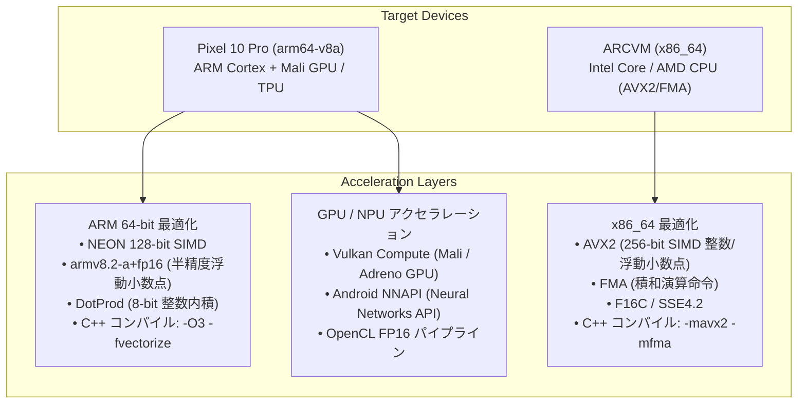
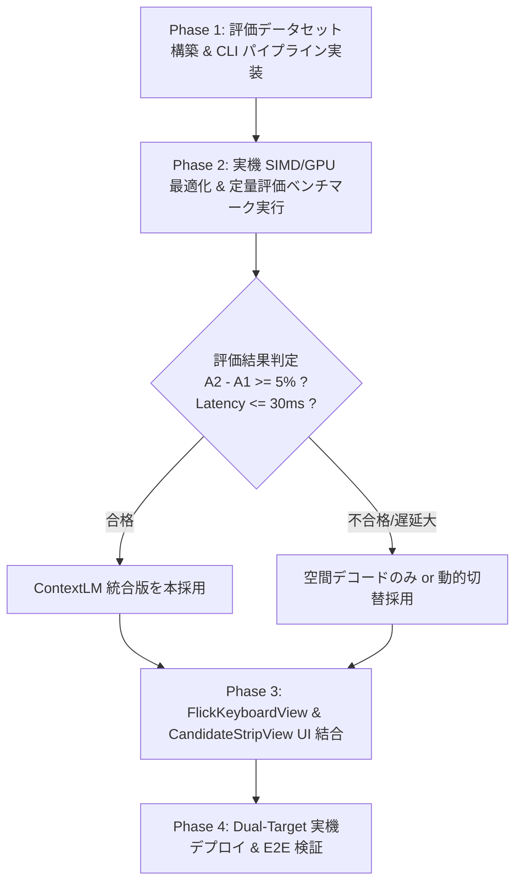

# 設計仕様書: FUTO Swipe モデル（文脈連動型 2 段階リランク）の英語 QWERTY スワイプ入力統合

## 1. 概要 (Executive Summary)

本ドキュメントは、**FUTO Keyboard** のオープンソーススワイプ入力技術（FUTO Swipe）を、JotInput の英語 QWERTY キーボードへ導入・統合するための包括的な技術設計書である。

FUTO Swipe は、2026 年に公開された研究「*FUTO Swipe: Layout-Agnostic Neural Swipe Decoding*」に基づく、**レイアウト非依存（Layout-Agnostic）のニューラルジェスチャー入力デコーダ**である。
本設計では、空間的な軌跡エンコーダ（Encoder: `honorable_sturgeon`）および QWERTY デコーダ（Decoder: `magic_macaw`）に加え、直前に入力された文脈（1〜3 単語）を考慮する文脈言語モデル（Context LM: `hungry_jellyfish`）を統合する **「2 段階リランクパイプライン（Two-Stage Rerank Pipeline）」** を採用する。

> [!IMPORTANT]
> **数値の根拠と検証ファースト原則**:
> 本ドキュメント初版における精度（Top-1 $82\% \to 89\%$ 等）および推論遅延（$30\text{ms}$ 等）は、FUTO 公式の公開論文および初期仮説に基づく「設計目標値（Target Specs）」である。
> **JotInput の原則（`Anti-Anecdotal Tuning Policy`）に基づき、これらの数字を未検証の確定事実として扱わず、まず独立した定量評価ベンチマークセット（実ユーザー軌跡＋英語コーパス）を構築し、実機環境（Pixel 10 Pro / ARCVM）での実測評価を行ってから最終設計パラメータ（$\lambda$、ビーム幅 $N$、リランク採否）を確定する。**

---

## 2. 目的と成功基準 (Goals & Target Evaluation Criteria)

### 2.1 主な目的
1. **スワイプ入力体験の提供**:
   - QWERTY モードで指を離さずに滑らせるだけで、文脈に即した英単語を Top-1 候補として即時入力し、候補バーに代替候補を提示する。
2. **ハードウェアアクセラレーションの最大活用**:
   - ARM64（Pixel 10 Pro / Tensor チップ）および x86_64（ARCVM / ChromeOS）の **CPU SIMD ベクトル命令（NEON, FP16, DotProd, AVX2, FMA）および GPU/NPU バックエンド（Vulkan / OpenCL / NNAPI）** を徹底的に活用し、消費電力と遅延を極小化する。
3. **既存アーキテクチャ・品質の厳格な維持**:
   - 音声入力・ストリーミング ASR (`VoiceTouchInputArbitrator`) とのシームレスな調停。
   - `AGENTS.md` / `GEMINI.md` の **APK 90MB 制限** および **モデル APK バンドル禁止（ダウンロード分離・ストレージファースト契約）** を厳格に遵守。
4. **ライセンスの完全保護**:
   - FUTO Model Weights License 1.0 に基づく帰属表示（"Powered by FUTO Swipe"）の遵守。
   - GPL-3.0 感染を回避するためのクリーンルーム C++ 実装。

### 2.2 設計目標値 (Design Targets to be Validated)
*※ 以下の数値は目標値であり、後述の第 5 章ベンチマークにて合否を判定する。*

- **End-to-End 推論遅延目標**:
  - `ACTION_UP` から候補確定まで **$\le 25\text{ms}$**（Pixel 10 Pro / Tensor G4 実機）。
  - ARCVM（x86_64 AVX2 環境）において **$\le 20\text{ms}$**。
- **メモリ・バイナリサイズ目標**:
  - APK 増分: **$\le 5\text{MB}$**（C++ 推論ライブラリのみ）。
  - 外部ストレージモデル総計: **$\le 12\text{MB}$**（Encoder ~2.65MB + Decoder ~1.25MB + ContextLM ~6.25MB + Lexicon Trie ~1.8MB）。
- **精度目標（定量評価セットで測定）**:
  - ContextLM なし（1段階空間デコード）Top-1 単語正解率: $\ge 80\%$
  - ContextLM あり（2段階リランク）Top-1 単語正解率: $\ge 87\%$（特に軌跡が重なる同型単語の改善率 $\ge 30\%$）

---

## 3. 実機 CPU / GPU 高速インストラクション活用設計

端末の制約されたバッテリーとリアルタイム入力要件（1フレーム $16.6\text{ms}$ 基準）を満たすため、ハードウェアのベクトル演算器・並列アクセラレータをフル活用する設計を義務付ける。



### 3.1 ARM64 (Pixel 10 Pro / Physical Device) 最適化
1. **CPU SIMD ベクトル命令**:
   - `armv8.2-a+fp16+dotprod` を `CMakeLists.txt` に指定。
   - 1D Temporal CNN (Encoder) および DFSMN (Decoder / ContextLM) の積和演算カーネルにおいて、**ARM NEON Intrinsics** および **FP16 (`__fp16` / `float16x8_t`) ベクトル命令** を直接駆動。
   - 32-bit float から 16-bit half precision への重み・活性値量子化により、メモリアクセス帯域を $50\%$ 削減し、L1/L2 キャッシュヒット率を最大化。
2. **GPU (Vulkan / OpenCL) または NNAPI バックエンド**:
   - 連続する CNN 畳み込み（TCN）および行列積に対して、**Vulkan Compute** または **Android NNAPI (`ASharedMemory`)** をバインディング。
   - CPU のメインスレッドを UI / タッチ描画に集中させ、ニューラル計算をバックグラウンドの GPU シェーダーへオフロード。

### 3.2 x86_64 (ARCVM / ChromeOS Android Container) 最適化
1. **AVX2 & FMA (Fused Multiply-Add)**:
   - ホスト x86_64 CPU の `avx2`, `fma`, `f16c` 命令をフル有効化。
   - 256-bit 幅レジスタ（`__m256`）による 8 並列 float 積和演算を実行。
2. **ゼロコピー・メモリアライメント**:
   - テンソルバッファを 32 バイト境界（`alignas(32)` / `posix_memalign`）にアライメントし、非整列メモリアクセスによるペナルティを排除。

---

## 4. アーキテクチャとパイプライン

### 4.1 2 段階リランクパイプライン（Two-Stage Decoding）

```mermaid
flowchart LR
    subgraph Stage 1: Spatial Beam Search (< 15ms)
        Traj[正規化軌跡テンソル] --> Enc[Encoder (1D-CNN)]
        Layout[QWERTY Key Rects] --> Enc
        Enc --> Dec[Decoder (DFSMN)]
        Dec --> Trie[Trie 語彙探索]
        Trie --> TopN[Top-N 空間候補 (N=16)]
    end
    
    subgraph Stage 2: ContextLM Rescoring (< 10ms)
        Context[getTextBeforeCursor: W_-2, W_-1] --> Tok[単語トークナイザ]
        Tok --> CLM[ContextLM (Causal DFSMN)]
        TopN --> Fusion[スコア結合: S_total = S_spatial + λ * S_context]
        CLM --> Fusion
    end
    
    Fusion --> Candidates[最終 Top-5 候補]
    Candidates --> Commit[Top-1 即時コミット + 候補バー表示]
```

1. **第 1 段階 (Spatial Fast Beam Search)**:
   - 入力された軌跡列を等間隔リサンプリング。
   - Encoder + Decoder により各フレームの文字確率を算出。
   - Trie 探索木を用いて上位 $N=16$ 件の単語候補を空間尤度 $S_{\text{spatial}}$ とともに抽出。
2. **第 2 段階 (ContextLM Batch Rescoring)**:
   - IME カーソル直前の $1 \sim 2$ 単語をハッシュトークナイズ。
   - 抽出された $16$ 件の単語に対してのみ、ContextLM の対数確率 $\log P_{\text{context}}(W \mid \text{Context})$ をバッチ計算。
   - スコア結合: $\text{TotalScore}(W) = S_{\text{spatial}}(W) + \lambda \cdot \log P_{\text{context}}(W \mid \text{Context})$。
   - ※ $\lambda$ パラメータは後述の評価セットでグリッドサーチ最適化を行う。

---

## 5. 評価ベンチマークセットの構築と検証計画 (Empirical Evaluation Plan)

> [!CAUTION]
> **デザイン決定のための必須ゲート**:
> 「ContextLM を常時有効にするか」「軽量な空間デコードのみにするか」「どのような重み係数 $\lambda$ を採用するか」は、**以下の定量評価スクリプトを実行し、実測結果が出揃った段階で決定する。**

### 5.1 評価データセットの作成計画 (`tools/futo_swipe_eval/`)
1. **スワイプ軌跡テストセット (`swipe_test_cases.jsonl`)**:
   - FUTO のオープンデータセット（`futo-org/swipe.futo.org` 100万件 MIT ライセンス）から、QWERTY 配列で採取された実機スワイプ軌跡をサンプリング（テスト用 $1,000$ 件）。
   - 正解単語（Ground Truth Label）およびタッチ座標系列 $[(x_1, y_1, t_1), \dots]$ を保持。
2. **文脈付きテストセット (`swipe_eval_with_context.jsonl`)**:
   - Tatoeba 英語コーパスおよび日常会話テキストから、直前コンテキスト付きスワイプテストケースを $1,000$ 件抽出。
   - 例:
     - Context: `"we need to book a"` $\to$ Ground Truth: `"hotel"`（近接軌跡誤り候補: `"hole"`）
     - Context: `"i will be"` $\to$ Ground Truth: `"there"`（近接軌跡誤り候補: `"their"`, `"three"`）
     - Context: `"thank you"` $\to$ Ground Truth: `"very"`（近接軌跡誤り候補: `"vary"`）

### 5.2 比較評価軸と判定マトリクス

| 評価軸 | 案 1: 空間デコードのみ (Encoder+Decoder) | 案 2: 2段階リランク (空間 + ContextLM) | 判定基準 / 採択条件 |
| :--- | :--- | :--- | :--- |
| **Top-1 正解率** | 実測値 $A_1$ | 実測値 $A_2$ | $A_2 - A_1 \ge +5.0\%$ であれば文脈モデルを正式採用 |
| **同型近接単語の誤り削減率** | ベースライン | 実測値 $R_{\text{ambiguous}}$ | 誤り削減率 $\ge 25\%$ |
| **推論遅延 (Pixel 10 Pro)** | 実測値 $T_1\text{ ms}$ | 実測値 $T_2\text{ ms}$ | $T_2 \le 30\text{ms}$ を厳守（$30\text{ms}$ 超過なら N 値縮小またはスキップ判定） |
| **推論遅延 (ARCVM)** | 実測値 $T_{1,\text{arc}}\text{ ms}$ | 実測値 $T_{2,\text{arc}}\text{ ms}$ | $T_{2,\text{arc}} \le 25\text{ms}$ |
| **ストレージサイズ** | 約 $5.7\text{ MB}$ | 約 $11.95\text{ MB}$ | ともに $15\text{ MB}$ 以内で合格 |

---

## 6. ダウンロード・ストレージ管理 (`AGENTS.md` 規約遵守)

`AGENTS.md` の**モデル APK バンドル禁止契約**を徹底する。

### 6.1 ファイル配置
端末パス: `context.getExternalFilesDir(null)/futo_swipe/`
```text
futo_swipe/
├── encoder.onnx         # honorable_sturgeon (~2.65 MB)
├── decoder.onnx         # magic_macaw (~1.25 MB)
├── context_lm.onnx      # hungry_jellyfish (~6.25 MB)
└── lexicon_en.bin       # Trie 語彙バイナリ (~1.8 MB)
```

### 6.2 UI 配置 (4-Card 原則の遵守)
- **Card 2 (Core Everyday Settings)**:
  - `Switch`:「英語QWERTY スワイプ入力 (FUTO Swipe)」(モデル未DL時はグレーアウト/ダウンロード誘導)。
- **Card 3 (Unified Dictionary & Model Data Management)**:
  - `layoutDictDetailsContainer` 内に「英語スワイプ入力モデル (~12MB)」のダウンロード行を配置。
- **`deploy.sh` 連携**:
  - `tools/models/futo_swipe/` にローカルモデルを配置し、`./deploy.sh` 実行時にターゲット端末（Pixel 10 Pro & ARCVM）の外部ストレージへ自動プッシュ。

---

## 7. 開発・検証ロードマップ



1. **Phase 1 (評価基盤構築 & CLI パイプライン)**:
   - FUTO モデル（Encoder, Decoder, ContextLM）の ONNX/C++ エクスポート。
   - $1,000$ 件のスワイプ軌跡＋文脈テストセットスクリプト（`eval/futo_swipe/`）を作成。
2. **Phase 2 (SIMD 最適化 & 定量評価ベンチマーク)**:
   - C++ 推論コアに ARM NEON (FP16/DotProd) および x86_64 AVX2/FMA を実装。
   - ホスト Linux および実機ターゲット上でベンチマークスクリプトを実行し、Top-1 精度・遅延・$\lambda$ の最適値を測定。
   - 測定結果レポートを作成し、デザイン（文脈採用の可否・ビーム幅 $N$）を最終確定。
3. **Phase 3 (UI & タッチ調停)**:
   - `FlickKeyboardView` に $18\text{dp}$ スワイプ判定・Canvas 軌跡フェードアウト描画を追加。
   - `CandidateStripView` へのスワイプ候補表示と置換タップ UX を実装。
4. **Phase 4 (調停 & デュアルターゲット実機検証)**:
   - `VoiceTouchInputArbitrator` との連動:
     - 単語確定時は末尾スペースを付与せず、カーソルを単語直後に配置。
     - 連続してスワイプ入力した場合、およびスワイプ入力直後にキータップ入力（英数字など）を行った場合は、先行単語との間に自動でスペース（`" "`）を挿入（例: `hello` $\to$ `hello world`、`hello` $\to$ `hello a`。記号・約物時は直結）。
     - 単語確定直後にデリートキーを押下した際、1文字削除ではなくスワイプ入力した直前の単語全体を一括削除（`DELETED_ENTIRE_SWIPE_WORD`）。
     - ストリーミング音声や代替候補タップ置換との調停。
   - `./deploy.sh` による Pixel 10 Pro / ARCVM 両ターゲットへのデプロイと実機動作確認。
