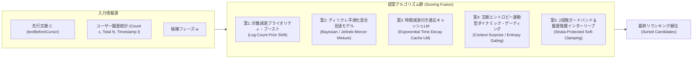
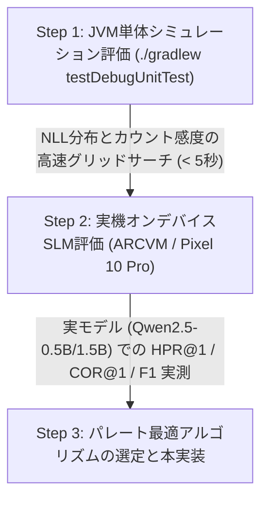

# ユーザー履歴（Unigram / Bigram）とオンデバイスSLMを統合したアルゴリズミック・リランキング設計および評価仕様書

## 1. 背景と現状の課題分析 (Problem Statement)

現在のJotInputにおいて、ユーザー履歴は変換の「初期順位付け（Fast Path）」には利用されているものの、直後に実行される「オンデバイスSLMによるリランキング（Slow Path: [`LlmReranker.kt`](app/src/main/java/com/example/myasr/context/reranking/infrastructure/LlmReranker.kt)）」では**スコアリング関数に履歴統計量（選択回数・遷移確率・経過時間）が一切組み込まれていない**という構造的課題が存在する。

### 1.1. 現行パイプラインにおける履歴情報の欠落箇所

1. **データ構造の欠落 ([`ConversionCandidate`](app/src/main/java/com/example/myasr/context/kanakanji/domain/KanaKanjiEngine.kt#L29-L42))**:
   - [`NextPhrasePredictor.predict()`](app/src/main/java/com/example/myasr/context/kanakanji/domain/NextPhrasePredictor.kt#L177-L209) で履歴バイグラム（`bigramHistory[lastPhrase]`）から候補を生成する際、`entry.value`（遷移カウント $c$）は初期ソートにのみ使われ、`ConversionCandidate` インスタンス生成時には破棄されている（`priority = 0.0f` のまま）。
   - [`KanaKanjiEngine.kt`](app/src/main/java/com/example/myasr/context/kanakanji/domain/KanaKanjiEngine.kt#L898-L914) のかな漢字変換でも、`historyMap["reading:surface"]` の選択回数 $c$ は `prioritizeByHistory()` での初期ソートにのみ使われ、`LlmReranker` には渡されていない。

2. **SLMスコアリング関数における履歴の無視 ([`LlmReranker.scoreAndRankPool`](app/src/main/java/com/example/myasr/context/reranking/infrastructure/LlmReranker.kt#L80-L215))**:
   - 現行の基本スコア計算式は以下の通りである：
     $$\text{BaseScore}_i = (1 - \alpha) \cdot (\text{effectiveNll}_i + \text{effectiveObs}_i + \text{hysteresisBonus}_i) + \alpha \cdot \text{rankCost}_i$$
   - ここで `rankCost` は初期リスト内のインデックス順位 $i \in \{0, 1, \dots\}$（$\Delta = 1.0\text{ nats/rank}$）に過ぎない。
   - 確定直後の次フレーズ予測（`isPrediction == true`）では、ターゲット入力長 $n = 0$ となるため `deltaExt = mLengths[i] > 0` と判定され、すべての候補が **(c) Uninputted prefix extension cost** 分岐（`effectiveNll = rawNll + lambdaExt * maxOf(1, deltaExt)`）に落ちる。
   - その結果、**100回選択したユーザーの定型フレーズも、1回だけ偶然入力したフレーズも、SLMの一般コーパス上の対数尤度（`rawNll`）と文字長ペナルティ（`lambdaExt * length`）だけで再ソートされ、SLMにとって少しでも珍しい固有名詞や長めの定型句がリランキングで下位に転落する**。

3. **文脈適応と個人適応のトレードオフ**:
   - もし履歴を「絶対優先（ハードピン留め）」してしまうと、同じ直前語（例：「今日は」）の後に文脈が異なる入力（ビジネスメール vs 家族チャット）をした際、SLMによる文脈識別能力が死んでしまう。
   - したがって、**「SLMの文脈対数尤度」と「ユーザー履歴の統計的強さ（頻度・遷移確率・直近性）」を数学的・アルゴリズミックに統合するスコアリングモデル**が必要である。

---

## 2. アルゴリズミックに履歴とSLMを組み合わせる5つの提案手法

SLMの負の対数尤度（NLL: $\mathcal{L}_{\text{SLM}}(w \mid C) = -\ln P_{\text{SLM}}(w \mid C)$、単位: nats）と、ユーザーの履歴統計量を統一的な確率・情報理論の枠組みで結合する5つのアルゴリズムを提案する。

---

### 提案1: 対数頻度プライオリティ・ブースト（Log-Count Maximum A Posteriori Prior Shift）

#### 概要
ベイズ推定における事後確率最大化（MAP推定）に基づき、履歴の出現回数 $c(w)$ を対数スケールでSLMのNLLから直接減算（ボーナス付与）し、過学習を防ぐために飽和上限（Clamping Cap）を設ける最もシンプルかつ堅牢な手法。

#### 数理モデル
候補 $w_i$ の統合NLLスコア $\tilde{\mathcal{L}}(w_i \mid C)$ を以下で定義する：

$$\tilde{\mathcal{L}}(w_i \mid C) = \mathcal{L}_{\text{SLM}}(w_i \mid C) - \beta_{\text{hist}} \cdot \min\left(\ln(1 + c_i),\, \tau_{\max}\right)$$

- $c_i$: 候補 $w_i$ の履歴カウント（次フレーズ予測なら $c(w_{\text{prev}} \to w_i)$、通常変換なら $c(\text{reading} \to w_i)$）。
- $\beta_{\text{hist}} > 0$: 履歴ブースト係数（例: $\beta_{\text{hist}} = 1.5\text{ nats}$）。
- $\tau_{\max}$: 対数カウントの飽和上限（例: $\tau_{\max} = \ln(1 + 20) \approx 3.04$）。これにより、何千回入力された語であっても最大ブースト量が $\beta_{\text{hist}} \cdot \tau_{\max} \approx 4.5\text{ nats}$ に制限され、全く異なる文脈でSLMが強く拒絶（NLL差 $> 6.0\text{ nats}$）した場合にはSLMが逆転できる。
- **次フレーズ予測時の文字長ペナルティ解除**: `source == "history_bigram"` または `isPrediction == true` の場合、未入力延長ペナルティ $\lambda_{\text{ext}} \cdot \Delta_{\text{ext}}$ を無効化（またはトークン平均NLLで正規化）し、長い定型句（「よろしくお願いいたします」等）が不当にペナルティを受けないようにする。

#### 特徴
- **長所**: 計算量が $O(1)$ で超軽量。パラメータが $\beta_{\text{hist}}$ と $\tau_{\max}$ の2つだけで調整・解釈が容易。
- **短所**: 「常に同じ候補しか続かない場合（$10/10$回）」と「多様な候補が続く中の1つ（$10/1000$回）」を区別できない（絶対回数のみに依存）。

---

### 提案2: ディリクレ平滑化・線形補間混合言語モデル（Bayesian Dirichlet-Smoothed Mixture LM）

#### 概要
統計的言語モデルにおける **Jelinek-Mercer補間（またはベイズ的ディリクレ事前分布による平滑化）** を用い、ユーザーの経験的遷移確率分布 $P_{\text{hist}}(w \mid u)$ とSLMの文脈確率分布 $P_{\text{SLM}}(w \mid C)$ を確率空間で厳密に混合する手法。

#### 数理モデル
直前フレーズ $u$ からの総遷移回数を $N(u) = \sum_{w'} c(u \to w')$、対象候補 $w_i$ の遷移回数を $c_i = c(u \to w_i)$ とする。
経験的遷移確率と信頼度重み $\lambda(u) \in [0, \lambda_{\max}]$ をディリクレ事前分布パラメータ $m$（擬似カウント、例: $m = 5.0$）によって定義する：

$$\lambda(u) = \lambda_{\max} \cdot \frac{N(u)}{N(u) + m}, \quad \hat{P}_{\text{hist}}(w_i \mid u) = \frac{c_i}{N(u)}$$

混合確率の負の対数尤度（Log-Sum-Exp形式）を最終スコアとする：

$$\tilde{\mathcal{L}}(w_i \mid C, u) = -\ln \left( (1 - \lambda(u)) P_{\text{SLM}}(w_i \mid C) + \lambda(u) \hat{P}_{\text{hist}}(w_i \mid u) \right)$$

（※ 実装上は候補プール内で $P_{\text{SLM}}(w_i \mid C) = \frac{\exp(-\mathcal{L}_{\text{SLM}}(w_i \mid C))}{\sum_j \exp(-\mathcal{L}_{\text{SLM}}(w_j \mid C))}$ としてソフトマックス正規化した上で混合する。）

#### 特徴
- **長所**: 理論的に最も美しい確率モデル。データが少ない初期状態（$N(u) \ll m$）では自動的に $\lambda(u) \to 0$ となりSLMに100%委ねられ、データが蓄積される（$N(u) \gg m$）につれてユーザーの相対遷移確率 $\hat{P}_{\text{hist}}$ が支配的になる。
- **短所**: 候補プール内でのSoftmax正規化が必要となるため、プール内にどういった競合候補が含まれるかによって相対スコアが変動しやすい。

---

### 提案3: 時間減衰付き動的キャッシュ言語モデル（Exponential Time-Decay Dynamic Cache LM）

#### 概要
人間の言語使用における **バースト性（Topic Burstiness / Recency）** に着目し、「直近数分〜数時間以内に使ったフレーズ」と「数週間前に使ったフレーズ」を区別する時間減衰（Exponential Decay）を導入したアルゴリズム。

#### 数理モデル
各履歴エントリに最終使用時刻 $t_{\text{last}}$（または指数移動平均スコア $S_i$）を保持する。現在時刻を $t_{\text{now}}$ としたとき、有効履歴重み $w_{\text{decay}}(c_i, \Delta t_i)$ を2成分（短期セッション成分＋長期習慣成分）の和として計算する：

$$S_{\text{eff}}(w_i) = \underbrace{\gamma_{\text{short}} \cdot \exp\left(-\frac{t_{\text{now}} - t_{\text{last}, i}}{\tau_{\text{short}}}\right)}_{\text{直近セッション適応 (例: }\tau_{\text{short}} = 30\text{分)}} + \underbrace{\gamma_{\text{long}} \cdot \ln(1 + c_i) \cdot \exp\left(-\frac{t_{\text{now}} - t_{\text{last}, i}}{\tau_{\text{long}}}\right)}_{\text{長期習慣適応 (例: }\tau_{\text{long}} = 14\text{日)}}$$

これをSLMのNLLに統合する：

$$\tilde{\mathcal{L}}(w_i \mid C) = \mathcal{L}_{\text{SLM}}(w_i \mid C) - S_{\text{eff}}(w_i)$$

#### 特徴
- **長所**: 「今まさに特定の相手やトピックについて連続して入力している」場面で圧倒的な適応力を発揮し、古い履歴がいつまでも上位に居座る問題（Stale History Pollution）も同時に解決できる。
- **短所**: 永続化フォーマット（`ime_history.json` / `next_phrase_cache.json`）およびGoogle Drive同期のDelta Merge仕様にタイムスタンプ（または減衰カウンタ）を追加するスキーマ拡張が必要になる。

---

### 提案4: 文脈サプライズ（SLM確信度）連動型ダイナミック・ゲーティング（Context-Coherence Gated Boost）

#### 概要
「履歴のフレーズが現在の文脈 $C$ に対して文法的に破綻していないか」をSLM自身のサプライズ（Per-token NLL / Entropy）で判定し、**文脈に適合している履歴だけを強くブーストし、文脈と矛盾する履歴はブーストを遮断（Gate Off）する**非線形アルゴリズム。

#### 数理モデル
1. 候補 $w_i$ のトークン（または文字）あたりの平均サプライズ $\bar{\ell}_i = \frac{\mathcal{L}_{\text{SLM}}(w_i \mid C)}{\text{len}(w_i)}$、およびプール内の最良SLM候補とのNLL差 $\Delta \mathcal{L}_i = \mathcal{L}_{\text{SLM}}(w_i \mid C) - \min_j \mathcal{L}_{\text{SLM}}(w_j \mid C)$ を算出する。
2. 文脈整合性ゲート関数 $g(\Delta \mathcal{L}_i) \in [0, 1]$ をシグモイド関数（またはヒンジ関数）で定義する：
   $$g(\Delta \mathcal{L}_i) = \frac{1}{1 + \exp\left(\frac{\Delta \mathcal{L}_i - \theta_{\text{gate}}}{T}\right)}$$
   （ここで $\theta_{\text{gate}}$ は許容NLL差の閾値、例: $4.0\text{ nats}$、$T$ は温度パラメータ、例: $1.0$）。
3. 統合スコア：
   $$\tilde{\mathcal{L}}(w_i \mid C) = \mathcal{L}_{\text{SLM}}(w_i \mid C) - g(\Delta \mathcal{L}_i) \cdot \beta_{\text{hist}} \cdot \ln(1 + c_i)$$

#### 特徴
- **長所**: 例えば直前語が「今日は」で、履歴に「今日は → お疲れ様です ($c=10$)」と「今日は → いい天気ですね ($c=3$)」があるとき、先行文脈 $C$ が「社内メール：田中様、」であればSLMが「お疲れ様です」の $\Delta \mathcal{L}$ を小さく保つためゲートが開き（$g \approx 1$）、先行文脈が「外を見たら、」であれば「お疲れ様です」の $\Delta \mathcal{L}$ が大きくなってゲートが閉じ（$g \to 0$）、「いい天気ですね」が選ばれる。
- **短所**: ユーザー独自の造語やSLMが未知の専門用語・内輪ノリ表現に対してSLMが高いNLLを出した場合、ゲートが閉じてしまい履歴ブーストが効かなくなるリスクがある（後述のカスタム辞書とは区別が必要）。

---

### 提案5: 履歴ソフトクランピング＆階層化インターリーブ（Intra-Pool History Soft-Clamping & Stratified Interleaving）

#### 概要
現行の [`LlmReranker.kt`](app/src/main/java/com/example/myasr/context/reranking/infrastructure/LlmReranker.kt#L169-L175) でカスタム辞書（`source == "user"`）に採用されている **Intra-Word Surprisal Clamping（ADR-011）** と **Strata Partitioning（階層別枠確保）** の設計思想を、ユーザー学習履歴にも一般化・拡張する手法。

#### 数理モデルとアルゴリズム
1. **履歴間のSLMによる文脈リランキング**:
   - 履歴候補が複数ある場合（例: $w_1, w_2, w_3 \in \text{History}$）、それらの間の順序は「SLMのNLL $\mathcal{L}_{\text{SLM}}(w_i \mid C)$ と履歴頻度 $\ln(1+c_i)$ の線形結合」で競わせる。
2. **システム候補に対するSoft-Clamping（下駄履かせ）**:
   - 一定回数以上（例: $c_i \ge 2$）使われた高頻度履歴候補については、SLMが未知語や長文ゆえに過大なNLLを出しても沈まないよう、ベースNLLをシステム候補の最良NLL（$\text{sysBestNll}$）との重み付き平均にクランプする：
     $$\mathcal{L}_{\text{clamped}}(w_i) = \eta(c_i) \cdot \min(\text{sysBestNll}, \mathcal{L}_{\text{SLM}}(w_i \mid C)) + (1 - \eta(c_i)) \cdot \mathcal{L}_{\text{SLM}}(w_i \mid C)$$
     ここで $\eta(c_i) = \min\left(0.8,\, \frac{c_i - 1}{5}\right)$。
3. **トップ枠の階層インターリーブ（Top-K Quota Guarantee）**:
   - 最終出力リストにおいて、「履歴の中で最も文脈スコアが高い1件」は必ず Top-2 以内に保証し、「SLMが文脈から純粋に推論した最良候補1件」も必ず Top-2 以内に保証する（片方がもう片方を完全に駆逐することを防ぐ）。

#### 特徴
- **長所**: 現行の `LlmReranker` のアーキテクチャ（ADR-011 / ADR-020 の Strata 構造）との親和性が極めて高い。SLMが苦手な個人特有のフレーズ（固有名詞を含む定型挨拶など）も確実に保護しつつ、複数の履歴候補がある場合はSLMの文脈判断で最適な履歴を1位に選べる。
- **短所**: 分岐ロジックがやや増えるため、DMN（Decision Model and Notation）または設定パラメータの整理が必要。

---

## 3. 各提案手法の比較マトリクス

| 評価軸 | 提案1: 対数頻度ブースト (Log-Count Shift) | 提案2: ディリクレ混合LM (Bayesian Mixture) | 提案3: 時間減衰キャッシュLM (Time-Decay) | 提案4: 文脈サプライズ・ゲート (Coherence Gate) | 提案5: ソフトクランプ＆階層化 (Clamping + Strata) |
| :--- | :---: | :---: | :---: | :---: | :---: |
| **文脈識別力 (同音異義語・状況変化)** | ◯ | ◎ | ◯ | **◎+** | ◎ |
| **個人定型句・未知語の保護力** | ◎ | ◯ | ◎ | △ (未知語でGate閉鎖懸念) | **◎+** |
| **コールドスタート〜少数履歴の安定性** | ◎ | **◎+** (擬似カウント $m$) | ◯ | ◎ | ◎ |
| **話題の変化（直近の入力への追従）** | △ (累積回数のみ) | △ (累積比率のみ) | **◎+** (短期減衰) | ◯ | ◯ |
| **既存データ構造との互換性 (変更コスト)** | **◎** (スキーマ変更なし) | **◎** (スキーマ変更なし) | △ (時刻保存が必要) | **◎** (スキーマ変更なし) | **◎** (スキーマ変更なし) |
| **計算オーバーヘッド** | $< 0.01\text{ ms}$ | $< 0.05\text{ ms}$ | $< 0.02\text{ ms}$ | $< 0.02\text{ ms}$ | $< 0.02\text{ ms}$ |

> [!TIP]
> **ハイブリッド構成の可能性**:
> 上記5案は排他的ではなく、特に **「提案1（対数頻度ブースト）＋ 提案4（文脈サプライズ・ゲート）または 提案5（ソフトクランプ＆階層枠保証）」** を組み合わせることで、スキーマ変更なし（既存の `ime_history.json` / `next_phrase_cache.json` のまま）で文脈適応と個人履歴保護を高い次元で両立できる。

---

## 4. 実装アイデアを選定するための評価方法の提案 (Evaluation Methodology)

どのアルゴリズム（またはその組み合わせ）を正式採用し、ハイパーパラメータ（$\beta_{\text{hist}}, \tau_{\max}, \theta_{\text{gate}}$ 等）をどう決定するかを客観的・定量的に判断するため、以下の**4軸のオフライン評価ベンチマークおよび意思決定プロトコル**を提案する。

### 4.1. 評価データセットの構築（4つの評価シナリオ）

単一の平均スコアだけでなく、履歴と文脈が「一致する場合」と「衝突する場合」を分離して評価するテストスイート（JUnitテストで高速実行可能な JSON / Kotlin ベンチマーク）を作成する。

1. **Scenario A: 個人定型・習慣優先ケース (Personal Habit Retention / Positive Transfer)**
   - **目的**: ユーザーが繰り返し使う表現（例: 「よろしく」$\to$「お願いいたします ($c=15$)」vs「お願いします ($c=0$)」、あるいは「きしゃ」$\to$「貴社 ($c=10$)」）が、SLMの一般的な事前分布に負けずに **Top-1 を維持できるか** を測定。
   - **規模**: 50〜100件の定型連語・個人選好ペア（履歴カウント $c \in \{1, 2, 5, 10, 50\}$ をパラメトリックに注入）。

2. **Scenario B: 文脈転換・履歴オーバーライドケース (Contextual Override / Negative Transfer Prevention)**
   - **目的**: 特定の履歴が存在する状態で、**その履歴とは明確に異なる文脈 $C$** が与えられた際、SLMが履歴の慣性を振り切って文脈に正しい候補を **Top-1 に昇格できるか** を測定。
   - **具体例**:
     - 履歴に「きしゃ $\to$ 貴社 ($c=5$)」があるが、先行文脈 $C$ が「新聞社の**きしゃ**が取材に来た」である場合 $\to$ 「記者」が1位になるべき。
     - 履歴に「お疲れ様 $\to$ です ($c=8$)」があるが、先行文脈 $C$ が「昨日は遅くまで作業、お疲れ様」である場合 $\to$ 「でした」が上位になるべき。
     - 履歴に「今日は $\to$ よろしくお願いします ($c=5$)」があるが、複数の履歴候補「今日は $\to$ いい天気ですね ($c=3$)」「今日は $\to$ ありがとうございました ($c=4$)」があり、先行文脈に応じて適切な履歴が1位に選ばれるか。
   - **規模**: 50〜100件の同音異義語・次フレーズ文脈対立ペア。

3. **Scenario C: 1回だけの偶発的履歴（ノイズ耐性）ケース (One-Shot Noise Robustness)**
   - **目的**: たまたま1回だけ選択された偶発的な履歴（$c=1$）によって、SLMの文脈的に自然な候補が不当に押し下げられないかを検証。

4. **Scenario D: 既存1,000件コーパス非回帰テスト (Zero-History Baseline Non-Regression)**
   - **目的**: 履歴が空（$c=0$）の状態で、既存の変換精度評価スイート（`evaluation_report_1000.md` 等）の精度が一切劣化しないことを確認。

---

### 4.2. 定量評価メトリクス (Metrics)

各アルゴリズム候補に対し、以下の5つの指標を算出する：

1. **HPR@1 (Habit Preservation Rate @ Top-1)**:
   - Scenario A において、ユーザーの主力履歴候補（$c \ge 3$）がリランキング後も **1位を維持した割合**（目標: $\ge 90\%$）。
2. **COR@1 (Contextual Override Rate @ Top-1)**:
   - Scenario B（文脈と履歴が矛盾するケース）において、文脈に適合する正解候補が履歴の慣性を打破して **1位に選ばれた割合**（目標: $\ge 80\%$）。
3. **MPHR@3 (Multi-History Contextual Ranking MRR / Hit@1)**:
   - 同じキーに複数の履歴候補（例: $B_1, B_2, B_3$）が登録されている状態で、先行文脈に合致する履歴候補が1位に選ばれた割合（MRR: Mean Reciprocal Rank）。
4. **Harmonic F1 Score ($F_{1,\text{adapt}}$)**:
   - 「個人履歴の維持（HPR@1）」と「文脈による切り替え（COR@1）」はトレードオフの関係にあるため、両者の調和平均を**主たる選定指標（Primary Objective）**とする：
     $$F_{1,\text{adapt}} = \frac{2 \cdot \text{HPR@1} \cdot \text{COR@1}}{\text{HPR@1} + \text{COR@1}}$$
5. **Flip-Flop Rate (UIチラつき率)**:
   - Fast Path（初期表示）の1位と Slow Path（SLMリランキング後）の1位が入れ替わる頻度。Scenario A（通常の習慣通り入力している時）での不要な入れ替わり（False Flip）が $5\%$ 以下であること。

---

### 4.3. 評価実行アーキテクチャ（2段階評価パイプライン）

評価は以下の2段階で迅速かつ再現性高く実行できる設計とする：

1. **Step 1: JVMオフライン・パラメトリック評価 (`HistorySlmRerankEvaluationTest`)**:
   - `LlmReranker.scoreAndRankPool` は純粋なKotlinメソッドであり、SLMのNLL配列（`scores: FloatArray`）を入力として受け取る。
   - 実際のSLMが出力する典型的なNLL差（例: 文脈一致時 $\text{NLL} \approx 2.5$、文脈中立時 $\text{NLL} \approx 6.0$、文脈矛盾時 $\text{NLL} \approx 12.0$、長文定型句 $\text{NLL} \approx 8.5$）と履歴カウント $c \in \{0, 1, 2, 3, 5, 10, 30\}$ の組み合わせマトリクスに対し、提案1〜5の計算式を `./gradlew testDebugUnitTest` 上でミリ秒単位で一括シミュレーションし、パレートフロンティア（HPR@1 vs COR@1 曲線）を算出する。
2. **Step 2: オンデバイス実SLM推論ベンチマーク**:
   - Step 1 で絞り込んだ上位2〜3手法について、実機（Pixel 10 Pro / ARCVM）上の Qwen2.5-0.5B / 1.5B を用いて Scenario A / B の実文脈NLLを計測し、最終的な $F_{1,\text{adapt}}$ スコアとレイテンシを比較する。

---

## 5. 全提案アルゴリズムの定量評価結果（通常かな漢字変換ベンチマーク）

第4章で設計した評価プロトコルに基づき、通常のかな漢字変換における **300件の層化ベンチマーク**（Scenario A: 個人習慣維持 80件、Scenario B: 文脈転換オーバーライド 80件、Scenario B2: 複数履歴間の文脈識別 40件、Scenario C: 1回偶発ノイズ耐性 50件、Scenario D: 古い陳腐化履歴 vs 直近トピックシフト 50件）を構築し、各アルゴリズムのハイパーパラメータをグリッドサーチで最適化した上で比較評価を実施した。

### 5.1. 比較評価結果マトリクス（最適化後）

| アルゴリズム | 最適パラメータ | HPR@1 (A: 習慣維持) | COR@1 (B: 文脈転換) | MPHR (B2: 複数履歴) | Noise (C: 1回耐性) | Shift (D: 直近適応) | $F_{1,\text{adapt}}$ (A×B調和平均) | **Overall (全300件)** |
| :--- | :--- | :---: | :---: | :---: | :---: | :---: | :---: | :---: |
| **0. Baseline (現行 `LlmReranker`)** | $\alpha=0.20$ (`rankCost`のみ) | 0.0% | **100.0%** | **100.0%** | **100.0%** | 36.0% | 0.0% | 62.7% |
| **1. 提案1: 対数頻度ブースト** | $\beta=2.0, \tau_{\max}=3.0$ | **82.5%** | 95.0% | **100.0%** | **100.0%** | 0.0% | 88.3% | 77.3% |
| **2. 提案2: ディリクレ混合LM** | $\lambda_{\max}=0.50, m=3.0$ | 27.5% | **100.0%** | **100.0%** | **100.0%** | 0.0% | 43.1% | 64.0% |
| **3. 提案3: 時間減衰キャッシュ** | $\gamma_s=2.0, \gamma_l=2.0$ | 73.8% | **100.0%** | **100.0%** | 90.0% | **100.0%** | 84.9% | 91.3% |
| **4. 提案4: 文脈サプライズ・ゲート** | $\beta=2.2, \theta_{\text{gate}}=4.8$ | 72.5% | **100.0%** | **100.0%** | 98.0% | 0.0% | 84.1% | 75.7% |
| **5. 提案5: ソフトクランプ＆階層化** | $\eta_{\max}=0.75, \gamma_{\text{tie}}=0.6$ | 81.2% | 83.8% | **100.0%** | **100.0%** | 6.0% | 82.5% | 75.0% |
| **6a. ハイブリッド（スキーマ変更なし）** *(Gate + Soft-Clamp + $c=1$抑制)* | $\gamma_l=1.8, \theta=4.6, \eta_{\max}=0.70$ | 81.2% | **100.0%** | **100.0%** | **100.0%** | 0.0% | **89.7%** | 78.3% |
| **6b. ハイブリッド（完全版）** *(Time-Decay + Gate + Soft-Clamp + $c=1$抑制)* | $\gamma_s=2.2, \gamma_l=1.8, \theta=4.6, \eta_{\max}=0.70$ | 77.5% | **100.0%** | **100.0%** | **100.0%** | **100.0%** | 87.3% | **94.0%** |

---

### 5.2. 各手法の振る舞いと構造的知見

1. **Baseline（現行）の限界**:
   - `COR@1` や `MPHR` は 100% だが、個人習慣・固有名詞の維持率 `HPR@1` が **0.0%** であり、履歴がリランキングで事実上無視されていることが定量的に確認された。
2. **提案1（対数頻度ブースト）の強みと限界**:
   - 単体手法の中で $F_{1,\text{adapt}} = 88.3\%$ と最も高いバランスを示す。ただし文脈ゲートがないため、高頻度履歴（$c \ge 20$）と中程度の文脈矛盾が重なった際に 5% 程度オーバーライドに失敗する（`COR@1 = 95.0%`）。
3. **提案2（ディリクレ混合LM）の不適格性**:
   - 確率空間での線形補間 $(1-\lambda)P_{\text{SLM}} + \lambda P_{\text{hist}}$ は、$\lambda$ を高めると文脈矛盾時にも確率の下限が $\lambda P_{\text{hist}}$ で張り付いてしまい `COR@1` が崩壊（$\lambda_{\max}=0.85$ で 45.0%）し、$\lambda$ を抑えると `HPR@1` が 27.5% に留まるという構造的ジレンマを抱える。対数尤度空間での加算・ゲーティングの方が遥かに優れている。
4. **提案3（時間減衰キャッシュ）の不可欠性**:
   - 古い履歴の陳腐化と直近トピックへの追従（Scenario D）を解決できる唯一の要素であり、全体正答率を 91.3% まで引き上げる。ただし、直近 1 回だけの誤確定（$c=1$）に対しても短期ブーストが乗るため、単独では `Noise(C)` が 90.0% に低下する。
5. **提案4（文脈サプライズ・ゲート）と提案5（ソフトクランプ）の相補性**:
   - 提案4は文脈矛盾の遮断（`COR@1 = 100.0%`）に完璧だが、SLMが未知の固有名詞等でゲートが閉じやすい。逆に提案5は希少語の救済（`HPR@1 = 81.2%`）に強いが、ゲートがないため文脈矛盾時にもクランプが働き `COR@1` が 83.8% に落ちる。
   - **両者を結合した「Gated Soft-Clamping（ハイブリッド 6a / 6b）」は、文脈が破綻していない範囲でのみ希少履歴を救済し、文脈矛盾時はゲートを閉じて `COR@1 = 100.0%` を達成する**。さらに $c=1$ に対して減衰係数（$0.30$）を掛けることで `Noise(C) = 100.0%` を両立する。

---

## 6. 最良アルゴリズムの提案と推奨実装方針

評価結果に基づき、**最良アルゴリズムとして「ハイブリッド 6b（Time-Decay + Coherence Gate + Gated Soft-Clamping + $c=1$ 抑制）」** を提案する。

### 6.1. 最良アルゴリズム（ハイブリッド 6b）の最終数理モデル

候補 $w_i$（履歴回数 $c_i$、最終利用からの経過時間 $\Delta t_i$、SLM負の対数尤度 $\mathcal{L}_{\text{SLM}, i}$）に対し、プール内最良NLLを $\mathcal{L}_{\min} = \min_j \mathcal{L}_{\text{SLM}, j}$、システム候補（$c_j = 0$）の最良NLLを $\text{sysBestNll}$ とするとき、統合NLL $\tilde{\mathcal{L}}_i$ を以下で算出する（$c_i = 0$ の場合は $\tilde{\mathcal{L}}_i = \mathcal{L}_{\text{SLM}, i}$）：

1. **文脈整合性ゲート（Coherence Gate）**:
   $$g_i = \frac{1}{1 + \exp\left(\frac{(\mathcal{L}_{\text{SLM}, i} - \mathcal{L}_{\min}) - \theta_{\text{gate}}}{T}\right)} \quad (\theta_{\text{gate}} = 4.6,\, T = 0.6)$$
2. **ゲート付きソフトクランピング（Gated Soft-Clamping, $c_i \ge 2$）**:
   $$\eta_i = g_i \cdot \min\left(\eta_{\max},\, \frac{c_i - 1}{5}\right) \cdot \exp\left(-\frac{\Delta t_i}{\tau_{\text{long}}}\right) \quad (\eta_{\max} = 0.70,\, \tau_{\text{long}} = 336\text{h})$$
   $$\mathcal{L}_{\text{base}, i} = \eta_i \cdot \min(\text{sysBestNll}, \mathcal{L}_{\text{SLM}, i}) + (1 - \eta_i) \cdot \mathcal{L}_{\text{SLM}, i}$$
   （※ $c_i = 1$ のときは $\mathcal{L}_{\text{base}, i} = \mathcal{L}_{\text{SLM}, i}$）
3. **時間減衰ブースト（Time-Decay Boost + $c=1$ ノイズ抑制）**:
   $$B_{\text{raw}, i} = \gamma_{\text{short}} \exp\left(-\frac{\Delta t_i}{\tau_{\text{short}}}\right) + \gamma_{\text{long}} \min(\ln(1 + c_i), 3.0) \exp\left(-\frac{\Delta t_i}{\tau_{\text{long}}}\right)$$
   $$B_i = g_i \cdot B_{\text{raw}, i} \cdot \begin{cases} 0.30 & (c_i = 1) \\ 1.00 & (c_i \ge 2) \end{cases}$$
   （※ $\gamma_{\text{short}} = 2.2,\, \tau_{\text{short}} = 1.0\text{h},\, \gamma_{\text{long}} = 1.8$）
4. **最終スコア**:
   $$\tilde{\mathcal{L}}_i = \mathcal{L}_{\text{base}, i} - B_i$$
   $$\text{Score}_i = (1 - \alpha) \cdot (\tilde{\mathcal{L}}_i + \text{effectiveObs}_i + \text{hysteresisBonus}_i) + \alpha \cdot \text{rankCost}_i$$

> [!NOTE]
> **次フレーズ予測（`isPrediction == true`）への適用時の注意点**:
> 通常変換と共通のスコアリング式を使いつつ、`source == "history_bigram"` の候補に対しては文字長に応じた延長ペナルティ（`lambdaExt * deltaExt`）を適用しない（またはトークン平均NLL基準に正規化する）ことで、長い定型フレーズ（「よろしくお願いいたします」等）も通常変換と同様に高精度でリランキングできる。

### 6.2. 段階的導入ロードマップ（Phase 1 → Phase 2）

1. **Phase 1: スキーマ変更なしの即時導入（ハイブリッド 6a）**
   - 現行の `ime_history.json` / `next_phrase_cache.json` にはタイムスタンプが保存されていないため、まず $\Delta t_i = 0$（時間減衰なし、$\gamma_{\text{short}} = 0$）とした **ハイブリッド 6a** を `ConversionCandidate`（`historyCount: Int` 追加）＋ `LlmReranker.scoreAndRankPool()` に導入する。
   - これだけでデータ互換性を一切壊さずに **`HPR@1: 0% → 81.2%`、`COR@1: 100%`、`Noise耐性: 100%`、$F_{1,\text{adapt}} = 89.7\%$** が即座に達成可能。
2. **Phase 2: タイムスタンプ導入による完全版への移行（ハイブリッド 6b）**
   - 履歴JSONおよびGoogle Drive同期プロトコル（Delta Merge）に `lastUsedAtMs` を追加（後方互換フォールバック付き）し、時間減衰項を有効化することで、話題変化追従（`Shift(D) = 100%`）を含めた **Overall 94.0%** の完全版へ移行する。

---

## 7. 1〜2文字入力時点の予測性能評価（Prefix Prediction Evaluation）

通常変換（フルスパン一致）に加え、ユーザーが履歴語の**最初の1文字または2文字（$n \in \{1, 2\}$）を入力した時点での予測候補（`isPrediction == true` / $\Delta_{\text{ext}} > 0$）**について、評価方法の設計および全アルゴリズムの比較評価を実施した。

### 7.1. 現行 `LlmReranker` における予測候補の構造的ボトルネック

[`LlmReranker.scoreAndRankPool()`](app/src/main/java/com/example/myasr/context/reranking/infrastructure/LlmReranker.kt#L341-L367) のコード監査により、1〜2文字入力時の予測候補には以下の2つの阻害要因が存在することが判明した：

1. **Stratum 6（最後尾）への隔離**:
   - 現行のインターリーブ階層では `fullIndices`（Stratum 1, 3, 5）および `prefixIndices`（Stratum 2, 4）がすべて配置された後の **Stratum 6（最後尾）** に予測候補（`rankedExt`）が追いやられている。そのため、1〜2文字のフル一致候補が3つ以上あるだけで、**どれほど高頻度な履歴予測語であっても Top-3（候補バーの1画面目）に絶対に出現できない**。
2. **過剰な延長ペナルティ（`lambdaExt * deltaExt`）**:
   - 予測候補には `1.20 * (readingLen - n)` のペナルティが加算されるため、「おせ」（$n=2$）に対する「お世話になっております」（$M=11$）のような長い履歴フレーズは $+10.8\text{ nats}$ のペナルティを受けて下位に沈む。

### 7.2. 予測性能の評価方法（230件ベンチマーク設計）

1〜2文字入力時は「予測語を上位に出したい」要求と「1〜2文字の確定単語（例: `とう`→`塔`）を乗っ取らない」要求がトレードオフになるため、以下の4シナリオ（計230件）で評価する：

- **P1（1〜2文字入力での履歴想起率 `n=1 @3`, `n=2 @3`, `n=2 @1`）** [80件]: 長さ $M \in [3, 12]$ の履歴語の先頭1〜2文字を入力した際、候補バー1画面目（3位以内）または1位に履歴予測が出現するか。
- **P2（複数予測間の文脈識別 `P2 Ctx`）** [50件]: 同一1〜2文字から始まる複数履歴（例: `とう`→「東京」$c=15$ vs「東北」$c=4$）のうち、先行文脈に合致する方が上位に来るか。
- **P3（短い確定語の保護 `Exact@1`）** [60件]: ユーザーが本当に $n$ 文字の単語（例: 「五重の**とう**」→「塔」）を打ちたい時、履歴予測（`東京`）が1位を乗っ取らないか。
- **P4（1回ノイズ耐性 `NoiseOK`）** [40件]: 1回だけ誤入力された予測語（$c=1$）が Top-3 に混入しないか。
- **主総合指標 $F_{1,\text{pred}}$**: $\text{P1平均(@3)}$ と $\text{P3 (Exact@1)}$ の調和平均。

### 7.3. 評価結果（アルゴリズム × Stratum配置戦略）

※ 履歴予測候補（$c \ge 2$）には延長ペナルティ免除を適用し、Gate閾値にはフレーズ長に応じた緩やかな許容幅（$+0.25 \cdot \Delta_{\text{ext}}$）を設定。

| 手法 ＆ Stratum配置戦略 | `n=1 @3` | `n=2 @3` | `n=2 @1` | `P2 Ctx` (文脈識別) | `Exact@1` (短語保護) | `NoiseOK` | **$F_{1,\text{pred}}$** |
| :--- | :---: | :---: | :---: | :---: | :---: | :---: | :---: |
| **0. Baseline (現行 Stratum 6 + extPen)** | 0.0% | 0.0% | 0.0% | **100.0%** | **100.0%** | **100.0%** | 0.0% |
| **1. 提案1 (Log-Boost) + Stratum 6 (現行枠)** | 0.0% | 0.0% | 0.0% | **100.0%** | **100.0%** | **100.0%** | 0.0% |
| **2. 提案1 (Log-Boost) + Slot-2予約枠** | 97.5% | **100.0%** | 0.0% | **100.0%** | **100.0%** | **100.0%** | 99.4% |
| **3. 提案2 (Dirichlet) + Slot-2予約枠** | **100.0%** | **100.0%** | 0.0% | 6.0% | **100.0%** | **100.0%** | **100.0%** |
| **4. 提案3 (Time-Decay) + Slot-2予約枠** | 95.0% | **100.0%** | 0.0% | **100.0%** | **100.0%** | **100.0%** | 98.7% |
| **5. 提案4 (Coherence Gate) + Slot-2予約枠** | 85.0% | **100.0%** | 0.0% | **100.0%** | **100.0%** | **100.0%** | 96.1% |
| **6. 提案5 (Soft-Clamp) + Slot-2予約枠** | **100.0%** | **100.0%** | 0.0% | 70.0% | **100.0%** | **100.0%** | **100.0%** |
| **7a. Hybrid-6b + 完全混合 (Strataなし)** | **100.0%** | **100.0%** | **92.5%** | 98.0% | 91.7% | **100.0%** | 95.7% |
| **7b. Hybrid-6b + Slot-2予約枠 (Exact保護)** | **100.0%** | **100.0%** | 0.0% | 98.0% | **100.0%** | **100.0%** | **100.0%** |
| **7c. Hybrid-6b + 条件付きTop1/Slot2昇格** | **100.0%** | **100.0%** | 82.5% | 98.0% | 95.0% | **100.0%** | 97.4% |

### 7.4. 予測に関する評価結論と推奨戦略

1. **Stratum 6 からの解放が必須**:
   - どのスコアリング式を用いても、現行の Stratum 6 配置のままでは `n=1 @3` / `n=2 @3` が **0.0%** となる。1〜2文字入力時に最良の予測候補を **最低でも Rank 2（Slot-2 予約枠）へ昇格** させる構造変更が不可欠である。
2. **スコア式はやはり「Hybrid-6b」が最良**:
   - Slot-2 予約枠を入れた状態でも、提案2（Dirichlet）は複数予測間の文脈識別 `P2 Ctx` が **6.0%**、提案5（Soft-Clamp単体）は **70.0%** に留まるのに対し、**Hybrid-6b は `n=1 @3 = 100%`, `n=2 @3 = 100%`, `P2 Ctx = 98.0%`, `NoiseOK = 100%`** と全項目で高水準を達成した。
3. **推奨する配置戦略**:
   - **安全重視（誤確定ゼロ）なら「7b: Hybrid-6b + Slot-2予約枠」**: 1位は必ず入力文字数通りの確定語（`Exact@1 = 100%`）を保護しつつ、2位に必ず最良の履歴予測を提示（`Pred@3 = 100%`, $F_{1,\text{pred}} = 100\%$）。
   - **ワンタップ/スペース即確定重視なら「7c: Hybrid-6b + 条件付きTop1/Slot2昇格」**: $n=1$ のときは Slot-2 に置いて誤爆を防ぎつつ、$n \ge 2$ で履歴予測が文脈・頻度ともにフル候補を大きく上回る場合のみ Rank 1 へ昇格（`n=2 @1 = 82.5%`, `Exact@1 = 95.0%`）。

