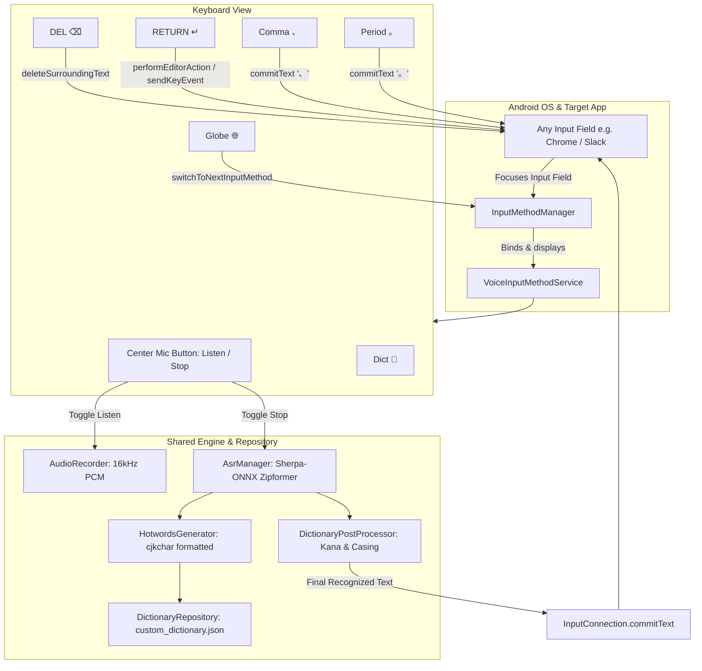

# Android Voice Keyboard (IME) Development Plan

This document outlines the architecture, UI design, text manipulation, lifecycle management, and implementation roadmap for turning **JotInput** into an Android **Input Method Editor (IME) Voice Keyboard**.

---

## 🎯 1. Overview & Goals

- **Primary Goal**: Allow users to use on-device ReazonSpeech speech recognition directly inside any Android application (browsers, messaging apps, notes, forms) as an active system keyboard.
- **App UI Retention**: Keep [`MainActivity`](app/src/main/java/com/example/myasr/MainActivity.kt) intact with its testing controls, model status, and direct link to [`DictionaryActivity`](app/src/main/java/com/example/myasr/DictionaryActivity.kt), while adding quick-setup controls for enabling/selecting the IME.
- **Keyboard UI**:
  - Clean, minimalist keyboard panel docked at the bottom of the screen.
  - A large **Listen / Stop toggle button** centered in the keyboard view.
  - Essential typing keys:
    - **Backspace / DEL** (`⌫`)
    - **Enter / Return** (`↵` / Search / Send depending on input field action)
    - **Japanese Comma** (`、`)
    - **Japanese Period** (`。`)
    - **World / Globe Icon** (`🌐`) to switch to next input method or bring up the IME selector.
    - **Dictionary Shortcut** (`📖`) to easily jump into the dictionary management screen.

---

## 🏗️ 2. Architectural Design



---

## 🧩 3. Key Components to Implement

### 3.1 Service Declaration: [`VoiceInputMethodService`](app/src/main/java/com/example/myasr/VoiceInputMethodService.kt)
- Subclasses `android.inputmethodservice.InputMethodService`.
- Binds to `android.view.InputMethod` action with `android.permission.BIND_INPUT_METHOD`.
- Configured via `res/xml/method.xml`.
- Manages view inflation (`onCreateInputView()`), field detection (`onStartInputView()`), and cleanup (`onDestroy()`, `onFinishInputView()`).

### 3.2 Service Manifest & XML Configuration
- **Manifest**:
  ```xml
  <service
      android:name=".VoiceInputMethodService"
      android:label="@string/ime_name"
      android:permission="android.permission.BIND_INPUT_METHOD"
      android:exported="true">
      <intent-filter>
          <action android:name="android.view.InputMethod" />
      </intent-filter>
      <meta-data
          android:name="android.view.im"
          android:resource="@xml/method" />
  </service>
  ```
- **`res/xml/method.xml`**:
  - `supportsSwitchingToNextInputMethod="true"`
  - `settingsActivity="com.example.myasr.MainActivity"`

### 3.3 Keyboard Layout: `res/layout/keyboard_view.xml`
- Height: Standard Android keyboard height (~220-250dp).
- Background: System surface color with clear button boundaries.
- **Center Area**:
  - Prominent rounded toggle button with microphone icon.
  - State indicators:
    - IDLE: "話す (Tap to Speak)" with mic icon.
    - RECORDING: "完了 (Tap to Finish)" pulsing red / highlighted.
    - DECODING: Progress spinner or "変換中…".
- **Bottom Left Row**:
  - Globe button (`🌐`): Switches input method.
  - Dictionary button (`📖`): Launches [`DictionaryActivity`](app/src/main/java/com/example/myasr/DictionaryActivity.kt).
  - Japanese comma (`、`).
- **Bottom Right Row**:
  - Japanese period (`。`).
  - DEL button (`⌫`): Deletes previous character.
  - RETURN button (`↵` / Action): Submits or starts a new line.

### 3.4 Text Input & Editing Mechanics via `InputConnection`
- **Text Insertion**:
  ```kotlin
  currentInputConnection?.commitText(recognizedText, 1)
  ```
- **Japanese Punctuation**:
  ```kotlin
  btnComma.setOnClickListener { currentInputConnection?.commitText("、", 1) }
  btnPeriod.setOnClickListener { currentInputConnection?.commitText("。", 1) }
  ```
- **Backspace / Delete**:
  ```kotlin
  btnDelete.setOnClickListener {
      val selected = currentInputConnection?.getSelectedText(0)
      if (!selected.isNullOrEmpty()) {
          currentInputConnection?.commitText("", 1)
      } else {
          currentInputConnection?.deleteSurroundingText(1, 0)
      }
  }
  ```
- **Return / Action**:
  ```kotlin
  btnReturn.setOnClickListener {
      val info = currentInputEditorInfo
      if (info != null && (info.imeOptions and EditorInfo.IME_FLAG_NO_ENTER_ACTION) == 0 &&
          (info.imeOptions and EditorInfo.IME_MASK_ACTION) != EditorInfo.IME_ACTION_NONE) {
          currentInputConnection?.performEditorAction(info.imeOptions and EditorInfo.IME_MASK_ACTION)
      } else {
          currentInputConnection?.sendKeyEvent(KeyEvent(KeyEvent.ACTION_DOWN, KeyEvent.KEYCODE_ENTER))
          currentInputConnection?.sendKeyEvent(KeyEvent(KeyEvent.ACTION_UP, KeyEvent.KEYCODE_ENTER))
      }
  }
  ```
- **Switch Keyboard (Globe)**:
  ```kotlin
  btnGlobe.setOnClickListener {
      if (Build.VERSION.SDK_INT >= Build.VERSION_CODES.P) {
          switchToPreviousInputMethod()
      } else {
          val imm = getSystemService(Context.INPUT_METHOD_SERVICE) as InputMethodManager
          imm.showInputMethodPicker()
      }
  }
  ```

### 3.5 Singleton Model Sharing: [`AsrApp`](app/src/main/java/com/example/myasr/AsrApp.kt)
To avoid loading the ~160MB Zipformer int8 model into memory multiple times (which would cause high RAM pressure or redundant initialization time), we establish an `Application` class or thread-safe shared singleton:
- Shared [`AsrManager`](app/src/main/java/com/example/myasr/AsrManager.kt)
- Shared [`DictionaryRepository`](app/src/main/java/com/example/myasr/DictionaryRepository.kt)
- Shared [`HotwordsGenerator`](app/src/main/java/com/example/myasr/HotwordsGenerator.kt)
- Shared [`DictionaryPostProcessor`](app/src/main/java/com/example/myasr/DictionaryPostProcessor.kt)

### 3.6 Permission Handling inside IME
- An IME cannot directly launch Android runtime permission dialogs via `ActivityResultLauncher` because it is a `Service`, not an `Activity`.
- If `RECORD_AUDIO` is missing when the mic button is pressed:
  - Display an instructional toast / banner: "マイクの権限が必要です (Microphone permission required)".
  - Launch [`MainActivity`](app/src/main/java/com/example/myasr/MainActivity.kt) via an Intent with `FLAG_ACTIVITY_NEW_TASK` where the standard permission dialog will trigger.

---

## 🚀 4. Step-by-Step Implementation Roadmap

1. **Create `method.xml`**: Define the IME metadata in `res/xml/method.xml`.
2. **Update `AndroidManifest.xml`**: Register `VoiceInputMethodService` and `AsrApp`.
3. **Establish Application Class (`AsrApp.kt`)**: Provide shared instances of `AsrManager`, `DictionaryRepository`, `HotwordsGenerator`, and `DictionaryPostProcessor`.
4. **Design Keyboard UI Layout (`res/layout/keyboard_view.xml`)**:
   - Status bar / Live feedback banner.
   - Central Toggle Button (Listen $\leftrightarrow$ Finish).
   - Comma (`、`), Period (`。`), Backspace (`⌫`), Return (`↵`), Globe (`🌐`), Dictionary (`📖`).
5. **Implement `VoiceInputMethodService.kt`**:
   - Inflate keyboard layout.
   - Wire listeners for microphone toggle, editing actions, punctuation, and input method switching.
   - Run asynchronous decoding via Kotlin Coroutines on `Dispatchers.Default` and commit text on main thread.
6. **Update `MainActivity.kt`**:
   - Add status pill and buttons for "Enable Voice Keyboard in Settings" and "Choose Input Method".
7. **Build, Deploy & Verify on ARCVM**:
   - Enable IME via ADB: `adb shell ime enable com.example.myasr/.VoiceInputMethodService`.
   - Set as default or test switching into it.
   - Test dictation in Chrome, Android search fields, and text editors.
8. **Document Everything**:
   - Update `docs/architecture.md`, `docs/setup_and_development.md`, and `docs/index.md`.
