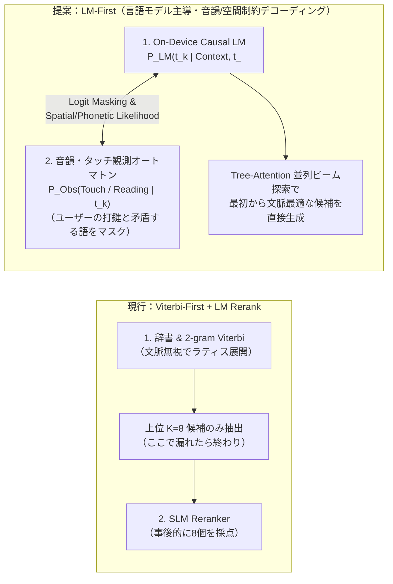
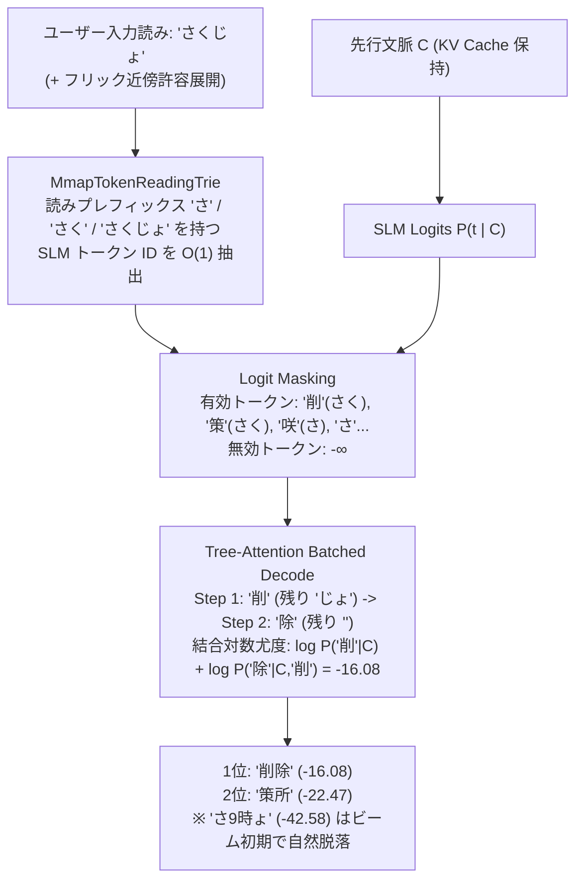
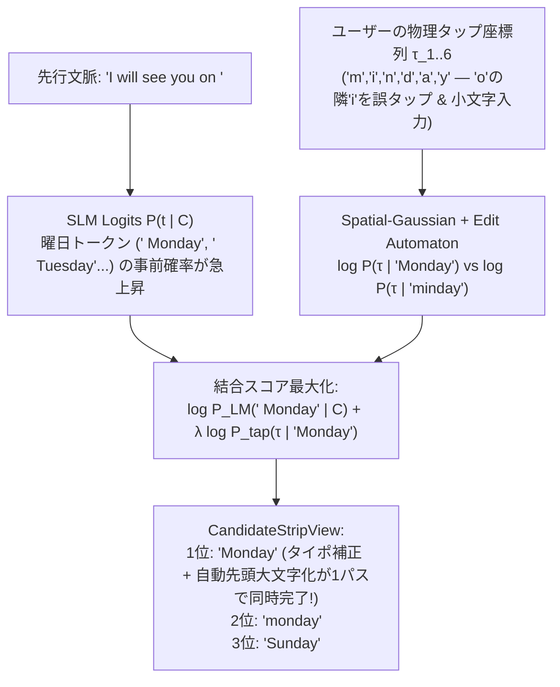
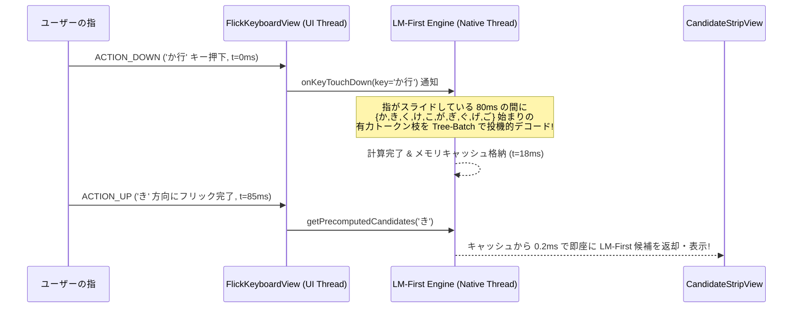
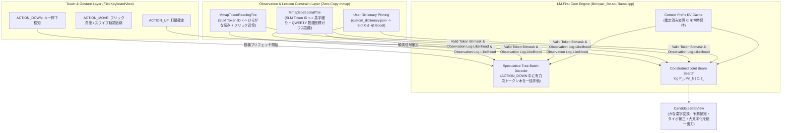

# 言語モデルファースト（LM-First）によるフリック＆QWERTY入力アーキテクチャ設計書

> [!IMPORTANT]
> - **ステータス**: アイデア創出・アーキテクチャ設計フェーズ（**実装はまだ行っていません**）。
> - **目的**: 現在の「Viterbi / 辞書ラティス探索 ＋ 言語モデルによる後段リランク（Retrieve-then-Rerank）」の限界を突破し、**言語モデル（SLM/LLM）の確率分布そのものを主エンジンとして候補生成・探索を駆動する「言語モデルファースト（LM-First）」方式**の設計アイデアと技術課題を体系化する。
> - **ポリシー準拠**:
>   - **Custom Dictionary Contract (ADR-004 / ADR-005 / ADR-011)**: ユーザー辞書登録語の絶対優先と永続化を保証する。
>   - **Anti-Anecdotal Tuning Policy**: 個別単語のアドホックなコスト操作を排し、コーパス統計・確率モデルによって一貫して解決する。
>   - **Model & Lexicon Decoupling Policy**: モデルや大規模インデックスは APK に同梱せず、オンデマンド配信・外部ストレージ配置とする。

---

## 1. 背景：なぜ「Viterbi ＋ リランク」から「言語モデルファースト」への転換が必要か

現在 JotInput では、日本語フリック入力において **Mozc 辞書 Trie ＋ 2-gram 連接コスト行列（`connection_data.bin`）による Viterbi 探索**で上位 $K=8$ 個のベース候補を生成し、それをオンデバイス SLM（`Qwen2.5-0.5B` 等）でリランクする 2 段階パイプライン（ADR-009 / Finding 16）を採用しています。また英語 QWERTY 入力では、**SymSpell 編集距離 / 空間距離検索**や **FUTO Swipe エンジン**の出力に対して後段処理を行っています。

この「従来型生成器 ＋ 後段リランク（Retrieve-then-Rerank）」には、構造上どうしても超えられない **4 つの天井（Glass Ceilings）** が存在します。

| 構造的課題 | 現行（Viterbi / SymSpell + Rerank）での限界 | LM-First（言語モデル主導）での解決 |
| :--- | :--- | :--- |
| **① 候補リコール天井<br>(Candidate Recall Ceiling)** | どれほど優秀な言語モデルを後段に置いても、前段の Viterbi 上位 8 候補（Top-$K$ Pool）に正解が含まれなければ **リランクでの救済率は 0%** となる（Finding 17/18 で確認された長文変換の最大ボトルネック）。 | 言語モデル自身がステップごとに次トークンを直接探索・生成するため、Viterbi の局所コストで枝刈りされた正解候補を最初から高い確率で引き上げられる。 |
| **② マルコフ 1 次近似の近視眼性<br>(1st-Order Markov Myopia)** | Viterbi は直前形態素の品詞 ID との 2-gram 連接コスト $C(\text{rid}_{i-1}, \text{lid}_i)$ しか見ないため、文頭からの意味的整合性や長距離の係り受け（例：「直感と挙動が**ことなります**」）を探索中に評価できない。 | 探索の初期段階（1 文字目・1 文節目の展開時）から先行文脈全体の Self-Attention KV キャッシュを参照し、文脈に合致する語幹・活用形のみへビームを集中させる。 |
| **③ キメラ候補・細切れ分割ノイズ<br>(Chimera & Fragmentation Noise)** | 未知語やフリック誤打鍵、口語短縮（「むかってる」「さくじょ」等）に対し、Viterbi が無理やりパスを繋ごうとして「向っテル」「さ9時ょ」「〜でし高」等の無意味な当て字キメラを大量生成し、候補枠を汚染する（Finding 19 / Finding 37）。 | 言語モデルにおいて無意味な当て字連鎖の結合確率 $P_{\text{LM}}(w_1, w_2, \dots \mid C)$ は限りなくゼロに近いため、探索空間から自然に消滅する。 |
| **④ 入力モダリティ間の分断<br>(Modality Fragmentation)** | 「かな漢字変換」「次文節予測」「フリック誤打鍵補正」「英語スペル補正」「大文字化」「スペース抜け補正」が別々のヒューリスティック・辞書ルールとして実装され、境界ケースで干渉・複雑化する。 | すべてを **「文脈 $C$ と観測タッチ信号 $O$ が与えられたときの事後確率最大化 $\arg\max_W P(W \mid C, O)$」** という単一の生成フレームワークに統合できる。 |

---

## 2. 言語モデルファースト（LM-First）の基本原理：ベイズ観測制約付き生成

従来方式と LM-First 方式の決定的な違いは、**「誰が探索ツリー（仮説空間）を提案し、誰が制約を与えるか」** の主従逆転にあります。



### 数学的定式化（Noisy-Channel / Constrained Direct Modeling）

先行確定文脈を $C$、ユーザーのタッチ操作列（フリックのキー・方向列、または QWERTY のタップ座標・スワイプ軌跡列）を $O = (o_1, o_2, \dots, o_m)$ としたとき、求めるべき出力テキスト（トークン列） $W = (t_1, t_2, \dots, t_L)$ はベイズの定理より次式で与えられます：

$$W^* = \arg\max_{W} \log P(W \mid C, O) = \arg\max_{W} \sum_{k=1}^{L} \Bigl( \underbrace{\log P_{\text{LM}}(t_k \mid C, t_{<k})}_{\text{① 言語モデル事前分布 (LM Prior)}} + \lambda \underbrace{\log P_{\text{Obs}}(O_{\text{span}(t_k)} \mid t_k)}_{\text{② 音韻・空間タッチ観測尤度 (Observation Model)}} \Bigr)$$

- **① 言語モデル事前分布 $\log P_{\text{LM}}(t_k \mid C, t_{<k})$**:
  現在の文脈 $C$ とこれまでに生成したトークン列 $t_{<k}$ のもとで、次にどのサブワードトークン $t_k$ が来るのが自然かを `llama.cpp` 上の SLM が直接出力します。
- **② 音韻・空間タッチ観測尤度 $\log P_{\text{Obs}}(O_{\text{span}(t_k)} \mid t_k)$**:
  トークン $t_k$ が持つ「読み（ひらがな）」または「アルファベット綴り」が、ユーザーの実際の打鍵 $O$ とどれだけ一致しているか（完全一致なら $0$、フリック隣接方向ミスや QWERTY 隣接キータップならガウス距離ペナルティ、無関係な文字なら $-\infty$ すなわち **Logit Mask**）を与えます。

---

## 3. 日本語フリック入力における LM-First 実装アイデア（3 つのアプローチ）

日本語入力では、ユーザーの打鍵（かな文字列 $Y = y_{1:n}$）とモデルの語彙空間（漢字・かな混じりの BPE サブワードトークン $v \in \mathcal{V}$）の間に**「読み（Phonetic Reading）」という多対多の写像**が存在します。これを解決する 3 段階の LM-First アーキテクチャを提案します。

---

### アイデア J-1：音韻トライ制約付き自己回帰ビームデコーディング（Phonetic-Trie Constrained Autoregressive Decoding）★最有力・本命

Viterbi ラティスを完全に廃止し、**SLM のトークナイザ語彙 $\mathcal{V}$ に「読みインデックス」を付与して、SLM 自体にかな漢字変換を行わせる**アーキテクチャです。

#### 仕組み
1. **オフライン前処理：逆引き Subword-to-Reading オートマトン（`token_reading_fst.bin`）の構築**
   - SLM（例：`Qwen2.5-0.5B`、語彙数 $|\mathcal{V}| \approx 151,646$）の全トークン $v \in \mathcal{V}$ について、Mozc 辞書・Sudachi 辞書・漢字音訓表を用いて**「トークン $v$ が取り得るすべてのひらがな読みの集合 $R(v)$」**を抽出します。
     - 例：トークン `"結果"` $\to R = \{\text{"けっか"}\}$
     - 例：トークン `"行"` $\to R = \{\text{"い"}, \text{"ゆ"}, \text{"おこな"}, \text{"ぎょう"}, \text{"こう"}, \text{"あん"}\}$
     - 例：トークン `"削除"` $\to \{ \text{tok}(\text{"削"}) \to \{\text{"さく"}, \text{"けず"}\},\; \text{tok}(\text{"除"}) \to \{\text{"じょ"}, \text{"のぞ"}\} \}$
   - これにより、任意の残り読みプレフィックス $Y_{\text{rem}}$（例：`"けっか"` や `"さくじょ"`）が与えられたとき、**「その読みで始まる有効な SLM トークン ID のリスト（Bitmask）」**を $O(1)$ で即座に返すメモリマップド Trie（`MmapTokenReadingTrie`）を構築します。

2. **オンライン推論：読み消費同期型ビーム探索（Reading-Synchronized Beam Search）**
   - ユーザーが「こういてきでしたか」と打鍵したとします。
   - **Step 0**: 先行文脈 $C$ の KV キャッシュから、SLM が次トークンの Logits $\mathbf{z}^{(0)} \in \mathbb{R}^{|\mathcal{V}|}$ を出力。
   - **Logit Masking**: `MmapTokenReadingTrie` を引き、現在の未消費読み `"こういてきでしたか"` のプレフィックスと一致する読みを持つトークン集合 $\mathcal{V}_{\text{valid}}$ 以外の Logit をすべて $-\infty$ にマスクします。
     - $\mathcal{V}_{\text{valid}}$ には `"好意"`（読み `こうい`）、`"行為"`（読み `こうい`）、`"広域"`（読み `こういき`）、`"こう"`（読み `こう`）などが含まれます。
   - **Step 1**: 生き残った上位トークン（例：`"好意"`, `"行為"`, `"更衣"`）を **Tree Attention バッチ（単一の `llama_decode` 呼び出し）** で一括評価し、それぞれのトークンが消費した読み長（例：`こうい` = 3 文字）だけ未消費ポインタを進めます（残り：`"てきでしたか"`）。
   - これを未消費読みが 0 になるまで繰り返します（通常 1 文節あたり 2〜4 サブワードステップ）。



#### なぜこれが画期的か
- **「さくじょ $\to$ 削除」問題の完全消滅**: Step 1 で `"削"`（読み `さく`）と `"さ"`（読み `さ`）が両方ビームに入り、Step 2 で `"削"` の直後に `"除"`（読み `じょ`、条件付き確率 35.3%）が接続された瞬間、結合確率で `"削除"` が圧倒的 1 位となり、`"さ9時ょ"` のようなキメラは `"9"` の遷移確率が極小なためビームから即座に脱落します。
- **予測変換（Prefix Prediction）との完全統合**: 入力読み `"こうい"` をすべて消費した時点で探索を止めずに 1〜2 トークン先までマスクなしで自走させれば、**「好意的でした」「好意を持たれる」といった文脈予測変換候補がまったく同じループからゼロ追加コストで得られます**。
- **フリック誤打鍵補正（Typo Tolerance）の自然な組み込み**: `MmapTokenReadingTrie` を検索する際、入力文字と同一キー内の別フリック方向（例：`き` に対して `く`・`け`）や濁点抜けをペナルティ $\Delta_{\text{flick}}$ 付きで許容するだけで、SLM が文脈的に最も自然な誤打鍵訂正候補（例：`てんきがわるい` と打つべきところを `てんくがわるい` と誤フリックしても `天気が悪い` を生成）を直接導出します。

---

### アイデア J-2：LM ガイド付き同期ラティス・ビーム探索（LM-Guided Synchronous Lattice Decoding / Early Fusion）

アイデア J-1 が「SLM のトークン空間」で直接探索するのに対し、アイデア J-2 は**「Mozc 辞書の形態素ラティス構造は維持しつつ、Viterbi の動的計画法コストを SLM の条件付き確率に置き換える（Early Fusion）」**ハイブリッド型の LM-First アプローチです。

#### 仕組み
1. 現在の `KanaKanjiEngine` では、文字位置 $i = 1 \dots n$ まで **2-gram コストだけで** Viterbi ラティスを最後まで解き切り、完成した 8 個の文字列だけを `LlmReranker` に渡しています（**Late Fusion**）。
2. **Early Fusion（LM ガイド付きラティス探索）**では、ラティス上の文節境界（または自立語境界）$i$ ごとに、そこに至る上位 $B$ 個の部分パス仮説 $\{h_1, h_2, \dots, h_B\}$ に対して `llama.cpp` の **Multi-Sequence KV Cache (`seq_id = 1..B`)** を割り当て、**ラティスを前進させながらリアルタイムに SLM スコアを加算**します：
   $$\text{Score}(h \oplus m) = \text{Score}(h) + (1 - \alpha) \log P_{\text{LM}}(\text{surface}(m) \mid C, h) - \alpha \cdot \frac{\text{Cost}_{\text{Mozc}}(m)}{1000}$$
3. **接頭辞独占（Prefix Monopoly）の防止**:
   `docs/prd_and_design_viterbi_nbest_diversity.md` で設計した「第 1 文節語幹 $\sigma$ ごとの商状態層化（Quotient-State Stratification）」を組み合わせることで、異なる第 1 文節語幹（例：「好意的」「行為的」「更衣的」）ごとに独立した `seq_id` ブランチを維持したまま文末まで SLM スコアでデコードします。

#### メリットとトレードオフ
- **メリット**: 既存の `MmapDictionary` や複合語・ 숫자変換（`JapaneseNumeralUtils`）の資産をそのまま活かせるため、未知の読みに対する安全性が高い。
- **トレードオフ**: 形態素の区切りと SLM の BPE トークン境界が一致しない場合（例：形態素「向かっ」＋「てる」に対し、SLM のトークンが「向」「かって」「る」にまたがる場合）に **Token Healing（境界トークン再結合）** の処理が必要になる。

---

### アイデア J-3：タッチ信号・読み直結型 Instruction / Prefix-Tuned Micro-SLM（End-to-End Generative IME Engine）

辞書ラティスも Token-to-Reading トライも使わず、**コンパクトな専用言語モデル（135M〜500M パラメータ）を「（先行文脈, 入力かな/タッチ列）$\to$ 変換後テキスト」のタスクに特化して Fine-Tuning（または LoRA 適応）する**純粋生成アプローチです（Zenzai / Neural Kana-Kanji 方式のオンデバイス発展形）。

#### プロンプト / 入出力フォーマット設計
モデルに特殊な制御トークン `<|context|>`, `<|reading|>`, `<|surface|>` を学習させ、以下の形式で直接デコードします：

```text
<|context|>昨日の会議の<|reading|>けっかをほうこくします<|surface|>結果を報告します<|endoftext|>
```

#### さらなる進化：Soft Touch Embedding の直接入力
- 離散的な「確定かな文字」を入力する代わりに、フリックのタッチ座標・角度から計算された **上位 3 かな文字の確率ベクトル（例：`き: 0.75, く: 0.20, け: 0.05`）の重み付き埋め込み和（Soft Embedding）** をモデルの `<|reading|>` 層に直接入力します。
- これにより、ユーザーがフリック方向を曖昧に入力しても、ハードな閾値判定による文字化けを起こさず、モデル内部の Attention が文脈と照らし合わせて自動的に正しい文字・漢字を復元します。

---

## 4. 英語 QWERTY 入力（タップ＆スワイプ）における LM-First 実装アイデア

英語 QWERTY 入力には日本語のような「かな→漢字」の変換ステップがなく、**「ユーザーの入力したアルファベット列（またはスワイプ軌跡）そのものが、タイポ・大文字小文字の省略・アポストロフィ抜け・スペース抜けを含んだ観測信号である」**という特徴があります。
実は、**英語 QWERTY こそ LM-First の恩恵が最も劇的に現れる領域**です。なぜなら、SLM（`Qwen2.5` 等）の BPE トークンそのものが英語の単語・サブワードで構成されているためです。

---

### アイデア E-1：空間ガウス観測モデル × BPE トライ制約付き LM デコーダ（Spatial-Gaussian BPE-Constrained LM Decoder）★最有力・本命

現在の `EnglishSpellEngine`（SymSpell 編集距離で単語候補を出してから文脈補正）を逆転させ、**SLM が予測する次トークン分布を、QWERTY キーボード上の物理タップ座標列 $(x_1, y_1), \dots, (x_m, y_m)$ で直接フィルタリング・重み付けする**方式です。

#### 仕組み
1. **BPE Vocabulary Character Trie の構築**
   - SLM の全英語トークン（先頭スペース付きトークン `" hello"`, `" the"`, `" I'm"` や大文字始まりトークン `"Hello"`, `"Monday"`, `"USA"` を含む）を、小文字・アポストロフィ除去正規化したキーで引けるコンパクトな文字トライに編成します。
2. **2 次元ガウスタッチ観測モデル（Spatial Key Observation Model）**
   - ユーザーが QWERTY キーボード上で $m$ 回タップした物理座標列を $\tau_{1:m} = ((x_1, y_1), \dots, (x_m, y_m))$ とします。
   - 文字 $c \in \{\text{'a'}\dots\text{'z'}\}$ のキー中心座標を $\mu(c) = (X_c, Y_c)$ とすると、タップ $i$ が文字 $c$ を意図していた対数尤度は：
     $$\log P_{\text{tap}}(\tau_i \mid c) = -\frac{(x_i - X_c)^2 + (y_i - Y_c)^2}{2\sigma_{\text{key}}^2}$$
   - これに 1 文字の入れ替わり（Transposition: `teh` $\leftrightarrow$ `the`）、挿入（Insertion）、脱落（Deletion / 特にアポストロフィ `'` やスペース `' '` の脱落コストはほぼ 0 に設定）を許容する軽量な編集オートマトンを組み合わせます。
3. **LM-First 統合スコアリング**
   - 先行文脈 $C$（例：`"I look forward to "`）の直後で、ユーザーが 3 回タップ（`h`, `e`, `a` 付近）したとします。
   - SLM はすでに `"I look forward to"` の KV キャッシュから、次トークンとして `" hearing"` の確率 $P_{\text{LM}}(\text{" hearing"} \mid C)$ を極めて高く予測しています。
   - したがって、わずか 2〜3 タップの段階でも、空間尤度 $\log P_{\text{tap}}(\tau_{1:3} \mid \text{"hea"})$ と SLM の事前確率 $\log P_{\text{LM}}(\text{" hearing"} \mid C)$ の和によって、**第 1 候補に `"hearing"`（さらには次トークンまで展開した `"hearing from you"`）が瞬時に浮上**します。



#### この方式が「一挙に」解決する 5 つの課題
これまで個別モジュール（`EnglishCapitalizationAnalyzer`, `EnglishSpellEngine`, スペース補正等）で別々に処理していた問題が、**単一の数式・単一のパスで同時に解決**されます：
1. **文脈適応型の先頭大文字化・固有名詞化・ALL CAPS**:
   SLM の語彙には `" Monday"`, `" I"`, `" USA"`, `"Hello"` が大文字のまま別トークンとして存在し、文頭や `on ___` の直後では SLM 自身が小文字トークン `" monday"` より大文字トークン `" Monday"` に圧倒的に高い確率を割り当てます。
2. **アポストロフィ省略の自動復元 (`im` $\to$ `I'm`, `dont` $\to$ `don't`, `cant` $\to$ `can't`)**:
   観測モデルでアポストロフィ `'` のスキップコストを 0 にするだけで、文脈に応じて `cant`（動詞 `can't` vs 名詞 `cant`）や `ill`（`I'll` vs 形容詞 `ill`）を SLM が文脈 100% で使い分けます。
3. **スペースキー押し忘れ（Run-on Words）の自動分割 (`thebest` $\to$ `the best`, `itwas` $\to$ `it was`)**:
   SLM の BPE トークンは `" the"` + `" best"` の 2 トークン遷移を持つため、観測モデルがトークン境界の暗黙スペースを許容するだけで、1 つの長いタイポ文字列から複数単語への分割候補が自然に生成されます。
4. **同音・類似スペル語の文脈区別 (`their` / `there` / `they're`, `affect` / `effect`)**:
   辞書頻度だけでは絶対に区別できない同音・近傍スペル語を、打鍵中から先行文脈に基づいて正しい順に並べます。
5. **1〜3 文字打鍵時点での超強力な単語・フレーズ補完（Predictive Completion）**:
   単語を最後まで打ち切らなくても、プレフィックス一致スコア＋SLM 確率で残りの文字を自動補完します。

---

### アイデア E-2：FUTO Neural Swipe エンコーダ × Causal LM Early-Fusion デコーダ

スワイプ（ジェスチャー）入力においても、現在の「FUTO Swipe モデル単独で単語候補を出して終わり」から、**SLM の文脈分布を FUTO の文字デコーダに Early Fusion（浅い統合 / Shallow Fusion）する** LM-First 方式へ進化させます。

#### 仕組み
- 現在 [`FutoSwipeEngine`](file:///home/kenichikurihara/repos/myasr/app/src/main/java/com/example/myasr/FutoSwipeEngine.kt)（C++ ネイティブ）は、スワイプ軌跡特徴量から Transformer/GRU デコーダによって文字単位の確率 $P_{\text{Swipe}}(c_t \mid \text{Trajectory}, c_{<t})$ を出力し、英語辞書 Trie 上でビーム探索を行っています。
- ここに SLM が直前文脈 $C$ から計算した次単語・サブワードの事前確率 $\log P_{\text{LM}}(W \mid C)$ を、Trie のプレフィックス確率（Look-ahead Weight pushing）として注入します：
  $$\text{BeamScore}(W_{1:k}) = \sum_{j=1}^{k} \log P_{\text{Swipe}}(c_j \mid \text{Trajectory}, c_{<j}) + \beta \log P_{\text{LM}}(\text{Prefix}(W_{1:k}) \mid C)$$
- **効果**: スワイプ軌跡がほぼ完全に重なる単語ペア（例：`read` と `road`、`out` と `our`、`shot` と `short`）において、スワイプモデル単体では 50:50 で迷うケースでも、直前文脈（例：`"I read a book"` vs `"cross the road"`）によって **100% 正しい単語がスワイプ完了と同時にコミット**されます。

---

### アイデア E-3：日英シームレス・コードスイッチング入力（Bilingual Mode-Free QWERTY）

`Qwen2.5-0.5B` などの多言語 SLM は、同一の文脈空間で日本語と英語の両方をネイティブに理解しています。これを活かすと、**QWERTY キーボード上で「あa」モード切替ボタンを押すことなく、ローマ字日本語と英単語をシームレスに混在入力する LM-First デコーダ**が実現できます。

- **例**: ユーザーが日本語文脈 `"明日の"` の後に QWERTY で `m` `e` `e` `t` `i` `n` `g` と打った場合：
  - ローマ字かな変換としては無意味な文字列になるが、SLM の多言語空間では `"明日の"` の後に `"meeting"` または `"ミーティング"` が続く確率が極めて高い。
  - 逆に `"ashita"` と打てば、Romaji-to-Kana オートマトン経由で `"明日"` が第 1 候補に出る。
- エンジニアやビジネスユーザーが頻用する「日英混じり文（`PRをmergeしてください`、`APIのspecを確認する`）」において、モード切替の認知負荷をゼロにできます。

---

## 5. オンデバイス LM-First 実装における 4 大技術課題と解決設計

「言語モデルを主エンジンにする」際に最大の障壁となるのは、**① レイテンシ（毎打鍵 16ms 以内の応答性）**、**② BPE トークン境界の不整合**、**③ ユーザー辞書の絶対優先保証**、**④ バッテリー・メモリ消費** の 4 点です。これらに対する具体的なエンジニアリング解決策を定義します。

### 課題 ①：打鍵レイテンシ予算（$< 15\text{ms}$）をどう達成するか？

毎打鍵ごとにゼロから SLM で複数ステップのビーム探索を直列実行すると、100ms 以上の遅延が発生してしまいます。これを **3 つの高速化技術** で平均 $1 \sim 8\text{ms}$ に抑え込みます。

#### 解決策 1-A：Tree-Attention 一括バッチ検証（Multi-Branch Single `llama_decode`）
- `llama.cpp` の `llama_batch` は、異なる仮説枝（ビーム）に対して別々の `seq_id` と共通の親 KV キャッシュを指定することで、**深さ 2〜3・幅 8 の探索木（計 16〜24 トークン）をたった 1 回の行列積（1 回の `llama_decode` 呼び出し）で並列評価**できます。
- モバイル CPU（ARMv9 DotProd / I8MM）において、バッチサイズ 1 でもバッチサイズ 16 でも、メモリ帯域律速（Memory-Bandwidth Bound）のため実行時間はほとんど変わりません（約 $10 \sim 18\text{ms}$）。

#### 解決策 1-B：インフライト投機的プリフェッチ（Keystroke-In-Flight Speculative Pre-computation）
- ユーザーが指を画面に触れた瞬間（`MotionEvent.ACTION_DOWN`）から、フリック方向を決めて指を離す（`MotionEvent.ACTION_UP`）までには **平均 $60 \sim 120\text{ms}$ の物理時間** があります。
- `ACTION_DOWN` でタッチされたキー（例：「か行」キー）が判明した瞬間に、バックグラウンドスレッドで「か・き・く・け・こ（＋濁音）」で始まる上位トークンの KV 展開を**指が離れる前に投機的に先行計算（Pre-compute）**しておきます。
- ユーザーが指を離した（`ACTION_UP`）瞬間にはすでに計算が完了しているため、**体感レイテンシ $0\text{ms}$（実質キャッシュルックアップのみ）**で LM-First 候補を即座に描画できます。



#### 解決策 1-C：2 層ハイブリッド表示（0.3ms 辞書プレースホルダ ＋ 非同期 LM-First 差し替え）
- 高速連打時（1 秒間に 8 打鍵など）で投機計算が追いつかない場合でも、UI スレッドでは既存の `MmapDictionary` / `MmapTokenReadingTrie` から $< 0.3\text{ms}$ で取得できる先頭トークン優先候補を即座に表示し、直後の数ミリ秒で完了するフル探索結果でスムーズに更新します（既存の Stale Job Cancellation 機構を継承）。

---

### 課題 ②：BPE サブワード境界と「読み / 文字境界」のズレ（Token Healing 問題）

SLM のトークナイザ（BPE）は文字単位・音節単位ではなく統計的な文字列塊で分割されるため、以下の 2 つの境界問題が起きます：
1. **UTF-8 バイト分割トークン**: 稀少な漢字（例：`咲`, `噌`, `頰`）が 1 トークンではなく 2〜3 個の Raw Byte トークンに分割される。
2. **送り仮名・活用語尾の巻き込み**: たとえばユーザーがまだ「おこな」（3 文字）しか打っていないのに、SLM 側の最良トークンが `"行わ"`（読み `おこなわ`、4 文字）や `"行う"`（読み `おこなう`、4 文字）として 1 トークン化されている場合。

#### 解決策：Partial-Reading Prefix Matching（読み前方一致許容）と Byte-Level Token Collapse
- `MmapTokenReadingTrie` の構築時に、2〜3 バイトに分割される漢字トークン列 $(b_1, b_2)$ は最初から 1 つの**仮想マクロトークン（Macro-Token Unit）**として束ねてトライに登録し、`llama_batch` に常にセットで投入します。これにより、バイト途中の無意味な確率評価を完全に排除します。
- また、ユーザーの未消費読み $Y_{\text{rem}}$ の末尾ステップにおいては、**「トークンの読み $r(v)$ が $Y_{\text{rem}}$ と完全一致するもの」**だけでなく、**「$Y_{\text{rem}}$ が $r(v)$ の真のプレフィックスになっているもの（例：入力 `おこな` に対して読み `おこなう`・`おこなわ` を持つトークン）」**も予測候補枠として同時に許可します。

---

### 課題 ③：カスタム辞書（User Dictionary）の絶対優先保証（ADR-004 / ADR-005 / ADR-011）

LM-First にすると、ユーザーが登録した社内用語・人名・造語（例：`くりはら` $\to$ `栗原`、英語 `Antigravity`）の言語モデル事前確率 $P_{\text{LM}}$ が低いため、一般語に負けてしまう懸念があります。

#### 解決策：User-Trie Logit Pinning & 確定 Slot-0 保護
1. **Slot-0 絶縁保護（Hard Slot Reservation）**:
   入力読み $Y$（または英語プレフィックス）に対して `DictionaryRepository` のユーザー辞書がマッチした場合、従来通り変換候補ストリップの先頭（Index 0）に `[USER]` 候補として無条件で固定配置します。
2. **Dynamic Hotword Logit Injection（文途中にあるユーザー語の保護）**:
   長文入力（例：`くりはらさんにれんらくする`）の途中にユーザー辞書語が含まれる場合、`MmapTokenReadingTrie` 上でユーザー辞書エントリに対応するトークン列 $(t_1, \dots, t_k)$ の遷移に対して **ホットワード・ブースト定数 $+\beta_{\text{user}}$（例：$+15.0\text{ nats}$）** を加算します。これにより、長文の LM-First ビーム探索中であってもユーザー登録語が確実に第 1 ビームに生き残ります。

---

### 課題 ④：モデル未ダウンロード時・低バッテリー時のフォールバック契約

Model & Lexicon Decoupling Policy に従い、SLM モデル（GGUF）が未ダウンロードの環境や、省電力モード時にもキーボードが 100% 動作しなければなりません。

#### 解決策：Unified Decoder Interface による透過的エンジン切替
- デコーダインターフェース `ContextualInputDecoder` を定義し、以下の 2 実装をシームレスに切り替え可能にします：
  1. `LmFirstBeamDecoder`: SLM（`libmyasr_llm.so`）＋ `MmapTokenReadingTrie` による LM-First デコーダ（メイン）。
  2. `MmapViterbiFallbackDecoder`: 既存の `MmapDictionary` ＋ `connection_data.bin` による軽量 Viterbi デコーダ（SLM 未ロード時、または 3 秒タイムアウト時の即時フォールバック）。

---

## 6. 現行方式 vs LM-First 各アイデアの定量・定性比較マトリクス

| 評価軸 | 現行：Viterbi + Late Rerank | アイデア J-1 / E-1：<br>Trie 制約付き LM-First ビーム探索 ★推奨 | アイデア J-2：<br>LM ガイド付きラティス探索 (Early Fusion) | アイデア J-3：<br>専用 Fine-Tuned 生成 SLM |
| :--- | :---: | :---: | :---: | :---: |
| **候補リコール天井の打破**<br>（Viterbi 漏れ候補の救済） | ❌ 不可<br>（Top-8 に出ないと 0%） | **◎ 完全解決**<br>（SLM が最初から全語彙を探索） | **○ 大幅改善**<br>（各文節境界で SLM が枝刈りを誘導） | **◎ 完全解決**<br>（辞書にない表現も生成可能） |
| **基本語の安定性**<br>（`けっか`$\to$`結果`, `さくじょ`$\to$`削除`） | △ トークン分割やキメラに攪乱されやすい | **◎ 極めて高い**<br>（キメラが最初から生成されない） | **◎ 高い**<br>（Mozc コストと LM 尤度の早期融合） | ○ 学習データ分布に依存 |
| **長文・口語・複合語変換**<br>（`こういてきでしたか`, `むかってる`） | △ 語尾当て字爆発・活用切れが発生 | **◎ 自然な日本語のみ生成**<br>（付属語連鎖は SLM が最も得意） | **○ 良好** | **◎ 非常に自然** |
| **予測変換・タイポ補正・大文字化の統合度** | ❌ 別々のモジュール・ルールで継ぎ接ぎ | **◎ 単一デコーダで完結**<br>（フリック・QWERTY・日英共通） | △ 予測変換は別パスが必要 | ○ 英語 QWERTY との統合には追加学習が必要 |
| **推論レイテンシ**<br>（投機的プリフェッチ併用時） | $1 \sim 20\text{ms}$ | **$0.5 \sim 12\text{ms}$**<br>（ACTION_DOWN 投機実行で体感 0ms） | $15 \sim 35\text{ms}$<br>（文節数に比例） | $25 \sim 60\text{ms}$<br>（フル生成が必要） |
| **追加アセットサイズ**<br>（外部ストレージ配置） | 0 MB | **`token_reading_fst.bin` 約 4〜8 MB のみ**<br>（既存の Qwen2.5-0.5B をそのまま利用可能） | 0 MB | 専用 GGUF モデル（約 200〜450 MB）の別途学習・配信が必要 |
| **Anti-Anecdotal Policy 適合性** | ○ | **◎ 完全適合（純粋な確率・統計モデル）** | ○ | ◎ |

---

## 7. 推奨アーキテクチャと段階的検証ロードマップ（実装前の検証計画）

最も費用対効果が高く、既存の `Qwen2.5-0.5B`（`libmyasr_llm.so`）資産をそのまま活かして劇的な品質向上とシンプル化を達成できるのは、**「アイデア J-1（日本語：音韻トライ制約付き自己回帰ビーム探索）＋ アイデア E-1（英語 QWERTY：空間ガウス × BPE トライ制約付き LM デコーダ）＋ 解決策 1-B（ACTION_DOWN 投機的プリフェッチ）」** の組み合わせです。

### 全体ターゲット・データフロー図



### 今後の段階的 PoC・実装ステップ（実装着手時のロードマップ）

1. **Phase 1: オフライン `Token-to-Reading` インデックス生成と Python / C++ ベンチマーク検証**
   - `Qwen2.5-0.5B` の語彙（151,646 トークン）と Mozc 辞書を突合し、各トークンの可能な読みリストを抽出するスクリプト `tools/build_token_reading_trie.py` を作成する。
   - 既存の評価データセット（`1,000 Tricky Sentences`, `Long-Phrase Conversion Benchmark`, `Kekka/Sakujo 12 Diagnostic Cases`）上で、Viterbi を介さずに **「Token-Reading Masking + Qwen2.5-0.5B Tree Beam Search」** を実行し、Top-1 / Top-5 精度および候補リコール率の改善幅を定量測定する。
2. **Phase 2: 英語 QWERTY 向け `BPE-Spatial-Gaussian` デコーダのプロトタイプ評価**
   - 英語サブワードトークンの Trie 上で、物理キー座標ガウス尤度＋SLM 事前確率による 1 パスデコーディングを実装し、タイポ補正・文頭/固有名詞大文字化・アポストロフィ復元・スペース抜け分割の統合精度とレイテンシを計測する。
3. **Phase 3: `libmyasr_llm.so` への C++ Tree-Attention Constrained Beam API 追加と `ACTION_DOWN` 投機プリフェッチ統合**
   - `llama_batch` のマルチ `seq_id` を用いた木構造一括デコード API（`nativeDecodeConstrainedBeam`）を実装する。
   - `FlickKeyboardView` の `ACTION_DOWN` イベントと連動した投機的プリフェッチを組み込み、実機（Pixel 10 Pro および ARCVM）で体感レイテンシ $< 5\text{ms}$ を検証する。
