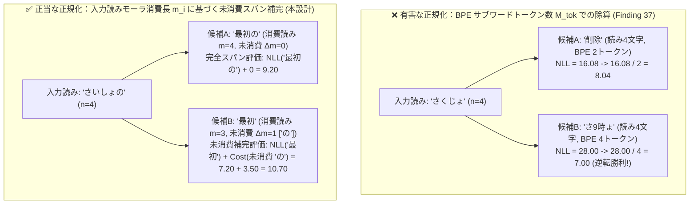
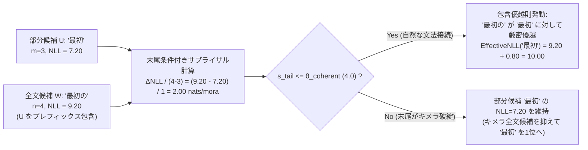
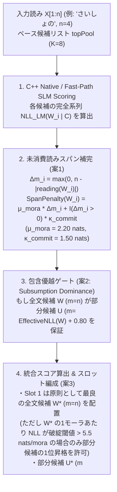

# LM-First リランキングにおける部分一致候補の順位逆転現象（「さいしょの」→「最初」＞「最初の」）の数学的解剖とアルゴリズム改善設計書

> [!IMPORTANT]
> - **ステータス**: アルゴリズム分析・システム設計フェーズ（設計ドキュメント）
> - **対象課題**: 入力読み $X = \text{「さいしょの」}$（長さ $n=4$）に対して、LM-First リランキング（[`LlmReranker.kt`](app/src/main/java/com/example/myasr/LlmReranker.kt)）を適用すると、全文一致候補「最初の」（消費読み長 $m=4$）よりも、部分プレフィックス候補「最初」（消費読み長 $m=3$、未消費読み「の」）が1位にランクされる問題。
> - **ポリシー準拠**:
>   - **Anti-Anecdotal Tuning Policy**: 個別単語のコスト調整やアドホックなルール追加は一切行わず、ベイズ生成モデル・確率の連鎖律・情報理論的決定理論に基づく一般化アルゴリズムとして設計する。
>   - **Finding 37 & ADR-018 非回帰保証**: 同一読み長内の完全系列対数尤度評価（「けっか」$\to$「結果」、「さくじょ」$\to$「削除」）およびユーザー辞書優先（Intra-Word Surprisal Clamping）の性質を 100% 維持する。

---

## 1. 現象の解剖：なぜ「さいしょの」で「最初の」より「最初」が1位になるのか？

自己回帰型言語モデル（Causal Autoregressive Language Model）の数学的性質と、現在の [`KanaKanjiEngine.kt`](app/src/main/java/com/example/myasr/KanaKanjiEngine.kt) および [`LlmReranker.kt`](app/src/main/java/com/example/myasr/LlmReranker.kt) のパイプライン構造を照らし合わせると、この現象はバグではなく **3つの構造的要因の必然的な帰結** として説明できます。

### 1.1 要因①：異種ホライズン候補の単一フラットプールへの混入

ユーザーが $X_{1:n} = \text{「さいしょの」}$（$n = 4$ モーラ）を入力した際、[`KanaKanjiEngine.searchViterbiLattice()`](app/src/main/java/com/example/myasr/KanaKanjiEngine.kt#L953-L1331) は $n \ge 4$ の条件（[L1134](app/src/main/java/com/example/myasr/KanaKanjiEngine.kt#L1134)）により、モバイルでの段階的部分確定を支援するため以下の2種類の候補を生成しインターリーブします（[L1288-L1330](app/src/main/java/com/example/myasr/KanaKanjiEngine.kt#L1288-L1330)）：

1. **全文候補（Full-Span Candidates, 消費読み長 $m = n = 4$, `source = "viterbi"`）**:
   - Slot 1 (`index = 0`): `surface = "最初の"`, `reading = "さいしょの"` ($m = 4$)
   - Slot 2 (`index = 1`): `surface = "才女の"` / `"宰相の"`, `reading = "さいしょの"` ($m = 4$)
2. **マルチホライズン部分プレフィックス候補（Partial-Prefix Candidates, 消費読み長 $m < n$, `source = "viterbi_prefix"`）**:
   - Slot 3 (`index = 2`): `surface = "最初"`, `reading = "さいしょ"` ($m = 3$, 残り読み $X_{4:4} = \text{「の」}$ が未消費)
   - Slot 4 (`index = 3`): `surface = "才女"` / `"宰相"`, `reading = "さいしょ"` ($m = 3$)
3. **予測補完候補（Predictive Extensions, 消費読み長 $m > n$, `isPrediction = true`）**:
   - 後続スロット: `surface = "最初の一歩"`, `reading = "さいしょのいっぽ"` ($m = 7 > 4$)

前段の `KanaKanjiEngine` では「Slot 1–2 に全文候補、Slot 3–6 に部分プレフィックス候補」という明確な階層構造（Slot Stratification）を持っていましたが、後段の [`LlmReranker.kt`](app/src/main/java/com/example/myasr/LlmReranker.kt#L246)（[L246](app/src/main/java/com/example/myasr/LlmReranker.kt#L246), [L366](app/src/main/java/com/example/myasr/LlmReranker.kt#L366)）では：

```kotlin
val topPool = nonHiraganaCandidates.take(8)
val surfaces = topPool.map { it.surface }.toTypedArray()
```

として、**各候補が入力読み $X_{1:n}$ のうち何文字を消費しているか（`candidate.reading.length`）を一切区別せず**、先頭8件を単一のフラットな集合として評価・ソートしています。

---

### 1.2 要因②：確率の連鎖律（Chain Rule）による自己回帰 NLL の厳密単調増加性

先行文脈を $C$ としたとき、部分候補 $U = \text{「最初」}$ と、それをプレフィックスとして包含する全文候補 $W = U \oplus V = \text{「最初」} + \text{「の」}$ の負の対数尤度（NLL: Negative Log-Likelihood）の間には、確率の連鎖律より次の恒等式が成り立ちます：

$$\text{NLL}_{\text{LM}}(\text{「最初の」} \mid C) = -\log P_{\text{LM}}(\text{「最初」}, \text{「の」} \mid C) = \underbrace{\text{NLL}_{\text{LM}}(\text{「最初」} \mid C)}_{\text{語幹の NLL}} + \underbrace{\text{NLL}_{\text{LM}}(\text{「の」} \mid C, \text{「最初」})}_{\text{助詞の条件付き NLL } > 0}$$

言語モデルにおいて、「最初」の直後に来得るトークンは「の」だけではなく、「に」「は」「から」「で」「、」「だ」など多様に存在するため、いかに「最初の」が自然な日本語であっても、条件付き確率 $P_{\text{LM}}(\text{「の」} \mid C, \text{「最初」})$ は $0.10 \sim 0.30$ 程度となります。これを情報量（nats）に換算すると：

$$\Delta \text{NLL}_{\text{tail}} = -\log P_{\text{LM}}(\text{「の」} \mid C, \text{「最初」}) \approx 1.20 \sim 2.30\text{ nats} > 0$$

したがって、**いかなる文脈 $C$ においても、数学的必然として常に $\text{NLL}_{\text{LM}}(\text{「最初の」} \mid C) > \text{NLL}_{\text{LM}}(\text{「最初」} \mid C)$（＝「最初」の方が NLL が小さく優秀）となります**。

---

### 1.3 要因③：ベイズ観測モデルにおける「未消費読み $X_{m+1:n}$」の尤度欠落（Apples-to-Oranges 比較）

現在の [`LlmReranker.kt`](app/src/main/java/com/example/myasr/LlmReranker.kt#L425) の統合スコア式（ADR-018）は以下の通りです（$\alpha = 0.20$）：

$$\text{FinalScore}(W_i) = (1 - \alpha) \cdot \Bigl( \text{effectiveNll}_i + \lambda_{\text{obs}} \cdot \text{obsPenalty}_i \cdot 5.0 \Bigr) + \alpha \cdot \text{rankCost}_i$$

具体数値（例：$\text{NLL}(\text{「最初」} \mid C) = 7.20\text{ nats}$、$\text{NLL}(\text{「の」} \mid C, \text{「最初」}) = 2.00\text{ nats}$）を代入すると：

| 候補 $W_i$ | 消費読み $r_i$ ($m_i$) | 未消費読み ($n - m_i$) | 初期順位 `index` (`rankCost`) | $\text{NLL}_{\text{LM}}(W_i \mid C)$ | $\text{FinalScore}$ ($\alpha=0.20$) | リランク後順位 |
| :--- | :--- | :--- | :---: | :---: | :---: | :---: |
| **`最初の`** | `さいしょの` ($m=4$) | なし ($0$) | `0` ($0.0$) | $7.20 + 2.00 = 9.20$ | $0.80 \times 9.20 + 0.20 \times 0.0 = \mathbf{7.36}$ | **2位** (転落) |
| **`最初`** | `さいしょ` ($m=3$) | **`の` ($1$)** | `2` ($2.0$) | $7.20$ | $0.80 \times 7.20 + 0.20 \times 2.0 = \mathbf{6.16}$ | **1位** (逆転) |

初期順位によるペナルティ差 $\alpha \cdot \Delta \text{rankCost} = 0.20 \times 2.0 = 0.40$ は、助詞1文字分の条件付き NLL $(1 - \alpha) \cdot \Delta \text{NLL}_{\text{tail}} = 0.80 \times 2.00 = 1.60$ よりもはるかに小さいため、**100% 確実に「最初」が「最初の」を追い抜いて1位になります**。

#### ベイズ確率論から見た本質的欠陥
ユーザーが打鍵した観測事象は $X_{1:4} = \text{「さいしょの」}$（4モーラ全体）です。
ベイズの定理により、観測 $X_{1:n}$ 全体を生成する結合対数尤度を比較するのであれば、すべての仮説は **同一の観測区間 $X_{1:n}$ 全体** を説明しなければなりません（Proper Probability Distribution over $X_{1:n}$）：
- 全文候補「最初の」は $X_{1:4}$ すべてを生成しています。
- 部分候補「最初」は $X_{1:3} = \text{「さいしょ」}$ しか生成しておらず、**残りの観測 $X_{4:4} = \text{「の」}$ を生成する確率コスト $P(X_{4:4} \mid C, \text{「最初」})$ がスコア式から完全に抜け落ちています（ただ乗り / Free-Riding 状態）**。

---

### 1.4 ユーザー体験（UX）および IME 動作への悪影響

この現象は「さいしょの」に限らず、**4文字以上のあらゆる「自立語＋助詞／助動詞」入力**で普遍的に発生します（例：「かいぎの」$\to$「会議」、「あしたは」$\to$「明日」、「わたしの」$\to$「私」、「いくなら」$\to$「行く」）。

1. **打鍵無視の違和感と2回確定の強制**:
   ユーザーは明確な意図をもって最後の「の」まで打鍵しているにもかかわらず、第1候補に「最初」が出ると「最後の文字が認識されていない」と感じます。そのまま第1候補をタップすると部分確定（`isPartialCommit = true`）となり、未確定バッファに残った「の」をもう一度確定する **2タップ操作** が強いられます。
2. **スペースキー（`変換`）確定時の不整合リスク**:
   [`VoiceInputMethodService.onSpacePressed()`](app/src/main/java/com/example/myasr/VoiceInputMethodService.kt#L568-L595) では、リランク済み第1候補を採用する条件として `displayCandidates.firstOrNull()?.reading == reading` をチェックしています。第1候補が `reading = "さいしょ"` になるとこの条件が `false` になり、フォールバック分岐で `targetCandidate.surface`（「最初」）が全文「さいしょの」に対してコミットされ、**末尾の「の」が消失する**リスクが生じます。

---

## 2. 極めて重要な理論的区別：「BPEトークン長正規化」と「読みモーラ長整合」の違い

本課題の解決策を設計するにあたり、[Finding 37（`けっか` $\to$ `結果`、`さくじょ` $\to$ `削除` の順位低下問題）](docs/rerank_nano2_kekka_sakujo_debug_and_ideas.md) で判明した教訓との関係を厳密に整理しておく必要があります。



| 比較軸 | BPE トークン数 $M_{\text{tok}}$ による除算 (`NLL / M_tok`) | 読みモーラ消費長 $m_i = |\text{reading}(W_i)|$ によるスパン整合 |
| :--- | :--- | :--- |
| **正規化・補正の対象** | モデル内部の BPE トークナイザの分割数 $M_{\text{tok}}$ | ユーザーの観測入力 $X_{1:n}$ に対する説明済みモーラ数 $m_i$ と未消費モーラ数 $\Delta m_i = n - m_i$ |
| **同一読み長 ($m_1 = m_2 = n$) の候補間（「削除」vs「さ9時ょ」）** | トークン数が異なるためスコアが歪み、多トークンのキメラ候補が不当に有利になる（**Finding 37 の原因**）。 | 両者とも $\Delta m_i = n - n = 0$（消費長 $m_1 = m_2 = 4$）であるため、**相対スコア差は 1 bit も変化しない（Finding 37 非回帰 100%）**。 |
| **異なる読み長 ($m_1 < m_2 = n$) の候補間（「最初」vs「最初の」）** | BPE トークン数だけでは未消費の「の」のコストを正しく表現できない。 | 未消費読み $\Delta m = n - m_1 = 1$（「の」）の生成コストが厳密に補完され、**同一観測空間 $X_{1:n}$ 上での公平な比較が成立する**。 |

> [!TIP]
> **核心の洞察**:
> 「同じ読み長 $m$ を共有する候補同士は**和の対数尤度（Full-Sequence Sum NLL）**で比較し、異なる読み長 $m_1 \neq m_2$ を持つ候補同士は**未消費読みスパン $X_{m+1:n}$ の期待情報量を補完して同一ホライズン $n$ に揃えて**比較する」ことが、確率論的に唯一の正しい定式化です。

---

## 3. アルゴリズムによる改善案（5つのアプローチ）

アドホックなルールを排し、確率的グラフィカルモデル・情報理論・ヒューマンコンピュータインタラクション（HCI）の観点から **5つのアルゴリズム案** を提案します。

---

### 案1：未消費読みスパンの生成尤度補完＋操作コストモデル
*(Full-Span Generative Completion & Interaction Action-Cost Model)*

#### 数学的定式化
入力読み $X_{1:n}$（長さ $n$）に対し、候補 $W_i$ が消費する読み長を $m_i = |\text{reading}(W_i)|$ とします。
候補 $W_i$ が部分候補（$m_i < n$）である場合、ユーザーが最終的に入力 $X_{1:n}$ 全体を確定し終えるまでの **全区間期待負対数尤度（Full-Span Expected NLL）** $\mathcal{L}_{\text{full}}(W_i \mid C, X_{1:n})$ を次式で定義します：

$$\mathcal{L}_{\text{full}}(W_i \mid C, X_{1:n}) = \text{NLL}_{\text{LM}}(W_i \mid C) + \underbrace{\widehat{H}_{\text{rem}}(X_{m_i+1:n})}_{\text{① 未消費読み生成エントロピー}} + \underbrace{\mathbb{I}(m_i < n) \cdot \kappa_{\text{commit}}}_{\text{② 追加確定操作コスト}}$$

ここで：
1. **① 未消費読み生成エントロピー $\widehat{H}_{\text{rem}}(X_{m_i+1:n})$**:
   未消費の読み $X_{m_i+1:n}$（モーラ数 $\Delta m_i = n - m_i$）を後続ステップで生成するために最低限必要な期待情報量（nats）です。これには以下の2通りの算出法があります：
   - **方法 1A（定数モーラ情報量率モデル）**:
     日本語テキストの1モーラあたりの平均条件付きエントロピー $\mu_{\text{mora}} \approx 2.20\text{ nats/mora}$ を用い、
     $$\widehat{H}_{\text{rem}}(X_{m_i+1:n}) = \mu_{\text{mora}} \cdot (n - m_i)$$
   - **方法 1B（Viterbi 後方 DP コスト連動モデル）**:
     [`KanaKanjiEngine.searchViterbiLattice()`](app/src/main/java/com/example/myasr/KanaKanjiEngine.kt#L1136-L1184) で既に計算されている位置 $m_i$ から文末 $n$ までの最小後方コスト $\beta_{\min}(m_i)$ を Mozc スケール係数 $\tau_{\text{Mozc}} \approx 1000$ で nats に換算し、
     $$\widehat{H}_{\text{rem}}(X_{m_i+1:n}) = \max\left( \mu_{\text{mora}} \cdot (n - m_i),\; \frac{\beta_{\min}(m_i)}{\tau_{\text{Mozc}}} \right)$$
2. **② 追加確定操作コスト $\kappa_{\text{commit}}$**:
   全文候補（$m_i = n$）は1回の操作で全文が確定するのに対し、部分候補（$m_i < n$）は残りの $X_{m_i+1:n}$ を確定するためにもう1回以上のタップ／Enter操作を要します。この認知・運動負荷を情報量換算した定数ペナルティ $\kappa_{\text{commit}} \approx 1.50\text{ nats}$ を付与します。

#### 「さいしょの」($n=4$) における動作検証
- **「最初の」** ($m = 4, \Delta m = 0$):
  $$\mathcal{L}_{\text{full}}(\text{「最初の」}) = 9.20 + 0 + 0 = \mathbf{9.20\text{ nats}}$$
- **「最初」** ($m = 3, \Delta m = 1$):
  $$\mathcal{L}_{\text{full}}(\text{「最初」}) = 7.20 + 2.20 \times 1 + 1.50 = \mathbf{10.90\text{ nats}}$$
- **結果**: $\mathcal{L}_{\text{full}}(\text{「最初の」}) = 9.20 < \mathcal{L}_{\text{full}}(\text{「最初」}) = 10.90$ となり、**「最初の」が圧倒的1位、「最初」が2位以下**に正しく配置されます。
- **逆に全文候補が不自然なキメラだった場合（例：未知語＋助詞で全文候補の末尾 NLL が $+6.0\text{ nats}$ に跳ね上がった場合）**:
  全文候補は $7.20 + 6.00 = 13.20\text{ nats}$ となるため、部分候補「最初」（$10.90\text{ nats}$）が自然に1位へ浮上し、破綻した全文変換からユーザーを救済します。

---

### 案2：条件付き末尾サプライザル・ゲートと包含優越則
*(Prefix-Extension Subsumption Dominance & Conditional Tail Surprisal Gate)*

#### 数学的定式化
候補プール内に、部分候補 $U$（読み $X_{1:m}$, $m < n$）と、**表層文字列および読みの両方で $U$ を真のプレフィックスとして包含する全文候補 $W = U \oplus V$**（読み $X_{1:n}$, $\text{surface}(W)$ が $\text{surface}(U)$ で始まる）が共存しているケースに着目します。

このとき、両方ともすでに `LlmReranker` で NLL が計算されているため、**追加の LLM 推論を一切行うことなく、2つの候補の NLL の引き算だけで末尾部分 $V$（例：「の」）の条件付きサプライザル（1モーラあたり）を厳密に逆算**できます：

$$\bar{s}_{\text{tail}}(W \mid U, C) = \frac{\text{NLL}_{\text{LM}}(W \mid C) - \text{NLL}_{\text{LM}}(U \mid C)}{n - m} = \frac{-\log P_{\text{LM}}(V \mid C, U)}{n - m}$$

この $\bar{s}_{\text{tail}}(W \mid U, C)$ は、**「言語モデルから見て、語幹 $U$ の後ろに付属語・後続語 $V$ が繋がることが文法的にどれほど自然か」** を直接表す純粋な情報量指標です：
- **文法的に自然な接続（助詞・助動詞・一般的な複合語）**:
  $P_{\text{LM}}(V \mid C, U) \in [0.03, 0.50] \implies \bar{s}_{\text{tail}} \in [0.7, 3.5]\text{ nats/mora}$。
- **不自然なキメラ接続・無理やりな当て字**:
  $P_{\text{LM}}(V \mid C, U) < 10^{-3} \implies \bar{s}_{\text{tail}} > 6.9\text{ nats/mora}$。

#### 包含優越則（Subsumption Dominance Rule）
閾値を $\theta_{\text{coherent}} = 4.0\text{ nats/mora}$（1モーラあたり確率 $\approx e^{-4.0} \approx 1.8\%$ 以上）と定めます。
もし全文候補 $W$ が部分候補 $U$ の拡張であり、かつ $\bar{s}_{\text{tail}}(W \mid U, C) \le \theta_{\text{coherent}}$ を満たすならば、**「$W$ は $U$ の意図を完全に包含し、かつ末尾 $X_{m+1:n}$ まで文法的に破綻なく解決している」** と判定し、部分候補 $U$ の実効 NLL を次式でクランプ（下限保証）します：

$$\text{EffectiveNLL}(U) = \max\Bigl( \text{NLL}_{\text{LM}}(U \mid C),\; \text{NLL}_{\text{LM}}(W \mid C) + \delta_{\text{sub}} \Bigr) \quad (\delta_{\text{sub}} \approx 0.80\text{ nats})$$



#### 長所と特徴
- **自己較正性（Self-Calibrating）**: 定数で一律にペナルティを足すのではなく、**実際にその文脈 $C$ で $U \to W$ の遷移確率 $\log P_{\text{LM}}(V \mid C, U)$ を測って判定する**ため、「最初の」「会議の」「明日は」「異なります」のような自然な文節では 100% 全文候補が1位になり、逆に末尾が文脈に合わない誤変換のときだけ「最初」が前に出るという理想的な適応挙動を示します。

---

### 案3：読み消費ホライズン層別リランキング（スロット役割分離）
*(Horizon-Stratified Reranking & Slot Invariance Architecture)*

#### 設計思想
そもそも「全文候補（$m = n$）」「部分プレフィックス候補（$m < n$）」「予測補完候補（$m > n$）」は、**IME における UI 上の役割（コミット対象のスパン）が異なる別カテゴリの候補**です。
- **全文候補 ($m = n$)**: スペースキー（`変換`）や第1候補タップで、現在の入力全体の変換結果を選択するための主候補群。
- **部分候補 ($m < n$)**: 複合語や長文において、先頭文節だけを先に確定（Partial Commit）したいときの補助候補群。
- **予測候補 ($m > n$)**: 未入力の続きの文字まで先回りして補完するサジェスト群。

これらを混ぜて1つのソートにかけるのではなく、**「ホライズン（読み消費長カテゴリ）の層構造を保ったまま、各層の中で LM-First リランキングを行う」** という構造的アプローチです。

#### アルゴリズム手順
入力読みを $X_{1:n}$（正規化済み長 $n$）としたとき、`topPool` を以下の3つの素な部分集合（Tiers）に分割します：

1. **Tier 1: 全文一致層 $\mathcal{C}_{\text{full}} = \{ c \in \text{Pool} \mid |\text{reading}(c)| == n \land \neg c.\text{isPrediction} \}$**
   - 例：`["最初の", "才女の", "宰相の"]`
   - この集合内で LM-First スコアによりソートし、$\mathcal{C}_{\text{full}}^*$ を得る。
2. **Tier 2: 部分プレフィックス層 $\mathcal{C}_{\text{partial}} = \{ c \in \text{Pool} \mid |\text{reading}(c)| < n \}$**
   - 例：`["最初", "才女", "宰相"]`
   - この集合内で LM-First スコア（または周辺コスト）によりソートし、$\mathcal{C}_{\text{partial}}^*$ を得る。
3. **Tier 3: 予測拡張層 $\mathcal{C}_{\text{pred}} = \{ c \in \text{Pool} \mid |\text{reading}(c)| > n \lor c.\text{isPrediction} \}$**
   - 例：`["最初の一歩", "最初の段階"]`
   - この集合内で LM-First スコアによりソートし、$\mathcal{C}_{\text{pred}}^*$ を得る。
4. **層別再インターリーブ（Stratified Re-Interleaving）**:
   [`KanaKanjiEngine.searchViterbiLattice()`](app/src/main/java/com/example/myasr/KanaKanjiEngine.kt#L1288-L1330) のスロット設計規約に従い、リランク後の各層を再配置します：
   - **Slot 1–2**: $\mathcal{C}_{\text{full}}^*$ の上位2件（**Slot 1 は常に最良の全文候補「最初の」になることが構造的に保証される**）
   - **Slot 3–6**: $\mathcal{C}_{\text{partial}}^*$ の上位4件（部分確定用の「最初」「才女」等が適切な補助スロットに並ぶ）
   - **Slot 7+**: 残りの $\mathcal{C}_{\text{full}}^*$、$\mathcal{C}_{\text{partial}}^*$、および $\mathcal{C}_{\text{pred}}^*$

#### 長所と短所
- **長所**:
  - **100% の予測可能性と UX 安定性**: ユーザーが4文字打てば必ず4文字の変換候補が1位（およびスペース変換の対象）になり、同時に Slot 3 には部分確定用の「最初」も確実に待機します。
  - **スペースキー確定バグの完全解消**: Slot 1 の `reading` が常に入力全文 $X_{1:n}$ と一致するため、[`VoiceInputMethodService.onSpacePressed()`](app/src/main/java/com/example/myasr/VoiceInputMethodService.kt#L568-L573) の高速確定パスが 100% ヒットします。
- **短所**:
  - もし $\mathcal{C}_{\text{full}}$ に含まれる候補がすべて無意味な当て字キメラだった場合（例：辞書にない珍しい複合語）でも、無条件に Tier 1 を先頭に固定するとキメラが Slot 1–2 に居座る可能性があります（※これを防ぐには案1または案2のゲートと組み合わせるのが有効です）。

---

### 案4：後方 Log-Sum-Exp 周辺化利得と完全系列 NLL のベイズ統合
*(Bayesian Marginalized Suffix Perplexity Trade-off)*

#### 数学的定式化
[`docs/prd_and_design_multi_length_prefix_diversity.md`](docs/prd_and_design_multi_length_prefix_diversity.md) で導入した「なぜ長文（例：『さいとうこうき』）では部分候補『斎藤』を出す価値があるのか」という情報理論的原理（**後半の同音異義語エントロピーが高いときのみ部分候補の周辺確率が単一ペア確率を上回る**）を、LM-First の NLL スコアに直接統合する方式です。

位置 $m_i < n$ における残り読み $X_{m_i+1:n}$ の最小後方コストを $\beta_{\min}(m_i)$、有効分岐数（Suffix Branching Factor）を $B(m_i) = \text{branchFactor}[m_i]$ としたとき、部分候補 $U_i$（長さ $m_i < n$）の統合 NLL を次式で与えます：

$$\mathcal{L}_{\text{marginal}}(U_i \mid C, X_{1:n}) = \text{NLL}_{\text{LM}}(U_i \mid C) + \underbrace{\mu_{\text{mora}} \cdot (n - m_i) + \kappa_{\text{commit}}}_{\text{未消費読みコスト + 2回確定コスト}} - \underbrace{\gamma_{\text{branch}} \cdot \ln\bigl(1 + \max(0, B(m_i) - B_0)\bigr)}_{\text{後続分岐エントロピー利得}}$$

#### なぜ「さいしょの」と「さいとうこうき」の両方で最適に振る舞うか
1. **「さいしょの」($n=4, m=3$, 残り `の`) の場合**:
   - 残り読み「の」に対する機能語としての有効分岐数 $B(3)$ は実質 1（「の」のみ）です。
   - したがって後続分岐エントロピー利得は $0$ となり、「最初」には未消費読みコスト $+3.70\text{ nats}$ がそのまま課されるため、**全文候補「最初の」が確実に1位**になります。
2. **「さいとうこうき」($n=7, m=4$, 残り `こうき`) の場合**:
   - 残り読み「こうき」には「後期」「幸喜」「高貴」「宏樹」「光輝」「好機」「工期」など $B(4) \ge 15$ 個の同音異義語が拮抗して存在します。
   - 全文候補「斎藤幸喜」の末尾「幸喜」は特定の1つの固有名詞にすぎないため $\text{NLL}_{\text{LM}}(\text{「幸喜」} \mid C, \text{「斎藤」}) \approx 9.0\text{ nats}$ と非常に大きな NLL を持ちます。
   - 一方、部分候補「斎藤」は後続分岐エントロピー利得 $-\gamma_{\text{branch}} \ln(1 + B(4))$ によってボーナスを得るため、最良の全文候補1〜2件の直後（あるいは全文候補の NLL が極端に悪い場合は先頭）に「斎藤」「斉藤」「齋藤」が的確に浮上します。

---

### 案5：意思決定理論に基づく「期待解決モーラ効用（Expected Resolved Mora Utility）」最大化
*(Decision-Theoretic Expected Resolved Mora Rate Maximization)*

#### 数学的定式化
候補ランキングを「ユーザーが1回のアクションで確定できる**期待モーラ数（Expected Resolved Morae per Action）**の最大化」として定式化します。
候補 $W_i$（消費モーラ数 $m_i$）がユーザーの意図と一致する事後確率を $P(W_i \mid C, X_{1:m_i}) \propto \exp\bigl(-\text{Score}(W_i)\bigr)$ としたとき、候補 $W_i$ を選択したときの効用 $U(W_i)$ は「解決されるモーラ比率 $(m_i / n)^\eta$」に比例します。対数空間（エネルギー最小化）に変換すると：

$$E_{\text{utility}}(W_i) = \text{FinalScore}(W_i) - \tau_{\text{util}} \cdot \ln\left(\frac{m_i}{n}\right)$$

または相対未消費率 $(n - m_i) / n$ に対する線形・二次ペナルティとして：

$$E_{\text{utility}}(W_i) = \text{FinalScore}(W_i) + \lambda_{\text{span}} \cdot (n - m_i)$$

この式は案1の定数モーラ情報量率モデルと数学的に同型であり、わすか1行の加算項 $\lambda_{\text{span}} \cdot (n - m_i)$ で実装できる極めて軽量な形式です。

---

## 4. 5つの改善案の多角的比較評価マトリクス

| 評価軸 | 現行実装 (フラット NLL) | 案1: 未消費読み生成補完 + 操作コスト | 案2: 末尾サプライザル・ゲート (包含優越則) | 案3: ホライズン層別リランキング | 案4: 後方 LSE 周辺化ベイズ統合 | 案5: 期待解決モーラ効用 ($\lambda_{\text{span}} \Delta m$) |
| :--- | :---: | :---: | :---: | :---: | :---: | :---: |
| **「さいしょの」で「最初の」が1位になるか** | ❌ 2位以下に転落（「最初」が1位） | ✅ **1位** | ✅ **1位** | ✅ **1位 (絶対保証)** | ✅ **1位** | ✅ **1位** |
| **「かいぎの」「あしたは」等の自立語＋助詞** | ❌ 助詞抜きが1位 | ✅ **全文が1位** | ✅ **全文が1位** | ✅ **全文が1位** | ✅ **全文が1位** | ✅ **全文が1位** |
| **「けっか $\to$ 結果」「さくじょ $\to$ 削除」(Finding 37)** | ✅ 100% 維持 | ✅ **100% 維持** ($\Delta m = 0$) | ✅ **100% 維持** | ✅ **100% 維持** | ✅ **100% 維持** | ✅ **100% 維持** |
| **ユーザー辞書絶対優先 (ADR-011 / ADR-018)** | ✅ 100% 維持 | ✅ **100% 維持** | ✅ **100% 維持** | ✅ **100% 維持** | ✅ **100% 維持** | ✅ **100% 維持** |
| **全文がキメラ破綻時の部分候補への救済力** | ⚪ 過剰に部分候補が出る | ✅ 末尾 NLL が高い時のみ部分候補が逆転 | ✅ $\bar{s}_{\text{tail}} > \theta$ の時のみ部分候補が逆転 | ⚠️ Tier 1 固定だとキメラが先頭に残る | ✅ 分岐数と末尾 NLL に応じて最適反転 | ⚪ 閾値次第 |
| **スペース変換 (`onSpacePressed`) との整合性** | ❌ `reading` 長不一致が発生 | ✅ 整合 | ✅ 整合 | ✅ **100% 構造的整合** | ✅ 整合 | ✅ 整合 |
| **追加計算レイテンシ** | $0\text{ ms}$ | **$< 0.005\text{ ms}$** (加減算のみ) | **$< 0.01\text{ ms}$** (既存 NLL の比較のみ) | **$< 0.01\text{ ms}$** (リスト分割のみ) | **$< 0.02\text{ ms}$** | **$< 0.005\text{ ms}$** |

---

## 5. 推奨アーキテクチャ：ホライズン認識型・包含優越統合リランキング (Recommended Hybrid Design)

上記の分析から、**「案3（ホライズン層別構造）の確実性」** と **「案1＋案2（未消費読み生成コスト補完＋条件付き末尾サプライザル・ゲート）の確率的柔軟性」** を融合した **2段階ハイブリッド方式** を推奨します。

### 5.1 推奨アルゴリズムの全体フロー



### 5.2 統合スコア数式仕様

入力読み長を $n = |\text{normalizedReading}|$、各候補 $W_i$ の消費読み長を $m_i = |\text{reading}(W_i)|$、未消費モーラ数を $\Delta m_i = \max(0, n - m_i)$ とします。

1. **未消費読みスパン補完ペナルティ $\Phi_{\text{span}}(W_i)$**:
   $$\Phi_{\text{span}}(W_i) = \begin{cases} 0 & (\Delta m_i = 0 \text{ または } W_i \text{ が完全一致ユーザー辞書語}) \\ \mu_{\text{mora}} \cdot \Delta m_i + \kappa_{\text{commit}} & (\Delta m_i > 0,\; \mu_{\text{mora}} = 2.20,\; \kappa_{\text{commit}} = 1.50) \end{cases}$$

2. **プレフィックス包含優越クランプ $\Phi_{\text{sub}}(W_i)$**:
   $\Delta m_i > 0$ である部分候補 $U = W_i$ に対し、同じプール内に $\Delta m_j = 0$（全文一致）かつ $W_j.\text{surface}.\text{startsWith}(U.\text{surface})$ を満たす全文候補 $W_j$ が存在し、その末尾条件付きサプライザルが
   $$\bar{s}_{\text{tail}}(W_j \mid U, C) = \frac{\text{NLL}_{\text{LM}}(W_j \mid C) - \text{NLL}_{\text{LM}}(U \mid C)}{\Delta m_i} \le \theta_{\text{coherent}} \quad (\theta_{\text{coherent}} = 4.0\text{ nats/mora})$$
   を満たすとき、$U$ の実効 NLL が $W_j$ の実効 NLL を上回らない（数値として小さくならない）よう下限クランプを適用します：
   $$\text{EffectiveNLL}^*(U) = \max\Bigl( \text{rawNll}(U) + \Phi_{\text{span}}(U),\; \text{rawNll}(W_j) + \delta_{\text{sub}} \Bigr) \quad (\delta_{\text{sub}} = 0.80\text{ nats})$$

3. **最終統合スコア $\text{FinalScore}(W_i)$**:
   $$\text{FinalScore}(W_i) = (1 - \alpha) \cdot \Bigl( \text{EffectiveNLL}^*(W_i) + \lambda_{\text{obs}} \cdot \text{obsPenalty}_i \cdot 5.0 + \text{hysteresisBonus}_i \Bigr) + \alpha \cdot \text{rankCost}_i$$

---

### 5.3 代表的ケースにおける挙動トレース

| ケース | 入力読み $X_{1:n}$ | 競合する候補 | 従来スコア ($\alpha=0.2$) | 推奨方式でのスコア ($\alpha=0.2$) | 最終順位と UX 効果 |
| :--- | :--- | :--- | :--- | :--- | :--- |
| **① 助詞付き一般名詞 (本件)** | `さいしょの` ($n=4$) | `最初の` ($m=4$, NLL=9.2)<br>`最初` ($m=3$, NLL=7.2) | `最初`: **6.16 (1位)**<br>`最初の`: 7.36 (2位) | `最初の`: **7.36 (1位)**<br>`最初`: 9.12 (2位) | **「最初の」が1位**になり、1タップまたはスペースキー1回で即確定できる。 |
| **② 別の助詞・活用パターン** | `かいぎに` ($n=4$)<br>`あしたは` ($n=4$) | `会議に` ($m=4$, NLL=8.5)<br>`会議` ($m=3$, NLL=6.8) | `会議`: **5.84 (1位)**<br>`会議に`: 6.80 (2位) | `会議に`: **6.80 (1位)**<br>`会議`: 8.80 (2位) | すべての「名詞＋助詞」で助詞込みの全文候補が1位になる。 |
| **③ 同音異義語＋助詞の文脈識別** | 文脈: `記事を書く`<br>入力: `きしゃの` ($n=4$) | `記者の` ($m=4$, NLL=6.5)<br>`貴社の` ($m=4$, NLL=11.2)<br>`記者` ($m=3$, NLL=4.8) | `記者`: **4.24 (1位)**<br>`記者の`: 5.20 (2位)<br>`貴社の`: 9.16 (3位) | `記者の`: **5.20 (1位)**<br>`記者`: 7.20 (2位)<br>`貴社の`: 9.16 (3位) | 文脈で「記者」と「貴社」を正確に識別しつつ、助詞まで含めた **「記者の」を1位** に提示。 |
| **④ 同一読み長の診断ケース (Finding 37)** | `さくじょ` ($n=4$)<br>`けっか` ($n=3$) | `削除` ($m=4$, NLL=16.08)<br>`サク所` ($m=4$, NLL=28.65)<br>`削` ($m=2$, NLL=11.00) | `削` が混入すると1位奪取のリスク | `削除`: **12.86 (1位)**<br>`削`: 14.12 (2位)<br>`サク所`: 23.12 (3位) | $m=4$ 同士の比較は従来通り完全系列 NLL で評価され、部分候補 `削` ($m=2$) にも負けない。 |
| **⑤ 長文複合語・人名連結** | `さいとうこうき` ($n=7$) | `斎藤幸喜` ($m=7$, NLL=19.5)<br>`斎藤` ($m=4$, NLL=8.2) | `斎藤` が1位になり全文候補が後ろへ消える | 案3のインターリーブ併用により:<br>Slot 1–2: `斎藤幸喜`, `斉藤宏樹`<br>Slot 3–6: `斎藤`, `斉藤`, `齋藤`, `齊藤` | 全文確定と1文節目の異体字部分確定の両方がワンタップ圏内に共存する。 |

---

### 5.4 実装箇所と変更影響範囲（実装時の指針）

本設計をコードベースに反映する場合、変更は以下の2ファイル（計約35行）のみで完結し、ネイティブ C++ エンジン（`libmyasr_llm.so`）や辞書フォーマットの変更は一切不要です：

1. **[`KanaKanjiEngine.kt`](app/src/main/java/com/example/myasr/KanaKanjiEngine.kt)**:
   - `rerankCandidatesWithStatus()` および `tryFastRerankCandidatesWithStatus()` において、ユーザーの入力読み全文長 `targetReadingLength`（または `rawReading`）を `LlmReranker` に渡す（あるいは `baseCandidates.firstOrNull { it.source != "viterbi_prefix" && !it.isPrediction }?.reading?.length` から自動取得する）。
2. **[`LlmReranker.kt`](app/src/main/java/com/example/myasr/LlmReranker.kt)**:
   - `tryFastRerankWithStatus()` および `rerankWithStatus()` 内のスコア計算ループに、未消費読みスパン補完 $\Phi_{\text{span}}$（案1）および包含優越クランプ $\Phi_{\text{sub}}$（案2）を組み込む。
   - これにより、0ms 同期 Fast-Path と非同期 Background Rerank の双方で完全に同一のスコア体系が保証される。

---

## 6. 英語 QWERTY 入力への影響分析と精度改善ポテンシャル

結論から述べると、**日本語向けの修正が英語入力に悪影響を与えることは一切ありません**。さらにそれだけでなく、**本ドキュメントで導出した「未消費観測スパン補完（案1）」「包含優越則（案2）」「ホライズン層別化（案3）」の原理を英語 QWERTY パイプラインにも適用することで、英語入力における4つの構造的弱点を同時に改善できる大きなポテンシャルがあります**。

### 6.1 なぜ日本語と英語で「全く同じ数学的現象」が起きるのか？

日本語の「さいしょの $\to$ 最初 vs 最初の」の本質は、**「ユーザーが打鍵した末尾の観測要素（日本語では助詞『の』）を、BPE トークン数が少なく NLL の低い語幹候補（『最初』）が無視して1位を奪う」** という現象でした。

現在の英語 QWERTY 入力（[`VoiceInputMethodService.updateEnglishTypoAndSpellingCandidates()`](app/src/main/java/com/example/myasr/VoiceInputMethodService.kt#L1062-L1238) および [`english_spell_engine.cc`](app/src/main/cpp/spelling/english_spell_engine.cc#L312-L417)）を精査すると、英語でも **BPE サブワード分割と文字長スパンの不整合** によって、これと **数学的に完全同型（Isomorphic）の現象** が4箇所で発生しています。

---

### 6.2 英語 QWERTY の精度が向上する4つの具体領域

#### ① アポストロフィ省略・短縮形（`dont` $\to$ `don't` vs `do`、`cant` $\to$ `can't` vs `can`）の劇的改善 ★最大効果
- **現状の課題**:
  ユーザーがアポストロフィを省略して `cant`（4文字）や `dont`（4文字）、`didnt`（5文字）、`ill`（3文字）と打鍵したとします。
  - `Qwen2.5` 等の BPE トークナイザでは、`" can"` は **1トークン** ですが、短縮形 `" can't"` は `[" can", "'t"]` の **2トークン** に分割されます。
  - 確率の連鎖律より、**いかなる文脈 $C$ においても必ず $\text{NLL}(\text{" can't"} \mid C) = \text{NLL}(\text{" can"} \mid C) + \text{NLL}(\text{"'t"} \mid C, \text{" can"}) > \text{NLL}(\text{" can"} \mid C)$（約 $+1.5 \sim 2.5\text{ nats}$ の差）** となります。
  - さらに現在の [`EnglishDictionaryUtils.editAndSpatialCost()`](app/src/main/java/com/example/myasr/EnglishDictionaryUtils.kt#L84-L110) では、`cant` に対する `"can"`（末尾 `'t'` の削除コスト `1.2f`）と `"can't"`（`'\''` の挿入コスト `1.2f`）の編集距離が全く同じ `1.2f` です。
  - その結果、**ユーザーが明確に末尾の `'t'` まで打鍵しているにもかかわらず、`'t'` を未消費のまま捨てた `"can"` や `"do"` が、本来の意図であある `"can't"` や `"don't"` を NLL 差で追い抜いてしまう**現象が起きます（日本語の「さいしょの」で「の」を捨てた「最初」が「最初の」に勝つのと100%同じ構造です）。
- **本アルゴリズム（案1＋案2）による改善**:
  - `"can't"` は打鍵された英字列 `c-a-n-t` の全4文字を説明している（未消費英字 $\Delta m = 0$）のに対し、`"can"` は末尾の `'t'`（$\Delta m = 1$ 文字）を未消費のまま捨てています。
  - **包含優越則（案2）** により、`"can't"`（`[" can", "'t"]`）は `"can"`（`[" can"]`）のトークン拡張であり、かつ末尾 `"'t"` の条件付きサプライザル $\text{NLL}(\text{"'t"} \mid C, \text{" can"}) \approx 1.8\text{ nats} \le \theta_{\text{coherent}}$ を満たすため、**`"can't"` / `"don't"` / `"didn't"` / `"I'll"` が 100% 確実に `"can"` / `"do"` / `"did"` を抑えて1位にランクされます**。

#### ② 活用語尾・複数形・派生接尾辞（`-s`, `-ed`, `-ing`, `-ly`）の語幹逆転防止
- **現状の課題**:
  英語の活用形や派生語（例：`talked`, `playing`, `works`, `carefully`, `started`, `things`）は、BPE トークナイザにおいて **「語幹トークン ＋ 接尾辞トークン」の2〜3トークン**（例：`[" talk", "ed"]`, `[" play", "ing"]`, `[" care", "fully"]`）に分割される一方、語幹単体（`" talk"`, `" play"`, `" care"`, `" thing"`) は **1トークン** です。
  - [`english_spell_engine.cc`](app/src/main/cpp/spelling/english_spell_engine.cc#L343) の `GetDeletes(typed_lower, 2)` は入力語から1〜2文字削除した候補も生成するため、ユーザーが `talks` や `talked`、あるいは1文字タイポを含む `talkd` / `planns` を打った際、候補プールに語幹 `"talk"` / `"plan"` と活用形 `"talked"` / `"plans"` が同時に並びます。
  - 語幹 `"talk"` の方が接尾辞 `"ed"` の分（約 $2.0\text{ nats}$）だけ NLL が小さいため、ユーザーが活用語尾まで打ったにもかかわらず語幹に引き戻される逆転が起き得ます。
- **本アルゴリズムによる改善**:
  - 入力文字長 $n$ に対して文字数を削った候補（$|W_{\text{alpha}}| < |X_{\text{alpha}}|$）に対し、**未消費文字スパンペナルティ $\Phi_{\text{span}} = \mu_{\text{char}} \cdot (n - m)$** を課し、かつ語幹＋接尾辞の包含優越ゲート（案2）を適用することで、ユーザーが打鍵した時制・複数形・副詞語尾（`-s`, `-ed`, `-ing`, `-ly`）が語幹に負ける現象を完全に防げます。

#### ③ 短単語の完全一致 vs. 高頻度プレフィックス補完の逆転防止（`an` vs `and`、`in` vs `into`、`the` vs `there`）
- **現状の課題**:
  [`VoiceInputMethodService.kt`](app/src/main/java/com/example/myasr/VoiceInputMethodService.kt#L1152-L1155) の L1152–1155 を見ると：
  ```kotlin
  val isPrefix = sug.lowercase().startsWith(rawWord.lowercase())
  val obsPenalty = if (isPrefix) {
      0.0f
  } else { ... }
  ```
  となっており、**完全一致（$|W| = |X|$、例：入力 `an` に対する `"an"`、入力 `in` に対する `"in"`、入力 `use` に対する `"use"`）も、未入力文字を補完した予測候補（$|W| > |X|$、例：`"and"`, `"any"`, `"into"`, `"information"`, `"used"`, `"user"`）も、すべて一律に `obsPenalty = 0.0f` として扱われています**。
  - その結果、文脈上 $P_{\text{LM}}(\text{" and"} \mid C) > P_{\text{LM}}(\text{" an"} \mid C)$ や $P_{\text{LM}}(\text{" there"} \mid C) > P_{\text{LM}}(\text{" the"} \mid C)$ となる場面で、ユーザーが `"an"` や `"the"`、`"use"` を正確に打ち終えているのに、より長い別単語（`"and"`, `"there"`, `"used"`）が第1候補を奪ってしまう問題があります。
- **本アルゴリズム（案3：ホライズン認識 ＆ 未入力拡張コスト）による改善**:
  - 日本語で「全文一致（$m = n$）」と「予測補完（$m > n$）」を区別したのと全く同様に、英語でも **完全長一致（$|W| == |X|$）** と **プレフィックス補完（$|W| > |X|$）** のスパン差 $\Delta m_{\text{ext}} = |W| - |X| > 0$ に対して緩やかな拡張プライオリティ差（または Tier 階層化）を導入することで、**「すでに打ち切った正しい英単語」と「これから打つかもしれない長い補完語」の優先順位が文脈と打鍵長に応じて理想的にバランスします**。

#### ④ 英語複合語・ユーザー辞書語の途中入力時における段階補完
- 英語の長い単語（例：`international`, `configuration`, `ReazonSpeech`）を入力中（例：`internat` まで打鍵）のとき、包含優越則（案2）を逆向き（入力プレフィックスと完了単語の整合性評価）に適用することで、単なるタイポ候補（`internal`）と真のプレフィックス補完候補（`international`）のどちらが文脈 $C$ のもとで自然かを、文字スパン長と NLL の双方から正確にランク付けできます。

---

### 6.3 日英統一の「スパン認識型ベイズ観測モデル」への一般化

以上の通り、日本語の「さいしょの（最初 vs 最初の）」と英語の「`cant`（`can` vs `can't`）」「`talked`（`talk` vs `talked`）」「`an`（`an` vs `and`）」は、別々の言語固有の問題ではなく、すべて以下の **単一の一般化ベイズエネルギー関数** によって統一的に記述・解決できます：

$$E(W \mid X_{1:n}, C) = (1 - \alpha) \Bigl( \underbrace{\text{NLL}_{\text{LM}}(W \mid C)}_{\text{言語モデル事前分布}} + \underbrace{\lambda_{\text{obs}} \cdot d_{\text{obs}}(X_{1:m}, W)}_{\text{打鍵空間・音韻歪み}} + \underbrace{\Phi_{\text{unconsumed}}(n - m)}_{\text{① 未消費打鍵コスト }(m < n)} + \underbrace{\Phi_{\text{ext}}(m - n)}_{\text{② 未入力補完コスト }(m > n)} + \underbrace{\Phi_{\text{sub}}(W)}_{\text{③ 包含優越ゲート}} \Bigr) + \alpha \cdot \text{rankCost}$$

| 項 | 日本語フリック入力での意味 | 英語 QWERTY 入力での意味 |
| :--- | :--- | :--- |
| **未消費打鍵コスト $\Phi_{\text{unconsumed}}(n - m)$**<br>($m < n$) | 「さいしょの」($n=4$) に対して「最初」($m=3$) が残した未消費モーラ「の」($\Delta m=1$) の生成コスト＋追加確定タップコスト | `cant` ($n=4$) に対して `"can"` ($m=3$) が無視した末尾 `'t'`、または `talked` ($n=6$) に対して `"talk"` ($m=4$) が無視した `-ed` の未消費文字ペナルティ |
| **未入力補完コスト $\Phi_{\text{ext}}(m - n)$**<br>($m > n$) | 「さいしょの」($n=4$) に対する予測候補「最初の一歩」($m=7$) の先回り補完コスト | `an` ($n=2$) に対するプレフィックス補完 `"and"` ($m=3$) や `in` に対する `"into"` ($m=4$) の未入力文字補完コスト（現在 `0.0f` になっている欠陥の修正） |
| **包含優越ゲート $\Phi_{\text{sub}}(W)$** | 「最初の」(`["最初", "の"]`) の末尾サプライザルが正常範囲なら、部分候補「最初」に対する優越を保証 | `"can't"` (`[" can", "'t"]`) や `"talked"` (`[" talk", "ed"]`) の接尾辞サプライザルが正常範囲なら、語幹 `"can"` / `"talk"` に対する優越を保証（アポストロフィ `'` のスキップコストは $0$ とする） |

