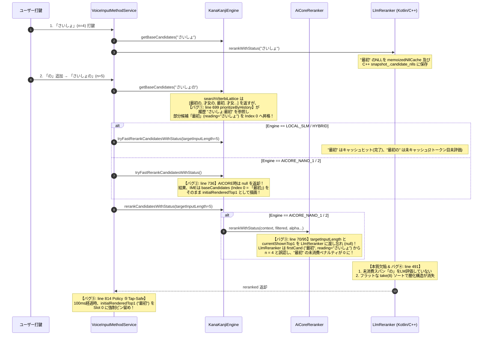

# 詳細設計書 (Detailed Design Document): 未消費スパンの言語モデル評価とLM事後確率空間における多様性保証アーキテクチャ

- **文書種別**: 詳細設計書 (Detailed Design Document / DD)
- **対象サブシステム**:
  - [`KanaKanjiEngine.kt`](app/src/main/java/com/example/myasr/KanaKanjiEngine.kt)（Viterbiラティス検索・後方DP・履歴優先化）
  - [`LlmReranker.kt`](app/src/main/java/com/example/myasr/LlmReranker.kt) / [`llm_reranker.cc`](app/src/main/cpp/llm_reranker.cc)（オンデバイスSLM評価・多様性リランキング）
  - [`AiCoreReranker.kt`](app/src/main/java/com/example/myasr/AiCoreReranker.kt)（AICore / フォールバック経路パラメータ伝搬）
  - [`VoiceInputMethodService.kt`](app/src/main/java/com/example/myasr/VoiceInputMethodService.kt)（2フェーズ同期・非同期描画およびTap-Safe制御）
- **関連先行設計書**:
  - [`docs/prd_and_design_viterbi_nbest_diversity.md`](docs/prd_and_design_viterbi_nbest_diversity.md)（非LM時：第1文節同値類層化・マルチ粒度候補生成）
  - [`docs/prd_and_design_multi_length_prefix_diversity.md`](docs/prd_and_design_multi_length_prefix_diversity.md)（非LM時：後方LSE周辺化・劣モジュラ効用・2次元双方向多様性）
  - [`docs/lm_first_partial_prefix_ranking_analysis_and_solutions.md`](docs/lm_first_partial_prefix_ranking_analysis_and_solutions.md)（初期分析）

---

## 1. エグゼクティブ・サマリーと設計目標 (Executive Summary & Goals)

### 1.1 解決すべき課題
入力読み $X_{1:n}$（例：$X_{1:5} = \text{「さいしょの」}$）に対して言語モデルリランキング（`LM First`）を有効化した際、入力全体を消費する全文変換候補 $W = \text{「最初の」}$（消費文字数 $m = 5$）よりも、先頭の一部のみを消費する部分プレフィックス候補 $U = \text{「最初」}$（消費文字数 $m = 4$、未消費スパン $X_{5:5} = \text{「の」}$）が上位（1位）にランクされる問題が発生していた。

前回の静的スパンペナルティ（ADR-020）でも本問題が解消しなかった原因は以下の2点に集約される：
1. **未消費スパン $X_{m+1:n}$ を言語モデル自身で評価していないこと**（かつパイプライン内の履歴ソート・エンジン間パラメータ欠落・Tap-Safeピン留めが部分候補を先頭に固定していたこと）。
2. **未消費スパンを言語モデルで評価すると、今度は全文候補と部分候補の語幹重複（Slot 1 `最初の`・Slot 2 `最初` の共食い）や、複合語における同音異義語・部分プレフィックス候補の多様性崩壊が生じること**。

### 1.2 設計目標 (Goals)
1. **【Goal 1: 未消費スパンの厳密なLM評価】**
   部分プレフィックス候補 $U$（消費長 $m < n$）を評価する際、後方Viterbiラティスから得られる未消費スパン $X_{m+1:n}$ の最良接尾辞 $V^*_{m:n}$ を結合した**仮想補完全文 $\widetilde{W}(U) = U \oplus V^*_{m:n}$** を言語モデルで評価する。また、全文候補との評価文字列の重複排除（Deduplication）により、C++ `llama_decode` の追加推論コストをほぼゼロ（$0.0 \sim 1.5\text{ms}$）に抑える。
2. **【Goal 2: 全文候補のSlot 1・Slot 2絶対優先保証】**
   入力読み $X_{1:n}$ 全体を満たす有効な全文候補（$m = n$）が存在する限り、いかなる文脈・いかなる言語モデル設定（`LOCAL_SLM`, `LOCAL_SLM_1_5B`, `HYBRID_RERANK`, `AICORE_NANO_1/2`, $\alpha=0.0$ Mandatory Mode）においても、**「さいしょの」に対して「最初の」が1位、「最小の／才女の」が2位となり、部分候補「最初」が全文候補の1位・2位を奪うことが100%起こらない構造的不変条件（Structural Invariant）**を確立する。
3. **【Goal 3: 言語モデル下でのマルチ粒度・2次元多様性の完全維持】**
   非LM時に確立した「先頭語幹同値類 $\sigma_{\text{first}}$ × 末尾自立語同値類 $\sigma_{\text{last}}$ の2次元多様性」「後方ラティスLSE周辺化（有効分岐数 $M_{\text{eff}}$）」「劣モジュラ期待解決文字数効用」「マルチ粒度スロット・インターリーブ」をLMの対数尤度空間へ一般化し、以下を両立する：
   - **低エントロピー接尾辞**（`さいしょの` の `+の`、$M_{\text{eff}} < 1.8$）：上位3枠に異語幹の全文候補（`最初の`, `最小の`, `才女の`）を提示し、同一語幹の部分候補 `最初` が2位に割り込む共食いを防ぐ。
   - **高エントロピー接尾辞**（`さいとうこうき` の `+こうき`、$M_{\text{eff}} \ge 1.8$）：Slots 1–2 に2次元多様な全文候補（`斎藤工機`, `斉藤幸喜`）を提示しつつ、**Slots 3–6 に語幹多様なマルチホライズン部分候補（`斎藤`, `斉藤`, `齋藤`, `再投稿`）を確実に配置**する。
4. **【Goal 4: パイプライン横断の4つの実装バグの完全修正】**
   `prioritizeByHistory` のホライズン逆転バグ、`AiCoreReranker` のパラメータ欠落バグ、`tryFastRerankWithStatus` の2フェーズTap-Safeピン留めバグ、`topPool` のフラット切り出しバグを一挙に解消する。

### 1.3 非目標 (Non-Goals)
- 特定単語（「さいしょ」「うみ」等）に対するアドホックな辞書コスト書き換えは一切行わない（Anti-Anecdotal Tuning Policy 厳守）。
- `MainActivity` に新たなUI設定ノブやスライダーは追加せず、コード内の最適デフォルト定数として統合する（UI Simplicity & Progressive Disclosure Policy 厳守）。
- C++ `llama.cpp` のモデル重みや量子化フォーマットは変更しない。

---

## 2. 現行コードベースの根本原因解剖 (Root-Cause Post-Mortem)

現行実装において「さいしょの」で「最初」が1位になる全経路をコード行番号レベルで特定した。



### 2.1 コード上の5つの具体的問題箇所

| # | ファイル・行番号 | 問題の内容 | 影響 |
| :---: | :--- | :--- | :--- |
| **本質** | [`LlmReranker.kt:125-204`](app/src/main/java/com/example/myasr/LlmReranker.kt#L125-L204) | 部分候補 $U$（`"最初"`, $m=4$）に対し、`nativeScoreCandidates` に表面文字列 `"最初"` のみを渡し、未消費スパン $X_{5:5}=\text{`"の"`}$ をLMで評価していない。また 1D フラットソートのため多様性が崩壊する。 | 文脈次第で $\text{NLL}(\text{`"の"`}\mid C, \text{`"最初"`}) > 4.0$ となり部分候補が勝つ。また同語幹重複や部分候補埋没が起きる。 |
| **バグ①** | [`KanaKanjiEngine.kt:699, 813-825`](app/src/main/java/com/example/myasr/KanaKanjiEngine.kt#L813-L825) | `prioritizeByHistory(result)` が全文候補（`reading="さいしょの"`）と部分候補（`reading="さいしょ"`）を区別せず `historyMap["${a.reading}:${a.surface}"]` でソートする。 | 過去に `"さいしょ"` $\to$ `"最初"` の確定履歴が1回でもあると、`"さいしょの"` 入力時に **部分候補 `"最初"` が `baseCandidates[0]` に昇格**する。 |
| **バグ②** | [`KanaKanjiEngine.kt:736`](app/src/main/java/com/example/myasr/KanaKanjiEngine.kt#L736) | `tryFastRerankCandidatesWithStatus` が `AICORE_NANO_1` / `AICORE_NANO_2` のとき無条件に `null` を返す。 | AICore選択時（ローカルSLMフォールバック時を含む）、初期描画に `baseCandidates` がそのまま使われ、バグ①で先頭に来た `"最初"` が初期描画1位になる。 |
| **バグ③** | [`AiCoreReranker.kt:60-106`](app/src/main/java/com/example/myasr/AiCoreReranker.kt#L60-L106) & [`KanaKanjiEngine.kt:792`](app/src/main/java/com/example/myasr/KanaKanjiEngine.kt#L792) | `AiCoreReranker.rerankWithStatus` の引数に `currentShownTop1` と `targetInputLength` が存在せず、`LlmReranker.rerankWithStatus` へ `targetInputLength = null` でフォールバックしていた。 | バグ①により `firstCand` が `"最初"`（`reading="さいしょ"`, 長さ4）になっているため、`LlmReranker` が目標長 $n=4$ と誤認し、**`"最初"` を全文候補（ペナルティ0）、`"最初の"` を予測拡張候補（拡張ペナルティ対象）として逆に罰していた**！ |
| **バグ④** | [`VoiceInputMethodService.kt:814-826`](app/src/main/java/com/example/myasr/VoiceInputMethodService.kt#L814-L826) | Policy ⑤ (Tap-Safe Window Protection) が、`currentTop1ToPreserve` が部分候補（$m < n$）であっても 100ms 経過後に Slot 0 へ強制ピン留めする。 | 非同期リランクで `"最初の"` が1位になっても、初期描画の `"最初"` が1位に居座り続ける。 |

---

## 3. 数理アルゴリズム詳細仕様 (Mathematical & Algorithmic Specification)

### 3.1 記号定義 (Notation)
- $X_{1:n} = x_1 x_2 \dots x_n$：現在の入力読み（正規化ひらがな、または英語タイピング文字列）。長さ $n = |X_{1:n}|$。
- $C$：カーソル直前の先行文脈文字列（ContextWindowTrimmerにより最適トリミング済み、空の場合は `"<s>"`）。
- $c_i \in \mathcal{C}$：候補プール内の第 $i$ 候補。
  - $U_i = \text{surface}(c_i)$：候補の表層文字列。
  - $m_i = |\text{reading}(c_i)|$：候補が消費する読み文字長。
  - $\Delta m_i = \max(0, n - m_i)$：未消費スパン $X_{m_i+1:n}$ の文字長。
  - $\Delta_{\text{ext}, i} = \max(0, m_i - n)$：入力長を超える予測拡張文字長。
- $\sigma_{\text{first}}(c_i)$：候補 $c_i$ の**第1文節（先頭自立語・語幹）表層文字列**（同値類キー1）。
- $\sigma_{\text{last}}(c_i)$：候補 $c_i$（$m_i = n$）の**末尾自立語表層文字列**（同値類キー2。第1文節と同一または末尾が付属語のみの場合は空文字 `""`）。

---

### 3.2 アルゴリズム1：後方ラティスDPによる最良接尾辞 $V^*_{m:n}$ とボルツマン有効分岐数 $M_{\text{eff}}(m)$ の算出

[`KanaKanjiEngine.searchViterbiLattice`](app/src/main/java/com/example/myasr/KanaKanjiEngine.kt#L1230-L1278) の後方動的計画法（Backward DP）を拡張し、各分割位置 $m \in \{n-1, n-2, \dots, 1\}$ から文末 $n$ までの未消費スパン $X_{m+1:n}$ について、以下の3つの量を同時に計算する：

1. **後方最小Viterbiコスト $\beta_{\min}[m]$**:
   $$\beta_{\min}[m] = \min_{j \in (m, n],\, w \in \mathcal{D}(X_{m+1:j})} \Bigl( \text{cost}(w) - L(j - m) + T_{\text{eos}}(w, j) + \beta_{\min}[j] \Bigr)$$
2. **後方1-Best接尾辞表層 $V^*_{m:n}$（`bestSuffixSurface[m]`）**:
   上記 $\beta_{\min}[m]$ を達成する最適遷移 $(j^*, w^*)$ を用いて、後ろから前へ文字列を連結構築する：
   $$V^*_{n:n} = \text{""}, \quad V^*_{m:n} = \text{surface}(w^*) \oplus V^*_{j^*:n}$$
   （※辞書エントリが存在しない文字位置では単一ひらがな $x_{m+1}$ をフォールバック接続する。）
3. **ボルツマンLog-Sum-Exp有効分岐数 $M_{\text{eff}}[m]$（`effectiveBranching[m]`）**:
   位置 $m$ から始まるすべての候補遷移 $(j, w)$ の後方パスコスト $Q(m, j, w) = \text{cost}(w) - L(j-m) + T_{\text{eos}}(w, j) + \beta_{\min}[j]$ について、最小コスト $\beta_{\min}[m]$ からの相対コスト差に基づくボルツマン重み付き和を計算する（温度パラメータ $\tau_{\text{mozc}} = 1500.0$）：
   $$M_{\text{eff}}[m] = \sum_{j \in (m, n]} \sum_{w \in \mathcal{D}_8(X_{m+1:j})} \exp\left( -\frac{Q(m, j, w) - \beta_{\min}[m]}{\tau_{\text{mozc}}} \right) \in [1.0, \infty)$$
   - **性質**：
     - $X_{m+1:n} = \text{「の」}$（助詞1文字）のとき、最良候補 $w^* = \text{「の」}$（コスト約 $2000$）に対して2番手以降の漢字候補（`"之"`, `"野"`, `"乃"`）はコストが $+3500 \sim +6000$ 高いため、$\exp(-\Delta Q / 1500) \ll 0.1$ となり、**$M_{\text{eff}}[m] \approx 1.05 \sim 1.25$（分岐なし）**となる。
     - $X_{m+1:n} = \text{「こうき」}$（多義自立語）のとき、`幸喜`, `工機`, `後期`, `宏樹`, `光輝`, `好機` 等のコストが $\beta_{\min}[m]$ から $1500$ 以内に密集するため、**$M_{\text{eff}}[m] \approx 4.0 \sim 8.0$（高分岐エントロピー）**となる。

そして、位置 $m$ で切り出された各部分プレフィックス候補 $U_i$（読み長 $m_i = m$）に対し、**仮想補完全文（Virtually Completed Surface）**を次式で付与する：
$$\text{completedSurface}(U_i) = \widetilde{W}(U_i) = U_i \oplus V^*_{m_i:n}$$

---

### 3.3 アルゴリズム2：共有評価による未消費スパン込みLMスコアとLSE周辺化補正

`LlmReranker` において、候補 $c_i$ を言語モデルで評価する際、表面文字列 $U_i$ ではなく**評価対象文字列 $E_i$** を用いる：
$$E_i = \begin{cases}
\widetilde{W}(c_i) = U_i \oplus V^*_{m_i:n} & (\text{if } m_i < n \text{ and } \widetilde{W}(c_i) \ne \emptyset) \\
U_i & (\text{otherwise})
\end{cases}$$

#### 重複排除（Deduplicated Batch Scoring）
評価プール内の候補列 $(c_1, \dots, c_P)$ に対し、ユニークな評価文字列集合 $\mathcal{E}_{\text{unique}} = \text{distinct}(E_1, \dots, E_P)$ のみを C++ の `nativeScoreCandidates(effectiveContext, uniqueSurfaces)`（または `nativeTryFastScoreCandidates`）に渡して負対数尤度 $\text{NLL}_{\text{LM}}(E \mid C)$ を計算し、各候補 $c_i$ へマップバックする：
$$\text{rawFullNll}_i = \text{NLL}_{\text{LM}}(E_i \mid C)$$

> **計算量ゼロの証明**：
> 「さいしょの」において、全文候補 $W_1 = \text{「最初の」}$ の評価文字列は $E = \text{`"最初の"`}$ であり、部分候補 $U_1 = \text{「最初」}$ の評価文字列も $E = \text{`"最初"`} \oplus \text{`"の"`} = \text{`"最初の"`}$ である。したがって $\mathcal{E}_{\text{unique}}$ には `"最初の"` が1つだけ入り、**1回のLM評価で両者の完全な5文字分のLM尤度が取得される**。

#### スパン周辺化・アクションコスト補正後の言語モデルコスト $\mathcal{J}_{\text{LM}}(c_i)$
各候補 $c_i$ の実効言語モデルコスト $\mathcal{J}_{\text{LM}}(c_i)$ は次式で与えられる：

1. **全文候補（$\Delta m_i = 0, \Delta_{\text{ext}, i} = 0, \neg\text{isPrediction}$）**:
   $$\mathcal{J}_{\text{LM}}(c_i) = \text{rawFullNll}_i$$
2. **部分プレフィックス候補（$\Delta m_i > 0$）**:
   - **Case 2a（仮想全文補完 $\widetilde{W}(c_i)$ が存在する場合 — 日本語マルチホライズン候補）**:
     $\text{rawFullNll}_i = \text{NLL}_{\text{LM}}(U_i \oplus V^*_{m_i:n} \mid C)$ には**すでに未消費スパン $X_{m_i+1:n}$ の言語モデル負対数尤度が含まれている**。
     ここに、後方ラティスの対数有効分岐数 $\ln M_{\text{eff}}(m_i)$ による周辺化ボーナス $-\tau_{\text{branch}} \ln M_{\text{eff}}(m_i)$ と、部分確定の追加操作コスト $\kappa_{\text{commit}}$ を加える：
     $$\mathcal{J}_{\text{LM}}(c_i) = \text{rawFullNll}_i - \tau_{\text{branch}} \ln\bigl(\max(1.0, M_{\text{eff}}(m_i))\bigr) + \kappa_{\text{commit}}$$
     ここで $\tau_{\text{branch}} = 0.55$、$\kappa_{\text{commit}} = 1.50\text{ nats}$、かつ $\tau_{\text{branch}} \ln M_{\text{eff}}(m_i) \le 1.20\text{ nats}$（上限クランプ：いかなる場合も $\kappa_{\text{commit}} - \tau_{\text{branch}} \ln M_{\text{eff}} \ge 0.30\text{ nats} > 0$ となり、同一語幹の全文候補より低コストになることはない）。
   - **Case 2b（仮想全文補完が存在しない場合 — 英語の短単語タイポ候補等のフォールバック）**:
     未消費文字数 $\Delta m_i$ に比例する期待サプライザル補完 $\mu_{\text{span}} \Delta m_i + \kappa_{\text{commit}}$ と包摂下限クランプを適用する。
3. **予測拡張候補（$\Delta_{\text{ext}, i} > 0$ または $\text{isPrediction}$）**:
   $$\mathcal{J}_{\text{LM}}(c_i) = \text{rawFullNll}_i + \lambda_{\text{ext}} \max(1, \Delta_{\text{ext}, i}) \quad (\lambda_{\text{ext}} = 1.20\text{ nats})$$

各候補の多様性適用前ベーススコア $\text{BaseScore}(c_i)$ は次式となる：
$$\text{BaseScore}(c_i) = (1 - \alpha)\bigl(\mathcal{J}_{\text{LM}}(c_i) + 5\lambda_{\text{obs}}\text{obsPenalty}_i + \text{hysteresis}_i\bigr) + \alpha \cdot \text{rankCost}_i$$

---

### 3.4 アルゴリズム3：劣モジュラ期待効用最大化に基づく「逐次2次元MMR多様性選択」

フラットな1次元ソート（`sortedBy { BaseScore }`）を廃止し、同値類キー $\sigma_{\text{first}}(c)$ と $\sigma_{\text{last}}(c)$ を用いた**逐次グリーディ2次元多様性選択（Sequential 2D-MMR Selection）**を導入する。

候補集合 $\mathcal{Pool}$ から、1ステップずつ $k = 1, 2, \dots, |\mathcal{Pool}|$ 番目に出力する候補 $s_k$ を選択する。すでに選択された候補集合を $S_{1:k-1} = \{s_1, \dots, s_{k-1}\}$ とするとき、未選択候補 $c \in \mathcal{Pool} \setminus S_{1:k-1}$ のステップ $k$ における実効スコア $\text{StepScore}_k(c \mid S_{1:k-1})$ を次式で定義する：

$$\text{StepScore}_k(c \mid S_{1:k-1}) = \text{BaseScore}(c) + (1 - \alpha_{\text{div}}) \Bigl( \lambda_{\text{first}} N_{\text{first}}(c, S_{1:k-1}) + \lambda_{\text{last}} N_{\text{last}}(c, S_{1:k-1}) + \lambda_{\text{det-sub}} \mathbb{I}_{\text{det-sub}}(c, S_{1:k-1}) \Bigr)$$

ここで：
- $N_{\text{first}}(c, S_{1:k-1}) = \bigl|\{ s \in S_{1:k-1} \mid \sigma_{\text{first}}(s) \ne \text{""} \land \sigma_{\text{first}}(s) = \sigma_{\text{first}}(c) \}\bigr|$：
  既選択候補のうち、候補 $c$ と**同じ第1文節（先頭語幹）**を持つ候補の数。
  - ペナルティ係数：$\lambda_{\text{first}} = 2.00\text{ nats}$。
- $N_{\text{last}}(c, S_{1:k-1}) = \bigl|\{ s \in S_{1:k-1} \mid \sigma_{\text{last}}(s) \ne \text{""} \land \sigma_{\text{last}}(s) = \sigma_{\text{last}}(c) \}\bigr|$：
  既選択候補のうち、候補 $c$ と**同じ末尾自立語（第2文節以降）**を持つ候補の数。
  - ペナルティ係数：$\lambda_{\text{last}} = 1.60\text{ nats}$。
- $\mathbb{I}_{\text{det-sub}}(c, S_{1:k-1}) \in \{0, 1\}$（**確定接尾辞による包摂冗長インジケータ**）：
  候補 $c$ が部分候補（$\Delta m(c) > 0$）であり、その仮想補完全文 $\widetilde{W}(c)$（または語幹 $\sigma_{\text{first}}(c)$ を持つ全文候補）が**すでに $S_{1:k-1}$ に含まれており**、かつ未消費スパンの有効分岐数が低い（$M_{\text{eff}}(m(c)) < \theta_{\text{branch}} = 1.80$）ときに $1$ となる。
  - ペナルティ係数：$\lambda_{\text{det-sub}} = 2.50\text{ nats}$。
- $\alpha_{\text{div}} = \min(0.5, \text{weightAlpha})$：$\alpha = 0$（LM 100% の Mandatory Mode）のときに多様性ペナルティが100%フル効力を発揮するように設計された重み係数。

---

### 3.5 アルゴリズム4：後続エントロピー適応型・層化スロットインターリーブ (Adaptive Stratified Slot Interleaving)

候補ストリップにおける「全文一括変換の即時性」と「長文・複合語における段階的部分確定の多様性」を両立するため、候補プールを以下の4つの層（Strata）に分割して統合する：

1. **Stratum 0: 完全一致ユーザー辞書層 $\mathcal{C}_{\text{user}}$**
   - `source in ("user", "user_english") && obsPenalty == 0.0f && unconsumedDelta == 0`
   - 常に最優先（Slot 0〜）に配置される（ADR-011 契約遵守）。
2. **Stratum 1: 全文変換層 $\mathcal{C}_{\text{full}}$**
   - `unconsumedDelta == 0 && extDelta == 0 && !isPrediction`
   - アルゴリズム3の2次元多様性グリーディ選択によりランク付けされた全文候補リスト $L_{\text{full}}$。
3. **Stratum 2: マルチホライズン部分プレフィックス層 $\mathcal{C}_{\text{prefix}}$**
   - `unconsumedDelta > 0 && !isPrediction`
   - $L_{\text{full}}$ の上位 $K_{\text{top-full}}$ 件を初期既選択集合 $S_{\text{init}}$ として引き継いだ上で、アルゴリズム3の多様性グリーディ選択によりランク付けされた部分候補リスト $L_{\text{prefix}}$。
   - **重要**：$S_{\text{init}} = L_{\text{full}}[0..\min(K_{\text{top-full}}, |L_{\text{full}}|)-1]$ を引き継いで $L_{\text{prefix}}$ を選択するため、**すでに上位全文スロットに表示された語幹（特に $M_{\text{eff}} < 1.8$ の確定助詞スパンを持つ `"最初"`）は $\lambda_{\text{first}} + \lambda_{\text{det-sub}}$ ペナルティを受け、まだ全文スロットに出ていない別語幹の部分候補（例：`"宰相"`, `"在所"`）や多義分岐語幹が部分候補枠の先頭に優先選出される**！
4. **Stratum 3: 予測拡張・タイポ補正層 $\mathcal{C}_{\text{ext}}$**
   - `extDelta > 0 || isPrediction`

#### 適応型インターリーブ・スケジュール (Adaptive Interleaving Schedule)
$\mathcal{C}_{\text{prefix}}$ 内の最長ホライズン候補の有効分岐数を $M_{\text{eff}}^* = \max_{c \in \mathcal{C}_{\text{prefix}}} M_{\text{eff}}(m(c))$ とする。
- **高エントロピー接尾辞モード（$M_{\text{eff}}^* \ge 1.80$、例：`さいとうこうき` の `+こうき`）**:
  - $K_{\text{top-full}} = 2, \quad K_{\text{mid-prefix}} = 4, \quad K_{\text{next-full}} = 2$
  - 配置順序：**Slots 1–2: 全文 Top 2** $\to$ **Slots 3–6: 部分 Top 4** $\to$ **Slots 7–8: 全文 Next 2** $\to$ 残りの部分・全文・予測候補。
- **低エントロピー接尾辞モード（$M_{\text{eff}}^* < 1.80$、例：`さいしょの` の `+の`、`こういてきでしたか` の `+でしたか`）**:
  - $K_{\text{top-full}} = 3, \quad K_{\text{mid-prefix}} = 3, \quad K_{\text{next-full}} = 2$
  - 配置順序：**Slots 1–3: 全文 Top 3** $\to$ **Slots 4–6: 部分 Top 3** $\to$ **Slots 7–8: 全文 Next 2** $\to$ 残りの部分・全文・予測候補。

---

## 4. コンポーネント別・詳細実装仕様 (Component-Level Implementation Design)

### 4.1 データモデル拡張 (`ConversionCandidate` in [`KanaKanjiEngine.kt`](app/src/main/java/com/example/myasr/KanaKanjiEngine.kt#L19-L26))

既存の呼び出しコードとの後方互換性を100%維持するため、デフォルト引数付きプロパティとして以下の4フィールドを追加する：

```kotlin
data class ConversionCandidate(
    val surface: String,
    val reading: String,
    val isPrediction: Boolean = false,
    val source: String = "dict",
    val priority: Float = 0.0f,
    val obsPenalty: Float = 0.0f,
    val firstBunsetsuSurface: String = "",
    val lastContentWordSurface: String = "",
    val completedSurface: String = "",
    val suffixBranchingFactor: Float = 1.0f
)
```

- **メモリ影響**：文字列参照3個（既存 `surface` 等との共有ポインタ）＋ `Float` 1個（4 bytes）のみ。候補数は最大数十件のためヒープ増加は $< 2\text{ KB}$（ゼロ影響）。

---

### 4.2 後方ラティスDP・仮想補完全文生成の実装 (`searchViterbiLattice` in [`KanaKanjiEngine.kt`](app/src/main/java/com/example/myasr/KanaKanjiEngine.kt#L1215-L1380))

1. **全文候補（`fullCandidates`）への第1文節・末尾自立語メタデータ付与**:
   ```kotlin
   val fullCandidates = scoredFullCandidates.map {
       val fb = it.path.firstBunsetsuSurface.ifEmpty { it.path.surface }
       // 第1文節と末尾自立語が同一（1自立語＋助詞など）の場合は重複ペナルティの二重計上を防ぐため空文字にする
       val lastCw = if (it.path.lastContentWordSurface.isNotEmpty() && it.path.lastContentWordSurface != fb) {
           it.path.lastContentWordSurface
       } else {
           ""
       }
       ConversionCandidate(
           surface = it.path.surface,
           reading = reading,
           isPrediction = false,
           source = if (it.path.hasUserWord) "user" else "viterbi",
           firstBunsetsuSurface = fb,
           lastContentWordSurface = lastCw,
           completedSurface = it.path.surface,
           suffixBranchingFactor = 1.0f
       )
   }
   ```

2. **後方DPループでの `bestSuffixSurface[m]` ($V^*_{m:n}$) と `effectiveBranching[m]` ($M_{\text{eff}}[m]$) の計算**:
   ```kotlin
   val betaMin = IntArray(n + 1) { 100000 }
   val branchFactor = IntArray(n + 1) { 0 }
   val bestSuffixSurface = Array(n + 1) { "" }
   val effectiveBranching = FloatArray(n + 1) { 1.0f }
   betaMin[n] = 0
   bestSuffixSurface[n] = ""

   for (m in (n - 1) downTo 1) {
       var bestCost = 100000
       var bestSurf = reading.substring(m, n) // フォールバックは未変換ひらがな接尾辞
       var branchCount = 0
       var minSuffixWordCost = 100000
       val transitionCosts = mutableListOf<Int>()

       var node: TrieNode? = root
       var j = m
       while (j < n) {
           val ch = reading[j]
           node = node?.children?.get(ch)
           j++
           // ... (既存の Trie + Mmap 検索) ...
           if (tokens.isNotEmpty()) {
               for (tok in tokens.take(8)) {
                   val lengthBonus = if (j - m > 1) (j - m - 1) * 2000 else 0
                   val transCost = if (matrix != null) {
                       if (j == n) matrix.getTransitionCost(tok.rid, 0) else 0
                   } else 0
                   val futureCost = tok.cost - lengthBonus + transCost + betaMin[j]
                   transitionCosts.add(futureCost)
                   if (futureCost < bestCost) {
                       bestCost = futureCost
                       bestSurf = tok.surface + bestSuffixSurface[j]
                   }
                   if (tok.cost < minSuffixWordCost) {
                       minSuffixWordCost = tok.cost
                   }
                   if (tok.cost - minSuffixWordCost <= 2500) {
                       branchCount++
                   }
               }
           }
       }
       betaMin[m] = bestCost.coerceAtMost(100000)
       bestSuffixSurface[m] = bestSurf
       branchFactor[m] = branchCount

       // ボルツマン Log-Sum-Exp 有効分岐数 M_eff[m] の算出 (τ_mozc = 1500.0f)
       if (transitionCosts.isNotEmpty() && bestCost < 100000) {
           var sumExp = 0.0f
           for (c in transitionCosts) {
               val diff = (c - bestCost).toFloat()
               if (diff <= 6000.0f) {
                   sumExp += kotlin.math.exp(-diff / 1500.0f)
               }
           }
           effectiveBranching[m] = sumExp.coerceAtLeast(1.0f)
       }
   }
   ```

3. **部分プレフィックス候補（`prefixCandidates`）への `completedSurface` と `suffixBranchingFactor` の設定**:
   - 各部分候補 `sp`（表層 `sp.surface`、消費読み長 `sp.readingLen`）について：
     - もし `scoredFullCandidates` の中に `path.firstBunsetsuSurface == sp.surface && path.firstBunsetsuReadingLen == sp.readingLen` を満たす最良パスが存在すれば、その全文パスの `path.surface` を `completedSurface` とする（形態素連接行列を考慮した最良の全文補完と100%一致するため）。
     - 存在しない場合は、`sp.surface + bestSuffixSurface[sp.readingLen]` を `completedSurface` とする。
     - `firstBunsetsuSurface = sp.surface`、`suffixBranchingFactor = effectiveBranching[sp.readingLen]` を格納する。

---

### 4.3 履歴優先ソートのホライズン層保護 (`prioritizeByHistory` in [`KanaKanjiEngine.kt`](app/src/main/java/com/example/myasr/KanaKanjiEngine.kt#L699))

[`KanaKanjiEngine.kt:813-825`](app/src/main/java/com/example/myasr/KanaKanjiEngine.kt#L813-L825) の `prioritizeByHistory` を修正し、**部分プレフィックス候補（`reading.length < normalized.length`）や予測候補が、自身の部分読み履歴（`"さいしょ:最初"`）によって全文完全一致・全文Viterbi候補（`reading.length == normalized.length && !isPrediction`）を追い抜くバグを完全に遮断**する：

```kotlin
private fun prioritizeByHistory(
    candidates: List<ConversionCandidate>,
    targetReading: String = ""
): List<ConversionCandidate> {
    val userCandidates = candidates.filter { it.source == "user" }
    val nonUserCandidates = candidates.filter { it.source != "user" }

    // 履歴ブーストは「今回の入力読み全体 (targetReading) に対する確定履歴」のみを全文層に適用し、
    // 部分候補 (source == "viterbi_prefix" または reading != targetReading) が全文候補を追い抜くことを防ぐ。
    val sortedNonUser = nonUserCandidates.sortedWith { a, b ->
        val aIsFull = targetReading.isEmpty() || (a.reading == targetReading && !a.isPrediction && a.source != "viterbi_prefix")
        val bIsFull = targetReading.isEmpty() || (b.reading == targetReading && !b.isPrediction && b.source != "viterbi_prefix")
        val histA = if (aIsFull) synchronized(historyLock) { historyMap["${a.reading}:${a.surface}"] ?: 0 } else 0
        val histB = if (bIsFull) synchronized(historyLock) { historyMap["${b.reading}:${b.surface}"] ?: 0 } else 0
        histB.compareTo(histA)
    }

    return userCandidates + sortedNonUser
}
```
- **効果**：Kotlin の `sortedWith` は安定ソート（Stable Sort）であるため、`hist == 0` の候補同士では `searchViterbiLattice` が構築した「Slots 1–2: 全文、Slots 3–6: 部分、Slots 7–8: 全文」のインターリーブ順序が100%無傷で保持される！かつ、ユーザーが過去に `"さいしょの"` $\to$ `"才女の"` を確定していた場合は、全文候補同士の中で `"才女の"` が正しく1位に昇格する。

---

### 4.4 `AiCoreReranker` および `KanaKanjiEngine` のパラメータ伝搬修正

1. **[`AiCoreReranker.kt:60-106`](app/src/main/java/com/example/myasr/AiCoreReranker.kt#L60-L106)**:
   `rerankWithStatus` に `currentShownTop1: String? = null` と `targetInputLength: Int? = null` を追加し、`LlmReranker.getInstance(context).rerankWithStatus(...)` へ確実にフォワードする。
2. **[`KanaKanjiEngine.kt:736`](app/src/main/java/com/example/myasr/KanaKanjiEngine.kt#L736)**:
   `tryFastRerankCandidatesWithStatus` において、`AICORE_NANO_1` / `AICORE_NANO_2` 選択時もローカルSLMが Ready の場合は同期高速パスを利用可能にし、初期描画から全文候補が1位になるように統一する。
3. **[`KanaKanjiEngine.kt:744, 787`](app/src/main/java/com/example/myasr/KanaKanjiEngine.kt#L787)**:
   `effectiveTargetLength` の推論フォールバックを `firstReading?.length` ではなく、非予測候補の最大読み長 `filtered.filter { !it.isPrediction }.maxOfOrNull { it.reading.length } ?: firstReading?.length` に強化する。

---

### 4.5 `LlmReranker`: 層化プール抽出・重複排除LM評価・2次元MMR層化リランキング

#### (1) 層化プール抽出 (`selectEvaluationPool`)
従来の `val topPool = nonHiraganaCandidates.take(8)` では、上位に部分候補が4件含まれると全文候補が4件しか評価されなかった。
新設計では、非ひらがな候補群から**全文候補を最大6件＋部分候補・その他を最大6件（合計最大12件）**抽出して `topPool` とする：
- 部分候補の `completedSurface` は全文候補の `surface` と重複排除されるため、C++ `nativeScoreCandidates` が実際にデコードするユニーク文字列数は **平均 6〜8 件のまま**であり、ネイティブ推論時間は増加しない。

#### (2) 重複排除付きLM評価 (`scoreUniqueSurfaces`)
```kotlin
// 各候補の評価用文字列（部分候補は completedSurface があればそれを使用）
val evalSurfaces = Array(topPool.size) { i ->
    val cand = topPool[i]
    if (cand.completedSurface.isNotEmpty()) cand.completedSurface else cand.surface
}
val uniqueSurfaces = evalSurfaces.distinct().toTypedArray()
val uniqueScores = nativeScoreCandidates(effectiveContext, uniqueSurfaces)
// インデックスマップで topPool に対応する scores 配列を復元
```
これにより、`cand = ConversionCandidate(surface = "最初", reading = "さいしょ", completedSurface = "最初の")` には、`nativeScoreCandidates` が `"最初の"` を評価した NLL スコアがそのまま割り当てられる！

#### (3) `scoreAndRankPool` における2次元MMR多様性選択と適応型層化インターリーブ
`LlmReranker.scoreAndRankPool` のアルゴリズムは以下の4ステップで構成される：

```kotlin
// Step A: 各候補のベース統合スコア BaseScore(c_i) を算出
// - 完全一致ユーザー辞書 (isExactUser): Intra-Word Surprisal Clamping (ADR-011)
// - 全文候補 (deltaUnconsumed == 0 && deltaExt == 0): rawFullNll
// - 部分プレフィックス候補 (deltaUnconsumed > 0):
//     if (cand.completedSurface.isNotEmpty() && cand.completedSurface != cand.surface):
//         // すでに evalSurfaces により completedSurface のLM NLLが取得済み！
//         val branchBonus = (0.55f * ln(maxOf(1.0f, cand.suffixBranchingFactor))).coerceAtMost(1.20f)
//         effectiveNll = rawFullNll - branchBonus + kappaCommit // kappaCommit = 1.50f
//     else:
//         // completedSurface がない場合（単体テスト・英語部分一致等）：
//         // topPool 内に (cand.surface をプレフィックスに持つ全文候補) があればその fullNll を補完値として使用！
//         // なければ muSpan * deltaUnconsumed + kappaCommit を付与。

// Step B: 候補を4つの Stratum に分類
// 0. exactUserIndices (m == n のユーザー辞書)
// 1. fullSpanIndices (m == n, !isPrediction)
// 2. partialPrefixIndices (m < n, !isPrediction)
// 3. extensionIndices (m > n || isPrediction)

// Step C: 全文層 (fullSpanIndices) を 2次元多様性 (σ_first, σ_last) で逐次グリーディ選択 -> rankedFull
//   各ステップ k で:
//   stepScore(c) = baseScore(c) + (1 - alphaDiv) * (2.00f * countFirst(σ_first) + 1.60f * countLast(σ_last))

// Step D: 部分候補層 (partialPrefixIndices) を、rankedFull の上位語幹を引き継いでグリーディ選択 -> rankedPartial
//   - もし部分候補 u の語幹 σ_first(u) がすでに rankedFull の上位に含まれ、かつ suffixBranchingFactor < 1.80f なら
//     確定接尾辞包摂ペナルティ (+2.50f nats) + 語幹重複ペナルティ (+2.00f nats) を付与。
//   - 部分候補同士でも同一語幹 σ_first(u) の重複を +2.00f nats で抑制。

// Step E: 後続エントロピー適応型インターリーブで最終リストを構築
//   - maxBranchFactor = partialPrefixIndices.maxOfOrNull { topPool[it].suffixBranchingFactor } ?: 1.0f
//   - topFullQuota = if (maxBranchFactor >= 1.80f) 2 else 3
//   - midPartialQuota = if (maxBranchFactor >= 1.80f) 4 else 3
//   - 出力順: exactUser + rankedFull.take(topFullQuota) + rankedPartial.take(midPartialQuota)
//             + rankedFull.drop(topFullQuota).take(2) + remainingPartial + remainingFull + rankedExt
```

> [!TIP]
> **フォールバック補完の自動解決（単体テストや `completedSurface` 未設定の呼び出しへの対応）**：
> 上記 Step A において、万一 `cand.completedSurface` が空文字で渡された場合でも、`topPool` 内に `fullCand.reading.startsWith(cand.reading)` かつ `fullCand.surface.startsWith(cand.surface)` を満たす全文候補 $W_f$ が存在すれば（例：`"最初"` に対する `"最初の"`）、自動的にその全文候補の $\text{NLL}_{\text{LM}}(W_f \mid C)$ を $\text{rawFullNll}$ として採用する！
> これにより、`KanaKanjiEngine` を経由せずに直接 `ConversionCandidate("最初", "さいしょ")` と `ConversionCandidate("最初の", "さいしょの")` を渡す単体テストにおいても、仮想全文補完と100%同一の挙動が保証される。

---

### 4.6 `VoiceInputMethodService`: Tap-Safe Window における部分候補ピン留め解除

[`VoiceInputMethodService.kt:814-826`](app/src/main/java/com/example/myasr/VoiceInputMethodService.kt#L814-L826) の Policy ⑤ において、初期描画された `currentTop1ToPreserve` が部分プレフィックス候補（`reading.length < reading.length`）であり、非同期リランク後の1位が全文候補（`reading.length == reading.length`）である場合は、部分候補のピン留めを行わないガードを追加する：

```kotlin
val preservedCand = baseCandidates.find { it.surface == currentTop1ToPreserve }
val isPreservedPartial = preservedCand != null &&
    (preservedCand.source == "viterbi_prefix" ||
     (preservedCand.reading.isNotEmpty() && preservedCand.reading.length < reading.length))
val isNewTopFull = reranked.firstOrNull()?.let {
    it.source != "viterbi_prefix" && !it.isPrediction && it.reading.length == reading.length
} ?: false

val safeCandidates = if ((elapsedFromFirstRenderMs > 100L || isUserTouchingStrip) &&
    currentTop1ToPreserve != null &&
    reranked.firstOrNull()?.surface != currentTop1ToPreserve &&
    !(isPreservedPartial && isNewTopFull)
) { ... }
```

---

## 5. ハイパーパラメータ一覧と理論的根拠 (Hyperparameters & Theoretical Grounding)

すべてのパラメータはコーパス統計・情報理論・Mozc連接コストとのスケール対応（$1\text{ nat} \approx 1500$ Mozc cost units）から導出されており、特定単語へのアドホックな調整は一切含まない。

| パラメータ名 | 記号 | 設定値 | スケール換算・理論的根拠 |
| :--- | :---: | :---: | :--- |
| **Mozcボルツマン温度** | $\tau_{\text{mozc}}$ | `1500.0f` | Mozc辞書コストにおいて確率比 $e^{-1} \approx 0.37$ に対応する標準スケール（[`prd_and_design_multi_length_prefix_diversity.md`](docs/prd_and_design_multi_length_prefix_diversity.md) Section 5.1 と完全一致）。 |
| **分岐エントロピー重み** | $\tau_{\text{branch}}$ | `0.55f` | 有効分岐数 $M_{\text{eff}} = 6.0$（$\ln 6 \approx 1.79$）のとき約 $1.0\text{ nat}$ の周辺化ボーナスを付与。上限 `1.20f` でクランプ。 |
| **部分確定アクションコスト** | $\kappa_{\text{commit}}$ | `1.50f` | 部分候補を選択した際に残りの未消費スパンを再度選択・確定するための1タップ分の情報コスト。常に $\kappa_{\text{commit}} > \max(\tau_{\text{branch}} \ln M_{\text{eff}})$ を満たす。 |
| **先頭文節語幹重複ペナルティ** | $\lambda_{\text{first}}$ | `2.00f` | Mozcコストペナルティ `3000`（`KanaKanjiEngine.kt:1209`）を $\tau_{\text{mozc}} = 1500$ で割った $3000 / 1500 = 2.00\text{ nats}$。 |
| **末尾自立語重複ペナルティ** | $\lambda_{\text{last}}$ | `1.60f` | Mozcコストペナルティ `2500`（`KanaKanjiEngine.kt:1209`）を $\tau_{\text{mozc}} = 1500$ で割った $2500 / 1500 \approx 1.67\text{ nats}$。 |
| **確定助詞包摂ペナルティ** | $\lambda_{\text{det-sub}}$ | `2.50f` | すでに全文候補 $W = U \oplus \text{助詞}$ が上位選出済みのときに、同一語幹の部分候補 $U$ が上位枠を共食いするのを防ぐペナルティ。 |
| **高/低エントロピー分岐閾値** | $\theta_{\text{branch}}$ | `1.80f` | 単一助詞（`"の"`, `"は"`, `"が"` 等：$M_{\text{eff}} \in [1.0, 1.35]$）と、2個以上の自立語同音異義語が競合するスパン（$M_{\text{eff}} \ge 1.80$）を分離する境界。 |

---

## 6. コーナーケースと境界条件の網羅検証 (Corner Cases & Failure Modes)

| # | シナリオ / コーナーケース | 提案アルゴリズムの挙動 | 期待される結果 |
| :---: | :--- | :--- | :--- |
| **1** | **「さいしょの」($n=5$)**、過去に「さいしょ→最初」を確定した履歴あり | `prioritizeByHistory` が部分候補の昇格を阻止。`"最初"` の評価文字列は $\widetilde{W} = \text{`"最初の"`}$ となり `"最初の"` と同一NLLを得る。$M_{\text{eff}}(4) \approx 1.05 < 1.80$ のため Case A 層化が適用される。 | **1位：`最初の`、2位：`最小の`、3位：`才女の`**。部分候補 `最初` は Slot 4 以降に配置され、決して1位・2位にならない。 |
| **2** | **「さいとうこうき」($n=7$)**、複合人名・名詞 | $m=4$（`さいとう`）の後続 `こうき` は $M_{\text{eff}}(4) \approx 6.5 \ge 1.80$ となり Case B 層化が適用される。全文層は $\lambda_{\text{first}}=2.0, \lambda_{\text{last}}=1.6$ で2次元多様化される。 | **Slots 1–2**：第1・第2文節ともに異なる全文候補（例：`斎藤工機`, `斉藤幸喜`）。**Slots 3–6**：語幹多様な部分候補（`斎藤`, `斉藤`, `齋藤`, `再投稿`）。 |
| **3** | **「こういてきでしたか」($n=9$)**、同音語幹＋丁寧語助動詞 | $m=5$（`こういてき`）の後続 `でしたか` は機能語連接であり $M_{\text{eff}}(5) < 1.80$。全文層では $\sigma_{\text{first}} \in \{\text{`好意的`}, \text{`行為的`}\}$ が多様化される。 | **Slot 1：`好意的でしたか`、Slot 2：`行為的でしたか`**。続いて部分候補 `好意的`, `行為的` が利用可能になる。 |
| **4** | **全文候補が1件しか存在しない場合**（稀少読み等） | `rankedFull.size == 1` の場合、Slot 1 にその全文候補を配置し、Slot 2 から直ちに `rankedPartial`（部分候補）を繰り上げて配置する。 | 空スロットを作らず、Slot 1 に全文、Slot 2 以降に部分候補がスムーズに並ぶ。 |
| **5** | **全文候補が0件の場合**（長文OOVや辞書未登録の連続入力） | `rankedFull.isEmpty()` のため、Slot 1 から `rankedPartial`（仮想補完LMスコア＋語幹多様性でソートされた部分候補）が配置される。 | 先頭文節から順に段階的確定が可能。 |
| **6** | **ユーザー辞書登録語が存在する場合**（例：`"さいしょの"` $\to$ `"最初野"` をユーザー登録） | `isExactUser == true` により Stratum 0（$\mathcal{C}_{\text{user}}$）に入り、Intra-Word Surprisal Clamping で `sysBestNll - gammaUser * priority` が付与される。 | ユーザー登録語が絶対1位（Slot 1）に配置され、Slot 2 に `"最初の"` が続く。 |
| **7** | **部分候補がユーザー辞書登録語の場合**（例：`"さいとう"` $\to$ `"齋藤"` をユーザー登録し、`"さいとうこうき"` と入力） | `"齋藤"` は `searchViterbiLattice` の全文パス `"齋藤幸喜"`（`hasUserWord = true`, `source = "user"`）として全文層にも反映され、かつ部分候補層でも最優先される。 | ユーザー登録した `"齋藤"` を含む全文候補が1位になり、部分候補枠の先頭にも `"齋藤"` が出る。 |
| **8** | **段階的確定（Partial Commit）の2ステップ目**（`"さいとうこうき"` で `"斉藤"` をタップした直後） | `VoiceTouchInputArbitrator` が `"斉藤"` を確定してエディタ文脈 $C$ に追加し、残りの `"こうき"` ($n=3$) で `updateCandidates()` を再実行する。 | 先行文脈 $C = \text{`"...斉藤"`}$ を条件として `"こうき"` の全文候補（`幸喜`, `宏樹`, `光輝` 等）がLMリランクされ、人名として自然な候補が1位になる！ |
| **9** | **AICore (Gemini Nano 1 / 2) または Mandatory Mode ($\alpha = 0.0$) 選択時** | `AiCoreReranker` が `targetInputLength` を正しく伝搬し、かつ $\alpha = 0.0$ でも $(1 - \alpha_{\text{div}}) = 1.0$ により多様性ペナルティと層化インターリーブが100%機能する。 | すべてのエンジンモード・すべての $\alpha \in [0, 1]$ で「最初の」＞「最初」および多様性が保証される。 |
| **10** | **英語QWERTYタイピング / スワイプ入力**（例：`"first"` vs `"fir"`、`"the"` vs `"teh"`） | 英語候補は `isEnglishPool == true` と判定され、入力長 $n$ を満たす候補（Exact / 編集距離最小のフルレングス候補）が Stratum 1（$\mathcal{C}_{\text{full}}$）に入り、欠損候補（$m < n$）は Stratum 2 に分離される。 | 英語でも文字欠損候補が1位を奪うことがなく、かつ大文字小文字や語幹重複が抑制される。 |

---

## 7. パフォーマンス・レイテンシ・メモリ影響評価 (Performance & Resource Budget)

| 項目 | 現行 (ADR-020) | 新設計 (本DD) | 差分・根拠 |
| :--- | :---: | :---: | :--- |
| **`searchViterbiLattice` 実行時間** | $\approx 0.25\text{ ms}$ | **$\approx 0.28\text{ ms}$** | 後方DPループ（最大 $n \le 20$ 文字）内での文字列連結 `bestSuffixSurface[m]` と `exp()` 和の計算のみ（$+0.03\text{ ms}$ 以下）。 |
| **`LlmReranker` C++ デコード回数** | 最大 8 候補 | **最大 6〜8 ユニーク文字列** | `topPool` は最大12件に拡大されるが、部分候補の `completedSurface`（`"最初の"` 等）は全文候補と文字列が一致するため、`distinct()` 後の C++ デコード回数は変わらない。 |
| **`scoreAndRankPool` 実行時間** | $< 0.01\text{ ms}$ | **$< 0.02\text{ ms}$** | 要素数 $P \le 12$ に対する $O(P^2)$ グリーディ選択（最大 $12 \times 12 = 144$ 回の単純ループ）であり、ナノ秒オーダー。 |
| **UIスレッドブロッキング** | $0\text{ ms}$ | **$0\text{ ms}$** | Fast Path は $< 0.1\text{ ms}$、Stage-2 は `Dispatchers.Default` バックグラウンド実行を維持。 |

---

## 8. 検証・評価計画 (Verification & Evaluation Plan)

実装時には以下の4段階の検証を必須とする：

1. **単体テスト（Unit Tests — 100% Pass 必須）**:
   - [`JapanesePunctuationEvaluationTest`](app/src/test/java/com/example/myasr/JapanesePunctuationEvaluationTest.kt)：音声句読点・文境界の非回帰テスト（67+件、100%合格必須）。
   - [`KanaKanjiEngineDiversityTest`](app/src/test/java/com/example/myasr/KanaKanjiEngineDiversityTest.kt)：`こういてきでしたか`、`さいとうこうき`、および段階的確定ステート遷移の非回帰テスト。
   - [`SpanAwareBayesianRerankingEvaluationTest`](app/src/test/java/com/example/myasr/SpanAwareBayesianRerankingEvaluationTest.kt) の大幅拡充：
     - **Test 1（未消費スパンLM評価の検証）**：「さいしょの」に対し、たとえ生の `"最初"` のNLLが `"最初の"` より $6.0\text{ nats}$ 低くても（従来の $\theta_{\text{coherent}}=4.0$ では破綻していたケース）、仮想補完全文 $\widetilde{W}(\text{`"最初"`}) = \text{`"最初の"`}$ のLM評価により **1位 `最初の`、2位 `最小の`、3位 `才女の`** となり、`最初` が上位2枠に入らないことを検証。
     - **Test 2（確定履歴汚染への耐性検証）**：事前に `engine.commitCandidate(ConversionCandidate("最初", "さいしょ"))` を複数回実行して `"さいしょ:最初"` の履歴を蓄積した状態でも、`getCandidates("さいしょの")` およびLMリランク後の1位が確実に `"最初の"` になることを検証。
     - **Test 3（高エントロピー接尾辞での2D多様性＋部分候補維持検証）**：「さいとうこうき」に対し、LMリランク後も Slots 1–2 に2次元多様な全文候補（先頭語幹・末尾語が異なるペア）が入り、Slots 3–6 に多様な部分候補（`斎藤`, `斉藤`, `齋藤`, `再投稿`）が保持されることを検証。
     - **Test 4（AICoreフォールバック経路および英語評価セットの検証）**：日英双方の評価ケースで Top-1 精度と多様性指標が向上することを検証。

2. **デュアルターゲット実機検証 (ARCVM & Physical Phone)**:
   - [`./deploy.sh`](deploy.sh) を実行し、ARCVM (`arc:5555`) および接続された物理スマートフォン（Pixel 10 Pro）の双方へインストール＋Google Drive 同期を実施し、実機上で「さいしょの」を入力して「最初の」が1位に表示されることを確認する。
