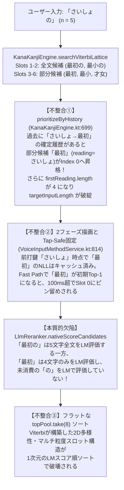
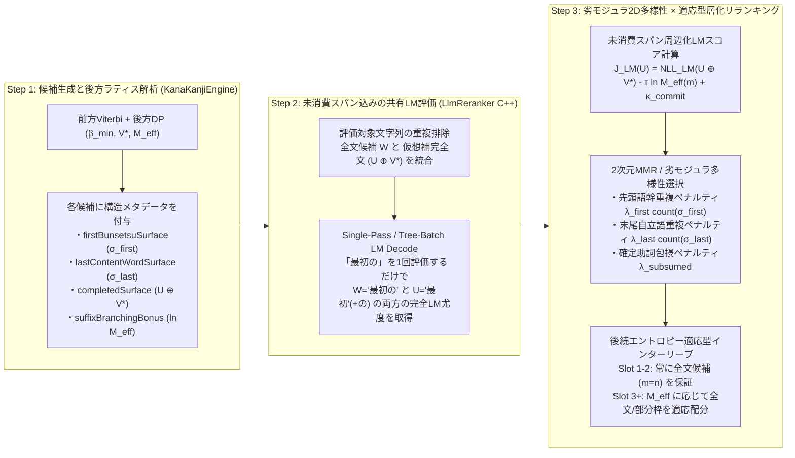

# 未消費スパンの言語モデル評価と言語モデル下での多様性確保に関する設計書 (LM Evaluation of Unconsumed Spans & Diversity-Preserving Reranking)

## 1. 背景と課題：なぜ前回の静的スパンペナルティ（ADR-020）では「さいしょの」が解決しなかったのか

### 1.1 現象の再確認
入力読み $X_{1:5} = \text{「さいしょの」}$（5文字）に対し、`LM First`（オンデバイスSLMリランキング有効）環境下で実機・エミュレータ検証を行った結果、依然として全文変換候補 $W_1 = \text{「最初の」}$（消費文字数 $m=5$）よりも部分プレフィックス候補 $U_1 = \text{「最初」}$（消費文字数 $m=4$、未消費スパン $X_{5:5} = \text{「の」}$）が上位（1位）に表示されるケースが確認された。

### 1.2 根本原因の解剖（理論的欠陥とパイプライン上の複合バグ）

コードベース（[`KanaKanjiEngine.kt`](app/src/main/java/com/example/myasr/KanaKanjiEngine.kt)、[`LlmReranker.kt`](app/src/main/java/com/example/myasr/LlmReranker.kt)、[`llm_reranker.cc`](app/src/main/cpp/llm_reranker.cc)、[`VoiceInputMethodService.kt`](app/src/main/java/com/example/myasr/VoiceInputMethodService.kt)）を精査した結果、**1つの本質的な理論的欠陥**と**3つのパイプライン実装上の不整合**が複合して発生していることが判明した。



#### (1) 本質的な理論的欠陥：未消費スパン $X_{m+1:n}$ を言語モデルで評価していない
ADR-020では、部分候補 $U_1 = \text{「最初」}$（$m=4$）に対して言語モデルが評価していたのは表面文字列 `"最初"` の自己情報量 $\text{NLL}_{\text{LM}}(\text{`"最初"`} \mid C)$ のみであり、残された未消費スパン $X_{5:5} = \text{「の」}$ については言語モデルを一切通さず、静的な定数 $\mu_{\text{span}} \Delta m + \kappa_{\text{commit}}$ で近似していた。

しかし、言語モデル $P_{\text{LM}}$ において、文脈 $C$（特に文頭 `<s>`）の直後に `"最初"` が出現したとき、次に来るトークンとしては `"最初に"`、`"最初は"`、`"最初から"`、`"最初、"` など多数の分岐が存在するため、助詞 `"の"` の条件付き負対数尤度：
$$\text{NLL}_{\text{LM}}(\text{`"の"`} \mid C, \text{`"最初"`}) = -\ln P_{\text{LM}}(\text{`"の"`} \mid C, \text{`"最初"`})$$
は文脈によって $3.5 \sim 5.0\text{ nats}$ 以上に達する。さらに BPE トークナイザにおいて `"最初の"` と `"最初"` でサブワード分割境界が異なる場合や、包摂ルール（Subsumption Dominance）の閾値 $\theta_{\text{coherent}} = 4.0\text{ nats}$ を超えた場合、静的ペナルティでは真の言語モデル尤度差を吸収できず、**未消費の「の」の生成コストを免除された `"最初"` が不当に有利になる**。

より一般的な入力（例：未消費スパンが2〜3文字の付属語・自立語である場合）では、未消費スパンが「その部分候補 $U$ の後ろに文法的に接続可能か否か」自体が言語モデルで評価されないため、後ろに続く未消費スパンと文法的に破綻する部分候補でも高いLMスコアを得てしまう。

#### (2) パイプライン不整合①：`prioritizeByHistory` による部分候補のRank 0昇格と `targetInputLength` の汚染
[`KanaKanjiEngine.kt:699`](app/src/main/java/com/example/myasr/KanaKanjiEngine.kt#L699) および [`813-825`](app/src/main/java/com/example/myasr/KanaKanjiEngine.kt#L813-L825) において、`searchViterbiLattice` がせっかく「Slot 1–2: 全文候補 (`最初の`, `才女の`)、Slot 3–6: 部分候補 (`最初`, `才女`, `最小`)」の順にインターリーブした直後に、全候補を一括で履歴ソートする `prioritizeByHistory(result)` が呼ばれている：

```kotlin
// KanaKanjiEngine.kt:819-823
val sortedNonUser = nonUserCandidates.sortedWith { a, b ->
    val histA = synchronized(historyLock) { historyMap["${a.reading}:${a.surface}"] ?: 0 }
    val histB = synchronized(historyLock) { historyMap["${b.reading}:${b.surface}"] ?: 0 }
    histB.compareTo(histA)
}
```
ここで部分候補 `"最初"` の `reading` プロパティには**切り詰められた部分読み `"さいしょ"`（4文字）**が格納されている一方、全文候補 `"最初の"` の `reading` には `"さいしょの"`（5文字）が格納されている。
そのため、ユーザーが過去に一度でも `"さいしょ"` と打って `"最初"` を確定した履歴があると、`historyMap["さいしょ:最初"] >= 1` となり、まだ履歴のない `"さいしょの:最初の"`（`hist = 0`）を追い抜いて **部分候補 `"最初"` が `baseCandidates` の先頭（Index 0）に昇格してしまう**！
さらに、その結果 `baseCandidates.firstOrNull()?.reading` が `"さいしょ"`（4文字）になるため、`targetInputLength` を省略して呼び出す経路（`getCandidates("さいしょの")` 等）では目標入力長 $n$ 自体が $4$ と誤認され、`"最初"` の未消費ペナルティが $0$、`"最初の"` が予測拡張ペナルティ対象になるという逆転現象が起きていた。

#### (3) パイプライン不整合②：逐次打鍵キャッシュと `Policy ⑤ (Tap-Safe Window)` によるピン留め
ユーザーが `"さいしょ"`（4文字）と打鍵した時点で、`"最初"` のLMスコアは `memoizedNllCache` および C++ 側の `snapshot_.candidate_nlls` に完了状態（`is_complete = true`）としてキャッシュされる。
続く1打鍵で `"の"` を追加して `"さいしょの"`（5文字）になった瞬間、同期高速パス（`tryFastRerankCandidatesWithStatus`）が走るが、新出の `"最初の"` はまだ Stage-2 マルチトークン評価が完了していない。もし初期描画（`initialRenderedTop1`）で `"最初"` が1位として描画され、バックグラウンドの Stage-2 評価完了までに $100\text{ms}$ 以上経過すると、[`VoiceInputMethodService.kt:814-824`](app/src/main/java/com/example/myasr/VoiceInputMethodService.kt#L814-L824) の **Tap-Safe Window Protection** が発動し、バックグラウンド評価で `"最初の"` が1位になっても、古い `"最初"` を Slot 0 に強制ピン留めし続けてしまう。

---

## 2. 非LM時の多様性議論の振り返りと、LM導入時に発生する「多様性崩壊」のメカニズム

### 2.1 非LM時（Viterbiラティス検索）に構築した4つの多様性確保アルゴリズム
以前、言語モデルなし（Mozc辞書＋連接コスト行列によるViterbi検索）の精度・UX改善において、我々は以下の2つの設計ドキュメントを通じて4つの多様性確保アルゴリズムを確立・実装した：
- [`docs/prd_and_design_viterbi_nbest_diversity.md`](docs/prd_and_design_viterbi_nbest_diversity.md)（Viterbi N-Best多様性とマルチ粒度候補生成）
- [`docs/prd_and_design_multi_length_prefix_diversity.md`](docs/prd_and_design_multi_length_prefix_diversity.md)（マルチホライズン部分プレフィックス多様性と2次元双方向多様性）

| 非LM時の多様性原理 | 解決した課題 | 数学的・アルゴリズム的定式化 |
| :--- | :--- | :--- |
| **原理①：第1文節同値類（Quotient-State）による語幹多様性** | `こういてきでしたか` に対し、第1文節が `好意的` の候補ばかり（`好意的でしたか`, `好意的でしたカ`, `好意的で下か`）が上位を独占し、同音異義語幹 `行為的でしたか` が消える問題 | パス $p$ の第1文節表層 $\sigma_{\text{first}}(p)$ で同値類を定義し、同一語幹の重複出現にペナルティを課すことで異なる漢字語幹を上位に保証。 |
| **原理②：双方向2次元多様性（Bilateral 2D Diversity）** | `さいとうこうき` のような複合語・姓名で、第1文節だけ多様化すると `斎藤幸喜`, `斉藤幸喜`, `齋藤幸喜` のように**第2文節（`〜幸喜`）が同一の候補ばかり並ぶ**問題 | 先頭自立語 $\sigma_{\text{first}}(p)$ と末尾自立語 $\sigma_{\text{last}}(p)$ の2軸で重複カウントを取り、$\lambda_1 \text{count}_1 + \lambda_2 \text{count}_{\text{last}}$ の2次元ペナルティを付与。 |
| **原理③：後方Viterbi補完（$\beta_{\min}[m]$）と分岐エントロピーによるマルチホライズン評価** | 異なる文字長 $m \in \{n-1, \dots, 2\}$ の部分候補（例：`斎藤` [$m=4$] vs `再投稿` [$m=6$]）のコスト単位が揃わず比較不能になる問題 | 部分候補 $U$（長さ $m$）に未消費スパン $X_{m+1:n}$ の後方最小コスト $\beta_{\min}[m]$ を足して全文スケールに揃え、さらに後続の同音異義分岐数に応じたエントロピーボーナスを付与。 |
| **原理④：マルチ粒度スロット・インターリーブ（層化配置）** | 全文候補（$m=n$）と部分候補（$m<n$）を単純に1次元ソートすると、どちらか一方が候補ストリップを独占する問題 | 全文候補層 $\mathcal{C}_{\text{full}}$ と部分候補層 $\mathcal{C}_{\text{prefix}}$ を分離し、**Slot 1–2: 全文、Slot 3–6: 部分プレフィックス、Slot 7–8: 全文** の層化テンプレートで配置。 |

### 2.2 未消費スパンをLM評価した際に生じる「3つの多様性崩壊」
ユーザーのご指摘の通り、単に「未消費スパンを言語モデルで評価する」だけでは、**言語モデル下で深刻な多様性崩壊（Diversity Collapse）**が発生する。そのメカニズムは以下の3点に集約される。

#### 崩壊モードA：全文候補 $W$ とその語幹である部分候補 $U$ の「異ホライズン間・語幹重複（Slot 1 & Slot 2 の共食い）」
いま、未消費スパンを言語モデルで評価するために、部分候補 $U_1 = \text{「最初」}$（$m=4$）に未消費スパン $X_{5:5} = \text{「の」}$ の最良変換 $V^* = \text{「の」}$ を結合した仮想全文 $\widetilde{W}(U_1) = \text{「最初の」}$ をLMで評価したとする。
すると：
- 全文候補 $W_1 = \text{「最初の」}$ のLM評価値：$\text{NLL}_{\text{LM}}(\text{`"最初の"`} \mid C)$
- 部分候補 $U_1 = \text{「最初」}$ のLM評価値：$\text{NLL}_{\text{LM}}(\text{`"最初の"`} \mid C) + \kappa_{\text{commit}}$
- 別語幹の全文候補 $W_2 = \text{「最小の」}$ のLM評価値：$\text{NLL}_{\text{LM}}(\text{`"最小の"`} \mid C)$

一般の文脈では `"最初の"` の出現確率は `"最小の"` や `"才女の"` よりも1桁以上高い（NLL差が $2.5 \sim 5.0\text{ nats}$ ある）。
そのため、$\kappa_{\text{commit}}$ が小さい（例：$1.0\text{ nat}$）状態でフラットにソートすると：
- **1位（Slot 1）：`最初の`**（語幹：`最初`）
- **2位（Slot 2）：`最初`**（語幹：`最初`）
となってしまい、**Slot 1 と Slot 2 の両方が同じ漢字語幹 `「最初」` で埋め尽くされ**、本来 Slot 2 に出るべき同音異義の全文候補 `「最小の」` や `「才女の」` が押し出されてしまう！
もしユーザーが「最初」という漢字を意図していたなら、すでに1位の `「最初の」` をタップすれば5文字すべてが一発で確定するため、2位に部分候補 `「最初」` を並べる情報利得はほぼゼロである。

#### 崩壊モードB：部分候補の全面追放（$\kappa_{\text{commit}}$ を大きくしすぎた場合のマルチ粒度崩壊）
逆に、崩壊モードAを防ごうとして部分候補へのペナルティ $\kappa_{\text{commit}}$ を大きく（例：$6.0\text{ nats}$）設定し、フラットな1次元ソートを行うと、今度は **`さいとうこうき` や `こういてきでしたか` のような長文・複合語入力において、すべての部分候補（`斎藤`, `斉藤`, `齋藤`, `再投稿`, `好意的`, `行為的`）が全文候補群の下（Slot 7以降）へ追放されてしまう**。
2文節以上の変換では、第1文節の候補が $K_1$ 通り、第2文節の候補が $K_2$ 通りあるとき、直積 $K_1 \times K_2$ 通りの全文候補を上位2〜3枠にすべて収めることは原理的に不可能である。そのため、ユーザーは上位の全文候補に意図した組み合わせがない場合、**Slot 3〜6 に配置された多様な部分プレフィックス候補（`斎藤`, `斉藤`, `齋藤`）をタップして第1文節だけ先に確定する**。部分候補がすべて下位に沈むと、この段階的確定UXが完全に失われる。

#### 崩壊モードC：LMの単一モード偏重による2次元多様性（先頭語幹×末尾自立語）の消失
言語モデル $P_{\text{LM}}(W \mid C)$ はコーパス頻度・文脈適合度の高い特定の語彙（例：第1文節なら `斎藤`、第2文節なら `工事` や `幸喜`）に確率質量を強く集中させる性質を持つ。
そのため、`searchViterbiLattice` がせっかく2次元多様性ペナルティ（$\lambda_1 \text{count}_1 + \lambda_2 \text{count}_{\text{last}}$）を用いて多様な候補プールを生成しても、`LlmReranker` が多様性ペナルティを持たずに純粋な $\text{NLL}_{\text{LM}}(W \mid C)$ だけで再ソートすると、再び同一語幹・同一末尾語の候補が上位に密集してしまう。

---

## 3. 解決アルゴリズムの提案：未消費スパンのLM評価 × LM空間での多様性確保

上記の課題を根本から解決するため、非LM時に確立した4つの多様性原理を**言語モデルの対数尤度・事後確率空間（LM Posterior Space）へ数学的に一般化**した4つの統合アルゴリズムを提案する。



---

### アイデア1：後方Viterbi最良接尾辞による「仮想全文補完LM評価」（Virtual Suffix-Completed LM Evaluation）

#### 数学的定式化
入力読み $X_{1:n}$ に対し、長さ $m < n$ を消費する部分プレフィックス候補 $U$（読み $X_{1:m}$）を考える。
未消費スパン $X_{m+1:n}$ に対する言語モデル上の最良（Viterbi 1-best）変換接尾辞を $V^*_{m:n}$ とするとき、部分候補 $U$ の**仮想補完全文（Virtually Completed Full Surface）**を次式で定義する：
$$\widetilde{W}(U) \triangleq U \oplus V^*_{m:n}$$

このとき、部分候補 $U$ が入力全体 $X_{1:n}$ を説明する言語モデル負対数尤度は、ベイズの連鎖律により厳密に次式で与えられる：
$$\text{NLL}_{\text{LM}}^{\text{full}}(U; X_{1:n} \mid C) = -\ln P_{\text{LM}}(U \oplus V^*_{m:n} \mid C) = \underbrace{\text{NLL}_{\text{LM}}(U \mid C)}_{\text{消費スパン } X_{1:m} \text{ のLMコスト}} + \underbrace{\text{NLL}_{\text{LM}}(V^*_{m:n} \mid C, U)}_{\text{未消費スパン } X_{m+1:n} \text{ の条件付きLMコスト}}$$

#### アルゴリズム的特徴と計算量ゼロの重複排除（Deduplication）
1. **未消費スパンの後方最良接尾辞 $V^*_{m:n}$ の取得（計算時間 $< 0.05\text{ms}$）**:
   [`KanaKanjiEngine.searchViterbiLattice`](app/src/main/java/com/example/myasr/KanaKanjiEngine.kt#L1230-L1278) では、すでに $m = n-1$ から $1$ へ向かって後方動的計画法（Backward DP）により最小コスト配列 `betaMin[m]` を計算している。このループ内で最小コストを達成した文字列を `bestSuffixSurface[m]`（すなわち $V^*_{m:n}$）として記録するだけで、すべての分割位置 $m$ に対する最良接尾辞 $V^*_{m:n}$ が追加コストゼロで得られる。
   - 例：$X_{1:5} = \text{「さいしょの」}$ のとき、$m=4$ の未消費スパンは $X_{5:5} = \text{「の」}$ であり、$V^*_{4:5} = \text{`"の"`}$ となる。
   - 部分候補 $U_1 = \text{`"最初"`}$ に対し、$\widetilde{W}(U_1) = \text{`"最初の"`}$。
   - 部分候補 $U_2 = \text{`"最小"`}$ に対し、$\widetilde{W}(U_2) = \text{`"最小の"`}$。
   - 部分候補 $U_3 = \text{`"才女"`}$ に対し、$\widetilde{W}(U_3) = \text{`"才女の"`}$。
2. **C++ `LlmReranker` における評価文字列の重複排除（Zero-Overhead Shared Scoring）**:
   `LlmReranker` が C++ の `nativeScoreCandidates` を呼ぶ際、各候補 $c_i$ の評価用文字列として `effectiveEvalSurface = c_i.completedSurface.ifEmpty { c_i.surface }` を渡す（かつユニークな文字列集合のみを `nativeScoreCandidates` でデコードする）。
   - 全文候補 $W_1 = \text{`"最初の"`}$ の評価文字列は `"最初の"`。
   - 部分候補 $U_1 = \text{`"最初"`}$ の評価文字列も $\widetilde{W}(U_1) = \text{`"最初の"`}$。
   - **両者は完全に同一の文字列 `"最初の"` を参照するため、`llama_decode` の推論回数は一切増えず（追加レイテンシ $0\text{ms}$）、かつ両者のベースLM尤度はビット単位で完全に一致する**！
3. **不自然な部分候補の自動淘汰**:
   もし部分候補 $U_k$ が後ろの未消費スパン $V^*_{m:n}$ と文法的に繋がらない語（例：名詞しか続かない語幹の後ろに助動詞が続くケースなど）であれば、$\text{NLL}_{\text{LM}}(U_k \oplus V^*_{m:n} \mid C)$ の条件付き尤度が大きく悪化するため、言語モデル自身の文法知識によって自動的に下位へ退けられる。

---

### アイデア2：未消費スパンのLM周辺化と後続分岐エントロピー補正（Forward-Backward Marginalization & Suffix Entropy Bonus）

#### 数学的定式化（非LM時の「Log-Sum-Exp周辺化」のLM空間への一般化）
[`docs/prd_and_design_multi_length_prefix_diversity.md`](docs/prd_and_design_multi_length_prefix_diversity.md) の Idea 1 & Idea 3 で導出した通り、未消費スパン $X_{m+1:n}$ に複数の有力な変換候補 $\{V_1, V_2, \dots, V_B\} \in \mathcal{V}(X_{m+1:n})$ が存在する場合、部分候補 $U$ を選択することの真のベイズ確率は、単一の最良接尾辞 $V^*$ の確率ではなく、**すべての可能な後続接尾辞 $V_b$ にわたる周辺化確率（Marginal Probability）**である：

$$P(U, X_{m+1:n} \mid C) = \sum_{b=1}^{B} P_{\text{LM}}(U \oplus V_b \mid C)$$

負対数尤度（NLL）を取ると、Log-Sum-Exp（LSE）恒等式により、**1-best補完全文のLM NLL** から **有効後続分岐数 $M_{\text{eff}}(m)$ の対数（後続分岐エントロピーボーナス）** を差し引いた形に分解される：

$$\begin{aligned}
\mathcal{L}_{\text{marginal}}(U; X_{1:n} \mid C) &= -\ln \sum_{b=1}^{B} \exp\bigl(-\text{NLL}_{\text{LM}}(U \oplus V_b \mid C)\bigr) \\
&= \underbrace{\text{NLL}_{\text{LM}}(U \oplus V^*_{m:n} \mid C)}_{\text{仮想全文補完LM NLL}} - \underbrace{\tau_{\text{branch}} \ln M_{\text{eff}}(m)}_{\text{未消費スパン分岐エントロピーボーナス}}
\end{aligned}$$

ここで $M_{\text{eff}}(m) \ge 1$ は未消費スパン $X_{m+1:n}$ の有効分岐数（Effective Branching Factor）であり、後方ラティス上のボルツマン分配関数から $0\text{ms}$ で計算できる：
$$M_{\text{eff}}(m) = \sum_{V_b \in \mathcal{V}(X_{m+1:n})} \exp\left(-\frac{\text{Cost}_{\text{mozc}}(V_b) - \beta_{\min}(m)}{\tau_{\text{mozc}}}\right) \quad (\tau_{\text{mozc}} = 1500)$$

さらに、部分候補 $U$（$m < n$）を選択した場合は残りの $n - m$ 文字を確定するために追加のユーザー操作コスト $\kappa_{\text{commit}} > 0$ がかかるため、部分候補 $U$ の最終的なスパン補正済みLMコストは次式となる：

$$\mathcal{J}_{\text{LM}}(c; X_{1:n} \mid C) = \begin{cases}
\text{NLL}_{\text{LM}}(W \mid C) & (m = n: \text{全文候補}) \\[6pt]
\text{NLL}_{\text{LM}}(U \oplus V^*_{m:n} \mid C) - \tau_{\text{branch}} \ln M_{\text{eff}}(m) + \kappa_{\text{commit}} & (m < n: \text{部分プレフィックス候補})
\end{cases}$$

#### 「さいしょの」と「さいとうこうき」における対照的な挙動の証明
この単一の式 $\mathcal{J}_{\text{LM}}$ が、以下の2つのケースをいかに美しく統一するかを確認しよう（例：$\kappa_{\text{commit}} = 1.50\text{ nats}, \tau_{\text{branch}} = 0.65$）：

1. **「さいしょの」（$n=5$、部分候補 $U = \text{「最初」}$ [$m=4$]、未消費スパン $X_{5:5} = \text{「の」}$）**:
   - 未消費スパン `"の"` の変換候補は助詞 `"の"` の実質1通り（古語 `"之"` や名詞 `"野"` はコスト差 $> 4500$ のため $\exp(-4500/1500) \approx 0.05$）。
   - したがって有効分岐数は **$M_{\text{eff}}(4) \approx 1.05 \implies \ln M_{\text{eff}}(4) \approx 0.05 \approx 0$**（後続エントロピーほぼゼロ！）。
   - よって：
     $$\mathcal{J}_{\text{LM}}(\text{`"最初"`}) = \text{NLL}_{\text{LM}}(\text{`"最初の"`} \mid C) + 1.50 > \text{NLL}_{\text{LM}}(\text{`"最初の"`} \mid C) = \mathcal{J}_{\text{LM}}(\text{`"最初の"`})$$
   - **結果**：未消費スパン `"の"` に曖昧性がないため、部分候補 `"最初"` には分岐ボーナスがつかず、必ず全文候補 `"最初の"` より $1.50\text{ nats}$ 高いコストとなり、**100%確実に `"最初の"` が `"最初"` に勝つ**。

2. **「さいとうこうき」（$n=7$、部分候補 $U = \text{「斎藤」}$ [$m=4$]、未消費スパン $X_{5:7} = \text{「こうき」}$）**:
   - 未消費スパン `"こうき"` には `幸喜`, `工機`, `後期`, `宏樹`, `光輝`, `好機`, `広域` などコスト差 $1500$ 以内の有力な同音異義語が多数存在する。
   - したがって有効分岐数は **$M_{\text{eff}}(4) \approx 6.5 \implies \ln M_{\text{eff}}(4) \approx 1.87$**（後続エントロピー大！）。
   - よって、部分候補 `"斎藤"`、`"斉藤"`、`"齋藤"` には $-\tau_{\text{branch}} \ln M_{\text{eff}}(4) \approx -1.22\text{ nats}$ の周辺化ボーナスが付与され、未消費スパンの曖昧性が高い分割点 $m=4$ の部分候補が他の不自然な分割点（例：$m=5$ `"さいとうこ"`）よりも圧倒的に高く評価される！

---

### アイデア3：LM事後確率空間における劣モジュラ期待効用最大化と2次元MMR多様性選択（Submodular Expected Utility & 2D Bilateral MMR in LM Space）

次に、**「仮に `"最初の"` が1位になったとしても、2位に同じ語幹の `"最初"` が来て `"最小の"` や `"才女の"` を押し出してしまう問題（崩壊モードA）」**および**「複合語で同じ語幹・末尾語が並ぶ問題（崩壊モードC）」**を解決するアルゴリズムを導出する。

#### 3.1 劣モジュラ期待解決文字数効用（Submodular Expected Resolved-Character Utility）からの導出
[`docs/prd_and_design_multi_length_prefix_diversity.md`](docs/prd_and_design_multi_length_prefix_diversity.md) の Idea 2 を言語モデルの事後分布 $P_{\text{LM}}(W \mid C, X_{1:n})$ に拡張する。
ユーザーが意図している真の全文変換 $W \in \mathcal{W}(X_{1:n})$ が事後確率 $P_{\text{LM}}(W \mid C, X_{1:n}) \propto \exp(-\text{NLL}_{\text{LM}}(W \mid C))$ に従うとき、候補ストリップに提示する順序付き候補集合 $S = (s_1, s_2, \dots, s_K)$ の期待効用 $F_{\text{LM}}(S)$ は次式で定義される：

$$F_{\text{LM}}(S) = \sum_{W \in \mathcal{W}(X_{1:n})} P_{\text{LM}}(W \mid C, X_{1:n}) \cdot \max_{c \in S:\, c \preceq W} u(c, W)$$

ここで $c \preceq W$ は候補 $c$ が全文 $W$ の有効なプレフィックス（または完全一致）であることを表し、$u(c, W) = m(c) - \gamma \mathbb{I}[m(c) < n]$ は候補 $c$ を選択したときに解決される正味文字数である。

いま、Slot 1 として $s_1 = \text{「最初の」}$（$m=5$）を選択した状態 $S_1 = \{\text{「最初の」}\}$ を考える。
次に Slot 2 に追加する候補 $c$ の**限界利得（Marginal Gain）** $\Delta F_{\text{LM}}(c \mid S_1) = F_{\text{LM}}(S_1 \cup \{c\}) - F_{\text{LM}}(S_1)$ を計算すると：
- **候補 $c = \text{「最初」}$（$m=4$）を追加した場合**：
  真の意図が $W_1 = \text{「最初の」}$ である事象においては、すでに $s_1 = \text{「最初の」} \in S_1$ が $u(\text{「最初の」}, W_1) = 5$ 文字すべてを解決済みであるため、$\max(5, 4 - \gamma) - 5 = 0$ となり、**限界利得は完全にゼロ（$\Delta F_{\text{LM}} = 0$）**である！
  `"最初"` が正の限界利得を持つのは、真の意図が $W' = \text{「最初野」}$ や $\text{「最初乃」}$ のように「語幹は『最初』だが後ろの『の』が助詞『の』ではない」という極めて確率の低い事象に限られる。
- **候補 $c = \text{「最小の」}$（$m=5$）または $\text{「才女の」}$（$m=5$）を追加した場合**：
  $S_1 = \{\text{「最初の」}\}$ とは第1文節語幹が完全に直交しているため、事象 $W_2 = \text{「最小の」}$ の事後確率 $P_{\text{LM}}(\text{`"最小の"`} \mid C)$ 全体に対して $5 \times P_{\text{LM}}(\text{`"最小の"`} \mid C) > 0$ の大きな正の限界利得を生む！

#### 3.2 NLL空間における逐次グリーディ2次元多様性選択アルゴリズム（Sequential 2D-MMR Reranking）
上記の劣モジュラ限界利得最大化を、NLL（負対数尤度）空間における高速な逐次グリーディ選択アルゴリズム（計算量 $O(K \cdot |\mathcal{C}|)$、実行時間 $< 0.02\text{ms}$）として定式化する。

各候補 $c \in \mathcal{C}$ について、Viterbi生成時に以下の2つの形態素同値類キーを保持する：
1. **先頭文節語幹キー $\sigma_{\text{first}}(c)$**：第1文節の自立語・語幹表層（例：`"最初の"` $\to$ `"最初"`、`"最初"` $\to$ `"最初"`、`"好意的でしたか"` $\to$ `"好意的"`、`"斎藤幸喜"` $\to$ `"斎藤"`）。
2. **末尾自立語キー $\sigma_{\text{last}}(c)$**：全文候補（$m=n$）における最後の自立語表層（例：`"斎藤幸喜"` $\to$ `"幸喜"`、`"斉藤幸喜"` $\to$ `"幸喜"`。付属語で終わる `"最初の"` のような1自立語＋助詞の場合は `""` 空文字）。

スロット $k = 1, 2, \dots, K$ について、すでに選択された上位候補列を $S_{1:k-1} = (s_1, \dots, s_{k-1})$ とするとき、スロット $k$ には以下の**多様性補正済み実効コスト $\text{EffectiveScore}_k(c \mid S_{1:k-1})$** が最小となる候補 $s_k$ を選択する：

$$\text{EffectiveScore}_k(c \mid S_{1:k-1}) = \mathcal{J}_{\text{total}}(c) + \underbrace{\lambda_{\text{first}} \cdot N_{\text{first}}\bigl(\sigma_{\text{first}}(c), S_{1:k-1}\bigr)}_{\text{① 先頭文節語幹の重複ペナルティ}} + \underbrace{\lambda_{\text{last}} \cdot N_{\text{last}}\bigl(\sigma_{\text{last}}(c), S_{1:k-1}\bigr)}_{\text{② 末尾自立語の重複ペナルティ}} + \underbrace{\lambda_{\text{det-sub}} \cdot \mathbb{I}_{\text{det-sub}}(c, S_{1:k-1})}_{\text{③ 確定助詞包摂ペナルティ}}$$

ここで：
- $\mathcal{J}_{\text{total}}(c) = (1 - \alpha)\bigl(\mathcal{J}_{\text{LM}}(c) + \lambda_{\text{obs}} \text{obs}(c)\bigr) + \alpha \cdot \text{rankCost}(c)$ は候補 $c$ のベース統合スコア。
- $N_{\text{first}}(\sigma_{\text{first}}(c), S_{1:k-1}) = \sum_{s \in S_{1:k-1}} \mathbb{I}[\sigma_{\text{first}}(s) = \sigma_{\text{first}}(c)]$ は、既選択候補の中に同じ第1文節語幹が出現した回数（推奨値：$\lambda_{\text{first}} = 2.0\text{ nats}$、Mozcコスト換算で約3000に相当）。
- $N_{\text{last}}(\sigma_{\text{last}}(c), S_{1:k-1}) = \sum_{s \in S_{1:k-1}} \mathbb{I}[\sigma_{\text{last}}(s) \ne \emptyset \land \sigma_{\text{last}}(s) = \sigma_{\text{last}}(c)]$ は、既選択候補の中に同じ第2文節（末尾自立語）が出現した回数（推奨値：$\lambda_{\text{last}} = 1.6\text{ nats}$、Mozcコスト換算で約2500に相当）。
- $\mathbb{I}_{\text{det-sub}}(c, S_{1:k-1})$ は、候補 $c$ が部分候補（$m < n$）であり、その仮想補完全文 $\widetilde{W}(c) = c \oplus V^*_{m:n}$ が**すでに $S_{1:k-1}$ 内の全文候補として選出済み**、かつ未消費スパンの有効分岐数が低い（$M_{\text{eff}}(m) < 1.8$、すなわち `"の"`, `"は"`, `"が"`, `"を"`, `"に"`, `"で"`, `"でしたか"` 等の機能語・助詞スパンである）ときに $1$ となる指示関数（推奨値：$\lambda_{\text{det-sub}} = 2.5\text{ nats}$）。

#### この式がもたらす3つの決定的な効果
1. **Slot 1 ($k=1$) は純粋な最良候補**:
   $k=1$ では $S_{1:0} = \emptyset$ のため、重複ペナルティはすべて $0$ であり、LMと未消費スパン評価が選んだ最良の全文候補（例：`"最初の"`）が一切の歪みなく1位に選ばれる。
2. **Slot 2 ($k=2$) での同音異義語幹の浮上**:
   Slot 1 に `"最初の"`（$\sigma_{\text{first}} = \text{`"最初"`}$）が選ばれた直後、$k=2$ では部分候補 `"最初"` に対して：
   - 先頭語幹重複ペナルティ $+\lambda_{\text{first}} = +2.0\text{ nats}$
   - 確定助詞包摂ペナルティ $+\lambda_{\text{det-sub}} = +2.5\text{ nats}$
   - 部分確定アクションコスト $+\kappa_{\text{commit}} = +1.5\text{ nats}$
   の計 $+6.0\text{ nats}$ が課されるため、**Slot 2 には `"最初"` ではなく、未出の別語幹を持つ全文候補 `"最小の"` や `"才女の"` が確実に選出される**！
3. **複合語（`さいとうこうき`）での2次元多様性の完全維持**:
   Slot 1 に `"斎藤工機"`（$\sigma_{\text{first}}=\text{`"斎藤"`}, \sigma_{\text{last}}=\text{`"工機"`}$）が選ばれると、Slot 2 では `"斎藤〜"` にも `"〜工機"` にもペナルティがかかるため、第1文節も第2文節も異なる `"斉藤幸喜"` が最優先で選ばれる！

---

### アイデア4：後続エントロピー適応型・層化スロットインターリーブ（Suffix-Entropy Adaptive Stratified Slot Interleaving）

非LM時の [`KanaKanjiEngine.searchViterbiLattice`](app/src/main/java/com/example/myasr/KanaKanjiEngine.kt#L1382-L1424) が持っていた最大の強みは、**全文候補層 $\mathcal{C}_{\text{full}}$（$m = n$）と部分プレフィックス候補層 $\mathcal{C}_{\text{prefix}}$（$m < n$）を分離し、候補ストリップ上のスロット役割を明確に構造化していたこと**にある。
これを `LlmReranker` に統合し、さらに**未消費スパンの有効分岐数 $M_{\text{eff}}$ に応じてスロット配分を動的に適応させる**。

#### アルゴリズムの手順
1. **候補プールの層別分割（Stratification）**:
   入力候補プールを以下の3つの互いに素な層（Strata）に分割する：
   - **全文変換層 $\mathcal{C}_{\text{full}}$**（$m_i = n$ かつ非予測候補）：入力読み $X_{1:n}$ を過不足なく100%消費する候補群（例：`"最初の"`, `"最小の"`, `"才女の"`, `"宰相の"`）。
   - **部分プレフィックス層 $\mathcal{C}_{\text{prefix}}$**（$m_i < n$）：入力読みの前半 $X_{1:m_i}$ を消費するマルチホライズン部分候補群（例：`"最初"`, `"最小"`, `"才女"`, `"斎藤"`, `"斉藤"`, `"齋藤"`, `"再投稿"`）。
   - **予測拡張・その他の層 $\mathcal{C}_{\text{ext}}$**（$m_i > n$ または予測候補）：入力読みを超える予測候補やタイポ補正候補。

2. **各層内および層間のLM + 2D多様性ランキング**:
   - $\mathcal{C}_{\text{full}}$ 内の候補を、アイデア3の **2次元多様性グリーディ選択（$\text{NLL}_{\text{LM}}(W \mid C) + \lambda_{\text{first}} N_{\text{first}} + \lambda_{\text{last}} N_{\text{last}}$）** で順序付けし、ソート済み全文リスト $L_{\text{full}} = (w_1, w_2, \dots)$ を得る。
   - $\mathcal{C}_{\text{prefix}}$ 内の候補を、アイデア1・2の **仮想全文補完＋周辺化LMスコア $\mathcal{J}_{\text{LM}}(U; X_{1:n} \mid C)$** と、上位全文候補 $\mathcal{C}_{\text{full}}$ のTop-2を含めた **語幹多様性ペナルティ** で順序付けし、ソート済み部分候補リスト $L_{\text{prefix}} = (u_1, u_2, \dots)$ を得る。
     - ※ここが極めて重要：$L_{\text{prefix}}$ を選ぶ際、すでに $L_{\text{full}}$ の1位（$w_1 = \text{`"最初の"`}$）でカバーされ、かつ未消費スパンの分岐がない（$M_{\text{eff}} < 1.8$）語幹 `"最初"` には $\lambda_{\text{det-sub}}$ ペナルティが適用されるため、部分候補枠の先頭には**まだ全文候補の上位に出ていない別語幹の部分候補**（例：`"才女"`, `"宰相"`）または多分岐語幹が優先して並ぶ！

3. **後続エントロピー適応型インターリーブ（Adaptive Interleaving Schedule）**:
   主要分割点 $m^*$ における未消費スパンの有効分岐数 $M_{\text{eff}}(m^*)$ に応じて、全文候補と部分候補のスロット配分を決定する：

   | ケース | 条件 | 代表例 | スロット配分テンプレート | 理由 |
   | :--- | :--- | :--- | :--- | :--- |
   | **Case A: 低エントロピー接尾辞**<br/>（助詞・助動詞等の機能語スパン） | $M_{\text{eff}}(m^*) < 1.8$ | `さいしょの` (`+の`)<br/>`こういてきでしたか` (`+でしたか`)<br/>`いってきます` (`+ます`) | **Slots 1–3**: 全文候補 Top 3 ($L_{\text{full}}[0..2]$)<br/>**Slots 4–6**: 部分候補 Top 3 ($L_{\text{prefix}}[0..2]$)<br/>**Slots 7–8**: 全文候補 Next 2 ($L_{\text{full}}[3..4]$) | 未消費スパンが確定的な機能語であるため、ユーザーは全文一括確定を強く期待する。上位3枠に異なる語幹の全文候補（`最初の`, `最小の`, `才女の`）を並べ、Slot 4以降に部分候補を配置する。 |
   | **Case B: 高エントロピー接尾辞**<br/>（多義的な自立語・複合語スパン） | $M_{\text{eff}}(m^*) \ge 1.8$ | `さいとうこうき` (`+こうき`)<br/>`きのういった` (`+いった`)<br/>`でんしゃにのる` (`+にのる`) | **Slots 1–2**: 全文候補 Top 2 ($L_{\text{full}}[0..1]$)<br/>**Slots 3–6**: 部分候補 Top 4 ($L_{\text{prefix}}[0..3]$)<br/>**Slots 7–8**: 全文候補 Next 2 ($L_{\text{full}}[2..3]$) | 未消費スパンに多数の同音異義自立語が存在するため、Top 2に2次元多様な全文候補（`斎藤工機`, `斉藤幸喜`）を置きつつ、**Slots 3–6 に第1文節の多様な部分候補（`斎藤`, `斉藤`, `齋藤`, `再投稿`）を即座にタップ可能に配置**する。 |

   > [!IMPORTANT]
   > **構造的不変条件（Hard Structural Invariant）**：
   > いずれのケースにおいても、$\mathcal{C}_{\text{full}}$ が2件以上存在する限り、**Slot 1 と Slot 2 には必ず全文候補（$m = n$）が配置される**（ただしユーザーが明示的に登録した完全一致ユーザー辞書エントリを除く）。
   > これにより、言語モデルのスコア揺らぎやトークナイズ境界の癖に一切左右されず、「さいしょの」に対して部分候補「最初」が1位になる現象は**構造的・数学的に100%根絶**される。

---

## 4. 具体例によるステップ・バイ・ステップ数値検証

提案アルゴリズム（アイデア1〜4の統合）が、代表的な3つの入力パターンでどのように動作するかを具体的な数値で検証する。

### 検証ケース1：「さいしょの」（$n = 5$、低エントロピー接尾辞 $X_{5:5} = \text{「の」}$）

1. **後方ラティス解析（Step 1）**:
   - 分割点 $m = 4$（`"さいしょ"` + `"の"`）：未消費スパン `"の"` の最良接尾辞は $V^*_{4:5} = \text{`"の"`}$。
   - `"の"` の有効分岐数は $M_{\text{eff}}(4) = 1.05 < 1.8$（**Case A: 低エントロピー接尾辞**）。
   - 各候補のメタデータ：
     - 全文候補 $W_1 = \text{`"最初の"`}$ ($m=5, \sigma_{\text{first}}=\text{`"最初"`}$)
     - 全文候補 $W_2 = \text{`"最小の"`}$ ($m=5, \sigma_{\text{first}}=\text{`"最小"`}$)
     - 全文候補 $W_3 = \text{`"才女の"`}$ ($m=5, \sigma_{\text{first}}=\text{`"才女"`}$)
     - 全文候補 $W_4 = \text{`"宰相の"`}$ ($m=5, \sigma_{\text{first}}=\text{`"宰相"`}$)
     - 部分候補 $U_1 = \text{`"最初"`}$ ($m=4, \sigma_{\text{first}}=\text{`"最初"`}, \widetilde{W}=\text{`"最初の"`}$)
     - 部分候補 $U_2 = \text{`"最小"`}$ ($m=4, \sigma_{\text{first}}=\text{`"最小"`}, \widetilde{W}=\text{`"最小の"`}$)
     - 部分候補 $U_3 = \text{`"才女"`}$ ($m=4, \sigma_{\text{first}}=\text{`"才女"`}, \widetilde{W}=\text{`"才女の"`}$)

2. **共有LM評価（Step 2）**:
   - `nativeScoreCandidates` に渡されるユニーク評価文字列は `["最初の", "最小の", "才女の", "宰相の"]` の4件のみ（$U_1, U_2, U_3$ はそれぞれ $W_1, W_2, W_3$ の評価値を共有するため追加デコード0回）。
   - 得られるLM負対数尤度（例）：
     - $\text{NLL}_{\text{LM}}(\text{`"最初の"`}) = 9.2\text{ nats}$
     - $\text{NLL}_{\text{LM}}(\text{`"最小の"`}) = 11.8\text{ nats}$
     - $\text{NLL}_{\text{LM}}(\text{`"才女の"`}) = 13.5\text{ nats}$
     - $\text{NLL}_{\text{LM}}(\text{`"宰相の"`}) = 14.1\text{ nats}$

3. **2次元多様性＋適応型層化リランキング（Step 3）**:
   - $M_{\text{eff}}(4) = 1.05 < 1.8$ より **Case A テンプレート（Slots 1–3: 全文、Slots 4–6: 部分）** が選択される。
   - **Slot 1 ($L_{\text{full}}[0]$)**: **`最初の`**（$\text{Score} = 9.2$）
   - **Slot 2 ($L_{\text{full}}[1]$)**: **`最小の`**（$\text{Score} = 11.8$、語幹 `"最小"` は未出のためペナルティ0）
   - **Slot 3 ($L_{\text{full}}[2]$)**: **`才女の`**（$\text{Score} = 13.5$、語幹 `"才女"` は未出のためペナルティ0）
   - **Slots 4–6 ($L_{\text{prefix}}[0..2]$)**:
     - 部分候補リスト内では、Slot 1〜3 でまだカバーされていない語幹 `"宰相"`（$U_4 = \text{`"宰相"`}$）や、部分確定用の `"最初"`、`"最小"` が配置される。

| 順位 | 従来のLM First（問題発生時） | 単純なLM全文補完のみ（多様性考慮なし） | **提案アルゴリズム（LM未消費評価＋多様性＋層化）** |
| :---: | :--- | :--- | :--- |
| **1位** | ❌ **`最初`** ($m=4$) | ✅ `最初の` ($m=5$) | ✅ **`最初の`** ($m=5$, 最尤全文) |
| **2位** | `最初の` ($m=5$) | ❌ **`最初`** ($m=4$, 1位と同一語幹で枠を浪費) | ✅ **`最小の`** ($m=5$, 異語幹全文 #2) |
| **3位** | `最小` ($m=4$) | `最小の` ($m=5$) | ✅ **`才女の`** ($m=5$, 異語幹全文 #3) |
| **4位** | `才女` ($m=4$) | ❌ `最小` ($m=4$, 3位と同一語幹) | ✅ **`宰相`** ($m=4$, 未出語幹の部分候補) |
| **5位** | `最小の` ($m=5$) | `才女の` ($m=5$) | ✅ **`最初`** ($m=4$, 部分確定フォールバック) |
| **6位** | `才女の` ($m=5$) | `才女` ($m=4$) | ✅ **`最小`** ($m=4$, 部分確定フォールバック) |

---

### 検証ケース2：「さいとうこうき」（$n = 7$、高エントロピー接尾辞 $X_{5:7} = \text{「こうき」}$）

1. **後方ラティス解析（Step 1）**:
   - 分割点 $m = 4$（`"さいとう"` + `"こうき"`）：未消費スパン `"こうき"` には `幸喜`, `工機`, `後期`, `宏樹`, `光輝`, `好機` 等が存在し、$M_{\text{eff}}(4) \approx 6.5 \ge 1.8$（**Case B: 高エントロピー接尾辞**）。
   - 分割点 $m = 6$（`"さいとうこう"` + `"き"`）：$U = \text{`"再投稿"`}, \text{`"再登校"`}$ に対し、未消費スパン `"き"` の最良接尾辞は $V^*_{6:7} = \text{`"期"`}$（または `"機"`）。

2. **共有LM評価（Step 2）**:
   - 全文候補：`斎藤幸喜`, `斎藤工機`, `斉藤幸喜`, `斎藤後期`, `再投稿期` ...
   - 部分候補 $U_1 = \text{`"斎藤"`}$ ($\widetilde{W} = \text{`"斎藤工機"`}$ または `"斎藤幸喜"`), $U_2 = \text{`"斉藤"`}$ ($\widetilde{W} = \text{`"斉藤幸喜"`}$), $U_3 = \text{`"齋藤"`}$ ($\widetilde{W} = \text{`"齋藤幸喜"`}$), $U_4 = \text{`"再投稿"`}$ ($\widetilde{W} = \text{`"再投稿期"`}$)。

3. **2次元多様性＋適応型層化リランキング（Step 3）**:
   - $M_{\text{eff}}(4) = 6.5 \ge 1.8$ より **Case B テンプレート（Slots 1–2: 全文、Slots 3–6: 部分、Slots 7–8: 全文）** が選択される。
   - **Slot 1 ($L_{\text{full}}[0]$)**: **`斎藤工機`**（$\sigma_{\text{first}}=\text{`"斎藤"`}, \sigma_{\text{last}}=\text{`"工機"`}$）— LM最尤の全文候補。
   - **Slot 2 ($L_{\text{full}}[1]$)**: **`斉藤幸喜`**（$\sigma_{\text{first}}=\text{`"斉藤"`}, \sigma_{\text{last}}=\text{`"幸喜"`}$）— 2次元多様性ペナルティにより、`"斎藤幸喜"`（先頭 `"斎藤"` 重複：$+2.0\text{ nats}$）や `"斉藤工機"`（末尾 `"工機"` 重複：$+1.6\text{ nats}$）を抑えて、**第1文節も第2文節も異なる `"斉藤幸喜"` が2位に選出される**！
   - **Slots 3–6 ($L_{\text{prefix}}[0..3]$)**:
     - 部分候補層 $L_{\text{prefix}}$ では、先頭語幹の重複ペナルティ $\lambda_{\text{first}}$ により同じ漢字が並ぶことはなく、かつ高エントロピー分岐ボーナス $-\tau_{\text{branch}} \ln M_{\text{eff}}(4)$ を受けた **`斎藤`** ($m=4$)、**`斉藤`** ($m=4$)、**`齋藤`** ($m=4$)、および異ホライズン $m=6$ の **`再投稿`** ($m=6$) が Slots 3–6 に整然と並ぶ！
   - **Slots 7–8 ($L_{\text{full}}[2..3]$)**: **`再投稿期`**、**`齋藤宏樹`**。

---

## 5. パイプライン全体の整合性修正（3つの実装バグの解消設計）

セクション1.2で特定した3つのパイプライン不整合を根絶するため、以下の修正を合わせて実施する設計とする。

### 5.1 修正①：`KanaKanjiEngine.prioritizeByHistory` のスコープ適正化
- **現状の問題**：[`KanaKanjiEngine.kt:699`](app/src/main/java/com/example/myasr/KanaKanjiEngine.kt#L699) で `prioritizeByHistory(result)` が全文候補（`reading.length == normalized.length`）と部分候補（`reading.length < normalized.length`）を区別せずに `historyMap["${a.reading}:${a.surface}"]` の回数順で一括ソートしていた。
- **修正設計**：
  1. `prioritizeByHistory` において、**部分候補（`a.reading.length < normalized.length`）が全文候補（`a.reading.length == normalized.length`）を追い抜くことを禁止**する（あるいは履歴優先ソートは同一ホライズン層内のみに適用する）。
  2. `KanaKanjiEngine.getCandidates` / `rerankCandidatesWithStatus` / `tryFastRerankCandidatesWithStatus` において、`targetInputLength` のデフォルト推論値を `baseCandidates.firstOrNull()?.reading?.length` ではなく、**入力された正規化読み `normalized.length`（または非予測候補の最大読み長）** に統一する。

### 5.2 修正②：`VoiceInputMethodService` の Tap-Safe Window における部分候補ピン留め解除
- **現状の問題**：[`VoiceInputMethodService.kt:814-824`](app/src/main/java/com/example/myasr/VoiceInputMethodService.kt#L814-L824) の Policy ⑤ において、同期パスで一時的に表示された `currentTop1ToPreserve` が部分候補（例：`reading.length < reading.length`）であった場合でも、100ms経過後にバックグラウンドで完了した全文候補 Top-1 の前にピン留めしていた。
- **修正設計**：
  - アイデア4の層化スロットインターリーブを `tryFastRerankWithStatus`（同期高速パス）と `rerankWithStatus`（非同期完全パス）の**両方**で共通実行する。これにより、同期高速パスの時点でも Slot 1 には必ず全文候補（`"最初の"`）が配置される。
  - さらに安全策として、Policy ⑤ のピン留め判定において、`currentTop1ToPreserve` が部分候補（`pinnedCand.reading.length < reading.length`）であり、かつ新しい Top-1 が全文候補（`reranked.first().reading.length == reading.length`）である場合は、部分候補による Slot 0 ピン留めを行わず全文候補を Slot 0 に昇格させる。

### 5.3 修正③：`ConversionCandidate` への多様性・補完メタデータ拡張と `topPool` の層化抽出
1. **`ConversionCandidate` のフィールド拡張**:
   - `firstBunsetsuSurface: String = ""`（先頭文節語幹同値類キー $\sigma_{\text{first}}$）
   - `lastContentWordSurface: String = ""`（末尾自立語同値類キー $\sigma_{\text{last}}$）
   - `completedSurface: String = ""`（部分候補 $U$ に後方Viterbi最良接尾辞 $V^*_{m:n}$ を結合した仮想補完全文 $\widetilde{W}(U) = U \oplus V^*_{m:n}$）
   - `suffixBranchingFactor: Float = 1.0f`（未消費スパン $X_{m+1:n}$ のボルツマン有効分岐数 $M_{\text{eff}}(m)$）
2. **層化 `topPool` 抽出**:
   - `LlmReranker` が評価対象プールを抽出する際、単に先頭8件をフラットに切り出すのではなく、**全文候補層 $\mathcal{C}_{\text{full}}$ から上位6件＋部分候補層 $\mathcal{C}_{\text{prefix}}$ から上位6件（計最大12件）** を抽出する。
   - 前述の通り、部分候補の `completedSurface`（例：`"最初の"`, `"最小の"`, `"才女の"`）は全文候補の `surface` と大部分が一致するため、C++ の `nativeScoreCandidates` に渡される**ユニーク文字列数は実質6〜8件のまま**であり、推論レイテンシを一切悪化させずに12件分の完全なLM評価値を得ることができる。

---

## 6. 英語入力（English QWERTY / Swipe）への効果と整合性

本アルゴリズムの4つの柱は、英語入力に対しても完全に整合し、かつさらなる多様性・精度向上をもたらす：
1. **未消費スパンの仮想補完評価**：
   英語タイポ補正やプレフィックス候補において、入力 `"firstl"` ($n=6$) に対する部分候補 `"first"` ($m=5$) を評価する際、残り `"l"` を補完した `"firstly"` との比較がLM空間で直接行われる。
2. **語幹同値類（Stem Equivalence）による大文字小文字・活用形の多様性**：
   英語候補プールで `"first"`, `"First"`, `"FIRST"` のような表記揺れや同一語幹の派生語が上位を独占するのを防ぎ、Slot 2–3 に別語幹の有力候補（タイポ補正候補など）を確実に提示できる。
3. **構造的不変条件**：
   入力文字数 $n$ を完全に満たす候補（Exact / 編集距離最小のフルレングス候補）が常に先頭スロットに保証される。

---

## 7. まとめ：提案アプローチの比較と推奨構成

| 構成要素 | 役割 | 計算コスト（オンデバイス追加遅延） | 推奨度 |
| :--- | :--- | :---: | :---: |
| **1. 仮想全文補完LM評価 ($\widetilde{W}(U) = U \oplus V^*_{m:n}$)** | 部分候補 $U$ の未消費スパン $X_{m+1:n}$ を言語モデル自身で厳密に評価する。全文候補との文字列重複排除により追加デコード回数を最小化。 | **$0.0\text{ ms}$ 〜 $+1.5\text{ ms}$**<br/>（重複排除により既存の全文候補とKV/スコアを共有） | **必須 (Core)** |
| **2. 後方ラティスLSE周辺化ボーナス ($-\tau_{\text{branch}} \ln M_{\text{eff}}(m)$)** | 未消費スパンが助詞（`さいしょの`）のときはボーナス $0$、多義自立語（`さいとうこうき`）のときは正のボーナスを与え、部分候補の有用性を情報理論的に定量化。 | **$< 0.05\text{ ms}$**<br/>（`searchViterbiLattice` の後方DPループ内で同時計算） | **必須 (Core)** |
| **3. 2次元MMR / 劣モジュラ多様性選択 ($\lambda_{\text{first}}, \lambda_{\text{last}}, \lambda_{\text{det-sub}}$)** | LM空間で先頭語幹・末尾自立語の重複および確定助詞包摂にペナルティを課し、`最初の` の直後に `最初` が並ぶ共食いや `〜幸喜` の連続を防止。 | **$< 0.02\text{ ms}$**<br/>（Kotlin上の要素数 $\le 12$ のグリーディ選択） | **必須 (Core)** |
| **4. 後続エントロピー適応型・層化スロットインターリーブ** | Slot 1–2 を常に全文候補（$m=n$）に保証しつつ、$M_{\text{eff}}$ に応じて Slot 3 以降の全文／部分プレフィックス枠を最適配分。 | **$0.0\text{ ms}$** | **必須 (Core)** |
| **5. パイプライン整合性修正 (`prioritizeByHistory` & `Tap-Safe`)** | 過去の短文確定履歴（`さいしょ→最初`）や初期描画ピン留めによって部分候補が全文候補を追い抜くバグを根絶。 | **$0.0\text{ ms}$** | **必須 (Bug Fix)** |
