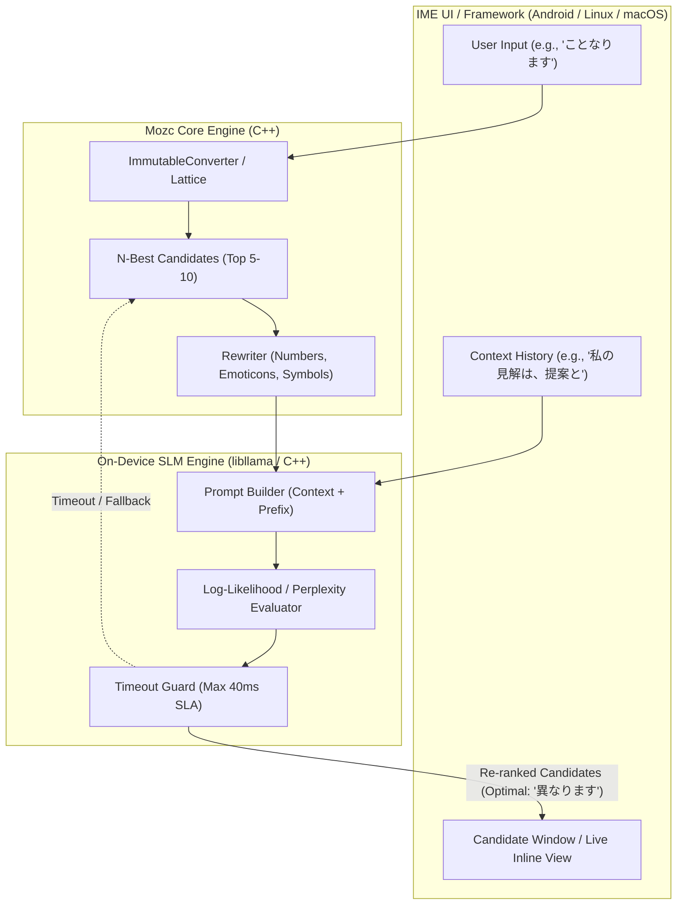
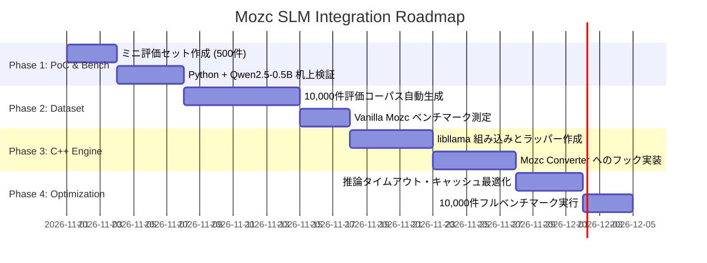

# Mozc On-Device SLM/LLM Integration & Evaluation Plan

## 1. Executive Summary & Problem Statement

### 1.1 背景と課題
従来の Mozc（Google日本語入力のオープンソース版）は、MeCab由来の形態素解析辞書、2-gram（前後形態素）連接コスト（CRF）、およびビタビ探索（動的計画法）をベースに構築されています。この設計は省メモリ・超高速（< 5ms）という優れた特性を持つ一方、以下のような構造的限界を抱えています：

1. **局所解への収束（文脈・文節境界問題）**:
   - 例: 「ことなります」に対して「異なります」が最上位に出ず、「ことなり」単体だと「異なり」が出る。
   - 原因: 2-gram連接コストの学習バイアスや、文節全体としての生起コスト計算において、局所的な最適解（平仮名維持や誤った区切り）が優先されてしまう。
2. **長距離文脈・意味理解の欠如**:
   - 直前・直後の確定文字列に応じた同音異義語の使い分け（「移動」「異動」、「貴社」「記者」等）が、単語連接確率の範囲内でしか行えない。

### 1.2 目的
本計画では、Mozcの高速な候補生成力（Viterbi Lattice）を維持しつつ、オンデバイスで動作する超軽量言語モデル（SLM: Small Language Model）を統合することで、**「打鍵感を一切損なわない超低レイテンシ」**と**「文脈を理解した高精度なかな漢字変換」**を両立するハイブリッド・アーキテクチャを確立します。

---

## 2. システムアーキテクチャ設計

### 2.1 ハイブリッド・リランキング構成 (採用設計)

完全な自己回帰生成（End-to-End LLM）は、モバイル/デスクトップIMEにおいてレイテンシ（>100ms）とハルシネーション（辞書外の文字欠落・誤字）のリスクがあります。そのため、**MozcのN-best候補生成 ＋ SLMによる文脈スコアリング（リランキング）**を採用します。



### 2.2 リランキングアルゴリズムの詳細
SLMは「新しいテキストの生成」を行うのではなく、**直前の文脈 $C$ が与えられた条件下で、各候補 $W_i$ が出現する条件付き対数尤度（Conditional Log-Likelihood）** をスコアリングします。

$$\text{Score}(W_i) = \alpha \cdot \text{Cost}_{\text{Mozc}}(W_i) + (1 - \alpha) \cdot \left( - \frac{1}{|W_i|} \sum_{t=1}^{|W_i|} \log P(w_{i,t} \mid C, w_{i,<t}) \right)$$

* $C$: 直前に入力・確定された文脈文字列（直近 64〜128 トークン）
* $W_i$: Mozcが生成した第 $i$ 候補文字列（例: `異なります` vs `ことなります` vs `事成ります`）
* $\text{Cost}_{\text{Mozc}}$: Mozcが算出したViterbiコスト（正規化値）
* $\alpha$: Mozcの辞書信頼度とSLMの文脈推論重みを制御するハイパーパラメータ（初期値: 0.3〜0.5）

---

## 3. オンデバイスSLM候補とランタイム

### 3.1 モデル選定マトリクス

| モデル | パラメータ | 量子化形式 | メモリ占有 | CPU推論速度 (Batch 1) | 特徴・評価 |
| :--- | :--- | :--- | :--- | :--- | :--- |
| **Qwen2.5-0.5B** *(最有力)* | 4.9億 | GGUF Q4_K_M | **約 350 MB** | **約 15〜25 ms** | 日本語の語彙力・文法理解がサイズ比で突出。モバイルでも常駐可能。 |
| **Qwen2.5-1.5B** | 15.4億 | GGUF Q4_K_M | **約 1.1 GB** | **約 45〜70 ms** | 複雑な敬語・長文脈の精度が非常に高い。PC・ハイエンド端末向け。 |
| **Llama-3.2-1B** | 12.3億 | GGUF Q4_K_M | **約 800 MB** | **約 35〜50 ms** | 各プラットフォームのNPU（Snapdragon NPU等）での実行親和性が高い。 |
| **Zenzai型 特化Transformer** | 5000万〜1億 | FP16 / INT8 | **約 50〜100 MB** | **< 10 ms** | かな漢字変換リランキング専用に小型学習されたBERT/RoBERTa系。超省電力。 |

### 3.2 推論ランタイム
* **`llama.cpp` (`libllama.a` / `libllama.so`)**:
  * Mozc（C++）のコードベースに最もクリーンに静的/動的リンク可能。
  * ARM NEON、x86 AVX2、Vulkan、Metalを自動サポートし、追加の外部ランタイムなしで単一バイナリ化が可能。

---

## 4. Mozcコードベースへのインテグレーションポイント

Mozcの変換パイプラインにおける具体的なフック位置を定義します。

```
src/
 ├─ converter/
 │   ├─ converter.cc           # 変換制御の最上位クラス
 │   ├─ immutable_converter.cc # ビタビ探索によるラティス構築・N-best生成
 │   └─ slm_reranker.cc/h      # 【新規追加】SLMリランキングモジュール
 └─ rewriter/
     ├─ rewriter_interface.h   # 既存の候補書き換えインターフェース
     └─ dictionary_rewriter.cc # 単語登録等の後処理
```

1. **フック位置**:
   - `converter/immutable_converter.cc` でビタビ探索が完了し、`Segment` に複数の候補（`Candidate`）が格納された直後、または `rewriter/` パイプラインの最終段。
2. **タイムアウト＆フォールバック保護**:
   - 推論タイマー（40ms）を設け、万が一CPU高負荷やメモリ競合で推論が遅延した場合は、SLMの推論を即時中断し、従来のMozc辞書順位をそのままUIに返却（ゼロフリーズ保証）。
3. **KVキャッシュの再利用**:
   - 直前文脈 $C$ のKVキャッシュを保持し、候補 $W_i$ の評価時に入力トークンのプレフィックス再計算をスキップ。

---

## 5. 1万件規模の評価データセット仕様とベンチマーク設計

### 5.1 データセット仕様 (10,000件 JSONL)

| カテゴリ | 割合 | 件数 | 構成例 |
| :--- | :--- | :--- | :--- |
| **日常会話・口語** | 35% | 3,500 | チャット、くだけた口調、動詞・助動詞活用（「〜ことになります」等） |
| **ビジネス・実務** | 30% | 3,000 | 敬語、同音異義語（「貴社/記者」「ご教示/ご教授」「移動/異動」等） |
| **技術・専門・Web** | 20% | 2,000 | カタカナ用語、英略語混じり文、複合名詞 |
| **難問・同音異義語特化** | 15% | 1,500 | 文脈がなければ絶対に解けない対立ペア（各ペア2〜3文） |

### 5.2 データ調達パイプライン
1. **確実な読み付きオープンコーパスの抽出**:
   - **KWDLC** (京都大学ウェブ文書リードコーパス): 人手で形態素・読みが付与された高品質データ。
   - **Tatoeba Project**: ふりがな付き日本語口語文。
2. **同音異義語・難問の合成生成**:
   - LLMを用いて「特定の読み（例: きしゃ）に対して異なる表記（貴社/記者/汽車）を持つ文脈対照文」をプロンプト生成し、フィルタリング。
3. **データフォーマット**:
   ```json
   {
     "id": "eval_00123",
     "domain": "dialogue",
     "context_prev": "私の直感と挙動が",
     "input_yomi": "ことなります",
     "ground_truth": "異なります",
     "granularity": "bunsetsu",
     "difficulty": "conjugation_boundary"
   }
   ```

### 5.3 定量評価指標 (KPI)
1. **Top-1 正解率 (Exact Match)**: 1回目の変換で正解が出る確率（最重要）。
2. **MRR (Mean Reciprocal Rank)**: 正解候補の表示順位の逆数平均。
3. **Win / Tie / Loss 比 (vs Vanilla Mozc)**:
   - **Win**: 既存Mozcが不正解で、SLMが正解した件数。
   - **Loss**: 既存Mozcが正解だったのに、SLMが順位を下げてしまった件数（退行検出）。
   - **合否基準**: $\text{Loss} / \text{Win} < 5\%$（リグレッションを極小化）。
4. **Latency SLA**: P90 < 40ms, P99 < 80ms。

---

## 6. 段階的実装ロードマップ



### 次のアクション
1. **小規模プロトタイプ検証**:
   - Python環境にて「ことなります」および代表的誤変換例（20件）を対象に、Qwen2.5-0.5Bを用いたPerplexityスコアリングによる順位逆転実験を実施する。
2. **KWDLC / Tatoeba からの初期データ抽出スクリプト作成**。
