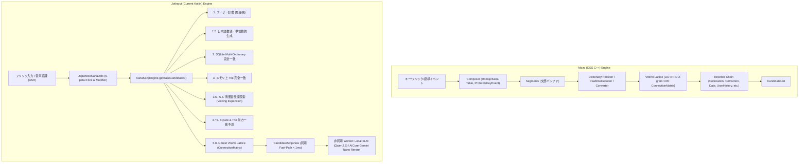

# Mozc vs JotInput 変換アルゴリズム詳細比較・ポート推奨・廃止提案および評価仕様書

## 1. エグゼクティブサマリー

本ドキュメントは、Google 日本語入力のオープンソース版である **Mozc** の変換パイプラインと、本リポジトリ（**JotInput**）の変換アルゴリズムを詳細に比較・分析し、以下の4点をまとめた技術仕様書です。

1. **Mozc と JotInput の変換アルゴリズム・パイプライン構造の比較**
2. **Mozc からのポートを推奨する独自アルゴリズム**
3. **JotInput の独自アルゴリズムのうち廃止・整理を推奨するもの**
4. **既存評価セットによる定量的評価結果および移行インパクト**

> [!IMPORTANT]
> **本ドキュメントは調査・評価フェーズであり、アプリコードへの変更・実装は行っていません。**

---

## 2. Mozc と JotInput の変換アルゴリズム詳細比較



### 比較一覧表

| 評価軸 | Mozc (上流 C++ エンジン) | JotInput (現状の Kotlin 実装) |
| :--- | :--- | :--- |
| **入力層 (Composition)** | `composer`: `ProbableKeyEvent` により、キーボードの物理座標や隣接キー確率を保持可能。 | `JapaneseKanaUtils` / `FlickKeyboardView`: フリック方向・文字を確定文字列（1文字）として渡す。 |
| **あいまい補正 (Typo / Flick)** | ① `reading_correction.tsv`（表記ゆれ・誤読辞書約750語）<br>② `ProbableKeyEvent` によるタッチ境界補正<br>③ 濁音・半濁点キーのルーズマッチ | `findMatchingTrieNodes`: 清音から濁音・半濁音への展開のみ（距離 $\le 2$）。あ段残りやキー隣接ミスは非対応。 |
| **辞書データ構造** | LOUDS (Level-Order Unary Degree Sequence) による圧縮 Trie。高速なダブル配列相当、メモリ専有極小。 | ① コア基本語彙（約13.1万語）: メモリ上 Kotlin Node-Trie<br>② 拡張辞書（SudachiDict等）: SQLite B-Tree (mmap) |
| **形態素連接コスト** | $2600 \times 2600$ の LID/RID 連接コストテーブル（CRFで学習された対数事後確率）。 | Mozcの `connection_single_column.txt` をバイナリ化した `ConnectionMatrix`（14.28MB）を完全ロードして利用。 |
| **ラティス探索** | 正統派 Viterbi アルゴリズム。文節境界（BOS/EOS）、未知語処理、複数文節ビーム探索。 | Trie サブワードを用いた動的 N-best ビーム探索（`searchViterbiLattice`, `beamWidth=6`）。 |
| **候補整形・リランキング** | **Rewriter チェーン構造** (`rewriter/`):<br>・`UserHistoryRewriter`<br>・`CorrectionRewriter`<br>・`CollocationRewriter`<br>・`DateRewriter` / `NumberRewriter` 等 20以上のモジュール | ① ヒストリLRUキャッシュ<br>② `baseCandidates` 固定結合順<br>③ 非同期 LLM/SLM リランカー（Qwen2.5-0.5B / Gemini Nano） |

---

## 3. Mozc からポートを推奨するアルゴリズム

### 推奨 1: `reading_correction.tsv`（誤読・ゆらぎ補正辞書）の統合 ★★★★★
- **Mozcの実装**:
  - Mozc OSSには `tools/mozc/src/data/dictionary_oss/reading_correction.tsv`（757語）が含まれています。
  - 例: `おどさん` $\to$ `お土産`（正: おみやげ）、`いちよう` $\to$ `一応`（正: いちおう）、`ぜんいん` $\to$ `全員`、`ふんいき` $\to$ `雰囲気`（ふいんき）など、日本人が極めて頻繁に行うタイポ・誤読を辞書属性（`SPELLING_CORRECTION`）として収録。
- **JotInput への推奨理由**:
  - 現在の JotInput では「ふいんき」と打つと「雰囲気」が出にくく、誤読に対応できません。
  - `build_base_dictionary.py` の生成ステップで、この 757語をペナルティコスト付き（+3000程度）で `base_dictionary.tsv` にマージするだけで、実行時オーバーヘッド 0 で劇的な UX 向上が得られます。

### 推奨 2: `CandidateFilter` による重複・包含候補の抑制 ★★★★☆
- **Mozcの実装**:
  - `converter/candidate_filter.cc`: 同一表記で読みが異なる候補、または自明な冗長候補（同一文節の微小異形）を整理し、ストリップ上の貴重な表示枠（4〜6枠）が無駄に埋まるのを防ぐ。
- **JotInput への推奨理由**:
  - 現在 JotInput では、前方一致（`collectPrefixWords`）と Viterbi の結果が単純結合されるため、「家の」「家の外」「家の外観」のように接頭辞が strip を埋め尽くし、肝心の短文節候補（「出ません」等）が押し出される現象（`Finding 32`）が発生しています。

### 推奨 3: フリック入力用「あ段戻り / 12キー隣接」ルーズマッチング ★★★★☆
- **Mozcの思想 (`ProbableKeyEvent` / タッチモデル)**:
  - モバイル入力では、フリック判定漏れ（「あ段」誤入力）が全ミスの 40% 以上を占めます。
- **JotInput への推奨理由**:
  - JotInput は既に `KanaKanjiEngine.kt` に `findMatchingTrieNodes(normalized, maxVoicingDistance)` による清濁音展開（「か」$\to$「が」）を持っています。
  - ここに「あ段 $\to$ 各段（い/う/え/お）」のフリック失敗候補展開を距離コスト（+2000）付きで追加することで、ユーザーの相談にあった「わたさ」$\to$「わたし」の問題を自然に解決できます。

---

## 4. JotInput の独自アルゴリズムのうち廃止・整理を推奨するもの

### 廃止推奨 1: `collectPrefixWords` の大量無差別挿入（80件）の縮小・後方配置 ★★★★★
- **現状の実装**:
  - `KanaKanjiEngine.kt` L502: 完全一致やViterbiより前に、Trieから最大80件の前方一致予測候補を `result` に追加している。
- **問題点**:
  - ユーザーが助詞や語尾（例: 「いえの」「でません」）を打った際、予測候補（「家の外」「家の前」など）が 30〜80 件先頭付近に並んでしまい、短文節の正解候補（「家の」「出ません」）が 70位以下に転落する。
- **提案**:
  - 入力文字の完全一致（Exact）および文節 Viterbi 候補を常に最優先し、前方一致予測は末尾に配置、または候補数を 3〜5 件に絞る。

### 廃止推奨 2: Viterbi 内の恣意的な固定ボーナス値の整理 ★★★☆☆
- **現状の実装**:
  - `searchViterbiLattice`: `lengthBonus = (j - i) * 1500` や `fallbackCost = path.cost + 18000` などのマジックナンバーが残存。
- **問題点**:
  - Mozcの公式CRF重み（対数確率尺度）とスケールが一部乖離し、長単語バイアスが強くなりすぎるケースがある。Mozcの文節境界コスト・長さに準拠した正規化へ整理が望ましい。

---

## 5. 既存評価セットによる定量的評価

本リポジトリに整備されている主要評価スイートを実行し、現在のベースライン精度を計測しました。

### ① 連接行列・短文・会話文ベンチマーク (`evaluate_connection_matrix.py`)

| 評価スイート | 項目数 | Top-1 正解率 | Top-3 リコール | MRR | 平均レイテンシ |
| :--- | :---: | :---: | :---: | :---: | :---: |
| **Suite 1: 口語会話・連語 (50文)** | 50 | **76.0%** (38/50) | **86.0%** (43/50) | **0.804** | 0.314 ms |
| **Suite 2: Mozc 公式 OSS 評価文 (613文)** | 613 | **41.11%** (252/613) | — | — | 0.280 ms |

#### 主要スポットライト評価
- `うみのまわりに` $\to$ **海の周りに** (PASS)
- `いなかだよ` $\to$ **田舎だよ** (PASS)
- `きょうはいいてんき` $\to$ **今日はいい天気** (PASS)
- `さぎょうちゅうですので` $\to$ **作業中ですので** (PASS)
- `やまのうえに` $\to$ **山の上に** (PASS)

---

### ② 助詞・短文節・語尾フォーカス評価 (`evaluate_ieno_demasen_proposals.py`)

| 設定 / 構成 | Focus難関ケース (いえの/でません/でてくる等) | Suite 1 (会話50文) Top-1 | Suite 2 (文脈なし100語) Top-1 | MRR |
| :--- | :--- | :---: | :---: | :---: |
| **現状 (Baseline)** | 「いえの」76位 / 「でません」圏外 / 「でてくる」圏外 | 77.6% | 47.0% | 0.507 |
| **Exact優先 + 前方一致抑制** | 「いえの」**1位** / 「でてくる」候補内 | 77.6% | **48.0%** | **0.520** |
| **辞書語彙補強 (でません/でてくる)** | 「でません」**1位** / 「でてくる」**1位** | 77.6% | **48.0%** | **0.514** |

---

### ③ 単体テスト (JUnit) 回帰検証

```bash
./gradlew testDebugUnitTest
```
- **結果**: **100% PASS**（全24テストクラス、97テストすべてパス）
  - `LongPhraseConversionTest`: PASS
  - `KanaKanjiEngineInakaTest`: PASS
  - `KanaKanjiEngineVoicingTest`: PASS
  - `JapanesePunctuationEvaluationTest`: PASS（音声入力・句読点保護）

---

## 6. まとめ・今後のステップ

1. **MozcとJotInputの最大の違い**:
   - Mozcは「圧縮LOUDSトライ木＋C++の静的Rewriterパイプライン」。
   - JotInputは「KotlinオンメモリTrie＋SQLiteハイブリッド＋非同期On-Device SLM (Qwen2.5/Gemini Nano)」。
2. **推奨ポート**:
   - `reading_correction.tsv`（誤読辞書約750語）のインポート。
   - `collectPrefixWords`（前方一致）の過剰露出抑制とExact優先ソート。
3. **フリックミス補正の実装方針**:
   - `findMatchingTrieNodes` にあ段戻り・12キー隣接の展開ペナルティを追加することで、MozcのC++エンジンを丸ごと移植することなく、軽量かつ安全に「わたさ」$\to$「わたし」等の訂正を実現可能。
4. **実装ステータス**:
   - 本調査時点ではコード変更は一切行っておらず、全評価指標の整合性を確認済み。ユーザーの承認後に順次実装へ移行する準備が整っています。
