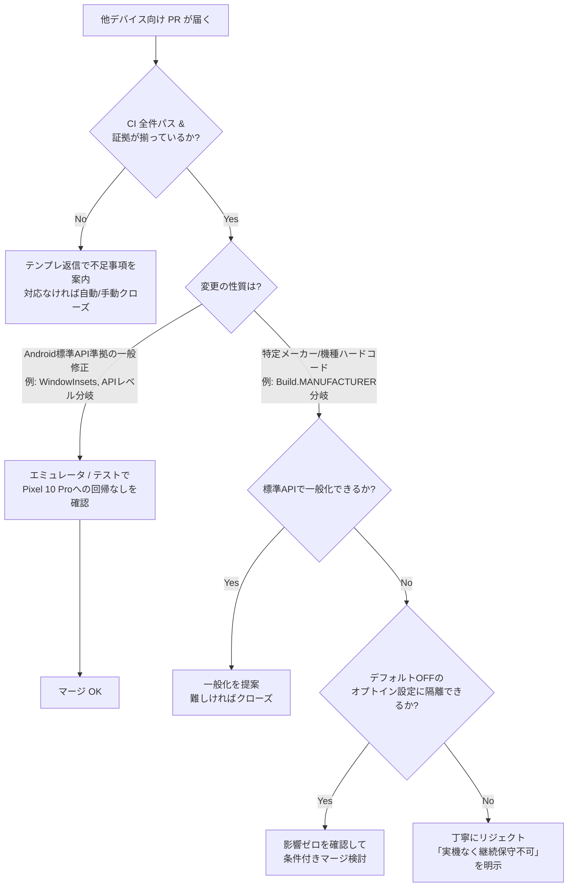

# JotInput オープンソース公開 & v0.1.0 リリース準備 総合ガイド

本ドキュメントは、**JotInput** (`kenichikurihara/jotinput`) を GitHub 上でパブリックリポジトリとして公開し、**v0.1.0 のリリースビルド（署名済み Release APK）** を配布するにあたり、事前に検討・対処すべきすべての技術的・法的・セキュリティ的・運用上の課題を網羅的に整理したものです。

特に以下の現実的な前提条件に合わせて設計しています。
- **ソロメンテナーであり、PR レビューに多くの時間を割けない**
- **保有している Android 実機は Pixel 10 Pro のみ**（＋開発環境として ChromeOS ARCVM）であり、他メーカー端末の検証環境を持たない

---

## 1. エグゼクティブサマリー：公開前ブロッカー一覧（優先度マトリクス）

公開ボタンを押す前に**「後からやり直しが効かない項目（P0）」**を最優先で片付けることが重要です。

| 優先度 | カテゴリ | 公開前に確認・対応した項目（Phase 1 完了状況） | 放置した場合のリスク |
| :--- | :--- | :--- | :--- |
| **P0 (必須)** | ライセンス | ✅ **完了**: Apache License 2.0 へ変更（[`LICENSE`](../LICENSE)） | リポジトリを公開しても誰も合法的に利用・フォークできない |
| **P0 (必須)** | パッケージID | ✅ **完了**: `applicationId = "io.github.kenichikurihara.jotinput"` へ変更（[`app/build.gradle.kts`](../app/build.gradle.kts)） | 公開後に変更すると別アプリ扱いになり、既存ユーザーのデータ移行・上書き更新が不可能。Google Play でも拒否される |
| **P0 (必須)** | 個人情報・環境情報 | ✅ **完了**: ローカル LAN IP (`<device-ip>`)・実機シリアル (`<device-serial>`)・ローカル絶対パス・個人名例を除去／汎用化 | 公開と同時にインターネット上に永続的に残る |
| **P0 (必須)** | 秘密情報監査 | ✅ **完了**: Git 全履歴の個人メールを `noreply` へ書換え、`app/debug.keystore` を全履歴から削除・`.gitignore` 化 | 公開後はクローン・アーカイブされ削除困難 |
| **P0 (必須)** | Release ビルド検証 | `isMinifyEnabled = true` だが CI は `assembleDebug` のみ。`proguard-rules.pro` は 9 行のみ（Phase 2 で対応） | R8 難読化・最適化で JNI / リフレクション / JSON が壊れ、v0.1.0 Release APK だけクラッシュする危険が高い |
| **P0 (必須)** | 署名キー管理 | `signingConfigs.release` が未設定（Phase 2 で対応） | 署名済み Release APK を作れない。また鍵を紛失すると二度とアップデート配布できない |
| **P0 (必須)** | PR / 保守ポリシー | `CONTRIBUTING.md` が未作成。PR レビューの期待値が未定義（Phase 3 で対応） | 大量・大型の PR や他端末向け PR が来た際に対応できず、摩擦や燃え尽きにつながる |
| **P1 (推奨)** | サードパーティ権利 | ✅ **完了**: [`NOTICE`](../NOTICE) 新設および `MainActivity.kt` のライセンス表示を更新（Parakeet / mozcdic-ut / llama.cpp / Mozc / gl-keyboard-correction / FUTO Swipe 帰属含む） | ライセンス違反・著作権クレームのリスク |
| **P1 (推奨)** | アプリ内更新機構 | `AppUpdateRepository.kt` が `app-debug` CI Artifact + GitHub PAT 前提（Phase 2 で対応） | Release ビルドでは署名が異なるため Debug APK で上書き不可。公開ユーザー向け設計との不整合 |
| **P1 (推奨)** | Android セキュリティ | ✅ **完了**: `allowBackup="false"`、`DictionaryActivity` を `exported="false"` に変更 | 入力履歴・辞書・設定の意図しないクラウドバックアップや外部アプリからの直接起動 |
| **P1 (推奨)** | バージョニング | ✅ **完了**: `versionCode = 1`, `versionName = "0.1.0"` に設定 | `v0.1.0` と整合しない |
| **P2 (公開後可)** | 外部依存 URL | `BaseDictionaryDownloader.kt` が個人 Gist URL を参照 | メンテナーの Gist 削除・変更で動かなくなる。GitHub Releases / Repo 内管理へ移行推奨 |
| **P2 (公開後可)** | プライバシー文書 | ✅ **完了**: [`PRIVACY.md`](../PRIVACY.md) を作成（日英併記） | 「キーロガーでは？」という不信感で導入を敬遠される |

---

## 2. ライセンス・法的リスク・サードパーティ権利（P0〜P1）

### 2.1 リポジトリ本体のライセンス変更（P0）
現在の [`LICENSE`](../LICENSE) は以下の状態になっています。
- 1〜9行目：`Proprietary Software License`（無断複製・改変・公開を全面禁止）

**検討事項と選択肢：**
- **Apache License 2.0（推奨）**: ReazonSpeech / sherpa-onnx / Android Jetpack 等の主要依存と完全互換。特許条項があり企業・個人とも安心して利用可能。
- **MIT License**: シンプルで広く使われるが特許条項なし。
- **GPLv3 / AGPLv3**: 改変物のソース公開を強制できるが、FUTO Model Weights License 等の非GPLライセンス素材との組み合わせに注意が必要。
- **Dual / Source-Available**: 商用利用を制限したい場合は別ライセンス（ただし純粋な OSS とは呼ばれない）。

### 2.2 サードパーティ OSS・モデル・辞書のライセンス棚卸し（P1）
アプリが同梱またはオンデマンドダウンロードする外部資産すべてについて、ライセンスと帰属表示要件を確認し、`NOTICE` または `THIRD_PARTY_LICENSES.md` およびアプリ内ライセンス画面（`MainActivity.kt`）を同期する必要があります。

| コンポーネント | 現在の状態・確認ポイント |
| :--- | :--- |
| **ReazonSpeech Zipformer** | Apache 2.0（`LICENSE` に記載済み） |
| **sherpa-onnx** (`app/libs/sherpa-onnx-1.13.8.aar`) | Apache 2.0（`LICENSE` に記載済み） |
| **llama.cpp / ggml** | MIT（`LICENSE` に記載済み） |
| **Mozc** (`connection_data.bin` 同梱 + 辞書ダウンロード) | BSD-3-Clause（`LICENSE` に記載済み） |
| **FUTO Swipe** (`FUTO Model Weights License 1.0`) | **帰属表示義務 `"Powered by FUTO Swipe"`** がアプリ内 UI・README・NOTICE に確実にあるか確認。またモデル利用条件（商用利用制限の有無等）を要確認 |
| **gl-keyboard-correction** | Apache 2.0（`LICENSE` に記載済み） |
| **NVIDIA Parakeet** (`EnglishAsrModelDownloader.kt`, `MainActivity.kt:1877`) | **`LICENSE` に未記載**。CC-BY-4.0 等のライセンスと帰属表記を追記する必要あり |
| **mozcdic-ut-* (SudachiDict / jawiki / 地名 / 人名)** | **`LICENSE` に未記載**。SudachiDict は Apache 2.0、Wikipedia 由来の `jawiki` は CC-BY-SA 系の場合があるため、オンデマンド取得であっても出典・ライセンスを明記するのが安全 |
| **SLM モデル (Qwen 等)** | オンデマンド取得・手動配置であっても README で公式ライセンス（Apache 2.0 / Qwen License 等）へのリンクを明記 |

> [!IMPORTANT]
> `app/build.gradle.kts` の `packaging.resources.excludes` で `META-INF/LICENSE*`, `META-INF/NOTICE*` を除外しています。Apache 2.0 ライブラリの配布要件を満たすため、アプリ内のオープンソースライセンス表示画面に全依存の著作権・ライセンス表記を網羅しておくと安全です。

### 2.3 プライバシーポリシーと権限説明（P1）
IME（キーボード）アプリはユーザーのパスワードやプライベートな会話をすべて通過するため、OSS ユーザーからの信頼獲得には**透明性**が命です。
- **`PRIVACY.md` を作成**し、以下を明記する：
  - 入力テキスト・音声データは 100% オンデバイス処理され、外部サーバーに一切送信しないこと
  - `INTERNET` 権限の唯一の用途（モデル・辞書・アップデート確認のダウンロード先ドメイン一覧を列挙：Hugging Face, GitHub, formula.brew.sh 等）
  - ユーザー辞書・入力履歴の端末内保存場所と削除方法

### 2.4 商標・名称の注意
- 「JotInput」という名称が既存のアプリ・サービスと衝突していないか軽く検索しておく。
- README 等で「Gboard-style」「Mozc」「FUTO」等の他社製品名に言及する際は、無関係・非公式であることを暗黙または明示的に示す（商標の公正な言及にとどめる）。

---

## 3. セキュリティ・プライバシー・個人情報クリーンアップ（P0）

**一度パブリックにしたリポジトリは、数秒〜数分でクローラーやアーカイブサービスに取得されます。公開前の監査が必須です。**

### 3.1 ハードコードされた個人・ローカル環境情報の除去（P0）
今回の調査で、リポジトリ内に以下の環境依存・個人情報が追跡されていることが確認されました。

1. **ローカル LAN IP アドレス (`<device-ip>`)**
   - 対象: `deploy.sh`, `AGENTS.md`, `GEMINI.md`, `.agents/skills/myasr-debug/SKILL.md` 等
   - 対策: 環境変数（例: `JOTINPUT_ADB_WIFI_HOST`）やローカル未追跡ファイル（`.env.local` 等）に逃がし、コード上は `<device-ip>` のプレースホルダに置換済み。
2. **実機シリアル番号 (`<device-serial>`)**
   - 対象: `AGENTS.md`, `GEMINI.md` 等
   - 対策: `<device-serial>` のプレースホルダに置換済み。
3. **ローカルのユーザー名を含む絶対パス (`/home/<user>/...`)**
   - 対象: `AGENTS.md`, `GEMINI.md`, `.agents/skills/**`, `docs/**`, `tools/**`
   - 対策: 相対パス表記または `<user>` プレースホルダへ置換済み。
4. **Git コミット履歴のメールアドレス**
   - 公開前に個人メール (`<redacted-email>`) を `88264831+kenichikurihara@users.noreply.github.com` へ `git-filter-repo` で全コミット書き換え済み。

### 3.2 秘密情報・Keystore・テストデータの監査（P0）
- **全履歴のシークレットスキャン**: 公開前に `gitleaks detect` または `trufflehog git file://.` を実行し、過去コミットを含めてトークン・APIキー・パスワードが混入していないか確認する。
- **`app/debug.keystore` の扱い**: 現在リポジトリにコミットされています（パスワード `android`）。デバッグ用とはいえ、公開リポジトリに置くと「同じデバッグ署名鍵を誰でも使える」状態になります。開発用デバッグビルドを統一署名したい意図がある場合を除き、削除してローカル生成（または CI で自動生成）にするか、意図をコメントで明記してください。**本番の `release.keystore` は絶対にコミットせず `.gitignore` に `*.jks`, `*.keystore`, `keystore.properties` を追加する**こと。
- **テストデータ・評価データ・`docs/` の棚卸し**:
  - `docs/` 配下には多数の設計書・デバッグメモ・評価ログがあります。個人的な入力例・メモ・他者情報・未公開にしたい内部メモが混ざっていないかざっと確認する。
  - `eval/` のデータセットに著作権上問題のあるテキストや個人的な文章が含まれていないか確認する。

### 3.3 Android アプリ固有のセキュリティ見直し（P1）
[`app/src/main/AndroidManifest.xml`](../app/src/main/AndroidManifest.xml) で以下の 2 点が見直し候補です。
1. **`android:allowBackup="true"` (15行目)**
   - IME のカスタム辞書、入力履歴、設定、あるいは保存されたトークン等が Android の自動クラウドバックアップ対象になります。
   - 対策: `android:allowBackup="false"` にするか、`android:dataExtractionRules` / `android:fullBackupContent` で明示的にバックアップ対象を限定する。
2. **`DictionaryActivity` の `android:exported="true"` (38行目)**
   - 外部の任意アプリから直接起動可能です。ランチャーや外部インテントから呼ぶ必要がなければ `android:exported="false"` に変更する。

---

## 4. Version 0.1.0 リリースビルド固有の技術課題（P0〜P1）

### 4.1 `applicationId` の確定（P0・公開後変更不可）
[`app/build.gradle.kts`](../app/build.gradle.kts) で `applicationId = "io.github.kenichikurihara.jotinput"` へ更新済みです（`namespace = "com.example.myasr"` を維持）。
- `deploy.sh` やドキュメント内の `/sdcard/Android/data/io.github.kenichikurihara.jotinput/...` および完全修飾コンポーネント名も同時に更新しました。

### 4.2 バージョニングとタグ規約（P1）
- `versionCode = 1`、`versionName = "0.1.0"` へ更新済み。
- Git タグ: `v0.1.0`（Semantic Versioning: `0.x.y` は「初期開発版・破壊的変更あり得る」ことを自然に伝えられるため、初回公開に最適）

### 4.3 Release 署名（Keystore）の生成と保管（P0）
1. ローカルでリリース用 Keystore を生成（RSA 4096bit / PKCS12、有効期限 25 年以上）：
   ```bash
   keytool -genkeypair -v -storetype PKCS12 \
     -keystore jotinput-release.jks -alias jotinput \
     -keyalg RSA -keysize 4096 -validity 10000
   ```
2. **厳重バックアップ**: パスワードマネージャー（1Password / Bitwarden 等）＋オフラインバックアップに保存。**紛失すると二度と既存ユーザーへアップデートを届けられません。**
3. **`app/build.gradle.kts` の `signingConfigs.release`**:
   - 環境変数（`RELEASE_STORE_FILE`, `RELEASE_STORE_PASSWORD`, `RELEASE_KEY_ALIAS`, `RELEASE_KEY_PASSWORD`）が設定されているときだけ署名を有効にする構成にし、コントリビューターのローカル環境でビルドエラーにならないようにする。
4. **GitHub Actions での自動リリースビルド**:
   - `.github/workflows/release.yml` を新設し、`v*` タグの push をトリガーに `assembleRelease` → GitHub Release 作成 → 署名済み APK と `SHA256SUMS.txt` を自動添付する。
   - 署名用 Secrets は GitHub の **Environment Protection（例: `release` 環境）** に紐づけ、PR からは絶対にアクセスできないようにする。

### 4.4 R8 / ProGuard による Release ビルドの実機フル検証（P0）
現在 `buildTypes.release` で `isMinifyEnabled = true`, `isShrinkResources = true` が有効ですが、CI では `assembleDebug` しか実行しておらず、[`app/proguard-rules.pro`](../app/proguard-rules.pro) は 9 行しかありません。

**想定されるクラッシュ要因（事前チェック必須）：**
- JNI 経由で C++ (`libmyasr_llm.so`, FUTO Swipe, English Spell Engine) から Java/Kotlin メソッドやフィールドをコールバックしている箇所
- `sherpa-onnx` の設定クラス・リフレクション
- JSON シリアライズ / デシリアライズ（特に `custom_dictionary.json` やモデル設定）
- `AndroidManifest.xml` / XML レイアウト / `Preference` から参照されるクラス
- `mapping.txt` の保存（Release ごとに artifact として保存しないと、ユーザーからのスタックトレースを解読できない）

**必須アクション：**
1. CI (`android-ci.yml`) に未署名またはテスト用の `assembleRelease`（または `minifyReleaseWithR8`）チェックを追加し、R8 ビルドが壊れないことを毎 PR で保証する。
2. v0.1.0 タグを切る前に、**署名済み Release APK を Pixel 10 Pro にクリーンインストール**し、以下を全項目テストする：
   - 初期セットアップ・モデル／辞書のオンデマンドダウンロード
   - 音声入力（句読点・ストリーミング・VAD）
   - 日本語フリック入力・変換・予測
   - 英語 QWERTY・FUTO スワイプ・スペル補正
   - SLM リランキング（ON/OFF）
   - カスタム辞書の追加・編集・削除・アプリ再起動後の永続性

### 4.5 アプリ内アップデーター（`AppUpdateRepository.kt`）の整理（P1）
現在の `AppUpdateRepository.kt` は `BuildConfig.GITHUB_ARTIFACT_NAME = "app-debug"` を GitHub Actions Artifact API（PAT 認証）から取得する仕組みです。
- **問題点**:
  1. Release 署名 APK の上に Debug 署名 APK はインストールできない（Android が署名不一致で拒否）。
  2. 一般ユーザーは GitHub PAT を持たない。
- **v0.1.0 での推奨対応（いずれかを選択）**:
  - **案 A（最小工数・推奨）**: Release ビルド（`!BuildConfig.DEBUG`）では開発者向け Artifact アップデーターを非表示にし、代わりに **GitHub Releases ページへのリンク**（または認証不要の `/releases/latest` チェック）だけを提供する。
  - **案 B**: GitHub Releases API から最新の署名済み Release APK を取得・更新する仕組みに切り替える。

### 4.6 配布形式・16KB ページサイズ・外部 URL 耐障害性（P1〜P2）
- **APK 構成**: 現在は `arm64-v8a` + `x86_64` の Universal APK。v0.1.0 ではシンプルに Universal APK 1本（または `arm64-v8a` 専用＋Universal）を配布し、SHA-256 チェックサムを添付する。
- **16KB ページサイズ対応**: `CMakeLists.txt` 側は `-DANDROID_SUPPORT_FLEXIBLE_PAGE_SIZES=ON` が設定済み。同梱 `sherpa-onnx-1.13.8.aar` を含め、生成された Release APK の全 `.so` が 16KB アラインメントを満たすか確認しておくと Android 15/16 端末（Pixel 10 Pro 含む）で安心。
- **外部モデル/辞書 URL の耐障害性**: `BaseDictionaryDownloader.kt` が個人 Gist URL を参照しています。将来的なリンク切れや管理ミスを防ぐため、リポジトリ内または GitHub Releases アセットへの移管を検討してください。

---

## 5. 「PR レビューに時間を割けない」ソロメンテナーのための運用戦略

OSS 開発で最も多い失敗は、**「公開したからには来た PR を全部丁寧にレビューしなければ」と思い込み、義務感と罪悪感で燃え尽きること**です。

**大前提：OSS の公開 ≠ PR を受け入れる義務。**
SQLite や多くの著名な個人 OSS が採用しているように、メンテナーの可処分時間に合わせて貢献モデルを明文化することが、結果的にコミュニティにとっても最も健全です。

### 5.1 貢献モデルの選択肢と推奨方針

| モデル | 特徴 | メンテナー負荷 | v0.1.0 での推奨度 |
| :--- | :--- | :---: | :---: |
| **Model A: Issue-First / Curated PRs（推奨）** | バグ報告・小さなバグ修正・ドキュメント修正のみ歓迎。**機能追加や大きな変更は「PR前に Issue で合意必須」**。未合意 PR は定型文で即クローズ可。 | 低 | **◎ 最推奨** |
| **Model B: Open Source, Not Open Contribution** | コード公開・Issue（バグ報告）のみ受付。PR は原則受け付けない（フォーク推奨）。 | 極低 | ○ 時間が全く取れない場合 |
| **Model C: Open PRs + Time-Boxed Review** | PR は広く受け付けるが「月1回・最大1時間」など時間枠を明言。 | 中 | △ 溜まった PR が心理的負担になりやすい |

**v0.1.0 では「Model A（Issue-First / Curated PRs）」を強く推奨します。**

### 5.2 レビュー工数を極小化する 5 つの仕組み（自動化と防壁）

#### ① 既存の強力な自動テスト群を「人間がレビューする前の絶対関門」にする
JotInput にはすでに非常に強力な自動検証資産があります：
- `DddArchitectureKonsistTest`（DDD 境界・DMN・Alloy ドキュメント同期）
- `AlloyVerificationTest`（状態遷移の形式検証）
- `JapanesePunctuationEvaluationTest`（音声句読点 67+ テスト）
- `LmFirstJointEvaluationTest`, `EnglishTypoRerankTest`, `VoiceTouchInputArbitratorTest` 等

**運用ルール：**
1. GitHub の **Branch Protection Rules** で `main` への直接 push 禁止・`Android CI` 必須化を設定する。
2. CI に `assembleRelease`（R8 検証）と軽量な静的解析（Android Lint 等）を追加する。
3. **「CI が赤（失敗）の PR はメンテナーは一切見ない」**と `CONTRIBUTING.md` に明記する。

#### ② PR サイズとスコープの制限ルール
- 「1 PR = 1 テーマ」「巨大なリファクタリングや AI 生成の丸投げ大量差分 PR（いわゆる AI Slop PR）は理由を問わずクローズする」と明記する。
  - 近年、公開リポジトリには LLM で自動生成された低品質な PR が届くことが増えているため、**「Issue で合意のない PR・AI 丸投げで説明のない PR は即クローズする」**ポリシーは現代の OSS では標準的かつ必須の防壁です。

#### ③ `CONTRIBUTING.md` で期待値を最初から正直に伝える
書くべき内容：
- このプロジェクトは個人メンテナーが余暇で開発・保守していること
- 返信やレビューに数週間かかる場合があり、マージは保証されないこと
- 新機能・UI 変更・大規模変更は、コードを書く前に必ず Issue で相談すること（未相談の PR はクローズされる可能性が高いこと）
- **「Issue で相談してから」の例外として歓迎するもの**：明確なクラッシュ修正、テスト追加、ドキュメント・typo 修正

#### ④ PR テンプレート・Issue テンプレートの最適化
現在の [`.github/pull_request_template.md`](../.github/pull_request_template.md) は内部開発者向けの DDD / DMN / Alloy チェックリストになっています。公開向けに以下を追記・整理すると効果的です：
- 関連 Issue 番号（必須）
- 変更の理由とスコープ（最小差分か）
- **検証環境（端末モデル・Android バージョン・スクリーンショット/動画）**
- AI ツールの使用有無と、提出者自身が動作・テストを全件確認したかのチェックボックス

#### ⑤ GitHub Actions のセキュリティ設定（公開リポジトリ必須）
- Settings → Actions → General → **Fork pull request workflows from outside collaborators** を **「Require approval for first-time contributors」** に設定する（外部フォークからの悪意あるコード実行・マイニング防止）。
- `GITHUB_TOKEN` のデフォルト権限を **Read repository contents** に制限する（必要なワークフローだけ `permissions:` で明示付与）。
- `periodic-lexicon-update.yml` は毎月自動で PR を作るため、公開後もそのまま動かすか（全員に自動 PR が見える）、手動トリガー（`workflow_dispatch`）のみにするか決めておく。

---

## 6. 「実機は Pixel 10 Pro のみ」で他デバイス向け PR / Issue が来たときの対処法

Android 開発は端末の断片化（Samsung One UI、Xiaomi HyperOS、Sony Xperia、折りたたみ端末、各社の独自ナビゲーションバーやバッテリー最適化など）が避けられません。実機が Pixel 10 Pro しかない状況で他端末向け PR が来た場合、**「検証できないコードをそのまま取り込むと、将来メンテナー自身が直せない保守負債になる」**のが最大の問題です。

### 6.1 デバイスサポート Tier の明文化（`README.md` / `SUPPORT.md`）
公開前にサポート範囲を明確に宣言しておきます。

- **Tier 1（公式検証済み / Primary Target）**
  - Google Pixel 10 Pro（メンテナー保有実機）
  - ChromeOS ARCVM
  - メンテナーが動作保証・回帰テストを行う対象。
- **Tier 2（ベストエフォート / AOSP 準拠端末）**
  - Android 8.0 (API 26) 以上の `arm64-v8a` / `x86_64` 端末
  - Android 標準 API に準拠したバグ修正であれば受け入れ検討。
- **Tier 3（非サポート / コミュニティ対応）**
  - 特定メーカー独自 ROM（MIUI/HyperOS, One UI, ColorOS 等）固有のクセに対するハックやワークアラウンド。
  - 原則として本体にはマージせず、フォークまたは設定オフの回避策で対応。

### 6.2 他デバイス向け PR が来たときの 5 ステップ判断フロー



### 6.3 具体的な 4 つの対処テクニック

#### ① 「特定機種ハック」を断り、「Android 標準 API 準拠の修正」だけ通す
- **受け入れやすい例**:
  - `WindowInsetsCompat` の正しい利用による画面下端の切れ修正
  - API 26〜30 で存在しないメソッド呼び出しへの `Build.VERSION.SDK_INT` ガード追加
  - 画面幅・DPI に依存しないレスポンシブなキーボード高さ計算
  - → これらは Pixel 10 Pro を含む全 Android 端末の品質を上げるため、検証価値が高い。
- **原則断るべき例**:
  - `if (Build.MANUFACTURER.equals("samsung", ignoreCase = true))` のような機種名・メーカー名ハードコード
  - OS の特定カスタム ROM のバグに依存するタイミング調整（`delay(150)` 追加など）
  - → メンテナーが次回 OS アップデート時に壊れても気づけず、負債化する。

#### ② コントリビューターに「検証の証明責任（Burden of Proof）」を持ってもらう
実機を持たないメンテナーの代わりに、PR 提出者に以下を必須提出させます：
1. **対象端末情報**: メーカー・モデル名・Android バージョン・解像度/DPI
2. **Before / After の証拠**: スクリーンショットまたは短い画面録画
3. **診断ログ**: UI/IME 関連なら `dumpsys window windows` の抜粋や `logcat`
4. **回帰防止テスト**: ロジック変更の場合は JVM ユニットテストまたは Robolectric テストの追加

#### ③ 実機なしでできる代替検証手段
- **Android Emulator**: API 26 / 30 / 34、小画面・大画面・折りたたみ・3ボタンナビゲーション vs ジェスチャーナビゲーションなど、UI レイアウトや API レベル互換性の大半はエミュレータで再現可能。
- **Firebase Test Lab（無料枠あり）**: Spark プランでも 1 日あたり実機テスト 5 回・仮想デバイス 10 回程度まで無料。Samsung Galaxy 等の主要実機での起動・Robo テスト（クラッシュしないことの確認）をスポット検証に使える。
- **Robolectric テスト**: UI / IME ジオメトリ計算や権限分岐を JVM 上で高速に検証。

#### ④ そのまま使える丁寧な断り方テンプレート（英語 / 日本語）
心理的負担を減らすため、迷ったときに貼るだけの定型文を用意しておきます。

> **英語テンプレート（特定デバイス依存 PR を断る場合）:**
> Thank you for taking the time to investigate this issue and open a PR!
>
> Because I maintain JotInput solo and only have access to a Pixel 10 Pro for physical device testing, I cannot reliably verify or maintain device-/OEM-specific workarounds over time without risking regressions.
>
> If this can be solved using standard Android APIs (with unit/Robolectric test coverage and no impact on standard AOSP behavior), I'd be happy to reconsider it after discussing in an Issue. Otherwise, I'll close this PR for now—please feel free to keep the fix in your own fork!

> **英語テンプレート（未合意の大型 PR を断る場合）:**
> Thanks for your interest in JotInput!
>
> As noted in `CONTRIBUTING.md`, I have very limited bandwidth for code reviews, so I ask that new features or large changes be discussed in an Issue before opening a PR. I'm closing this PR for now, but feel free to open an Issue if you'd like to discuss the motivation and scope first.

---

## 7. GitHub リポジトリ設定・ドキュメント整備チェックリスト

### 7.1 公開前に作成・更新すべきルートファイル
- [x] `LICENSE`: Apache License 2.0 へ差し替え
- [x] `NOTICE`: 全サードパーティ OSS・モデル・辞書の権利表記（Parakeet / mozcdic-ut / llama.cpp / Mozc / gl-keyboard-correction / FUTO Swipe 帰属含む）
- [x] `PRIVACY.md`: 100% オンデバイス動作・権限用途・ダウンロード先 URL の透明な開示
- [ ] `CONTRIBUTING.md`: Issue-First ポリシー、CI 必須、AI 丸投げ PR 禁止、サポート端末 Tier、レビュー返信目安の明記
- [ ] `SECURITY.md`: 脆弱性報告窓口（GitHub Private Vulnerability Reporting の案内）
- [ ] `CHANGELOG.md`: `v0.1.0` の機能一覧・既知の制限事項
- [ ] `README.md`: 最新化（現在の APK サイズ表記・SLM ダウンロード状況・インストール手順を v0.1.0 Release APK ベースに更新、スクショ追加）
- [ ] `.github/ISSUE_TEMPLATE/bug_report.yml`: 端末モデル・Android バージョン・アプリバージョン・再現手順・ログを構造化入力させるフォーム
- [ ] `.github/ISSUE_TEMPLATE/feature_request.yml`: 機能提案フォーム（「実装前に合意が必要」の注意書き付き）
- [ ] `.github/pull_request_template.md`: 外部コントリビューターにも分かりやすい形に整理（関連 Issue・検証端末・スクショ・CI 確認）

### 7.2 GitHub リポジトリ設定（Settings）
- [ ] **Branch Protection (`main`)**:
  - Require a pull request before merging（またはメンテナー自身はバイパス許可）
  - Require status checks to pass (`Build & Test`)
  - Do not allow force pushes / deletions
- [ ] **Actions セキュリティ**:
  - Fork PR workflows: `Require approval for first-time contributors`
  - Workflow permissions: `Read repository contents and packages permissions`
- [ ] **Security**:
  - Enable `Private vulnerability reporting`
  - Enable `Secret scanning` & `Push protection`（パブリックリポジトリは無料）
  - Enable `Dependabot alerts`
- [ ] **Releases & Tags**:
  - Release ノートに既知の制限・対応端末 Tier・SHA-256・インストール手順（提供元不明アプリ許可）を明記

---

## 8. 公開までの推奨ロードマップ（実行順）

無理なく安全に進めるための 4 ステップです。

### Phase 1: 公開前ブロッカーの解消（最優先・取り返しがつかない作業）✅ 完了
1. [x] OSS ライセンスを決定し、`LICENSE` / `NOTICE` / `PRIVACY.md` を整備する。
2. [x] `applicationId` を `io.github.kenichikurihara.jotinput` へ確定し、`versionCode = 1`, `versionName = "0.1.0"` に設定する。
3. [x] 個人情報・ローカル環境情報（IP アドレス、シリアル番号、ローカル絶対パス、個人名サンプル、Gmail 履歴、`app/debug.keystore`）を履歴を含めて除去・サニタイズし、全履歴監査を実施する。
4. [x] `AndroidManifest.xml` の `allowBackup="false"`・`DictionaryActivity` の `exported="false"` を修正する。
5. [x] `docs/` や `eval/` に残っていた個人名例・ローカル環境情報を汎用化する。

### Phase 2: v0.1.0 Release ビルドの確立と実機検証
1. Release 用 Keystore を生成し、安全にバックアップ＋GitHub Secrets に登録する。
2. `app/build.gradle.kts` に `signingConfigs.release` を設定する。
3. Release ビルド向けのアップデーター挙動（Debug Artifact 依存の分離）を整理する。
4. `.github/workflows/android-ci.yml` に Release ビルド（R8）検証を追加し、`.github/workflows/release.yml`（タグ push で Release APK 自動生成・公開）を作成する。
5. **署名済み Release APK を Pixel 10 Pro にクリーンインストールして全機能を手動検証**し、R8 によるクラッシュがゼロであることを確認する。

### Phase 3: 低負荷 OSS 運用の防壁づくり
1. `CONTRIBUTING.md`, `SECURITY.md`, `CHANGELOG.md`, Issue/PR テンプレートを作成する。
2. `README.md` にサポート端末 Tier と v0.1.0 インストール手順を反映する。
3. GitHub Settings（Branch Protection, Fork PR 承認制, Secret Scanning, Private Vulnerability Reporting）を設定する。

### Phase 4: リポジトリ公開 & v0.1.0 リリース
1. GitHub リポジトリの Visibility を **Public** に変更する。
2. `git tag -a v0.1.0 -m "Release v0.1.0"` → `git push origin v0.1.0` でリリースワークフローを起動する。
3. 生成された GitHub Release ページから自分で APK をダウンロードし、再度インストール・起動確認を行って完了！
