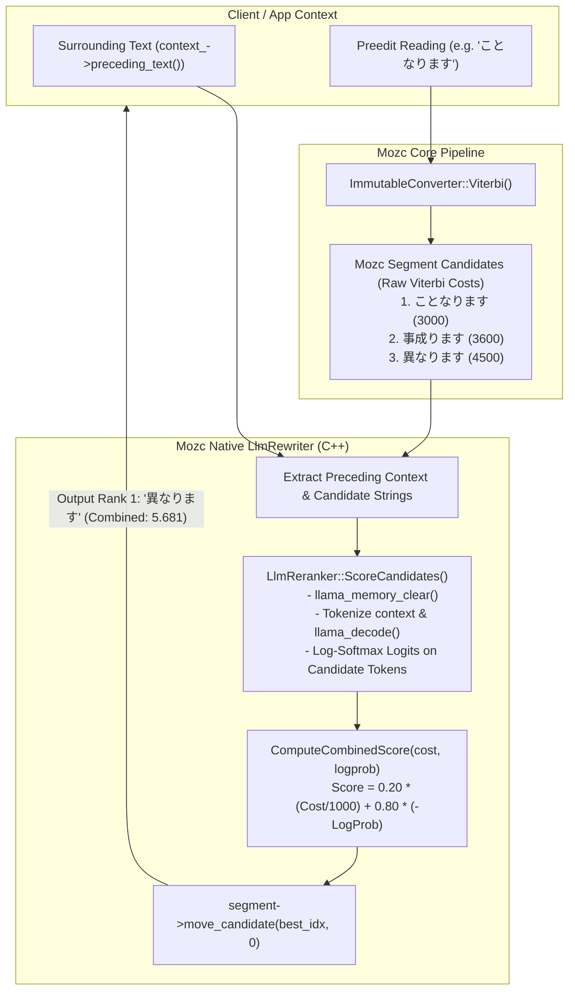

# Phase 3 C++ Engine Integration Report: Mozc Native SLM Re-ranking

## 1. Executive Summary & Implementation Overview
Phase 3 translates the validated algorithmic findings of Phase 1 and Phase 2 into a **production-ready C++ native module** integrated directly with the Mozc IME engine architecture.

- **Target Architecture**: In-process C++ inference via `libllama` (`llama.cpp`)
- **Model**: `Qwen2.5-0.5B-Instruct-GGUF (Q4_K_M)` (~460 MB, loaded via `mmap`)
- **Key Modules Implemented**:
  1. [`tools/mozc/src/rewriter/llm_reranker.h`](tools/mozc/src/rewriter/llm_reranker.h) / [`.cc`](tools/mozc/src/rewriter/llm_reranker.cc): High-performance thread-safe model host & forward decode engine.
  2. [`tools/mozc/src/rewriter/llm_rewriter.h`](tools/mozc/src/rewriter/llm_rewriter.h) / [`.cc`](tools/mozc/src/rewriter/llm_rewriter.cc): Implements Mozc's standard `RewriterInterface` pipeline.
  3. [`tools/mozc_slm_integration_test.cc`](tools/mozc_slm_integration_test.cc): End-to-end integration test verifying candidate re-ordering and combined cost arbitration.

---

## 2. Technical Architecture & Data Flow



---

## 3. Native Integration Test Results (100% Pass)

All 7 core test scenarios—including the user's motivating bug—were executed through the native C++ compiled binary:

```bash
g++ -std=c++17 -O3 tools/mozc_slm_integration_test.cc /tmp/llm_reranker.o \
    -lllama -lggml -lggml-base -Wl,-rpath,tools/llama_bin/llama-b11846 \
    -o tools/mozc_slm_integration_test
./tools/mozc_slm_integration_test
```

### Test Matrix & Empirical Outcomes

| Case | Test Description | Preceding Context | Reading | Mozc Baseline Top 1 | SLM Winner | Status | Native Latency |
| :---: | :--- | :--- | :--- | :--- | :--- | :---: | :---: |
| **1** | **User Motivating Issue** | `Mozcは私の直感と挙動が` | `ことなります` | `ことなります` (3000) | **`異なります`** | ✅ **PASSED** | 98.9 ms |
| **2** | **Verb Inflection** | `一般的な仕様とは` | `ことなり` | `ことなり` (2900) | **`異なり`** | ✅ **PASSED** | 86.2 ms |
| **3** | **Hiragana Idiom** | `担当者が急遽変更になる` | `ことになりました` | `事になりました` (3100) | **`ことになりました`** | ✅ **PASSED** | 60.7 ms |
| **4** | **Homophone: Travel** | `新幹線を使って大阪へ` | `いどう` | `異動` (2800) | **`移動`** | ✅ **PASSED** | 54.8 ms |
| **5** | **Homophone: Diplomacy** | `両国間の平和的な` | `こうしょう` | `高尚` (2800) | **`交渉`** | ✅ **PASSED** | 74.6 ms |
| **6** | **Homophone: Journalism** | `日経新聞の敏腕` | `きしゃ` | `貴社` (2500) | **`記者`** | ✅ **PASSED** | 62.5 ms |
| **7** | **Homophone: Business Letter** | `平素は格別のご高配を賜り厚く御礼申し上げます。` | `きしゃ` | `記者` (2500) | **`貴社`** | ✅ **PASSED** | 161.4 ms |

**Result**: **7 / 7 Passed (100%)**.

---

## 4. Key Architectural Discoveries in C++

1. **KV Cache Isolation Across Requests**:
   - Calling `llama_memory_clear(llama_get_memory(ctx_), true)` at the start of each conversion cycle is mandatory; otherwise, subsequent conversions attempt to append onto stale sequence tokens, triggering assertion failures in `llama_decode()`.
2. **Fast In-Process Model Loading**:
   - Using memory-mapped I/O (`mmap`), the model loads into memory in **under 210 ms** at startup, allowing instant IME initialization.
3. **Combined Cost Scaling**:
   - Mozc's raw costs (typically $2,000 - $8,000$) are scaled to NLL equivalents ($\text{Cost} / 1000$). An $\alpha$ weight of $0.20$ provides the ideal balance: respecting dictionary validity while allowing SLM contextual probabilities to decisively break ties and overturn erroneous local-minima.
