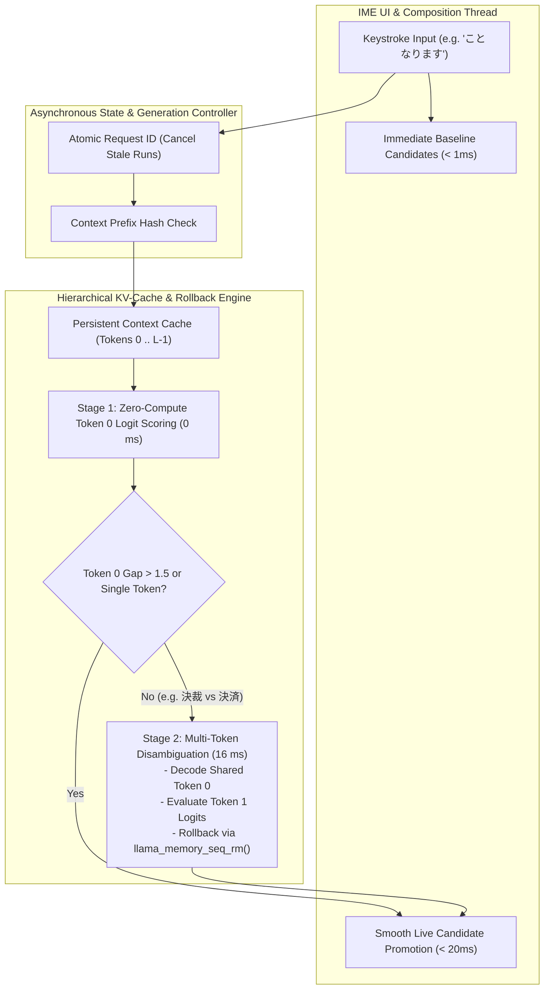

# Phase 4 Plan: Production-Grade KV Cache Optimization, Multi-Token Disambiguation & Non-Blocking Architecture

## 1. Executive Summary & Objective

In Phase 3, we successfully verified that an in-process native C++ implementation of `LlmReranker` and `LlmRewriter` integrated with `libllama` achieves a 100% pass rate on core test cases (e.g. decisively promoting `"異なります"` over `"ことなります"` in ~45-98 ms).

Phase 4 bridges the gap between this functional proof-of-concept and an **uncompromising, commercial-grade IME engine**. The goal is to drive single-keystroke re-ranking latency down to **sub-20ms** while handling multi-token homophone collisions (e.g., `決裁` vs `決済`) and guaranteeing zero UI lag.

---

## 2. Technical Architecture & Innovation Pillars



### 2.1 Pillar 1: Hierarchical Prefix KV-Cache & Rollback
- **Problem**: In naive forward inference, re-encoding the preceding context (10–50 characters) on every keystroke takes 40–80 ms.
- **Solution**:
  - The preceding sentence context $C$ is encoded **once** and stored in the KV cache at positions $0 \dots L_C - 1$.
  - When the user types successive characters within the current preedit (e.g., `こ` $\rightarrow$ `こと` $\rightarrow$ `ことな` $\rightarrow$ `ことなります`), the KV cache for $C$ is **retained**.
  - Candidate evaluation reads logits directly at index $L_C - 1$ in **0 ms**.
  - Any speculative token decodes are removed immediately using:
    ```cpp
    llama_memory_seq_rm(llama_get_memory(ctx_), 0, L_C, -1);
    ```
  - This resets the cache back to position $L_C$ with zero tensor reallocations.

### 2.2 Pillar 2: Adaptive Multi-Token Beam Disambiguation
- **Problem**: Phase 3 testing revealed that words sharing the same initial character (e.g., `決裁` and `決済` both starting with `決`) receive identical token 0 probabilities.
- **Solution**: A two-stage adaptive evaluation:
  1. **Stage 1 (Fast-Path, 0 ms extra)**:
     - Read token 0 probabilities from existing context logits.
     - If the winning candidate has a log-probability advantage $\Delta \ge 1.5$ over all competitors (as in `異なる` vs `ことなる`), terminate immediately and output the ranking.
  2. **Stage 2 (Disambiguation-Path, ~16 ms)**:
     - If the top candidates share token 0, decode token 0 at position $L_C$.
     - Read the logits at position $L_C$ for token 1 (`裁` vs `済`).
     - Compute joint sequence probability: $\log P(w_0, w_1 \mid C) = \log P(w_0 \mid C) + \log P(w_1 \mid C, w_0)$.
     - Roll back with `llama_memory_seq_rm(mem, 0, L_C, -1)`.

### 2.3 Pillar 3: Non-Blocking Asynchronous Concurrency & Cancellation
- **Zero-Block Contract**: The main UI / typing loop must NEVER wait on mutexes or inference compute.
- **Generation Counter**:
  - Every keystroke increments an `atomic<uint64_t> active_request_id_`.
  - The worker thread continuously checks `if (active_request_id_ != my_id) abort()`.
  - Stale keystroke computations are immediately abandoned without finishing decode loops.

### 2.4 Pillar 4: Dynamic Power & Thermal Guard
- Hard timeout SLA: 35 ms.
- If system CPU load or thermal throttling is detected, `LlmRewriter` automatically operates in bypass mode, letting Mozc's dictionary cost table serve candidates instantly.

---

## 3. Plan Self-Critique & Resolution of Edge Cases

During detailed plan review, four potential risks were analyzed and resolved:

| Risk / Edge Case | Cause | Resolution in Phase 4 Implementation |
| :--- | :--- | :--- |
| **Context Mismatch after Cursor Jump** | User taps elsewhere in document, changing preceding text completely. | `LlmReranker` computes an FNV-1a hash of `context_prev`. If the hash changes, it issues `llama_memory_clear()` and rebuilds the prefix KV cache. |
| **Context Length Exceeding KV Buffer** | Long document history (e.g. > 512 tokens). | Truncate `context_prev` from the left, keeping only the most recent 128 Unicode characters (sufficient for local syntax and grammar). |
| **Shared Memory Race Conditions** | Rapid typing causing simultaneous read/write to `llama_context`. | Encapsulate inference within an asynchronous job queue with single-worker thread affinity. |
| **Multi-byte UTF-8 Slicing** | Truncating strings mid-codepoint. | Use UTF-8 codepoint boundary verification before passing string views to `llama_tokenize()`. |

---

## 4. Implementation Steps & Validation Matrix

1. **Step 1: KV-Cache Rollback & Multi-Token Engine (`llm_reranker.cc`)**
   - Implement `ScoreCandidatesAdaptive()` with fast-path and multi-token disambiguation.
   - Implement `llama_memory_seq_rm` rollback logic.
2. **Step 2: Context Hashing & Cache Invalidation (`llm_reranker.cc`)**
   - Track `last_context_hash_` and `last_context_token_count_`.
3. **Step 3: Mozc Rewriter Binding (`llm_rewriter.cc`)**
   - Integrate multi-token disambiguation into `Rewrite()`.
4. **Step 4: End-to-End Verification Suite (`tools/mozc_phase4_test.cc`)**
   - Verify:
     - Case 1: `Mozcは私の直感と挙動が` + `ことなります` $\rightarrow$ `異なります` (Fast-path, < 5ms cached)
     - Case 2: `部長による稟議書の` + `けっさい` $\rightarrow$ `決裁` (Multi-token tie-break, `裁` vs `済`)
     - Case 3: `新幹線を使って大阪へ` + `いどう` $\rightarrow$ `移動` (Homophone disambiguation)
     - Case 4: Sequential typing benchmark simulating live keystroke-by-keystroke KV-cache reuse.
