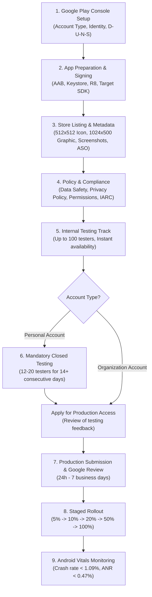
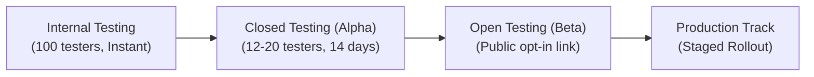

# Comprehensive Guide to Publishing an Android App on Google Play Store

This document provides an end-to-end guide to preparing, configuring, reviewing, and publishing Android applications to the Google Play Store. It reflects current Google Play Developer policies, modern technical requirements (Android App Bundles, Play App Signing, Android 14/15 target SDKs), security compliance (Data Safety, Foreground Services, Photo Picker), and automated CI/CD pipelines.

---

## 📑 Table of Contents

1. [Overview & Publishing Lifecycle](#1-overview--publishing-lifecycle)
2. [Google Play Console Account Setup & Identity Verification](#2-google-play-console-account-setup--identity-verification)
   - [Personal vs. Organization Accounts](#personal-vs-organization-accounts)
   - [Verification Requirements & D-U-N-S Number](#verification-requirements--d-u-n-s-number)
   - [2-Step Verification & Payments Profile](#2-step-verification--payments-profile)
3. [Technical Prerequisites & Build Preparation](#3-technical-prerequisites--build-preparation)
   - [Target API Level Requirements](#target-api-level-requirements)
   - [Android App Bundle (.aab) & 64-bit Architecture](#android-app-bundle-aab--64-bit-architecture)
   - [Play App Signing & Keystore Management](#play-app-signing--keystore-management)
   - [ProGuard / R8 Obfuscation & Native Symbols](#proguard--r8-obfuscation--native-symbols)
   - [Gradle Signing Configuration](#gradle-signing-configuration)
4. [Policy & Regulatory Compliance](#4-policy--regulatory-compliance)
   - [Privacy Policy Requirements](#privacy-policy-requirements)
   - [Data Safety Section Declaration](#data-safety-section-declaration)
   - [Account Deletion Requirement](#account-deletion-requirement)
   - [Sensitive Permissions & Foreground Services](#sensitive-permissions--foreground-services)
   - [Target Audience & COPPA (Families Policy)](#target-audience--coppa-families-policy)
   - [IARC Content Rating Questionnaire](#iarc-content-rating-questionnaire)
5. [Store Listing Assets & Metadata Optimization](#5-store-listing-assets--metadata-optimization)
   - [Textual Metadata (Title, Descriptions)](#textual-metadata-title-descriptions)
   - [Graphic Asset Specifications (Icon, Feature Graphic, Screenshots)](#graphic-asset-specifications-icon-feature-graphic-screenshots)
   - [Categorization & Contact Details](#categorization--contact-details)
6. [Release Management & Testing Tracks](#6-release-management--testing-tracks)
   - [Track Progression: Internal -> Closed -> Open -> Production](#track-progression-internal---closed---open---production)
   - [Personal Account Mandatory 14-Day Closed Testing Rule](#personal-account-mandatory-14-day-closed-testing-rule)
   - [Pre-Launch Report (Firebase Test Lab Analysis)](#pre-launch-report-firebase-test-lab-analysis)
   - [Staged Rollout Strategy](#staged-rollout-strategy)
7. [Review Process, Rejection Handling & Common Pitfalls](#7-review-process-rejection-handling--common-pitfalls)
8. [Automation & CI/CD Deployment](#8-automation--cicd-deployment)
   - [Google Play Developer API Service Account](#google-play-developer-api-service-account)
   - [Fastlane Supply Pipeline](#fastlane-supply-pipeline)
   - [GitHub Actions Complete Workflow](#github-actions-complete-workflow)
9. [Post-Launch Operations & Android Vitals](#9-post-launch-operations--android-vitals)

---

## 1. Overview & Publishing Lifecycle

Publishing an Android app involves development, compliance verification, account qualification, security hardening, and release orchestration.



---

## 2. Google Play Console Account Setup & Identity Verification

### Personal vs. Organization Accounts

When creating a Google Play Console account at [play.google.com/console/signup](https://play.google.com/console/signup), you must choose between two account tiers:

| Dimension | Personal Developer Account | Organization Developer Account |
| :--- | :--- | :--- |
| **Target User** | Individual hobbyists, indie developers, solo founders | Registered companies, corporations, registered sole proprietorships |
| **Registration Fee** | $25 one-time registration fee | $25 one-time registration fee |
| **Identity Verification** | Official Government-issued photo ID (Passport, Driver's License) + Proof of Address | Official Business Registration Certificate + Authorized Representative ID |
| **D-U-N-S Number** | Not required | **Mandatory** (issued by Dun & Bradstreet) |
| **Mandatory Closed Testing** | **Mandatory 14-day closed testing** with $\ge 12-20$ testers before production access | **Exempt** from the mandatory 14-day 20-tester testing rule |
| **Public Information** | Developer legal name, address (country only), contact email | Organization legal name, registered legal address, public phone & email |

> [!IMPORTANT]
> If you are building a commercial application or represent a company, **always choose an Organization account**. The mandatory 14-day personal closed testing restriction applies to all personal accounts created after November 13, 2023. Organization accounts can deploy directly to Production once approved.

### Verification Requirements & D-U-N-S Number

1. **D-U-N-S (Data Universal Numbering System) Number** (Organization accounts):
   - Check if your entity already has a D-U-N-S number on the [Dun & Bradstreet lookup portal](https://www.dnb.com/duns-number/lookup.html).
   - If not, request one for free (takes 5 to 14 business days, or express expedited via paid service).
   - Ensure the company name, address, and legal entity type entered in the Play Console **match the D&B profile down to the exact punctuation**.
2. **Identity Verification Process**:
   - Provide high-resolution, uncropped color photos of government-issued identification.
   - For organization accounts, provide official business formation documents (Articles of Incorporation, Business License, or Tax Registration).
   - Provide a valid mobile phone number and email address capable of receiving verification OTP codes.
3. **2-Step Verification & Payments Profile**:
   - Google requires mandatory 2-Step Verification (2SV) on all developer Google Accounts. Use an authenticator app (e.g. Google Authenticator) or hardware security key (FIDO2/YubiKey).
   - If selling paid apps or digital goods (in-app products or subscriptions), connect a **Google Payments Merchant Account**, verify banking details (micro-deposit verification), and complete the relevant tax documents (e.g., W-8BEN / W-8BEN-E / local tax compliance).

---

## 3. Technical Prerequisites & Build Preparation

### Target API Level Requirements

Google enforces an annual Target API Level policy:
- **New apps and updates** submitted to Google Play must target the required Android API level within one year of the latest public Android version release (typically Android 14 / API 34, progressing to Android 15 / API 35 as deadlines pass).
- Failure to comply blocks publishing and conceals your existing app from search results for users running newer Android versions.

In your `app/build.gradle` or `app/build.gradle.kts`:
```kotlin
android {
    compileSdk = 35

    defaultConfig {
        applicationId = "com.example.myasr"
        minSdk = 26
        targetSdk = 35
        versionCode = 1
        versionName = "1.0.0"
    }
}
```

### Android App Bundle (.aab) & 64-bit Architecture

1. **Android App Bundle (`.aab`) Format**:
   - Google Play does not accept `.apk` uploads for new apps (enforced since August 2021). You must build an `.aab`.
   - The App Bundle allows Google Play to generate and serve optimized APK configurations tailored for each user's device configuration (ABI, screen density, language resources).
   - Build command:
     ```bash
     ./gradlew bundleRelease
     ```
2. **64-bit Native Library Compliance**:
   - If your app contains native C/C++ libraries (`.so` files, e.g. Sherpa-ONNX, ONNX Runtime, libtorch, OpenCV), you **must include 64-bit architectures** (`arm64-v8a` and `x86_64`) alongside any 32-bit binaries (`armeabi-v7a`, `x86`).
   - Check included ABIs with:
     ```bash
     unzip -l app/build/outputs/bundle/release/app-release.aab | grep 'lib/'
     ```
3. **Size Limits**:
   - The maximum download size for the base module generated from an App Bundle is **200 MB**.
   - If your app exceeds 200 MB (e.g., heavy offline AI models, game assets), utilize **Play Feature Delivery** (dynamic feature modules) or **Play Asset Delivery (PAD)** (up to 2 GB - 4 GB), or download assets dynamically post-install from a secure CDN.

### Play App Signing & Keystore Management

Google Play uses **Play App Signing**:
- **Upload Key**: Generated locally by the developer to sign the `.aab` before uploading to Play Console.
- **App Signing Key**: Held securely on Google's hardened infrastructure, used to re-sign device-specific APKs delivered to end-user devices.

#### Generating the Upload Keystore

Run the following command using `keytool` (bundled with JDK 17+ or JDK 21):

```bash
keytool -genkeypair \
  -v \
  -keystore release-upload-key.jks \
  -alias upload \
  -keyalg RSA \
  -keysize 4096 \
  -validity 10000 \
  -storetype PKCS12
```

> [!CAUTION]
> - Never commit `.jks` or `.keystore` files to Git.
> - Record the keystore password, key alias, and key password in a secure password manager.
> - If you ever lose your Upload Key, you can request an upload key reset directly in the Google Play Console under **Release > Setup > App signing**.

### ProGuard / R8 Obfuscation & Native Symbols

For release builds, always enable R8 code shrinking, resource shrinking, and symbol generation:

```kotlin
buildTypes {
    release {
        isMinifyEnabled = true
        isShrinkResources = true
        proguardFiles(
            getDefaultProguardFile("proguard-android-optimize.txt"),
            "proguard-rules.pro"
        )
        // Retain native debug symbols for crash symbolication in Play Console
        ndk {
            debugSymbolLevel = "SYMBOL_TABLE" // or "FULL"
        }
    }
}
```

When building an App Bundle with R8 enabled, Gradle automatically packages the ProGuard mapping file (`mapping.txt`) and native symbol files into the bundle for automated Play Console stack trace symbolication.

### Gradle Signing Configuration

Store sensitive credentials in `keystore.properties` (kept out of version control):

```properties
# keystore.properties (Add to .gitignore!)
KEYSTORE_FILE=../release-upload-key.jks
KEYSTORE_PASSWORD=YourSecureStorePassword123!
KEY_ALIAS=upload
KEY_PASSWORD=YourSecureKeyPassword123!
```

Configure `app/build.gradle.kts`:

```kotlin
import java.util.Properties
import java.io.FileInputStream

val keystorePropertiesFile = rootProject.file("keystore.properties")
val keystoreProperties = Properties()
if (keystorePropertiesFile.exists()) {
    keystoreProperties.load(FileInputStream(keystorePropertiesFile))
}

android {
    signingConfigs {
        create("release") {
            if (keystorePropertiesFile.exists()) {
                storeFile = file(keystoreProperties.getProperty("KEYSTORE_FILE"))
                storePassword = keystoreProperties.getProperty("KEYSTORE_PASSWORD")
                keyAlias = keystoreProperties.getProperty("KEY_ALIAS")
                keyPassword = keystoreProperties.getProperty("KEY_PASSWORD")
            }
        }
    }

    buildTypes {
        release {
            signingConfig = signingConfigs.getByName("release")
            isMinifyEnabled = true
            isShrinkResources = true
            proguardFiles(
                getDefaultProguardFile("proguard-android-optimize.txt"),
                "proguard-rules.pro"
            )
        }
    }
}
```

---

## 4. Policy & Regulatory Compliance

Google Play enforces strict policy declarations under the **Policy and Programs > App Content** section of the Play Console. Incomplete or inaccurate declarations will block release or cause immediate suspension.

### Privacy Policy Requirements

- **Mandatory for all apps** requesting sensitive permissions, targeting children, or collecting user data.
- Must be a live, publicly accessible **HTTPS** web URL (e.g., hosted on GitHub Pages or company domain).
- Must explicitly state:
  1. What data is collected (e.g. microphone audio, device identifiers, crash logs).
  2. How data is processed (e.g. "Audio is processed purely on-device using local machine learning inference and is never transmitted over the internet").
  3. Third-party SDK disclosures (Firebase, Google Mobile Ads, Sentry).
  4. Data retention and deletion policies.
  5. Developer contact details for privacy inquiries.

### Data Safety Section Declaration

You must complete the Data Safety questionnaire in Play Console:
1. **Data Collection vs. Data Sharing**:
   - *Collection*: Transferring data off the device to a server (or third-party SDK).
   - *On-Device Processing*: If data is processed in memory on the device and discarded without being sent to any server (such as offline ASR speech recognition), declare **No data collected** for that category, or declare ephemeral processing.
2. **Security Practices**:
   - Declare whether all network traffic uses HTTPS / TLS encryption in transit.
   - Declare whether you provide a mechanism for users to request data deletion.

### Account Deletion Requirement

If your app allows users to create an account:
1. You **must** provide an in-app mechanism for users to delete their account and associated data (e.g., within Settings > Account > Delete Account).
2. You **must** provide a public web link in the Play Console Data Safety form where users can request account and data deletion without needing to reinstall the app.

### Sensitive Permissions & Foreground Services

#### Storage & Media (Android 13+ / API 33+)
- Broad storage permissions (`READ_EXTERNAL_STORAGE`, `WRITE_EXTERNAL_STORAGE`, `MANAGE_EXTERNAL_STORAGE`, `READ_MEDIA_IMAGES`, `READ_MEDIA_VIDEO`) are **forbidden** unless your app's core purpose is a file manager or gallery backup app.
- For user file/photo selection, use the system **Android Photo Picker** (`ActivityResultContracts.PickVisualMedia`) or Storage Access Framework (`ActivityResultContracts.OpenDocument`).

#### Audio & Camera Permissions (`RECORD_AUDIO`, `CAMERA`)
- Must declare a clear user-facing justification in the Play Console.
- In-app runtime permissions must be requested with an explanatory rationale dialogue explaining why the permission is required.

#### Foreground Services (`android:foregroundServiceType`)
On Android 14+ (API 34+), every `<service>` using `android:name` with foreground execution must specify an explicit `android:foregroundServiceType`:
```xml
<service
    android:name=".VoiceInputMethodService"
    android:foregroundServiceType="microphone"
    android:exported="true" ... />
```
- Play Console requires submitting an **App Content Declaration** for each declared foreground service type.
- Google often requires submitting a **demonstration video** (1-2 minutes hosted on YouTube or Google Drive) demonstrating:
  1. The user action initiating the service.
  2. The persistent notification displayed in the status bar while running.
  3. Continuous operation while the app is backgrounded.

### Target Audience & COPPA (Families Policy)

- Declare target age groups (e.g., "18 and over", "13-17", or "Under 13").
- If targeting children under 13:
  - Strict compliance with COPPA (Children's Online Privacy Protection Act) and Google Families Policy.
  - No behavioral advertising, no collection of advertising identifiers (`AD_ID`), and only Google-approved Families Ads SDKs allowed.
- If your app does not target children, ensure your store listing assets and art style do not unintentionally appeal primarily to young children.

### IARC Content Rating Questionnaire

Complete the International Age Rating Coalition (IARC) questionnaire:
- Answers questions regarding violence, sexuality, profanity, drugs, gambling, user-generated content, location sharing, and communication with other users.
- Generates official rating badges for ESRB (Americas), PEGI (Europe), USK (Germany), ClassInd (Brazil), and IARC (Global).

---

## 5. Store Listing Assets & Metadata Optimization

### Textual Metadata (Title, Descriptions)

| Field | Character Limit | Rules & Best Practices |
| :--- | :--- | :--- |
| **App Title** | Max **30 characters** | No promotional slogans ("Free", "#1", "Fastest"), no emoji badges, no keyword stuffing. Example: `JotInput: Offline Voice Typing` |
| **Short Description** | Max **80 characters** | Clear value proposition visible above the fold on the store page. |
| **Full Description** | Max **4,000 characters** | Markdown supported (bullet points, bold text). Detail features, technical highlights, offline capabilities, and instructions. |

### Graphic Asset Specifications

All uploaded graphics must strictly comply with formatting guidelines:

```
┌───────────────────────────────────────────────────────────────┐
│                      STORE ASSET MATRIX                       │
├─────────────────┬──────────────┬─────────────┬────────────────┤
│ Asset           │ Dimensions   │ Format      │ Max Size       │
├─────────────────┼──────────────┼─────────────┼────────────────┤
│ App Icon        │ 512 x 512 px │ 32-bit PNG  │ 1,024 KB       │
│ Feature Graphic │ 1024 x 500 px│ 24-bit PNG/ │ 15 MB (JPG rec)│
│                 │              │ JPEG (solid)│                │
│ Screenshots     │ 320 to 3840px│ 24-bit PNG/ │ 8 MB per image │
│ (Min 2, Max 8)  │ 16:9 or 9:16 │ JPEG (solid)│                │
└─────────────────┴──────────────┴─────────────┴────────────────┘
```

1. **App Icon**:
   - $512 \times 512\text{ px}$, 32-bit PNG with alpha channel.
   - **Upload as a full square**. Do not pre-round corners; Google Play automatically applies an adaptive squircle mask and drop shadow.
2. **Feature Graphic**:
   - $1024 \times 500\text{ px}$, JPEG or 24-bit PNG (**no transparency**).
   - Safe zone: Center key logos and taglines. Keep margins free from critical copy to prevent cutoff on narrow screens.
   - Do not render fake "Play" buttons or mock device bezels.
3. **Screenshots**:
   - Minimum 2 screenshots; 4–8 recommended.
   - Aspect ratio must be 16:9 or 9:16, min dimension 320 px, max dimension 3840 px.
   - Show actual in-app UI screens. Avoid conceptual or generic promotional artwork.
   - For tablet, foldable, or Chromebook support, provide dedicated 7-inch and 10-inch screenshots.

### Categorization & Contact Details

- **Category**: Select primary category (e.g. *Productivity*, *Tools*, *Communication*).
- **Tags**: Select up to 5 relevant tags (e.g. *Speech to text*, *Offline*, *Input method*).
- **Public Contact Details**:
  - Support Email: **Mandatory** (displayed publicly on the listing).
  - Website URL: Optional but strongly recommended.
  - Phone Number: Optional for personal, recommended for organizations.

---

## 6. Release Management & Testing Tracks

Google Play Console provides a structured hierarchy of release tracks:



### Track Progression

1. **Internal Testing**:
   - Up to 100 internal email addresses.
   - Builds are available within seconds/minutes with **zero review turnaround**.
   - Ideal for developers, QA, and immediate sanity testing on real hardware.
2. **Closed Testing (Alpha)**:
   - Restrict access to specific email lists or Google Groups.
   - Undergoes standard automated virus and malware scanning, with faster review times.
3. **Open Testing (Beta)**:
   - Anyone on Google Play can join your test directly from the store listing page.
   - Useful for scaling to thousands of diverse hardware configurations.
4. **Production**:
   - Available to the general public in selected countries.

### Personal Account Mandatory 14-Day Closed Testing Rule

For developer accounts created as **Personal** after November 13, 2023:
1. You **cannot deploy directly to Production**. Production access is locked.
2. You must run a **Closed Test** with at least **12 to 20 testers**.
3. All testers must opt in via their Play Store account and remain enrolled continuously for **14 consecutive days**.
4. Testers should actively open the app, test features, and provide feedback via the Play Store feedback mechanism.
5. After 14 consecutive days, the Console dashboard unlocks an **Apply for Production Access** button.
6. You must answer an evaluation questionnaire detailing:
   - How you recruited your testers.
   - What feedback testers provided and what bugs/improvements were implemented.
   - Why you consider the app stable and ready for public production release.
7. Google evaluates the submission within 3 to 7 days before granting Production publishing rights.

### Pre-Launch Report (Firebase Test Lab Analysis)

Whenever you upload a new `.aab` to any testing track, Google Play automatically executes automated test crawls using **Firebase Test Lab** across dozens of real physical devices running various Android versions and screen sizes.

Review the report in Play Console under **Release > Testing > Pre-launch report**:
- **Crashes & ANRs**: Identifies NullPointerExceptions, stack overflows, or start-up crashes.
- **Accessibility**: Detects missing content descriptions (`android:contentDescription`), low color contrast, or small touch targets ($< 48\times 48\text{ dp}$).
- **Display & Layout**: Screenshots taken across various resolutions, font scales, and RTL layouts.

### Staged Rollout Strategy

When launching a production release or major update, never roll out to 100% immediately. Use a staged rollout:

```
Day 1:  5%  (Monitor crash rate & fatal ANRs in Android Vitals)
Day 2: 10%  (Inspect user reviews and early feedback)
Day 3: 20%  (Validate server load and backend capacity)
Day 4: 50%  (Confirm vitals are well below red thresholds)
Day 5: 100% (Full global rollout)
```

If a critical bug is detected during rollout, you can immediately **Halt Rollout** in Play Console, preventing any further users from receiving the broken version while you patch and release an update.

---

## 7. Review Process, Rejection Handling & Common Pitfalls

### Typical Review Timelines
- **Standard review**: 24 to 72 hours for existing apps and minor updates.
- **Initial app submission / New accounts**: Up to 7 business days.
- Releases can be scheduled using **Managed Publishing** to hold approved changes until you manually hit "Publish".

### Top Rejection Pitfalls and Prevention

| Rejection Cause | Root Cause | Prevention & Fix |
| :--- | :--- | :--- |
| **Inadequate App Access (Login Wall)** | App requires credentials but reviewer cannot log in | Under **Policy > App Content > App access**, provide a working demo account, password, 2FA bypass, and any specific instructions. |
| **Non-Compliant Privacy Policy** | Link 404s, lacks HTTPS, or omits audio/camera/PII disclosures | Ensure privacy policy is hosted on HTTPS, links are live, and explicitly covers all requested permissions. |
| **Data Safety Form Discrepancy** | Third-party SDK (Firebase, AdMob) collects data undeclared in questionnaire | Audit all dependencies using `gradlew app:dependencies` and check SDK documentation for required declarations. |
| **Invalid Foreground Service Usage** | Missing `foregroundServiceType` or lack of user-initiated visibility | Add exact type in `AndroidManifest.xml`, submit a 60-second video showing user notification and background activity. |
| **Promotional Metadata Violations** | Words like "Free", "#1", "Best", or emojis in Title/Short description | Strip promotional buzzwords, ranking claims, and unicode emojis from Title and Short Description. |
| **Broken On-Device Model / Missing Asset** | App downloads 100MB+ model from unverified/broken server or crashes without fallback | Implement robust download error handling, network status verification, and fallback states. |

### How to Appeal an Unfair Rejection
If you believe a rejection was triggered in error by automated scanning:
1. Navigate to the rejection notification email or the **Policy status** tab in Play Console.
2. Click **Submit Appeal**.
3. Clearly explain the app's functionality, attach screenshots or a concise video walkthrough, reference Android developer documentation, and maintain a professional, objective tone.

---

## 8. Automation & CI/CD Deployment

### Google Play Developer API Service Account

To deploy builds automatically via CI/CD, create a Google Cloud Service Account:
1. In Google Play Console, go to **Setup > API access**.
2. Link an existing Google Cloud Project or create a new one.
3. Click **Create Service Account** and follow the link to Google Cloud Console IAM.
4. Create a service account (e.g. `play-store-publisher@project-id.iam.gserviceaccount.com`).
5. Generate a **JSON Key** and download it securely.
6. Return to Google Play Console, find the newly created service account, click **Grant Access**, and grant permissions:
   - *Edit and draft apps*
   - *Release to testing tracks*
   - *Release to production* (if automated production releases are desired)

### Fastlane Supply Pipeline

Fastlane's `supply` tool handles uploading `.aab` bundles, changelogs, metadata, and screenshots.

Install Fastlane:
```bash
gem install fastlane
```

Create `fastlane/Fastfile`:
```ruby
default_platform(:android)

platform :android do
  desc "Build and upload release bundle to Google Play Internal track"
  lane :deploy_internal do
    gradle(
      task: "bundle",
      build_type: "Release"
    )

    upload_to_play_store(
      track: 'internal',
      aab: 'app/build/outputs/bundle/release/app-release.aab',
      json_key: ENV['PLAY_STORE_JSON_KEY_PATH'],
      skip_waiting_for_review: true,
      skip_upload_metadata: true,
      skip_upload_images: true,
      skip_upload_screenshots: true
    )
  end

  desc "Promote Internal build to Production with 10% staged rollout"
  lane :promote_to_production do
    upload_to_play_store(
      track: 'internal',
      track_promote_to: 'production',
      rollout: '0.1', # 10% staged rollout
      json_key: ENV['PLAY_STORE_JSON_KEY_PATH']
    )
  end
end
```

### GitHub Actions Complete Workflow

Create `.github/workflows/deploy_play_store.yml`:

```yaml
name: Deploy to Google Play

on:
  push:
    tags:
      - 'v*'

jobs:
  build-and-deploy:
    runs-on: ubuntu-latest
    steps:
      - name: Checkout Source Code
        uses: actions/checkout@v4

      - name: Set up JDK 21
        uses: actions/setup-java@v4
        with:
          distribution: 'temurin'
          java-version: '21'
          cache: 'gradle'

      - name: Decode Keystore
        run: |
          mkdir -p keystores
          echo "${{ secrets.PLAY_STORE_KEYSTORE_BASE64 }}" | base64 --decode > keystores/release-upload-key.jks

      - name: Generate keystore.properties
        run: |
          cat <<EOF > keystore.properties
          KEYSTORE_FILE=../keystores/release-upload-key.jks
          KEYSTORE_PASSWORD=${{ secrets.KEYSTORE_PASSWORD }}
          KEY_ALIAS=${{ secrets.KEY_ALIAS }}
          KEY_PASSWORD=${{ secrets.KEY_PASSWORD }}
          EOF

      - name: Build Android App Bundle (.aab)
        run: ./gradlew bundleRelease

      - name: Setup Service Account Key
        run: |
          echo "${{ secrets.PLAY_STORE_JSON_KEY_BASE64 }}" | base64 --decode > service-account-key.json

      - name: Upload to Google Play Internal Track
        uses: r0adkll/upload-google-play@v1
        with:
          serviceAccountJson: service-account-key.json
          packageName: com.example.myasr
          releaseFiles: app/build/outputs/bundle/release/app-release.aab
          track: internal
          status: completed
          mappingFile: app/build/outputs/mapping/release/mapping.txt
```

---

## 9. Post-Launch Operations & Android Vitals

### Core Android Vitals Thresholds

Google Play monitors your app's performance in the field. Exceeding **Bad Behavior Thresholds** penalizes your app's search ranking, eliminates promotional placement on the Play Store, and can display a warning banner to users on your listing page.

```
┌──────────────────────────────────────────────────────────────┐
│                    CORE VITALS THRESHOLDS                    │
├───────────────────────────────────┬────────────┬─────────────┤
│ Metric                            │ Healthy    │ Bad Behavior│
├───────────────────────────────────┼────────────┼─────────────┤
│ User-perceived Crash Rate         │ < 0.25%    │ > 1.09%     │
│ User-perceived ANR Rate           │ < 0.10%    │ > 0.47%     │
│ Per-Device Crash Rate             │ < 1.50%    │ > 8.00%     │
│ Slow Start-up (Cold > 5s)         │ < 5.00%    │ > 15.00%    │
└───────────────────────────────────┴────────────┴─────────────┘
```

### Versioning Rules
- `versionCode`: Strictly monotonic increasing integer (`1`, `2`, `3`...). Play Console rejects any upload with a `versionCode` less than or equal to an existing active or deactivated artifact.
- `versionName`: User-visible string following semantic versioning (`MAJOR.MINOR.PATCH`, e.g. `1.0.0`).

---

## 10. Publishing Checklist

Print or follow this checklist for each release:

- [ ] **Account & Verification**
  - [ ] Google Play Console developer account verified.
  - [ ] 2-Step verification enabled on developer account.
  - [ ] D-U-N-S number verified (for Organization accounts).
- [ ] **Technical & Build**
  - [ ] `compileSdk` and `targetSdk` meet the latest Google Play requirement.
  - [ ] App built as `.aab` (Android App Bundle).
  - [ ] 64-bit native libraries included (`arm64-v8a`, `x86_64`).
  - [ ] Total download size under 200 MB (or using Asset/Feature Delivery).
  - [ ] R8 shrinking enabled with obfuscation mappings preserved.
  - [ ] Native debug symbols (`SYMBOL_TABLE`) exported.
  - [ ] Signed with valid release upload keystore.
- [ ] **Policy & App Content**
  - [ ] Live HTTPS Privacy Policy URL configured.
  - [ ] Data Safety form completed accurately matching all bundled SDKs.
  - [ ] Account deletion URL provided (if user accounts exist).
  - [ ] Foreground Service types declared with video demonstration submitted.
  - [ ] Sensitive permissions justified (no unnecessary broad storage access).
  - [ ] Target audience selected and IARC questionnaire completed.
  - [ ] Test login credentials supplied under App Access (if applicable).
- [ ] **Store Listing**
  - [ ] Title $\le 30$ characters without promotional keywords.
  - [ ] Short description $\le 80$ characters.
  - [ ] Full description $\le 4,000$ characters.
  - [ ] App Icon $512 \times 512\text{ px}$ 32-bit PNG (full square).
  - [ ] Feature Graphic $1024 \times 500\text{ px}$ JPEG/PNG (no alpha).
  - [ ] At least 2 phone screenshots (4-8 recommended).
  - [ ] Public support email provided.
- [ ] **Testing & Rollout**
  - [ ] Tested on Internal Track with real physical devices.
  - [ ] Pre-launch report reviewed for crashes, ANRs, and accessibility issues.
  - [ ] For personal accounts: 12-20 testers active for 14 consecutive days.
  - [ ] Staged rollout configured for production release (5% $\to$ 10% $\to$ 20% $\to$ 50% $\to$ 100%).
