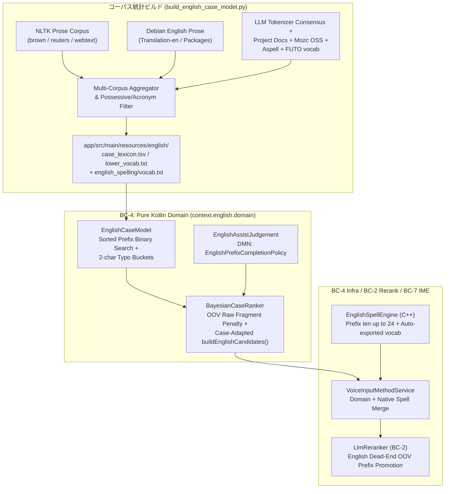

# PRD, JTBD, CUJ & System Design: 英語辞書強化＆プレフィックス補完（`tailsc` $\to$ `Tailscale`）

## Part 1: Product Requirements Document (PRD)

### 1. 概要 (Overview)
JotInput の英語 QWERTY 入力において、現代の技術用語・固有名詞・CamelCase/PascalCase ブランド名（例: `Tailscale`, `WireGuard`, `Kubernetes`, `PostgreSQL`, `TypeScript`, `Cloudflare`, `GitHub`）および一般英語語彙を包括的に拡充し、数文字のプレフィックス入力（例: `tailsc`）から即座に適切な大文字・小文字表記の完成単語（`Tailscale`）を第1候補（Rank 1）へ提示する高応答・ゼロ依存の英語辞書・プレフィックス補完パイプラインを構築する。

---

### 2. 背景と課題（Root Cause Analysis）

従来の英語 QWERTY 補完・タイポ補正パイプラインには、以下の 4 つの構造的ボトルネックが存在した：

1. **小規模かつ古い語彙基盤（3.2 万語・1990年代コーパス中心）**:
   - [`tools/futo_swipe/vocab.txt`](tools/futo_swipe/vocab.txt) は 32,768 語の一般語（ほぼ全小文字）のみであり、[`tools/build_english_case_model.py`](tools/build_english_case_model.py) も 1961–2000 年代の NLTK コーパス（`brown`, `reuters`, `webtext`）と `futo_swipe/vocab.txt` のみから `english_case_lexicon.tsv`（17,488 語）と `english_lower_vocab.txt`（25,775 語）を生成していた。
   - そのため、`Tailscale`, `WireGuard`, `Kubernetes`, `PostgreSQL`, `SQLite`, `TypeScript`, `PyTorch`, `TensorFlow`, `FastAPI`, `Cloudflare`, `GitLab`, `Wayland`, `Prometheus`, `Grafana`, `WebAssembly`, `OAuth`, `WebAuthn`, `gRPC`, `Terraform` 等の現代的語彙・IT用語・固有名詞が辞書に収録されていなかった。
2. **プレフィックス補完・タイポ補正の 27.5 MB GEC ONNX モデル依存**:
   - ドメイン層の [`EnglishCaseModel`](app/src/main/java/com/example/myasr/context/english/domain/EnglishCaseModel.kt) は `HashMap` / `HashSet` による完全一致照合のみを提供しており、プレフィックス補完やタイポ探索を持たなかった。
   - [`VoiceInputMethodService.kt`](app/src/main/java/com/example/myasr/VoiceInputMethodService.kt) の `updateEnglishTypoAndSpellingCandidates()` は [`EnglishSpellEngine.suggestTypo()`](app/src/main/java/com/example/myasr/context/english/infrastructure/EnglishSpellEngine.kt) のみに依存しており、外部ストレージの 27.5 MB ニューラル GEC ONNX モデル（`gec-encoder-int8.onnx` 等）が未ダウンロードの環境では `isReady() == false` となり、一般語彙の補完すら一切動作しなかった。さらに [`EnglishSpellDownloader`](app/src/main/java/com/example/myasr/context/provisioning/infrastructure/EnglishSpellDownloader.kt) は `vocab.txt` を取得せず、C++ 側 [`english_spell_engine.cc`](app/src/main/cpp/spelling/english_spell_engine.cc) もプレフィックス長を `min(L, 10)` に制限していた。
3. **OOV 部分プレフィックスのランキング逆転と Shift/頭文字大文字化バイパス**:
   - 未完成の OOV プレフィックス（例: `tailsc`）に対し、[`BayesianCaseRanker.generateCaseVariants()`](app/src/main/java/com/example/myasr/context/english/domain/BayesianCaseRanker.kt) は `tailsc` に `post = 1.0`（`-ln(post) = 0`）、`obsPenalty = 0.0` を与えていたため、未知の入力断片が正当な辞書補完候補より高スコアになる場合があった。
   - また、ユーザーが Shift キーで `Tailsc` と頭文字大文字で入力した場合、`VoiceInputMethodService.kt` が `BayesianCaseRanker` を完全にバイパスし、大文字意図に応じた補完や整形が行われなかった。
4. **SLM リランカー（`LlmReranker.scoreAndRankPool`）における英語プレフィックス補完の埋没**:
   - [`LlmReranker.scoreAndRankPool`](app/src/main/java/com/example/myasr/context/reranking/infrastructure/LlmReranker.kt) では、長さ $9$ の補完候補 `Tailscale`（`isPrediction = true`, `extDeltas > 0`）が `extIndices` に分類される一方、長さ $6$ の OOV 断片 `tailsc` が `fullIndices` に分類されていた。
   - 日本語向け階層化インタリーブの `isDeadEndReading` および `canPromoteTop1` が `!isEnglishPool` でガードされていたため、SLM 有効時には `rankedFull`（`tailsc`）や `rankedPartial`（`tails`）が常に先に出力され、`Tailscale` が下位（`remainingExt`）に埋もれていた。

---

### 3. Jobs to be Done (JTBD)

- **Main Job**: モバイル QWERTY キーボードで英単語（特に技術用語・固有名詞・製品名・長い単語）を入力する際、全文字を最後まで打ち切らずに先頭 3〜6 文字（例: `tailsc`, `kubern`, `postgr`, `examp`）をタイプするだけで、正しい大文字・小文字表記（`Tailscale`, `Kubernetes`, `PostgreSQL`, `example`）を候補バーの第1候補（Rank 1）に表示させ、ワンタップ＋オートスペースで高速かつミスなく入力を完了したい。
- **Functional JTBD**:
  1. 追加の大型モデル（27.5 MB GEC ONNX）をダウンロードしていない初期状態でも、アプリ導入直後から数万語規模の英語補完とスペル補正が即時（$< 1\text{ ms}$）に機能すること。
  2. 既知の短い英単語（例: `an`, `tail`）を入力し終えた際は生入力を第1候補に保護し、単語として成立しない未完成プレフィックス（例: `tailsc`）の入力中のみ補完候補（`Tailscale`）を第1候補へ昇格させること。
  3. オンデバイス SLM リランキング有効時も、英語入力の文脈と OOV プレフィックス判定が整合し、補完候補が OOV 断片に負けないこと。
- **Emotional / Social JTBD**:
  - 長いツール名・技術用語を打つたびに「また辞書に出ない」「最後の一文字まで正確に打たないと変換されない」というストレスを感じず、日本のエンジニア・日常ユーザーの双方が快適に日英混じり文や英語テキストを書けること。

---

### 4. Critical User Journeys (CUJ)

| ID | ジャーニー名 | ユーザー行動・入力 | 期待されるシステム挙動と候補ストリップ | 成功基準 |
|---|---|---|---|---|
| **CUJ-1** | **現代技術用語・固有名詞のプレフィックス補完** | `tailsc`, `kubern`, `postgr`, `typesc`, `wiregu`, `cloudfl`（または `cloudf`）を入力 | Rank 1 にそれぞれ `Tailscale`, `Kubernetes`, `PostgreSQL`, `TypeScript`, `WireGuard`, `Cloudflare`（`cloudf` では `CloudFront` とともに Top-2）を提示し、タップで全文置換＋オートスペース | 全クエリで Rank 1（`cloudf` は Top-2）命中・正しい混合ケース表記 |
| **CUJ-2** | **既知短語から長単語への段階的プレフィックス遷移** | `tail` $\to$ `tails` $\to$ `tailsc` と順に打鍵 | `tail` 時点では `tail` が Rank 1；`tails` 時点では `tails` が Rank 1 かつ Top-3 に `Tailscale`；`tailsc` 時点で `Tailscale` が Rank 1 へ遷移 | 既知語の誤上書きゼロ＆`tailsc` で即時 Rank 1 |
| **CUJ-3** | **明示的 Shift / 頭文字大文字 / CAPS 補完** | `Tailsc`, `Examp`, `TAILSC` と入力 | `Tailsc` $\to$ `Tailscale`、`Examp` $\to$ `Example`、`TAILSC` $\to$ `TAILSCALE` を Rank 1 に提示 | ユーザーのケース意図を保った補完 |
| **CUJ-4** | **ファジープレフィックス＆空間タイポ復元** | `tailscle` / `tailsacle`, `kuberntes`, `teh` と誤打 | 空間編集距離（QWERTY 隣接キーコスト）とバケット検索により `Tailscale`, `Kubernetes`, `the` を上位提示 | タイポから 1 タップで回復可能 |
| **CUJ-5** | **Out-of-the-Box 100% 動作（GEC ONNX 不要）** | `english_spelling/*.onnx` 未ダウンロード状態で英語入力 | 純粋ドメイン `EnglishCaseModel` が単体でプレフィックス補完＆タイポ補正を完結（APK 増加はコンパクト範囲内） | ONNX 未導入環境でも 100% 動作・$< 1.0\text{ ms}$ |
| **CUJ-6** | **SLM リランキング有効時の協調動作** | Qwen SLM 有効状態で `tailsc` や `an` を入力 | `tailsc` では OOV 断片ペナルティ＋補完昇格により `Tailscale` が Rank 1；`an` では完全一致保護により `an` が Rank 1（`and` より上位） | Dead-end 昇格と既知短語保護の両立 |
| **CUJ-7** | **既存 Truecasing・短語誤変換ガード非退行** | 60 ケース Truecasing 評価・`wi` 入力（ユーザー辞書に `UI`） | 60 ケース Top-1 $\ge 95\%$、Top-3 $\ge 98\%$、平均レイテンシ $< 1.0\text{ ms}$；`wi` で `UI` を誤提案しない | 既存全テスト・品質契約 100% 維持 |

---

### 5. 非目標・制約 (Non-Goals & Constraints)
- **Non-Goal**: `tools/futo_swipe/vocab.txt`（32,768 行）の行数・順序は `embeddings.onnx` の行インデックスと直結しているため変更しない。
- **Anti-Anecdotal Tuning Policy**: 特定単語（例: `tailscale`）を手動でコードへハードコードせず、コーパス統計・多段コーパス統合パイプライン（`tools/build_english_case_model.py`）から体系的に語彙・頻度・ケース分布を生成する。
- **APK Size & Decoupling Policy**: `app/src/main/resources/english/` のテキスト語彙・ケースモデルはコンパクトに保ち、APK サイズ上限（$\le 110\text{ MB}$）を厳守する。

---

## Part 2: System, DMN & Formal Design

### 1. アーキテクチャ概要 (Architecture Overview)

---

### 2. DMN 決定表設計 (`EnglishPrefixCompletionPolicy`)

[`EnglishAssistJudgement`](app/src/main/java/com/example/myasr/context/english/domain/EnglishAssistJudgement.kt) に追加する DMN 決定表（Hit Policy: `FIRST`）：

| Rule ID | `rawWordLength` | `isKnownExactWord` | `isOovAcronym` | `hasPrefixCompletions` | 出力戦略 (`PrefixCompletionStrategy`) | 説明 |
|---|---|---|---|---|---|---|
| `EN_PREFIX_R1` | `< 2` | `-` | `-` | `-` | `NONE` | 1 文字入力ではプレフィックス補完を行わない |
| `EN_PREFIX_R2` | `>= 2` | `true` or `isOovAcronym == true` | (any) | `-` | `PROTECT_EXACT_WORD` | 既知単語（`tail`, `an`）や OOV アクロニム（`sdk`, `vpn`）は完全一致を最優先保護 |
| `EN_PREFIX_R3` | `>= 2` | `false` | `false` | `true` | `PROMOTE_PREFIX_COMPLETION` | 未完成 OOV プレフィックス（`tailsc`）で辞書補完がある場合は補完候補（`Tailscale`）を Rank 1 へ昇格 |
| `EN_PREFIX_DEFAULT` | `>= 2` | `false` | `false` | `false` | `RAW_AND_TYPO_ONLY` | 補完先が存在しない未知語は生入力＋空間タイポ候補を提示 |

---

### 3. Alloy 6 形式検証仕様 (`english_prefix_completion.als`)

[`app/src/test/resources/alloy/english_prefix_completion.als`](app/src/test/resources/alloy/english_prefix_completion.als) にて以下を網羅的にモデル検査する：
- **`PrefixPolicyTableIsTotal`**: 全入力組み合わせに対して `EnglishPrefixCompletionPolicy` が一意の戦略へ解決されること。
- **`KnownExactShortWordProtectedAtRank1`**: `isKnownExactWord = True`（例: `an`, `tail`）かつユーザー辞書オーバーライドがないとき、完全一致単語が予測拡張候補（`and`, `Tailscale`）より上位（Rank 1）に保護されること。
- **`DeadEndOovPrefixPromotesCompletionToRank1`**: `isKnownExactWord = False` かつ `isOovAcronym = False`（例: `tailsc`）で有効なプレフィックス補完（`Tailscale`）が存在するとき、プレフィックス補完が OOV 生断片（`tailsc`）や短縮タイポ（`tails`）より上位（Rank 1）となること。
- **`RawEscapeHatchAlwaysPresent`**: いかなる戦略であっても、ユーザーの生入力文字列が候補プール（エスケープハッチ）に必ず保持されること。
