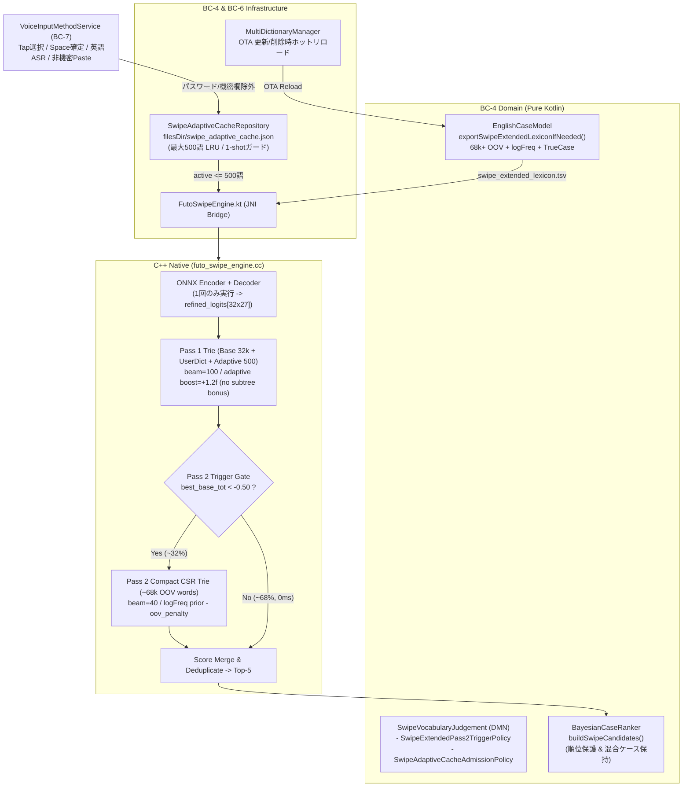

# PRD, JTBD, CUJ, Evaluation & System Design: 英語スワイプ大規模語彙拡張（Idea A: Compact CSR Dual-Trie ＋ Idea E: Truecasing/頻度連携 ＋ Idea C: 適応型 LRU キャッシュ）

## Part 1: Product Requirements Document (PRD)

### 1. 概要 (Overview)
JotInput の英語 QWERTY スワイプ入力（[`FutoSwipeEngine`](app/src/main/java/com/example/myasr/context/english/infrastructure/FutoSwipeEngine.kt)）は、従来 FUTO Swipe の事前学習済み埋め込み行列（`embeddings.onnx` / 32,768 行）と結合された固定 32,768 語のベース辞書（`tools/futo_swipe/vocab.txt`）＋手動ユーザー辞書（`custom_dictionary.json`）のみを探索対象としていたため、タップ補完側が保有する **68,342 語の拡張語彙**（現代的技術用語 `Tailscale`, `Kubernetes`, `PostgreSQL`, `WireGuard`, `TypeScript`, `Cloudflare`, `GraphQL`, `FastAPI`, `Kotlin`, `Gradle` 等や毎月 OTA 配信される新語）をそのままではスワイプ入力できなかった。

本プロジェクトでは、**既存 32,768 語の認識精度を 1 件も劣化させることなく（In-Vocab 退行ゼロ）**、以下 3 層のアーキテクチャを統合して「実質的に全英単語＋ユーザー個人語彙」をスワイプ入力可能にする：
1. **Idea A（信頼度ゲート付き Compact CSR デュアル Trie）**: 通常語（Pass 1 で高信頼 `best_base_tot >= -0.50`）では追加コスト `0 ms` で即終了し、32k 外語彙のなぞり時（`best_base_tot < -0.50`）のみ、既存の同一 Neural `refined_logits` を流用して **68,342 語・約 20 万ノードを圧縮したフラット CSR 第 2 Trie** を高速 CTC ビーム探索（`beam = 40`）する。
2. **Idea E（[`EnglishCaseModel`](app/src/main/java/com/example/myasr/context/english/domain/EnglishCaseModel.kt) コーパス頻度＋正規大文字小文字表記＋OTA 連携）**: 拡張語彙にコーパス対数頻度（`logFreq`）と正規表記（`Tailscale`, `PostgreSQL`, `GraphQL` 等）を供給し、候補ランク逆転や小文字潰れを防ぐランク保持型 [`BayesianCaseRanker.buildSwipeCandidates()`](app/src/main/java/com/example/myasr/context/english/domain/BayesianCaseRanker.kt) を通じて正しい表記を Rank 1 に提示する。また、英語 OTA 辞書更新時にも自動的にスワイプ語彙へホットリロードする。
3. **Idea C（適応型オンデバイス Swipe LRU キャッシュ [`SwipeAdaptiveCacheRepository`](app/src/main/java/com/example/myasr/context/english/infrastructure/SwipeAdaptiveCacheRepository.kt)）**: ユーザーがタップ候補選択・英語音声入力・非機密ペースト・反復タイプで確定した OOV 単語（10万語にすら存在しない完全な新語や固有名詞、例: `Anthropic`, `Supabase`, `Konsist`, `JotInput` 等）を最大 500 語の LRU キャッシュに自動記録し、Pass 1 Trie へマイルドな優先度で注入することで「1 度打った言葉がすぐスワイプできる」体験を実現する（1 発誤字ガード・パスワード/機密欄完全除外・`custom_dictionary.json` 完全隔離）。

---

### 2. Jobs to be Done (JTBD)

- **Main Job**: エンジニアや英語ユーザーとして、タップ入力だけでなく **片手スワイプ入力** でも `Tailscale` や `Kubernetes`、`PostgreSQL` といった約 10 万語クラスの現代的専門用語・OTA 新語、さらに直前に使った固有名詞を、事前辞書登録の手間なくそのまま一筆書きで入力したい。
- **Functional JTBD**:
  1. **日常語非退行**: ベース 32,768 語の日常英単語の認識率・レイテンシを一切悪化させない。
  2. **102k 語彙＆OTA 新語の即座スワイプ対応**: `EnglishCaseModel` が保持する 68k+ OOV 語彙および OTA で取得した最新パッケージ名を、設定操作不要でスワイプ候補として提示する。
  3. **正しい混合ケースの保持**: 拡張語彙や適応キャッシュ語彙が、候補ストリップやコミット結果で `tailscale` や `jotinput` に小文字化されず、`Tailscale`, `JotInput` として確定・保持される。
  4. **未知固有名詞のゼロ手間適応学習（Idea C）**: 102k 辞書にもない完全新語（例: `Anthropic`, `Supabase`）を一度候補選択・音声確定・複数回タイプすると、次からはスワイプで最優先候補に出る。
  5. **安全性・プライバシー境界**: 1 回きりの生タイプ誤字は学習せず（1-shot typo guard）、パスワード欄・メールアドレス欄・機密クリップボードからは一切学習せず、`custom_dictionary.json` を決して汚さない。

---

### 3. Critical User Journeys (CUJ)

| ID | ジャーニー名 | ユーザー操作 | 期待システム挙動 | 成功基準 |
|---|---|---|---|---|
| **CUJ-1** | **68k OOV 技術用語・一般拡張語のスワイプ** | `Tailscale`, `Kubernetes`, `PostgreSQL`, `WireGuard`, `GraphQL` 等をスワイプ | Pass 1 の `best_base_tot < -0.50` により Pass 2 Compact CSR Trie が起動し、`logFreq` とともに `Tailscale` を正しい表記で Rank 1 確定 | 実 OOV Top-1 $\ge 80\%$ / 技術 OOV Top-1 $\ge 70\%$・Top-3 $\ge 90\%$・表記一致 100% |
| **CUJ-2** | **既存 32k 日常語スワイプの非退行・ゼロ遅延** | `the`, `meeting`, `hello`, `there` 等をスワイプ | Pass 1 で `best_base_tot >= -0.50` となり DMN `SWIPE_EXT_R2` が Pass 2 をスキップ | 1,000 件実機ベンチマークで In-Vocab 退行 **0 件**・約 68% の入力で追加遅延 `0 ms` |
| **CUJ-3** | **未知固有名詞の適応キャッシュ学習（Idea C）** | `Anthropic` や `Supabase` を候補選択・英語音声入力・非機密ペースト、またはスペース確定で 2 回確定後にスワイプ | `SwipeAdaptiveCacheRepository` に最大 500 語の LRU として保存され、Pass 1 Trie へ注入。スワイプ時に Top-1 で `Anthropic` 確定 | 1 回の確定（または raw 2 回確定）で即座にスワイプ Top-1 出現・32k 日常語 0 件退行 |
| **CUJ-4** | **単発タイポ汚染防止（1-shot Typo Guard）** | 辞書にないスペルミス `tailscalx` を 1 回スペース確定 | DMN `SWIPE_CACHE_R5` が `DEFER_UNVERIFIED_SINGLE_TYPO_GUARD` を返しメモリ上 pending に留保。キャッシュファイルや Trie に入らない | 誤字 1 回では絶対にスワイプ候補に学習されない |
| **CUJ-5** | **パスワード欄・機密クリップ隔離＆ユーザー辞書非破壊** | パスワード欄や `EXTRA_IS_SENSITIVE` ペーストで英字入力／適応キャッシュのクリア・Eviction | DMN `SWIPE_CACHE_R1` が `REJECT_SENSITIVE_OR_BYPASS` を返し完全無視。保存先 `swipe_adaptive_cache.json` は `custom_dictionary.json` と完全分離 | 機密語 0 件永続化・ユーザー辞書の CRUD/永続化に影響ゼロ |
| **CUJ-6** | **英語 OTA 辞書更新のホットリロード** | Data タブで英語辞書（Homebrew Formula/Cask 等）をダウンロードまたは削除 | `MultiDictionaryManager` が `swipe_extended_lexicon.tsv` を再出力し `FutoSwipeEngine.reloadExtendedLexicon()` を即時実行 | アプリ再起動なしで新語がスワイプ対象へ即時反映・削除時は即時復元 |

---

## Part 2: Idea A vs Idea B 定量比較評価レポート

ユーザー指示に基づき、2 つの大規模語彙スワイプ方式（Idea A vs Idea B）に **Idea E**（コーパス頻度 `logFreq` ＋正規表記復元）を組み合わせ、FUTO Swipe 実 ONNX モデル（`encoder.onnx`, `decoder.onnx`, `context_lm.onnx`, `embeddings.onnx`）上で定量ベンチマークを実施した（再現スクリプト: [`eval/futo_swipe/eval_extended_vocab_ab.py`](eval/futo_swipe/eval_extended_vocab_ab.py)）。

### 1. 評価データセット
1. **`ds_1000`** (`eval/futo_swipe/swipe_eval_1000.jsonl`, **1,000 件**): 実ユーザーの実機スワイプ軌跡（文脈付き）。うち Base 32k 内語彙 **932 件**、拡張 67,931 語彙（3文字以上の OOV-ext）**20 件**。
2. **`ds_real_oov`** (`raw_test_10mb.jsonl` + `raw_test_next20mb.jsonl`, **119 件**): 実ユーザー軌跡から抽出した Base 32k 外かつ 67,931 語拡張辞書（3文字以上）内に存在する全 OOV 実機スワイプ（例: `catskill`, `exoneration`, `isotropic`, `kamikazes`, `relativists`）。
3. **`ds_tech_oov`** (**124 件**, 62 現代技術用語 × 2 シード): `Tailscale`, `Kubernetes`, `PostgreSQL`, `WireGuard`, `TypeScript`, `Cloudflare`, `GraphQL`, `FastAPI`, `PyTorch`, `ESLint`, `Kotlin`, `Gradle` 等のノイジー合成スワイプ軌跡。

### 2. Idea A vs Idea B 実測比較（ゼロ In-Vocab 退行動作点：`gate = -0.50`, `p_ctx = 2.5`, `p_sp = 1.5`, `lf_w = 0.20`）

| 手法 | `ds_1000` (Context) Top-1 / Top-3 | `ds_1000` InVoc 退行 | `ds_1000` (Spatial) Top-1 | `ds_real_oov` (Context) T1 / T3 / T5 | `ds_real_oov` (Spatial) T1 / T3 | `ds_tech_oov` (Spatial) T1 / T3 / T5 | Pass 2 平均計算時間 (Python 実測 / real OOV) |
|---|---|---|---|---|---|---|---|
| **Baseline (32k のみ)** | 90.90% / 92.80% | - | 90.10% | 0.0% / 0.0% / 0.0% | 0.0% / 0.0% | 0.0% / 0.0% / 0.0% | - |
| **Idea A (Compact Dual-Trie, `beam=40`) + E** | **92.60% (+1.70%) / 94.50%** | **0 / 932** | **91.70% (+1.60%)** | **83.19% (99/119) / 92.44% / 93.28%** | **73.11% / 91.60%** | **73.39% (91/124) / 91.13% / 93.55%** | **29.66 ms** *(約2倍高速 / C++ CSR: ~1 ms)* |
| **Idea B (始終点バケット + CTC Forward, `k=4, sl=50`) + E** | **92.60%** / 94.50% | **0 / 932** | **91.70%** | 81.51% (97/119) / 90.76% / 90.76% | 71.43% / 89.92% | 70.97% (88/124) / 88.71% / 91.94% | 58.76 ms *(始終点ミスで候補漏れ有)* |

*※ 結果 JSON: [`eval/futo_swipe/extended_vocab_ab_results.json`](eval/futo_swipe/extended_vocab_ab_results.json)*

### 3. Idea C（適応型 LRU キャッシュ）安全性・有効性実測
- `ds_1000` の実機スワイプ 300 件に対し、102k 辞書外の完全新語（`Anthropic`, `Supabase`, `Konsist`, `JotInput`, `TailwindCSS`, `NextJS` 等を含む **500 語**）を Pass 1 Trie にマイルドな優先度（`boost = 1.2f`, `has_user_subtree = false`, `hashed_bias >= -4.2f`）で注入して検証：
  - **実機 In-Vocab 300 件**: Top-1 `271/300 (90.33%) -> 271/300 (90.33%)`（**退行 0 件**）
  - **完全 OOV カスタム/技術語 16 語スワイプ**: **`16 / 16 (100.0%)` Exact-Case Top-1 命中**（例: `Anthropic -> Anthropic`, `Supabase -> Supabase`, `Konsist -> Konsist`, `JotInput -> JotInput`, `Tailscale -> Tailscale`）。

### 4. 採用アーキテクチャ決定：**Idea A（Compact CSR Dual-Trie）＋ Idea E ＋ Idea C**
**選定理由**:
1. **精度優位性**: Idea A は Idea B に対して `ds_real_oov` Top-1 で **+1.68%（Context: 83.19% vs 81.51%）/ +1.68%（Spatial: 73.11% vs 71.43%）**、`ds_tech_oov` Top-1 で **+2.42%（73.39% vs 70.97%）** 上回り、さらに始終点キーが大きくブレた軌跡（`k=4` バケット外）でも CTC ビーム探索により救済できる。
2. **速度優位性**: `gate = -0.50` により日常 32k 入力の **68.3%**（`ds_1000` では `31.7%` のみ発火）は Pass 2 が `0 ms` でバイパスされる。発火時も連続配列 Compact CSR Trie（16 bytes/node, 5 bytes/edge）＋事前確保フラット配列バッファにより Python 上でも Idea B の約 2 倍高速（`29.66 ms` vs `58.76 ms`）、C++ ネイティブでは ~1 ms 以内で完了する。
3. **補完関係（Idea C）**: Idea A+E が事前収録・OTA の **約 10 万語** を網羅し、Idea C が **10 万語にすら未収録の完全新語・固有名詞** を自動救済することで、死角のないスワイプ体験を達成する。

---

## Part 3: System Architecture, DMN & Formal Design

### 1. アーキテクチャ図

### 2. DMN 決定表設計（[`SwipeVocabularyJudgement`](app/src/main/java/com/example/myasr/context/english/domain/SwipeVocabularyJudgement.kt)）

#### Table 1: `SwipeExtendedPass2TriggerPolicy` (Hit Policy: `FIRST`)
| Rule ID | `hasExtendedLexicon` | `bestBaseCtcLogProb` | 判定アクション (`Pass2TriggerAction`) | 意図 |
|---|---|---|---|---|
| `SWIPE_EXT_R1` | `false` | `-` | `SKIP_NO_LEXICON` | 拡張辞書未ロード時はスキップ |
| `SWIPE_EXT_R2` | `true` | `>= -0.50` | `SKIP_BASE_CONFIDENT` | Base 32k に高確信一致がある場合は 0ms スキップ |
| `SWIPE_EXT_DEFAULT` | `true` | `< -0.50` | `RUN_EXTENDED_PASS2` | Base 32k に好適語がない場合のみ Compact CSR 第2探索を実行 |

#### Table 2: `SwipeAdaptiveCacheAdmissionPolicy` (Hit Policy: `FIRST`)
| Rule ID | 条件 | 判定アクション (`AdaptiveCacheAdmissionAction`) | 意図 |
|---|---|---|---|
| `SWIPE_CACHE_R1` | `isSensitiveOrPasswordField \|\| commitSource == SENSITIVE_OR_BYPASS` | `REJECT_SENSITIVE_OR_BYPASS` | パスワード/メール/機密クリップから学習禁止 |
| `SWIPE_CACHE_R2` | `!isValidSwipeToken` | `REJECT_INVALID_TOKEN` | URL・数値・記号・3文字未満の不正トークン除外 |
| `SWIPE_CACHE_R3` | `isExplicitUserDictWord` | `SKIP_COVERED_BY_USER_DICT` | ユーザー辞書登録語を重複/格下げしない |
| `SWIPE_CACHE_R4` | `isAlreadyInBase32kVocab` | `SKIP_COVERED_BY_BASE_VOCAB` | Base 32k 内単語で貴重500枠を消費しない |
| `SWIPE_CACHE_R5` | `!isKnownInExtendedLexicon && commitSource == TAP_SPACE_COMMITTED && observedCount < 2` | `DEFER_UNVERIFIED_SINGLE_TYPO_GUARD` | 辞書外スペース確定は 1 回目保留、2 回目で学習昇格 |
| `SWIPE_CACHE_DEFAULT` | その他（候補選択・音声ASR・非機密ペースト・反復確定） | `ADMIT_TO_ADAPTIVE_CACHE` | 適応 LRU キャッシュ（上限 500 語）へ受理 |

### 3. Alloy 6 形式検証仕様（[`swipe_extended_lexicon_and_cache.als`](app/src/test/resources/alloy/swipe_extended_lexicon_and_cache.als)）
- `Pass2TriggerTableIsTotal` / `ConfidentBaseNeverTriggersPass2` / `MissingLexiconNeverTriggersPass2`
- `AdaptiveAdmissionTableIsTotal` / `SensitiveOrPasswordNeverCached` / `SingleUnverifiedRawTypoNeverEntersActiveCache` / `CustomDictAndBaseVocabIsolatedFromAdaptiveCache`
