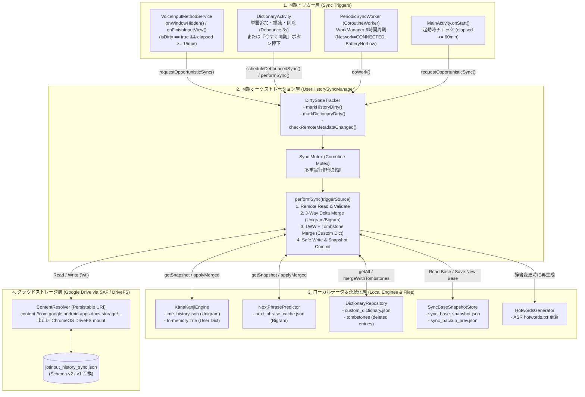
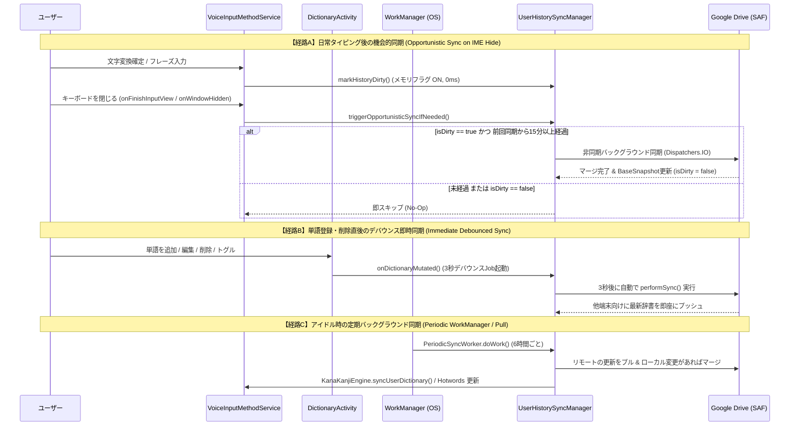

# PRD & Detailed System Design: Google Drive ユーザー辞書・学習頻度の定期自動同期システム (Periodic Cloud Sync for Custom Dictionary & User Learning Frequencies)

## Part 1: Product Requirements Document (PRD)

### 1. 概要 (Executive Summary)
JotInput（オンデバイス音声入力・フリックハイブリッドIME）において、複数端末（例: Pixel 10 Pro と ChromeOS ARCVM）を日常的に併用するユーザーが、手動操作なしで常に最新の **「ユーザー辞書（単語登録）」**、**「確定単語頻度履歴（Unigram History）」**、および **「次フレーズ遷移学習履歴（Bigram History）」** を共有・統合できる **Google Drive 定期自動同期（Periodic & Opportunistic Cloud Sync）システム** を導入する。

現行の [`UserHistorySyncManager`](app/src/main/java/com/example/myasr/UserHistorySyncManager.kt) は、ユーザーが [`DictionaryActivity`](app/src/main/java/com/example/myasr/DictionaryActivity.kt) を開いて「Google Drive と同期」ボタンを手動タップした時のみ同期が走る「単発手動同期」であり、かつマージアルゴリズムに単純な `max(local, remote)` や追加優先マージを採用しているため、以下の課題を抱えている。本ドキュメントではこれらを抜本的に解決するプロダクト要件（PRD）と詳細システム設計（DD）を定義する。

---

### 2. 背景と現状の課題 (Background & Problem Statement)

#### 2.1. 手動同期のみによるマルチデバイス体験の分断
- **現状**: [`DictionaryActivity`](app/src/main/java/com/example/myasr/DictionaryActivity.kt) の [`btnSyncGoogleDrive`](app/src/main/res/layout/activity_dictionary.xml#L95) を人間が明示的に押さない限り同期されない。
- **課題**: スマートフォン（Pixel 10 Pro）で日々学習した変換頻度や新規登録した専門用語・固有名詞が、PC（ChromeOS ARCVM）で入力する際に反映されておらず、両方を使うユーザーにとって「同じ言葉を別端末で何度も選び直す・登録し直す」ストレスが発生する。

#### 2.2. 頻度カウンタの「他端末加算分の消失」問題 (`max(local, remote)` の限界)
- **現状**: [`KanaKanjiEngine.mergeHistory`](app/src/main/java/com/example/myasr/KanaKanjiEngine.kt#L958-L974) および [`NextPhrasePredictor.mergeHistory`](app/src/main/java/com/example/myasr/NextPhrasePredictor.kt#L277-L320) では `maxOf(localCount, remoteCount)` によるべき等マージを行っている。
- **課題**:
  - 端末Aと端末Bが両方とも基準値 `10回` からスタートし、端末Aで `+5回`（計15回）、端末Bで `+4回`（計14回）選択された場合、`max(15, 14) = 15` となり、**端末Bで入力した4回分の学習増分（Delta）が完全に消失する**。
  - 逆に単純加算（`local + remote`）にすると、定期同期のたびに `15 + 15 = 30 -> 60 -> 120` と指数関数的にカウントが爆発してしまう。

#### 2.3. ユーザー辞書の削除・無効化・優先度引き下げが復活してしまう問題 (Zombie Resurrection Bug)
- **現状**: [`DictionaryRepository.mergeEntries`](app/src/main/java/com/example/myasr/DictionaryRepository.kt#L104-L128) は以下のロジックになっている：
  - ローカルに存在しないリモートエントリは無条件で追加する（削除記録＝Tombstone がない）。
  - 既存エントリとの競合時は `Priority.HIGH` 優先、`isEnabled = existing.isEnabled || remote.isEnabled` でマージする。
- **課題**:
  1. ユーザーが端末Aで不要な単語を**削除**しても、定期同期が走ると Google Drive 上の古いファイルからその単語が**ゾンビのように復活（再追加）**してしまう。
  2. ユーザーが単語を**無効化 (`isEnabled = false`)** したり、優先度を **高 $\to$ 標準** に下げたりしても、`||` 演算子と `HIGH` 優先ルールのせいで定期同期のたびに強制的に `isEnabled = true` / `Priority.HIGH` に戻されてしまう。

#### 2.4. バックグラウンド同期完了時のインメモリ辞書・ASR ホットワード未反映
- **現状**: [`UserHistorySyncManager.performSync`](app/src/main/java/com/example/myasr/UserHistorySyncManager.kt#L104-L183) は `dictionaryRepository.mergeEntries(remoteCustomDict)` を呼んでファイル保存するだけであり、インメモリの [`KanaKanjiEngine.syncUserDictionary`](app/src/main/java/com/example/myasr/KanaKanjiEngine.kt#L171) や [`HotwordsGenerator`](app/src/main/java/com/example/myasr/HotwordsGenerator.kt) の更新は [`DictionaryActivity`](app/src/main/java/com/example/myasr/DictionaryActivity.kt#L247) の UI コールバック側に依存している。
- **課題**: バックグラウンド定期同期が走った際、IME プロセス内の Trie 辞書と音声認識ホットワードに新規マージ単語が即時反映されない。

---

### 3. ゴールと非ゴール (Goals & Non-Goals)

#### ゴール (Goals)
1. **ゼロタッチのハイブリッド定期自動同期**:
   - OS の省電力スケジューラ（`WorkManager` 定期ジョブ）と、IME 特有のライフサイクル（キーボード収納時 `onFinishInputView` / `onWindowHidden` における Dirty 検知＋クールダウン付き機会的同期）を組み合わせ、バッテリーを消費せずに自動で Google Drive 同期を実行する。
2. **数学的に厳密で増分を失わない頻度マージ（3-Way Delta Merge / G-Counter CRDT）**:
   - 各端末での純粋な入力増分（$\Delta = \text{local} - \text{base}$）を正確に統合し、定期同期を何度繰り返してもカウント爆発せず、かつ複数端末の学習回数を1回も失わないマージを実現する。
3. **ユーザー辞書の削除・更新・無効化を正確に伝播する LWW-Element-Set (Tombstone) 同期**:
   - 単語ごとの更新タイムスタンプ（`updatedAtMillis`）と削除墓標（Tombstone: `deletedAtMillis`）を導入し、複数端末間での単語追加・編集・ON/OFF切替・削除を矛盾なく同期する。
4. **耐障害性・データ保護の徹底 (`Custom Dictionary Persistence Contract` 遵守)**:
   - リモートファイルの破損・空ファイル化・通信切断・SAF 権限失効時にもローカルの `custom_dictionary.json` や学習履歴を決して破壊・消失させないアトミック書き込み＆世代バックアップ機構を備える。

#### 非ゴール (Non-Goals)
- **自前クラウドサーバーの構築**: サーバー運用コストおよびプライバシーリスクを避けるため、外部バックエンドは持たず、Android 標準の Storage Access Framework (SAF) / ChromeOS DriveFS マウント経由のユーザー個人の Google Drive ファイルのみを使用する。
- **数百万語のシステム拡張辞書（SudachiDict / Wikipedia 等）の Google Drive 同期**: 大容量の公開辞書（数百MB）は [`DictionaryUpdateTracker`](app/src/main/java/com/example/myasr/DictionaryUpdateTracker.kt) により GitHub から直接配信されるため、Google Drive 同期の対象外とする（同期対象はあくまでユーザー固有の辞書と学習頻度データ、数百KB〜数MB以下）。

---

### 4. 機能要件 (Functional Requirements)

| 要件ID | カテゴリ | 要件内容 | 優先度 |
| :--- | :--- | :--- | :--- |
| **FR-1** | **ハイブリッド自動同期トリガー** | ① **定期バックグラウンド同期 (`WorkManager`)**: デフォルト6時間周期（ネットワーク接続時・バッテリー低下でない時）。<br>② **IME キーボード収納時の機会的同期 (`Opportunistic Sync`)**: キーボードを閉じた際、未同期のローカル変更（Dirty flag）があり、かつ前回同期から15分以上経過していればバックグラウンドで非同期同期。<br>③ **辞書編集時の即時デバウンス同期**: [`DictionaryActivity`](app/src/main/java/com/example/myasr/DictionaryActivity.kt) で単語を追加・編集・削除した3秒後に自動でバックグラウンド同期。 | **P0 (必須)** |
| **FR-2** | **頻度データの 3-Way Delta マージ** | Unigram（[`KanaKanjiEngine`](app/src/main/java/com/example/myasr/KanaKanjiEngine.kt)）および Bigram（[`NextPhrasePredictor`](app/src/main/java/com/example/myasr/NextPhrasePredictor.kt)）について、前回同期時のローカルスナップショット（`sync_base_snapshot.json`）との差分 $\Delta \ge 0$ を算出し、リモート値に加算マージする。Schema v1 ファイルとも完全後方互換を保つ。 | **P0 (必須)** |
| **FR-3** | **ユーザー辞書の LWW + Tombstone マージ** | [`DictionaryEntry`](app/src/main/java/com/example/myasr/DictionaryEntry.kt) に `updatedAtMillis` を持たせ、削除時は Tombstone（`deleted_dictionary_tombstones`、保持期間30日）を記録することで、削除・無効化・優先度変更が他端末へ正しく伝播し、削除済み単語が復活しないようにする。 | **P0 (必須)** |
| **FR-4** | **インメモリエンジン＆ホットワード即時反映** | バックグラウンド同期でユーザー辞書または頻度に変化があった場合、[`KanaKanjiEngine.syncUserDictionary`](app/src/main/java/com/example/myasr/KanaKanjiEngine.kt#L171) および [`HotwordsGenerator`](app/src/main/java/com/example/myasr/HotwordsGenerator.kt) を自動的に再構築し、IME 再起動なしで即座に変換・音声認識へ反映する。 | **P0 (必須)** |
| **FR-5** | **UI 統合（UI Simplicity Contract 遵守）** | [`MainActivity`](app/src/main/java/com/example/myasr/MainActivity.kt) の4カード上限を厳守し、メイン画面に新規カードは追加しない。[`DictionaryActivity`](app/src/main/java/com/example/myasr/DictionaryActivity.kt) の既存カード [`cardHistorySync`](app/src/main/res/layout/activity_dictionary.xml#L39) 内に「自動同期スイッチ（ON/OFF）」と「同期ステータス表示（最終同期日時・次回予定・エラー通知）」をシンプルに配置する。 | **P0 (必須)** |
| **FR-6** | **データ破損防止＆世代バックアップ** | リモート JSON のパース検証、異常な大量消失検知（Safety Guard）、ローカルバックアップ（`sync_backup_prev.json`）への自動退避、および SAF ストリーム書き込み時のトランケート事故防止を実装する。 | **P0 (必須)** |

---

### 5. 非機能要件・制約事項 (Non-Functional Requirements)

1. **IME 入力レイテンシへの影響ゼロ (`0.0 ms` UI ブロッキング)**:
   - 同期処理・JSON シリアライズ・ファイル I/O・ContentResolver I/O はすべて `Dispatchers.IO` 上のバックグラウンドコルーチンで実行し、メインスレッドや音声認識スレッド、Viterbi 変換スレッドを一切ブロックしない。
2. **省電力・通信量最小化**:
   - ローカルで1文字も確定しておらず辞書変更もない場合（`isDirty == false`）、キーボード収納時の機会的同期は一切発火しない。
   - 定期同期においても、リモートファイルのメタデータ（`DocumentsContract.Document.COLUMN_LAST_MODIFIED` / `COLUMN_SIZE`）が前回同期時と同一かつローカルが `isDirty == false` の場合は、JSON のフルパースおよび再書き込みをスキップ（Fast-NoOp）する。
3. **APK サイズおよび依存関係の軽量性**:
   - Google Drive REST SDK（Play Services Auth / Drive API ライブラリ群）は OAuth 同意画面の審査や APK サイズ肥大化を招くため使用せず、既存の **Android Storage Access Framework (`ContentResolver` + Persistable URI Permission)** を継続活用する。

---
---

## Part 2: Detailed Design Document (DD / 詳細システム設計)

### 1. システムアーキテクチャ全体像 (System Architecture)



---

### 2. データスキーマ設計 (JSON Schema v2 & 後方互換性)

既存の Schema v1（[`UserHistorySyncManager.kt`](app/src/main/java/com/example/myasr/UserHistorySyncManager.kt#L28)）を破壊せず、古いバージョンのアプリが読んでも正常に動作する **上位互換の Schema v2** を定義する。

#### 2.1. リモート同期ファイル (`jotinput_history_sync.json`) の Schema v2 構造

```json
{
  "schema_version": 2,
  "sync_revision_id": "a8f9d2c1-4b3e-4d1a-9c2b-7e6f5a4b3c2d",
  "exported_at_ms": 1794271747000,
  "device_id": "d4e5f6a7-8b9c-4d0e-a1b2-c3d4e5f60001",
  "device_model": "Google Pixel 10 Pro",
  "unigram_history": {
    "きしゃ:貴社": 24,
    "とうきょう:東京": 15,
    "りーぞん:ReazonSpeech": 8
  },
  "bigram_history": {
    "お疲れ様": {
      "です": 42,
      "でした": 11
    },
    "よろしく": {
      "お願いします": 35
    }
  },
  "custom_dictionary": [
    {
      "id": "550e8400-e29b-41d4-a716-446655440000",
      "word": "JotInput",
      "reading": "じょっといんぷっと",
      "priority": "HIGH",
      "isEnabled": true,
      "updatedAtMillis": 1794260000000
    }
  ],
  "custom_dictionary_tombstones": [
    {
      "id": "123e4567-e89b-12d3-a456-426614174000",
      "word": "旧プロジェクト名",
      "reading": "きゅうぷろじぇくとめい",
      "deletedAtMillis": 1794270000000
    }
  ]
}
```

#### 2.2. 各フィールドの詳細仕様と Schema v1 互換ルール

| フィールド名 | 型 | v1 との違い・フォールバック動作 |
| :--- | :--- | :--- |
| `schema_version` | `Int` | v2 として出力。v1 のアプリが読んだ場合も `unigram_history`, `bigram_history`, `custom_dictionary` のキー名・構造が完全に同一であるためそのままパース可能。 |
| `sync_revision_id` | `String (UUID)` | 書き出しごとに新規発行される一意なリビジョンID。前回同期時に自分が書き出した `last_synced_revision_id` と一致する場合は「リモート側に他端末からの更新なし」と O(1) で判定できる。 |
| `device_id` | `String (UUID)` | アプリ初回インストール時に生成し `SharedPreferences` に保存する匿名端末識別子。 |
| `custom_dictionary[].updatedAtMillis` | `Long` | 単語の追加・編集・ON/OFF切替・優先度変更が行われたエポックミリ秒。Schema v1 の JSON（または既存ローカルファイル）から読み込んだ際に未定義の場合は `0L` にフォールバックする。 |
| `custom_dictionary_tombstones` | `JSONArray` | 削除されたユーザー辞書エントリの墓標リスト。`deletedAtMillis` から **30日（`2,592,000,000 ms`）** 経過した古い墓標は同期時に自動パージ（ガベージコレクション）し、ファイルの肥大化を防ぐ。 |

#### 2.3. ローカルベーススナップショット (`context.filesDir/sync_base_snapshot.json`)
3-Way Delta マージのために、**「前回 Google Drive との同期が成功した直後の時点における Unigram / Bigram カウント」** を端末ローカルの内部ストレージに保存する。

```json
{
  "last_synced_revision_id": "a8f9d2c1-4b3e-4d1a-9c2b-7e6f5a4b3c2d",
  "last_synced_at_ms": 1794271747000,
  "base_unigram": {
    "きしゃ:貴社": 24,
    "とうきょう:東京": 15
  },
  "base_bigram": {
    "お疲れ様": {
      "です": 42,
      "でした": 11
    }
  }
}
```

---

### 3. コアアルゴリズム詳細設計 (Core Merge Algorithms)

#### 3.1. 学習頻度（Unigram / Bigram）の 3-Way Delta マージアルゴリズム

単純な `max(local, remote)` による他端末加算分の消失と、`local + remote` による二重加算爆発の両方を防ぐため、**前回同期時のベース値 $B(k)$**、**現在のローカル値 $L(k)$**、**リモート値 $R(k)$** を用いた **べき等 3-Way 増分マージ（Idempotent 3-Way Delta Merge）** を採用する。

##### 数式定義
任意のキー $k$（Unigram なら `"reading:surface"`、Bigram なら `(prev, curr)` ペア）について：

1. **ローカル増分 $\Delta_L(k)$ の算出**:
   $$\Delta_L(k) = \max\bigl(0,\; L(k) - B(k)\bigr)$$
   - 通常入力時は $L(k) \ge B(k)$ となり、前回同期以降にこの端末で確定された純粋な回数 $\Delta_L(k)$ が得られる。
   - 万一ローカルで LRU 追い出しや履歴クリアが行われて $L(k) < B(k)$ となった場合も、$\Delta_L(k) = 0$ にクランプされるため負の破壊が起きない。

2. **リモート基準値の決定と統合値 $M(k)$ の算出**:
   $$M(k) = \min\Bigl(C_{\max},\; \max\bigl(R(k),\; B(k)\bigr) + \Delta_L(k)\Bigr)$$
   （ただし上限 $C_{\max} = 100,000$）

3. **同期完了後のローカル状態とベーススナップショットの更新**:
   $$L_{\text{new}}(k) \leftarrow M(k), \qquad B_{\text{new}}(k) \leftarrow M(k)$$

##### 具体例によるトレース検証（2端末並行利用ケース）
- **初期状態（同期済み）**:
  - 単語 `"きしゃ:貴社"` について、端末1（Pixel）・端末2（Chromebook）・Google Drive すべて `10` ($B_1 = 10, L_1 = 10, B_2 = 10, L_2 = 10, R = 10$)。
- **Step 1: 両端末でオフライン／非同期に入力**:
  - 端末1で5回確定 $\to L_1 = 15$ ($B_1 = 10$)。
  - 端末2で4回確定 $\to L_2 = 14$ ($B_2 = 10$)。
- **Step 2: 端末1が定期同期を実行**:
  - $\Delta_{L1} = \max(0, 15 - 10) = 5$。
  - $M_1 = \max(R=10, B_1=10) + 5 = 15$。
  - Google Drive に $R \leftarrow 15$ を書き込み、端末1は $L_1 \leftarrow 15, B_1 \leftarrow 15$ に更新。
- **Step 3: 端末2が定期同期を実行**:
  - $\Delta_{L2} = \max(0, 14 - 10) = 4$。
  - $M_2 = \max(R=15, B_2=10) + 4 = 19$。
  - Google Drive に $R \leftarrow 19$ を書き込み、端末2は $L_2 \leftarrow 19, B_2 \leftarrow 19$ に更新！
- **Step 4: 端末1が再度定期同期を実行（追加入力なし）**:
  - $\Delta_{L1} = \max(0, 15 - 15) = 0$。
  - $M_1 = \max(R=19, B_1=15) + 0 = 19$。
  - 端末1も $L_1 \leftarrow 19, B_1 \leftarrow 19$ に収束！
- **結果**: 端末1の `+5` と端末2の `+4` が1回も失われず正確に `19` に合算され、かつ何回同期を繰り返しても `19` で完全に安定（べき等）する。

##### 初回同期時（`sync_base_snapshot.json` 未存在時）の挙動
- 新しい同期ファイルを選択した直後や、v1 から v2 へのアップグレード初回同期時は $B(k)$ が存在しない。
- この初回1回に限り、既存と同じ $M(k) = \max(L(k), R(k))$ でマージして初期ベース $B_{\text{new}}(k) = M(k)$ を確立する。これにより既存の蓄積カウントが2倍になる現象も完全に防止できる。

##### 容量制限（LRU Eviction & Cap）の整合性維持
- **Unigram ([`KanaKanjiEngine`](app/src/main/java/com/example/myasr/KanaKanjiEngine.kt))**:
  - マージ後に `MAX_HISTORY_WORDS (10,000)` を超えた場合は、カウント値の昇順（最も頻度が低い語）から順に切り詰める。なお、切り詰め時には直近ローカルで入力された語（$\Delta_L(k) > 0$）が不当に消えないよう、`mergedCount` 優先で保持する。
- **Bigram ([`NextPhrasePredictor`](app/src/main/java/com/example/myasr/NextPhrasePredictor.kt))**:
  - 同様に 1親キーあたり `MAX_CONTINUATIONS_PER_KEY (16)`、親キー数 `MAX_PREFIX_KEYS (4,000)`、総ペア数 `MAX_TOTAL_BIGRAM_PAIRS (32,000)` のメモリ上限（$< 5\text{ MB}$ RAM）を守って頻度順に剪定する。

---

#### 3.2. ユーザー辞書（Custom Dictionary）の LWW-Element-Set + Tombstone マージアルゴリズム

ユーザー辞書エントリは、同一性の正規化キー（Identity Key）を以下で定義する：
$$\text{Key}(e) = \begin{cases} \text{lowercase}(e.\text{reading}) & (\text{英語単一登録 } e.\text{isEnglishOnlyEntry} = \text{true の場合}) \\ e.\text{reading} + \text{"\textbackslash u0000"} + \text{lowercase}(e.\text{word}) & (\text{日本語・一般登録の場合}) \end{cases}$$

##### データ構造の拡張 ([`DictionaryEntry.kt`](app/src/main/java/com/example/myasr/DictionaryEntry.kt))
```kotlin
data class DictionaryEntry(
    val id: String = UUID.randomUUID().toString(),
    val word: String,
    val reading: String,
    val priority: Priority = Priority.NORMAL,
    val isEnabled: Boolean = true,
    val updatedAtMillis: Long = System.currentTimeMillis()
)

data class DictionaryTombstone(
    val id: String,
    val word: String,
    val reading: String,
    val deletedAtMillis: Long
)
```

##### 状態遷移とタイムスタンプ記録 ([`DictionaryRepository.kt`](app/src/main/java/com/example/myasr/DictionaryRepository.kt))
1. **`add(entry)`**:
   - `entry.copy(updatedAtMillis = System.currentTimeMillis())` として保存。
   - もし同一キーの Tombstone がローカルの墓標リストに存在していた場合は、その Tombstone を削除（再登録による復活）する。
2. **`update(updated)` / `toggle(id)`**:
   - 優先度変更や有効/無効トグル時に `updatedAtMillis = System.currentTimeMillis()` を更新して保存する。
3. **`delete(id)`**:
   - `entries` から該当エントリを削除すると同時に、`tombstones` リスト（`custom_dictionary_tombstones.json` または同一ファイル内）に `DictionaryTombstone(id, entry.word, entry.reading, System.currentTimeMillis())` を記録する。

##### マージ決定表（Local Entry $E_L$, Remote Entry $E_R$, Local Tombstone $T_L$, Remote Tombstone $T_R$）

任意の Identity Key $K$ について、4つの候補イベントの最新時刻を比較する：
- $t(E_L) = E_L.\text{updatedAtMillis}$（存在しなければ $-1$）
- $t(E_R) = E_R.\text{updatedAtMillis}$（存在しなければ $-1$）
- $t(T_L) = T_L.\text{deletedAtMillis}$（存在しなければ $-1$）
- $t(T_R) = T_R.\text{deletedAtMillis}$（存在しなければ $-1$）

また、Tombstone の最大生存時間を $T_{\text{max}} = \max(t(T_L), t(T_R))$、Entry の最大更新時間を $E_{\text{max}} = \max(t(E_L), t(E_R))$ とする。

| ケース | 条件 | マージ結果（Winner） | 説明 |
| :--- | :--- | :--- | :--- |
| **Case 1: 削除が最新** | $T_{\text{max}} > E_{\text{max}}$ | **Tombstone 採用（エントリ削除）** | ローカルまたはリモートで最後に行われた操作が「削除」であるため、生存エントリから除去し、最新時刻 $T_{\text{max}}$ の Tombstone を保持する。**これにより削除した単語のゾンビ復活が100%防がれる。** |
| **Case 2: リモート編集が最新** | $E_{\text{max}} \ge T_{\text{max}}$ かつ $t(E_R) > t(E_L)$ | **Remote Entry $E_R$ 採用** | リモート側で後から追加・優先度変更・無効化トグルが行われたため、$E_R$ の `priority`, `isEnabled`, `word`, `reading` をそのまま採用する。**これにより他端末での無効化（OFF）や優先度引き下げも正しく反映される。** |
| **Case 3: ローカル編集が最新** | $E_{\text{max}} \ge T_{\text{max}}$ かつ $t(E_L) > t(E_R)$ | **Local Entry $E_L$ 採用** | ローカル側の変更の方が新しいため $E_L$ を維持し、次回書き出し時にリモートへ伝播させる。 |
| **Case 4: 同時刻 / Schema v1 フォールバック** | $t(E_L) == t(E_R)$ （両方 `0L` 等） | **決定的タイブレーク** | `priority` が高い方、および `isEnabled` をマージし、`updatedAtMillis` に現在時刻を付与して v2 へ昇格させる。 |

---

### 4. 定期＆機会的同期スケジューリング設計 (Hybrid Scheduling Architecture)

IME（キーボードアプリ）は、一般的なフォアグラウンドアプリと異なり「あらゆるアプリの上で1日に何十回も短時間起動・収納される」という特有のライフサイクルを持つ。この特性を最大限に活かし、**3階層のトリガー**を組み合わせる。



#### 4.1. トリガーごとのパラメータと発火条件

| トリガー種別 | 発火フック | 実行条件（ガード条件） | 目的 |
| :--- | :--- | :--- | :--- |
| **1. 辞書編集デバウンス同期**<br>(`DEBOUNCED_DICT_EDIT`) | [`DictionaryRepository`](app/src/main/java/com/example/myasr/DictionaryRepository.kt) の `add` / `update` / `delete` / `toggle` | - 自動同期が ON かつ `syncUri != null`<br>- 最後の変更から **3,000 ms** 経過後 | 単語登録・削除した直後に、手動で同期ボタンを押さなくても即座に Google Drive へ反映する。 |
| **2. IME 収納時・機会的同期**<br>(`IME_WINDOW_HIDDEN`) | [`VoiceInputMethodService.onFinishInputView`](app/src/main/java/com/example/myasr/VoiceInputMethodService.kt) | - 自動同期が ON かつ `syncUri != null`<br>- `isHistoryDirty == true` または前回プルから **30分以上** 経過<br>- 前回同期試行から **15分以上** 経過（クールダウン） | 日常のタイピング・音声入力で蓄積された頻度学習を、キーボードを閉じた直後のアイドルタイミングで透過的に同期する。 |
| **3. OS 定期バックグラウンド同期**<br>(`WORK_MANAGER_PERIODIC`) | `PeriodicSyncWorker` (`WorkManager` またはアプリプロセス内定期タイマー) | - 自動同期が ON かつ `syncUri != null`<br>- 周期: **6時間**（設定で 1時間 / 6時間 / 24時間 から選択可）<br>- ネットワーク接続あり・バッテリー低下でないこと | 端末を使わずに放置していた後、別端末で登録された新しい単語や頻度を事前にプルしておく。 |
| **4. 手動即時同期**<br>(`MANUAL_USER`) | [`DictionaryActivity`](app/src/main/java/com/example/myasr/DictionaryActivity.kt) の [`btnSyncGoogleDrive`](app/src/main/res/layout/activity_dictionary.xml#L95) タップ | - クールダウンや Dirty フラグを無視して無条件で即時実行 | ユーザーが今すぐ確実に同期結果を確認したいときに使用。 |

---

### 5. Google Drive (SAF) I/O の安全性・耐障害設計 (Resilience & Atomic Safety)

Android の Storage Access Framework (`com.google.android.apps.docs.storage`) や ChromeOS の DriveFS マウントを扱う際、ローカル POSIX ファイルシステムとは異なる固有の挙動・エッジケースが存在するため、以下の5つの防御壁を設ける。

#### 5.1. メタデータ事前チェックによる Fast-NoOp 最適化
定期同期（`WORK_MANAGER_PERIODIC` や `IME_WINDOW_HIDDEN`）において、ローカルで一切変更がない（`!isHistoryDirty && !isDictionaryDirty`）場合、`ContentResolver.query(targetUri, arrayOf(Document.COLUMN_LAST_MODIFIED, Document.COLUMN_SIZE), null, null, null)` でリモートファイルの更新時刻とサイズを確認する。
- リモートの `COLUMN_LAST_MODIFIED` と `COLUMN_SIZE` が前回同期完了時の記録値と完全一致していれば、**ストリームのオープン・JSON パース・再書き込みをすべてスキップ（所要時間 $< 2\text{ ms}$）**し、`lastSyncCheckTimestamp` のみ更新する。

#### 5.2. ストリーム書き込み時の 0-byte 破損防止
`ContentResolver.openOutputStream(targetUri, "wt")` は、呼び出した瞬間にターゲットファイルをトランケートする。もし JSON 生成中に例外が発生したり、空文字列を書き込んだりすると Google Drive 上の同期ファイルが 0 byte で上書きされてしまう。
- **対策**:
  1. 書き出す JSON 文字列 `exportJson` をメモリ上で完全に構築し、`exportJson.length > 32` かつ `JSONObject(exportJson)` として妥当であることを検証し終えるまで、絶対に `openOutputStream(targetUri, "wt")` を呼ばない。
  2. 先にローカル一時ファイル `File(context.filesDir, "sync_staging_out.json")` に書き出してフラッシュし、その後 `targetUri` へ一括バイトコピー（`copyTo`）する。

#### 5.3. 異常縮小検知ガード (Catastrophic Shrinkage Guard)
万一、Google Drive 上のファイルが外部要因や別ツールの誤操作で空ファイル（`{}`）や破損状態になっていた場合：
- リモートからの読み込み時、ローカルに既存の辞書・履歴が存在するのにリモート側が空（0件）であっても、3-Way Delta マージと Tombstone 方式であれば **「Tombstone が明示的に存在しない限りローカルの単語や頻度は削除されない」** ため、ローカルデータが消去されることは構造的にあり得ない。
- さらに、毎回同期直前にローカルの統合スナップショットを `File(context.filesDir, "sync_backup_prev.json")` にローテーション保存し、万一のロールバックを可能にする（[`AGENTS.md`](AGENTS.md) の **Custom Dictionary Persistence Contract** を100%保証）。

#### 5.4. 排他ロックと指数バックオフ (Concurrency Mutex & Exponential Backoff)
- 手動同期ボタンの連打や、IME 収納トリガーと `WorkManager` の同時発火による Race Condition を防ぐため、[`UserHistorySyncManager`](app/src/main/java/com/example/myasr/UserHistorySyncManager.kt) 内に単一の `kotlinx.coroutines.sync.Mutex` (`syncMutex`) を設ける。
- バックグラウンド自動同期呼び出し時にすでに `syncMutex.isLocked` であれば、後から来た自動同期リクエストは待機せず即座に Coalesce（スキップ、または `pendingResync = true` フラグのみセット）する。
- オフライン時や Google Drive プロバイダの一時的な `IOException` 発生時は、UI にエラートーストを出さず（サイレント失敗）、次回クールダウン後に自動リトライする。一方、`SecurityException`（SAF 権限の失効やファイル削除）を検知した場合は `SyncHealthState.PERMISSION_REVOKED` を記録し、[`DictionaryActivity`](app/src/main/java/com/example/myasr/DictionaryActivity.kt) のステータス欄で「同期ファイルの再選択が必要です」と案内する。

#### 5.5. 同期完了時のインメモリ状態ホットリロード
`performSync()` のステップ2（ローカルマージ）において、ユーザー辞書（`custom_dictionary`）に1件以上の追加・更新・削除・トグル変化があった場合、[`UserHistorySyncManager`](app/src/main/java/com/example/myasr/UserHistorySyncManager.kt) 内部から直接以下を呼び出す：
```kotlin
if (dictChangedCount > 0) {
    val activeEntries = app.dictionaryRepository.getActive()
    app.kanaKanjiEngine.syncUserDictionary(activeEntries)
    val hotwords = app.hotwordsGenerator.generateHotwordsString(activeEntries)
    app.asrManager.updateHotwords(hotwords)
}
```
これにより、バックグラウンド同期が完了した瞬間から、現在起動中の [`VoiceInputMethodService`](app/src/main/java/com/example/myasr/VoiceInputMethodService.kt) でのかな漢字変換および ReazonSpeech 音声認識ホットワードに最新辞書が即時反映される。

---

### 6. クラス設計・変更対象ファイル一覧 (Class & Component Specifications)

| ファイルパス | 変更種別 | 役割と主な変更内容 |
| :--- | :--- | :--- |
| [`DictionaryEntry.kt`](app/src/main/java/com/example/myasr/DictionaryEntry.kt) | **拡張** | `updatedAtMillis: Long` フィールドの追加、`DictionaryTombstone` データクラスの定義、Schema v1/v2 双方向 JSON シリアライズ対応。 |
| [`DictionaryRepository.kt`](app/src/main/java/com/example/myasr/DictionaryRepository.kt) | **拡張** | Tombstone リスト（`custom_dictionary_tombstones.json`、30日 TTL）の永続化管理、`add`/`update`/`delete`/`toggle` 時のタイムスタンプ更新と `UserHistorySyncManager.notifyDictionaryChanged()` の呼び出し、`mergeEntriesWithTombstones()` の実装。 |
| [`KanaKanjiEngine.kt`](app/src/main/java/com/example/myasr/KanaKanjiEngine.kt) | **拡張** | `commitCandidate()` 時の Dirty フラグ通知、`mergeHistoryDelta(remoteHistory, baseHistory)` による 3-Way Delta マージの実装、`clearHistory()` 時のベーススナップショットリセット連携。 |
| [`NextPhrasePredictor.kt`](app/src/main/java/com/example/myasr/NextPhrasePredictor.kt) | **拡張** | `recordTransition()` 時の Dirty フラグ通知、`mergeHistoryDelta(remoteBigram, baseBigram)` による 3-Way Delta マージの実装。 |
| [`UserHistorySyncManager.kt`](app/src/main/java/com/example/myasr/UserHistorySyncManager.kt) | **大幅拡張** | - Schema v2 JSON ビルダ＆パーサ<br>- `sync_base_snapshot.json` / `sync_backup_prev.json` の管理<br>- `Mutex` 排他制御、Dirty フラグ管理、クールダウン判定<br>- `triggerOpportunisticSyncIfNeeded()`, `scheduleDebouncedSync()`<br>- 同期完了時の `KanaKanjiEngine` & `HotwordsGenerator` ホットリロード連携 |
| `PeriodicSyncScheduler.kt` *(新規または `UserHistorySyncManager` 内包)* | **新規** | アプリ起動時および設定変更時に定期バックグラウンド同期スケジュール（1h / 6h / 24h）を登録・管理するスケジューラ。 |
| [`VoiceInputMethodService.kt`](app/src/main/java/com/example/myasr/VoiceInputMethodService.kt) | **追加** | `onFinishInputView(finishingInput: Boolean)`（または `onWindowHidden()`）にて `UserHistorySyncManager.getInstance(this).triggerOpportunisticSyncIfNeeded()` を非ブロッキング呼び出し。 |
| [`DictionaryActivity.kt`](app/src/main/java/com/example/myasr/DictionaryActivity.kt) & [`activity_dictionary.xml`](app/src/main/res/layout/activity_dictionary.xml) | **UI 拡張** | [`cardHistorySync`](app/src/main/res/layout/activity_dictionary.xml#L39) 内に「自動同期（バックグラウンド定期同期）」の ON/OFF スイッチ（`switchAutoSync`）および同期周期セレクタ（または最適デフォルト6時間表示）を統合。 |

---

### 7. UI / UX 設計 (UI Simplicity Contract 準拠)

[`docs/ui_design_and_simplicity_guidelines.md`](docs/ui_design_and_simplicity_guidelines.md) の原則に従い、[`MainActivity`](app/src/main/java/com/example/myasr/MainActivity.kt) には一切カードや設定項目を増やさず、[`DictionaryActivity`](app/src/main/java/com/example/myasr/DictionaryActivity.kt) 上部の既存カード [`cardHistorySync`](app/src/main/res/layout/activity_dictionary.xml#L39) を以下のように洗練させる。

```
┌──────────────────────────────────────────────────────────────┐
│ 学習履歴 ＆ クラウド同期                [単語 142 / 連接 389] │
│ Google Drive (jotinput_history_sync.json) と自動同期中        │
│ 最終同期: 11/09 16:45 (単語 142語 / 連接 389件 / 辞書 28語)   │
│                                                              │
│ 定期自動同期 (入力後・バックグラウンド)              [ ON ]  │
│                                                              │
│ ┌──────────────────────────────────────────────────────────┐ │
│ │            今すぐ Google Drive と同期 (安全マージ)       │ │
│ └──────────────────────────────────────────────────────────┘ │
│ ┌────────────────────────────────────┐ ┌───────────────────┐ │
│ │         同期先ファイル変更         │ │    履歴クリア     │ │
│ └────────────────────────────────────┘ └───────────────────┘ │
└──────────────────────────────────────────────────────────────┘
```

- **Progressive Disclosure（段階的開示）**:
  - 同期先ファイルが未設定（`syncUri == null`）の初期状態では、`定期自動同期` スイッチは非表示（`View.GONE`）とし、ユーザーが同期先ファイルを選択した時点で自動的に `定期自動同期 = ON` として有効化・表示する。
  - 同期周期は「最適デフォルト優先原則（Optimal Defaults Over UI Knobs）」に基づき、コード内定数として **「IME収納時クールダウン 15分 ＋ バックグラウンド定期 6時間 ＋ 辞書編集後 3秒デバウンス」** を自動適用することで、ユーザーに細かい分数・時間数の設定を強いないシンプルさを維持する。

---

### 8. コーナーケースと対処一覧 (Edge Cases & Mitigations)

| # | コーナーケース | 現象・リスク | 設計上の解決策 |
| :--- | :--- | :--- | :--- |
| 1 | **履歴クリア (`clearHistory()`) 後の自動同期** | 端末Aで「履歴クリア」を押した直後に定期同期が走ると、Google Drive 上の古い履歴がまた端末Aに戻ってしまうか、逆にどう扱うべきか？ | 「履歴クリア」ダイアログで **①「この端末とGoogle Driveの両方の学習履歴をリセット」** か **②「この端末のみクリア」** を明確に処理し、①の場合はリモートの `unigram_history` / `bigram_history` も空（`{}`）で書き出しつつ `sync_base_snapshot.json` をクリアする（ユーザー辞書 `custom_dictionary` は絶対に消さない）。 |
| 2 | **ChromeOS (ARCVM) スリープ復帰直後のマウント遅延** | Chromebook を開いた直後、ChromeOS 側の Google Drive 仮想ファイルシステム（DriveFS）がまだマウント準備中で `FileNotFoundException` になることがある。 | `openInputStream` が一時的な I/O エラーを返した場合はローカルデータを一切変更せず中断し、次回の `IME_WINDOW_HIDDEN` トリガーで再試行する。 |
| 3 | **端末間の時計ズレ (Clock Skew)** | 端末Aと端末Bのシステム時刻が数秒〜数分ズレている場合。 | 頻度（Unigram/Bigram）は時刻に依存しない **3-Way カウンタ差分マージ** であるため時計ズレの影響を一切受けない。ユーザー辞書の LWW は人間が別端末に持ち替えて同じ単語を数秒以内に同時編集する確率が極めて低いためミリ秒タイムスタンプで十分機能する。 |
| 4 | **同一単語を別端末で別々に新規登録した場合** | 端末Aで `("JotInput", "じょっといんぷっと", id=UUID_A)`、端末Bで `("JotInput", "じょっといんぷっと", id=UUID_B)` をオフラインで登録した場合。 | マージの同一性判定は `UUID` ではなく正規化された `(reading, word)` ペアで行うため、重複登録にならず 1件に統合され、新しい方の `updatedAtMillis` と `id` に収束する。 |

---

### 9. テスト・検証計画 (Verification & Test Plan)

1. **JUnit 単体テスト (`UserHistoryPeriodicSyncTest.kt`)**:
   - **Test 1 (3-Way Unigram/Bigram Delta Merge)**:
     - Base=10, Local=15 (+5), Remote=14 (+4) のマージ結果が正確に `19` になり、直後に再度同じリモート値 `19` とマージしても `19` のまま（べき等）であることを検証。
   - **Test 2 (Legacy Schema v1 Compatibility)**:
     - Schema v1 の JSON（`updatedAtMillis` や `custom_dictionary_tombstones` がない JSON）を読み込んでもエラーにならず、Schema v2 として正常にマージ・アップグレード出力されることを検証。
   - **Test 3 (Custom Dictionary Tombstone & Deletion Propagation)**:
     - 登録済み単語をローカルで `delete()` した後、まだその単語が残っているリモート JSON とマージしても、Tombstone によって**削除状態が維持され復活しない**こと、および出力 JSON からその単語が消え `custom_dictionary_tombstones` に記録されることを検証。
   - **Test 4 (Custom Dictionary Disable & Priority Downgrade LWW)**:
     - リモート側で `isEnabled = true, priority = HIGH (t=1000)` の単語を、ローカル側で `isEnabled = false, priority = NORMAL (t=2000)` に変更した際、マージ後に `isEnabled = false, priority = NORMAL` が維持されることを検証。
   - **Test 5 (Tombstone 30-Day TTL Garbage Collection)**:
     - `deletedAtMillis` が31日前の Tombstone が同期時に自動パージされ、29日前の Tombstone は保持されることを検証。
   - **Test 6 (Cooldown & Dirty Flag Gate)**:
     - `isDirty == false` の時やクールダウン（15分）未満の時に `triggerOpportunisticSyncIfNeeded()` が I/O を発生させず即座にスキップされることを検証。
2. **実機デュアルターゲット検証 (`./deploy.sh`)**:
   - **ARCVM (`arc:5555`)** および **Pixel 10 Pro** の双方にデプロイし、[`JapanesePunctuationEvaluationTest`](app/src/test/java/com/example/myasr/JapanesePunctuationEvaluationTest.kt) を含む全単体テストが 100% パスすること、および [`DictionaryActivity`](app/src/main/java/com/example/myasr/DictionaryActivity.kt) と IME 収納時の自動同期が正常に動作することを `logcat` で確認する。
