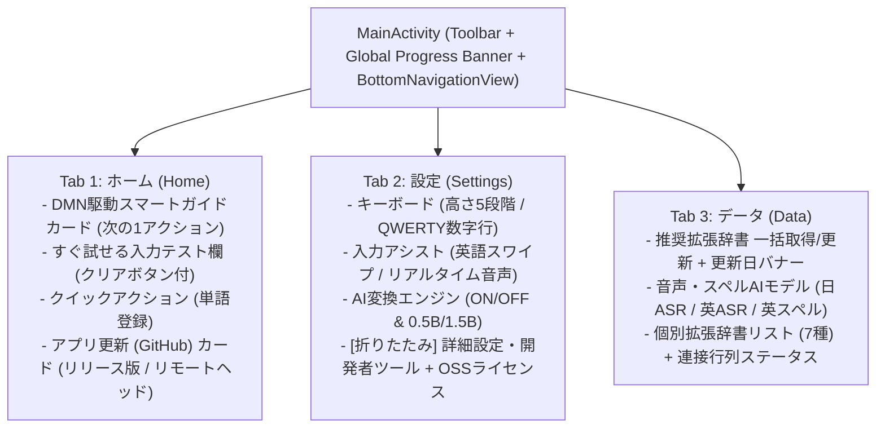

# PRD & System Design: メインアプリ UI 刷新 (MainActivity v2 — 3-Tab + DMN Smart Guide Architecture)

## Part 1: Product Requirements Document (PRD)

### 1. 概要 (Executive Summary)
従来の [`MainActivity`](app/src/main/java/com/example/myasr/MainActivity.kt) は「4カード構成・単一縦スクロール（1,358行 XML）」という過去の制約の中で機能追加を重ねてきた結果、以下の構造的な課題を抱えていた：

1. **初回セットアップと日常利用の混在**: すでに IME を有効化しモデルを導入済みのユーザーに対しても、最上部に「1. キーボード設定」「2. 入力方法を切替」のセットアップボタンと4つの技術バッジが常時表示され、画面を占有していた。
2. **異なる仕事（JTBD）の縦積みによる視認性低下**: 「試し打ち＆単語登録」「日常の入力設定」「大容量辞書・モデル管理」「開発者向け $\lambda$ チューニング」が1本の縦長スクロールに同居し、目的の機能へ到達するスクロールコストが高い。
3. **非宣言的な UI 状態判定**: IME状態・音声モデル状態・辞書更新状態・バックグラウンドダウンロード状態の判定が Activity 内の手続き的 `if-else` に分散し、状態間の整合性が保証しにくかった。

本 PRD では、**従来の「4カード制約」を白紙撤回**し、**Jobs to be Done (JTBD)** と **Critical User Journeys (CUJ)** から逆算した **「3タブ情報設計（ホーム / 設定 / データ）＋ DMN スマートガイド ＋ Alloy 形式検証」** アーキテクチャを再定義する。

---

### 2. Jobs to be Done (JTBD)

| JTBD ID | Job Statement (状況・動機・期待する成果) | 主担当タブ |
| :--- | :--- | :--- |
| **JTBD-M1** | **迷わない導入と即座の動作確認**: アプリを初めて開いたとき、あるいは環境が変わったとき、**「いま次に何をすべきか」を1つだけ迷わず案内され、設定完了後はすぐに試し打ちと音声入力をテストしたい**。 | **ホーム** |
| **JTBD-M2** | **日常のショートカットアクセス**: 普段アプリを開くときは、**単語登録画面へ1タップで移動したり、入力の試し打ちをしたりしたい**（毎回セットアップ手順を見せられたくない）。 | **ホーム** |
| **JTBD-M3** | **入力体験のカスタマイズ**: 自分の好みに合わせて**キーボード高さ、QWERTY数字行、スワイプ入力、音声ストリーミング、AI変換エンジン（0.5B/1.5B/OFF）を迷わず切り替えたい**。 | **設定** |
| **JTBD-M4** | **オフライン資産の一元管理**: Wi-Fi 環境などで**音声認識モデル（日/英）・スペル補正・拡張辞書（SudachiDict等）の導入・更新・削除・進捗確認を整理された一覧から安心して行いたい**。 | **データ** |
| **JTBD-M5** | **高度な実験とチューニング**: 開発・検証時には、**$\lambda$ パラメータやデバッグ表示を通常の操作を邪魔しない場所から調整したい**。 | **設定 (折りたたみ)** |
| **JTBD-M6** | **キーボード入力時の広々としたテスト環境**: アプリ内の入力テスト欄をタップしたとき、**ボトムナビゲーションバー（ホーム、設定、データ）がキーボードの上に押し上げられたり画面が必要以上にスクロールして不要なホワイトスペースが生じたりせず、入力テスト欄が自然な位置で広々と操作できること**。 | **ホーム (IME連動)** |

---

### 3. Critical User Journeys (CUJ)

#### CUJ-M1: 初回セットアップ（IME有効化 → 切替 → モデル/辞書準備 → テスト）
1. ユーザーがアプリを起動すると、**ホーム**タブ最上部の **スマートガイドカード** が現在の不足ステップを DMN 決定表で自動判定し、**次にやるべき唯一の CTA** を提示する：
   - IME未有効 → `Step 1: キーボードを有効にする`（システム設定へ）
   - IME有効だが未選択 → `Step 2: JotInput に切り替える`（IMEピッカー表示）
   - 日本語音声モデル未取得 → `音声認識モデルを取得 (~160MB)`（ワンタップ開始）
   - 日本語拡張辞書未取得 → `推奨変換辞書を取得`（データタブまたは即時一括ダウンロード）
2. 各ステップが完了するごとにカードが次のステップへ自動遷移し、すべて揃うと **「準備完了 — すぐに入力できます」** 状態（緑）へ変化する。
3. ユーザーはそのすぐ下にある **「入力テスト」** 欄をタップし、音声入力とフリック/QWERTY入力を即座に試せる。

#### CUJ-M2: 日常利用（単語登録・入力テスト）
1. すでにセットアップ完了済みのユーザーは、ホーム画面を開いた瞬間に「準備完了 ✓」のコンパクトなステータスと、広い「入力テスト」エリア、および **「単語登録」** クイックアクションカードに即座にアクセスできる。（「入力方法を切り替える」導線はホーム画面上での重複を排除するため DMN スマートガイドカード `HERO_R2: SELECT_IME` に一元化されており、`imeEnabled && !imeSelected` の場合のみ表示される。JotInput がすでに選択済みの状態で他キーボードへ切り替える場合は、IME の地球儀キーまたはシステム IME スイッチャーを使用する。）
2. 辞書にリモート更新がある場合は、スマートガイドカードが「新しい辞書アップデートがあります」と通知し、ワンタップで更新を実行できる。

#### CUJ-M3: 入力設定のカスタマイズ（設定タブ）
1. ボトムナビゲーションの **「設定」** タブをタップする。
2. 「キーボード表示（高さ5段階・QWERTY数字行）」「入力アシスト（英語スワイプ・リアルタイム音声ストリーミング）」「AI 変換エンジン（ON/OFF ＆ 0.5B / 1.5B 選択）」が論理グループごとに整理されており、スクロール迷子にならず設定できる。
3. **AI 変換エンジン ON 時のモデル選択保証**:
   - スイッチを ON にした際、現在モデルが未選択（NONE / 未設定）の場合は **DMN 決定表（`RerankEngineSelectionDecisionTable`）により自動的に高速標準モデル「Qwen2.5-0.5B」がデフォルト選択** される。
   - 「リランクが ON ならば必ず有効なモデルが選択されていなければならない（空欄や NONE のまま放置されない）」というドメイン不変条件（Invariant）を DMN および UI の双方向バインディングで厳格に担保する。
4. AI 変換エンジンが OFF のときはモデル選択ラジオボタンを自動的に `View.GONE` とする。
5. 最下部の折りたたみセクション「詳細設定・開発者ツール」を開くと、$\lambda$ スライダーおよび `[SLM]` デバッグ表示スイッチへアクセスできる。（なお、SLM 重み係数 $\alpha$ は交差検証の結果に基づき $\alpha = 0.0$ に固定され、UI オプションから削除された。）

#### CUJ-M4: モデル・拡張辞書のダウンロードと更新管理（データタブ）
1. ボトムナビゲーションの **「データ」** タブをタップする。
2. ダウンロードやコンパイルがバックグラウンド（[`ProvisioningForegroundService`](app/src/main/java/com/example/myasr/context/provisioning/infrastructure/ProvisioningForegroundService.kt)）で実行中の場合、**グローバル進捗バナー**がタブを跨いで上部に表示され、ホームや設定にいても進捗を把握できる。
3. データタブ内では、① **推奨データ一括セットアップ / 更新カード**、② **音声・AIモデル（日本語ASR / 英語ASR / 英語スペル補正）**、③ **日本語拡張辞書（7種 ＋ 連接コスト行列ステータス）** が明確に分かれて表示される。

#### CUJ-M5: 入力テスト時のボトムナビゲーション自動退避とホワイトスペース排除
1. ホームタブでユーザーが「入力テスト」欄（`etKeyboardTest`）をタップする。
2. `android:windowSoftInputMode="adjustResize"` と `WindowInsetsCompat` により IME（ソフトウェアキーボード）の出現が検知される。
3. DMN 決定表（`BottomNavVisibilityDecisionTable`）により、IME 表示中はボトムナビゲーションバー（ホーム、設定、データ）および境界線が即座に `View.GONE` へ遷移する。
4. ボトムナビゲーションバーがキーボードの上に押し上げられて貴重な画面縦領域を圧迫することがなくなり、入力エリアが広々と確保される。
5. `ScrollView` が過剰に上方向へスクロールして巨大な無駄ホワイトスペースが発生する現象が根本的に解消される。
6. ユーザーがキーボードを閉じる（戻るキーまたは外部タップ）と、ボトムナビゲーションバーがスムーズに `View.VISIBLE` に復帰する。

---

### 4. 情報設計 (Information Architecture)

---

## Part 2: DMN 決定表設計 (Decision Model and Notation)

[`MainAppUiDecisionModel`](app/src/main/java/com/example/myasr/context/ime/domain/MainAppUiDecisionModel.kt) に以下の 5 つの純粋な DMN `DecisionTable` を定義し、`MainActivity` の表示状態・CTA・バッジ・AIモデル選択・IME連動ナビゲーション表示を宣言的に決定する。

1. **`HomeHeroActionDecisionTable` (`HitPolicy.FIRST`)**:
   - 入力: `imeEnabled`, `imeSelected`, `japaneseAsrReady`, `totalDictWords`, `outdatedDictCount`
   - 出力 (`HomeHeroDecision`): `HeroActionKind` (`ENABLE_IME`, `SELECT_IME`, `DOWNLOAD_JA_ASR`, `DOWNLOAD_DICTS`, `UPDATE_DICTS`, `READY`)、タイトル、説明文、CTAラベル、重要度トーン（`WARNING` / `INFO` / `SUCCESS`）。
   - `SELECT_IME` (`HERO_R2`) をホーム画面における「入力方法を切り替える」の唯一のエントリポイントとし、静的なクイックアクション側への重複配置は行わない。
2. **`ProvisioningBannerDecisionTable` (`HitPolicy.FIRST`)**:
   - 入力: `hasActiveTask`, `queuedCount`, `progress`, `statusText`
   - 出力 (`ProvisioningBannerDecision`): バナー表示可否、見出し、進捗率、インデターミネート判定。
3. **`AiEngineStatusDecisionTable` (`HitPolicy.FIRST`)**:
   - 入力: `slmEnabled`, `engineType`, `rerankerState`, `modelInstalled`
   - 出力 (`AiEngineStatusDecision`): セレクタ表示可否、ステータスバッジ文言、バッジトーン、説明文。
4. **`RerankEngineSelectionDecisionTable` (`HitPolicy.FIRST`)**:
   - 入力: `rerankEnabled`, `currentEngine`
   - 出力 (`RerankEngineSelectionDecision`): `effectiveRerankEnabled`, `selectedEngine`, `shouldInitializeModel`, `reason`
   - 不変条件: `rerankEnabled == true` のとき `selectedEngine` は絶対に `NONE` にならず、未選択/NONEの場合は `LOCAL_SLM` (0.5B) がデフォルト選択される。
5. **`BottomNavVisibilityDecisionTable` (`HitPolicy.FIRST`)**:
   - 入力: `isImeVisible` (Boolean)
   - 出力 (`BottomNavVisibilityDecision`): `visibility` (`VISIBLE` / `GONE`), `reason`
   - 不変条件: IME 表示中 (`isImeVisible == true`) はボトムナビゲーションバーを必ず非表示 (`GONE`) とし、キーボード上の縦領域を最大化してタブの押し上げと無駄なホワイトスペースを排除する。

---

## Part 3: Alloy による形式仕様 (Formal Verification)

[`app/src/test/resources/alloy/main_app_ui_state.als`](app/src/test/resources/alloy/main_app_ui_state.als) により、UI 状態遷移の安全性を SAT4J で網羅検証する：

- **`ReadyImpliesAllPrerequisitesMet`**: ホームの Hero Action が `HeroReady`（準備完了）のとき、必ず `imeEnabled = True`, `imeSelected = True`, `jaAsrReady = True`, `baseDictReady = True`, `outdatedDicts = False` がすべて成立していること。
- **`HeroActionTotalAndDeterministic`**: 任意のシステム状態に対して必ず 1 つの Hero Action が決定され、`imeEnabled = False` のときは常に最優先で `HeroEnableIme` が選ばれること。
- **`TabSwitchPreservesState`**: `Home` ↔ `Settings` ↔ `Data` のタブ切替は、プロビジョニング状態・AI設定・セットアップ状態を一切破壊しないこと。
- **`SlmSelectorHiddenWhenDisabled`**: AI 変換エンジンが OFF のときは、サブモデル選択パネルが必ず非表示であること。
- **`GlobalBannerVisibleDuringProvisioning`**: バックグラウンドでダウンロード/コンパイルが進行中または待機中のときは、どのタブを表示していてもグローバル進捗バナーが表示されること。
- **`RerankEnabledImpliesValidModel`**: AI リランクが ON のとき、モデルは必ず有効なモデル（0.5B または 1.5B）が選択されており、モデル未選択（NONE）のまま放置されないこと。
- **`BottomNavHiddenWhenImeActive`**: IME 入力中（`imeInputActive = True`）のときは、ボトムナビゲーションバーが必ず非表示（`showBottomNav = False`）となり、タブの押し上げ・不要なホワイトスペースを完全に抑止すること。
- **`HeroSelectImeSingleSourceWhenEnabledAndUnselected`**: `imeEnabled = True` かつ `imeSelected = False` のときは、常に Hero Card が `HeroSelectIme`（`showHeroSwitchImeCta = True`）となり、唯一の入力方法切替 CTA が提示されること。
- **`NoSwitchImeCtaWhenAlreadySelectedOrDisabled`**: `imeEnabled = False` または `imeSelected = True` のときは、`showHeroSwitchImeCta = False` となり、ホーム画面上に入力方法切替 CTA が重複・残存しないこと。

