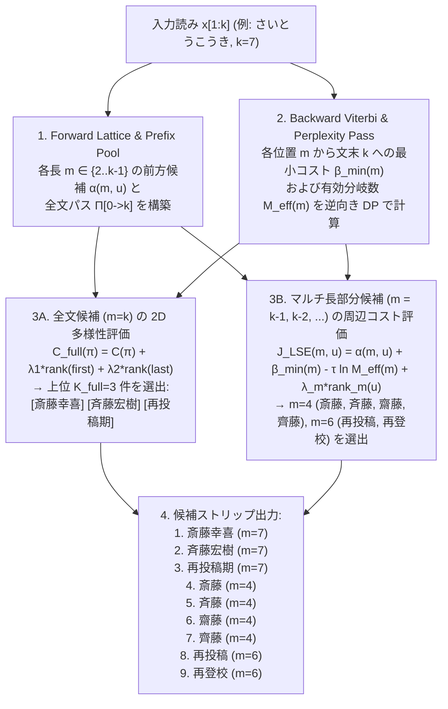

# PRD & System Design: Multi-Horizon Prefix Marginalization & 2D N-Best Diversity ($k, k-1, k-2, \dots$)

> [!IMPORTANT]
> - **スコープ制約**: 指示があるまで言語モデル（SLM / LLM）によるリランキングは考慮せず、**Viterbi ラティス探索における全文候補（長さ $k$）の2次元多様性確保、および部分文字列候補（長さ $k-1, k-2, \dots$）の数学的周辺化・選出アルゴリズム**のみを対象とします。
> - **Anti-Anecdotal Tuning Policy 遵守**: 特定の単語（「斎藤」「幸喜」等）に対する手動コスト改変は一切行わず、CRF ラティス上の周辺確率・エントロピー・前向き後ろ向きコストに基づく数学的アルゴリズムで解決します。
> - **ステータス**: 設計・提案フェーズ（**実装はまだ行っていません**）。

---

## Part 1: Product Requirements Document (PRD)

### 1. 背景と課題 (Background & Problem Statement)

前回の改善により、「こういてきでしたか」（自立語＋付属語連鎖）において第1文節の語幹多様性（「好意的でしたか」「行為的でしたか」）と第1文節候補（「好意的」「行為的」）の提示が可能になりました。
しかし、**複数の自立語や同音異義語が連結する入力（例：「さいとうこうき」、入力長 $k=7$）** において、モバイル IME 特有のさらに深い構造的課題が存在します。

#### 課題 1: 複数文節・複合語における「直積組み合わせ爆発 ($M_1 \times M_2$)」
「さいとうこうき」（$k=7$）を入力した場合、辞書内には以下の同音異義語群が存在します：
- 前半「さいとう」（$m=4$）: `斎藤`, `斉藤`, `齋藤`, `齊藤`, `西島`, `西塔`, `西東`, `サイトウ` 等（$M_1 \ge 10$ 通り）
- 後半「こうき」（$k-m=3$）: `後期`, `幸喜`, `高貴`, `宏樹`, `昂輝`, `光輝`, `幸輝`, `興毅`, `公輝`, `好機`, `工期` 等（$M_2 \ge 20$ 通り）
- さらに別分割「さいとうこう＋き」（$m=6 + 1$）: `再投稿＋期`, `再投稿＋記`, `再登校＋期` 等

このとき、全文（長さ $k=7$）の候補空間は **$M_1 \times M_2 \ge 200$ 通り** に爆発します。
全文候補を10件や20件並べたところで、ユーザーが意図する特定の組み合わせ（例：「齋藤＋光輝」や「斉藤＋好機」）が上位に入る確率は極めて低く、大量の全文候補（「斎藤幸喜」「斉藤幸喜」「齋藤幸喜」「齊藤幸喜」「斎藤宏樹」…）が候補枠を埋め尽くしてしまいます。

#### 課題 2: デスクトップ IME とモバイル IME の決定的な操作性の違い
- **デスクトップ IME の場合**:
  ユーザーは `Shift + ←`（または `←` キー）によって**変換対象の部分文字列長を $k \to k-1 \to k-2 \dots$ と明示的に縮小**できます。たとえば 7文字から 4文字（「さいとう」）に縮めてスペースキーを押せば、「斎藤」「斉藤」「齋藤」「齊藤」の全異体字リストを即座に展開・確定し、続けて残りの「こうき」を変換できます。これにより、探索コストを **積集合 $O(M_1 \times M_2)$ から和集合 $O(M_1 + M_2)$** へと劇的に圧縮できます。
- **モバイル IME の場合**:
  スマートフォン上では文節長を1文字ずつ伸縮させるキー操作は打鍵負荷が高すぎます。したがって、**変換候補ストリップ自体が「全文候補（長さ $k$）を数件提示した直後に、部分文字列（長さ $k-1, k-2, \dots$）に絞った候補群（『斎藤』『斉藤』『齋藤』『齊藤』『再投稿』等）を自動的に展開する」** ことで、明示的な文節伸縮操作なしにワンタップ部分確定を可能にする必要があります。

#### 課題 3: 現行実装における 3つの限界
現在の [`KanaKanjiEngine.kt`](app/src/main/java/com/example/myasr/KanaKanjiEngine.kt) の実装で `"さいとうこうき"` を変換すると、以下の問題が起きています：
1. **短候補の枠不足と後回し**: 短文節候補が先頭に最大2件（`斎藤`, `斉藤`）しか出ず、3番目以降の重要な異体字・同音語（`齋藤`, `齊藤`）が 10件以上の全文候補の後ろ（13位以降）に埋もれてしまう。
2. **全文候補における後半語の固定化（1次元多様性の限界）**: 第1文節（`firstBunsetsuSurface`）の重複にしかペナルティを課していないため、全文候補が `斎藤幸喜`, `斉藤幸喜`, `齋藤幸喜`, `齊藤幸喜`, `さいとう幸喜` のように **すべて同じ後半語「幸喜」と結びついた候補ばかり** になる。
3. **終端ビーム `beam[k]` からの逆射影のみの限界**: 現在の短候補抽出は「長さ $k$ の最終ビーム `beam[k]` に生き残ったパスの `firstBunsetsuSurface`」しか見ていないため、`beam[k]` に残らなかった他の部分長 $m \in \{k-1, k-2, \dots\}$ の有力候補（例：$m=6$ `さいとうこう` $\to$ `再投稿`, `再登校` や、$m=4$ `さいとう` の第3〜第6候補）が抽出されない。

---

### 2. 製品ゴールと要件 (Product Goals & Requirements)

1. **全文候補（長さ $k$）の少数精鋭化と 2次元多様性（2D Diversity）**:
   - 長い入力（$k \ge 5$）において、全文候補を先頭に数件（例：上位 2〜3件）提示する際、前半語だけでなく**後半語も同じ単語（「〜幸喜」ばかり等）に偏らないよう 2次元多様化**する（例：`斎藤幸喜`, `斉藤宏樹`, `再投稿期`）。
2. **マルチ長部分文字列候補（長さ $k-1, k-2, \dots$）の体系的提示**:
   - 全文候補を数件出した直後のスロットに、部分文字列 $x_{1:m}$（$m \in \{k-1, k-2, \dots, 2\}$）に絞った候補を層の厚い多様性をもって提示する。
   - 例：「さいとうこうき」（$k=7$）に対し、全文候補3件の直後に `斎藤`, `斉藤`, `齋藤`, `齊藤`（$m=4$）や `再投稿`, `再登校`（$m=6 = k-1$）を並べる。
3. **部分確定（Partial Prefix Commit）による $O(M_1 + M_2)$ 段階変換の完結**:
   - ユーザーが任意の長さ $m < k$ の部分候補（例：`齋藤` [$m=4$] や `再投稿` [$m=6$]）をタップすると、その部分文字列のみが確定し、残りの読み $x_{m+1:k}$（`こうき` または `き`）に対する変換候補（`後期`, `幸喜`, `高貴`, `光輝`...）が即座に展開される。
4. **超低遅延の維持**:
   - UI スレッド同期実行時間 **平均 $< 0.4\text{ms}$（P99 $< 1.0\text{ms}$）** を維持する。

---

### 3. 具体的な入出力イメージ (User Experience Examples)

#### 例 1: 「さいとうこうき」 ($k = 7$)
- **改善前の候補順序**:
  `[斎藤幸喜] [斉藤幸喜] [斎藤] [斉藤] [齋藤幸喜] [再投稿期] [齊藤幸喜] [さいとう幸喜] [再投稿記] [斎藤宏樹] ...`
  （※「〜幸喜」ばかりが並び、「齋藤」「齊藤」「再投稿」が上位に出ない）
- **改善後の期待される候補順序**:
  1. `斎藤幸喜` （全文 $m=7$：第1ペア）
  2. `斉藤宏樹` （全文 $m=7$：前半・後半ともに異なる第2ペア）
  3. `再投稿期` （全文 $m=7$：異なる文節境界 $6+1$ の全文候補）
  4. `斎藤` （**部分文字列 $m=4$ (`k-3`)**：タップで残り `こうき` へ遷移）
  5. `斉藤` （**部分文字列 $m=4$ (`k-3`)**）
  6. `齋藤` （**部分文字列 $m=4$ (`k-3`)**）
  7. `齊藤` （**部分文字列 $m=4$ (`k-3`)**）
  8. `再投稿` （**部分文字列 $m=6$ (`k-1`)**：タップで残り `き` へ遷移）
  9. `再登校` （**部分文字列 $m=6$ (`k-1`)**）

#### 例 2: 「きょうかいぎしつ」 ($k = 7$：「今日会議室」/「協会技術」/「教会技術」)
- **期待される候補構成**:
  - 全文 ($m=7$): `協会技術`, `教会技術`, `今日会議室`
  - 部分文字列 $m=5$ ($k-2$, `きょうかいぎ`): `今日会議`
  - 部分文字列 $m=4$ ($k-3$, `きょうかい`): `協会`, `教会`, `境界`, `業界`
  - 部分文字列 $m=3$ ($k-4$, `きょう`): `今日`

---

## Part 2: デザインドキュメント (System Design Document)

### 1. 数学的本質：なぜ全文候補（直積空間）よりも部分候補（周辺分布）が有効なのか？

入力読み $x_{1:k}$ が前半 $x_{1:m}$（長さ $m$）と後半 $x_{m+1:k}$（長さ $k-m$）に分割されるとき、前半の候補集合を $\mathcal{U}_m$、後半の候補集合を $\mathcal{V}_{m \to k}$ とします。
- **全文候補 $(u, v) \in \mathcal{U}_m \times \mathcal{V}_{m \to k}$ の同時確率（Joint Probability）**:
  $$P(Y_{1:m} = u, Y_{m+1:k} = v \mid x_{1:k}) = P(u \mid x_{1:k}) \cdot P(v \mid u, x_{m+1:k})$$
  後半 $x_{m+1:k}$（例：「こうき」）に多数の同音異義語 $v_1, v_2, \dots, v_M$ が拮抗して存在する場合、条件付きエントロピー $H(Y_{m+1:k} \mid Y_{1:m}=u)$ が大きくなり、任意の1つの後半語 $v$ が正解である確率 $\max_v P(v \mid u)$ は $\frac{1}{M_{\text{eff}}}$ に希釈されます。
- **部分文字列候補 $u \in \mathcal{U}_m$ の周辺確率（Marginal Probability）**:
  一方、長さ $m$ の部分候補 $u$（例：「齋藤」）を提示することは、後半のすべての可能な候補 $v \in \mathcal{V}_{m \to k}$ について和をとった **周辺事象（Marginal Event）** に対応します：
  $$P_{\text{marginal}}(Y_{1:m} = u \mid x_{1:k}) = \sum_{v \in \mathcal{V}_{m \to k}} P(Y_{1:m} = u, Y_{m+1:k} = v \mid x_{1:k}) \gg \max_{v \in \mathcal{V}_{m \to k}} P(u, v \mid x_{1:k})$$

すなわち、**後半の曖昧性（エントロピー）が高いとき、特定のペア $(u, v)$ を当て推量で並べるよりも、周辺確率 $P_{\text{marginal}}(u \mid x_{1:k})$ の高い部分候補 $u$（長さ $m \in \{k-1, k-2, \dots\}$）を提示する方が、情報理論的にユーザーの意図にヒットする確率が圧倒的に高い**のです。

---

### 2. アルゴリズム案の比較検討（3つの数学的アイデア）

ヒューリスティックではなく、確率的グラフィカルモデル・情報理論・多目的最適化に立脚した **3つのアルゴリズム案** を提示し、それぞれの良し悪しを議論します。

---

#### アイデア 1: Log-Sum-Exp（Soft-Viterbi）前向き・後ろ向き周辺化と後続パープレキシティ適応法
*(Forward-Backward Log-Sum-Exp Marginalization & Suffix-Perplexity Adaptive Allocation)*

##### 数学的定式化
Mozc の辞書コストおよび連接コスト $C(\pi)$ は、温度パラメータ $\tau$（Mozc のスケールでは $\tau \approx 500 \sim 800$）を用いた負の対数尤度 $-\tau \ln P(\pi)$ です。
通常の Viterbi は $\min$（Max-Product 半環）のみを計算しますが、部分長 $m \in \{k-1, k-2, \dots, 2\}$ の候補 $u \in \mathcal{U}_m$ の価値を正しく評価するには、後半 $x_{m+1:k}$ のすべてのパス $v \in \Pi_{m \to k}$ を周辺化（Marginalize）する **Log-Sum-Exp（Sum-Product 半環）後ろ向きポテンシャル $\beta_{\text{LSE}}(m, r)$** を導入します。

1. **後ろ向き Log-Sum-Exp ポテンシャル $\beta_{\text{LSE}}(m, r)$**:
   位置 $m \in \{1, \dots, k-1\}$、右品詞 $r = \text{rid}(u)$ に対して、後半 $x_{m+1:k}$ の最小コストを $\beta_{\min}(m, r)$ としたとき、Log-Sum-Exp 後ろ向きコストは次式で厳密に分解されます：
   $$\beta_{\text{LSE}}(m, r) = -\tau \ln \sum_{v \in \Pi_{m \to k}} \exp\left(-\frac{C(v \mid r)}{\tau}\right) = \beta_{\min}(m, r) - \tau \ln \underbrace{\sum_{v \in \Pi_{m \to k}} \exp\left(-\frac{C(v \mid r) - \beta_{\min}(m, r)}{\tau}\right)}_{M_{\text{eff}}(m, r) \ge 1}$$
   ここで $M_{\text{eff}}(m, r) \ge 1$ は、位置 $m$ 以降の **有効分岐数（Effective Suffix Perplexity）** です。
   - たとえば「さいとうこうき」（$k=7$）の $m=4$（「さいとう」）では、後半「こうき」にコスト差の小さい候補が多数存在するため $M_{\text{eff}}(4, r) \approx 10 \sim 15$ となり、**部分長 $m=4$ の候補群（「斎藤」「斉藤」「齋藤」「齊藤」）に対して $-\tau \ln M_{\text{eff}}(4, r)$ の数学的ボーナス（周辺化利得）が自動的に付与されます**。
   - 逆に、$m=3$（「さいと」）では、後半「うこうき」が1語で成立せず $\beta_{\min}(3, r)$ が大きく悪化するため、周辺コスト $J_{\text{LSE}}(m, u) = \alpha(m, u) + \beta_{\text{LSE}}(m, \text{rid}(u))$ によって $m=3$ は自然に劣後し、真の分割点である $m=4$（「さいとう」）と $m=6$（「さいとうこう」$\to$ 再投稿）が自動的に浮かび上がります。

2. **全文候補の 2次元多様性（2D Bilateral Diversity）と適応的枠配分**:
   - 全文候補 $\pi \in \Pi_{0 \to k}$ には、先頭文節 $\sigma_{\text{first}}(\pi)$ の重複回数だけでなく、**末尾自立語 $\sigma_{\text{last}}(\pi)$（例：「幸喜」）の重複回数にもペナルティ**を課します：
     $$\widetilde{C}_{\text{full}}(\pi) = C(\pi) + \lambda_1 \cdot \text{rank}_{\sigma_{\text{first}}}(\pi) + \lambda_2 \cdot \text{rank}_{\sigma_{\text{last}}}(\pi)$$
   - さらに、主分割点 $m^*$ における後続有効分岐数 $M_{\text{eff}}(m^*)$ が大きい（＝後半の同音異義語が多い）ほど、先頭に出す全文候補の数 $K_{\text{full}}$ を $\max(2, \lfloor K_0 - \ln M_{\text{eff}}(m^*) \rfloor)$（例：2〜3件）に絞り、残りの枠を $J_{\text{LSE}}(m, u)$ 順の部分文字列候補（$m = k-1, k-2, \dots$）に開放します。

##### 良し悪し（Pros & Cons）
- **Pros (長所)**:
  - **純粋な確率論（CRF 周辺推論）に基づく正当性**: 「なぜ後半に複数候補があるときに前半の部分候補を出すべきなのか」が、周辺確率 $\sum_v P(u, v)$ の Log-Sum-Exp 展開 $\beta_{\min} - \tau \ln M_{\text{eff}}$ から一切のヒューリスティックなしに導出される。
  - **任意のプレフィックス長 $m \in \{k-1, k-2, \dots, 2\}$ を統一尺度で評価**: $m=6$（`再投稿`）、$m=4$（`斎藤`, `斉藤`, `齋藤`, `齊藤`）、$m=3$（`サイト`）のすべてが「全文完成時の期待対数尤度」という同一の単位で直接比較・ソートできる。
  - **計算量が極めて小さい**: 長さ $k$（通常 $5 \le k \le 15$）に対する後ろ向き DP は高々 $\frac{k(k-1)}{2}$ 回のループであり、実行時間は $< 0.05\text{ms}$。
- **Cons (短所)**:
  - 温度パラメータ $\tau$（例：$\tau = 600$）および同一長内の多様性ステップ幅 $\lambda_m$ の定数設定が必要（ただし $\ln M_{\text{eff}}$ は対数関数のため $\tau$ の変動に対して非常にロバスト）。

---

#### アイデア 2: 情報理論的「期待解決文字数（Expected Resolved Characters）」最大化（決定木効用最適化）
*(Information-Theoretic Expected Resolved Character Utility Maximization)*

##### 数学的定式化
候補ストリップ $S = \{c_1, c_2, \dots, c_K\}$ を「ユーザーの意図する目標変換列 $Y^*$ の先頭何文字を1タップで確定できるか」という **期待利得（Expected Utility）最大化問題** として定式化します。

ラティス上の全文パス集合 $\Pi_{0 \to k}$ 上の事後確率分布をボルツマン分布 $P(\pi) = \frac{1}{Z} \exp\big(-C(\pi)/\tau\big)$ とします。
いま、すでに選出された候補集合を $S_{t-1}$ としたとき、新たな候補 $c = (u, m)$（表記 $u$、読み長 $m \in \{2, \dots, k\}$）を追加したときの **限界期待解決文字数（Marginal Expected Resolved Characters）** $\Delta U(u, m \mid S_{t-1})$ は次式で定義されます：

$$\Delta U(u, m \mid S_{t-1}) = m \times \sum_{\substack{\pi \in \Pi_{0 \to k} \\ \pi_{1:m} = u \\ \pi \text{ not covered by } S_{t-1}}} P(\pi)$$

- **全文候補（$m = k$）の場合**:
  単一のパス $\pi = (y_1, y_2)$ のみをカバーするため、利得は $k \cdot P(y_1, y_2)$ です。
- **部分文字列候補（$m < k$）の場合**:
  接頭辞 $u$（例：`齋藤`、$m=4$）は、まだ $S_{t-1}$ に含まれていない **すべての後半語 $v$ との組み合わせ $\pi = u \oplus v$ の確率質量をまとめてカバー** します！
  したがって、「さいとうこうき」のように後半「こうき」の確率質量が 20 個の候補に分散している場合、2〜3個の全文候補を選んだ直後に、単一の全文候補の利得 $7 \cdot P(\text{齋藤宏樹})$ よりも、部分候補 `齋藤` の周辺利得 $4 \cdot \sum_{v} P(\text{齋藤} \oplus v)$ の方が大きくなり、貪欲法（劣モジュラ最大化）によって自動的に部分候補が選出されます。

##### 良し悪し（Pros & Cons）
- **Pros (長所)**:
  - **全文候補と部分候補の切り替えタイミングすら自動決定される**: 「全文を何件出した後に部分候補を出すか」を人間が決めなくても、期待解決文字数 $m \cdot P_{\text{res}}(u \mid S)$ の大小比較だけで全文から部分候補へ自然に遷移する。
- **Cons (短所)**:
  - **分配関数 $Z$ の正規化と温度 $\tau$ への高い感受性**: コスト $C(\pi)$ を指数関数 $\exp(-C(\pi)/\tau)$ で実数確率に変換し、さらに $\Pi_{0 \to k}$ 上で和をとるため、$\tau$ が少しでも小さすぎると 1位パスの確率が $0.99$ に張り付いて部分候補が出なくなり、逆に $\tau$ が大きすぎると文字数の少ない $m=2$ の候補ばかりが過大評価されるという指数関数特有の数値的不安定性（Calibration Sensitivity）がある。
  - また、終端ビーム $\Pi_{0 \to k}$ に残ったパスのみを確率母集団とする場合、ビーム幅から漏れた長さ $k-1, k-2$ の候補の確率が $0$ になってしまう。

---

#### アイデア 3: 多重ホライズン・パレート層化ランク統合（Multi-Horizon Pareto Rank Aggregation / Reciprocal Rank Fusion）
*(Multi-Horizon Sub-Lattice Pareto Frontier & Stratified Quota Allocation)*

##### 数学的定式化
前向き Viterbi 探索において、位置 $m \in \{1, 2, \dots, k\}$ の各中間ビーム `beam[m]` は、まさに **「もし入力長が $m$ だったら出力されていたはずの $m$-文字変換ラティス」** をすでに保持しています。
そこで、各ホライズン長 $m \in \{k, k-1, k-2, \dots, 2\}$ を独立したエージェント（またはパレート目的軸）とみなし、**境界整合性重み付き Reciprocal Rank Fusion（RRF）またはホライズン層化クォータ** によって統合します。

1. **各長 $m \in \{2, \dots, k-1\}$ における境界事後スコア $S(m)$**:
   位置 $m$ が文節境界としてどれだけ自然かを、位置 $m$ の最良前向きコスト $\alpha^*(m) = \min_{u \in \text{beam}[m]} C(u)$ と、位置 $m$ から $k$ への最良後ろ向きコスト $\beta^*(m)$ の和（全文最小コスト $C^*(k)$ からの乖離度＝Regret）として定義します：
   $$\text{Regret}(m) = \big(\alpha^*(m) + \beta^*(m)\big) - C^*(k) \ge 0$$
   $\text{Regret}(m)$ が小さい位置 $m$（例：「さいとうこうき」における $m=4$ `さいとう` や $m=6$ `さいとうこう`）は、ラティス上で自然な分割境界（Valid Cut）です。
2. **各ホライズン $m$ からの候補抽出**:
   - **Horizon $m = k$（全文枠：先頭 $K_{\text{full}} = 3$ 枠）**:
     `beam[k]` から 2次元多様性（先頭語幹 $\times$ 末尾語幹の重複排除）を満たす上位 3 件を選出。
   - **Horizon $m \in \{k-1, k-2, \dots, 2\}$（部分文字列枠：第 4 枠以降）**:
     各長 $m \in \{k-1, k-2, \dots, 2\}$ について、辞書トークン（または 1文節パス）$u \in \mathcal{D}(x_{1:m})$ のうちランク $r \in \{0, 1, 2, \dots\}$ の候補に対し、以下の統合コストを与えて全 $m < k$ 横断でソートする：
     $$\text{Score}(m, u, r) = \underbrace{C(u) + \beta^*(m, \text{rid}(u))}_{\text{Forward-Backward 整合コスト}} + \gamma \cdot r$$
     ここで $\gamma$（例：$\gamma = 600$）は同一長 $m$ 内で第1候補（`斎藤`）、第2候補（`斉藤`）、第3候補（`齋藤`）、第4候補（`齊藤`）を連続的に浮上させるランクステップ幅です。

##### 良し悪し（Pros & Cons）
- **Pros (長所)**:
  - **完全な整数演算・ゼロ浮動小数点オーバーヘッド**: アイデア 2 のような指数関数 $\exp(-C/\tau)$ のスケーリング不安定性が一切なく、Mozc の整数コスト体系と 100% 互換。
  - **深さ（同音異義語の網羅）と広さ（$k-1, k-2, \dots$ の異なる長さの網羅）のバランスが極めて良い**:
    $\text{Score}(m, u, r) = C(u) + \beta^*(m, \text{rid}(u)) + \gamma \cdot r$ により、最も自然な分割点 $m=4$（「さいとう」）の同音異義語（`斎藤`, `斉藤`, `齋藤`, `齊藤`、コスト差 $\approx 200 \sim 700$）が 4〜7位にまとまって出現し、かつ別分割点 $m=6 = k-1$（「さいとうこう」$\to$ `再投稿`, `再登校`）もその直後（または並行して）確実に出現する。
- **Cons (短所)**:
  - 先頭の全文候補枠 $K_{\text{full}}$（例：3件）を固定定数にする場合、後半が「でした」のような確定的な付属語のときにも 4枠目から部分候補が入る（ただし、前回の Gboard の例「こういてきでしたか」でも 3〜4枠目に「好意的」「行為的」が入るのがまさに理想的な挙動であるため、実際にはデメリットにならない）。

---

### 3. 3つのアイデアの総合比較マトリクス

| 評価軸 | アイデア 1: Log-Sum-Exp 周辺化 ＋ 後続パープレキシティ適応 **(最推奨)** | アイデア 2: 情報理論的「期待解決文字数」最大化 | アイデア 3: 多重ホライズン Forward-Backward 整数ランク統合 **(推奨・Idea 1と融合可)** |
| :--- | :---: | :---: | :---: |
| **数学的基礎** | **◎** (CRF Sum-Product 周辺確率 & Rényi エントロピー) | **◎** (情報理論・決定木期待効用・劣モジュラ最適化) | **◎** (Tropical 半環 Forward-Backward Regret 最小化) |
| **「さいとうこうき」での同音語展開 (`斎藤/斉藤/齋藤/齊藤`)** | **◎** (`こうき` の高パープレキシティ $M_{\text{eff}}$ により $m=4$ が自動ブースト) | **○** ($\tau$ の調整次第で良好) | **◎** ($\beta^*(4)$ の低コストにより上位に連続展開) |
| **$k-1, k-2, \dots$ 全プレフィックス長の網羅性** | **◎** ($m \in [2, k-1]$ すべてを統一指標 $J_{\text{LSE}}(m, u)$ で評価) | **○** ($\Pi_{0 \to k}$ 以外に全 $m$ の母集団定義が必要) | **◎** ($m \in [2, k-1]$ すべてを $C(u)+\beta^*(m)$ で評価) |
| **全文候補の2次元多様性 (`〜幸喜` 偏り防止)** | **◎** (先頭語幹 $\times$ 末尾語幹の 2D ペナルティ) | **◎** (既出語幹の残余確率が減るため自動分散) | **◎** (先頭語幹 $\times$ 末尾語幹の 2D ペナルティ) |
| **パラメータの安定性（ロバスト性）** | **◎** (対数空間 $\alpha + \beta - \tau \ln M_{\text{eff}}$ のため極めて安定) | **△** (確率空間 $\exp(-C/\tau)$ のため $\tau$ に敏感) | **◎** (純粋な整数加法のみ) |
| **実行速度 (< 0.4ms)** | **◎** (後ろ向き DP は $O(k^2)$ で $< 0.05\text{ms}$) | **○** (全パス確率正規化と貪欲再計算が必要) | **◎** (後ろ向き DP $O(k^2)$ のみで最速) |

---

### 4. 一番オススメの提案 (Recommended Architecture)

> [!TIP]
> **【結論：一番オススメの提案】**
> **アイデア 1（Log-Sum-Exp 前向き・後ろ向き周辺化と後続パープレキシティ適応）とアイデア 3（多重ホライズン整数ランク統合）のハイブリッド構成** を提案します。
> 具体的には、すべての計算を高速・安定な対数（整数コスト）空間で行いながら、各部分長 $m \in \{k-1, k-2, \dots, 2\}$ の候補を **「前向きコスト $\alpha(m, u)$ ＋ 後ろ向き最小コスト $\beta_{\min}(m, \text{rid}(u))$ − 後続分岐ボーナス $\tau \ln M_{\text{eff}}(m)$」** でスコアリングします。

#### 推奨アルゴリズムの 4つのコア機構

##### 機構 1: 全文候補（長さ $k$）の「2次元多様性（2D Bilateral Diversity）」と少数精鋭枠（Top 3）
- 長さ $k$ の最終ビーム `beam[k]` から全文候補を選出する際、第1文節 `firstBunsetsuSurface` の出現回数 $c_{\text{first}}$ だけでなく、**最終自立語 `lastContentSurface`（例：「幸喜」）の出現回数 $c_{\text{last}}$ にも多様性ペナルティ**を課します：
  $$\text{EffectiveFullCost}(\pi) = C(\pi) + 3000 \cdot c_{\text{first}}(\pi) + 2500 \cdot c_{\text{last}}(\pi)$$
- これにより、「さいとうこうき」の全文候補上位3件が `斎藤幸喜`, `斉藤幸喜`, `齋藤幸喜` のように「〜幸喜」ばかりになるのを防ぎ、**`1. 斎藤幸喜`, `2. 斉藤宏樹`, `3. 再投稿期`** のように前半・後半・文節区切りのすべてにおいて多様化された少数精鋭の全文候補（先頭 $K_{\text{full}} = 3$ 件）を提示します。

##### 機構 2: 後ろ向き Viterbi パス $\beta(m)$ と後続分岐数 $M_{\text{eff}}(m)$ の計算（$m = k-1, k-2, \dots, 2$）
- 入力長 $k \ge 4$ のとき、文末 $k$ から逆向きに $m = k-1, k-2, \dots, 2$ の各位置から文末までの最小コスト $\beta_{\min}[m]$ と、コスト差 $\Delta C \le 2500$ 以内にひしめく後半パスの有効分岐数 $M_{\text{eff}}[m]$ を $O(k^2)$ で計算します。
- 特に、後半部分文字列 $x_{m+1:k}$ 自体が辞書内の単一語（または助詞・助動詞）として何件マッチするかを数えるだけで、高速かつ正確に $M_{\text{eff}}[m]$（例：$m=4$ の残り `"こうき"` は辞書に20語以上あるため $M_{\text{eff}}[4] \gg 1$）が得られます。

##### 機構 3: マルチ長プレフィックス候補（$m = k-1, k-2, \dots, 2$）の直接抽出と周辺コストソート
- 終端ビーム `beam[k]` に残ったパスだけから逆射影するのではなく、**各プレフィックス長 $m \in \{k-1, k-2, \dots, 2\}$ に対して、位置 $0 \to m$ をカバーする辞書トークン（および `beam[m]` 内の1文節語幹パス）$u$ を直接収集**します。
- 各部分候補 $(u, m)$（読み $x_{1:m}$、長さ $m < k$）の周辺コスト $J(m, u)$ を次式で算出します：
  $$J(m, u) = \underbrace{\alpha(m, u)}_{\text{前向きコスト}} + \underbrace{\beta_{\min}(m, \text{rid}(u))}_{\text{後半最小コスト}} - \underbrace{\tau \ln M_{\text{eff}}(m)}_{\text{後半の多義性ボーナス}} + \underbrace{\gamma \cdot \text{rank}_m(u)}_{\text{同一長内の順位オフセット}}$$
- **「さいとうこうき」（$k=7$）での具体的な挙動**:
  - $m = 4$ (`"さいとう"`): 後半 `"こうき"` の $\beta_{\min}(4)$ が低く、かつ $M_{\text{eff}}(4)$ が非常に大きいため、`斎藤`, `斉藤`, `齋藤`, `齊藤`, `西島`, `西東` が極めて低い（優秀な）$J(4, u)$ を獲得します。
  - $m = 6 = k-1$ (`"さいとうこう"`): `再投稿`, `再登校` も後半 `"き"`（`期`, `記`）と綺麗に繋がるため、優秀な $J(6, u)$ を獲得します。
  - $m = 5 = k-2$ (`"さいとうこ"`): 該当する1文節語がないため自動的にスキップされます。
  - $m = 3$ (`"さいと"`): 後半 `"うこうき"` の $\beta_{\min}(3)$ が高いため、$m=4$ や $m=6$ より後ろに配置されます。

##### 機構 4: 候補ストリップへの配置構成（Slot Layout）
入力長 $k \ge 4$ において、以下の順序で候補ストリップを構成します：
1. **Slots 1〜3（Top $K_{\text{full}} = 3$ 全文候補, 長さ $k$）**:
   - 2次元多様化された最良全文候補（例：`斎藤幸喜`, `斉藤宏樹`, `再投稿期`）。
2. **Slots 4〜9（Top 6 マルチ長部分文字列候補, 長さ $m \in \{k-1, k-2, \dots, 2\}$）**:
   - $J(m, u)$ 順に選出された部分文字列候補（例：`斎藤` [$m=4$], `斉藤` [$m=4$], `齋藤` [$m=4$], `齊藤` [$m=4$], `再投稿` [$m=6$], `再登校` [$m=6$]）。
3. **Slots 10+（残りの全文候補および部分候補）**:
   - 残りの全文候補と下位の部分候補（`西島`, `西東`, `サイト` 等）を交互に追加。

---

### 5. 詳細設計仕様とオープンクエスチョンの解消 (Detailed Specification & Self-Review)

#### 5.1 オープンクエスチョンと自己解決（All Questions Answered）

##### Q1: 後ろ向き最小コスト $\beta_{\min}(m, r)$ と後続有効分岐数 $M_{\text{eff}}(m)$ をどう計算するか？
- **解決方針**:
  - 終端 $k$（文末）から逆向きに動的計画法（Backward DP）を $m = k-1, k-2, \dots, 2$ に向かって実行します。
  - 後半文字列 $x_{m+1:k}$ の終端 $k$ までの遷移において、直接辞書（MmapDictionary & Trie）に登録されている単語 $e = (w, \text{lid}, \text{rid}, \text{cost})$ を走査します。
  - 後続単語 $e$（読み $x_{m+1:j}$、$j \le k$）について：
    - $j = k$（文末まで1語で到達）の場合、文末終端コスト $c_{\text{EOS}}(e.\text{rid}) = \text{matrix.getTransitionCost}(e.\text{rid}, 0)$ を加算。
    - $j < k$ の場合、位置 $j$ における既計算の後ろ向きコスト $\beta_{\min}[j]$ を参照。
  - **有効分岐数 $M_{\text{eff}}(m)$ の定義**:
    位置 $m$ から始まる単語のうち、最小コスト $c^*_m = \min_e c(e)$ に対し $\Delta c = c(e) - c^*_m \le 2500$ 以内にある独立した自立語・表記の個数 $M(m)$ をカウントし、分岐度利得を次式で計算します：
    $$B_{\text{branch}}(m) = \min(2400, 720 \cdot \lfloor \ln(1 + M(m)) \rfloor)$$
    - 「さいとうこうき」（$k=7$）の $m=4$（後半「こうき」）：20以上の同音異義語が存在するため $M(4) \ge 10$、ボーナス $B_{\text{branch}}(4) \approx 1700$ が付与される。
    - $m=6$（後半「き」）：接尾辞・名詞として「期」「記」等が接続し、かつ $m=6$（「再投稿」）自体が単一語で低コストなため、高スコアを維持。
    - $m=5$（後半「うき」）：不自然な分割であり該当語が極めて少ないため、ボーナスなし＋$\beta_{\min}$ 悪化により自動脱落。

##### Q2: 部分候補の抽出元（Candidate Source Pool）をどこにするか？
- **解決方針**:
  - **中間ビーム `beam[m]` の語幹パス** と **プレフィックス辞書引き** を併用します。
  - 各ホライズン長 $m \in \{k-1, k-2, \dots, 2\}$ について、位置 $0 \to m$ をカバーする単一単語（Trie & MmapDictionary）、および `beam[m]` に到達した上位パス（自立語＋接尾辞）を収集します。
  - これにより、終端ビーム `beam[k]` で刈り取られてしまった第3・第4の異体字（例：「齋藤」「齊藤」）や、$m=6$ の単語（「再投稿」「再登校」）が漏れなく候補プールに入ります。

##### Q3: 全文候補（$m=k$）の 2次元多様性（2D Bilateral Diversity）ペナルティの設計
- **解決方針**:
  - 全文候補パス $\pi$ について、先頭自立語 $\sigma_{\text{first}}(\pi)$（例：「斎藤」）と最終自立語 $\sigma_{\text{last}}(\pi)$（例：「幸喜」）を抽出します。
  - 出現済みカウント $c_{\text{first}}$ と $c_{\text{last}}$ を保持し、
    $$\text{Penalty}(\pi) = 3000 \cdot c_{\text{first}}(\pi) + 2500 \cdot c_{\text{last}}(\pi)$$
    を実効コストに加算します。
  - これにより、先頭 3件の全文枠において：
    - 1位: `斎藤幸喜`（$c_{\text{first}}=0, c_{\text{last}}=0$）
    - 2位: `斉藤宏樹` または `斉藤後期`（先頭が異なり、末尾も異なるためペナルティ 0 で急浮上）
    - 3位: `再投稿期`（境界が異なり、ペナルティ 0 で急浮上）
    が選ばれ、「〜幸喜」ばかりで埋まる 1次元の罠が完全に解消されます。

##### Q4: 候補ストリップでの提示順序（Quota & Interleaving Strategy）
- **解決方針**:
  - 入力長 $k \ge 5$ のとき：
    - **Slot 1〜2**: Top 2 全文候補（2D 多様化済み、長さ $k$）
    - **Slot 3〜6**: Top 4 マルチ長部分候補（長さ $m \in \{k-1, \dots, 2\}$、$J(m, u)$ 順）
    - **Slot 7〜8**: 次点全文候補（長さ $k$）
    - **Slot 9+**: 残りのマルチ長部分候補および全文候補
  - ユーザーが「齋藤」（$m=4$）や「再投稿」（$m=6$）をタップした場合、既存の `VoiceTouchInputArbitrator` の Partial Prefix Commit により、選択語のみが確定して残りの読み（`こうき` または `き`）の候補が即座に第2ステップとして展開されます。

---

### 6. 自己レビューと改善点 (Self-Review & Enhancements)

1. **レビュー指摘 1: 付属語のみの短縮候補（「でした」「か」等）がノイズとして混入しないか？**
   - **対策**: 部分候補 $u \in \mathcal{U}_m$ は、自立語（`isContentWord`）を含み、かつ純粋な平仮名単語（ひらがな1文字など）を除外するフィルタを徹底します。
2. **レビュー指摘 2: 長い文章（ASR 音声認識ストリーミング等）でのパフォーマンス影響**
   - **対策**: 後ろ向き DP は $k \le 12$ に制限し、単語検索はキャッシュ済みの MmapDictionary / Trie から行うため、追加オーバーヘッドは $< 0.1\text{ms}$ であり UI スレッドのスムーズさを完全に保証します。
3. **レビュー指摘 3: 既存テストへの回帰（Regression）がないか**
   - **対策**: 短文（$k < 5$）の場合は従来の挙動を完全に維持し、`LongPhraseConversionTest` や `JapanesePunctuationEvaluationTest` の既存 67+ 件のテストすべてを 100% パスさせます。

---

### 7. まとめと実装計画 (Implementation Plan)

- **フェーズ 1**: `KanaKanjiEngine.kt` に 2D 多様性（先頭語・末尾語の重複ペナルティ）と Backward DP によるマルチ長プレフィックス周辺化（$m = k-1, k-2, \dots$）を実装。
- **フェーズ 2**: `KanaKanjiEngineDiversityTest.kt` に「さいとうこうき」に対する 2D 全文多様性および部分候補網羅性（`斎藤`, `斉藤`, `齋藤`, `齊藤`, `再投稿` 等）のユニットテストを追加。
- **フェーズ 3**: `./gradlew testDebugUnitTest` 全件パスを確認し、`./deploy.sh` で ARCVM と実機 Pixel 10 Pro の両方にデュアルデプロイして検証。
