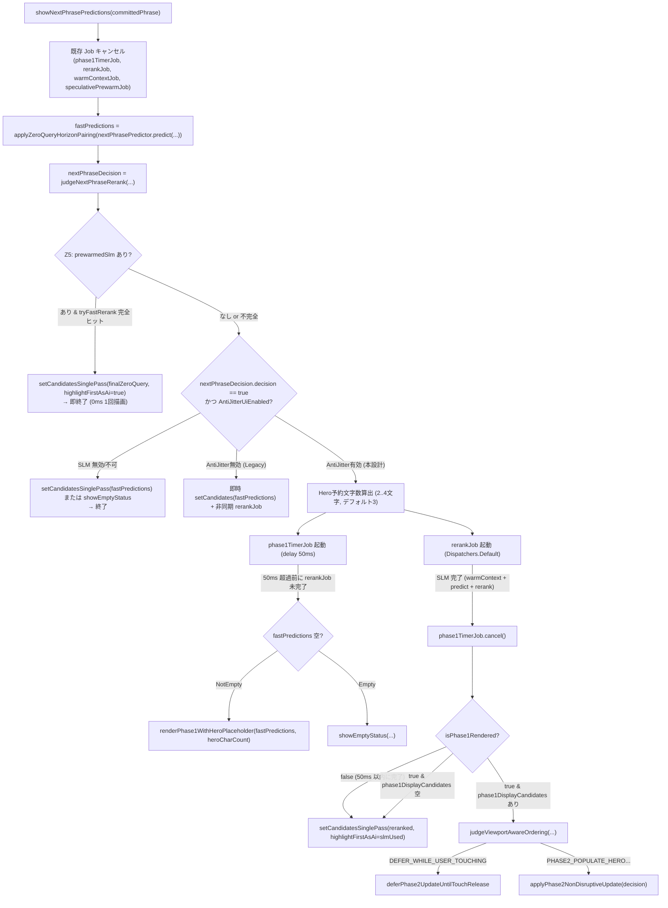

# PRD & Detailed Design Document (DD): Next-Phrase Prediction (Zero-Query) Anti-Jitter & Zero-Mis-Tap UI Architecture

> [!IMPORTANT]
> - **ステータス**: PRD・CUJ・詳細設計書（Detailed Design Document / DD）策定
> - **目的**: [`docs/prd_and_design_slm_rerank_ui_anti_jitter.md`](docs/prd_and_design_slm_rerank_ui_anti_jitter.md) で変換候補（`updateCandidates`）に導入して大きな効果を上げた **Anti-Jitter UI アーキテクチャ（UI-Idea 1: Dedicated AI Hero Slot + UI-Idea 2: Adaptive Micro-Wait Hold + UI-Idea 8: Off-Screen Tail Reranking + Touch Deferral + Single-Pass Highlight）** を、**確定直後の予測候補表示（[`showNextPhrasePredictions`](app/src/main/java/com/example/myasr/VoiceInputMethodService.kt#L1687) / Zero-Query）** にも適用し、予測候補の突然の入れ替わりによるミスタップと描画カクつきを完全に排除する。
> - **設計原則遵守**:
>   - [`docs/ui_design_and_simplicity_guidelines.md`](docs/ui_design_and_simplicity_guidelines.md) の **原則0（PRD / JTBD / CUJ の事前定義、DMN による宣言的状態制御）** および **原則5（IME ヘッダーバー `36dp` のミニマリズム維持）** に完全準拠する。
>   - 新規の UI 設定トグルは追加せず、既存の `KeyboardHeightManager.isAntiJitterCandidateUiEnabled(context)`（デフォルト `true`）の設定とシームレスに連動させる。

---

## Part 1: Product Requirements Document (PRD)

### 1. 背景と課題の本質 (Background & Problem Analysis)

#### 1.1 予測候補（Zero-Query）パイプラインの現状と問題点
変換候補（[`updateCandidates`](app/src/main/java/com/example/myasr/VoiceInputMethodService.kt#L1158)）にはすでに Anti-Jitter UI パイプラインが導入されている一方、文節確定直後に呼ばれる予測候補表示（[`showNextPhrasePredictions`](app/src/main/java/com/example/myasr/VoiceInputMethodService.kt#L1687)）は旧来の 2 段階上書き描画のまま残っています。

1. **Phase 1（同期 Fast-Path: $< 1\text{ ms}$）**:
   確定直後に [`NextPhrasePredictor.predict()`](app/src/main/java/com/example/myasr/VoiceInputMethodService.kt#L1699)（ユーザー履歴バイグラム、定型連語、ConnectionMatrix ベースの助詞候補）を実行し、即座に `candidateStripView?.setCandidates(fastPredictions)` でストリップ全体を描画する。
2. **Phase 2（非同期 SLM 生成・リランク: $50 \sim 300\text{ ms}$ 後）**:
   バックグラウンド（`Dispatchers.Default`）で `slm.warmContext()` $\to$ `slm.predictNextPhrases()` $\to$ `slm.rerankWithStatus()` を実行し、完了後に `candidateStripView?.setCandidates(reranked)` を再度呼び出して、**DOM 全体を破棄・再構築して上書きする**。

#### 1.2 確定直後に発生するミスタップと描画ジッター
ユーザーが文節を確定した直後は、次の助詞（「を」「が」「に」「は」「です」など）や次の文節候補を素早くタップして文章を繋げようとするタイミングです。
* 確定直後 $t = 0\text{ ms}$ に表示された助詞や履歴候補をタップしようと指を伸ばした瞬間（$t = 120 \sim 250\text{ ms}$）に、SLM が生成した予測フレーズが先頭付近に割り込んで **候補の位置が突然右にズレる・入れ替わる**。
* また、`isUserInteracting`（指で触れている・スクロール中）の保護がないため、指を置いた瞬間に DOM が差し替わり、スクロール位置も先頭に強制リセット（`fullScroll(View.FOCUS_LEFT)`）される。
* さらに、`50ms` 以内に SLM 推論が終わる高速パス（キャッシュヒット時や短文脈時）であっても、一瞬 `fastPredictions` が見えてから上書きされるため **視覚的なチラつき** が発生する。

---

### 2. Jobs to be Done (JTBD)

| ペルソナ / 状況 | Job to be Done (JTBD) | 動機・背景 (Motivation) | 期待する成果 (Expected Outcome) |
| :--- | :--- | :--- | :--- |
| **JTBD-1: 確定直後に表示された助詞や次文節を素早く連続タップしたいユーザー** | **When** 単語を確定した直後に、候補バーに表示された助詞（「は」「が」「を」等）や予測候補をタップしようとしたとき、 **I want to** 後から割り込んでくる AI 予測候補によって今見ている候補の座標がズレたり書き換わったりしないようにしてほしい、 **So I can** 確定 $\to$ 予測タップのリズムを崩さず、ミスタップゼロで文章をテンポよく繋げられる。 | 確定直後は次の入力への移行タイミングであり、視線が候補バーに集中している。ここで候補がジャンプすると誤タップが頻発する。 | **可視領域の座標不変契約**: Phase 1 で一度描画された予測候補の座標が Phase 2 で 1px も動かない。 |
| **JTBD-2: AI が文脈から生成した次のフレーズを安全に選びたいユーザー** | **When** 確定後に次のフレーズを少し考えて選ぼうとしたとき（または横スクロールして探すとき）、 **I want to** AI が推論中の間は専用の予約枠（`✨ …`）で待っていることが分かり、推論完了後は予約枠や画面外スクロール領域に AI 予測が自然に収まってほしい、 **So I can** 画面のガタつきを感じずに、賢い予測候補を 1 タップで活用できる。 | 変換候補と同じ操作感・同じ UI 言語（`✨` AI 枠と凍結された可視領域）で予測候補も扱えると認知負荷が下がる。 | 変換候補（`updateCandidates`）と予測候補（`showNextPhrasePredictions`）で **完全に統一された Anti-Jitter UI 体験** を提供する。 |

---

### 3. Critical User Journeys (CUJ)

#### CUJ-1: Speculative Prewarm ヒット（$0\text{ ms}$）または Micro-Wait Hold（$\le 50\text{ ms}$）以内の高速パス
1. ユーザーが文節「今日」を確定する（`showNextPhrasePredictions("今日")`）。
2. **パス 1A（0ms 投機キャッシュ完全ヒット）**:
   すでに直前の打鍵中に `speculativePrewarm` によって次文節候補が生成・スコアリング済み（`fastReranked.isFullyComplete == true`）である場合、即座に `setCandidatesSinglePass(finalZeroQuery, highlightFirstAsAi = true)` で **1回だけ描画** して完了する。
3. **パス 1B（Micro-Wait Hold $\le 50\text{ ms}$ 以内に完了）**:
   投機キャッシュが完全一致しない場合でも、UI は直ちに `fastPredictions` を描画せず、**Micro-Wait Hold（$\tau_{\text{hold}} = 50\text{ ms}$）** に入る。
   $t = 35\text{ ms}$ でバックグラウンドの `warmContext` + `predictNextPhrases` + `rerankWithStatus` が完了すると、`phase1TimerJob` をキャンセルし、`setCandidatesSinglePass(reranked, highlightFirstAsAi = slmUsed)` で **最初から SLM 反映済みの予測候補を 1回だけ描画** する。再描画・位置ズレは **0回**。

#### CUJ-2: SLM 推論が $50\text{ ms}$ を超えた場合の「AI 予約枠 ＋ 可視領域完全凍結 ＋ Off-Screen Tail 更新」
1. 長文脈の Prefill や新規生成により、確定から $t = 50\text{ ms}$ が経過しても SLM 処理がまだ完了していない。
2. **$t = 50\text{ ms}$（Phase 1 描画）**:
   - `fastPredictions` が存在する場合、`CandidateStripView.renderPhase1WithHeroPlaceholder(baseCandidates = fastPredictions, reservedHeroCharCount = heroCharCount)` を呼び出す。
   - **Slot 0（Dedicated AI Hero Slot）**: 固定幅の予約ピル `[ ✨ … ]` を左端に確保する。
   - **Visible Slots $1 \dots K_{\text{vis}}$（Zone B）**: その右側に `fastPredictions`（履歴バイグラム、連語、助詞など）を画面幅に収まる分だけ描画し、座標をロックする。
   - （※ もし `fastPredictions` 自体が空の場合は、`showEmptyStatus(getActiveIdleStatusPrompt())` を表示して待機する）
3. **$t = 180\text{ ms}$（SLM 予測・リランク完了 — Phase 2 非破壊更新）**:
   - もしユーザーが候補ストリップをタッチ・スクロール中（`isUserInteracting == true`）であれば、`deferPhase2UpdateUntilTouchRelease` により指を離すまで DOM 更新を保留する。
   - [`CandidateRerankJudgement.judgeViewportAwareOrdering()`](app/src/main/java/com/example/myasr/context/reranking/domain/CandidateRerankJudgement.kt#L298) を実行し：
     - **Zone B（可視領域の `fastPredictions`）**: 座標と View インスタンスを 100% 維持する（SLM 1位がすでに Zone B に含まれる場合はその場で Spotlight ハイライトを点灯）。
     - **Slot 0（Hero Slot）**: SLM が生成・1位に選んだ予測フレーズ（または Zone B に未表示の最良 SLM 予測）を `[ ✨ ○○ ]` としてフェードイン表示する。
     - **Zone C（Off-Screen Tail）**: スクロールしないと見えない右側の画面外領域のみを、`applyZeroQueryHorizonPairing` 済みの残り候補で差し替える。スクロール位置（`scrollX`）はリセットしない。
   - もし Phase 1 時点で `fastPredictions` が空だった場合は、通常の `setCandidatesSinglePass(reranked, highlightFirstAsAi = slmUsed)` で描画する。

---

## Part 2: 詳細設計書 (Detailed Design Document — DD)

### 1. 変更対象コンポーネントと責務

本変更は既存の DDD 境界（`context/reranking/domain/CandidateRerankJudgement`、`context/ime/presentation/CandidateStripView`、サービス層 `VoiceInputMethodService`）をそのまま維持・活用し、新たな Bounded Context 境界変更や Android UI 依存のドメイン漏洩は発生しません。

| コンポーネント | 変更概要 |
| :--- | :--- |
| [`VoiceInputMethodService.kt`](app/src/main/java/com/example/myasr/VoiceInputMethodService.kt) | `showNextPhrasePredictions(committedPhrase)` を Anti-Jitter パイプライン（Micro-Wait Hold + Phase 1 Hero Placeholder + Phase 2 Viewport-Aware 更新 + Touch Deferral + Single-Pass Highlight）に対応させる。 |
| [`CandidateRerankJudgement.kt`](app/src/main/java/com/example/myasr/context/reranking/domain/CandidateRerankJudgement.kt) | 既存の `judgeViewportAwareOrdering()` および `MICRO_WAIT_HOLD_MS`（`50L`）を予測候補でも再利用する（必要に応じた定数・ヘルパの参照）。 |
| [`CandidateStripView.kt`](app/src/main/java/com/example/myasr/context/ime/presentation/CandidateStripView.kt) | 既存の `setCandidatesSinglePass()`, `renderPhase1WithHeroPlaceholder()`, `applyPhase2NonDisruptiveUpdate()`, `deferPhase2UpdateUntilTouchRelease()` をそのまま利用する。 |

---

### 2. `showNextPhrasePredictions()` の制御フロー詳細

---

### 3. エッジケース・安全性設計

1. **セッション世代チェック（`nextPhrasePredictionGeneration` による Stale Callback 防止）**:
   * `showNextPhrasePredictions` 起動時に `nextPhrasePredictionGeneration` をインクリメントし、`updateCandidates` でもインクリメントする。
   * `phase1TimerJob`、`rerankJob`、`deferPhase2UpdateUntilTouchRelease` のすべてのメインスレッド反映箇所で `generation == nextPhrasePredictionGeneration` および `!arbitrator.isKeyboardComposing() && !arbitrator.isStreamingComposing()` を検証し、古い予測セッションが新しいセッションや変換入力を上書きしないことを保証する。
2. **確定直後の Micro-Wait Hold（`50ms`）中の誤タップ防止（Stale Click Suppression）**:
   * 確定直後に Micro-Wait Hold に入る瞬間、`CandidateStripView.suppressStaleClicksDuringMicroWait()` で直前の変換候補ピルのクリック受付だけを無効化する。これにより、空ステータスへのフラッシュ（チラつき）を起こさずに、確定済み単語を二重確定してしまう事故を物理的に防止する。
3. **タイムアウト・例外・空結果・`hero == null` 時の `[ ✨ … ]` プレースホルダー解消保証**:
   * `rerankJob` がタイムアウト（`TimeoutCancellationException`）、例外、または空結果で終了した場合、`CandidateStripView.dismissHeroPlaceholderIfPending()` を通じて保留中の `[ ✨ … ]` プレースホルダーを必ず解消し、`initialPhase1Candidates` の単一パス表示へ安全にフォールバックする。
   * `CancellationException` は握りつぶさず再スローし、構造的並行性を維持する。
   * `applyPhase2NonDisruptiveUpdate()` でも `heroSlotCandidate == null` の場合は Slot 0 プレースホルダーを除去する。
4. **Hero Slot 予約幅（`reservedHeroCharCount`）の算出**:
   * 予測候補は `"✨ "` プレフィックス＋複数文字の次文節フレーズになるため、`(rawHeroCharCount + 1).coerceIn(3, 4)`（デフォルト 4 文字枠 = `108dp`）を確保し、エリプシスによる文字途切れを軽減する。
5. **タッチ状態リセットの堅牢化**:
   * `CandidateStripView.dispatchTouchEvent()` で `ACTION_UP` / `ACTION_CANCEL` を捕捉し、子ビューによるインターセプト抑止が起きても `isUserInteracting` が `true` のままスタックしないことを保証する。
6. **`isAntiJitterUiEnabled == false`（Legacy モード）の互換性**:
   * 設定で Anti-Jitter UI が無効化されている場合は、既存の即時描画＋非同期上書きパスをフォールバックとして維持する。

---

### 4. 検証計画 (Verification Plan)

1. **JUnit 単体テスト**:
   * 既存の [`CandidateRerankJudgementTest`](app/src/test/java/com/example/myasr/context/reranking/domain/CandidateRerankJudgementTest.kt) および [`ZeroJitterRerankingTest`](app/src/test/java/com/example/myasr/ZeroJitterRerankingTest.kt) に、予測候補（Zero-Query、`targetInputLength = 0`）を想定した Viewport-Aware Ordering のテストケースを追加する：
     * 50ms 以内完了時は `DIRECT_SINGLE_PASS_SLM` になること。
     * 50ms 超過時は `PHASE2_POPULATE_HERO_AND_RERANK_OFFSCREEN_TAIL` となり、Zone B の `fastPredictions`（助詞・履歴バイグラム等）の順序・個数が 100% 維持され、Slot 0 に SLM 予測候補が入り、Zone C のみが更新されること。
     * タッチ操作中は `DEFER_WHILE_USER_TOUCHING` になること。
   * `./gradlew testDebugUnitTest` で全テスト（`DddArchitectureKonsistTest`, `AlloyVerificationTest`, `JapanesePunctuationEvaluationTest` 含む）が 100% パスすることを確認する。
2. **実機・ARCVM デプロイ検証**:
   * `./deploy.sh` を実行してビルド・デプロイし、起動および IME 動作・予測候補表示にクラッシュやエラーがないことを logcat で確認する。
3. **CI/CD 検証**:
   * `origin/main` へ push し、GitHub Actions (`Android CI`) が成功（Green）になることを確認する。
