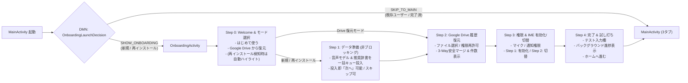

# PRD & System Design: Onboarding Flow (初回導入・再インストール・Google Drive 履歴復元対応)

## Part 1: Product Requirements Document (PRD)

### 1. 背景と課題 (Executive Summary)
JotInput は完全オンデバイスの高精度日本語・英語 IME（音声認識 ASR + Mozc かな漢字変換 + SLM リランキング + ユーザー辞書/学習履歴同期）であり、アプリサイズを軽量に保つため **音声認識モデル (~160MB)** や **拡張辞書 (SudachiDict / Wikipedia 等)** をオンデマンドでダウンロードする設計を採用している。また、[`UserHistorySyncManager`](app/src/main/java/com/example/myasr/context/kanakanji/application/UserHistorySyncManager.kt) により、Google Drive 上の `jotinput_history_sync.json` を介したユーザー辞書・変換学習履歴（Unigram / Bigram / Tombstone）の安全な 3-Way Delta マージ機能を備えている。

しかし現状では以下の課題がある：
1. **初回導入の迷いとブロッキング**: 新規インストール時に、IME 有効化・入力方法切替・マイク権限・モデル/辞書ダウンロードが `MainActivity` の通常画面に混在しており、初めて使うユーザーが一連の導入を直感的に完走できない。
2. **再インストール・機種変更時の導線欠如**: せっかく Google Drive に履歴・辞書を保存していても、機種変更や再インストール時に `DictionaryActivity` の奥深くにある同期シートまで辿り着かないと復元できない。
3. **Android Auto Backup による再インストール時の不整合**: `android:allowBackup="true"` により `SharedPreferences`（`sync_file_uri` や設定値）や `custom_dictionary.json` が復元されても、**SAF（Storage Access Framework）の永続 URI 権限 (`takePersistableUriPermission`) は再インストール時に失効**し、大容量モデル・辞書バイナリや IME 有効化状態もリセットされている。この「設定だけ残っていて権限とバイナリがない」半端な状態を安全に検知・復旧する仕組みがない。
4. **ダウンロード待ちによる離脱**: モデルや辞書のダウンロードには数十秒〜数分かかるが、ダウンロード完了を待たないとオンボーディングを進められない設計ではユーザーが離脱する。

本 PRD では、**「バックグラウンドでダウンロードを継続したままオンボーディングを止めずに完了できる」** 非ブロッキング型の [`OnboardingActivity`](app/src/main/java/com/example/myasr/OnboardingActivity.kt) および関連ドメインモデル（DMN / Alloy）を定義する。

---

### 2. Jobs to be Done (JTBD)

| JTBD ID | ユーザー状況 (When) | 動機・やりたいこと (I want to) | 期待する成果 (So I can) |
| :--- | :--- | :--- | :--- |
| **JTBD-OB1** | **初めて JotInput をインストールしたとき** | 何をどの順に設定すればよいか迷わず案内され、重いデータのダウンロード中でも待ちぼうけにならずに残りの設定を進めたい | 最短の手順で「話せる・打てる」状態になり、すぐに試用を開始できる |
| **JTBD-OB2** | **アプリを再インストールしたとき（同一端末・Auto Backup あり/なし）** | 以前の設定やローカルバックアップが残っているか自動判定してもらい、失効した権限や欠落したモデル・IME設定だけを迷わず復旧したい | ゼロからやり直す手間なく、元の快適な入力環境を取り戻せる |
| **JTBD-OB3** | **新しい端末や再インストール後に、Google Drive の履歴を使って復元したいとき** | 導入フローの最初から「Google Drive から復元」を選び、過去のカスタム辞書・変換学習履歴・ホットワードを即時取り込みたい | 新しい環境でも初日から自分の語彙・変換クセが反映された状態で入力できる |
| **JTBD-OB4** | **モバイル回線中や時間がないときに導入しているとき** | 大容量モデル・辞書のダウンロードを強制されず、スキップまたはバックグラウンド実行したままキーボード導入を完了したい | 後から Wi-Fi 環境でデータを取得し、まずは基本入力から使い始められる |

---

### 3. Critical User Journeys (CUJ)

#### CUJ-OB1: 初めてのインストール（Fresh Install）
1. **起動判定**: `OnboardingStateStore` が未完了かつ既存セットアップ形跡なし（IME無効・モデル未配置・辞書0語）を検知し、`OnboardingActivity` を起動する。
2. **Step 0 — Welcome ＆ 導入スタイル選択**:
   - 「はじめて使う（新規セットアップ）」をタップ（デフォルト強調）。
3. **Step 1 — バックグラウンドデータ準備（非ブロッキング）**:
   - 日本語音声認識モデル (~160MB) と推奨拡張辞書の取得を「まとめてバックグラウンドで取得（推奨）」ワンタップで [`ProvisioningForegroundService`](app/src/main/java/com/example/myasr/context/provisioning/infrastructure/ProvisioningForegroundService.kt) へ投入する。
   - **重要**: 投入した瞬間に画面上部のグローバル進捗バーが動き出し、**ダウンロード完了を待たずに「次へ」ボタンが即座に有効**（あるいは自動進行案内）となる。モバイル回線等で今は落としたくない場合は「あとでデータタブから取得（スキップ）」も可能。
4. **Step 2 — クラウド同期（任意）**:
   - 新規ユーザーには「あとで設定する（スキップ）」または「Google Drive と自動同期を設定する」を提示。
5. **Step 3 — 権限 ＆ キーボードの有効化・切替**:
   - マイク権限 (`RECORD_AUDIO`)、通知権限 (`POST_NOTIFICATIONS` ※Android 13+ でバックグラウンド進捗通知用) を取得。
   - 「Step 1: キーボードを有効にする」（システム設定）→ 戻ってきたら自動検知 → 「Step 2: 入力方法を JotInput に切替」（IME ピッカー）を実行。
6. **Step 4 — 完了 ＆ 試し打ち**:
   - テスト入力欄でフリック/QWERTY入力を即座に試せる。モデルダウンロードが完了済みなら音声入力もそのまま試行可能、未完了なら「音声モデルをバックグラウンドで準備中 (XX%)」を表示してブロックしない。
   - 「使い始める」タップでオンボーディング完了フラグを保存し `MainActivity` へ遷移（ダウンロードはバックグラウンドで継続）。

#### CUJ-OB2: 再インストール（Local / Android Auto Backup Restore）
1. **起動判定**: 再インストール直後、Android Auto Backup により `SharedPreferences` や `custom_dictionary.json` が復元されている可能性がある一方、IME は無効化され、外部ストレージの ASR モデルや拡張辞書が欠落していることが多い。
   - `OnboardingDecisionModel` は「`onboarding_completed` が `false`」だけでなく、**「`onboarding_completed == true` であっても `imeEnabled == false && !asrReady && totalDictWords == 0`（再インストール直後の典型状態）」** を検知し、再セットアップとしてオンボーディング（再インストールモード）を起動する。
   - 逆に、すでにアップグレード前から使っていた既存ユーザー（`imeEnabled == true` かつ `asrReady || totalDictWords > 0`）は **自動マイグレーションで `onboarding_completed = true` 扱いとし、いきなりオンボーディングを出さない**。
2. **Step 0 — 再インストール検知バナー**:
   - Auto Backup でカスタム辞書や過去の `sync_file_uri` が検出された場合、「以前の設定・辞書データが見つかりました」と表示し、「環境を再構築する」または「Google Drive と再連携して復元」を案内する。
3. **Step 1〜3 — 欠損している要素だけ補完**:
   - すでに配置済みのモデル・辞書があれば「導入済み ✓」と表示し二重ダウンロードしない。
   - 過去に設定していた Google Drive URI があるが SAF 権限が失効している場合は、Step 2 で **「アクセス権限の再許可が必要です」** と警告トーンで表示し、ワンタップでファイル再選択 → 安全マージを実行できる。

#### CUJ-OB3: Google Drive の履歴を使った再インストール（Drive History Restore）
1. **Step 0**: ユーザーが **「Google Drive の履歴から復元して始める」** を選択する。
2. **Step 2 へ優先フォーカス（または専用復元ステップを先頭に配置）**:
   - ステップ進行順を Drive 復元優先に切り替え、まず「Google Drive の履歴ファイル (`jotinput_history_sync.json`) を選択」させる。
   - 選択完了と同時に `takePersistableUriPermission` を取得し、[`UserHistorySyncManager.performSync`](app/src/main/java/com/example/myasr/context/kanakanji/application/UserHistorySyncManager.kt#L217) で安全にマージ・復元する。
   - 復元完了後、「単語 X件・変換履歴 Y件を復元しました ✓」と件数をフィードバックし、[`AsrApp.syncAllUserDictionaries()`](app/src/main/java/com/example/myasr/AsrApp.kt#L115) によりホットワード・変換エンジンへ即時反映する。
3. **Step 1（バックグラウンドデータ準備）→ Step 3（権限・IME設定）→ Step 4（テスト）**:
   - Drive 復元後は、同様にモデル・拡張辞書をバックグラウンドダウンロードに投げたまま、IME 有効化・テスト入力まで一気通貫で完了できる。

#### CUJ-OB4: オンボーディング中断・アプリキル・ダウンロードエラー時の復帰
1. **中断と再開**: ユーザーが Step 2 や Step 3（システム設定画面への遷移等）でアプリを一時離脱したり、プロセスキルされたりしても、`OnboardingStateStore` が「現在のステップ」と「選択したモード」を永続化しているため、元のステップから再開できる。
2. **ダウンロードエラー時**: オフラインやサーバーエラーで `ProvisioningForegroundService` が失敗イベントを出しても、オンボーディングは停止しない。「バックグラウンド取得を一時中断しました（あとでデータタブから再試行できます）」と非破壊バナーで通知し、先へ進める。

---

### 4. ステップ構成と情報設計 (Non-Blocking Architecture)

※ **Drive 復元モード (`DRIVE_RESTORE`)** の場合、ユーザーが最初に期待するのは「まず自分の履歴が戻るか確認すること」であるため、Step 0 → **Step 2 (Drive復元)** → **Step 1 (バックグラウンドデータ準備)** → **Step 3 (権限・IME設定)** → **Step 4 (試し打ち)** の順で自然に案内する（進捗インジケータも動的にステップ順を反映）。

---

### 5. コーナーケース対策マトリクス (Corner Cases & Safeguards)

| # | コーナーケース | 発生原因 | 対策 (設計・実装上の保証) |
| :--- | :--- | :--- | :--- |
| **CC-1** | **Auto Backup で `sync_file_uri` だけ復元され、SAF 権限が失効している** | `allowBackup="true"` により `history_sync_prefs` は復元されるが、Android OS は再インストール時に `UriPermission` を引き継がない | `UserHistorySyncManager.hasValidSyncPermission()` で `contentResolver.persistedUriPermissions` を検証し、`URIあり & 権限なし` を **`PERMISSION_LOST`** として検知。「連携済み」と偽表示せず「権限の再接続」CTA を出す。 |
| **CC-2** | **Auto Backup で `onboarding_completed = true` が復元される** | 端末初期化・再インストール時のクラウドバックアップ復元 | `OnboardingLaunchDecisionTable` で、`completed == true` でも **`!imeEnabled && !japaneseAsrReady && totalDictWords == 0`** の場合は「再インストール直後の未セットアップ状態」と判定し、オンボーディング（`REINSTALL` モード）を起動する。 |
| **CC-3** | **既存ユーザーのアップデート時にオンボーディングが強制出現する** | 新バージョンで `onboarding_completed` フラグが未設定（`false`） | `imeEnabled && (japaneseAsrReady || totalDictWords > 0)` の既存ユーザーは `OnboardingLaunchDecisionTable` が **`AUTO_MIGRATE_COMPLETE`** と判定し、オンボーディングをスキップしてフラグを `true` に自動移行する。 |
| **CC-4** | **ダウンロード中に「次へ」「完了」を押しても通信が止まらないか** | Activity の `lifecycleScope` でダウンロードすると画面遷移/終了でキャンセルされる | すべてのモデル・辞書ダウンロードは [`ProvisioningForegroundService`](app/src/main/java/com/example/myasr/context/provisioning/infrastructure/ProvisioningForegroundService.kt)（`foregroundServiceType="dataSync"`）で実行する。Activity 側は `StateFlow` を購読するだけなので、ステップ移動・完了・アプリ最小化でも継続する。 |
| **CC-5** | **同じモデル・辞書の二重エンキュー** | ユーザーが Step 1 で戻る/進むを繰り返したり、完了済み項目を再度タップ | `ProvisioningUiState.isTaskActiveOrQueued(...)` および実ファイルの存在チェック（`asrManager.isModelAvailable` / `outdatedDictCount == 0 && totalDictWords > 0`）で既に実行中または導入済みのタスクをスキップする。 |
| **CC-6** | **Android 13+ で通知権限がなくバックグラウンド進捗通知が見えない** | Android 13 (`API 33`) 以降は `POST_NOTIFICATIONS` がランタイム権限 | Step 3 でマイク権限と合わせて通知権限も案内（ダウンロード開始時に未許可なら事前リクエストも可能）。**ただし拒否されても Foreground Service 自体は継続し、アプリ内バナーで進捗を見せる。** |
| **CC-7** | **オンボーディング中のダウンロード完了とモデル初期化** | Step 3〜4 や試し打ち中に ASR モデルダウンロードが完了する | `OnboardingActivity` が `ProvisioningForegroundService.state` の `lastEvent` を監視し、`JAPANESE_ASR_MODEL` 成功時に即座に `AsrApp.instance.ensureModelInitialized()` を呼び、試し打ち欄の音声入力準備完了を即時反映する。 |
| **CC-8** | **オフライン・容量不足等でダウンロード失敗** | Wi-Fi 切断、ストレージ残量不足、サーバータイムアウト | 失敗イベントを受信してもオンボーディングをブロックせず、「ダウンロードに失敗しました（後からデータタブで再試行できます）」と表示し、再試行ボタンと「このまま進む」の両方を維持する。 |
| **CC-9** | **Google Drive 上のファイルが破損・空・不正JSON・オフライン** | ユーザーが別ファイルを選んだ、ファイル編集ミス、機内モード | `UserHistorySyncManager.performSync()` の例外・パース失敗を安全にキャッチし、ローカルデータと `sync_backup_prev.json` を破壊しない。UI 上で分かりやすいエラーメッセージを表示し、再選択またはスキップを可能にする。 |
| **CC-10** | **システム設定（IME有効化）から戻った際のフォーカス・状態反映** | ユーザーが別アプリ（設定画面）へ遷移して戻ってくる | `onResume()` で必ず `isImeEnabled()`, `isImeSelected()`, `hasMicrophonePermission()`, `hasNotificationPermission()`, Drive 権限状態をすべて再評価し、DMN 結果で UI を即時更新する。 |
| **CC-11** | **画面回転・プロセスキルによる状態喪失** | システム設定遷移中のメモリ不足や画面回転 | `OnboardingStateStore`（`SharedPreferences`）に `selectedMode` と `currentStep` を保存し、`onCreate` 時に復元する。 |
| **CC-12** | **後からオンボーディングや Drive 復元をやり直したい** | 初回スキップしたユーザーが後から案内を見たい | `MainActivity` の「設定」タブ（およびデータ管理導線）から「セットアップウィザード / 履歴復元を開く」を明示的に起動できるようにする（`EXTRA_FORCE_LAUNCH = true`）。 |

---

## Part 2: DMN 決定表設計 (Decision Model and Notation)

[`OnboardingDecisionModel`](app/src/main/java/com/example/myasr/context/ime/domain/OnboardingDecisionModel.kt) に以下の 3 つの純粋 DMN `DecisionTable` を定義する。

1. **`OnboardingLaunchDecisionTable` (`HitPolicy.FIRST`)**:
   - 入力: `forceLaunch`, `onboardingCompleted`, `imeEnabled`, `japaneseAsrReady`, `totalDictWords`, `hasLocalCustomDict`, `hasStoredDriveUri`
   - 出力 (`OnboardingLaunchAction`):
     - `LAUNCH_EXPLICIT`（設定等からの明示起動）
     - `AUTO_MIGRATE_COMPLETE`（既存ユーザーアップグレード時の自動完了移行・スキップ）
     - `LAUNCH_REINSTALL_DRIVE_HINT`（再インストールかつ Auto Backup 由来の履歴/Drive URI あり）
     - `LAUNCH_REINSTALL`（再インストールだがローカル履歴なし）
     - `LAUNCH_FRESH`（初回インストール）
     - `SKIP_TO_MAIN`（完了済み通常起動）
2. **`DriveRestoreStatusDecisionTable` (`HitPolicy.FIRST`)**:
   - 入力: `isSyncing`, `hasStoredUri`, `hasValidPermission`, `lastSyncSuccess`, `lastRestoredCount`, `lastErrorMessage`
   - 出力 (`DriveRestoreDecision`): `DriveRestoreUiState` (`SYNCING`, `RESTORED_OK`, `ERROR`, `PERMISSION_LOST`, `CONNECTED_IDLE`, `NOT_CONNECTED`)、バッジ文言、説明文、ボタン文言、トーン。
3. **`OnboardingStepGuidanceDecisionTable` (`HitPolicy.FIRST`)**:
   - 入力: `step`, `mode`, `provisioningActive`, `japaneseAsrReady`, `totalDictWords`, `imeEnabled`, `imeSelected`, `micGranted`, `driveStatus`
   - 出力 (`StepGuidanceDecision`): プライマリ CTA ラベル、スキップ/次へ可否、補助ステータス文言。

---

## Part 3: Alloy による形式仕様 (Formal Verification)

[`app/src/test/resources/alloy/onboarding_flow.als`](app/src/test/resources/alloy/onboarding_flow.als) により、オンボーディングの状態機械とコーナーケースの安全性を SAT4J で網羅検証する：

- **`ExistingUserNeverForcedIntoOnboarding`**: `forceLaunch = False` かつ `imeEnabled = True` かつ（`jaAsrReady = True` または `hasDict = True`）の既存ユーザーは、必ず `LaunchSkipToMain` または `LaunchAutoMigrate` になり、オンボーディングが強制起動されないこと。
- **`RevokedDrivePermissionNeverReportedConnected`**: `hasStoredDriveUri = True` かつ `driveUriPermValid = False`（Auto Backup による権限失効）のとき、Drive 状態は必ず `DrivePermissionLost` となり、誤って `DriveConnectedReady` にならないこと。
- **`DownloadInProgressNeverBlocksCompletion`**: バックグラウンドダウンロードが `ProvRunning` または `ProvFailed` であっても、オンボーディングの完了状態 (`StepComplete`) に到達可能であること（非ブロッキング性の形式証明）。
- **`AllModesCanReachCompletion`**: `ModeFresh`、`ModeReinstall`、`ModeDriveRestore` のどのモードから開始しても、デッドロックなく完了状態へ到達できること。
