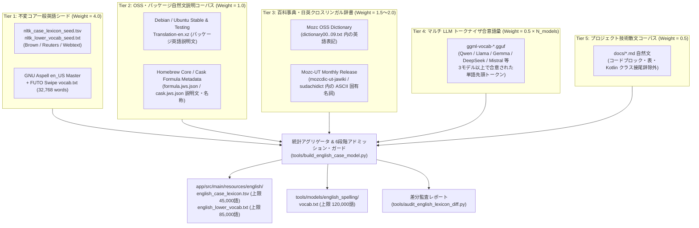
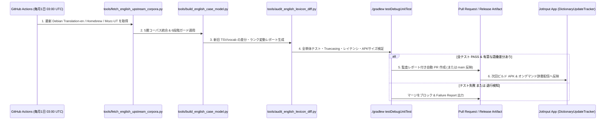

# PRD, JTBD, CUJ & System Design: 定期的・体系的な新語取り込み計画（Periodic Vocabulary Ingestion Pipeline）

**作成日**: 2026-11-22  
**関連文書**:
- [`docs/prd_and_design_english_dictionary_strengthening.md`](docs/prd_and_design_english_dictionary_strengthening.md) — 英語辞書強化＆プレフィックス補完（`tailsc` $\to$ `Tailscale`）
- [`docs/prd_and_design_dictionary_update_tracker.md`](docs/prd_and_design_dictionary_update_tracker.md) — 自動辞書更新チェック・更新日可視化・更新通知システム
- [`docs/mozc_ut_dictionary_best_practices.md`](docs/mozc_ut_dictionary_best_practices.md) — Mozc コミュニティ拡張辞書エコシステムとベストプラクティス
- [`docs/prd_and_design_unified_english_dictionary.md`](docs/prd_and_design_unified_english_dictionary.md) — 日英共通カスタム辞書
- [`tools/build_english_case_model.py`](tools/build_english_case_model.py) — 多段コーパス英語語彙・Truecasing 統計ビルドパイプライン

---

## Part 1: Product Requirements Document (PRD)

### 1. 概要 (Overview)

JotInput における**英語語彙（一般語・最新技術用語・OSS/クラウド製品名・AI モデル名・CamelCase/PascalCase 固有名詞）**および**日本語語彙（SudachiDict 現代語・Wikipedia 固有名詞・人名・地名）**の双方について、**「手作業の個別単語ハードコード（Anecdotal Cost Hacking）を一切行わず、信頼できる公開コーパス・辞書データソースから定期的（月次自動パイプライン＋オンデマンド配信）に新語を収集・統計フィルタリング・品質検証して取り込む仕組み」**を定義する。

本計画は以下の 4 本の柱で構成される：
1. **Multi-Tier 公開コーパス統合と再現性保証**: ビルド端末のローカル環境（`/var/lib/apt/lists/` 等）への暗黙依存をなくし、公式ミラー・公開リポジトリ・LLM トークナイザ合意から決定論的に新語と大文字小文字分布 $P_{\text{lex}}(s \mid w)$ を抽出する。
2. **日英クロスリンガル新語還流（Cross-Lingual Vocabulary Pollination）**: 毎月更新される `mozcdic-ut-jawiki`（Wikipedia 日本語版）および `mozcdic-ut-sudachidict` に追加される英語固有名詞・技術用語を、日本語変換だけでなく英語 QWERTY 辞書（`english_case_lexicon.tsv` / `vocab.txt`）のコーパス集計ソースとしても自動還流させる。
3. **厳格な統計アドミッション・ガード（6 段階の汚染・退行防止フィルタ）**: 新語追加によって基本短語（`an`, `tail`, `the` 等）の保護、OOV 頭字語検出（`SDK`, `VPN` 等）、検索レイテンシ（$< 0.5\text{ ms} / < 0.8\text{ ms}$）、APK サイズ予算（$\le 110\text{ MB}$）が一切損なわれないことを機械的に保証する。
4. **月次 GitHub Actions 自動取り込み PR ＆ 端末オンデマンド差分配信（OTA）**: 毎月 1 日の定期スケジュール実行で上流コーパス取得・辞書再生成・差分監査レポート作成・全テスト検証を行い、さらにアプリの APK 更新を待たずに端末側でも新語を受け取れるハイブリッド配信計画を定める。

---

### 2. 背景と課題 (Background & Problem Statement)

1. **新語・技術トレンドの継続的発生と陳腐化リスク**:
   - [`tools/build_english_case_model.py`](tools/build_english_case_model.py) により `Tailscale`, `WireGuard`, `Kubernetes`, `PostgreSQL`, `Cloudflare` 等の語彙を拡充したが、新しい OSS・AI モデル・開発ツール・時事固有名詞は毎月新たに登場する。一度きりの手動再ビルドでは時間経過とともに再び辞書が陳腐化する。
2. **ビルド環境依存（`/var/lib/apt/lists/`）による再現性の課題**:
   - 現行の `load_debian_prose()` はビルド実行マシンの `/var/lib/apt/lists/*Translation-en` および `*Packages*` を参照している。CI ランナーや新規開発環境では apt リストが空または構成が異なる場合があり、どの環境で実行しても同じ語彙が生成される**ネットワーク取得＋キャッシュ／スナップショット方式**への昇華が必要である。
3. **日本語の月次オンデマンド更新と英語の内蔵辞書更新の分断**:
   - 日本語拡張辞書（`mozcdic-ut-sudachidict`, `mozcdic-ut-jawiki`, `place_names`, `personal_names`）は毎月 1 日前後に上流が更新され、アプリ内の [`DictionaryUpdateTracker`](app/src/main/java/com/example/myasr/context/provisioning/domain/DictionaryUpdateTracker.kt) が GitHub Commits Atom フィード経由で更新を自動検知・通知できる。
   - 一方、英語辞書（`app/src/main/resources/english/english_case_lexicon.tsv`, `english_lower_vocab.txt`, `tools/models/english_spelling/vocab.txt`）はリポジトリへのコミット＆APK ビルド時にのみ更新される構造となっており、定期自動更新パイプラインが未定義だった。
4. **無秩序な語彙追加に伴う副作用リスク**:
   - 外部コーパスから無制限に単語を取り込むと、以下の退行リスクが生じる：
     - **短語・タイポバケット汚染**: 低頻度の 2〜4 文字略語やタイポ語が混入し、`tail` $\to$ `tails` $\to$ `tailsc` の段階入力や `teh` $\to$ `the` の空間タイポ補正でノイズ候補が上位に割り込む。
     - **OOV 頭字語検出の破壊**: `sdk`, `vpn`, `gpu`, `llm` 等の頭字語が誤って `english_lower_vocab.txt` に小文字一般語として登録されると、`EnglishCaseModel.oovAcronymProbability()` が `0.0f` を返し、自動大文字化（`SDK`, `VPN`）が機能しなくなる。
     - **レイテンシ・APK サイズ超過**: 2 文字タイポバケットの候補数が膨張して `< 0.8ms` の検索予算を超過したり、APK サイズ上限（$\le 110\text{ MB}$）を圧迫する。

---

### 3. Jobs to be Done (JTBD)

- **Main Job（ユーザー視点）**: 日常の英語・日本語入力において、新しく普及した技術用語・サービス名・固有名詞・現代語を「自分で毎回カスタム辞書に手動登録しなくても」最初から候補バーに正しい綴り・大文字小文字で予測表示させたい。
- **Maintainer Job（開発・運用視点）**: 個別の単語要望が来るたびにアドホックに辞書やコストを書き換えるのではなく、**定期スケジュール（月次）で上流コーパスから自動収集・統計検証・退行テスト・PR 作成までが自律的に回るパイプライン**を持ちたい。
- **Quality & Safety Job**: 新語が数千語追加されても、既存の基本語入力（`an`, `tail`, `the`）、Truecasing 精度（Top-1 $\ge 95\%$）、音声句読点テスト（67+ 件 100% パス）、キーストローク応答速度（$< 0.8\text{ ms}$）、およびユーザー辞書（`custom_dictionary.json`）が絶対に退行・破損しないことを保証したい。

---

### 4. Critical User & Maintainer Journeys (CUJ)

| ID | ジャーニー名 | トリガー・行動 | システムの自動処理・期待挙動 | 成功・合格基準 |
|---|---|---|---|---|
| **CUJ-1** | **月次自動コーパス収集＆英語辞書更新 PR 生成** | 毎月 1 日 03:00 UTC の GitHub Actions `schedule`（または手動 `workflow_dispatch`） | 上流コーパス（Debian `Translation-en`、Homebrew Formula 説明文、Mozc-UT 最新版、LLM トークナイザ語彙）を取得し、`build_english_case_model.py` と差分監査スクリプトを実行して自動 PR を作成 | 差分レポート（新規追加語・削除語・主要語ランク確認）付き PR が自動生成される |
| **CUJ-2** | **自動品質ゲートによる汚染・退行ブロック** | 新語取り込み PR またはローカル辞書再生成の実行 | 6 段階の統計アドミッション・ガードを適用した上で、`./gradlew testDebugUnitTest`（全 484+ テスト）と APK サイズ検査を実行 | Truecasing Top-1 $\ge 95\%$、プレフィックス $< 0.5\text{ ms}$、タイポ $< 0.8\text{ ms}$、APK $\le 110\text{ MB}$ を 100% 満たす場合のみ通過 |
| **CUJ-3** | **日英クロスリンガル新語の同時反映** | 上流の `mozcdic-ut-jawiki` / `sudachidict` に新しい IT 用語・製品名（例: 新 OSS や新 SaaS 名）が追加される | ① 日本語側は `DictionaryUpdateTracker` が更新を通知して `.bin` へ反映<br>② 英語側は月次ビルドが Mozc-UT 内の ASCII 固有名詞もコーパス根拠として集計し、`english_case_lexicon.tsv` に混合ケース表記を収録 | 日本語かな入力でも英語 QWERTY プレフィックス入力でも同一の新語が候補に出る |
| **CUJ-4** | **端末オンデマンド英語拡張語彙オーバーレイ更新（Phase 3 OTA）** | ユーザーがアプリ設定（データタブ）で「辞書アップデートを確認・一括更新」を実行 | 日本語拡張辞書と合わせて、最新の英語拡張ケース辞書・スペル語彙差分を外部ストレージへ取得し、`EnglishCaseModel` と `EnglishSpellEngine` に即時ホットリロード | APK 本体（Play ストア等）の更新を待たずに月次の英語新語が端末上で利用可能になる |
| **CUJ-5** | **カスタム辞書・学習履歴の完全保護** | 月次辞書更新またはアプリ本体アップデートを実行 | `context.filesDir/custom_dictionary.json` およびユーザー学習履歴は一切変更・消去されず、ユーザー登録単語が常に最優先スコアを維持 | Custom Dictionary Persistence Contract 100% 遵守 |

---

## Part 2: 上流データソース階層と収集仕様（Multi-Tier Corpus Taxonomy）

`AGENTS.md` の **Anti-Anecdotal Tuning Policy（個別単語の手動コスト調整・ハードコード禁止）** を厳守するため、すべての語彙・対数頻度 $\log(1 + \text{count})$・大文字小文字確率 $P_{\text{lex}}(s \mid w)$ は、以下の **5 層（Tier 1〜Tier 5）のコーパス統計** から導出する。



### 各 Tier の詳細と更新頻度・取得方法

| Tier | データソース名 | 役割・カバーする語彙領域 | 上流の更新頻度 | 再現可能な取得経路（Fetcher 仕様） | 基本重み |
|---|---|---|---|---|---|
| **Tier 1** | **NLTK 一般英語散文シード + Aspell + FUTO** | 日常英語の基本語・活用形・縮約形（`I'm`, `don't`, `let's`）・略語 EOS 確率・文字バイグラム LM の不変ベースライン | 不変（年 1 回見直し） | リポジトリ内シード（`tools/models/english_spelling/nltk_*_seed.*`, `tools/futo_swipe/vocab.txt`）＋ CI 環境の `aspell -d en_US dump master` | `4.0`（散文） |
| **Tier 2A** | **Debian `Translation-en` & `Packages` 説明文** | Linux / ネットワーク / セキュリティ / 開発ツール / 科学技術ソフトウェアの英語自然文（例: `Tailscale`, `WireGuard`, `Wayland`, `PostgreSQL`, `systemd`） | 毎日〜毎週 | 公式ミラー `https://deb.debian.org/debian/dists/trixie/main/i18n/Translation-en.xz`（および `sid/main`）を `tools/fetch_english_upstream_corpora.py` で `tools/data_sources/english_corpora/` へダウンロード | `1.0` |
| **Tier 2B** | **Homebrew Core / Cask メタデータ (`formulae.brew.sh`)** | macOS / Linux / クラウド開発者が日常利用する最新 CLI・SaaS・デスクトップアプリ名と 1 行英語説明文（例: `Cloudflare`, `Terraform`, `FastAPI`, `Ollama`, `Bun`, `Ruff`, `Raycast`, `OrbStack`） | 毎日 | `https://formulae.brew.sh/api/formula.jws.json` および `cask.jws.json` から `name`, `full_name`, `desc` の自然文を抽出 | `1.0` |
| **Tier 3A** | **Mozc OSS 英語表記 (`google/mozc`)** | 日本語 IME ユーザーが頻繁に入力する定番の英語固有名詞・略語・製品名 | 月 1〜数回 | `tools/mozc/src/data/dictionary_oss/dictionary00..09.txt`（または `google/mozc` `master` ブランチ） | `2.0` |
| **Tier 3B** | **Mozc-UT 最新リリース（`jawiki` / `sudachidict`）の ASCII 表記** | Wikipedia 日本語版や SudachiDict に毎月新規追加される最新トレンド固有名詞・ブランド名・サービス名の英語表記 | **毎月 1 日** | `utuhiro78/mozcdic-ut-jawiki` および `mozcdic-ut-sudachidict` の最新 `.txt.bz2` から、表記カラム（第 5 カラム）が純粋な英単語（`WORD_RE` 合致かつ非全小文字または高頻度）のエントリを抽出 | `1.5` |
| **Tier 4** | **マルチ LLM トークナイザ合意 (`ggml-vocab-*.gguf`)** | 大規模 Web コーパスで学習された複数ファミリーの LLM（Llama, Qwen, Gemma, DeepSeek, Mistral 等）が独立に単一トークンとして割り当てた現代語・CamelCase 語 | 新 LLM 登場時（四半期） | `tools/llama_cpp_src/models/ggml-vocab-*.gguf` で単語先頭マーカー（`\u2581` / `\u0120`）を持ち、**3 モデル以上**で一致するトークン | `0.5 × N` |
| **Tier 5** | **プロジェクト技術散文 (`docs/*.md`)** | 音声認識・機械学習・モバイル開発ドメインの専門用語（例: `ReazonSpeech`, `Zipformer`, `Truecasing`, `SymSpell`） | 随時 | `docs/*.md` からコードブロック・インラインコード・Markdown 表・Kotlin クラス接尾辞（`Activity`, `Service` 等）を除いた自然文中で 3 回以上出現する混合ケース語 | `0.5`（上限 `5.0`） |

---

## Part 3: 統計フィルタリング・ノイズ防止・ランキング保護アルゴリズム（6 段階アドミッション・ガード）

定期的に新語を取り込む際、辞書の肥大化や誤変換を防ぐため、[`tools/build_english_case_model.py`](tools/build_english_case_model.py) に以下の **6 つの統計アドミッション・ガード（Admission Guards）** を課す。

### Guard 1: 文頭大文字バイアス＆見出し文の完全除外
- 英語の自然文では、文頭（`idx == 0`）や引用符直後の単語は普通名詞であっても頭文字が大文字（`The`, `Table`, `Server`）になる。
- したがって、すべての散文コーパス（NLTK, Debian, Homebrew `desc`, `docs/*.md`）において **文頭トークン（`idx == 0`）および ALL-CAPS 見出し文（文内の全大文字トークン比率 $> 40\%$）を統計集計から除外**し、文中（mid-sentence）で実際に大文字・混合ケースで書かれた証拠のみから $P_{\text{lex}}(s \mid w)$ を推定する。

### Guard 2: 最小証拠量とマルチソース合意しきい値（Minimum Evidence & Consensus）
- 1 回限りのタイポやパッケージ固有の内部識別子が辞書に混入するのを防ぐため：
  1. 全コーパス合算の重み付き出現カウントが **`total >= 3.0`** 未満の単語はすべて棄却する。
  2. LLM トークナイザ（Tier 4）由来の語は、**3 種類以上の異なるトークナイザ（`cnt >= 3`）**に共通して単語先頭トークンとして存在する場合のみ受理する。
  3. Mozc-UT `jawiki`（Tier 3B）由来の ASCII 固有名詞は、単独では全大文字のノイズ略語が多いため、**① CamelCase/混合ケースであるか、② Tier 2/4（Debian, Homebrew, GGUF）のいずれかでも共起しているか、③ Mozc コストが十分に低い（高頻度固有名詞）** 場合のみ採用する。

### Guard 3: 既知短語（2〜4 文字）の優先度保護とタイポバケット足切り
- `an`, `in`, `on`, `to`, `it`, `is`, `at`, `or`, `by`, `tail`, `tails`, `the`, `and` などの一般短語が、新しく追加された固有名詞や長単語のプレフィックス補完に負けないよう以下を強制する：
  1. Tier 1（NLTK 一般散文は重み `4.0`、FUTO Swipe 上位語はランク反比例の擬似カウント `1500 / (rank + 10)`）により、日常基本語の `logFreq`（$6.0 \sim 10.8$）が新規専門用語の初期 `logFreq`（$1.4 \sim 3.5$）より常に統計的に高く保たれる。
  2. DMN 決定表 [`EnglishPrefixCompletionPolicy`](app/src/main/java/com/example/myasr/context/english/domain/EnglishAssistJudgement.kt) の Rule `EN_PREFIX_R2` により、`EnglishCaseModel.isKnownWord(rawLower) == true` の既知語は常に `PROTECT_EXACT_WORD` 戦略となり、長単語の予測補完が Rank 1 を奪うことを防ぐ。
  3. 2 文字タイポバケット（`typoBuckets`）への登録は **`TYPO_INDEX_MIN_LOG_FREQ = 2.1f`**（重み付き出現数 $\ge 7.2$ 相当）以上に限定し、かつバケット内を `logFreq` 降順ソート＋上界枝刈りすることで、新語が増えても低頻度語がタイポ候補に誤爆せず、検索レイテンシ $< 0.8\text{ ms}$ を維持する。

### Guard 4: `english_lower_vocab.txt` の純度保護（OOV 頭字語検出の非退行）
- [`EnglishCaseModel.oovAcronymProbability()`](app/src/main/java/com/example/myasr/context/english/domain/EnglishCaseModel.kt#L115-L121) は、2〜6 文字の入力語が `english_lower_vocab.txt` に存在しない（`!isKnownLowerWord(lowerWord)`）ときに文字バイグラム対数尤度比（LLR）で未知の頭字語（`sdk` $\to$ `SDK`, `vpn` $\to$ `VPN`）を判定する。
- 新語取り込みによって頭字語や固有名詞が誤って `english_lower_vocab.txt` に混入するのを防ぐため、`english_lower_vocab.txt` への収録は以下の厳格条件を満たす語のみに限定する：
  $$\frac{\text{count}(\text{lowercase})}{\text{total}} \ge 0.65 \quad \land \quad \left(w \in \text{SeedLower} \cup \text{AspellLower} \;\lor\; \text{LowerProseCount}(w) \ge 10.0\right)$$

### Guard 5: 所有格・URL/Slug・コード識別子フィルタ
- `VALID_CONTRACTIONS`（`don't`, `let's`, `I'm`, `it's` 等 42 語）以外の `'s` で終わる名詞所有格（例: `tailscale's`, `user's`）はすべて除外し、プレフィックス補完候補が所有格で埋まるのを防ぐ。
- URL、メールアドレス、2 個以上のハイフンを含む 패키ジスラグ（`libfoo-bar-dev`）、およびソースコードのクラス名接尾辞（`KOTLIN_IDENTIFIER_SUFFIXES`: `Activity`, `Service`, `Manager`, `Judgement`, `Ranker` 等）は正規表現および接尾辞フィルタで自動除外する。

### Guard 6: 語彙数・ファイルサイズ・レイテンシ予算キャップ（Hard Budget Caps）
毎月新語を取り込み続けても APK サイズとメモリ・検索速度が劣化しないよう、以下のハードキャップを設ける。上限を超えた場合はコーパス重み付き頻度 `total` の降順で上位のみを保持（LRU/Frequency Eviction）する：

| 生成アーティファクト | 収録語数ハードキャップ | ファイルサイズ上限 | 2026-11 現在の実績値 |
|---|---:|---:|---:|
| [`app/src/main/resources/english/english_case_lexicon.tsv`](app/src/main/resources/english/english_case_lexicon.tsv) | $\le 45,000$ 語 | $\le 1.8\text{ MB}$ | $29,463$ 語 ($1.11\text{ MB}$) |
| [`app/src/main/resources/english/english_lower_vocab.txt`](app/src/main/resources/english/english_lower_vocab.txt) | $\le 85,000$ 語 | $\le 1.4\text{ MB}$ | $71,423$ 語 ($1.11\text{ MB}$) |
| [`tools/models/english_spelling/vocab.txt`](tools/models/english_spelling/vocab.txt) | $\le 120,000$ 語 | $\le 1.3\text{ MB}$ | $98,763$ 語 ($0.88\text{ MB}$) |
| **Debug APK 全体 (`app-debug.apk`)** | — | **$\le 110\text{ MiB}$** | **$106.57\text{ MiB}$ ($111,746,354\text{ bytes}$)** |

---

## Part 4: 定期実行スケジュールと自動化パイプライン設計

### 1. 定期取り込みの 3 つのサイクル（Ingestion Cadence）



1. **月次定期バッチ（Monthly Scheduled Run — 毎月 1 日 03:00 UTC）**:
   - 上流の Mozc-UT 辞書（`utuhiro78/mozcdic-ut-sudachidict`, `mozcdic-ut-jawiki`）が毎月 1 日に定期リリースされるタイミングに合わせ、毎月 1 日に自動実行する。
   - Debian `Translation-en`、Homebrew Formula メタデータ、Mozc-UT 最新版を取得し、英語語彙を再ビルドする。
2. **イベント駆動更新（Event-Driven Trigger）**:
   - 新しいオンデバイス SLM（新しい `.gguf` モデル）を評価・導入した際や、大型技術カンファレンス等で重要用語群が追加された際に、`workflow_dispatch` またはローカルコマンド 1 行で即時実行できる。
3. **端末側の自動更新チェック（In-App 6-Hour Polling via Atom Feed）**:
   - 日本語拡張辞書（6 種）およびベース辞書は、既存の [`DictionaryUpdateTracker`](app/src/main/java/com/example/myasr/context/provisioning/domain/DictionaryUpdateTracker.kt) が 6 時間ごとに GitHub Commits Atom フィードをチェックし、新しい月次辞書があればメイン画面（データタブ）のバナーと OS 通知でワンタップ更新を案内する。

---

### 2. 差分監査スクリプト（`tools/audit_english_lexicon_diff.py`）の検査項目

自動更新時に「何が追加され、何が消え、重要語の挙動が変わっていないか」を人間および CI が一目で確認できるよう、以下の Markdown レポートを自動出力する設計とする：

1. **語彙統計サマリー**:
   - `english_case_lexicon.tsv` の総語数変化（例: `29,463 -> 29,810 (+347 / -12)`）
   - `english_lower_vocab.txt` の総語数変化
   - ファイルサイズ増減（KB）
2. **新規追加語 Top-50（対数頻度 `log_freq` 降順）**:
   - 新たにコーパス基準を満たして追加された固有名詞・技術用語・一般語の一覧と、その代表ケース表記（例: `Valkey:0.9800`, `OpenTelemetry:0.9500`, ` LlamaIndex:0.9200`）。
3. **削除・降格語一覧と理由**:
   - もし既存の単語が削除された場合、それがノイズ除去によるものか、コーパス欠落による異常かを判別するため一覧表示する（削除語数が既存の $0.5\%$ を超えた場合は上流取得エラーとみなして CI を自動停止するフェイルセーフを設ける）。
4. **カナリア語彙（Canary Benchmark Words）の非退行チェック**:
   - 代表的な技術用語（`Tailscale`, `Kubernetes`, `PostgreSQL`, `TypeScript`, `WireGuard`, `Cloudflare`, `GitHub`, `GitLab`, `FastAPI`, `PyTorch`, `TensorFlow`, `Terraform`, `Prometheus`, `Grafana`, `WebAssembly`）および基本語・縮約形（`the`, `tail`, `tails`, `an`, `I'm`, `don't`, `let's`）がすべて維持され、主表記が変化していないことを検証する。

---

### 3. GitHub Actions 定期更新ワークフロー仕様（`.github/workflows/periodic-lexicon-update.yml`）

定期実行を自動化する GitHub Actions ワークフローの構成定義：

```yaml
name: Periodic Lexicon Update

on:
  schedule:
    # 毎月1日 03:00 UTC (12:00 JST) に実行（Mozc-UT 月次更新直後）
    - cron: '0 3 1 * *'
  workflow_dispatch:
    inputs:
      dry_run:
        description: 'Run audit and tests without opening a PR'
        required: false
        default: 'false'

jobs:
  update-english-lexicon:
    name: Fetch Corpora, Rebuild Lexicon & Verify Quality Gates
    runs-on: ubuntu-latest
    permissions:
      contents: write
      pull-requests: write

    steps:
      - name: Checkout repository
        uses: actions/checkout@v4

      - name: Set up Python & Aspell
        run: |
          sudo apt-get update -qq
          sudo apt-get install -y --no-install-recommends aspell aspell-en xz-utils bzip2

      - name: Fetch Upstream Corpora (Debian Translation-en, Homebrew, Mozc-UT)
        run: python3 tools/fetch_english_upstream_corpora.py

      - name: Rebuild English Case & Prefix/Typo Lexicon
        run: python3 tools/build_english_case_model.py

      - name: Audit Lexicon Diff & Check Safety Thresholds
        run: python3 tools/audit_english_lexicon_diff.py --output /tmp/lexicon_diff_report.md

      - name: Set up JDK 17 & Run Full Unit / Quality Gate Tests
        uses: actions/setup-java@v5
        with:
          distribution: 'temurin'
          java-version: '17'

      - name: Run Unit Tests (Truecasing, Prefix Rank-1, Latency, Punctuation, Konsist, Alloy)
        run: ./gradlew testDebugUnitTest --max-workers=2 --stacktrace

      - name: Open Automated Pull Request with Audit Report
        if: github.event.inputs.dry_run != 'true'
        uses: peter-evans/create-pull-request@v7
        with:
          branch: auto/monthly-lexicon-update
          title: "chore(lexicon): monthly corpus-driven vocabulary update"
          body-path: /tmp/lexicon_diff_report.md
          commit-message: "chore(lexicon): monthly corpus-driven vocabulary update"
```

---

## Part 5: 段階的実装ロードマップと運用手順

### 段階的ロードマップ（Phase 1 〜 Phase 3）

| フェーズ | スコープ | 主な成果物・変更ファイル | 状態 |
|---|---|---|---|
| **Phase 1: 多段コーパス辞書ビルド基盤＆高速ドメイン検索** | ・不変 NLTK シード保存 (`nltk_*_seed.*`)<br>・Debian / GGUF / Mozc OSS / Aspell / FUTO 5 ソース統合 (`tools/build_english_case_model.py`)<br>・`EnglishCaseModel.suggestPrefixAndTypo()` 二分探索＋頻度降順タイポバケット＋上界枝刈り<br>・DMN `EnglishPrefixCompletionPolicy` & Alloy `english_prefix_completion.als`<br>・`EnglishTruecasingEvaluationTest`（Rank 1・レイテンシ $< 0.5\text{ ms} / < 0.8\text{ ms}$） | [`tools/build_english_case_model.py`](tools/build_english_case_model.py)<br>[`EnglishCaseModel.kt`](app/src/main/java/com/example/myasr/context/english/domain/EnglishCaseModel.kt)<br>[`BayesianCaseRanker.kt`](app/src/main/java/com/example/myasr/context/english/domain/BayesianCaseRanker.kt)<br>[`EnglishTruecasingEvaluationTest.kt`](app/src/test/java/com/example/myasr/EnglishTruecasingEvaluationTest.kt) | **完了・稼働中** |
| **Phase 2: 再現可能な上流コーパス自動フェッチャー＆月次 CI パイプライン** | ・ローカル `/var/lib/apt/lists` 非依存の `tools/fetch_english_upstream_corpora.py`（Debian 公式ミラー `Translation-en.xz`、Homebrew `formula.jws.json`、Mozc-UT `jawiki`/`sudachidict` 英語固有名詞抽出）<br>・差分監査・異常検知スクリプト `tools/audit_english_lexicon_diff.py`<br>・GitHub Actions `.github/workflows/periodic-lexicon-update.yml` | `tools/fetch_english_upstream_corpora.py`<br>`tools/audit_english_lexicon_diff.py`<br>`.github/workflows/periodic-lexicon-update.yml` | **次期実装 (Next Up)** |
| **Phase 3: 英語拡張語彙の OTA オンデマンド差分配信統合** | ・APK 再インストール不要で月次新語を端末へ配信するため、`EnglishCaseModel` が内蔵 TSV に加えて `{filesDir}/english/english_case_lexicon_ota.tsv` をオーバーレイ読込可能に拡張<br>・`DictionaryUpdateTracker` の更新チェック対象に英語拡張辞書を追加 | `EnglishCaseModel.kt`<br>`DictionaryUpdateTracker.kt` | **将来拡張 (Future)** |

---

### 開発者向け：手動での定期辞書更新・検証ランブック（Runbook）

新しいコーパス環境や月次メンテナンス時に手動で辞書を更新・検証する場合は、以下の 4 ステップを実行する：

```bash
# Step 1: 上流パッケージ情報・コーパスを最新化（Phase 2 導入後は fetch_english_upstream_corpora.py も実行）
python3 tools/build_english_case_model.py

# Step 2: 生成された辞書の差分と語数・サイズを確認
git diff --stat app/src/main/resources/english/ tools/models/english_spelling/vocab.txt

# Step 3: 英語 Truecasing・プレフィックス補完・タイポ・レイテンシおよび全単体テストを実行
./gradlew testDebugUnitTest --rerun-tasks --max-workers=2

# Step 4: APK ビルドとサイズ予算（<= 110 MiB）の確認
./gradlew assembleDebug
ls -lh app/build/outputs/apk/debug/app-debug.apk
```

#### マージ前の必須チェックリスト（Quality Gate Checklist）
- [ ] 個別単語のハードコードや手動コスト書き換えを行っていないか（**Anti-Anecdotal Tuning Policy** 遵守）
- [ ] `EnglishTruecasingEvaluationTest` の 60 ケース Truecasing ベンチマーク（Top-1 $\ge 95\%$, Top-3 $\ge 98\%$）、技術用語プレフィックス Rank 1（`tailsc` $\to$ `Tailscale` 等 16 ケース）、段階入力（`tail` $\to$ `tails` $\to$ `tailsc`）、空間タイポ救済（`teh`, `tailscle`, `kuberntes`）がすべてパスしているか
- [ ] プレフィックス平均検索時間が $< 0.5\text{ ms}$、タイポバケット平均検索時間が $< 0.8\text{ ms}$ に収まっているか
- [ ] `SpanAwareBayesianRerankingEvaluationTest` および `JapanesePunctuationEvaluationTest`（67+ テスト）が 100% パスしているか
- [ ] `app-debug.apk` のサイズが $\le 110\text{ MiB}$ に収まっているか
