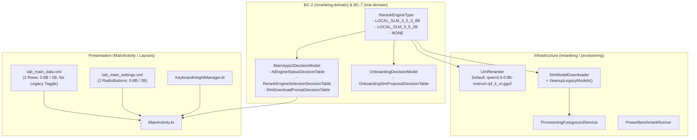

# PRD, JTBD, CUJ & Technical Design (DD): Qwen2.5 サポートの廃止と Qwen3.5 への完全移行

## 1. エグゼクティブサマリー・背景と目的 (Executive Summary & Background)

### 1.1 背景
JotInput では、オンデバイス小規模言語モデル（SLM: `llama.cpp` + 量子化 GGUF）を用いた条件付き対数尤度（Causal Conditional Log-Likelihood）スコアリングにより、日本語かな漢字変換（Viterbi 候補・分割スパン候補・次文節予測）および英語 QWERTY タイポ・文法補正のリランキングを行っている。

これまで JotInput は以下の 2 世代・計 4 モデルを並行サポートしていた：
- **次世代モデル（Qwen3.5 世代）**:
  - **Qwen3.5-0.8B** (`qwen3.5-0.8b-instruct-q4_k_m.gguf`, 約 508 MB, Apache-2.0)
  - **Qwen3.5-2B** (`qwen3.5-2b-instruct-q4_k_m.gguf`, 約 1.19 GB, Apache-2.0)
- **旧世代モデル（Qwen2.5 世代）**:
  - **Qwen2.5-0.5B** (`qwen2.5-0.5b-instruct-q4_k_m.gguf`, 約 469 MB, Apache-2.0)
  - **Qwen2.5-1.5B** (`qwen2.5-1.5b-instruct-q4_k_m.gguf`, 約 1.04 GB, Apache-2.0)

### 1.2 課題 (Problem Statement)
1. **モデル選択の認知負荷と UI の複雑化**:
   - 「設定」タブの AI 変換エンジン選択ラジオグループに 4 つのモデル（`Qwen2.5-0.5B`, `Qwen2.5-1.5B`, `Qwen3.5-0.8B`, `Qwen3.5-2B`）が並び、さらに「データ」タブにも「旧世代モデル (Qwen2.5) を表示 ▼」のアコーディオンが存在するため、ユーザーがどのモデルを選ぶべきか直感的に判断しにくい。
2. **デフォルトモデルの世代遅れ**:
   - `KeyboardHeightManager.getRerankEngineType()` や `MainAppUiDecisionModel.rerankEngineSelectionDecisionTable` のフォールバック先が旧世代の `LOCAL_SLM` (`Qwen2.5-0.5B`) のままになっており、オンボーディングで推奨している `Qwen3.5-0.8B` と不整合が生じていた。
3. **ストレージ容量とメンテナンスコスト**:
   - `Qwen3.5-0.8B` (~508MB) は `Qwen2.5-0.5B` (~469MB) とほぼ同等のメモリ・ストレージフットプリントでありながら、日本語・英語の文脈理解力と変換精度において明確に優位である。同様に高精度帯でも `Qwen3.5-2B` (~1.19GB) が `Qwen2.5-1.5B` (~1.04GB) の完全な上位互換となっている。旧世代モデルを維持し続ける技術的・UX 的メリットが存在しない。

### 1.3 目的とゴール (Goals)
- **Qwen2.5 系モデル (`Qwen2.5-0.5B` / `Qwen2.5-1.5B`) のサポートを完全廃止**し、オンデバイス SLM を **Qwen3.5 世代 (`Qwen3.5-0.8B` [高速標準・推奨] / `Qwen3.5-2B` [最高精度])** の 2 モデル体系へ一本化する。
- 既存の `SharedPreferences` に旧モデル ID (`local_slm`, `local_slm_1_5b` 等) が保存されているアップデートユーザーを、設定画面や IME 起動時にクラッシュや無効化を起こすことなく **透過的に Qwen3.5 (`0.5B -> 0.8B`, `1.5B -> 2B`) へ自動マイグレーション**する。
- 「設定」タブおよび「データ」タブから Qwen2.5 用のラジオボタン・折りたたみコンテナ・ビューを完全に削除し、[`docs/ui_design_and_simplicity_guidelines.md`](docs/ui_design_and_simplicity_guidelines.md) の **Zero Dead UI Resources** と **Optimal Defaults Over UI Knobs** を徹底する。
- DMN 決定表 (`MainAppUiDecisionModel`, `OnboardingDecisionModel`) と Alloy 6 形式検証モデル (`main_app_ui_state.als`) を Qwen3.5 専用体系に更新し、状態遷移の不変条件を形式的に保証する。

---

## 2. Jobs to be Done (JTBD)

- **JTBD-1 (迷いのない AI モデル選択)**:
  - **When** 「設定」タブまたはオンボーディングで AI 変換エンジンを有効化・選択するとき、
  - **I want to** 旧世代モデル（Qwen2.5）と次世代モデル（Qwen3.5）の重複で迷うことなく、「高速標準 (`Qwen3.5-0.8B`)」か「最高精度 (`Qwen3.5-2B`)」の明確な 2 択から選びたい、
  - **So that** 最小の認知負荷で常に最新世代の変換精度を享受できる。

- **JTBD-2 (既存環境からのシームレスなアップグレード)**:
  - **When** 以前に Qwen2.5 (`0.5B` または `1.5B`) を選択していた端末でアプリをアップデートしたとき、
  - **I want to** 設定が壊れたり AI 変換が勝手にオフになったりせず、対応するクラスの次世代モデル（`0.5B` なら `Qwen3.5-0.8B`、`1.5B` なら `Qwen3.5-2B`）へ自動的に引き継がれ、未取得であればワンタップでダウンロード案内を受けたい、
  - **So that** アップデート後もスムーズに次世代モデルへ移行できる。

- **JTBD-3 (「データ」タブでのシンプルなモデル管理)**:
  - **When** 「データ」タブで端末内の AI 言語モデルを管理・取得・削除するとき、
  - **I want to** サポート対象の `Qwen3.5-0.8B` と `Qwen3.5-2B` のみがクリーンに一覧表示されてほしい、
  - **So that** 不要な「旧世代モデルを表示」トグルや使われないモデル枠に画面領域を圧迫されずに管理できる。

---

## 3. Critical User Journeys (CUJ)

### CUJ-1: 新規インストール／デフォルト状態での AI 変換エンジン利用
1. 新規インストール時、または AI 変換スイッチを OFF から ON に切り替えた際、デフォルトエンジンとして **`Qwen3.5-0.8B` (`LOCAL_SLM_3_5_0_8B`)** が自動選択される。
2. オンボーディング (`OnboardingActivity` Step 1: `DATA_PREP`) でもデフォルトで `Qwen3.5-0.8B (約508MB・高速標準)` が提案され、ユーザーは `Qwen3.5-0.8B` / `Qwen3.5-2B` / `今回は取得しない` から選択してバックグラウンド取得を開始できる。

### CUJ-2: 「設定」タブでのモデル切替 (`Qwen3.5-0.8B` ⇄ `Qwen3.5-2B`)
1. ユーザーが「設定」タブの「AI 変換エンジン」カードを開く。
2. スイッチが ON のとき、ラジオボタンには以下の 2 選択肢のみが表示される：
   - `Qwen3.5-0.8B (508MB • 高速標準・推奨)`
   - `Qwen3.5-2B (1.19GB • 最高精度)`
3. 未導入のモデルをタップすると、`SlmDownloadPromptDecisionTable` により即座にダウンロード確認ダイアログ（`Qwen3.5-0.8B をダウンロードしますか？` 等）が表示され、1 タップで `ProvisioningForegroundService` によるバックグラウンド取得を開始できる。

### CUJ-3: 旧 Qwen2.5 設定ユーザーからの自動マイグレーションと残存ファイルクリーンアップ
1. アップデート前の `SharedPreferences` (`ime_preferences`) に `rerank_engine_type = "local_slm"` (旧 0.5B) または `"local_slm_1_5b"` (旧 1.5B) が保存されている状態でアプリが起動する。
2. `RerankEngineType.fromId(id)` がレガシー ID を透過的にマイグレーション解決する：
   - `"local_slm"`, `"lm_first_0_5b"`, `"qwen2.5_0.5b"`, `"0.5b"`, `"hybrid_rerank"` 等 $\rightarrow$ **`LOCAL_SLM_3_5_0_8B`**
   - `"local_slm_1_5b"`, `"lm_first_1_5b"`, `"qwen2.5_1.5b"`, `"1.5b"` $\rightarrow$ **`LOCAL_SLM_3_5_2B`**
3. 端末ストレージに旧 `qwen2.5-0.5b-instruct-q4_k_m.gguf` / `qwen2.5-1.5b-instruct-q4_k_m.gguf` が残存している場合、`SlmModelDownloader.cleanupLegacyModels(context)` によって安全に削除され、最大約 1.5GB の端末ストレージが自動解放される。
4. 移行先の Qwen3.5 モデルがまだ端末にない場合は、設定タブのバッジが `未導入` となり、インラインの `Qwen3.5-0.8B をダウンロード (約508MB)` ボタンが表示されて即座に取得できる。

### CUJ-4: 「データ」タブでの Qwen3.5 モデル管理
1. ユーザーが「データ」タブを開く。
2. 「AI 変換言語モデル (SLM / Qwen3.5)」カードには **`Qwen3.5-0.8B (高速標準・推奨)`** と **`Qwen3.5-2B (最高精度)`** の 2 行のみが常時表示される（旧世代モデルの折りたたみボタンや Qwen2.5 行は存在しない）。
3. 各行から `取得` / `再取得` / `削除` を直接実行でき、進行状況がプログレスバーおよびグローバルバナーにリアルタイム反映される。

---

## 4. Technical Design (DD: 詳細設計)

### 4.1 アーキテクチャ全体像と変更スコープ



---

### 4.2 ドメインモデル設計 (`BC-2: Neural Reranking`)

#### 4.2.1 [`RerankEngineType`](app/src/main/java/com/example/myasr/context/reranking/domain/RerankEngineType.kt) の再定義
`LOCAL_SLM` (`Qwen2.5-0.5B`) および `LOCAL_SLM_1_5B` (`Qwen2.5-1.5B`) 列挙子を廃止し、以下の 3 列挙子のみとする：

| 列挙子 | `id` | `displayName` | `modelName` | `badgeLabel` | `modelFileName` | `sizeLabel` |
|---|---|---|---|---|---|---|
| `LOCAL_SLM_3_5_0_8B` | `"local_slm_3_5_0_8b"` | `"Qwen3.5-0.8B"` | `"Qwen3.5-0.8B (508MB • 高速標準)"` | `"Qwen3.5 0.8B"` | `"qwen3.5-0.8b-instruct-q4_k_m.gguf"` | `"約508MB"` |
| `LOCAL_SLM_3_5_2B` | `"local_slm_3_5_2b"` | `"Qwen3.5-2B"` | `"Qwen3.5-2B (1.19GB • 最高精度)"` | `"Qwen3.5 2B"` | `"qwen3.5-2b-instruct-q4_k_m.gguf"` | `"約1.19GB"` |
| `NONE` | `"none"` | `"AI変換オフ (Mozc辞書・Viterbiのみ)"` | `"AI変換無効 (Mozc辞書・Viterbiのみ)"` | `""` | `""` | `""` |

#### 4.2.2 後方互換マイグレーション (`RerankEngineType.fromId`)
既存の永続化データ (`SharedPreferences`) やベンチマーク Intent 引数からの呼び出しに対し、以下のように解決する：
```kotlin
companion object {
    val DEFAULT: RerankEngineType = LOCAL_SLM_3_5_0_8B

    fun fromId(id: String): RerankEngineType {
        return when (id.lowercase()) {
            "local_slm_3_5_0_8b", "qwen3.5_0.8b", "0.8b", "qwen3.5-0.8b",
            "local_slm", "lm_first_0_5b", "qwen2.5_0.5b", "0.5b", "hybrid_rerank" -> LOCAL_SLM_3_5_0_8B
            "local_slm_3_5_2b", "qwen3.5_2b", "2b", "qwen3.5-2b",
            "local_slm_1_5b", "lm_first_1_5b", "qwen2.5_1.5b", "1.5b" -> LOCAL_SLM_3_5_2B
            "none" -> NONE
            else -> LOCAL_SLM_3_5_0_8B
        }
    }
}
```
- これにより、旧 `0.5B` ユーザーは `Qwen3.5-0.8B` へ、旧 `1.5B` ユーザーは `Qwen3.5-2B` へ自動的にマッピングされる。

---

### 4.3 DMN 決定表設計 (`BC-7: IME Session & Main App UI`)

#### 4.3.1 [`MainAppUiDecisionModel.rerankEngineSelectionDecisionTable`](app/src/main/java/com/example/myasr/context/ime/domain/MainAppUiDecisionModel.kt)
旧 `RERANK_SEL_R2` (`keep_1_5b`) および `RERANK_SEL_R3` (`keep_0_5b`) を廃止し、デフォルトフォールバックを `LOCAL_SLM_3_5_0_8B` に統一する：

| Rule ID | 条件 (`when`) | 出力 (`effectiveRerankEnabled`, `selectedEngine`, `shouldInitializeModel`, `reason`) | 説明 |
|---|---|---|---|
| `RERANK_SEL_R1` | `!it.rerankEnabled` | `(false, NONE, false, "rerank_disabled")` | スイッチ OFF 時はエンジンを `NONE` に設定 |
| `RERANK_SEL_R2` | `it.currentEngine == LOCAL_SLM_3_5_2B` | `(true, LOCAL_SLM_3_5_2B, true, "keep_3_5_2b")` | `Qwen3.5-2B` 選択時はそのまま維持 |
| `RERANK_SEL_R3` | `it.currentEngine == LOCAL_SLM_3_5_0_8B` | `(true, LOCAL_SLM_3_5_0_8B, true, "keep_3_5_0_8b")` | `Qwen3.5-0.8B` 選択時はそのまま維持 |
| `RERANK_SEL_DEFAULT` | *(default)* | `(true, LOCAL_SLM_3_5_0_8B, true, "default_to_3_5_0_8b_when_enabled")` | 未選択 (`NONE` / `null`) から ON にした際は推奨の `Qwen3.5-0.8B` を選択 |

---

### 4.4 Alloy 6 形式検証モデル設計 ([`main_app_ui_state.als`](app/src/test/resources/alloy/main_app_ui_state.als))

1. **シグネチャの整理**:
   ```alloy
   abstract sig EngineType {}
   one sig Engine3_5_0_8B, Engine3_5_2B, EngineNone extends EngineType {}
   ```
2. **初期状態と遷移述語の更新**:
   - `init[s: State]`: `s.selectedEngine = Engine3_5_0_8B`
   - `toggleSlm[s, sNext: State]`: OFF $\rightarrow$ ON 復帰時は `sNext.selectedEngine = Engine3_5_0_8B`
   - `select2B[s, sNext: State]`: `Engine3_5_2B` への明示的切替遷移（旧 `select15B` を置換）
3. **安全性不変条件 (`RerankEnabledImpliesValidModel`) の更新**:
   ```alloy
   assert RerankEnabledImpliesValidModel {
       all s: State | s.slmEnabled = True implies (
           s.selectedEngine = Engine3_5_0_8B or
           s.selectedEngine = Engine3_5_2B
       )
   }
   ```
   これにより、リランク有効時に選択され得るエンジンが `Qwen3.5-0.8B` または `Qwen3.5-2B` のみであることが SAT ソルバによって網羅検証される。

---

### 4.5 インフラストラクチャ層・ストレージ設計

#### 4.5.1 [`LlmReranker.kt`](app/src/main/java/com/example/myasr/context/reranking/infrastructure/LlmReranker.kt)
- `getModelFile(fileName: String = RerankEngineType.LOCAL_SLM_3_5_0_8B.modelFileName)`
- `isModelInstalled(fileName: String = RerankEngineType.LOCAL_SLM_3_5_0_8B.modelFileName)`
- `getTargetModelFileName()`: 選択中エンジンの `modelFileName` が空の場合は `RerankEngineType.LOCAL_SLM_3_5_0_8B.modelFileName` (`"qwen3.5-0.8b-instruct-q4_k_m.gguf"`) を返す。

#### 4.5.2 [`SlmModelDownloader.kt`](app/src/main/java/com/example/myasr/context/provisioning/infrastructure/SlmModelDownloader.kt) における旧モデル自動クリーンアップ
- 旧世代モデルファイル名の定数リストを定義し、アプリ起動時またはモデル管理画面リフレッシュ時に残存ファイルを削除する `cleanupLegacyModels(context: Context)` を追加する：
  ```kotlin
  private val LEGACY_QWEN25_FILES = listOf(
      "qwen2.5-0.5b-instruct-q4_k_m.gguf",
      "qwen2.5-1.5b-instruct-q4_k_m.gguf"
  )

  fun cleanupLegacyModels(context: Context): Int {
      var deletedCount = 0
      val candidateDirs = listOfNotNull(
          File(context.filesDir, "models"),
          context.getExternalFilesDir("models")
      )
      for (dir in candidateDirs) {
          for (legacyName in LEGACY_QWEN25_FILES) {
              val file = File(dir, legacyName)
              if (file.exists() && file.delete()) {
                  deletedCount++
              }
              val tmp = File(dir, "$legacyName.tmp")
              if (tmp.exists()) {
                  tmp.delete()
              }
          }
      }
      return deletedCount
  }
  ```

#### 4.5.3 [`KeyboardHeightManager.kt`](app/src/main/java/com/example/myasr/context/ime/presentation/KeyboardHeightManager.kt) & [`PowerBenchmarkRunner.kt`](app/src/main/java/com/example/myasr/context/reranking/infrastructure/PowerBenchmarkRunner.kt)
- `KeyboardHeightManager.getRerankEngineType(context)` の `defaultType` を `RerankEngineType.LOCAL_SLM_3_5_0_8B` に変更する。
- `PowerBenchmarkRunner` のエンジン解決を `RerankEngineType.fromId(engineStr)` に統一する。

---

### 4.6 プレゼンテーション層・UI レイアウト設計 (Zero Dead UI Resources)

#### 4.6.1 「設定」タブ ([`tab_main_settings.xml`](app/src/main/res/layout/tab_main_settings.xml))
- `rgRerankEngine` から旧 `rbEngineLocalSlm` (`Qwen2.5-0.5B`) および `rbEngineLocalSlm15B` (`Qwen2.5-1.5B`) を削除する。
- 残るラジオボタンは以下の 2 つ（+ 非表示の `rbEngineNone`）とする：
  - `rbEngineLocalSlm35_08B`: `"Qwen3.5-0.8B (508MB • 高速標準・推奨)"`
  - `rbEngineLocalSlm35_2B`: `"Qwen3.5-2B (1.19GB • 最高精度)"`

#### 4.6.2 「データ」タブ ([`tab_main_data.xml`](app/src/main/res/layout/tab_main_data.xml))
- カードタイトルを `"AI 変換言語モデル (SLM / Qwen3.5)"` に更新する。
- `btnToggleLegacySlmModels`（「旧世代モデル (Qwen2.5) を表示 ▼」ボタン）および `layoutLegacySlmContainer`（`Qwen2.5-0.5B` 行・`Qwen2.5-1.5B` 行の全 View 群）を完全削除する。
- `Qwen3.5-2B` 行がカード内の最終行となるため、下部の不要なディバイダやマージンを整理する。

#### 4.6.3 [`MainActivity.kt`](app/src/main/java/com/example/myasr/MainActivity.kt)
- `rbEngineLocalSlm`, `rbEngineLocalSlm15B`, `btnToggleLegacySlmModels`, `layoutLegacySlmContainer` のフィールド・`findViewById`・イベントリスナーをすべて削除する。
- `slmModelRows` を `LOCAL_SLM_3_5_0_8B` と `LOCAL_SLM_3_5_2B` の 2 要素のみに簡素化する。
- `onCreate` / `setupSlmModelsUI` にて `SlmModelDownloader.cleanupLegacyModels(this)` を呼び出し、旧モデルファイルを自動クリーンアップする。

---

### 4.7 開発・デプロイ・評価ツール群の更新

- [`tools/push_model_to_device.sh`](tools/push_model_to_device.sh):
  - サポート対象引数を `0.8b` (`3.5-0.8b`), `2b` (`3.5-2b`), `all`（デフォルト）に整理し、Qwen2.5 GGUF のプッシュ処理を削除する。
- C++ / Python 評価・ベンチマークツール (`tools/slm_scorer_cli.cc`, `tools/bench_*.cc`, `tools/eval_*.cc`, `tools/eval/*.py`):
  - デフォルトのローカルモデルパス参照を `./tools/models/qwen3.5-0.8b-instruct-q4_k_m.gguf` に更新する。

---

### 4.8 テスト・検証計画 (Verification Plan)

1. **単体テスト & DMN 決定表テスト**:
   - [`MainAppUiDecisionModelTest.kt`](app/src/test/java/com/example/myasr/MainAppUiDecisionModelTest.kt):
     - `RerankEngineSelectionDecisionTable` のデフォルト選択が `LOCAL_SLM_3_5_0_8B` になること、`LOCAL_SLM_3_5_0_8B` と `LOCAL_SLM_3_5_2B` の状態保持・トグル不変条件が成立することを検証。
   - [`DebugDisplayTest.kt`](app/src/test/java/com/example/myasr/DebugDisplayTest.kt):
     - `RerankEngineType.badgeLabel` の検証、および旧 ID (`"local_slm"`, `"local_slm_1_5b"`, `"aicore_nano_2"`) が `LOCAL_SLM_3_5_0_8B` / `LOCAL_SLM_3_5_2B` へ正しくマイグレーション解決されることを検証。
2. **Alloy 6 形式検証**:
   - `./gradlew testDebugUnitTest --tests com.example.myasr.formal.AlloyVerificationTest` を実行し、`main_app_ui_state.als` を含む全 `.als` 仕様の `check` / `run` が 100% パスすることを検証。
3. **Konsist アーキテクチャ適合度テスト & トップライン非回帰テスト**:
   - `./gradlew testDebugUnitTest` を実行し、`DddArchitectureKonsistTest` および `JapanesePunctuationEvaluationTest`（67+ テスト）が 100% パスすることを検証。
4. **デュアルターゲット実機デプロイ検証**:
   - `./deploy.sh` により ARCVM (`arc:5555`) と Pixel 10 Pro 実機の両方へデプロイし、`MainActivity` の「設定」タブ・「データ」タブから Qwen2.5 表示が完全に消え、Qwen3.5 の 2 モデル構成が正常に動作することを `logcat`・`screencap`・`dumpsys window` で確認する。
