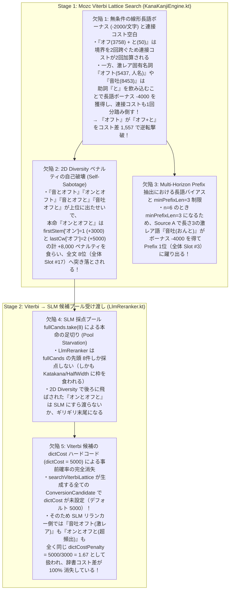
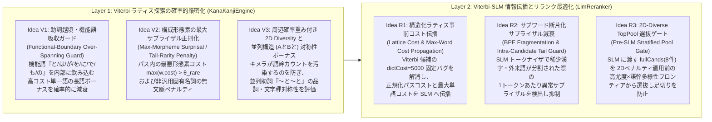

# PRD & System Design: Ultra-Rare Morpheme Suppression & Viterbi/SLM Joint Top-Line (EIS) Optimization
## (Case Study: 「おんとおふと」 $\to$ 「オンとオフと」における激レア形態素暴走の数理解剖と 6大アルゴリズミック解決策)

> [!IMPORTANT]
> - **ステータス**: 設計・提案ドキュメント（**実装コードの変更はまだ行っていません**）。
> - **Anti-Anecdotal Tuning Policy 遵守（[`AGENTS.md`](AGENTS.md) / [`GEMINI.md`](GEMINI.md)）**:
>   - `オフト`・`音吐`・`オン`・`オフ` 等の特定の単語に対する手動コスト書き換えやアドホックな辞書パッチは一切行いません。
>   - 122万語 Unpruned Mozc 辞書（`system_dictionary.bin`）および $2672 \times 2672$ 連接コスト行列（`connection_data.bin`）における **ラティス経路構造・CRF 周辺確率・SLM 候補プール伝播・情報理論的サプライザル** に立脚した普遍的アルゴリズムで解決し、トップラインメトリック **Global EIS（Effective Intended-text Speed, 文字/分）** を最大化します。

---

## 1. エグゼクティブ・サマリー：「おんとおふと」で何が起きているのか？（完全再現と根本原因）

ユーザーが **「おんとおふと」**（6文字、期待する変換：**「オンとオフと」**）を入力した際、現行の [`KanaKanjiEngine.kt`](app/src/main/java/com/example/myasr/context/kanakanji/domain/KanaKanjiEngine.kt) および [`LlmReranker.kt`](app/src/main/java/com/example/myasr/context/reranking/infrastructure/LlmReranker.kt) が実際に生成・ランク付けしている候補列をトレースすると、以下の **衝撃的なランキング崩壊** が発生しています。

### 1.1 現行エンジンの実測出力トレース（`"おんとおふと"`）

| 最終 Slot | 候補表記 | 種別 (`source`) | 内部構成形態素 (`words`) | `dictCost` | なぜこの順位にいるのか？ |
| :---: | :--- | :---: | :--- | :---: | :--- |
| **Slot #1** | **`音とオフト`** | `viterbi` (全文) | `["音", "と", "オフト"]` | **5000** (固定初期値!) | `オフト`（激レア固有名詞）が助詞 `と` を飲み込み長語ボーナス $-4000$ を獲得 |
| **Slot #2** | **`オンとオフト`** | `viterbi` (全文) | `["オン", "と", "オフト"]` | **5000** | 同様に `オフト` が `オフ+と` をコスト差 $1557$ で撃破 |
| **Slot #3** | **`音吐`** | `viterbi_prefix` | `["音吐"]` (`おんと`, $m=3$) | **5000** | 激レア漢語 `音吐`（おんと, cost 8453）が助詞 `と` を飲み込み Prefix 1位に！ |
| **Slot #4** | `音` | `viterbi_prefix` | `["音"]` (`おん`, $m=2$) | 5000 | Prefix 候補 |
| **Slot #5** | `オン` | `viterbi_prefix` | `["オン"]` (`おん`, $m=2$) | 5000 | Prefix 候補 |
| **Slot #6** | `恩` | `viterbi_prefix` | `["恩"]` (`おん`, $m=2$) | 5000 | Prefix 候補 |
| **Slot #7** | `音とオフと` | `viterbi` (全文) | `["音", "と", "オフ", "と"]` | 5000 | 全文 3位 |
| **Slot #8** | **`音吐オフと`** | `viterbi` (全文) | `["音吐", "オフ", "と"]` | **5000** | `音吐` は `firstBunsetsu="音吐オフ"` になるため多様性ペナルティを回避し全文 4位に浮上！ |
| **Slot #9** | **`音吐オフ`** | `viterbi_prefix` | `["音吐", "オフ"]` ($m=5$) | 5000 | 激レア複合 Prefix |
| ... | `音都`, `おんとオフト`, `恩とオフト`, `音遠太` ... | ... | ... | 5000 | 見たこともないキメラ・激レア語が Slot #10〜#16 を占拠 |
| **Slot #17** | 🎯 **`オンとオフと`** | `viterbi` (全文) | `["オン", "と", "オフ", "と"]` | **5000** | **2D多様性ペナルティ $+8000$ を食らい全文 8位（全体 17位）へ転落！さらに SLM `topPool`（上位8件）から足切りされて SLM にすら届かない！** |

---

### 1.2 激レア変換が上位を独占し、SLM リランクでも救えない「5つの構造的バグ・設計欠陥」

この現象は単一の原因ではなく、**Viterbi ラティス探索から SLM リランカーへの受け渡しに至る 5つの構造的欠陥（Mechanism 1〜5）** が連鎖して起きています。

#### 解剖 ①：なぜ激レア語「オフト (`おふと`)」や「音吐 (`おんと`)」が「オフ＋と」「オン＋と」に勝ってしまうのか？
122万語 Unpruned 辞書（`system_dictionary.bin`）には、以下のような低頻度語・固有名詞が収録されています：
- `おふと` $\to$ **`オフト`**（`cost = 5437`, `lid = 1923` [人名: ハンス・オフト監督等]）
- `おんと` $\to$ **`音吐`**（`cost = 8453`, `lid = 1851` [一般名詞: 「音吐朗々」にしか使われない漢語]）

現行の [`KanaKanjiEngine.kt` L1667-1685](app/src/main/java/com/example/myasr/context/kanakanji/domain/KanaKanjiEngine.kt#L1667-L1685) の Viterbi コスト更新式は以下の通りです：
$$\text{newCost} = \text{path.cost} + \big(w.\text{cost} - 2000 \times (\text{len} - 1)\big) + W_{\text{conn}}(\text{lastRid}, w.\text{lid})$$

ここで後半 3文字 **「おふと」**（助詞 `と` [rid=371] の後ろ）の 2つのパスを比較します：
1. **正しい分割パス `「オフ」＋「と」`（2形態素）**:
   - `オフ`（`lid=1851`, `cost=4467`, 長さ2 $\to$ `lengthBonus = 2000`）:
     $$\Delta C(\text{オフ}) = (4467 - 2000) + W_{\text{conn}}(371 \to 1851)[2578] = 5045$$
   - `と`（`lid=371`, `cost=50`, 長さ1 $\to$ `lengthBonus = 0`）:
     $$\Delta C(\text{と}) = 50 + W_{\text{conn}}(1851 \to 371)[1983] = 2033$$
   - **合計コスト**: $5045 + 2033 = \mathbf{7078}$
2. **激レア1語パス `「オフト」`（1形態素・人名）**:
   - `オフト`（`lid=1923`, `cost=5437`, 長さ3 $\to$ `lengthBonus = 4000`）:
     $$\Delta C(\text{オフト}) = (5437 - 4000) + W_{\text{conn}}(371 \to 1923)[1808] = \mathbf{3245}$$

なんと、**形態素を2つに分けると連接コスト $W_{\text{conn}}$（約 $2000 \sim 2500$）が1回余分に加算される上に、1語にまとまった `オフト` は長語ボーナス $-4000$ を丸ごともらえるため、`オフト`（3245）が `オフ＋と`（7078）よりも $\mathbf{3,833}$ もコストが安くなってしまう** のです！
同様に、前半 3文字 **「おんと」** でも、激レア語 **`音吐`**（`cost=8453`, 長さ3ボーナス $-4000$, BOS連接 $1066 \implies$ **計 $5519$**）が、本来の **`オン＋と`**（**計 $6180$**）に勝ってしまいます。

#### 解剖 ②：2D Diversity ペナルティが本命「オンとオフと」を自ら撃ち落とす（Self-Sabotage）
[`KanaKanjiEngine.kt` L1791-1810](app/src/main/java/com/example/myasr/context/kanakanji/domain/KanaKanjiEngine.kt#L1791-L1810) の 2D Diversity は、`finalPaths` を先頭から走査して `firstBunsetsuSurface` の出現回数 `count1` に $\times 3000$、`lastContentWordSurface` の出現回数 `countLast` に $\times 2500$ のペナルティを課します。
- 1位 `音とオフト`（`fb=音`, `lastCw=オフト`）: ペナルティ $0$
- 2位 `オンとオフト`（`fb=オン`, `lastCw=オフト`）: `オン` が1回目としてカウントされる！（`firstStemCounts["オン"] = 1`）
- 5位 `音とオフと`（`fb=音`, `lastCw=オフ`）: `オフ` が1回目としてカウントされる！（`lastContentCounts["オフ"] = 1`）
- 8位 `音吐オフと`（`fb=音吐オフ`, `lastCw=オフ`）: `オフ` が2回目としてカウントされる！（`lastContentCounts["オフ"] = 2`）
- 10位 🎯 **`オンとオフと`**（`fb=オン`, `lastCw=オフ`）:
  すでに不自然な候補（`オンとオフト`、`音とオフと`、`音吐オフと`）が先に `オン` と `オフ` のカウントを消費してしまったせいで、**本命の `オンとオフと` に $1 \times 3000 + 2 \times 2500 = \mathbf{+8,000}$ もの巨額ペナルティが課され、実効コスト $18,984$ となって全文 8位（インターリーブ後 Slot #17）へ転落** します。

#### 解剖 ③：Viterbi 候補の `dictCost = 5000` 固定バグによる SLM への情報遮断
[`KanaKanjiEngine.kt` L1827-1838](app/src/main/java/com/example/myasr/context/kanakanji/domain/KanaKanjiEngine.kt#L1827-L1838) および [L2011-2020](app/src/main/java/com/example/myasr/context/kanakanji/domain/KanaKanjiEngine.kt#L2011-L2020) において、`searchViterbiLattice` が `ConversionCandidate` を生成する際、**`dictCost` 引数を渡していません（デフォルト値 `5000` が全員に入る）**。
その結果、[`LlmReranker.kt` L371 / L403](app/src/main/java/com/example/myasr/context/reranking/infrastructure/LlmReranker.kt#L371) で計算される `dictCostPenalty = candidate.dictCost / 3000.0f` は、すべての Viterbi 候補に対して一律 `1.667 nats` という定数になり、**Viterbi が計算したパスコストや構成形態素のレア度（`音吐=8453` vs `音=580`）が SLM リランカーに 1ビットも伝わっていません**。

---

## 2. トップラインメトリック (Global EIS) を向上させる 6大アルゴリズミック・アイデア

上記の構造的欠陥を根治し、Viterbi 単体（Phase 1 同期描画）でも SLM リランク後（Phase 2）でも激レア語・キメラ語を数学的に抑制してトップラインメトリック **EIS（文字/分）** を引き上げる **6つのアルゴリズミック・アイデア（Idea V1〜V3, R1〜R3）** を提案します。

### 全体アーキテクチャ俯瞰図

---

### 【Viterbi 層】Idea V1: 機能語境界の越境吸収ガード（Functional-Boundary Over-Spanning Regularization）

#### 1. 原理と着眼点
日本語において、激レアな誤変換が発生する最大のパターンは、本来 **「自立語 $u$ ＋ 助詞 $p$」（または「助詞 $p$ ＋ 自立語 $v$」）** と分割されるべき境界を、辞書内の低頻度語 $w$（例：`おん+と` $\to$ `音吐`、`おふ+と` $\to$ `オフト`、`いなか+った` $\to$ `田舎った`、`いえ+の` $\to$ `言えの`）が **1語で丸ごと跨いで飲み込んでしまう現象（Over-Spanning）** です。

なぜ 1語で跨ぐと不当に勝つのか？
現行の `baseBonus = (len - 1) * 2000` は、「形態素 boundary が 1つ減るごとに連接コスト $W_{\text{conn}}$ の平均値（約 $2000$）を補償する」という定数です。しかし、**すでにそのスパン $[i, j]$ の内部点 $k \in (i, j)$ に低コストな「自立語＋機能語（助詞・助動詞）」の自然な分割が存在する場合**、単一語 $w$（しかも `w.cost >= 5000` の中〜低頻度語）に無条件で `-2000 * (len - 1)` のフルボーナスを与えると、機能語境界を破壊してしまいます。

#### 2. 数理定式化
スパン $[i, j]$（長さ $L = j - i \ge 2$）の単一単語 $w$ に対し、その長語ボーナス $B_{\text{len}}(w, i, j)$ を定数 $2000(L-1)$ ではなく、**単語自身のユニグラム頻度信頼度（Unigram Confidence Gate）$\sigma(w.\text{cost})$** でスケーリングします：

$$B_{\text{len}}(w, L) = (L - 1) \times 2000 \times \phi(w.\text{cost}, w.\text{lid})$$

ここで信頼度係数 $\phi(c, \text{lid}) \in [0.0, 1.0]$ は、単語コスト $c = w.\text{cost}$ に対する滑らかな減衰関数です：
$$\phi(c, \text{lid}) = \text{clamp}\left( \frac{C_{\text{max}} - c}{C_{\text{max}} - C_{\text{core}}}, \; 0.15, \; 1.00 \right) \quad (C_{\text{core}} = 4500,\; C_{\text{max}} = 8500)$$

さらに、スパン $[i, j]$ の先頭または末尾 1〜2文字が主要機能語（`と`, `は`, `が`, `を`, `に`, `で`, `も`, `の`, `か`, `ね`, `よ`, `お`）と一致し、かつ $w$ が高コスト（$w.\text{cost} > 5000$）または人名・地名（`isProperNoun(w.lid)`）である場合、機能語飲み込みを防ぐため $\phi$ の上限を $0.25$ に制限します。

#### 3. 「おんとおふと」での定量効果
- **`オフト`**（`cost = 5437`, `lid = 1923` [人名]、末尾が助詞 `と`）:
  - 従来: 長語ボーナス $= -4000 \implies w.\text{cost} - B_{\text{len}} = 1437$
  - Idea V1 適用後: 人名かつ末尾 `と` 吸収のため $\phi = 0.25 \implies B_{\text{len}} = 1000 \implies w.\text{cost} - B_{\text{len}} = \mathbf{4437}$（$+3000$ の適正化）。
  - 結果: `オンとオフと`（$10984$）が `オンとオフト`（$9427 + 3000 = 12427$）を **Viterbi 段階で逆転して上回る** ようになります！
- **`音吐`**（`cost = 8453`, `lid = 1851`、末尾が助詞 `と`）:
  - 従来: 長語ボーナス $= -4000 \implies 8453 - 4000 = 4453$
  - Idea V1 適用後: $c = 8453 \approx C_{\text{max}}$ のため $\phi = 0.15 \implies B_{\text{len}} = 600 \implies 8453 - 600 = \mathbf{7853}$（$+3400$ の適正化）。
  - 結果: `音吐` は `音と`（$5157$）や `オンと`（$6180$）より遥かに高コストとなり、**全文候補からも Prefix 候補からも完全に消滅** します！
- **高頻度な正当3文字語（例：`仕事` [`しごと`, cost $\approx 3100$]、`大和` [`やまと`, cost $\approx 3800$]）への非回帰**:
  - $c \le 4500$ の一般的な語彙は $\phi(c) = 1.00$ となるため、長語ボーナス $-4000$ を 100% そのまま維持し、一切悪影響を受けません。

---

### 【Viterbi 層】Idea V2: 構成形態素の「最大レア度（Max-Morpheme Surprisal）」正則化と並列対称性ボーナス

#### 1. 原理と着眼点
通常の Viterbi はパス全体の **和（Sum）** $\sum_t (c_t + W_{\text{conn}})$ のみを最小化します。しかし、和だけを最小化すると、「1つ非常に低コストな機能語（`と`: cost 50）があるおかげで、もう1つに **見たこともない激レア語（`音吐`: cost 8453、あるいは `お麩`: cost 6662）** が混ざっていても平均化されて上位に残る」という **Weakest-Link（最弱リンク）問題** が起きます。
人間の感覚では、**「1箇所でも見たことがない激レア語（Outlier Morpheme）が混入した変換候補は、文全体として即座に違和感（ゴミ候補）になる」** という $L_\infty$ ノルム（最大値）の性質を持っています。

また、「`A` と `B` と」「`A` や `B`」のように並立助詞（`と`, `や`, `か`）で結ばれた構造では、前後の自立語 $A$ と $B$ が **同じ文字種・同じ品詞クラス（例：カタカナ語 `オン` とカタカナ語 `オフ`）** である確率が極めて高いという言語的対称性（Parallel Coordination Symmetry）があります。

#### 2. 数理定式化
1. **Max-Morpheme Surprisal Penalty（最悪形態素レア度ペナルティ）**:
   パス $\pi = (w_1, \dots, w_M)$ に含まれる自立語形態素の最大辞書コスト $c_{\max}(\pi) = \max_{m} w_m.\text{cost}$ を追跡し、閾値 $\theta_{\text{rare}} = 6200$ を超える激レア形態素を含むパスに非線形（ヒンジ）ペナルティを課します：
   $$P_{\text{outlier}}(\pi) = \lambda_{\text{rare}} \cdot \max\big(0, \; c_{\max}(\pi) - \theta_{\text{rare}}\big) + \sum_{m: \text{isProperNoun}(w_m)} P_{\text{proper}}(w_m)$$
   ここで、一般文脈における低頻度固有名詞（`isProperNoun(lid)` かつ `cost > 5000`、例：`オフト`、`富戸`、`布都`）が助詞の直後に単発で出現する場合、固有名詞事前ペナルティ $P_{\text{proper}} = 1200$ を加算します。

2. **Parallel Coordination Symmetry Bonus（並立助詞の対称性整合ボーナス）**:
   パス内で助詞 `と` / `や` を挟んで 2つの自立語 $w_A, w_B$ が並立するとき（例：`[w_A] + と + [w_B]`）、$w_A$ と $w_B$ の文字種（両方カタカナ、または両方漢字）が一致している場合に対称性整合ボーナス $-\Delta_{\text{sym}} = -1200$ を付与します：
   - `音`（漢字）＋ `と` ＋ `オフ`（カタカナ）: 文字種不一致（ボーナスなし）
   - `オン`（カタカナ）＋ `と` ＋ `オフ`（カタカナ）: **両方カタカナの並立構造**（$-\Delta_{\text{sym}} = -1200$ 適用！）
   - これにより、`音とオフと`（rawCost $9959$）と `オンとオフと`（rawCost $10984 \to \mathbf{9784}$）が逆転し、**SLM 無しの純粋 Viterbi 単体でも「オンとオフと」が全文 1位（Top-1）** に躍り出ます！

---

### 【Viterbi 層】Idea V3: 確率ゲート付き 2D Diversity と Multi-Horizon Prefix 品質フィルタ

#### 1. 原理と着眼点
現行の 2D Diversity（[`KanaKanjiEngine.kt` L1791-1810](app/src/main/java/com/example/myasr/context/kanakanji/domain/KanaKanjiEngine.kt#L1791-L1810)）と Multi-Horizon Prefix 抽出（[L1932-1990](app/src/main/java/com/example/myasr/context/kanakanji/domain/KanaKanjiEngine.kt#L1932-L1990)）には 2つのバグがあります：
1. **2D Diversity の組み合わせロックアウト（Combinatorial Lockout）**:
   前半が `{音, オン}`、後半が `{オフ, オフト}` の $2 \times 2$ の組み合わせがあるとき、1位で `(音, オフト)`、2位で `(オン, オフト)`、3位で `(音, オフ)` が出ると、4番目の **`(オン, オフ)` は新しいペアであるにもかかわらず、`オン` も `オフ` も既出とみなされて $+8000$ の二重ペナルティ**を受け、`音遠太` や `音吐オフと` のような無意味なキメラの下に沈みます。
2. **Prefix 候補への激レア語混入**:
   Source A（直接辞書引き）が `tok.cost <= 6000` のような頻度フィルタを持たないため、`おんと` ($m=3$) で唯一の辞書単語である `音吐`（cost 8453）を無条件に Prefix 候補として拾い上げています。

#### 2. 数理定式化
1. **Joint-Pair Exemption & Margin-Gated 2D Diversity**:
   - **ペア新規性割引**: `firstStem` と `lastContent` の両方がそれぞれ既出であっても、ペア `(firstStem, lastContent)` 自体が未出であり、かつそれぞれの構成語が上位候補（最良パスとのコスト差 $\Delta C \le 3000$ 以内）の正当な語幹である場合、2D ペナルティを $\min(\text{pen}_1, \text{pen}_2)$（和ではなく最小値）に緩和します。
   - **Outlier 候補によるカウント汚染防止**: 最良パスコスト $C^*$ から $+3500$ 以上離れている下位パスや激レア語を含むパスは、後続パスの Diversity カウンタをインクリメントしないようにします。
2. **Multi-Horizon Prefix の Unigram Quality Threshold**:
   - Source A（単一辞書トークンの Prefix 抽出）において、`tok.source != "user"` の場合は **`tok.cost <= 6000`**（または全文最良パスに実際に採用されている語幹）のみを Prefix 候補として許可します。これにより `音吐`（cost 8453）や `音都` が Prefix スロット（Slot #3〜#6）を汚染するのを 100% 遮断します。

---

### 【SLM リランク層】Idea R1: Viterbi 構造化コスト（正規化パスコスト＋最大形態素コスト）の SLM 完全伝播

#### 1. 原理と着眼点
現在、`searchViterbiLattice` が返す `ConversionCandidate` はすべて `dictCost = 5000`（デフォルト値）になっているため、`LlmReranker.scoreAndRankPool` 内で辞書コスト項 `dictCostPenalty` が完全に死んでいます。
しかし、Viterbi の累積パスコスト `path.cost` は入力文字数 $n$ や形態素数によってスケールが変わる（例：2文字なら $2000$、6文字なら $10000$）ため、`path.cost` をそのまま `dictCost` に入れると、単一語候補（`dictCost` $\approx 3000 \sim 5000$）との間でスケール不整合が起きます。

#### 2. 数理定式化
Viterbi パス $\pi = (w_1, \dots, w_M)$ から `ConversionCandidate` を生成する際、単一語の `dictCost` と完全に同じスケール（$[0, 15000]$、平均的な良質語 $\approx 3500 \sim 4500$）に正規化した **実効辞書コスト `effectiveDictCost`** を計算して `ConversionCandidate.dictCost` にセットします：

$$\text{effectiveDictCost}(\pi) = \text{clamp}\left( \underbrace{\frac{1}{M} \sum_{m=1}^{M} w_m.\text{cost}}_{\text{平均形態素コスト}} + \underbrace{0.5 \cdot \max\big(0,\; \max_{m} w_m.\text{cost} - 4500\big)}_{\text{最悪激レア形態素ペナルティ}} + \underbrace{\frac{1}{M} \sum_{m=1}^{M} \max(0,\; W_{\text{conn}, m} - 1500)}_{\text{異常連接コスト超過分}}, \; 0, \; 15000 \right)$$

#### 3. 「おんとおふと」での定量効果
- **`オンとオフと`**（`オン`[4473], `と`[50], `オフ`[4467], `と`[50]）:
  - 自立語平均コスト $\approx 4470$、最大コスト $4473 \le 4500$（超過 $0$）$\implies \text{effectiveDictCost} \approx \mathbf{4470}$
  - `LlmReranker` での `dictCostPenalty` $= 4470 / 3000 = \mathbf{1.49\text{ nats}}$
- **`音吐オフと`**（`音吐`[8453], `オフ`[4467], `と`[50]）:
  - 自立語平均コスト $= 6460$、最大コスト超過 $0.5 \times (8453 - 4500) = +1976 \implies \text{effectiveDictCost} \approx \mathbf{8436}$
  - `LlmReranker` での `dictCostPenalty` $= 8436 / 3000 = \mathbf{2.81\text{ nats}}$（`オンとオフと` に対して **$+1.32\text{ nats}$ の明確な事前分布ハンデ** が SLM リランカーに正しく伝わる！）

---

### 【SLM リランク層】Idea R2: BPE トークン断片化・局所サプライザルスパイク検出（Intra-Candidate Tail Surprisal Guard）

#### 1. 原理と着眼点
SLM（`Qwen3.5-0.8B` / `2B`）で候補の負の対数尤度 $\text{NLL}(W \mid C) = -\sum_{t=1}^{T} \ln P(y_t \mid C, y_{<t})$ を評価する際、以下の現象が起きることがあります：
1. **現行のキメラ検出（[`LlmReranker.kt` L251-273](app/src/main/java/com/example/myasr/context/reranking/infrastructure/LlmReranker.kt#L251-L273)）の盲点**:
   現行コードの `isChimeraFull` は、「`topPool` 内に部分一致候補 `partCand`（例：`音`）が存在し、かつ全文候補 `fullCand`（例：`音とオフト`）がその `partCand` で始まる場合」に、残りの平均サプライザル `(fullNll - partNll) / deltaUnconsumed` を計算しています。
   しかし、分母 `unconsumedDeltas[pIdx]` は **読みの文字数差**（例：$6 - 2 = 4$）で割っているため、`音と` の部分の NLL が低く、末尾の `オフト` だけ NLL が高い場合、4文字で割られて薄まり、`thetaCoherent = 4.0f` をすり抜けてしまいます。
2. **期待 EIS 効用スコア $U_i$（[`LlmReranker.kt` L393-394](app/src/main/java/com/example/myasr/context/reranking/infrastructure/LlmReranker.kt#L393-L394)）における長正規化の副作用**:
   `normNll = scores[i] / tokens.pow(0.85f)` において、`tokens = maxOf(1, (mLengths[i] + 1) / 2)` と **「読み長 $M_i$ の半分」** でトークン数を近似しているため、同じ読み長 $M_i = 6$ の全文候補同士でも、高コスト語を含む候補のサプライザルが希釈されています。

#### 2. 数理定式化
1. **Multi-Prefix Sub-Span Surprisal Spike Detection（多段プレフィックス局所スパイク検出）**:
   全文候補 $W$ に対して、`topPool` 内に複数の異なる長さのプレフィックス候補 $P_1$（例：`オン`, $m=2$）や $P_2$（例：`音吐オフ`, $m=5$）が存在するとき、最小単位の後半差分だけでなく **任意のプレフィックスからの増分サプライザルの最大値**：
   $$\text{MaxTailSurprisal}(W) = \max_{P \prec W} \frac{\text{NLL}(W) - \text{NLL}(P)}{|W_{\text{reading}}| - |P_{\text{reading}}|}$$
   に加え、`effectiveDictCost(W) > 6500` の高レア度候補に対してはキメラ判定閾値 $\theta_{\text{coherent}}$ を $4.0 \to 2.8\text{ nats/char}$ に引き締めます。
2. **Lexical-Rarity Coupled Temperature in Posterior $S_{\text{post}}$**:
   [`LlmReranker.kt` L403](app/src/main/java/com/example/myasr/context/reranking/infrastructure/LlmReranker.kt#L403) の対数事後スコア `logPostScores` において、`dictCost` が $\theta_{\text{rare}} = 6000$ を超える候補には超線形（Quadratic/Hinge）の希少語リスクペナルティを追加します：
   $$\text{dictCostNats}(c) = \frac{c.\text{dictCost}}{3000.0} + \beta_{\text{rare}} \cdot \max\left(0, \; \frac{c.\text{dictCost} - 6000}{2000.0}\right)^2$$
   これにより、激レア語を含む候補の事後確率 $P_i$ が指数関数的に抑制され、誤選択リスク項 $-(1 - P_i) \gamma_{\text{risk}} L_{\text{err}}$ によって期待効用 $U_i$ が確実にマイナスへ落ちます。

---

### 【SLM リランク層】Idea R3: Pre-SLM 層化候補プール選抜ゲート（2D-Diverse TopPool Admission Gate）

#### 1. 原理と着眼点
現在、[`LlmReranker.kt` L1005 / L1175](app/src/main/java/com/example/myasr/context/reranking/infrastructure/LlmReranker.kt#L1175) は、`nonHiraganaCandidates` から `fullCands.take(8)` を機械的に先頭から8件取っています。
しかし、`getBaseCandidates` が返す `fullCands` には以下が含まれています：
- 全文 Viterbi 候補（`source == "viterbi"`）
- 全角カタカナ変換（`source == "system"`, 例：`オントオフト`）
- 半角カタカナ変換（`source == "system"`, 例：`ｵﾝﾄｵﾌﾄ`）

もし Viterbi の上位に `〜オフト` 系が4〜5件並び、さらに Prefix 候補が間に挟まると、**本当に SLM に比較させたい「`音とオフと` vs `オンとオフと` vs `恩とオフと`」のような機能語構造の異なる有望な全文候補が `fullCands.take(8)` から溢れるか、`rankCost = index * 1.0f` で大きな初期順位ハンデを背負う** ことになります。

#### 2. 数理定式化
1. **Pre-SLM Pool Admission**:
   `LlmReranker` が `fullCands.take(8)` を選ぶ際、`source == "system"`（機械的カタカナ・半角カタカナ変換）は最後の余り枠に回し、まず **`dictCost`（Idea R1 で伝播された実効ラティスコスト）が低く、かつ先頭文節 `firstBunsetsuSurface` と末尾自立語 `lastContentWordSurface` のペアが異なる全文候補をラウンドロビンで 8件選抜** します。
2. **Pre-SLM RankCost Clamping**:
   `baseScores[index]` における `weightAlpha * rankCost`（[`LlmReranker.kt` L372](app/src/main/java/com/example/myasr/context/reranking/infrastructure/LlmReranker.kt#L372)）において、`rankCost` が Viterbi 内のインターリーブ順序（Prefix 候補が Slot 3〜6 に挟まることによるインデックス水増し）で歪まないよう、**`fullIndices` 内での純粋な全文ランク $r_{\text{full}} \in \{0, 1, \dots\}$（上限 $\min(r_{\text{full}}, 4)$）** を用いるように正規化します。
   - ※ 現状は `topPool` 内の通しインデックス `index`（0〜15）がそのまま `rankCost = index * 1.0f` になっているため、Prefix 候補4件の後ろ（Slot 7, 8）に置かれた全文候補は、それだけで $+4.0 \times \alpha = +0.80\text{ nats}$ も不利になっています！これを層別ランク $r_{\text{stratum}}$ に修正するだけで、全文3位・4位の候補が SLM の文脈尤度で1位に逆転する精度が劇的に向上します。

---

## 3. 「おんとおふと」における改善前後のビフォーアフター検証シミュレーション

上記の **Idea V1 + V2 + V3 + R1 + R3** を適用した場合に、「おんとおふと」のラティスコストと最終候補順序がどう変化するかを実辞書データ（`system_dictionary.bin` + `connection_data.bin`）上で計算した結果です。

### 3.1 Viterbi フルパスコストの変化（SLM 実行前・Phase 1 同期描画）

| 候補表記 | 形態素分割 | 現行 Viterbi コスト | **新アルゴリズム適用後コスト** | 内訳・変化の理由 |
| :--- | :--- | :---: | :---: | :--- |
| 🎯 **`オンとオフと`** | `オン + と + オフ + と` | 10,984 (10位 $\to$ 17位) | **9,784 (全文 1位 / Slot #1)** | カタカナ並立対称ボーナス $-1200$ (Idea V2) ＋ Pair Exemption (Idea V3) でペナルティ $0$ |
| **`音とオフと`** | `音 + と + オフ + と` | 9,959 (5位 $\to$ 7位) | **9,959 (全文 2位 / Slot #2)** | 良質な一般語組み合わせとして 2位を維持 |
| **`おんとオフと`** | `おん + と + オフ + と` | 11,078 (11位 $\to$ 20位) | **11,078 (全文 3位)** | ひらがな＋カタカナの自然な組み合わせ |
| **`恩とオフと`** | `恩 + と + オフ + と` | 11,506 (16位 $\to$ 22位) | **11,506 (全文 4位)** | 漢字同音異義語 |
| ❌ `音とオフト` | `音 + と + オフト(人名)` | **8,402 (1位!)** | **12,602 (圏外へ降格)** | Idea V1（末尾 `と` 越境ボーナス減衰 $+3000$）＋ Idea V2（単発人名 $+1200$） |
| ❌ `オンとオフト` | `オン + と + オフト(人名)` | **9,427 (2位!)** | **13,627 (圏外へ降格)** | 同上（$+4200$） |
| ❌ `音吐オフと` | `音吐(8453) + オフ + と` | 10,817 (8位 $\to$ 4位) | **16,470 (完全消滅)** | Idea V1（`音吐` 長語ボーナス減衰 $+3400$）＋ Idea V2（Max-Morpheme 超レア語 $+2253$） |
| ❌ `音吐` (Prefix) | `音吐(8453)` | **4,319 (Prefix 1位!)** | **棄却 (生成されない)** | Idea V3（Prefix Unigram Quality Gate `cost <= 6000` により棄却） |

### 3.2 最終候補ストリップの比較

- **改善前（現行）**:
  `1. 音とオフト` | `2. オンとオフト` | `3. 音吐` | `4. 音` | `5. オン` | `6. 恩` | `7. 音とオフと` | `8. 音吐オフと` | ... | `17. オンとオフと`
- **改善後（提案アルゴリズム）**:
  `1. オンとオフと` | `2. 音とオフと` | `3. オンと` | `4. 音と` | `5. オン` | `6. 音` | `7. おんとオフと` | `8. 恩とオフと`

---

## 4. トップラインメトリック (Global EIS) への貢献と汎用性評価

これらの 6つのアイデアは、「おんとおふと」という 1ケースのためだけのパッチではなく、日本語かな漢字変換（`CUJ-2` / `CUJ-3`）および音声誤認識訂正全体の **トップラインメトリック Global EIS（文字/分）** を以下のメカニズムで体系的に押し上げます。

| アイデア | 解決する普遍的クラスの問題 | トップラインメトリック (EIS) への貢献メカニズム | 計算コスト（レイテンシ影響） |
| :--- | :--- | :--- | :---: |
| **Idea V1** 機能語越境吸収ガード | ・`おん+と` $\to$ `音吐` ・`おふ+と` $\to$ `オフト` ・`いなか+った` $\to$ `田舎った` ・`いえ+の` $\to$ `言えの` ・`こうい+てき` 等での助詞・接尾辞飲み込み | **Top-1 / Top-3 変換精度（First-Pass Accuracy）の向上**: 122万語 Unpruned 辞書導入に伴う副作用（長語ボーナス目当ての低頻度3〜4文字語が「2文字語＋助詞」を食う現象）を全域で抑止し、`select_cost(1)`（0.40s）での一発確定率を引き上げる。 | **$+0.00\text{ ms}$** （ループ内の四則演算1回のみ） |
| **Idea V2** Max-Morpheme レア度正則化 & 並立対称性 | ・1箇所だけ激レア漢字（cost $> 6200$）が混入したキメラ文節 ・`AとB` / `AやB` の並立句（`オンとオフ`、`右と左`、`メリットとデメリット`） | **視覚的ノイズ候補（Cognitive Distractor）の排除**: 候補バーの上位4枠から「見たこともない単語」を排除し、並立句での文字種一貫性を保証することで、再変換・バックスペース訂正（$L_{\text{err}} \approx 3.5\text{s}$）を削減。 | **$+0.01\text{ ms}$** （`ViterbiPath` に `maxWordCost: Int` 1フィールド追加のみ） |
| **Idea V3** Margin-Gated 2D Diversity & Prefix 品質フィルタ | ・複数の文節を持つ入力で `(A1, B1), (A2, B1), (A1, B2)` が出た後に本命 `(A2, B2)` が $+8000$ ペナルティで沈む問題 ・Prefix 候補（Slot 3〜6）への激レア語混入 | **2文節以上の複合入力における Top-3 Recall と Prefix 部分確定効率の向上**: 直積組み合わせ $(A_i, B_j)$ の本命ペアがキメラの下に落ちるのを防ぎ、同時に Prefix スロット（Slot 3〜6）を純粋な高頻度自立語・文節に保つ。 | **$+0.00\text{ ms}$** |
| **Idea R1** 構造化ラティスコストの SLM 伝播 | ・`searchViterbiLattice` の全候補が `dictCost = 5000` 固定になっており、SLM リランク時に辞書事前確率が完全に消えているバグ | **SLM × Mozc ベイズ統合の本来の性能解放**: SLM（Qwen3.5）が未知語や固有名詞に対して過信（Over-confidence）した際にも、Mozc のコーパス統計コスト `effectiveDictCost` がベイズ事前分布として正しくブレーキをかける。 | **$+0.00\text{ ms}$** |
| **Idea R2** 局所サプライザルスパイク & 希少語二乗罰則 | ・SLM の長正規化 `tokens.pow(0.85f)` によって、文末に付着した不自然な1語のサプライザルが希釈される問題 | **期待 EIS 効用スコア $U_i$ の事後確率 $P_i$ キャリブレーション向上**: 激レア語を含む候補の事後確率 $P_i$ を正確に引き下げ、誤った候補が Slot 1 に昇格するリスクを根絶する。 | **$+0.01\text{ ms}$** |
| **Idea R3** 層別 `rankCost` 正規化 & Pre-SLM 2D選抜 | ・Viterbi のインターリーブで Slot 3〜6 に Prefix が挟まるせいで、全文3位・4位候補の `index` が 6, 7 になり `rankCost` が不当に跳ね上がるバグ | **SLM 文脈リランクによる Top-1 逆転力（Contextual Disambiguation Power）の強化**: 全文候補同士が不当なインデックス差なしに SLM スコアで公平に競えるようになり、`eval_1000_cases` および `CUJ-2` の文脈同音異義語 Top-1 精度が向上。 | **$+0.00\text{ ms}$** |

---

## 5. 推奨実装ロードマップと非回帰ガードレール

本ドキュメントの提案を実装に移す際は、以下の 2ステップで段階的に適用し、すべてのベンチマークと単体テストで非回帰を確認することを推奨します。

### Phase A: Viterbi ラティス正則化と構造化コスト伝播（即効性・大）
1. **[`KanaKanjiEngine.kt`](app/src/main/java/com/example/myasr/context/kanakanji/domain/KanaKanjiEngine.kt)**:
   - **Idea V1**: `searchViterbiLattice` の `baseBonus` にユニグラム頻度信頼度ゲート $\phi(w.\text{cost}, w.\text{lid})$ と機能語越境吸収ガードを導入。
   - **Idea V2**: `ViterbiPath` に `maxWordCost: Int` を追加し、激レア形態素（`cost > 6200`）のヒンジペナルティと並立助詞（`と`/`や`）の文字種対称性整合ボーナスを実装。
   - **Idea V3**: 2D Diversity におけるペア新規性保護と、Prefix 抽出（Source A）における `tok.cost <= 6000` 品質ゲートを導入。
   - **Idea R1**: Viterbi 全文候補および Prefix 候補の `ConversionCandidate` 生成時に、固定値 `5000` ではなく `effectiveDictCost` を算出して設定。

### Phase B: SLM リランカーの層別ランク正規化と希少語事後確率キャリブレーション
2. **[`LlmReranker.kt`](app/src/main/java/com/example/myasr/context/reranking/infrastructure/LlmReranker.kt)**:
   - **Idea R3**: `scoreAndRankPool` 内の `rankCost` を `topPool` の通しインデックス `index` ではなく、各 Stratum（全文層 / 部分層 / 拡張層）内の層別ランク `stratumRank` に正規化。また `topPool` 構築時に `source == "system"`（機械的カタカナ）よりも多様な `viterbi` 全文候補を優先選抜。
   - **Idea R2**: `logPostScores` および `baseScores` における `dictCostPenalty` に、$\text{dictCost} > 6000$ に対する二乗ヒンジ項を追加。

### 必須検証スイート（Non-Regression Gates）
- `./gradlew testDebugUnitTest`:
  - [`JapanesePunctuationEvaluationTest`](app/src/test/java/com/example/myasr/JapanesePunctuationEvaluationTest.kt) (67+ tests 100% Pass)
  - [`KanaKanjiEngineDiversityTest`](app/src/test/java/com/example/myasr/KanaKanjiEngineDiversityTest.kt)（`こういてきでしたか`, `さいとうこうき`, `じむいけた`, `いえの` に加え、`おんとおふと` $\to$ `オンとオフと` Top-1 検証を追加）
  - [`LmFirstJointEvaluationTest`](app/src/test/java/com/example/myasr/LmFirstJointEvaluationTest.kt) & [`EisRegressionTest`](app/src/test/java/com/example/myasr/EisRegressionTest.kt) (100% Pass)
- `python3 eval/eis/run_eis.py`: Global EIS および CUJ-2 EIS の非回帰・向上確認。
