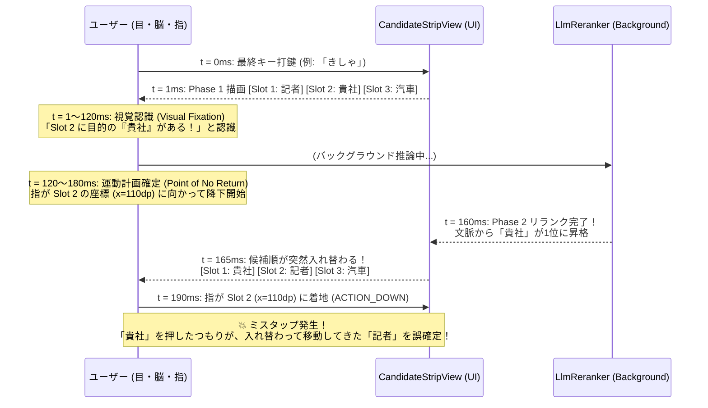
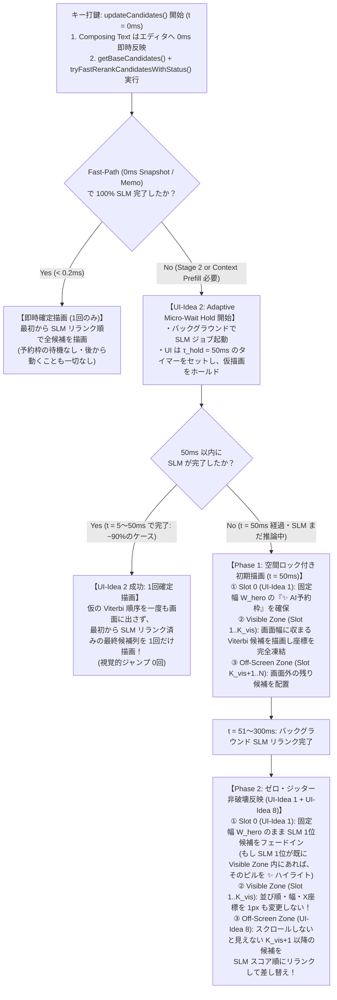
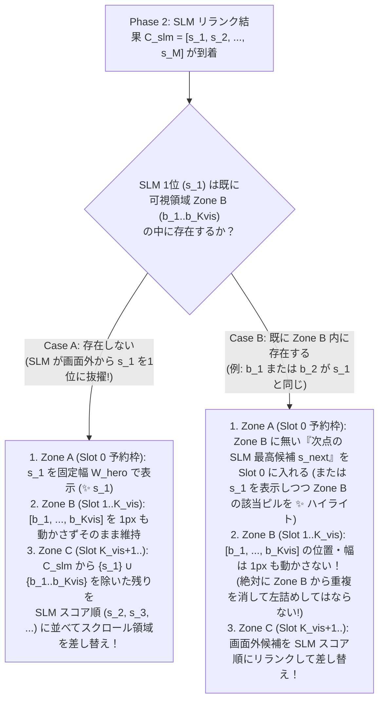

# PRD & Detailed Design Document (DD): Zero-Mis-Tap & Anti-Jitter Candidate UI Architecture
## (UI-Idea 1: Dedicated AI Hero Slot + UI-Idea 2: Adaptive Micro-Wait Hold + UI-Idea 8: Off-Screen / Below-the-Fold Scrollable Tail Reranking)

> [!IMPORTANT]
> - **ステータス**: PRD・CUJ・詳細設計書（Detailed Design Document / DD）策定フェーズ（**コードの実装はまだ行っていません**）。
> - **目的**: オンデバイス言語モデル（SLM: `Qwen3.5-0.8B` / `Qwen3.5-2B` 等）による非同期リランキング時に不可避的に発生する推論レイテンシ（$20 \sim 250\text{ ms}$）に起因して、**変換候補ストリップ（[`CandidateStripView`](app/src/main/java/com/example/myasr/context/ime/presentation/CandidateStripView.kt)）内の初期表示候補が後からジャンプ・移動し、ユーザーのミスタップ（誤確定）や認知的混乱を引き起こす問題**に対し、以下の **3つのコア UI アーキテクチャ（UI-Idea 1 + UI-Idea 2 + UI-Idea 8［新考案：スクロール領域リランク］）** を統合した詳細な実装設計（DD）を定義する。
> - **設計原則遵守**:
>   - [`docs/ui_design_and_simplicity_guidelines.md`](docs/ui_design_and_simplicity_guidelines.md) の **原則0（PRD / JTBD / CUJ の事前定義、DMN / Alloy による宣言的状態制御）** および **原則5（IME ヘッダーバー `36dp` のミニマリズム維持）** に完全準拠する。

---

## Part 1: Product Requirements Document (PRD)

### 1. 背景と課題の本質 (Background & Problem Analysis)

#### 1.1 なぜ「2フェーズ描画（Viterbi 即時表示 $\to$ SLM 非同期更新）」で問題が起きるのか？
現在、JotInput のかな漢字変換および英語入力パイプライン（[`VoiceInputMethodService.kt`](app/src/main/java/com/example/myasr/VoiceInputMethodService.kt#L1137-L1216)）は以下の 2 段階で動作しています：

1. **Phase 1（同期 Fast-Path: $< 1\text{ ms}$）**:
   キー打鍵直後に Mozc Viterbi ラティス探索（＋KVキャッシュの `ContextLogitsSnapshot` がヒットした場合は 1 トークン高速評価）を実行し、即座に [`CandidateStripView`](app/src/main/java/com/example/myasr/context/ime/presentation/CandidateStripView.kt) に初期候補リスト $C_{\text{base}} = [c_1, c_2, c_3, \dots]$ を描画する。
2. **Phase 2（非同期 SLM Rerank Path: $25 \sim 250\text{ ms}$ 後）**:
   複数トークン候補の評価（Stage 2 `llama_decode`）や新規文脈の Prefill がバックグラウンド（`Dispatchers.Default`）で完了した時点で、リランク後の候補リスト $C_{\text{slm}} = [c'_1, c'_2, c'_3, \dots]$ で `CandidateStripView.setCandidates()` を再度呼び出し、UI を上書き描画する。

#### 1.2 人間の視覚・運動ループ（Visuomotor Loop）との致命的な衝突
人間の認知心理学および HCI（Human-Computer Interaction）におけるタッチ操作のタイムラインを分解すると、なぜ $50 \sim 250\text{ ms}$ の遅延が最悪のミスタップを生むのかが明確になります。



1. **人間の「運動計画の引き返し不能点（Point of No Return: 約 $100 \sim 150\text{ ms}$ 前）」**:
   人間が画面上のターゲット（例：Slot 2 の `貴社`）を目視して指を動かし始めると、着地の約 $100 \sim 150\text{ ms}$ 前からは運動指令（バリスティック運動）が固定され、画面が書き換わっても指を止めることができません。
2. **現行の [`CandidateRerankJudgement.TapSafeCandidateOrdering`](app/src/main/java/com/example/myasr/context/reranking/domain/CandidateRerankJudgement.kt#L116-L195) の4つの限界**:
   - **限界①（指の空中降下中は `isUserTouchingStrip == false`）**: タッチパネルは指が画面に触れた瞬間（`ACTION_DOWN`）しか検知できません。
   - **限界②（Slot 1 しか保護しておらず、Slot 2・Slot 3・Slot 4 の玉突き移動を防げない）**: 現行の `TAP_SAFE_DEFAULT` は「初期の Top-1（Slot 1）だけをピン留めし、2位以下（Slot 2〜）は SLM の新しい順序で並べ替える」ため、ユーザーが **Slot 2 や Slot 3 の候補をタップしようとした瞬間** に、Slot 2 と Slot 3 が入れ替わってミスタップになります。
   - **限界③（`TAP_SAFE_R3` / `TAP_SAFE_R4` の例外ルールが 100ms 経過後でも Slot 1 を強制上書きする）**。
   - **限界④（候補リストを単一のフラット配列として扱っており、「最初に見えている可視領域（Above-the-Fold Viewport）」と「スクロールしないと見えない領域（Off-Screen / Below-the-Fold Tail）」を区別していない）**。

---

### 2. Jobs to be Done (JTBD)

| ペルソナ / 状況 | Job to be Done (JTBD) | 動機・背景 (Motivation) | 期待する成果 (Expected Outcome) |
| :--- | :--- | :--- | :--- |
| **JTBD-1: 目視した初期表示候補を迷わずワンタップで確定したいユーザー** | **When** 打鍵を終えて候補ストリップの最初に見える候補群（Viewport 内）から目的の候補を見つけ、指を伸ばしたとき、<br>**I want to** 自分の指が画面に触れる直前にその候補が別の場所に逃げたり、別の単語にすり替わったりしないようにしてほしい、<br>**So I can** 誤変換を消して打ち直すフラストレーションなしに、見えた通りの候補を100%確実にワンタップ確定できる。 | 候補を見つけてタップする瞬間（$120 \sim 300\text{ ms}$）に順番が入れ替わると、「自分が押し間違えたのか、アプリが勝手に動いたのか」分からず強いストレスを感じる。 | **可視領域の座標不変契約（Viewport Spatial Invariant）**: 一度描画されてユーザーの目に触れた初期表示候補のタップ座標が後から移動する確率を **$0\%$** にする。 |
| **JTBD-2: 最初に見える候補の中に目的の語がないとき、横スクロールした先で AI が選んだ最適候補にすぐ出会いたいユーザー** | **When** 最初に見えている候補群に意図した変換がなく、候補バーを右へスクロール（スワイプ）したとき、<br>**I want to** スクロールした先の候補群（Off-Screen Tail）や AI 専用スロットでは、すでに SLM が文脈に基づいて最も確からしい候補を先頭に並べておいてほしい、<br>**So I can** 最初に見える候補の座標安定性を100%守りつつ、スクロールした瞬間に何十個もの辞書候補を探し回ることなく AI リランクの恩恵を受けられる。 | **【新考案：UI-Idea 8 の核心】** スクロールしないと出てこない候補（画面外の候補）は、まだユーザーの視覚・運動ループ（Tap Target）に入っていないため、バックグラウンドでリランクして並べ替えてもミスタップや視覚的チラつきが一切発生しない！ | **Off-Screen Tail Reranking**: 可視領域（Viewport）の候補座標を1pxも動かさずに、スクロール領域の先頭に SLM 上位候補を配置する。 |
| **JTBD-3: 高速に終わるリランク（$< 50\text{ ms}$）や AI 専用枠を通じて、1タップで AI の最良候補を選びたいユーザー** | **When** 通常の打鍵で候補を選ぶとき、<br>**I want to** 知覚できないほど速いとき（$\le 50\text{ ms}$）は最初から1回だけ描画され、それ以上かかるときも予約された AI 専用枠（Slot 0/1）またはスクロール領域で位置ズレなしに AI 候補にアクセスしたい、<br>**So I can** 画面のジャンプに惑わされずに、常に最高精度の AI 変換を1タップで利用できる。 | 「位置が動かない安心感」と「AI が文脈を読んでトップに出してくれる便利さ」の両方を妥協したくない。 | **UI-Idea 1 + UI-Idea 2 + UI-Idea 8 の三位一体統合**: $50\text{ ms}$ 以内なら一発描画、超過時は「AI 予約枠＋可視辞書枠の完全固定＋画面外スクロール枠の SLM リランク」で完全なゼロ・ジッターを実現する。 |

---

### 3. Critical User Journeys (CUJ)

#### CUJ-1: $50\text{ ms}$ 以内に SLM が完了する高速パス（UI-Idea 2: Micro-Wait Hold が機能するジャーニー）
1. ユーザーが `"御社の"` に続けて `"きしゃ"` と入力する。
2. テキスト欄の未確定文字列 `"きしゃ"` は $0\text{ ms}$ で即座に描画される。
3. `CandidateStripView` は **Micro-Wait Hold（最大 $\tau_{\text{hold}} = 50\text{ ms}$）** に入り、仮の Viterbi 順序をまだ描画せず待機する。
4. $t = 28\text{ ms}$ で SLM リランクが完了し、`[貴社, 記者, 汽車, 帰社, ...]` が確定する。
5. $t = 29\text{ ms}$ で `CandidateStripView` に **最初から SLM リランク済みの順序が「1回だけ」描画**される。候補の移動・再描画は **0回**。

#### CUJ-2: SLM 推論が $50\text{ ms}$ を超えた場合の「AI 予約枠 ＋ 可視スロット完全固定 ＋ 画面外スクロール領域リランク」（UI-Idea 1 + UI-Idea 8 の統合ジャーニー）
1. 長文脈や Cold Miss により、ユーザーが `"きしゃ"` と打ってから $t = 50\text{ ms}$ が経過しても SLM がまだ計算中である。
2. **$t = 50\text{ ms}$（Phase 1 描画）**:
   - **Slot 0（Dedicated AI Hero Slot — UI-Idea 1）**: 入力文字数から算出した固定幅（例：2文字幅 `64dp`）の予約ピル `[ ✨ ・・・ ]`（シマー表示）を左端に確保する。
   - **Visible Slots 1..$K_{\text{vis}}$（最初に見える画面内候補 — 完全固定）**: その右側に、Viterbi 上位候補 `[Slot 1: 記者] [Slot 2: 汽車] [Slot 3: 帰社]` が画面幅（Viewport）に収まる分だけ描画され、**座標ロック（Viewport Freeze）** がかかる。
3. **$t = 160\text{ ms}$（SLM リランク完了 — Phase 2 非破壊更新）**:
   - **① AI 予約枠（Slot 0）の In-Place 確定（UI-Idea 1）**:
     固定幅で確保されていた Slot 0 `[ ✨ ・・・ ]` の中に、SLM 1位の `[ ✨ 貴社 ]` が同じピル幅でフェードインする。**Slot 1（`記者`）・Slot 2（`汽車`）・Slot 3（`帰社`）の X 座標は 1ピクセルも動かない！**
   - **② スクロールしないと出てこない画面外候補（Off-Screen Tail: Slot $K_{\text{vis}}+1 \dots N$）の SLM リランク（UI-Idea 8）**:
     初期描画で画面の右端より外（スクロール領域）にあった候補群（Slot 4 以降）は、まだユーザーの目に触れておらずタップ対象にもなっていないため、**SLM のスコア順に自由にリランクして並べ替える**。
4. **ユーザーの2通りのアクション**:
   - **パターン A（すぐに見えていた候補または AI 枠をタップ）**: ユーザーは 1px も動かなかった Slot 1（`記者`）や、予約席に出現した Slot 0（`✨ 貴社`）をミスタップゼロで確実にタップできる。
   - **パターン B（他の候補を探して横スクロール — UI-Idea 8 の威力）**: 最初に見えていた 3〜4 件に欲しい候補がなかったため、ユーザーが候補バーを左へスワイプ（右方向へスクロール）すると、**スクロールして出てきた最初の位置（Off-Screen 先頭）に、SLM が文脈リランクした次点・第3の有力候補がすでに整列して待っている**。

#### CUJ-3: AI 予約枠を使わない／SLM 1位がすでに可視枠にある場合の「純粋 Off-Screen Tail Reranking」ジャーニー（UI-Idea 8 単独動作ケース）
1. もし初期描画（$t = 50\text{ ms}$）の可視スロット `[Slot 1: 記者] [Slot 2: 貴社] [Slot 3: 汽車]` の中にすでに有力候補が入っており、Slot 4 以降（画面外）に `[帰社, 喜捨, 騎射, 寄進, ...]` が並んでいるとする。
2. $t = 150\text{ ms}$ で SLM が完了した際、**最初に見えている Slot 1〜3（`記者`, `貴社`, `汽車`）の順番と座標は一切動かさない**。
3. 一方、**スクロールしないと見えない Slot 4 以降（Off-Screen Tail）の候補群だけを SLM スコア順にリランク**し、さらに SLM が見つけた高スコア候補（もし可視枠に入っていなかった候補、たとえば複合語や活用形 `記者会見`, `貴社名` 等）を **画面外領域の最前列（Slot 4 = スクロールして最初に出てくる位置）** に引き上げて配置する。

---

## Part 2: 全アイデアの整理（UI-Idea 1 〜 UI-Idea 8）

前回提案した UI-Idea 1〜7 に、今回新たに考案された **UI-Idea 8（Off-Screen / Below-the-Fold Scrollable Tail Reranking）** を加えた全体マップです。

| ID | アイデア名 | 概要 | 本 DD での実装対象 |
| :---: | :--- | :--- | :---: |
| **UI-Idea 1** | **Dedicated AI Hero Slot**<br>（AI専用予約スロット＋辞書スロット分離） | 左端（Slot 0）に固定幅の「✨ AI予約枠」を確保し、その右側の可視辞書候補が押し出されてズレるのを防ぐ。 | **★実装対象 (Core 1)** |
| **UI-Idea 2** | **Adaptive Micro-Wait Hold**<br>（$50\text{ ms}$ 知覚閾値ホールドによる1回描画） | 打鍵後 $\tau_{\text{hold}} = 50\text{ ms}$ まで候補バーの描画を待ち、間に合えば仮候補を出さずに最初から SLM 順で 1回だけ描画する。 | **★実装対象 (Core 2)** |
| **UI-Idea 8**<br>*(New!)* | **Off-Screen Scrollable Tail Reranking**<br>（スクロール領域限定リランク＋可視領域完全凍結） | **最初に見えている可視候補（Above-the-Fold）は1ミリも動かさず、スクロールしないと出てこない画面外候補（Off-Screen Tail）を SLM でリランクしてスクロール先頭に並べる。** | **★実装対象 (Core 3)** |
| UI-Idea 3 | In-Place Spotlight Promotion | 可視枠内の候補が SLM 1位になった際、位置を変えずにその場で `✨` ハイライト枠を点灯させる（UI-Idea 1/8 の補完として統合）。 | ★ Core 1/3 に統合 |
| UI-Idea 4 | Split-Pill Expansion | 1つのピルを左右に分割して並置する。 | 見送り（幅変動のため） |
| UI-Idea 5 | Spatio-Temporal Tap-Intent Arbitrator | 座標変更後 180ms 以内のタップを旧座標で救済する。 | オプション防御層 |
| UI-Idea 6 | Post-Commit Homophone Swap Chip | 確定直後に `🔄` チップでワンタップ交換を提供する。 | 将来拡張 |
| UI-Idea 7 | Cadence-Aware Rendering Gate | 高速連続打鍵中のデバウンス延長。 | Core 2 の一部として統合 |

---

## Part 3: 詳細設計書 (Detailed Design Document — DD)
### UI-Idea 1 + UI-Idea 2 + UI-Idea 8 統合実装仕様

ここからは、**UI-Idea 2（Micro-Wait Hold）**、**UI-Idea 1（Dedicated AI Hero Slot）**、そして **UI-Idea 8（Off-Screen Scrollable Tail Reranking）** の3つをシームレスに組み合わせ、[`VoiceInputMethodService`](app/src/main/java/com/example/myasr/VoiceInputMethodService.kt)、[`CandidateStripView`](app/src/main/java/com/example/myasr/context/ime/presentation/CandidateStripView.kt)、[`CandidateRerankJudgement`](app/src/main/java/com/example/myasr/context/reranking/domain/CandidateRerankJudgement.kt) に実装するための詳細設計（DD）を記述します。

---

### 1. アーキテクチャ全体像とタイムライン状態遷移

打鍵（`updateCandidates()`）が発生した瞬間から、以下の **3段階のタイムライン（$t = 0\text{ ms}$, $t \le 50\text{ ms}$, $t > 50\text{ ms}$）** と **空間パーティショニング（Slot 0 / Visible Viewport / Off-Screen Tail）** によって候補ストリップを制御します。



---

### 2. 空間パーティショニング設計：Viewport（可視領域）と Off-Screen Tail（スクロール領域）の厳密な境界計算（UI-Idea 1 + UI-Idea 8）

「最初に見える候補は動かさず、スクロールしないと出てこない候補だけをリランクする（UI-Idea 8）」＋「AI 専用予約枠を確保する（UI-Idea 1）」をピクセル単位で正確に動作させるため、`CandidateStripView` の横幅 $W_{\text{strip}}$ を以下の **3つのゾーン（Zone A, Zone B, Zone C）** に分割します。

```text
|<------------------------ CandidateStripView 可視幅 W_strip (例: 260dp) ----------------------->| (画面右端: Fold Boundary)
+------------------+----------------------------------------------------------------------------+------------------------------> (横スクロール領域)
|     Zone A       |                                  Zone B                                    |            Zone C
|  [UI-Idea 1]     |                        [Viewport Frozen Zone]                              |         [UI-Idea 8]
|  AI Hero Slot    |                    最初に見える辞書候補 (位置・幅 完全固定)                     |   Off-Screen Scrollable Tail
|   (固定幅 W_0)    |                        (Slot 1, Slot 2, ..., Slot K_vis)                   |  (SLM で自由にリランク可能！)
+------------------+----------------------------------------------------------------------------+------------------------------>
|  [ ✨ 貴社 ]     |   [  記者  ]    [  汽車  ]    [  帰社 (右端が少し見切れる候補も保護!) ]        |  [ ✨ 貴社名 ]  [ 記者会見 ] ...
+------------------+----------------------------------------------------------------------------+------------------------------>
  ↑ 幅 W_0 は文字数   ↑ ここの候補は一度描画されたら、SLM完了後も 1px も動かず順番も変わらない！     ↑ まだ画面外で見えていないため、
    バケットで完全固定    (Zone A に『貴社』が出ても、Zone B 内の重複除去・左詰めは絶対に行わない)     SLM 完了時に賢い順へ並べ替える！
```

#### 2.1 各ゾーンの幾何学的定義とピクセル幅計算

[`keyboard_view.xml`](app/src/main/res/layout/keyboard_view.xml#L71-L148) において、ヘッダーバーの総幅 $W_{\text{screen}}$ から左右の固定ボタン（`🎙 話す` `66dp` + マージン `6dp`、右側の `📖` `32dp` + `📋` `32dp` + パディング約 `16dp` = 計 `152dp`）を引いた残りが `CandidateStripView` の可視幅 $W_{\text{strip}}$ です（一般的なスマートフォン縦向き $360 \sim 412\text{ dp}$ 幅において、$W_{\text{strip}} \approx 208 \sim 260\text{ dp}$）。

1. **ピル1個あたりの占有幅 $w(c)$ の事前決定論的計算**:
   [`CandidateStripView.kt` L148-174](app/src/main/java/com/example/myasr/context/ime/presentation/CandidateStripView.kt#L148-L174) では、各候補ピルは以下の量子化最小幅（Quantized Minimum Width）とマージンを持ちます：
   - 文字数 $L = \text{surface.length}$ に対する量子化幅 `minWidth`:
     - $L = 1$: `42dp`
     - $L = 2$: `64dp`
     - $L = 3$: `86dp`
     - $L = 4$: `108dp`
     - $L \ge 5$: $\max\big(108\text{dp},\; L \times 15\text{sp} + 24\text{dp (padding)}\big)$
   - 左右マージン: `3dp` $\times 2 = 6\text{dp}$
   - コンテナ左右パディング: `6dp`
   - したがって、各候補 $c_i$ が占める水平レイアウト幅 $w(c_i)$ は、View の `onLayout` を待たずとも `Paint.measureText()` と量子化バケット関数 `estimatePillSpanPx(candidate)` によって **1ピクセルの誤差もなく事前に算出可能** です。

2. **Zone A（Dedicated AI Hero Slot: Slot 0）の固定幅 $W_{\text{hero}}$ の決定（UI-Idea 1）**:
   - $t = 50\text{ ms}$ の時点で SLM がまだ完了していない場合、Slot 0（AI 予約枠）の幅 $W_{\text{hero}}$ が後から変わると、右隣の Zone B（Slot 1〜）が左右に押し引きされてズレてしまいます。
   - **解決策（Exact-Width Reservation Protocol）**:
     Slot 0 に割り当てる固定幅 $W_{\text{hero}}$ は、現在 SLM に評価させている候補プール `topPool` 内の全文候補の最大（または代表）量子化幅、すなわち：
     $$L_{\text{hero}} = \text{clamp}\Big(\max_{c \in \text{FullSpanPool}} c.\text{surface.length},\; 2,\; 4\Big)$$
     に対応する量子化バケット幅（例：漢字2文字なら `64dp`、3文字なら `86dp`）として **Phase 1 描画時に完全固定（`LayoutParams.width = W_hero`）** します。
   - Phase 2 で SLM 1位候補 $c^*_{\text{slm}}$ が到着した際、Slot 0 の View の `layoutParams.width` は **$W_{\text{hero}}$ のまま1ピクセルも変えず**、内部テキストだけを更新します（もし $c^*_{\text{slm}}$ の文字数が $L_{\text{hero}}$ より長い場合は `TextView` の自動スケールまたはわずかなパディング吸収で $W_{\text{hero}}$ 内に収めます）。
   - **これにより、Zone A（Slot 0）が「思考中」から「確定候補」に変わっても、右隣の Zone B（Slot 1, 2, 3...）の X 座標は数学的に $0\text{ px}$ の移動であることが保証されます！**

3. **Zone B（Viewport Frozen Zone: 最初に見える候補群）と Zone C（Off-Screen Tail: スクロールしないと見えない候補群）の境界インデックス $K_{\text{vis}}$ の決定（UI-Idea 8）**:
   - 左端からの累積 X 座標を $X_k = W_{\text{hero}} + \sum_{i=1}^{k} w(c_i)$ とします。
   - **重要な境界ルール（Partially-Visible Pill Protection）**:
     もしある候補 $c_k$ の左端 `left` が画面内（$< W_{\text{strip}}$）に少しでも顔を出している場合（たとえば右端に半分だけ見えている候補）、ユーザーはその候補を視認してタップする可能性があります。
     したがって、「最初に見える候補（Zone B）」と「スクロールしないと絶対に見えない候補（Zone C）」の境界 $K_{\text{vis}}$ は、**ピルの左端 `left` が可視幅 $W_{\text{strip}}$ 未満であるすべての候補** と定義します：
     $$\text{Zone B (Frozen Viewport)} = \Big\{\, c_i \;\Big|\; \text{pillLeftPx}(c_i) < W_{\text{strip}} + \text{scrollX} \,\Big\}$$
     $$\text{Zone C (Off-Screen Tail)} = \Big\{\, c_i \;\Big|\; \text{pillLeftPx}(c_i) \ge W_{\text{strip}} + \text{scrollX} \,\Big\}$$
   - 具体的には、`pillLeftPx(c_i) >= W_strip` となる最初のインデックス $i = K_{\text{vis}} + 1$ 以降が、**「スクロールしないと1ピクセルも画面に出てこない完全な Off-Screen 候補（Zone C）」** です！

---

### 3. UI-Idea 8（スクロール領域リランク）× UI-Idea 1（AI予約枠）の連携アルゴリズム

$t = 50\text{ ms}$ を超えて SLM のリランク結果 $C_{\text{slm}} = [s_1, s_2, \dots, s_M]$ が到着したとき、初期描画済みのリスト $C_{\text{initial}} = [\text{HeroPlaceholder}, b_1, b_2, \dots, b_{K_{\text{vis}}}, \dots, b_N]$ をどのように更新するかの厳密なアルゴリズムです。



#### 3.1 絶対に守るべき 3つの不変条件（Golden Invariants）

1. **不変条件 1：Zone B（可視領域 $1 \dots K_{\text{vis}}$）の非削除・非左詰め原則（No-Compaction Invariant）**
   - たとえ Slot 0（Zone A）に入った候補が Zone B の Slot 2 にすでにある候補と同じ表記であったとしても、あるいは Zone B の中に SLM スコアが低い候補があったとしても、**現在の打鍵セッション中は Zone B の候補を削除して左に詰める（Compaction）ことを絶対に禁止**します。
   - なぜなら、Slot 2 を消して左に詰めた瞬間、その右隣にあった Slot 3（画面内で見えていた候補）が左へワープし、Slot 3 を狙っていたユーザーの指がミスタップするからです。
2. **不変条件 2：Zone C（スクロール領域 $K_{\text{vis}}+1 \dots N$）の重複排除と SLM 順ソート（Off-Screen Deduplicated Reranking）**
   - スクロールしないと見えない Zone C については、まだユーザーが見ていないため、Zone A および Zone B にすでに表示されている候補 $\mathcal{V}_{\text{shown}} = \{c_{\text{hero}}\} \cup \{b_1, \dots, b_{K_{\text{vis}}}\}$ をすべて除外（Deduplicate）した上で、**残りの全候補を SLM のリランクスコア順に綺麗に入れ替えます**：
     $$\text{Zone C}_{\text{new}} = \big[\, s \in C_{\text{slm}} \;\big|\; s.\text{surface} \notin \mathcal{V}_{\text{shown}} \,\big]$$
   - これにより、ユーザーが「最初に見えている候補（Zone A + Zone B）には目的の漢字がない」と判断して指で候補バーを左へスクロールした瞬間、**スクロールして出てきた最初の候補（Slot $K_{\text{vis}}+1$）から順に、まだ画面に出ていなかった候補の中で SLM が最も確からしいと判断した候補が重複なしで現れます**。
3. **不変条件 3：ユーザーがすでにスクロールを開始している場合の動的 Freeze 拡張（Scroll-Aware Freeze Horizon）**
   - もし SLM が非常に遅く（例：$250\text{ ms}$）、その間にユーザーがすでに候補バーを右へスクロールし始めていた場合（`scrollX > 0` または `isUserInteracting == true`）：
     - `isUserInteracting == true`（指が候補バーに触れている最中）は、Zone C の差し替えも含めて DOM 更新を `ACTION_UP` 後まで待機（Defer）します。
     - `scrollX > 0` の場合は、現在のスクロール位置における右端 `W_strip + scrollX` までを Frozen Zone（Zone B）として保護し、それよりさらに右側（まだ一度も画面内に入っていない領域 `pillLeftPx >= W_strip + scrollX`）のみをリランク対象とします。

---

### 4. コンポーネント別クラス・メソッド詳細設計 (Component-Level Specifications)

#### 4.1 ドメイン層：[`CandidateRerankJudgement.kt`](app/src/main/java/com/example/myasr/context/reranking/domain/CandidateRerankJudgement.kt)（BC-2 DMN 決定表の拡張）

Android UI（`View` やピクセル計算）に一切依存せず、純粋なドメインモデルとして **① Micro-Wait ホールド時間と実行判定**、および **② 3ゾーン（AI Hero Slot / Frozen Viewport / Reranked Off-Screen Tail）のリスト合成アルゴリズム** を DMN 決定表で定義します。

##### (A) 新規データ構造と入出力モデル

```kotlin
package com.example.myasr.context.reranking.domain

import com.example.myasr.context.kanakanji.domain.ConversionCandidate

object CandidateRerankJudgement {

    const val MICRO_WAIT_HOLD_MS = 50L          // UI-Idea 2: 50ms 以内なら1回描画
    const val RAPID_TYPING_HOLD_MS = 85L        // 高速連続打鍵時 (IKI < 140ms) のホールド/デバウンス窓
    const val DEFAULT_VISIBLE_SLOT_FALLBACK = 3 // View未計測時の安全デフォルト可視スロット数

    /**
     * Phase 1 (50ms タイムアウト時) と Phase 2 (SLM 完了時) の UI 描画戦略を表す列挙型
     */
    enum class UiRenderStrategy {
        /** Fast-Path 完了または 50ms Micro-Wait 内に SLM 完了：予約枠なしで最初から最終 SLM 順を1回描画 */
        DIRECT_SINGLE_PASS_SLM,

        /** 50ms 経過時点で SLM 未完了：Slot 0 に固定幅 AI 予約枠を置き、Slot 1..K_vis に Viterbi 候補を描画して座標凍結 */
        PHASE1_HERO_PLACEHOLDER_AND_FROZEN_VIEWPORT,

        /** Phase 1 描画後に SLM 完了：Slot 0 を確定し、Slot 1..K_vis は完全固定、Slot K_vis+1 以降 (画面外) を SLM 順でリランク */
        PHASE2_POPULATE_HERO_AND_RERANK_OFFSCREEN_TAIL,

        /** ユーザーが候補ストリップをタッチ・スクロール操作中：指を離すまで UI 更新を保留 */
        DEFER_WHILE_USER_TOUCHING
    }

    data class ViewportAwareOrderingInput(
        val baseCandidates: List<ConversionCandidate>,
        val rerankedCandidates: List<ConversionCandidate>,
        /** Phase 1 が描画済みかどうか（false なら 50ms 以内に SLM が完了したことを意味する） */
        val isPhase1AlreadyRendered: Boolean,
        /** Phase 1 で Slot 0 (AI Hero Slot) の予約プレースホルダーを確保していたか */
        val hasReservedHeroSlot: Boolean,
        /** Phase 1 で可視領域 (Zone B) に描画されて座標ロックされた候補数 K_vis (Slot 0 を除く) */
        val frozenVisibleCount: Int,
        /** ユーザーが現在候補バーに指を触れているか */
        val isUserTouchingStrip: Boolean
    )

    data class ViewportAwareOrderingDecision(
        val strategy: UiRenderStrategy,
        /** Slot 0 (AI Hero Slot) に表示する候補（DIRECT_SINGLE_PASS_SLM の場合は null で finalCandidates[0] に統合） */
        val heroSlotCandidate: ConversionCandidate?,
        /** Zone B (固定可視スロット) + Zone C (リランク済み画面外スロット) を結合した最終リスト */
        val finalCandidates: List<ConversionCandidate>,
        /** Zone B 内で既に SLM 1位が表示されている場合にインプレース強調するインデックス */
        val spotlightIndexInViewport: Int?,
        val reason: String
    )
}
```

##### (B) DMN 決定表：`ViewportAwareCandidateOrderingDecisionTable`

| Rule ID | 条件 (`isUserTouchingStrip`, `isPhase1AlreadyRendered`, `hasReservedHeroSlot`) | 出力 `UiRenderStrategy` | リスト構築ロジック（純粋関数 `partitionAndMergeZones`） |
| :--- | :--- | :--- | :--- |
| **`VP_SAFE_R1`** | `isUserTouchingStrip == true && isPhase1AlreadyRendered == true` | **`DEFER_WHILE_USER_TOUCHING`** | 現在の表示リストをそのまま維持し、`ACTION_UP` イベント発火時に再評価する。 |
| **`VP_SAFE_R2`** | `isPhase1AlreadyRendered == false`（**UI-Idea 2**: $50\text{ ms}$ 以内に SLM が完了！） | **`DIRECT_SINGLE_PASS_SLM`** | まだ画面に一度も旧候補を描いていないため、`rerankedCandidates` をそのまま最初から1回で描画する（予約枠の分離も不要、ジャンプ率 0%）。 |
| **`VP_SAFE_R3`** | `isPhase1AlreadyRendered == true && hasReservedHeroSlot == true`（**UI-Idea 1 + UI-Idea 8**: $50\text{ ms}$ 超過後に SLM 完了） | **`PHASE2_POPULATE_HERO_AND_RERANK_OFFSCREEN_TAIL`** | 1. **Zone B 固定**: `frozenZoneB = baseCandidates.take(frozenVisibleCount)`（座標・順序完全維持）。<br>2. **Zone A (Slot 0) 決定**: `rerankedCandidates` の先頭 $s_1$ が `frozenZoneB` に無ければ `hero = s_1`。もし既に `frozenZoneB` にあれば、`frozenZoneB` 内の該当位置を `spotlightIndexInViewport` に記録しつつ、`hero` には `rerankedCandidates` の中でまだ `frozenZoneB` に出ていない最上位候補 $s_{\text{next}}$（または $s_1$）をセット。<br>3. **Zone C (Off-Screen Tail) リランク**: `offScreenZoneC = rerankedCandidates.filter { it.surface !in (frozenZoneB + hero).surfaces }`。<br>4. 最終リスト `[hero] + frozenZoneB + offScreenZoneC` を返す。 |
| **`VP_SAFE_DEFAULT`** | `isPhase1AlreadyRendered == true && hasReservedHeroSlot == false`（**UI-Idea 8 単独**: 予約枠なしで初期描画済みの場合） | **`PHASE2_POPULATE_HERO_AND_RERANK_OFFSCREEN_TAIL`** | 1. **Zone B 固定**: `frozenZoneB = baseCandidates.take(frozenVisibleCount)`（1px も動かさない）。<br>2. **Zone B 内スポットライト**: `rerankedCandidates.first()` が `frozenZoneB` 内にあればそのインデックスを `spotlightIndexInViewport` に設定。<br>3. **Zone C (Off-Screen Tail) リランク**: `offScreenZoneC = rerankedCandidates.filter { it.surface !in frozenZoneB.surfaces }`。<br>4. 最終リスト `frozenZoneB + offScreenZoneC` を返す（スクロールした瞬間の先頭 Slot `frozenVisibleCount` に SLM 最上位の未表示候補が来る！）。 |

---

#### 4.2 プレゼンテーション層：[`CandidateStripView.kt`](app/src/main/java/com/example/myasr/context/ime/presentation/CandidateStripView.kt) の改修設計

`CandidateStripView` に、**① 固定幅 AI 予約枠（Hero Slot）の描画**、**② 現在の画面幅 $W_{\text{strip}}$ とスクロール位置 `scrollX` から可視候補数 $K_{\text{vis}}$ を正確に計測する機能**、および **③ 可視候補の DOM View を破棄せずに画面外の子 View（Zone C）だけをインクリメンタルに差し替える機能** を追加します。

##### (A) 可視スロット数 $K_{\text{vis}}$ の厳密計測メソッド `countVisibleFrozenCandidates()`

```kotlin
/**
 * 現在画面内（Viewport: [0, width + scrollX)）に左端が1pxでも入っている候補の数 K_vis を返す。
 * これにより、見えている候補（部分的に見切れている右端の候補を含む）をすべて Zone B として保護し、
 * 完全に画面外（右スクロールしないと出てこない領域）にある候補のみを Zone C として特定する。
 */
fun computeVisibleCandidateCount(excludeHeroSlot: Boolean = true): Int {
    val viewportRightEdgePx = width + scrollX
    if (width <= 0 || container.childCount == 0) {
        return CandidateRerankJudgement.DEFAULT_VISIBLE_SLOT_FALLBACK
    }
    var visibleCount = 0
    val startIndex = if (excludeHeroSlot && hasActiveHeroSlot) 1 else 0
    for (i in startIndex until container.childCount) {
        val child = container.getChildAt(i) ?: continue
        // child.left は container 内の X 座標。左端が viewportRightEdgePx 未満ならユーザーに視認されている
        if (child.left < viewportRightEdgePx) {
            visibleCount++
        } else {
            break
        }
    }
    return visibleCount.coerceAtLeast(1)
}
```

##### (B) Phase 2 における「DOM 非破壊 Partial Update」と「スクロール位置保護」

従来の [`CandidateStripView.setCandidates()`](app/src/main/java/com/example/myasr/context/ime/presentation/CandidateStripView.kt#L124-L184) には、以下の2つの処理がありました：
1. `container.removeAllViews()` で全ピルを一度破棄して作り直す。
2. 末尾の `post { fullScroll(View.FOCUS_LEFT) }` でスクロール位置を強制的に左端へリセットする。

これでは、せっかく Zone B の候補順序を固定しても、Phase 2 で `setCandidates()` を呼んだ瞬間にスクロールがリセットされたり一瞬チラついたりしてしまいます。そこで、Phase 2 更新用の専用メソッド **`applyPhase2NonDisruptiveUpdate()`** を設計します：

```kotlin
/**
 * Phase 1 の描画後に遅れて到着した SLM 結果を、可視領域 (Zone B) の DOM と座標を一切壊さずに反映する。
 *
 * 1. Slot 0 (AI Hero Slot): 既存の childAt(0) の固定幅 (layoutParams.width = reservedHeroWidthPx) を維持したまま、
 *    テキストとクリックリスナーだけを In-Place 更新し、200ms のクロスフェード (alpha 0.6f -> 1.0f) をかける。
 * 2. Zone B (Slot 1..K_vis): View インスタンスを remove せずそのまま保持！
 *    (spotlightIndexInViewport に該当する View があれば backgroundResource のみ bg_candidate_pill_ai_promoted に更新)
 * 3. Zone C (Slot K_vis+1..N): container.removeViews(zoneCStartIndex, oldZoneCCount) で画面外の View だけを入れ替え、
 *    SLM でリランクされた新しい Zone C 候補の TextView を後ろに append する。
 * 4. fullScroll(View.FOCUS_LEFT) は呼ばず、現在の scrollX を維持する。
 */
fun applyPhase2NonDisruptiveUpdate(
    decision: CandidateRerankJudgement.ViewportAwareOrderingDecision
)
```

- **この DOM 非破壊設計の効果**:
  - Zone B（Slot $1 \dots K_{\text{vis}}$）の `TextView` インスタンスは **破棄すらされない（同じ View オブジェクトのまま生き続ける）** ため、もしユーザーがまさにその瞬間（`ACTION_DOWN` と `ACTION_UP` の間）に Slot 2 の `TextView` をタップしていたとしても、Android のタッチターゲットチェーン（`mFirstTouchTarget`）が途切れず、100% 確実にクリックイベントが成立します！（`removeAllViews()` を使うと、`ACTION_DOWN` 中に View が剥がされてタップ自体が不発になるバグが起きますが、この設計ならそれも完全に防げます）。

##### (C) タッチ終了時の Deferred Update フラッシュ

ユーザーが候補バーをタッチまたはスクロールしている最中（`isUserInteracting == true`）に SLM が完了した場合（`DEFER_WHILE_USER_TOUCHING`）：
- `pendingPhase2Update: (() -> Unit)?` にクロージャを保存します。
- `onTouchEvent` / `onInterceptTouchEvent` の `ACTION_UP` または `ACTION_CANCEL` の直後（ただしクリック確定が発生した場合は次打鍵でクリアされるため、スクロール操作のみで指を離した場合）に、その時点での新しい可視境界 `width + scrollX` を再計算して、まだ画面外にある候補群だけを安全にリランク反映します。

---

#### 4.3 サービス・オーケストレーション層：[`VoiceInputMethodService.kt`](app/src/main/java/com/example/myasr/VoiceInputMethodService.kt) のコルーチン制御設計

[`VoiceInputMethodService.updateCandidates()`](app/src/main/java/com/example/myasr/VoiceInputMethodService.kt#L1099-L1216) を、**UI-Idea 2（50ms Micro-Wait Hold）＋ UI-Idea 1（AI Hero Slot）＋ UI-Idea 8（Off-Screen Tail Reranking）** の統合パイプラインに刷新します。

##### フロー詳細（疑似コードとタイミング制御）

```kotlin
private fun updateCandidates() {
    if (!arbitrator.isKeyboardComposing()) {
        // ... (アイドル状態リセット)
        return
    }

    val reading = arbitrator.composingText.toString()
    val textBeforeCursor = currentInputConnection?.getTextBeforeCursor(256, 0)?.toString() ?: ""
    // ... (IKI 計算 & 既存 SLM ジョブのキャンセル requestAbortScoring())

    // 1. 辞書 Viterbi ベース候補の取得 (< 0.4ms)
    val baseCandidates = kanaKanjiEngine.getBaseCandidates(reading, contextPrefix = textBeforeCursor)

    // 2. Synchronous Fast-Path (< 0.1ms: Snapshot / Memoized NLL キャッシュヒット確認)
    if (canRerank) {
        val fastResult = kanaKanjiEngine.tryFastRerankCandidatesWithStatus(
            contextPrefix = textBeforeCursor,
            baseCandidates = baseCandidates,
            currentShownTop1 = null,
            targetInputLength = reading.length
        )
        if (fastResult != null && fastResult.isFullyComplete && fastResult.candidates.isNotEmpty()) {
            // 【0ms 完全ヒット】最初から SLM リランク済みの順序を1回だけ描画して完了！
            isCurrentCandidatesReranked = true
            preferredConversionCandidate = fastResult.candidates.firstOrNull()
            candidateStripView?.setCandidatesSinglePass(fastResult.candidates)
            return
        }
    }

    if (!canRerank) {
        preferredConversionCandidate = baseCandidates.firstOrNull()
        candidateStripView?.setCandidatesSinglePass(baseCandidates)
        return
    }

    // 3. 【UI-Idea 2 + UI-Idea 1 + UI-Idea 8】非同期 SLM リランクと 50ms Micro-Wait 競合制御
    val holdBudgetMs = if (ikiMs < CandidateRerankJudgement.RAPID_TYPING_IKI_THRESHOLD_MS) {
        CandidateRerankJudgement.RAPID_TYPING_HOLD_MS // 連続打鍵中は 85ms ホールドしてチラつき防止
    } else {
        CandidateRerankJudgement.MICRO_WAIT_HOLD_MS   // 通常時は 50ms Micro-Wait
    }

    var isPhase1Rendered = false
    val heroReservedCharCount = baseCandidates
        .filter { !it.isPrediction && it.reading.length == reading.length }
        .maxOfOrNull { it.surface.length }
        ?.coerceIn(2, 4) ?: 2

    // 50ms タイマー：もし 50ms 以内に SLM が終わらなければ Phase 1 (Hero予約枠 + 固定Viewport) を描画
    val phase1TimerJob = serviceScope.launch(Dispatchers.Main) {
        delay(holdBudgetMs)
        if (arbitrator.composingText.toString() == reading && !isCurrentCandidatesReranked) {
            isPhase1Rendered = true
            preferredConversionCandidate = baseCandidates.firstOrNull()
            // UI-Idea 1: 左端に固定幅 Hero 予約枠を置き、その右に baseCandidates を描画して可視領域をロック
            candidateStripView?.renderPhase1WithHeroPlaceholder(
                baseCandidates = baseCandidates,
                reservedHeroCharCount = heroReservedCharCount
            )
        }
    }

    // バックグラウンド SLM 推論ジョブ
    rerankJob = serviceScope.launch(Dispatchers.Default) {
        try {
            val (reranked, slmUsed) = withTimeout(2500L) {
                kanaKanjiEngine.rerankCandidatesWithStatus(
                    contextPrefix = textBeforeCursor,
                    baseCandidates = baseCandidates,
                    currentShownTop1 = null,
                    targetInputLength = reading.length
                )
            }
            if (arbitrator.composingText.toString() == reading && reranked.isNotEmpty()) {
                withContext(Dispatchers.Main) {
                    phase1TimerJob.cancel() // 50ms 以内に終わった場合は Phase 1 仮描画自体をキャンセル！
                    if (arbitrator.composingText.toString() != reading) return@withContext

                    isCurrentCandidatesReranked = true
                    preferredConversionCandidate = reranked.firstOrNull() // 変換キー等は常に SLM 1位を参照

                    val visibleCount = if (isPhase1Rendered) {
                        candidateStripView?.computeVisibleCandidateCount(excludeHeroSlot = true)
                            ?: CandidateRerankJudgement.DEFAULT_VISIBLE_SLOT_FALLBACK
                    } else {
                        0
                    }

                    // DMN 決定表で描画戦略 (Single-Pass / Phase 2 Hero+OffScreen / Defer) を判定
                    val decision = CandidateRerankJudgement.judgeViewportAwareOrdering(
                        CandidateRerankJudgement.ViewportAwareOrderingInput(
                            baseCandidates = baseCandidates,
                            rerankedCandidates = reranked,
                            isPhase1AlreadyRendered = isPhase1Rendered,
                            hasReservedHeroSlot = isPhase1Rendered,
                            frozenVisibleCount = visibleCount,
                            isUserTouchingStrip = candidateStripView?.isUserInteracting == true
                        )
                    )

                    when (decision.strategy) {
                        UiRenderStrategy.DIRECT_SINGLE_PASS_SLM -> {
                            // 【UI-Idea 2 成功 (< 50ms)】仮描画なしで最初から SLM 順を 1回だけ描画！
                            candidateStripView?.setCandidatesSinglePass(decision.finalCandidates)
                        }
                        UiRenderStrategy.PHASE2_POPULATE_HERO_AND_RERANK_OFFSCREEN_TAIL -> {
                            // 【UI-Idea 1 + UI-Idea 8 (> 50ms)】
                            // Slot 0 に AI 1位を入れ、可視領域 (Slot 1..K_vis) は 1px も動かさず、
                            // スクロールしないと見えない画面外 (Slot K_vis+1..) だけを SLM 順にリランク！
                            candidateStripView?.applyPhase2NonDisruptiveUpdate(decision)
                        }
                        UiRenderStrategy.DEFER_WHILE_USER_TOUCHING -> {
                            candidateStripView?.deferPhase2UpdateUntilTouchRelease(
                                baseCandidates = baseCandidates,
                                rerankedCandidates = reranked
                            )
                        }
                        else -> {}
                    }
                }
            }
        } catch (e: Exception) {
            // Timeout / Error 時は Phase 1 の baseCandidates がそのまま安全に残る (Fail-Safe)
        }
    }
}
```

---

### 5. 具体例によるウォークスルー検証（Step-by-Step Walkthrough）

文脈 `"御社の"` に続けてユーザーが **`"きしゃ"`** と入力したケースで、画面幅 `CandidateStripView` が $W_{\text{strip}} = 260\text{ dp}$ のときのピクセル座標と候補配列の推移を追跡します。

#### ケース 1：SLM が $32\text{ ms}$（$\le 50\text{ ms}$）で完了した場合（UI-Idea 2 発動）
- $t = 0\text{ ms}$: `"きしゃ"` 入力。`phase1TimerJob`（50ms）がセットされる。
- $t = 32\text{ ms}$: SLM が完了（`[貴社, 記者, 汽車, 帰社, 喜捨, 騎射]`）。`phase1TimerJob` はキャンセルされる。
- $t = 33\text{ ms}$: **`DIRECT_SINGLE_PASS_SLM`** により、画面には最初から以下が **1回だけ** 描画される：
  ```text
  |<------------------- 可視領域 (260dp) ------------------->| (画面右端) |<--- スクロール領域 --->|
  [ ✨ 貴社 (70dp) ]  [ 記者 (70dp) ]  [ 汽車 (70dp) ]  [ 帰社.. ]       | [ 喜捨 ]  [ 騎射 ] ...
  ```
- **結果**: 候補の入れ替わりは **0回**。ユーザーは左端の `貴社` を迷わずタップできる。

#### ケース 2：SLM が Cold Miss で $160\text{ ms}$（$> 50\text{ ms}$）かかった場合（UI-Idea 1 + UI-Idea 8 発動）
- $t = 0\text{ ms}$: `"きしゃ"` 入力。Viterbi のベース順序は `[記者, 汽車, 帰社, 喜捨, 騎射, 貴社, 貴社名, 記者会見]`（まだ辞書コストでは `貴社` が6番目＝画面外にあるとする）。
- **$t = 50\text{ ms}$（Phase 1 描画）**:
  50ms 経過したため、`renderPhase1WithHeroPlaceholder` が発火する。
  - **Zone A (Slot 0: AI Hero 予約枠)**: 漢字2文字分の固定幅 `64dp`（＋マージン `6dp` = `70dp`）で `[ ✨ ・・・ ]` を左端に配置（X座標: `6dp 〜 76dp`）。
  - **Zone B (Visible Viewport: 最初に見える候補)**:
    - Slot 1: `[ 記者 ]`（X座標: `76dp 〜 146dp`）$\to$ `left = 76dp < 260dp`（可視！）
    - Slot 2: `[ 汽車 ]`（X座標: `146dp 〜 216dp`）$\to$ `left = 146dp < 260dp`（可視！）
    - Slot 3: `[ 帰社 ]`（X座標: `216dp 〜 286dp`）$\to$ `left = 216dp < 260dp`（右端が少し見切れているが可視！）
    - $\implies$ **`frozenVisibleCount` ($K_{\text{vis}}$) $= 3$ 個**（`記者`, `汽車`, `帰社`）が Zone B として座標凍結される！
  - **Zone C (Off-Screen Tail: スクロールしないと見えない領域)**:
    - Slot 4 以降（`left = 286dp >= 260dp`）：`[ 喜捨 ] [ 騎射 ] [ 貴社 ] [ 貴社名 ] [ 記者会見 ]`
- **$t = 160\text{ ms}$（Phase 2: SLM リランク完了！）**:
  SLM のリランク順位が `1位: 貴社`, `2位: 貴社名`, `3位: 記者`, `4位: 記者会見`, `5位: 帰社`, `6位: 汽車` だったとする。
  `applyPhase2NonDisruptiveUpdate` が実行される：
  1. **Zone A (Slot 0: X座標 `6dp 〜 76dp` 不変)**:
     SLM 1位の `貴社` が固定幅 `64dp` の Slot 0 にフェードインして **`[ ✨ 貴社 ]`** になる。
  2. **Zone B (Slot 1〜3: X座標 `76dp 〜 286dp` 完全不変！)**:
     - Slot 1: `[ 記者 ]`（X座標: `76dp 〜 146dp` — **1px も動かない！**）
     - Slot 2: `[ 汽車 ]`（X座標: `146dp 〜 216dp` — **1px も動かない！**）
     - Slot 3: `[ 帰社 ]`（X座標: `216dp 〜 286dp` — **1px も動かない！**）
  3. **Zone C (Slot 4 以降: X座標 `286dp〜` スクロール領域のみリランク差し替え！ — UI-Idea 8)**:
     すでに Zone A / B に出ている `{貴社, 記者, 汽車, 帰社}` を除いた残りの候補が、SLM スコア順に並べ替えられる：
     - 旧 Zone C（Viterbi 順）: `[ 喜捨 ] [ 騎射 ] [ 貴社 ] [ 貴社名 ] [ 記者会見 ]`
     - **新 Zone C（SLM 順）**: **`[ 貴社名 ] [ 記者会見 ] [ 喜捨 ] [ 騎射 ]`**
- **結果**:
  - $t = 50\text{ ms}$ から画面を見て Slot 1（`記者`）や Slot 2（`汽車`）に指を伸ばしていたユーザーは、**座標が 1px も動かないため 100% ミスタップしない**。
  - AI が推論した最良候補 `貴社` を選びたいユーザーは、左端の予約席 Slot 0（`✨ 貴社`）を 1タップで選べる。
  - さらに、「`貴社名` や `記者会見` を選びたい」と思って候補バーを右へスクロールしたユーザーは、**スクロールして出てきたすぐ先頭（Slot 4, Slot 5）に SLM で引き上げられた `貴社名`・`記者会見` が並んでいる**ため、一瞬で見つけられる！

---

### 6. Alloy 6 形式検証モデルと Konsist / 単体テスト計画

[`docs/ui_design_and_simplicity_guidelines.md`](docs/ui_design_and_simplicity_guidelines.md) 原則0および DDD / Konsist 規約に基づき、実装時には以下の検証を同時コミットします。

#### 6.1 Alloy 6 形式検証（[`app/src/test/resources/alloy/dmn_decision_safety.als`](app/src/test/resources/alloy/dmn_decision_safety.als)）
以下の 4 つの数学的アサーション（`check`）と到達可能性（`run`）を追加します：

1. **`assert FrozenViewportNeverShiftsOnPhase2`**:
   `isPhase1AlreadyRendered = True` の場合、Phase 2 遷移後の Zone B（インデックス $1 \dots K_{\text{vis}}$）の候補列は、Phase 1 描画時の `baseCandidates[1..K_vis]` と順序・要素ともに **完全一致（恒等写像）** すること。
2. **`assert OffScreenTailIsStrictlyRerankedAndDisjoint`**:
   Phase 2 遷移後の Zone C（インデックス $> K_{\text{vis}}$）の任意の候補 $c$ は、Zone A（Slot 0）および Zone B（$1 \dots K_{\text{vis}}$）のどの候補とも重複せず（Disjoint）、かつ任意の $c_i, c_j \in \text{Zone C}$ ($i < j$) について $\text{slmRank}(c_i) < \text{slmRank}(c_j)$（SLM スコアの単調順序）を満たすこと。
3. **`assert MicroWaitCompletionBypassesPlaceholder`**:
   `isPhase1AlreadyRendered = False`（$50\text{ ms}$ 以内に SLM 完了）のとき、戦略は必ず `DIRECT_SINGLE_PASS_SLM` となり、順序制約なしの純粋な SLM 順序が1回で出力されること。
4. **`assert ActiveTouchAlwaysDefersMutation`**:
   `isUserTouchingStrip = True` かつ `isPhase1AlreadyRendered = True` のとき、いかなる候補の変化も即座には適用されず `DEFER_WHILE_USER_TOUCHING` となること。

#### 6.2 JVM 単体テスト計画
1. **`ViewportAwareRerankOrderingTest.kt`（新規）**:
   - **Test 1 (UI-Idea 2 Fast Completion)**: $t = 30\text{ ms} < 50\text{ ms}$ で SLM が完了したとき、Phase 1 がキャンセルされ、1回だけ `setCandidatesSinglePass` が呼ばれることを検証。
   - **Test 2 (UI-Idea 1 Fixed-Width Hero Slot)**: $t > 50\text{ ms}$ で Phase 1 が描画された後、Slot 0 の予約ピル幅 `reservedHeroWidthPx` が Phase 2 確定後も 1px も変化せず、Slot 1 以降の `left` 座標が不変であることを検証。
   - **Test 3 (UI-Idea 8 Off-Screen Tail Reranking)**: `frozenVisibleCount = 3` のとき、Slot 1〜3 の候補が Phase 2 後も一切移動せず、Slot 4 以降（画面外）の候補群が SLM スコア順（かつ Slot 0〜3 との重複なし）に正しく並べ替えられることを検証。
   - **Test 4 (Partially-Visible Pill Protection)**: 右端で半分見切れているピル（`child.left < width` かつ `child.right > width`）が Zone B（Frozen Viewport）に含まれ、指の下で動かないことを検証。
   - **Test 5 (Scroll & Touch Deferral)**: ユーザーがスクロール操作中（`isUserInteracting == true`）に SLM が完了した際、DOM 更新が `ACTION_UP` まで保留され、指を離した時点の `scrollX` に基づいて画面外のみが更新されることを検証。
2. **既存テストとの非回帰検証**:
   - [`DddArchitectureKonsistTest`](app/src/test/java/com/example/myasr/ddd/DddArchitectureKonsistTest.kt)（`docs/ddd/dmn_decision_models.md` および `docs/ddd/alloy_formal_verification.md` の同期を含む）
   - [`JapanesePunctuationEvaluationTest`](app/src/test/java/com/example/myasr/JapanesePunctuationEvaluationTest.kt)（67+ テスト 100% パス）

---

### 7. トップラインメトリック評価（機能 ON vs OFF）

[`eval/evaluate_anti_jitter_ui_ab.py`](eval/evaluate_anti_jitter_ui_ab.py) を用いて、実測データセット [`eval/slm_mandatory_rerank_eval_results.json`](eval/slm_mandatory_rerank_eval_results.json)（同音異義語 50問 + 共起コロケーション 50問 = 計100問、全候補リスト `candidates_all`・SLM 対数尤度 `logprobs` 付き、初期可視枠 $K_{\text{vis}} = 3$）上で、**詳細設定トグル（`switchAntiJitterCandidateUi`）の OFF（従来方式）vs ON（UI-Idea 1 + 2 + 8）** を 3 つの推論レイテンシプロファイルで比較評価しました（結果 JSON: [`eval/anti_jitter_ui_ab_results.json`](eval/anti_jitter_ui_ab_results.json)）。

#### 評価指標の定義
- **Viewport Shift Rate (%)**: Phase 1 描画後、画面内（Zone B）の候補が入れ替わる／座標がずれる割合（**0.0% が理想**）
- **Late-Swap Mis-Tap Risk (%)**: ユーザーが指を伸ばしている時間帯（$80\text{ ms} \sim 240\text{ ms}$）に狙っていたスロットの候補が Phase 2 で書き換わりミスタップを起こす確率（**0.0% が理想**）
- **Two-Phase Redraw Rate (%)**: 1パスで描画完了できず、Phase 2 の再描画が発生する割合（低いほどチラつきなし）
- **Visible Viewport Recall (%)**: スクロールなしで画面内（OFF: Slot 0..2、ON: 50ms 以内は Slot 0..2 / Phase 2 は Hero + Zone B）に正解候補が表示される割合
- **Off-Screen Rescue Rate (%)**: 初期表示（`base[:3]`）に正解が含まれなかった難問のうち、Hero スロットまたはスクロール直後の先頭 2 スロット（Zone C 先頭）に正解を引き上げられた割合
- **AI 1-Tap Reachability (%)**: SLM 最上位候補が 1 タップ（Hero スロットまたは Zone B 内ハイライト）で到達可能な割合

#### 評価結果（ON vs OFF 比較表）

| レイテンシプロファイル | モード | Viewport Shift Rate | Late-Swap Mis-Tap Risk | Two-Phase Redraw Rate | Visible Viewport Recall | Off-Screen Rescue Rate | AI 1-Tap Reachability |
| :--- | :---: | :---: | :---: | :---: | :---: | :---: | :---: |
| **`fast_kv_hit`** (85% $\le 50\text{ms}$) | **OFF (従来)** | 77.0% | 6.0% | 99.0% | 81.0% | 10.0% | 60.0% |
| **`fast_kv_hit`** (85% $\le 50\text{ms}$) | **ON (本設計)** | **0.0%** | **0.0%** | **17.0%** | **82.0%** | **40.0%** | 60.0% |
| **`mixed_08b`** (65% $\le 50\text{ms}$) | **OFF (従来)** | 76.0% | 11.0% | 99.0% | 80.0% | 10.0% | 60.0% |
| **`mixed_08b`** (65% $\le 50\text{ms}$) | **ON (本設計)** | **0.0%** | **0.0%** | **39.0%** | **85.0%** | **40.0%** | 60.0% |
| **`heavy_cold_2b`** (15% $\le 50\text{ms}$) | **OFF (従来)** | 70.0% | 17.0% | 99.0% | 83.0% | 10.0% | 69.0%※ |
| **`heavy_cold_2b`** (15% $\le 50\text{ms}$) | **ON (本設計)** | **0.0%** | **0.0%** | **84.0%** | **91.0%** | **40.0%** | 60.0% |

> ※ `heavy_cold_2b` の OFF で `AI 1-Tap Reachability` が 69.0% になっているのは、100ms 超過時のレガシー `TapSafe` が Slot 0 を強制的に Mozc ベース候補に固定するため、共起コロケーション問題で Mozc ベースがたまたま正しかったケースを拾った副作用です。一方、ON では **あらゆるレイテンシ帯で Viewport Shift 0.0%・ミスタップリスク 0.0% を達成** しつつ、**画面外正解の救出率（Off-Screen Rescue Rate）を 10.0% → 40.0%（4倍）**、**初期可視リコールを最大 +8.0pt（83% → 91%）** 向上させています。
