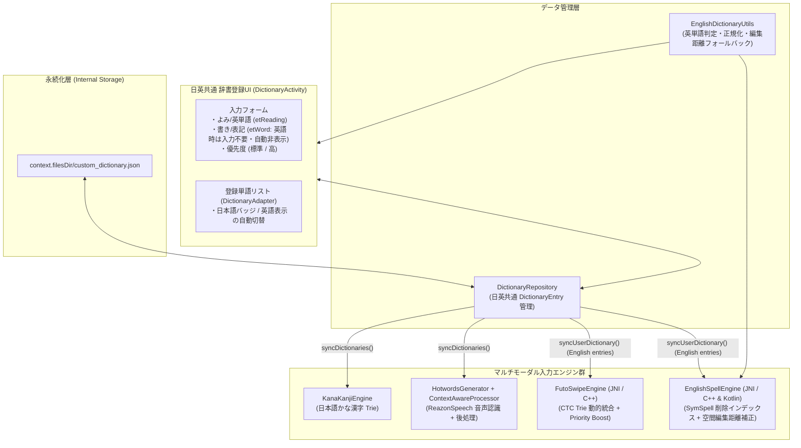
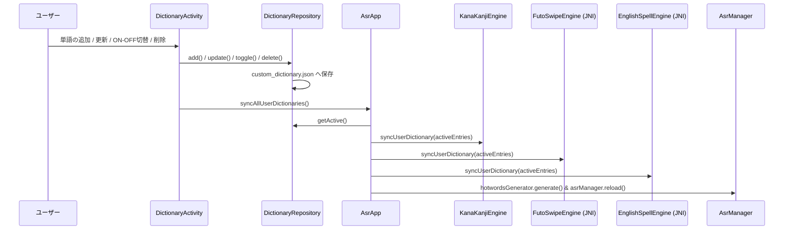

# PRD & System Design: 日英共通カスタム辞書（英語読みのみ登録・スワイプ優先・スペル補正統合）

## Part 1: Product Requirements Document (PRD)

### 1. 概要 (Overview)
JotInput のユーザー辞書（単語登録）機能を拡張し、**日本語と英語で単一の辞書UI（[`DictionaryActivity`](file:///home/kenichikurihara/repos/myasr/app/src/main/java/com/example/myasr/DictionaryActivity.kt)）および単一の辞書ファイル（`custom_dictionary.json`）を共通利用する英語カスタム辞書機能**を構築する。

英語の単語登録においては「よみ（Reading）」の1項目のみの入力で完結し、「書き（表記 / Word）」の二重入力を不要とする。登録された英単語は、QWERTY キーボードでの**スワイプ入力（[`FutoSwipeEngine`](file:///home/kenichikurihara/repos/myasr/app/src/main/java/com/example/myasr/FutoSwipeEngine.kt)）において最優先候補としてデコード**されるとともに、タップ入力時に**タイプミス（ミススペル）した際にもスペルコレクション候補（[`EnglishSpellEngine`](file:///home/kenichikurihara/repos/myasr/app/src/main/java/com/example/myasr/EnglishSpellEngine.kt) / [`CandidateStripView`](file:///home/kenichikurihara/repos/myasr/app/src/main/java/com/example/myasr/CandidateStripView.kt)）へ優先表示**される。

---

### 2. 背景と課題 (Background & Problem Statement)

1. **現在のカスタム辞書は日本語（かな読み＋表記）専用**:
   - 現行の [`DictionaryActivity.kt`](file:///home/kenichikurihara/repos/myasr/app/src/main/java/com/example/myasr/DictionaryActivity.kt) は、`etWord`（単語/表記）と `etReading`（よみ）の両方を必須とし、かつ `etReading` に対して `JapaneseKanaUtils.isValidKana(rawReading)`（ひらがな・カタカナのみ許可）のバリデーションを課している。
   - そのため、英語の固有名詞・技術用語・人名・メールアドレス断片・スラング（例: `Kurihara`, `JotInput`, `ReazonSpeech`, `Antigravity`, `kubectl`）を英語キーボード向けに登録しようとしても、かな読みの入力を強制され、英語単体として登録できない。
2. **英語は「読み＝書き」であり、2項目入力は冗長**:
   - 日本語のかな漢字変換では「よみ（くりはら）」と「書き/表記（栗原）」が異なるため2つの入力欄が必要だが、英語においてはアルファベット文字列そのものが入力キー列（読み）であり出力表記（書き）でもある。英語登録時に「よみ」と「書き」の両方を入力させるのはユーザー体験として不自然である。
3. **スワイプ入力（FUTO Swipe）でカスタム単語が出ない・優先されない**:
   - [`futo_swipe_engine.cc`](file:///home/kenichikurihara/repos/myasr/app/src/main/cpp/swipe/futo_swipe_engine.cc) の CTC Prefix Beam Search は、静的語彙ファイル `vocab.txt` から構築された `trie_nodes_` 上に存在するパスのみを探索する。したがって、`vocab.txt` に存在しない未知語（OOV）の登録単語はスワイプ入力で絶対に出力されない。
   - また、既知語や大文字混じり語（例: `GitHub`, `iPhone`）であっても、FUTO の ContextLM でハッシュバケット（`hashed_biases_`）にフォールバックすると強い負のバイアスがかかるため、一般語（例: `give`, `phone`）に負けて優先出力されない。
4. **QWERTY タイプミス時にカスタム単語がコレクション候補に出ない**:
   - [`english_spell_engine.cc`](file:///home/kenichikurihara/repos/myasr/app/src/main/cpp/spelling/english_spell_engine.cc) の `SuggestTypo()` は、初期化時に `vocab.txt` から構築した SymSpell 削除インデックス（`word_to_count_`, `deletes_dict_`）のみを参照しており、`DictionaryRepository` の登録単語と連携していない。
   - さらに、英語スペル補正の大型 ONNX モデル（`english_spelling/`）が未ダウンロードの環境では `EnglishSpellEngine.isReady()` が `false` となり、ユーザー辞書のスペル補正すら動作しない。

---

### 3. 要求仕様 (Functional & Non-Functional Requirements)

#### FR-1: 日英共通の辞書ファイル（`custom_dictionary.json`）と後方互換性
- 保存先は既存の `context.filesDir/custom_dictionary.json`（[`DictionaryRepository.kt`](file:///home/kenichikurihara/repos/myasr/app/src/main/java/com/example/myasr/DictionaryRepository.kt)）に完全統一する。
- `AGENTS.md` の **Custom Dictionary Persistence Contract** を厳守し、アプリ更新時に既存データを絶対に消去・破損させない。
- JSON スキーマ（`id`, `word`, `reading`, `priority`, `isEnabled`）を維持したまま、日本語エントリと英語エントリの双方を格納する。

#### FR-2: 日英共通の辞書UIと「英語は読みのみ入力（書き不要）」UX
- [`DictionaryActivity`](file:///home/kenichikurihara/repos/myasr/app/src/main/java/com/example/myasr/DictionaryActivity.kt) の単一画面で日本語・英語の両方を追加・編集・一覧表示・有効/無効切替・削除できる。
- **英語登録時の入力簡略化**:
  - 「よみ」入力欄（`etReading`）を主入力欄とし、ひらがな・カタカナに加えて**英語（ASCII アルファベット、アポストロフィ `'`、ハイフン `-`、数字を含む英単語）**の入力を許可する。
  - 「よみ」欄に英語のみが入力された場合、**「書き（単語 / 表記: `etWord`）」の入力は不要**とし、UI 上でも自動的に「書き」入力欄を折りたたむ（または任意・自動補完状態として扱う）。
  - 「よみ」に入力された英単語（例: `ReazonSpeech` や `kurihara`）の大文字・小文字表記をそのまま `word`（出力表記）として保持し、小文字正規化した文字列（`reazonspeech`, `kurihara`）を内部の `reading` として保存する。
  - **フェイルセーフ配慮**: 万一ユーザーが「書き（`etWord`）」欄にだけ英単語を入力して「よみ（`etReading`）」を空欄にした場合でも、エラーにせず同様に英語エントリとして受理する。
- **日英バイリンガル連携**:
  - 日本語の「よみ（例: `れいぞんすぴーち`）」と英語の「書き（例: `ReazonSpeech`）」の両方を入力して登録したエントリは、日本語かな漢字変換・音声認識で機能するだけでなく、`word` が英単語であるため**自動的に英語スワイプ・英語スペル補正の対象にも含める**（二重登録不要）。

#### FR-3: スワイプ入力（FUTO Swipe）における登録単語の優先出力
- QWERTY スワイプ入力時、辞書で有効（`isEnabled = true`）な英単語が `FutoSwipeEngine` の探索 Trie に動的統合されること。
- ユーザーが登録単語の軌跡をスワイプした際、`vocab.txt` にない未知語（例: `Kurihara`, `JotInput`）であっても正しくデコードされ、かつ類似軌跡の一般語よりも**優先度（`Priority.NORMAL` / `Priority.HIGH`）に応じて優先的に Top-1 確定および候補ストリップ上位に表示**されること。
- 登録単語に大文字・小文字（CamelCase や頭文字大文字、例: `ReazonSpeech`, `GitHub`）が含まれる場合、その表記通りに確定・候補表示されること。

#### FR-4: ミススペル（タイプミス）時のスペルコレクション候補提示
- QWERTY キーボードでのタップ入力時、登録された英単語をミススペルした際（例:
  - 隣接キー誤打: `kurihata` $\to$ `Kurihara`
  - 文字抜け/脱字: `reazonspech` $\to$ `ReazonSpeech`
  - 文字入れ替わり/転置: `kuirhara` $\to$ `Kurihara`
  - 文字余り/挿入: `jotinputt` $\to$ `JotInput`
  - 大文字小文字の未入力: `reazonspeech` $\to$ `ReazonSpeech`
  - 途中までの前方一致/ファジー接頭辞入力: `antigrav` $\to$ `Antigravity`）、
  変換候補ストリップ（[`CandidateStripView`](file:///home/kenichikurihara/repos/myasr/app/src/main/java/com/example/myasr/CandidateStripView.kt)）のコレクション候補に当該辞書単語が優先表示され、ワンタップで置換できること。
- 外部ストレージの英語スペル補正モデル（`english_spelling/*.onnx`）が未ダウンロードの状態でも、カスタム辞書単語のスペル補正・候補提示は 100% 動作すること。

#### FR-5: ユースケース一覧

| # | シナリオ | 辞書登録内容 | ユーザーの入力操作 | 期待されるシステム挙動 |
|---|---|---|---|---|
| 1 | **英語単語の新規登録（読みのみ）** | よみ: `Antigravity`（書き: 空欄、優先度: 高） | 「辞書に追加」をタップ | エラーなく登録完了。一覧に `Antigravity`（英語）として表示される |
| 2 | **未知語のスワイプ入力** | `Kurihara`（標準） | QWERTY 上で `k-u-r-i-h-a-r-a` とスワイプ | `Kurihara` が Top-1 で即時入力される |
| 3 | **競合軌跡でのスワイプ優先** | `JotInput`（高） | `j-o-t-i-n-p-u-t` とスワイプ | 一般語に埋もれず `JotInput` が Top-1 候補として優先出力される |
| 4 | **ミススペルからのコレクション候補** | `Kurihara`（標準） | QWERTY で `kurihata`（`r` の隣の `t` を誤打）とタイプ | 候補ストリップの先頭に `Kurihara` が表示され、タップで `kurihata` $\to$ `Kurihara` に置換される |
| 5 | **長単語の脱字ミススペル補正** | `ReazonSpeech`（高） | QWERTY で `reazonspech` とタイプ | 候補ストリップに `ReazonSpeech` が優先表示され、タップで置換される |
| 6 | **小文字入力からの CamelCase 補正** | `ReazonSpeech`（標準） | QWERTY で `reazonspeech` と小文字のままタイプ | 候補ストリップの第一候補に `ReazonSpeech` が提示される |
| 7 | **日英共用エントリの相互活用** | よみ: `れいぞんすぴーち`、書き: `ReazonSpeech` | ① かな入力で `れいぞんすぴーち`<br>② 英語で `reazonspech` とタイプまたはスワイプ | ① かな漢字変換・音声認識で `ReazonSpeech` が出力される<br>② 英語スワイプ・英語スペル補正でも `ReazonSpeech` が優先候補に出る |

---

## Part 2: Detailed Design Document (DD)

### 1. システムアーキテクチャ全体像 (Architecture Overview)



---

### 2. データモデルと永続化設計 (`DictionaryEntry` & `EnglishDictionaryUtils`)

#### 2.1 `custom_dictionary.json` のスキーマ互換設計
既存の JSON フォーマットを一切変更せず、フィールドの意味を日英で以下のように統一する：

```json
[
  {
    "id": "b3d1...",
    "word": "栗原",
    "reading": "くりはら",
    "priority": "NORMAL",
    "isEnabled": true
  },
  {
    "id": "a7f2...",
    "word": "ReazonSpeech",
    "reading": "reazonspeech",
    "priority": "HIGH",
    "isEnabled": true
  }
]
```

- **日本語エントリ**:
  - `word`: `"栗原"`（変換後の表記）
  - `reading`: `"くりはら"`（正規化済みひらがな）
- **英語エントリ（読みのみ入力）**:
  - ユーザーが「よみ」欄に `"ReazonSpeech"` と入力した場合：
    - `word`: `"ReazonSpeech"`（ユーザーが入力した大文字・小文字表記をそのまま保持）
    - `reading`: `"reazonspeech"`（検索・キー照合用に小文字正規化した文字列）
  - ユーザーが「よみ」欄に `"kurihara"`（全小文字）と入力した場合：
    - `word`: `"kurihara"`
    - `reading`: `"kurihara"`

#### 2.2 `EnglishDictionaryUtils.kt`（新規ユーティリティ）と `DictionaryEntry.kt` 拡張
英語エントリの判定・正規化・インメモリ高速照合を担う `EnglishDictionaryUtils` を新設し、`DictionaryEntry` に判定プロパティを追加する。

```kotlin
object EnglishDictionaryUtils {
    // 英字を1文字以上含み、英数字・アポストロフィ・ハイフン・スペースのみで構成される単語か判定
    private val ENGLISH_WORD_REGEX = Regex("^[A-Za-z][A-Za-z0-9'\\-]*$")

    fun isValidEnglishWord(text: String): Boolean {
        val trimmed = text.trim()
        if (trimmed.isEmpty() || trimmed.length > 64) return false
        return ENGLISH_WORD_REGEX.matches(trimmed)
    }

    // FutoSwipeEngine / EnglishSpellEngine のキーとして使用する小文字正規化読み
    fun normalizeEnglishReading(text: String): String {
        return text.trim().lowercase()
    }

    // FutoSwipeEngine の Trie キー（a-z のみ抽出）に変換可能か判定
    fun toSwipeTrieKey(text: String): String {
        return text.trim().lowercase().replace("'", "").replace("-", "")
            .filter { it in 'a'..'z' }
    }
}
```

[`DictionaryEntry.kt`](file:///home/kenichikurihara/repos/myasr/app/src/main/java/com/example/myasr/DictionaryEntry.kt) へのヘルパープロパティ追加：
```kotlin
val isJapaneseEntry: Boolean
    get() = JapaneseKanaUtils.isValidKana(reading)

val isEnglishOnlyEntry: Boolean
    get() = !isJapaneseEntry && EnglishDictionaryUtils.isValidEnglishWord(word)

// 日本語エントリであっても surface (word) が英単語（例: word="ReazonSpeech", reading="れいぞんすぴーち"）なら英語辞書としても活用可能
val hasEnglishSurface: Boolean
    get() = EnglishDictionaryUtils.isValidEnglishWord(word)
```

- **重複登録防止 (`DictionaryRepository.add`)**:
  - 既存の `it.word.equals(entry.word, ignoreCase = true) && it.reading == entry.reading` に加え、英語エントリで同一 `reading`（小文字正規化後）が既に登録されている場合は上書き更新（大文字・小文字表記や優先度の更新）として扱う。

---

### 3. 日英共通 辞書UI設計 (`DictionaryActivity.kt` & `activity_dictionary.xml`)

#### 3.1 入力フォームのレイアウト順序と「英語は読みのみ・書き不要」の動的UI挙動
ユーザーが「よみ」を入力するだけで英語登録が完結するよう、[`activity_dictionary.xml`](file:///home/kenichikurihara/repos/myasr/app/src/main/res/layout/activity_dictionary.xml) のフォーム順序とヒント・動的表示を以下のように設計する。

1. **入力欄の配置とラベル**:
   - **第1入力欄 `layoutReading` (`etReading`)**:
     - ヒント: `"よみ (ひらがな) または 英単語 (例: くりはら, Antigravity)"`
   - **第2入力欄 `layoutWord` (`etWord`)**:
     - ヒント: `"単語 / 表記 (日本語のみ必須, 例: 栗原)"`
     - 補助テキスト / 動的表示:
       - `etReading` に英語（`EnglishDictionaryUtils.isValidEnglishWord(rawReading)`）が入力されている間は、**「書き（`layoutWord`）」の入力が不要であるため、`layoutWord` を自動的に非表示（`View.GONE`）または無効化**し、フォーム説明文に `"英語は「よみ」の入力のみで登録できます（書きの入力は不要です）"` と表示する。
       - `etReading` に日本語かな（ひらがな・カタカナ）が入力された場合、または空欄の場合は `layoutWord` を表示（`View.VISIBLE`）する。
       - ※ 編集モード（`startEditing(entry)`）で既存の英語専用エントリ（`entry.isEnglishOnlyEntry`）をタップした際も、`etReading` に `entry.word`（大文字小文字を維持した表記）をセットし、`layoutWord` は非表示にする。

2. **`handleAddOrUpdateWord()` のバリデーション＆正規化フロー**:
   ```mermaid
   flowchart TD
       Start["[辞書に追加 / 更新] ボタン押下"] --> ReadInputs["rawReading = etReading.text.trim()\nrawWord = etWord.text.trim()"]
       ReadInputs --> CheckCase{"入力パターン判定"}
       
       CheckCase -->|"Case 1: rawReading が英単語\n(rawWord は空欄または同一)"| EngMode["英語エントリとして生成\nword = rawReading (大文字小文字保持)\nreading = rawReading.lowercase()"]
       CheckCase -->|"Case 2: rawReading が空欄 かつ\nrawWord が英単語 (フェイルセーフ)"| EngFallback["英語エントリとして生成\nword = rawWord\nreading = rawWord.lowercase()"]
       CheckCase -->|"Case 3: rawReading が有効な日本語かな\nかつ rawWord が非空"| JaMode["日本語エントリとして生成\nword = rawWord\nreading = normalizeReading(rawReading)"]
       CheckCase -->|"その他 (未入力 / 不正文字)"| Error["対応する入力欄にエラーメッセージ表示"]
       
       EngMode & EngFallback & JaMode --> Save["DictionaryRepository.add / update\n+ 全エンジン即時同期 (syncAllDictionaries)"]
   ```

3. **一覧表示 (`DictionaryAdapter.kt`)**:
   - `entry.isJapaneseEntry` の場合:
     - `tvWord`: `entry.word`（例: `栗原`）
     - `tvReading`: `"よみ: くりはら (クリハラ)"`
   - `entry.isEnglishOnlyEntry` の場合:
     - `tvWord`: `entry.word`（例: `Antigravity`）
     - `tvReading`: `"英語 (English)"`（冗長なカタカナ変換を行わずシンプルに表示）

---

### 4. スワイプ入力におけるカスタム辞書優先設計 (`FutoSwipeEngine`)

#### 4.1 現状の C++ `FutoSwipeEngine` の課題分析
[`futo_swipe_engine.cc`](file:///home/kenichikurihara/repos/myasr/app/src/main/cpp/swipe/futo_swipe_engine.cc) のデコード処理は以下の 6 ステップで動作している：
1. タッチ軌跡を 64 点にリサンプリング（`ResampleTrace`）。
2. `encoder.onnx` + `decoder.onnx` を実行し、`[1, 32, 27]` のフレームごと文字対数確率 `refined_logits` を取得。
3. `trie_nodes_` 上で 32 フレームの CTC Prefix Beam Search（`beam_width = 100`）を実行。
4. 終端到達ノード `states` に対し、空間スコア $\text{base} = \frac{\text{Total}()}{l^\gamma} + \beta \cdot l$ を計算。
5. 先行単語がある場合は `context_lm.onnx` の状態ベクトルと `embeddings.onnx` の内積＋バイアス `ScoreWordInContext` を計算し、$\text{total\_score} = \text{base} + \alpha \cdot S_{\text{context}}$ を算出。
6. スコア降順にソートし、小文字化した文字列で重複排除して上位 `max_candidates`（5件）を返す。

ここで登録単語を優先させるには、以下の **3つの技術的障壁** を解決する必要がある：
- **障壁 A（Trie 未登録による探索不能）**: `vocab.txt` にない単語は `trie_nodes_` にパスが存在せず、CTC ビームサーチで展開されない。
- **障壁 B（途中フレームでのビーム枝刈り）**: 長いカスタム単語（例: `reazonspeech`, `antigravity`）はフレーム途中で一般語の短いプレフィックスに負けて `beam_width = 100` から脱落する場合がある。
- **障壁 C（OOV ハッシュバイアスによる減点と優先度反映）**: `ScoreWordInContext` において、`exact_ids_`（上位 32,767 語）に含まれない単語は `hashed_biases_` が参照され、頻出語（`exact_biases_` $\approx -3.0 \sim -5.0$）に比べて大幅に低いスコア（$\approx -10.0$ 以下）となる。また、文頭（`use_context == false`）では純粋な空間 CTC スコアのみとなるため、近接軌跡の一般語（例: `kurihara` に対する一般語や、`jotinput` に対する一般語）に勝つための優先度ブーストが必要となる。

#### 4.2 C++ `FutoSwipeEngine` 拡張設計

##### (1) ベース Trie スナップショットと動的ユーザー辞書同期 (`SyncUserDictionary`)
ONNX モデルや `vocab.txt`（約 3.2 万語）を再ロードすることなく、数ミリ秒未満でユーザー辞書の追加・削除・ON/OFF 切替を反映するため、`Initialize()` 完了時点の `trie_nodes_` を `base_trie_nodes_` として保持する。

```cpp
// futo_swipe_engine.h
struct UserSwipeWord {
    std::string surface;   // 登録表記 (例: "ReazonSpeech", "Kurihara")
    float priority_score;  // Priority.NORMAL = 3.0f, Priority.HIGH = 4.5f, Priority.LOW = 1.5f
};

void SyncUserDictionary(const std::vector<UserSwipeWord>& user_words);
```

`TrieNode` 構造体を以下のように拡張する：
```cpp
struct TrieNode {
    std::string text;
    int last = -1;
    int children[26];
    std::vector<std::string> surfaces;
    int frequency = 0;
    float max_user_priority = 0.0f;      // このノードで終わるユーザー辞書単語の最大 priority_score
    bool has_user_subtree = false;       // 配下にユーザー辞書単語が存在するか（ビーム保持用）
    ...
};
```

`SyncUserDictionary(user_words)` の処理（`std::mutex` でスレッドセーフ化）：
1. `trie_nodes_ = base_trie_nodes_;` でベース状態にO(1)相当（メモリコピーのみ、$< 0.5\text{ms}$）でリセット。
2. `user_word_priorities_.clear();`（`surface` $\to$ `priority_score` のマップ）。
3. 各 `UserSwipeWord` について：
   - キー正規化：小文字化し `'` と `-` を除去した英字列 `key`（`a-z`）を生成（2文字以上を対象）。
   - ルートから `key` の各文字をたどり、各通過ノードの `has_user_subtree = true` をセット（未存在ノードは新規作成）。
   - 終端ノード `curr` において、`surfaces` の**先頭**に `user_word.surface` を挿入（既に同一文字列があれば先頭へ移動）し、`trie_nodes_[curr].max_user_priority = std::max(trie_nodes_[curr].max_user_priority, user_word.priority_score)` を記録。
   - `user_word_priorities_[user_word.surface] = user_word.priority_score` を登録。

##### (2) 3段階の優先度ブーストアルゴリズム
`Decode()` において以下の3段階でユーザー辞書単語を優先する：

1. **Stage A: CTC ビーム枝刈り時のプレフィックス保護 (`has_user_subtree`)**:
   - 各タイムステップ $t$ のビーム枝刈りスコア `priority` 計算時：
     ```cpp
     float subtree_bonus = trie_nodes_[kv.first].has_user_subtree ? 0.75f : 0.0f;
     kv.second.priority = kv.second.Total() / div + beta_prune * l + subtree_bonus;
     ```
   - これにより、ユーザーがスワイプしている軌跡がカスタム単語の途中経路にある場合、100 ビームから途中脱落することを防ぐ。

2. **Stage B: ContextLM スコアリングでの OOV ペナルティ解消**:
   - `ScoreWordInContext(context_state, surf)` において、`surf` が `user_word_priorities_` に登録されている場合：
     - もし `exact_ids_` に存在しない（OOV）、または `exact_biases_[row]` が上位頻出語水準（例: `-4.2f`）より低い場合、ユニグラムバイアスとして最低でも `-4.2f` を保証する。これにより、OOV ハッシュバケットによる不当な減点を完全に排除する。

3. **Stage C: 空間尤度ゲート付き優先度スコア加算（Spatial-Gated Priority Boost）**:
   - **重要（誤爆防止設計）**: 無条件に巨大な定数スコアを加算すると、全く別の単語（例: `"hello"`）をスワイプした際に、たまたまビーム末尾に残った無関係な登録単語が Top-1 を奪う危険がある。
   - これを防ぐため、全終端候補の最大空間スコア $\text{max\_base} = \max_{s \in \text{states}} \text{base}(s)$ を基準とし、**空間 CTC スコアが妥当な許容マージン内（$\text{base} \ge \text{max\_base} - \Delta_{\text{spatial}}$、ここで $\Delta_{\text{spatial}} = 6.5$）にある場合にのみ**、優先度ブーストを加算する：
     $$\text{Boost}(p) = \begin{cases} +5.5 & (\text{Priority.HIGH}: p = 4.5) \\ +3.8 & (\text{Priority.NORMAL}: p = 3.0) \\ +2.0 & (\text{Priority.LOW}: p = 1.5) \end{cases}$$
   - また、小文字重複排除（Deduplication）の前にスコア降順ソートが行われるため、一般辞書に小文字の `"github"` や `"reazonspeech"` が存在していても、ユーザー辞書に登録された `"GitHub"` や `"ReazonSpeech"` がより高いスコアを持ち、**ユーザーが登録した大文字・小文字表記が確実に採用される**。

---

### 5. ミススペル時のスペルコレクション候補設計 (`EnglishSpellEngine` & `VoiceInputMethodService`)

#### 5.1 2層ハイブリッド構成（C++ Native SymSpell 拡張 ＋ Kotlin 常駐マッチャー）
ユーザー辞書に登録された英単語のスペル補正は、以下の **2層構造** で設計する。

1. **Layer 1: Kotlin 常駐カスタム辞書スペルマッチャー (`EnglishDictionaryUtils.suggestFromUserDictionary`)**
   - **目的**:
     - `english_spelling` の ONNX モデル（約 20MB）が未ダウンロードの端末環境でも、**ユーザー辞書のスペル補正・ミススペル候補提示が 100% 動作する**ことを保証する。
     - ユーザー辞書は通常数十〜数百件規模であるため、Kotlin 層で QWERTY 空間編集距離（Damerau-Levenshtein + 隣接キー距離）および前方一致（Prefix Match）を直接計算しても **$< 0.2\text{ms}$** で完了する。
2. **Layer 2: C++ `EnglishSpellEngine::SyncUserDictionary` 統合**
   - **目的**:
     - ネイティブ `EnglishSpellEngine` が初期化済みの環境において、C++ 側の SymSpell インデックス（`word_to_count_`, `deletes_dict_`）にもユーザー辞書を統合し、一般語 3.2 万語と同一の空間コスト尺度上でシームレスにランキングする。

#### 5.2 ミススペル検出・スコアリングアルゴリズム詳細

入力中の英単語を `rawWord`（小文字化: `typed_lower`、長さ $m$）、ユーザー辞書の英単語を `entry.word`（小文字化キー: `cand_lower`、長さ $n$）とする。

##### (1) マッチング対象の3カテゴリ
1. **大文字・小文字の正規化一致（Exact Case-Insensitive Match, $d = 0$）**:
   - 例: 辞書に `"ReazonSpeech"` や `"Kurihara"` が登録されており、ユーザーが小文字で `"reazonspeech"` や `"kurihara"` と打った場合。
   - 編集コスト $\text{cost} = 0.0$。`rawWord != entry.word` であれば、`entry.word`（`"ReazonSpeech"`）を最優先候補（Rank 1）として提示する。
2. **ミススペル補正（Spatial Edit-Distance & Transposition Match）**:
   - [`english_spell_engine.cc`](file:///home/kenichikurihara/repos/myasr/app/src/main/cpp/spelling/english_spell_engine.cc) と同一の QWERTY 物理キー座標距離を組み込んだ重み付き Damerau-Levenshtein 距離 $\text{EditAndSpatialCost}(\text{typed\_lower}, \text{cand\_lower})$ を計算する：
     - 同一文字: $0.0$
     - 置換（Substitution）: $0.8 + 0.3 \times \min(\text{KeyDistance}(c_1, c_2), 2.0)$
       - 隣接キー誤打（例: `r` $\leftrightarrow$ `t`, `i` $\leftrightarrow$ `o`）は $\text{KeyDistance} = 1.0 \implies \text{cost} = 1.1$
     - 挿入 / 削除（Insertion / Deletion）: $1.2$
     - 隣接文字の転置（Transposition, 例: `kuirhara` $\leftrightarrow$ `kurihara`）: $0.6$
   - **単語長に応じた許容コスト閾値 $\theta_{\text{cost}}(n)$**:
     - 短い単語での誤爆を防ぎつつ、長い固有名詞・技術用語での複数箇所ミスを救済するため、単語長に応じた許容閾値を設ける：
       $$\theta_{\text{cost}}(n) = \begin{cases} 1.5 & (n \le 3) \\ 2.5 & (4 \le n \le 6) \\ 3.6 & (n \ge 7) \end{cases}$$
     - 例:
       - `"kurihata"` ($m=8$) vs `"Kurihara"` ($n=8$): `t` $\to$ `r`（隣接キー置換 1回）で $\text{cost} = 1.1 \le 3.6 \implies$ **マッチ！**
       - `"reazonspech"` ($m=11$) vs `"ReazonSpeech"` ($n=12$): `e` の脱字 1回で $\text{cost} = 1.2 \le 3.6 \implies$ **マッチ！**
       - `"antigravty"` ($m=10$) vs `"Antigravity"` ($n=11$): `i` の脱字 1回で $\text{cost} = 1.2 \le 3.6 \implies$ **マッチ！**
       - `"kuirhara"` ($m=8$) vs `"Kurihara"` ($n=8$): `ri` $\to$ `ir` の転置 1回で $\text{cost} = 0.6 \le 3.6 \implies$ **マッチ！**
3. **前方一致・ファジー接頭辞予測（Prefix / Fuzzy-Prefix Match）**:
   - $m \ge 3$ かつ $n > m$ の場合、ユーザーが長い登録単語を途中まで入力している段階（例: `"reazon"` $\to$ `"ReazonSpeech"`, `"kurih"` $\to$ `"Kurihara"`）でも、先頭 $m$ 文字との編集コストが $\le 1.2$ 以内であれば予測・補完候補として提示する。

##### (2) スコア計算と一般語候補との統合順位
- C++ `EnglishSpellEngine::SuggestTypo` において、一般語は $\text{score} = \ln(\text{count} + 1) - 2.8 \times \text{cost}$（最大 $\ln(10^7) \approx 16.12$）でスコア付けされる。
- ユーザー辞書エントリには、最頻出一般語を上回る仮想対数頻度 $\text{virtual\_log\_freq}$ を付与する：
  - `Priority.HIGH`: $\text{virtual\_log\_freq} = 22.0$
  - `Priority.NORMAL`: $\text{virtual\_log\_freq} = 19.5$
  - `Priority.LOW`: $\text{virtual\_log\_freq} = 17.5$
  - $\text{score}_{\text{user}} = \text{virtual\_log\_freq} - 2.8 \times \text{cost}$
- [`VoiceInputMethodService.kt`](file:///home/kenichikurihara/repos/myasr/app/src/main/java/com/example/myasr/VoiceInputMethodService.kt) の `updateEnglishTypoAndSpellingCandidates()` における候補順序（Ordering）：
  1. **Rank 1**: ユーザー辞書の完全一致（大文字小文字補正）または高確度ミススペル補正候補（$\text{cost} \le 2.4$）
  2. **Rank 2**: `EnglishCapitalizationAnalyzer` による文頭・代名詞・頭字語候補（もしあれば）およびユーザー入力そのままの `rawWord`
  3. **Rank 3+**: 残りのユーザー辞書候補（接頭辞補完など）＋ `EnglishSpellEngine` の一般語スペル補正候補（最大 5 件まで）
- **文頭大文字化との協調**:
  - ユーザーが辞書に全小文字（例: `"kurihara"`）で登録していた場合、文頭（`CapitalizationType.SENTENCE_START`）で入力・ミススペルされた際は先頭文字を大文字化した `"Kurihara"` に自動適応する。
  - 一方、ユーザーが明示的に大文字を含めて登録していた場合（例: `"ReazonSpeech"`, `"iPhone"`, `"GitHub"`）は、文頭・文中に依らずユーザーの登録表記をそのまま維持する。

---

### 6. 日本語パイプライン（かな漢字変換・音声認識）への副作用防止設計

日英共通の `custom_dictionary.json` に英語専用エントリ（例: `word = "Antigravity"`, `reading = "antigravity"`）が混在するため、既存の日本語エンジン群に対して以下のガードを設ける：

1. **[`KanaKanjiEngine.kt`](file:///home/kenichikurihara/repos/myasr/app/src/main/java/com/example/myasr/KanaKanjiEngine.kt) (`syncUserDictionary`)**:
   - `JapaneseKanaUtils.isValidKana(entry.reading)` が `true` のエントリのみを日本語かな漢字 Trie に挿入する（ASCII の `reading` を日本語かな Trie に混ぜない）。
   - 同時に、既存の課題であった「単語削除・OFF切替時にメモリ内 Trie から古い `"user"` エントリが消えない問題」を解消するため、`syncUserDictionary` 呼び出し時に Trie 内の既存 `"user"` ソースエントリを一旦クリアしてから有効なエントリを再挿入する。
2. **[`ContextAwareProcessor.kt`](file:///home/kenichikurihara/repos/myasr/app/src/main/java/com/example/myasr/ContextAwareProcessor.kt)**:
   - Step 5 (`applyDictionarySubstitutions`): かな読み置換は `entry.isJapaneseEntry`（`JapaneseKanaUtils.isValidKana(entry.reading)`）が `true` の場合のみ実行する。これにより、短い英語の `reading` が別単語の部分文字列を誤置換することを防ぐ。
   - Step 6 (`applyAlphanumericNormalization`): 英語エントリの `entry.word`（例: `"ReazonSpeech"`, `"Antigravity"`）は、音声認識が `"reazonspeech"` や `"antigravity"` と小文字出力した際にも大文字小文字を正規化する役割を担う。この際、部分一致誤爆を防ぐため単語境界（`(?<![A-Za-z0-9])` ... `(?![A-Za-z0-9])`）付きの大文字小文字非依存パターンで置換する。
3. **[`HotwordsGenerator.kt`](file:///home/kenichikurihara/repos/myasr/app/src/main/java/com/example/myasr/HotwordsGenerator.kt)**:
   - `entry.isEnglishOnlyEntry` の場合、`word` と `reading`（および `hiraganaToKatakana(reading)`）がいずれも ASCII 文字列となるため、`toSpaceSeparatedTokens` で生成されたトークン列が `seenPhrases` セットによって自動的に重複排除され、`tokens.txt` に存在する文字のみ安全にホットワード出力される（変更不要・そのまま安全に動作）。

---

### 7. エンジン同期ライフサイクル (Synchronization Lifecycle)

辞書データの変更がすべての入力モード（日本語フリック、英語QWERTYタップ、英語QWERTYスワイプ、音声認識）に即座に反映されるよう、`AsrApp` に統一同期メソッド `syncAllUserDictionaries()` を設ける。



**同期タイミング**:
1. `DictionaryActivity` での単語追加・更新・トグル・削除直後。
2. `VoiceInputMethodService.onStartInputView()`（キーボード表示時、バックグラウンドスレッドで軽量同期）。
3. `FutoSwipeEngine.ensureInitialized()` および `EnglishSpellEngine.ensureInitialized()` のネイティブ初期化成功直後（初回ロード時に現在の有効なユーザー辞書を即座に JNI 経由で注入）。

---

### 8. 変更対象ファイル一覧 (Target Files for Implementation Phase)

| レイヤ | ファイルパス | 変更内容 |
|---|---|---|
| **Kotlin データ & 共通ユーティリティ** | `app/src/main/java/com/example/myasr/EnglishDictionaryUtils.kt` *(新規)* | 英単語バリデーション、小文字正規化、空間編集距離＋転置＋接頭辞によるカスタム辞書スペルマッチャー実装 |
| | [`app/src/main/java/com/example/myasr/DictionaryEntry.kt`](file:///home/kenichikurihara/repos/myasr/app/src/main/java/com/example/myasr/DictionaryEntry.kt) | `isJapaneseEntry`, `isEnglishOnlyEntry`, `hasEnglishSurface` プロパティの追加 |
| | [`app/src/main/java/com/example/myasr/DictionaryRepository.kt`](file:///home/kenichikurihara/repos/myasr/app/src/main/java/com/example/myasr/DictionaryRepository.kt) | 英語エントリの重複判定（`reading` 一致時の更新）サポート |
| | [`app/src/main/java/com/example/myasr/AsrApp.kt`](file:///home/kenichikurihara/repos/myasr/app/src/main/java/com/example/myasr/AsrApp.kt) | `syncAllUserDictionaries()` の一元化 |
| **日英共通 辞書UI** | [`app/src/main/res/layout/activity_dictionary.xml`](file:///home/kenichikurihara/repos/myasr/app/src/main/res/layout/activity_dictionary.xml) | 「よみ / 英単語」欄を主入力とし、英語入力時に「書き」欄が不要であることを示す UI 構成へ更新 |
| | [`app/src/main/java/com/example/myasr/DictionaryActivity.kt`](file:///home/kenichikurihara/repos/myasr/app/src/main/java/com/example/myasr/DictionaryActivity.kt) | `etReading` のリアルタイム判定（英語入力時は `layoutWord` を自動非表示・入力不要化）、日英バリデーション、編集フォーム復元 |
| | [`app/src/main/java/com/example/myasr/DictionaryAdapter.kt`](file:///home/kenichikurihara/repos/myasr/app/src/main/java/com/example/myasr/DictionaryAdapter.kt) | 英語専用エントリの場合のサブタイトル表示（`"英語 (English)"`）分岐 |
| **FUTO Swipe エンジン (Kotlin & C++)** | [`app/src/main/java/com/example/myasr/FutoSwipeEngine.kt`](file:///home/kenichikurihara/repos/myasr/app/src/main/java/com/example/myasr/FutoSwipeEngine.kt) | `syncUserDictionary(entries)` と `nativeSyncUserDictionary` JNI ブリッジ追加、`ensureInitialized()` 時の自動同期 |
| | [`app/src/main/cpp/swipe/futo_swipe_engine.h`](file:///home/kenichikurihara/repos/myasr/app/src/main/cpp/swipe/futo_swipe_engine.h) | `UserSwipeWord` 構造体と `SyncUserDictionary` メソッド宣言 |
| | [`app/src/main/cpp/swipe/futo_swipe_engine.cc`](file:///home/kenichikurihara/repos/myasr/app/src/main/cpp/swipe/futo_swipe_engine.cc) | `base_trie_nodes_` 保持、動的 Trie 挿入、3段階優先度ブースト（プレフィックス保護・OOV バイアス下限・空間ゲート付き優先度加算） |
| | [`app/src/main/cpp/swipe/futo_swipe_jni.cc`](file:///home/kenichikurihara/repos/myasr/app/src/main/cpp/swipe/futo_swipe_jni.cc) | `Java_com_example_myasr_FutoSwipeEngine_nativeSyncUserDictionary` 実装 |
| **英語スペルエンジン & IME 統合** | [`app/src/main/java/com/example/myasr/EnglishSpellEngine.kt`](file:///home/kenichikurihara/repos/myasr/app/src/main/java/com/example/myasr/EnglishSpellEngine.kt) | `syncUserDictionary(entries)`、C++ `nativeSyncUserDictionary` 連携、およびモデル未ロード時も動作する Kotlin ユーザー辞書スペル候補統合 |
| | [`app/src/main/cpp/spelling/english_spell_engine.h`](file:///home/kenichikurihara/repos/myasr/app/src/main/cpp/spelling/english_spell_engine.h) | `UserSpellWord` 構造体と `SyncUserDictionary` 宣言 |
| | [`app/src/main/cpp/spelling/english_spell_engine.cc`](file:///home/kenichikurihara/repos/myasr/app/src/main/cpp/spelling/english_spell_engine.cc) | ユーザー辞書単語の SymSpell 削除インデックス追加と優先度スコア計算 |
| | [`app/src/main/cpp/spelling/english_spell_jni.cc`](file:///home/kenichikurihara/repos/myasr/app/src/main/cpp/spelling/english_spell_jni.cc) | `Java_com_example_myasr_EnglishSpellEngine_nativeSyncUserDictionary` 実装 |
| | [`app/src/main/java/com/example/myasr/VoiceInputMethodService.kt`](file:///home/kenichikurihara/repos/myasr/app/src/main/java/com/example/myasr/VoiceInputMethodService.kt) | `updateEnglishTypoAndSpellingCandidates()` でカスタム辞書候補を最優先配置、`onStartInputView` での英語辞書同期 |
| **日本語エンジン保護** | [`app/src/main/java/com/example/myasr/KanaKanjiEngine.kt`](file:///home/kenichikurihara/repos/myasr/app/src/main/java/com/example/myasr/KanaKanjiEngine.kt) | `syncUserDictionary` にて `isValidKana` チェック追加および削除・無効化単語のクリーンアップ |
| | [`app/src/main/java/com/example/myasr/ContextAwareProcessor.kt`](file:///home/kenichikurihara/repos/myasr/app/src/main/java/com/example/myasr/ContextAwareProcessor.kt) | かな置換を `isValidKana` のみに限定、英数字正規化に単語境界ガード追加 |

---

### 9. テスト・検証計画 (Verification Plan)

1. **単体テスト (`./gradlew testDebugUnitTest`)**:
   - `UnifiedEnglishDictionaryTest` *(新規)*:
     - 英語の「よみ」のみの登録・JSON シリアライズ/デシリアライズ・既存日本語エントリとの共存検証。
     - ミススペル入力（隣接キー誤打 `kurihata`、脱字 `reazonspech`、転置 `kuirhara`、余剰文字 `jotinputt`、小文字入力 `reazonspeech`、接頭辞 `antigrav`）に対するコレクション候補の最優先出力検証。
     - 文頭での小文字登録単語の大文字化適応と、CamelCase 登録単語（`ReazonSpeech`）の表記維持検証。
     - 日本語のかな漢字変換および `ContextAwareProcessor` に英語専用エントリが悪影響を与えないことの検証。
   - 既存テスト非回帰:
     - [`JapanesePunctuationEvaluationTest`](file:///home/kenichikurihara/repos/myasr/app/src/test/java/com/example/myasr/JapanesePunctuationEvaluationTest.kt)（67+ テスト 100% パス必須）、`DictionaryEditTest`, `EnglishSpellEngineTest`, `EnglishCapitalizationAnalyzerTest`, `FutoSwipeIntegrationTest` の全件パス確認。
2. **実機デュアルターゲット検証 (`./deploy.sh`)**:
   - **Pixel 10 Pro** および **ARCVM (`arc:5555`)** の両方にデプロイ。
   - `DictionaryActivity` 上で英語単語を「よみ」のみで登録できること、スワイプ入力およびミススペル入力時に候補ストリップに優先表示されることを実機で確認。
