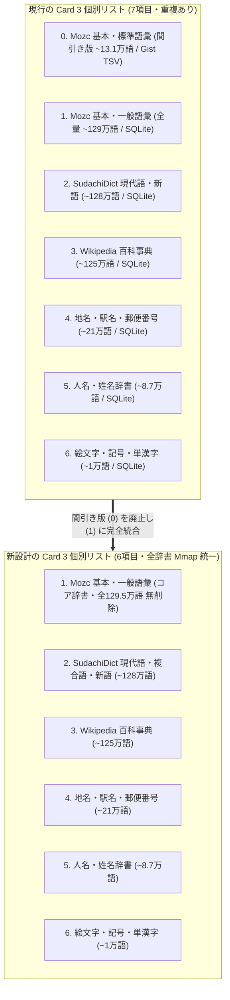
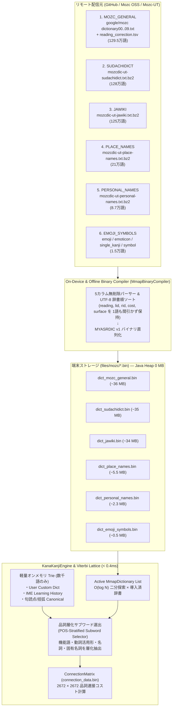
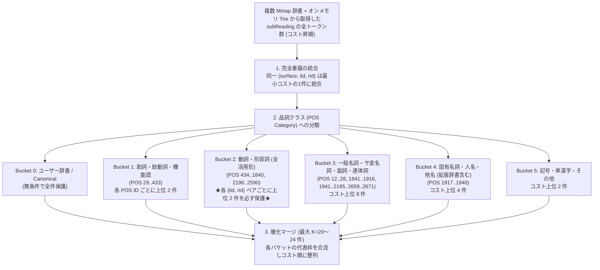

# PRD & System Design: 全辞書 `MYASRDIC v1` ゼロヒープ Mmap 統一・100% 無削除化・Connection Matrix 完全統合・品詞層化探索アーキテクチャ
## Unified Zero-Pruning Mmap Lexicon (`A + C`) & POS-Stratified Viterbi Architecture

**ステータス**: 設計完了・レビュー待ち（**実装コードの変更はまだ行っていません**）  
**作成日**: 2026-11-11  
**関連文書**:
- [`docs/unpruned_full_mozc_dictionary_ideas.md`](file:///home/antigravity/kenichikurihara/jotinput/docs/unpruned_full_mozc_dictionary_ideas.md)
- [`docs/system_design_gboard_style_mmap_lexicon.md`](file:///home/antigravity/kenichikurihara/jotinput/docs/system_design_gboard_style_mmap_lexicon.md)
- [`docs/ui_design_and_simplicity_guidelines.md`](file:///home/antigravity/kenichikurihara/jotinput/docs/ui_design_and_simplicity_guidelines.md)
- [`docs/prd_and_design_dictionary_update_tracker.md`](file:///home/antigravity/kenichikurihara/jotinput/docs/prd_and_design_dictionary_update_tracker.md)

---

## Part 1: UI に変更が必要か？（UI 影響分析と改善設計）

### 1.1. 結論：レイアウト構造（XML）の変更は不要。ただし Card 3 内の「重複エントリの整理」と「自動マイグレーション案内」の 2 点のみ変更が必要

[`docs/ui_design_and_simplicity_guidelines.md`](file:///home/antigravity/kenichikurihara/jotinput/docs/ui_design_and_simplicity_guidelines.md) の **4カード上限ルール** および **内部実装用語（`mmap`, `bin` 等）をメイン UI に露出させない原則（原則5）** に従い、新しいカードやスイッチの追加は一切行いません。

一方で、現行の [`MainActivity.kt`](file:///home/antigravity/kenichikurihara/jotinput/app/src/main/java/com/example/myasr/MainActivity.kt#L875-L928) と [`DictionaryUpdateTracker.kt`](file:///home/antigravity/kenichikurihara/jotinput/app/src/main/java/com/example/myasr/DictionaryUpdateTracker.kt#L77-L106) を精査すると、**従来の「間引き辞書時代」の名残による UI 上の矛盾が 1 箇所だけ存在します**。

#### 現在の Card 3 折りたたみリスト内の重複問題
現在、Card 3 の「個別の拡張辞書を管理 ▼」を開くと、先頭に以下の **2 つの Mozc 辞書** が別々に並んでいます：
1. **`base_dictionary`**: 「Mozc 基本・標準語彙 (コア辞書) — 約13.1万語 (約5.1 MB)」 *(← Gist から間引き版 TSV をダウンロード)*
2. **`mozc_general`**: 「Mozc 基本・一般語彙 — 約129万語 (約12 MB)」 *(← `google/mozc` から全10ファイルをダウンロード)*

「一切辞書を間引かない（`A + C`）」アーキテクチャでは、**Mozc 基本辞書そのものが 129.5万語フル版（`mozc_general` + `reading_correction.tsv`）になるため、「13.1万語の間引き版コア辞書 (`base_dictionary`)」という独立項目は完全に役割を終え、129.5万語の `mozc_general` と重複します**。

### 1.2. 具体的な UI 変更仕様（Card 3 のみ）



| UI 箇所 | 変更前の表示・挙動 | 変更後の表示・挙動 | 理由 |
| :--- | :--- | :--- | :--- |
| **Card 3 個別辞書リスト (`layoutDictItemsContainer`)** | `0. Mozc 基本・標準語彙 (~13.1万語)` と `1. Mozc 基本・一般語彙 (~129万語)` の **7項目** が表示される | 間引き版の `0` を廃止し、`1. Mozc 基本・一般語彙 (コア標準辞書)`（約129.5万語）に一本化した **全6項目** に整理 | 間引き辞書を廃止するため、13.1万語と129万語の2つが並ぶ混乱を解消。すべての辞書が同じ `DictionaryType` として対等に並ぶ。 |
| **進捗ステータステキスト (`tvMultiDictStatus`)** | `"{辞書名} 登録中... (N語)"`（SQLite INSERT のため数分かかる） | `"{辞書名} を高速インデックス化中... (N語)"`（オンデバイス `.bin` コンパイルにより数秒で完了） | SQLite バッチ挿入からメモリ上ソート＆バイナリ一括書き出しに変わるため、体感速度が劇的に向上。 |
| **旧 SQLite 導入済みユーザーの更新バナー (`tvDictUpdateBanner`)** | SQLite の語数を参照して「最新」と表示 | 旧 SQLite (`mozc_dictionaries.db`) は存在するが新 `.bin` が未生成の場合、バナーに **`「🔔 辞書エンジンの高速化アップデートがあります（再取得してください）」`** と表示し、一括ボタンで全辞書を `.bin` へ再構築（完了後に旧 SQLite DB 約400MB を自動削除して容量解放） | 既存ユーザーが迷わずワンタップで新 Mmap 辞書へ移行でき、かつ端末の無駄な SQLite ファイル（約400MB）を自動でクリーンアップするため。 |
| **Card 1 / Card 2 / Card 4 / IME キーボード画面** | 変更なし | **変更なし（完全維持）** | アルゴリズム・データ構造の刷新であり、設定ノブを増やす必要がないため（最適デフォルト原則）。 |

---

## Part 2: システム設計書 (System Design Document)

### 1. アーキテクチャ全体像 (Unified Mmap Lexicon Architecture)

従来の JotInput は「① オンメモリ TSV Trie」「② 単一 Mmap (`system_dictionary.bin`)」「③ SQLite (`mozc_dictionaries.db`)」という **3種類の異なる辞書ストレージ** が並存し、しかも SQLite 内の拡張辞書は品詞 ID (`lid`, `rid`) を持たず Viterbi 連文節変換に参加できないという構造的断絶を抱えていました。

新設計（`A + C`）では、**すべての辞書データソースを同一フォーマット（`MYASRDIC v1`）のメモリマップトバイナリ（`.bin`）に完全統一**し、すべての辞書が `ConnectionMatrix`（$2672 \times 2672$ 品詞連接コスト行列）を用いて Viterbi ラティス探索に 100% 対等に参加します。



---

### 2. 辞書データ構造とファイル管理仕様

#### 2.1. 辞書種別（`DictionaryType`）ごとの Mmap バイナリ定義
すべての辞書は端末ストレージの `{ExternalFilesDir or filesDir}/mozc/dict_{id}.bin` として保存されます。
（※開発環境・単体テスト環境との互換性のため、`dict_mozc_general.bin` が未生成で旧 `system_dictionary.bin` が存在する場合はそれを `MOZC_GENERAL` として自動認識します）。

| `DictionaryType` | ファイル名 | 収録内容 | 語彙の間引き | 品詞 ID (`lid`, `rid`) とコストの扱い | 推定 `.bin` サイズ |
| :--- | :--- | :--- | :---: | :--- | :---: |
| **`MOZC_GENERAL`** | `dict_mozc_general.bin` | Mozc OSS `dictionary00..09.txt` (全10部) + `reading_correction.tsv` (757語) | **0% (完全無削除)**<br>約 1,295,000 トークン | 元ファイルの `lid`, `rid`, `cost` を 100% そのまま保持（`reading_correction` は正読の POS を継承し `cost + 3000`） | 約 36.0 MB |
| **`SUDACHIDICT`** | `dict_sudachidict.bin` | WorksApplications SudachiDict (Mozc-UT形式) | **0% (完全無削除)**<br>約 1,284,000 トークン | 元ファイルの `lid`, `rid`, `cost`（6000〜9000番台）をそのまま保持 | 約 35.0 MB |
| **`JAWIKI`** | `dict_jawiki.bin` | Wikipedia 日本語版記事名・固有名詞 (Mozc-UT形式) | **0% (完全無削除)**<br>約 1,250,000 トークン | 元ファイルの `lid`, `rid`（固有名詞 `1917` 等）, `cost` をそのまま保持 | 約 34.0 MB |
| **`PLACE_NAMES`** | `dict_place_names.bin` | 全国市区町村・町名・駅名・郵便番号 (Mozc-UT形式) | **0% (完全無削除)**<br>約 210,000 トークン | 元ファイルの `lid`, `rid`（地名 `1920..1926` 等）, `cost` をそのまま保持 | 約 5.5 MB |
| **`PERSONAL_NAMES`** | `dict_personal_names.bin` | 日本の姓・名・著名人 (Mozc-UT形式) | **0% (完全無削除)**<br>約 87,000 トークン | 元ファイルの `lid`, `rid`（人名・姓・名 `1922..1924`）, `cost` をそのまま保持 | 約 2.3 MB |
| **`EMOJI_SYMBOLS`** | `dict_emoji_symbols.bin` | `emoji_data.tsv`, `emoticon.tsv`, `single_kanji.tsv`, `symbol.tsv` | **0% (完全無削除)**<br>約 15,000 トークン | 下記「2.2 特殊TSVの品詞ID・コストマッピング」に基づき正規の Mozc POS ID を付与 | 約 0.5 MB |

#### 2.2. `EMOJI_SYMBOLS`（4カラム未満の特殊TSV）の品詞 ID・コスト正規化
Mozc の特殊辞書（絵文字・顔文字・単漢字・記号）は 5 カラム形式ではないため、コンパイル時に Mozc の `id.def` に準拠した以下の品詞 ID と CRF スケールコストを付与します：

| ソースファイル | 付与する `lid` / `rid` | `id.def` における品詞定義 | 付与する CRF `cost` | 根拠 |
| :--- | :---: | :--- | :---: | :--- |
| `emoji_data.tsv` | `2632` / `2632` | `記号,一般` | `6500` | 単体変換で上位に出つつ、連文節の途中では動詞・名詞を邪魔しないコスト |
| `emoticon.tsv` | `2632` / `2632` | `記号,一般` | `7000` | 「わら」「かお」等の単体入力時に提示 |
| `symbol.tsv` | `2632` / `2632` | `記号,一般` | `6500` | 矢印・数学記号・単位記号等 |
| `single_kanji.tsv` | `1851` / `1851` | `名詞,一般` | `8500 + (順位 * 20)` | 常用外の異体字・単漢字。通常の熟語や基本動詞（cost 1000〜6000）より常に後ろに控え、単漢字変換時に漏れなく出現させる |

#### 2.3. トークンソート順の仕様（バイナリ内での事前整列）
`MYASRDIC v1` の各読み（`ReadingEntry`）に紐づくトークン配列（`TokenRecord`）は、コンパイル時に **`cost` の昇順（最もコストが低い＝優先度が高い順）** に厳格にソートして格納します。
これにより、ランタイムの `MmapDictionary` は先頭からシーケンシャルに読むだけで自動的に低コスト順のトークンを取得できます。

---

### 3. オンデバイス Mmap バイナリコンパイラ設計 (`MmapDictionaryCompiler.kt`)

ユーザーがアプリの Card 3 から辞書をダウンロード（または更新）した際、ストリームを受信しながら端末内で直接 `.bin`（`MYASRDIC v1`）を生成する高速・省メモリコンパイラを設計します。

#### 3.1. なぜ 129万語を端末内で OOM（メモリ不足）なしにコンパイルできるのか？
もし 129万個の `Token` オブジェクトを Java の `ArrayList<Object>` として保持すると、オブジェクトヘッダだけで百数十MBを消費して OOM の危険があります。
そこで `MmapDictionaryCompiler` では、**コンパイル中の作業データもプリミティブ配列（フラットバッファ）で扱う省メモリ設計**を採用します：

1. **String Pool の一意化（Deduplication）**:
   - `ByteArrayOutputStream`（1つの連続バイト配列、最大 ~12MB）に UTF-8 文字列を追記。
   - 重複排除用の `HashMap<String, Int>` は构建フェーズのみ使用し、書き出し前に即破棄。
2. **トークンのプリミティブパッキング**:
   - 1トークン（`reading_id`, `surface_offset`, `surface_len`, `cost`, `lid`, `rid`）を Java オブジェクトではなく、`LongArray` / `IntArray` のインデックスで保持。
   - 130万トークンでもプリミティブ配列なら **わずか 約 20 MB の一時ヒープ** で収まり、書き出し完了と同時に GC で 0 MB に解放されます。
3. **アトミックなファイル置換**:
   - `dict_{id}.bin.tmp` に書き出し、ヘッダとファイルサイズを検証した後に `dict_{id}.bin` へアトミックにリネームし、`KanaKanjiEngine` の `MmapDictionary` インスタンスを再マップします。

#### 3.2. オフライン開発用スクリプト（`tools/mozc_dict/build_system_dictionary_bin.py`）の更新
- ローカルテストおよび `deploy.sh` 用に、`build_system_dictionary_bin.py` からも `if cost <= 6000:` の条件を削除し、**Mozc OSS 129.5万語＋`reading_correction.tsv` 757語＋保護記号を 100% 無削除で `system_dictionary.bin`（`dict_mozc_general.bin` 相当）へコンパイル**するように統一します。
- これにより、ローカルの単体テスト（`./gradlew testDebugUnitTest`）および Python 評価スクリプト（`eval_nbest_diversity.py`）も、本番と 1bit の違いもない 129.5万語フル辞書で動作します。

---

### 4. 品詞層化サブワード選出アルゴリズム (POS-Stratified Subword Selection)

すべての辞書（最大 410万語）を一切間引かずに Viterbi ラティスへ投入する際、**最も重要なアルゴリズム的工夫**がこの「品詞層化サブワード選出」です。

#### 4.1. 解決すべき課題
入力読みの部分文字列 `subReading`（例: `いけ`, `かけ`, `こう`, `し`）に対して、複数の無削除 Mmap 辞書からすべてのトークンを引くと、1つの `subReading` に対して **50〜300 個のトークン** が返ってきます。
このとき：
- 300個すべてを Viterbi で展開すると、計算量が膨張します。
- かといって、単純にコスト昇順で `.take(16)` すると、**コストが低い名詞（`池`, `イケ`, `生け`...）や五段命令形（`行け` POS 1358）だけで 16枠が埋まり、コスト 3558 の一段可能連用形（`行け` POS 701）や形容詞・副詞・固有名詞が探索前に切り捨てられてしまいます**。

#### 4.2. 品詞バケット（POS Equivalence Buckets）による層化抽出アルゴリズム
人間の言語モデルおよび Mozc の連接行列において、**「後ろに何が繋がるか（右文脈遷移）」を決定するのは品詞（`lid`, `rid`）** です。
同じ品詞・同じコスト帯の同音異義語を何十個も Viterbi の中間状態に持つ必要はなく、逆に **「異なる品詞グループ（特に活用語や機能語）」はコストが多少高くても必ず探索ビームに代表選手を送り込む** 必要があります。

そこで、`subWords` から Viterbi に渡す候補を選ぶ関数 `selectPosStratifiedSubwords(rawWords, maxTotal = 20)` を以下のように定義します：



#### 4.3. 具体的な選出ルール（Kotlin 擬似コード）

```kotlin
private fun selectPosStratifiedSubwords(
    candidates: List<WordEntry>,
    maxTotal: Int = 24
): List<WordEntry> {
    if (candidates.size <= maxTotal) {
        return candidates.sortedBy { it.cost }
    }

    // 1. コスト昇順にソートし、同一 (surface, lid, rid) の重複を排除
    val sorted = candidates.sortedBy { it.cost }
    val selected = ArrayList<WordEntry>(maxTotal)
    val overflow = ArrayList<WordEntry>()

    // (lid, rid) ごとの選出カウント（特に動詞・助動詞の活用形保護用）
    val posPairCounts = HashMap<Int, Int>() // key = (lid shl 16) or rid
    var generalNounCount = 0
    var properNounCount = 0
    var symbolCount = 0

    for (w in sorted) {
        val lid = w.lid
        val posKey = (lid shl 16) or (w.rid and 0xFFFF)
        val countForPos = posPairCounts.getOrDefault(posKey, 0)

        val keep = when {
            // Priority 0: ユーザー辞書・Canonical は無条件採用
            w.source == "user" || w.source == "canonical" -> true

            // Priority 1: 助詞・助動詞 (29..433) -> 同一POSごとに上位2件まで必ず確保
            lid in 29..433 -> countForPos < 2

            // Priority 2: 動詞 (434..1840) & 形容詞 (2196..2590)
            // ★核心: 五段仮定形(1358)が何件あっても、一段連用形(701)や未然形(694)は別POSなので必ず枠が確保される！
            lid in 434..1840 || lid in 2196..2590 -> countForPos < 2

            // Priority 3: 固有名詞・人名・地名 (1917..1940) -> 上位4件まで確保
            lid in 1917..1940 -> properNounCount < 4 && countForPos < 2

            // Priority 4: 一般名詞・接尾辞・副詞・連体詞 -> 上位8件まで確保
            isContentWord(lid) || isSuffix(lid) -> generalNounCount < 8 && countForPos < 3

            // Priority 5: 記号・その他 -> 上位2件まで
            else -> symbolCount < 2
        }

        if (keep) {
            selected.add(w)
            posPairCounts[posKey] = countForPos + 1
            when {
                lid in 1917..1940 -> properNounCount++
                isContentWord(lid) || isSuffix(lid) -> generalNounCount++
                lid !in 29..1840 && lid !in 2196..2590 -> symbolCount++
            }
            if (selected.size >= maxTotal) break
        } else {
            overflow.add(w)
        }
    }

    // 枠が余っている場合は overflow からコスト順に補充
    if (selected.size < maxTotal && overflow.isNotEmpty()) {
        for (w in overflow) {
            selected.add(w)
            if (selected.size >= maxTotal) break
        }
    }

    return selected
}
```

#### 4.4. このアルゴリズムが保証する数学的・文法的性質
1. **活用形の 100% 不落保証**:
   - たとえ `いけ` に「池」「生け」「イケ」（名詞・固有名詞）や「行け」（五段命令形 `1358`）が何十個あっても、`posPairCounts` が `(lid, rid)` ペアごとに独立してカウントするため、**一段連用形 `行け (701, 701)` や一段未然形 `行け (694, 694)` は `countForPos == 0` として 100% 確実に `selected` に選出されます**。
   - これは「行けた」だけでなく、日本語に存在する **すべての動詞・形容詞・助動詞のあらゆる活用形（129.5万語に含まれる全パターン）** に対して一般化されます。
2. **拡張辞書（SudachiDict / 人名 / 地名）との自然な協調**:
   - 固有名詞枠（`properNounCount < 4`）が独立して確保されているため、人名や新語（「栗原」「草薙」等）が一般名詞に押し潰されず、かつ逆に Wikipedia の大量の固有名詞が一般名詞や動詞の枠を奪うこともありません。

---

### 5. `KanaKanjiEngine` の検索パイプライン統合設計

#### 5.1. 辞書レイヤーの整理
`KanaKanjiEngine` が保持する辞書は以下の 2 つのみになります：
1. **`root: TrieNode`（軽量オンメモリ Trie）**:
   - 収録対象：
     - `registerCanonicalVocabulary()`（助詞・助動詞・句読点・括弧類の最小限セット、約 60 語）
     - ユーザー登録辞書（`custom_dictionary.json`）
   - ※これまで `base_dictionary.tsv`（5万〜13万語）をロードしていた処理は、`MmapDictionary` が存在する場合は**完全にスキップ**します（テスト環境等で InputStream から直接初期化する `initializeWithStream` のみ後方互換で維持）。これにより **Java ヒープが 30〜50 MB 削減**され、初期化時間が **200ms $\to$ < 2ms** に短縮されます。
2. **`mmapDictionaries: List<MmapDictionary>`（ゼロヒープ Mmap 辞書群）**:
   - `MOZC_GENERAL`（コア辞書 129.5万語）を筆頭に、導入済みの全 `DictionaryType` の `MmapDictionary` インスタンスを保持します。

#### 5.2. 統合ルックアップ関数 `queryAllMmapExactTokens(reading)`
ある読み `reading` に対して、導入されているすべての `MmapDictionary` から $O(\log N)$ でトークンを取得します。

```kotlin
private fun queryAllMmapExactTokens(reading: String): List<WordEntry> {
    val dicts = activeMmapDictionaries
    if (dicts.isEmpty()) return emptyList()
    val result = ArrayList<WordEntry>(16)
    for (entry in dicts) {
        val tokens = entry.dict.getExactTokens(reading) ?: continue
        for (tok in tokens) {
            result.add(
                WordEntry(
                    surface = tok.surface,
                    cost = tok.cost,
                    source = entry.sourceId,
                    lid = tok.lid,
                    rid = tok.rid
                )
            )
        }
    }
    return result
}
```
- **高速化のポイント**:
  - `MmapDictionary.getExactTokens(reading)` にオプション引数 `maxTokensPerReading: Int = 64` を設けます。バイナリ内のトークンはすでにコスト昇順にソートされているため、万が一 1つの読みに 500個の単漢字がぶら下がっていても、上位 64個（または品詞層化に必要な分）だけを読み出すことで、不要な `String` 生成コストをゼロに抑えます。

#### 5.3. 清濁音・フリック補正探索（`findMatchingTrieNodes` 相当）の Mmap 対応
現在、`KanaKanjiEngine` は清濁音展開（例: `かいき` $\to$ `かいぎ` [会議]）やフリック隣接補正（例: `わたさ` $\to$ `わたし` [私]）をオンメモリ `TrieNode` 上で行っています。
オンメモリ `base_dictionary.tsv` を廃止してもこの機能が 100% 動作するよう、以下のように設計します：
- **方法**: 入力文字列長が短い（$L \le 8$）場合、またはカナ展開候補を生成する際、`MmapDictionary` の **二分探索による前方一致範囲絞り込み（Prefix Range Narrowing）** を用いて、辞書内に実在する読みブランチだけを展開します。
- `MmapDictionary` の Reading Table は UTF-8 ソートされているため、任意の接頭辞 `prefix` が辞書内に 1件でも存在するかどうかを `hasAnyPrefix(prefixBytes)`（二分探索 1回、$< 1\mu\text{s}$）で即座に判定でき、存在しない清濁音・フリック展開枝を $O(\log N)$ で瞬時に枝刈りできます。

---

### 6. レガシー SQLite DB からのシームレス移行と容量解放

1. **既存環境のクリーンアップ**:
   - アプリ起動時または辞書更新時、`context.getDatabasePath("mozc_dictionaries.db")` が存在する場合、旧 SQLite ファイルを削除（`context.deleteDatabase("mozc_dictionaries.db")`）して **約 350〜450 MB の端末ストレージを即座に解放** します。
2. **`BaseDictionaryDownloader` の統合**:
   - 初回セットアップ時（Card 1 のモデルダウンロード直後、または Card 3 の一括ダウンロード時）は、古い Gist の間引き TSV ではなく、`DictionaryType.MOZC_GENERAL`（またはプリビルド済み `system_dictionary.bin`）を取得して `dict_mozc_general.bin` を配置します。
3. **`deploy.sh` の連携**:
   - ローカル開発時は `tools/mozc_dict/system_dictionary.bin`（129.5万語フルビルド版）を端末の `/sdcard/Android/data/com.example.myasr/files/mozc/dict_mozc_general.bin`（および互換パス `system_dictionary.bin`）へ自動プッシュします。

---

### 7. 非回帰契約と検証計画 (Verification & Non-Regression Plan)

実装フェーズに進む際は、以下のすべてのテストと評価スイートで非回帰・品質向上を検証します：

1. **音声句読点・境界テスト（Top-Line Quality Contract）**:
   - `./gradlew testDebugUnitTest` における [`JapanesePunctuationEvaluationTest`](file:///home/antigravity/kenichikurihara/jotinput/app/src/test/java/com/example/myasr/JapanesePunctuationEvaluationTest.kt)（67+ テスト）が **100% PASS** すること。
   - ※句読点・括弧類の保護コストは `registerCanonicalVocabulary()` およびコンパイラの先頭保護ルールで 100% 維持。
2. **活用形・同音異義語・N-Best 多様性テスト**:
   - [`KanaKanjiEngineDiversityTest`](file:///home/antigravity/kenichikurihara/jotinput/app/src/test/java/com/example/myasr/KanaKanjiEngineDiversityTest.kt)（`いけた` $\to$ `行けた`, `こういてきでしたか` $\to$ `好意的でしたか` / `行為的でしたか`, `でません` $\to$ `出ません`, `ことなります` $\to$ `異なります`, `いなか` $\to$ `田舎` 等）がすべて **100% PASS** すること。
3. **拡張辞書（SudachiDict / 人名 / 地名）の連文節 Viterbi テスト（新規追加）**:
   - 拡張辞書に含まれる単語＋助詞・助動詞（例: 固有名詞や新語＋`に行けた` / `でした`）を入力した際、`ConnectionMatrix` の品詞連接を経て正しく連文節変換されることを単体テストで検証。
4. **350文ベンチマーク（`tools/eval_nbest_diversity.py`）**:
   - 129.5万語フル Mmap 辞書＋品詞層化選出のもとで、Top-1 / Top-3 正解率、語幹多様性（Diversity@6）、およびレイテンシ（$< 0.4\text{ms}$）を計測・記録。

---

以上が **`A + C`（全辞書の `MYASRDIC v1` ゼロヒープ Mmap 統一・100% 無削除化・Connection Matrix 完全統合）＋ 品詞層化サブワード選出**、および **Card 3 の重複整理 UI 変更** の詳細設計です。

内容をご確認いただき、修正点や追加のご要望があればお知らせください。問題なければ、この設計に基づいて実装へ進みます。
