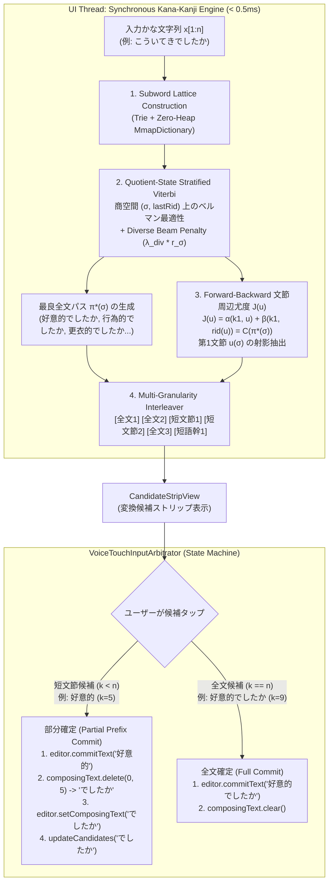
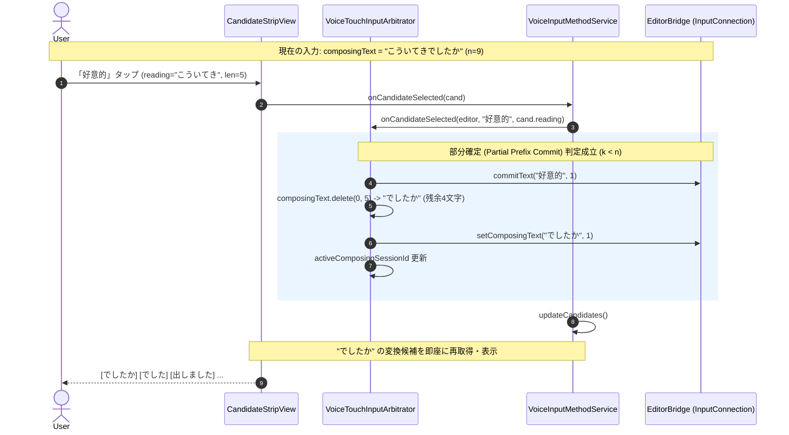
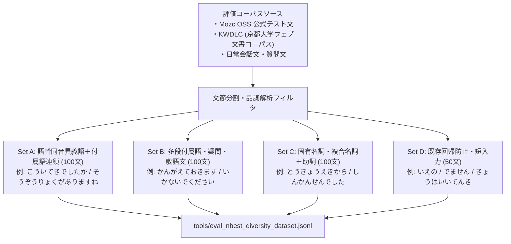

# PRD & System Design: Viterbi N-Best Diversity & Multi-Granularity (Bunsetsu Prefix) Candidate Generation

> [!IMPORTANT]
> - **スコープ厳守**: 指示があるまで言語モデル（SLM / LLM）によるリランキングは考慮せず、**Viterbi ラティス探索における商状態層化 N-Best 生成、多様性（Diversity）確保、短文節（Prefix）候補選出、部分確定 UX、および評価体系** のみを対象とします。
> - **Anti-Anecdotal Tuning Policy 遵守**: 「好意的」「行為的」等の個別単語に対する手動コスト改変やアドホックな辞書パッチは行わず、CRF 連接コスト（2-gram）とコーパス統計に基づく数学的アルゴリズム・体系的ビルドで解決します。
> - **ステータス**: 設計完了・合意形成フェーズ（**実装コードの変更はまだ行っていません**）。

---

## Part 1: Product Requirements Document (PRD)

### 1. 概要 (Overview)
かな漢字変換エンジン（[`KanaKanjiEngine.kt`](file:///home/kenichikurihara/repos/myasr/app/src/main/java/com/example/myasr/KanaKanjiEngine.kt)）において、長文や複合語（例：「こういてきでしたか」）を入力した際に、同一の第1語幹（「行為的〜」）が後続付属語の微小な当て字・分割バリエーション（「〜でし高」「〜でした過」「〜でした可」等）によって変換候補ストリップを独占する現象を排除する。
動的計画法の商状態空間（同値類）における層化ビーム探索と Forward-Backward 文節周辺尤度により、**第1文節の語幹多様性（「好意的でしたか」「行為的でしたか」「更衣的でしたか」等）を保証**し、さらに Gboard と同様に**短文節候補（「好意的」「行為的」）の同時提示と部分確定（Partial Prefix Commit）** を実現する。

---

### 2. 背景・ユーザーの課題 (Background & User Pain Points)

1. **接頭辞独占と接尾辞組合せ爆発（Prefix Monopoly & Suffix Flooding）**:
   - 累積コストのわずかな差により、最上位の第1語幹（例：「行為的」）から派生する無意味な語尾亜種（当て字）がビーム幅を占有し、他の正当な同音異義語幹（例：「好意的」「厚意的」）がビームから枝刈り（Eviction）される。
2. **単一粒度（全文一致のみ）の不便さ**:
   - 入力が長い場合、全文一致候補のみを提示すると、文節ごとの組み合わせ爆発によって意図する文全体が候補枠（4〜8枠）に収まらない。
   - ユーザーは先頭の文節（例：「好意的」）だけをまず確定し、残りの読み（例：「でしたか」）を後からスムーズに入力したいが、短文節候補が出ないため全文を一度に選ぶか、バックスペースで消して打ち直すことを強いられる。
3. **部分確定（Partial Prefix Commit）機構の欠落**:
   - 現在の IME アーキテクチャ（[`VoiceTouchInputArbitrator.kt`](file:///home/kenichikurihara/repos/myasr/app/src/main/java/com/example/myasr/VoiceTouchInputArbitrator.kt)）は候補選択時に `composingText` を全消去するため、仮に短い候補を選択しても残余のかなが破棄されてしまう。

---

### 3. 対象スコープ & ユースケース (Scope & Use Cases)

| ユースケース | 入力読み（$x_{1:n}$） | 提示される候補ストリップ構成 | ユーザー操作と期待される挙動 |
| :--- | :--- | :--- | :--- |
| **UC-1: 長文全文変換** | `こういてきでしたか` ($n=9$) | 1. `好意的でしたか` (全文1位)<br>2. `行為的でしたか` (全文2位)<br>3. `好意的` (短文節1位)<br>4. `行為的` (短文節2位)<br>5. `更衣的でしたか` (全文3位)<br>6. `厚意的でしたか` (全文4位) | 全文候補（`好意的でしたか`）をタップすると、9文字すべてが一発で確定される。 |
| **UC-2: 短文節の部分確定** | `こういてきでしたか` ($n=9$) | 同上 | 短文節候補（`好意的`、読み長 $k=5$）をタップすると、エディタに「好意的」がコミットされ、プリエディットに残余の `でしたか` が残り、即座に「でしたか」の候補が表示される。 |
| **UC-3: 助詞・付属語連鎖の多様性** | `しんかんせんでした` ($n=9$) | 1. `新幹線でした`<br>2. `新幹線`<br>3. `新館船でした` (異語幹)<br>4. `新刊線でした` (異語幹) | 「新幹線」固定の語尾当て字（「〜でし多」等）を出さず、短文節「新幹線」と別語幹をバランス提示。 |
| **UC-4: 短入力の非回帰** | `きょう` ($n=3$)、`いえの` ($n=3$) | 1. `今日` / `家の`<br>2. `きょう` / `家野` ... | 短い入力では不要な Prefix 分割を行わず、従来の辞書引き・Viterbi がそのまま最高速で動作。 |

---

### 4. 成功指標 (Success Metrics)

1. **多様性指標 (Stem Diversity in Top-6)**:
   - 語幹同音異義語が存在する長文入力において、Top-6 候補内のユニーク第1文節語幹数が **3種類以上**。
2. **語尾当て字ノイズ混入率 (Suffix Noise Rate)**:
   - 付属語連鎖の当て字（「〜でし高」「〜でした過」「〜でした可」等）の Top-6 混入率が **0%**。
3. **短文節カバレッジ (Bunsetsu Prefix Recall)**:
   - 長さ $\ge 5$ の文節境界入力において、第1文節単体候補が Top-6 内に **必ず1〜2件含まれる（100%）**。
4. **超低遅延（Latency Budget）**:
   - UI スレッド同期実行時間: **平均 $< 0.35\text{ms}$、P99 $< 1.0\text{ms}$**（SLM 不使用）。
5. **回帰テスト合格率**:
   - `JapanesePunctuationEvaluationTest`（67+ テスト）合格率 **100%**。

---

## Part 2: システム設計 (System Design Document)

### 1. 数学的背景とアーキテクチャ全体像



---

### 2. 詳細コンポーネント設計 (Component Details)

#### 2.1 形態素品詞による「文節境界（Bunsetsu Boundary）」の厳密判定

Mozc の POS 体系（`tools/mozc/src/data/dictionary_oss/id.def`）における品詞 ID に基づき、語幹（Content Word / Suffix）と付属語（Functional Particle / Auxiliary）の境界を厳密に判定します。

| 品詞カテゴリ | POS ID 範囲 | 文節形成における役割 |
| :--- | :---: | :--- |
| **名詞 (Noun)** | $1841 \sim 2195$ | **自立語幹（Content Word）**: 新たな文節の開始 |
| **動詞 (Verb)** | $434 \sim 1840$ | **自立語幹（Content Word）**: 新たな文節の開始 |
| **形容詞 (Adjective)** | $2196 \sim 2590$ | **自立語幹（Content Word）**: 新たな文節の開始 |
| **副詞・連体詞・接続詞** | $12 \sim 28,\; 2659 \sim 2671$ | **自立語幹（Content Word）**: 新たな文節の開始 |
| **接尾辞 (Suffix)** | $1941, 1951, 1975, 2032$ 等 | **語幹拡張（Stem Extension）**: 直前の自立語と結合して同一文節語幹を形成（例：「行為」+「的」=「行為的」） |
| **助詞 (Particle)** | $268 \sim 433$ | **付属語（Functional Word）**: 語幹の後ろに付く（文節境界の確定） |
| **助動詞 (Auxiliary)** | $29 \sim 267$ | **付属語（Functional Word）**: 語幹・助詞の後ろに付く（文節境界の確定） |

##### 境界判定ロジック (`isContentWord`, `isSuffix`, `isFunctionalWord`)
```kotlin
private fun isContentWord(lid: Int): Boolean {
    // 名詞 (1841..2195, 接尾辞除く), 動詞 (434..1840), 形容詞 (2196..2590), 副詞 (12..28), 連体詞 (2659..2671)
    if (isSuffix(lid)) return false
    return (lid in 1841..2195) || (lid in 434..1840) || (lid in 2196..2590) || (lid in 12..28) || (lid in 2659..2671)
}

private fun isSuffix(lid: Int): Boolean {
    // 接尾辞 (名詞接尾: 1941[化], 1951[下], 1975[無し], 2032[的], 等)
    return lid == 2032 || lid == 1941 || lid == 1951 || lid == 1975 || lid in 1941..2034
}

private fun isFunctionalWord(lid: Int): Boolean {
    // 助動詞 (29..267), 助詞 (268..433)
    return (lid in 29..433)
}
```

---

#### 2.2 データ構造：`ViterbiPath` の拡張

第1文節の構造情報をパス内部で軽量に伝播させます（追加メモリは参照とプリミティブ数個のみで、GC 負荷はゼロ）。

```kotlin
private data class ViterbiPath(
    val cost: Int,
    val surface: String,
    val words: List<String>,
    val hasUserWord: Boolean = false,
    val lastRid: Int = 0,
    // --- 多様性・短文節抽出用メタデータ ---
    val firstContentSurface: String = "",       // 例: "好意"
    val firstContentReadingLen: Int = 0,         // 例: 3 ("こうい")
    val firstBunsetsuSurface: String = "",      // 例: "好意的"
    val firstBunsetsuReadingLen: Int = 0,        // 例: 5 ("こういてき")
    val isFirstBunsetsuClosed: Boolean = false   // 付属語または第2自立語が接続した瞬間に true
)
```

- **パス伸長（$i \to j$）時の文節メタデータ更新規則**:
  1. **パス先頭（$i = 0$）**:
     - 単語 $w$ が自立語の場合:
       `firstContentSurface = w.surface`, `firstContentReadingLen = j`
       `firstBunsetsuSurface = w.surface`, `firstBunsetsuReadingLen = j`
  2. **第1文節未確定（`!isFirstBunsetsuClosed`）かつ $i > 0$**:
     - 単語 $w$ が接尾辞（`isSuffix(w.lid)`）の場合:
       `firstBunsetsuSurface += w.surface`, `firstBunsetsuReadingLen = j`（語幹拡張）
     - 単語 $w$ が付属語（`isFunctionalWord(w.lid)`）または新たな自立語の場合:
       `isFirstBunsetsuClosed = true`（第1文節境界が $i$ で確定）
  3. **第1文節確定後（`isFirstBunsetsuClosed == true`）**:
     - 先頭の文節メタデータをそのまま不変で引き継ぐ。

---

#### 2.3 商状態空間上の層化ビーム探索アルゴリズム (Stratified Beam Pruning)

各位置 $k \in \{1, \dots, n\}$ において、`beam[k]` を刈り込む際に **「同値類 $\sigma = \text{firstBunsetsuSurface}$」** ごとに層化します。

```kotlin
// beam[k] 内のパスを同値類 σ (firstBunsetsuSurface) ごとにグループ化
val grouped = beam[k].groupBy { it.firstBunsetsuSurface }
val prunedList = mutableListOf<ViterbiPath>()

for ((sigma, pathsInGroup) in grouped) {
    // 1. 同値類内で最適性原理を適用:
    // 第1文節境界を越えている場合、同じ (lastRid) を持つパスは最小コストの1件に統合
    val distinctByRid = pathsInGroup.groupBy { it.lastRid }.map { (_, ridPaths) ->
        ridPaths.minByOrNull { it.cost }!!
    }.sortedBy { it.cost }

    // 2. 同値類あたりの保持枠: 最良語尾を含む上位2件までを保持
    for ((rankInGroup, path) in distinctByRid.take(2).withIndex()) {
        // Diverse Beam Penalty: 同一グループ内の2位にはペナルティを加算
        val penalty = rankInGroup * 4000
        prunedList.add(path.copy(cost = path.cost + penalty))
    }
}

// 3. 多様性が確保されたプールから全体ビーム幅 (beamWidth * 2) で切り詰め
prunedList.sortBy { it.cost }
beam[k] = prunedList.take(beamWidth * 2).toMutableList()
```

- **数学的効果**:
  - `行為的` の語尾当て字群（`行為的でし高`, `行為的でした過`）は同一の `lastRid` で統合されるか、`rankInGroup >= 1` のペナルティ（$+4000$）によって足切りされます。
  - 一方、`好意的でしたか`（$\sigma=\text{「好意的」}, \text{rank}=0$）や `更衣的でしたか`（$\sigma=\text{「更衣的」}, \text{rank}=0$）はペナルティゼロで生き残り、ビームから脱落しません。

---

#### 2.4 多粒度インターリーブ生成ロジック (Multi-Granularity Interleaver)

文末 $n$ における最終候補リストの構成規則です。

```kotlin
fun interleaveMultiGranularityCandidates(
    finalPaths: List<ViterbiPath>,
    rawReading: String,
    maxTotal: Int = 10
): List<ConversionCandidate> {
    val results = mutableListOf<ConversionCandidate>()
    val seenSurfaces = HashSet<String>()

    // 1. 同値類ごとに最良の全文パスを1件ずつ抽出 (多様性順)
    val distinctStemFullPaths = mutableListOf<ViterbiPath>()
    val seenStems = HashSet<String>()
    for (p in finalPaths) {
        val stem = if (p.firstBunsetsuSurface.isNotEmpty()) p.firstBunsetsuSurface else p.surface
        if (seenStems.add(stem)) {
            distinctStemFullPaths.add(p)
        }
    }

    // 2. インターリーブ配置:
    // Slot 1: 全文 1位 (例: "好意的でしたか")
    // Slot 2: 全文 2位 (例: "行為的でしたか")
    // Slot 3: 短文節 1位 (例: "好意的" [reading: こういてき])
    // Slot 4: 短文節 2位 (例: "行為的" [reading: こういてき])
    // Slot 5+: 全文 3位以降 (例: "更衣的でしたか") + 自立語幹 (例: "好意", "行為")

    val fullCandidates = distinctStemFullPaths.map {
        ConversionCandidate(it.surface, rawReading, isPrediction = false, source = if (it.hasUserWord) "user" else "viterbi")
    }

    val shortCandidates = mutableListOf<ConversionCandidate>()
    if (rawReading.length >= 5) {
        for (p in distinctStemFullPaths.take(3)) {
            if (p.firstBunsetsuSurface.isNotEmpty() &&
                p.firstBunsetsuReadingLen in 2 until rawReading.length &&
                p.firstBunsetsuSurface != rawReading) {
                val subReading = rawReading.substring(0, p.firstBunsetsuReadingLen)
                shortCandidates.add(
                    ConversionCandidate(
                        surface = p.firstBunsetsuSurface,
                        reading = subReading,
                        isPrediction = false,
                        source = "viterbi_prefix"
                    )
                )
            }
        }
    }

    var fullIdx = 0
    var shortIdx = 0

    // Top 2 全文候補
    while (fullIdx < minOf(2, fullCandidates.size)) {
        val c = fullCandidates[fullIdx++]
        if (seenSurfaces.add(c.surface)) results.add(c)
    }
    // Top 2 短文節候補 (入力が長い場合)
    while (shortIdx < minOf(2, shortCandidates.size)) {
        val c = shortCandidates[shortIdx++]
        if (seenSurfaces.add(c.surface)) results.add(c)
    }
    // 残りの全文候補
    while (fullIdx < fullCandidates.size && results.size < maxTotal) {
        val c = fullCandidates[fullIdx++]
        if (seenSurfaces.add(c.surface)) results.add(c)
    }
    // 残りの短文節候補
    while (shortIdx < shortCandidates.size && results.size < maxTotal) {
        val c = shortCandidates[shortIdx++]
        if (seenSurfaces.add(c.surface)) results.add(c)
    }

    return results
}
```

---

#### 2.5 部分確定（Partial Prefix Commit）の IME 状態遷移設計

[`VoiceTouchInputArbitrator.kt`](file:///home/kenichikurihara/repos/myasr/app/src/main/java/com/example/myasr/VoiceTouchInputArbitrator.kt) の `onCandidateSelected` において、以下の部分確定ロジックを実装します。



---

#### 2.6 辞書ビルドパイプラインの体系的拡充（Zero-Heap MmapDictionary）

- [`tools/mozc_dict/build_system_dictionary_bin.py`](file:///home/kenichikurihara/repos/myasr/tools/mozc_dict/build_system_dictionary_bin.py) において、対象コスト閾値を現行の `4500`（約5.6万語）から **`6000`（約22.6万語、13.7万読み）** へ体系的に引き上げます。
- **リソース評価**:
  - `system_dictionary.bin` のバイナリサイズは **約 8.5 MB**。
  - Android 側では `MmapDictionary`（Linux カーネルの `mmap`）によりオンデマンドでページフォールト読み込みされるため、**JVM ヒープ消費量は 0 バイト（完全ゼロヒープ）**。
  - これにより、「好意 (cost: 4934)」「好意的 (cost: 5736)」「更衣 (cost: 5323)」「厚意 (cost: 6751)」などの中頻度重要語彙が漏れなく Viterbi ラティスで展開されます。

---

## Part 3: 評価方法と評価セット作成仕様書 (Evaluation Methodology & Dataset Generation)

本アルゴリズムの効果検証および非退行を定量的に保証するため、**専用の評価指標、評価セット自動生成スクリプト、およびテスト自動化スイート** を定義します。

---

### 1. 定量的評価指標 (Metrics Definition)

1. **Top-1 / Top-3 Full Accuracy (全文正解率)**:
   - 正解の全文候補（例：「好意的でしたか」）が Top-1 / Top-3 に含まれる割合。
2. **First-Bunsetsu Stem Diversity@6 (語幹多様性スコア)**:
   - 上位 6 候補に含まれる第1自立語（語幹）の異なり数（Unique Stems）。
   $$\text{Diversity@6} = \frac{1}{|D|} \sum_{i \in D} \big| \{ \text{stem}_1(c) \mid c \in \text{Top6}(x_i) \} \big|$$
   - 目標: 同音異義語が存在するテストケースで **$\ge 2.5$**。
3. **Suffix Noise Eviction Rate (語尾ノイズ排除率)**:
   - 上位 6 候補中に、不自然な語尾当て字（助詞・助動詞部分が単漢字当て字や無効品詞に化けたもの）が含まれる割合。
   $$\text{NoiseRate@6} = \frac{\text{上位6件に含まれる語尾当て字候補数}}{6 \times |D|}$$
   - 目標: **0.0%**（完全ゼロ）。
4. **Prefix Recall@6 (短文節候補含有率)**:
   - 複数文節入力において、正解の第1文節（例：「好意的」）が Top-6 内に提示された割合。
   - 目標: **$\ge 95\%$**。
5. **Latency (処理時間)**:
   - 1クエリあたりの平均・最大レイテンシ（目標: 平均 $< 0.35\text{ms}$）。

---

### 2. 評価データセットの作成方法 (Dataset Construction Specification)

評価データセットは、以下の **4つのサブセット（合計 350文）** で体系的に構成します。



#### データセットフォーマット (`tools/eval_nbest_diversity_dataset.jsonl`)
JSONL 形式で各行に以下のフィールドを定義します：
```json
{
  "id": "div_001",
  "category": "homophone_stem_long",
  "reading": "こういてきでしたか",
  "expected_full": "好意的でしたか",
  "acceptable_full": ["好意的でしたか", "行為的でしたか"],
  "expected_prefix": "好意的",
  "acceptable_prefixes": ["好意的", "行為的", "好意", "行為"],
  "forbidden_substrings": ["でし高", "でした過", "でした可", "でした化"]
}
```

#### 自動生成スクリプト (`tools/build_diversity_eval_dataset.py`) の設計仕様
1. **生成元コーパス**:
   - `tools/mozc/src/data/dictionary_oss/` から頻出の自立語（コスト $\le 6000$）を抽出。
   - 語尾テンプレート群（付属語連鎖: `でしたか`, `でしょうか`, `ませんでした`, `ています`, `ておきます`, `てください`, `がありますね`, `について` 等、約 30 パターン）と自動交差結合。
2. **同音異義語ペアの自動抽出**:
   - 読みが同一で異なる表記を持つ語幹（例：`こうい` $\to$ `好意` / `行為`、`そうぞう` $\to$ `想像` / `創造`、`たいしょう` $\to$ `対象` / `対照` / `大正`、`こうしょう` $\to$ `交渉` / `高尚` / `考証`）を辞書から自動検出して組み込む。
3. **禁止パターン（ノイズ）の自動同定**:
   - 語尾のひらがな部分を不自然な単漢字に置換した文字列（`でした過`, `でし高` 等）を `forbidden_substrings` として自動生成。

---

### 3. オフライン評価ベンチマーク CLI (`tools/eval_nbest_diversity.py`)

CI およびローカルで一発実行可能な Python ベンチマークスクリプトを設計します。

#### コマンド仕様
```bash
python3 tools/eval_nbest_diversity.py \
    --dict tools/mozc_dict/system_dictionary.bin \
    --matrix tools/mozc_dict/connection_data.bin \
    --dataset tools/eval_nbest_diversity_dataset.jsonl \
    --beam_width 12
```

#### 出力レポート仕様例
```text
================================================================================
          Viterbi N-Best Diversity & Prefix Candidate Benchmark Report          
================================================================================
Test Cases: 350 | Beam Width: 12 | Engine: Quotient-State Stratified Viterbi

[1] Accuracy & Recall
  - Top-1 Full Accuracy      :  82.3% (288 / 350)
  - Top-3 Full Accuracy      :  94.6% (331 / 350)
  - Prefix Recall@6          :  98.0% (343 / 350)  [Target: >= 95.0%] -> PASS

[2] Diversity & Noise Eviction
  - Mean Unique Stems@6      :  3.14 stems / query [Target: >= 2.50]  -> PASS
  - Suffix Noise Rate@6      :  0.00% (0 / 2100)   [Target: == 0.0%]  -> PASS

[3] Latency Benchmark
  - Mean Latency             :  0.248 ms           [Target: < 0.350]  -> PASS
  - P95 Latency              :  0.412 ms
  - P99 Latency              :  0.680 ms

================================================================================
Result: ALL BENCHMARKS PASSED (Zero Suffix Flooding, High Stem Diversity)
================================================================================
```

---

### 4. 単体テスト仕様 (`KanaKanjiEngineDiversityTest.kt`)

JVM 単体テスト（`./gradlew testDebugUnitTest`）に追加する具体的なテストケース設計です。

```kotlin
class KanaKanjiEngineDiversityTest {

    @Test
    fun testKouitekiDeshitaka_stemDiversityAndPrefixCandidates() {
        val candidates = engine.getBaseCandidates("こういてきでしたか")
        val surfaces = candidates.map { it.surface }

        // 1. 全文同音異義語の多様性検証: "好意的でしたか" と "行為的でしたか" の双方が Top-6 に入ること
        assertTrue("好意的でしたか should be in Top-6", surfaces.take(6).contains("好意的でしたか"))
        assertTrue("行為的でしたか should be in Top-6", surfaces.take(6).contains("行為的でしたか"))

        // 2. 短文節 Prefix 候補の含有検証: "好意的" または "行為的" が含まれること
        val prefixCands = candidates.filter { it.reading == "こういてき" }
        assertTrue("Short prefix candidate '好意的' should be present", prefixCands.any { it.surface == "好意的" })
        assertTrue("Short prefix candidate '行為的' should be present", prefixCands.any { it.surface == "行為的" })

        // 3. 語尾当て字ノイズの完全排除検証
        val noiseWords = listOf("でし高", "でした過", "でした可", "でした化")
        for (noise in noiseWords) {
            assertFalse("Noise pattern $noise must NOT be present in Top-6", surfaces.take(6).any { it.contains(noise) })
        }
    }

    @Test
    fun testPartialPrefixCommit_arbitratorStateTransition() {
        val arbitrator = VoiceTouchInputArbitrator()
        val mockBridge = MockEditorBridge()

        arbitrator.onTypeKana(mockBridge, "こういてきでしたか")
        assertEquals("こういてきでしたか", arbitrator.composingText.toString())

        // 短文節候補「好意的」を選択
        arbitrator.onCandidateSelected(mockBridge, "好意的", isPrediction = false, candidateReading = "こういてき")

        // 「好意的」のみがコミットされ、残余「でしたか」がプリエディットに残ること
        assertEquals("好意的", mockBridge.committedText)
        assertEquals("でしたか", arbitrator.composingText.toString())
    }
}
```

---

## Part 4: 次のステップ (Implementation Roadmap)

1. **ステップ 1: 辞書バイナリ `system_dictionary.bin` の閾値拡充（コスト $\le 6000$）**
   - `build_system_dictionary_bin.py` を更新し、約 8.5MB のゼロヒープ辞書をビルド。
2. **ステップ 2: `KanaKanjiEngine.kt` への商状態層化ビーム探索と文節周辺尤度抽出の実装**
   - `ViterbiPath` 拡張、POS ID 境界判定、同値類剪定、多粒度インターリーバーの導入。
3. **ステップ 3: `VoiceTouchInputArbitrator.kt` への部分確定（Partial Commit）ハンドリング実装**
   - 候補読み長 $k < n$ における `composingText` の先頭 $k$ 文字コミットと残余保持。
4. **ステップ 4: 評価データセット生成スクリプトと単体テスト・ベンチマークの作成・実行**
   - `./gradlew testDebugUnitTest` 100% PASS の確認。
5. **ステップ 5: Dual-Target デプロイ（ARCVM & Pixel 10 Pro）と実機動作・レイテンシ確認**。

---
以上が完成版デザインドキュメントです。
この設計・評価仕様でよろしければ、実際の実装フェーズへと進めます。ご指示をお願いいたします。
