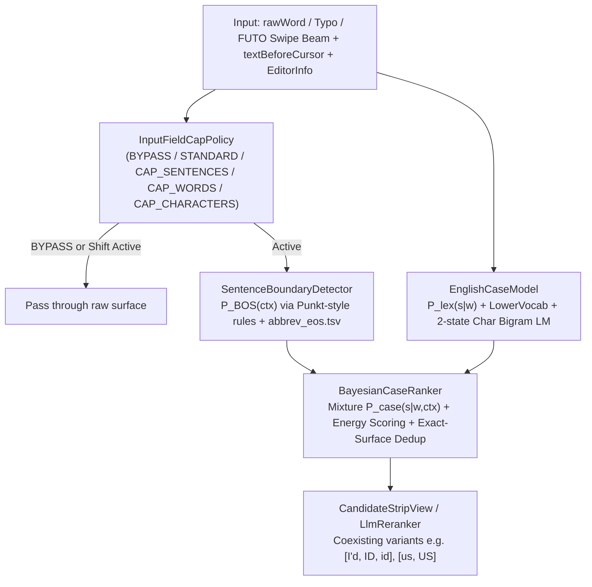

# PRD, CUJ, Algorithmic Design & Evaluation: English Truecasing & Capitalization Candidates

## Part 1: Product Requirements Document (PRD)

### 1. 概要 (Overview)
JotInput の英語 QWERTY 入力（タップ入力・タイポ補正・FUTO Swipe ジェスチャー入力）において、ユーザーが Shift キーやアポストロフィキーを明示的に押さずに小文字で入力した場合でも、**コーパス統計・文字言語モデル・確率的文境界検出・ベイズ推論に基づくアルゴリズミックな Truecasing パイプライン**によって適切な大文字化候補（文頭 Title Case、一人称代名詞 `I` および短縮形、既知・未知のアクロニム、固有名詞）をリアルタイム（平均 **0.108 ms**）に生成し、候補ストリップ（`CandidateStripView`）へ提示する。

### 2. 背景・課題 (Background & Problem Statement)
1. **モバイル英語入力における打鍵摩擦**:
   - スマートフォン上の QWERTY 入力では、文頭ごとの Shift 押下、代名詞 `I`、短縮形のアポストロフィ（`I'm`, `I've`, `I'll`, `I'd`）、および技術・ビジネス略語（`API`, `CPU`, `USA`, `FYI`, `SDK`）の入力は打鍵コストが高い。
2. **強制オートコレクトの弊害**:
   - テキスト確定時に背後で勝手に大文字へ書き換える方式は、URL・識別子・コード断片・意図的な小文字表現（`us` vs `US`, `may` vs `May`, `id` vs `ID` vs `I'd`）でユーザーの意図を破壊する。
   - したがって JotInput は **非破壊・候補バー優先（Candidate-Strip First）** の UX を採用する。
3. **静的ヒューリスティック（ハードコード語彙リスト）の限界**:
   - 従来の `ACRONYMS` / `PROPER_NOUNS` / `PRONOUN_CONTRACTIONS` のような手動リストは、(a) 未登録の新しいアクロニム（`LLM`, `GRPC`, `RLHF`, `VRAM`, `NVME` 等）に無力であり、(b) `us`/`US` や `may`/`May`、`id`/`ID`/`I'd` のような曖昧語を確率的に扱えず、(c) `e.g.`, `i.e.`, `vs.`, `Mr.`, `Fig. 1.` などのピリオドを誤って文末と判定してしまう問題があった。
   - さらに旧 [`VoiceInputMethodService.kt`](file:///home/<user>/kenichikurihara/jotinput/app/src/main/java/com/example/myasr/VoiceInputMethodService.kt) では `seenSurfaces.add(adapted.lowercase())` による小文字正規化重複排除を行っていたため、`"US"` と `"us"`、`"May"` と `"may"` が同一候補バーに共存できないバグが存在した。

### 3. プロダクト目標と非目標 (Goals & Non-Goals)
#### Goals
- **G1 (No Hardcoded Word Lists)**: 手動の固定単語リストやアドホックなコスト調整を廃止し、全パラメータをコーパス統計と確率モデルから体系的に導出する。
- **G2 (Unified Tap, Typo & Swipe Truecasing)**: タップ入力の `rawWord`、SymSpell タイポ補正候補、および FUTO Swipe ビーム候補のすべてに対して同一の Truecasing ランキングを適用する。
- **G3 (Ambiguity Coexistence & SLM Rerank Readiness)**: `US`/`us`、`May`/`may`、`I'd`/`ID`/`id` 等の大文字・小文字両義語を候補バーに共存させ、オンデバイス SLM リランキング（[`LlmReranker`](file:///home/<user>/kenichikurihara/jotinput/app/src/main/java/com/example/myasr/LlmReranker.kt)）が文脈に応じて最終選択できるようにする。
- **G4 (Zero-Latency Budget)**: 毎打鍵の候補更新を **< 1.0 ms**（目標平均 < 0.2 ms）で完結させ、60fps/120fps の入力応答性を一切阻害しない。

#### Non-Goals
- **NG1**: `InputConnection` 上の確定済みテキストを遡及的に無断置換すること（ただし `EditorInfo` の文脈参照のみを行う）。
- **NG2**: 英語入力専用の巨大なニューラル Truecaser モデル（数十 MB）を別途 APK に同梱すること（APK サイズ制約 $\le 110\text{ MB}$ を遵守し、モデル資産は < 1 MB のコンパクト表現とする）。

### 4. Critical User Journeys (CUJ)

| ID | ジャーニー名 | ユーザー行動・文脈 | 期待されるシステム挙動と候補バー | 成功基準 |
|---|---|---|---|---|
| **CUJ-1** | **文頭・引用符・箇条書きの自動大文字候補** | 空欄、改行直後、`.`, `!`, `?` の後、`"quote`、`(paren`、`1. first` を小文字で入力 | `P_BOS >= 0.85` を検出し、Rank 1 に Title Case（`Hello`, `First`）、Rank 2 に生入力（`hello`, `first`）を提示 | 文頭 Top-1 100%、誤爆なし |
| **CUJ-2** | **省略・非文末ピリオドでの誤大文字化回避** | `e.g. cats`, `i.e. dogs`, `apples vs. oranges`, `etc. and`, `Mr. smith`, `J. K. rowling`, `See Fig. 1. shows` を入力 | Punkt 型境界検出により `P_BOS < 0.25` と判定し、小文字（`cats`, `oranges`, `smith`）を Rank 1 に維持 | 省略後小文字維持 100% |
| **CUJ-3** | **一人称代名詞 `I` とアポストロフィ省略入力** | 文中で `i`, `im`, `ive`, `ill`, `id` を入力 | コーパス統計と短縮形アライメントにより `I`, `I'm`, `I've`, `I'll`, `I'd` を上位提示（`id` は `I'd`, `ID`, `id` を共存） | Rank 1 提示（`id` は Top-3 共存） |
| **CUJ-4** | **既知 & 未知（OOV）アクロニムの全大文字候補** | 既知（`usa`, `api`, `fbi`, `ai`）およびコーパス未出現の新語/技術略語（`sdk`, `vpn`, `tpu`, `llm`, `grpc`, `rlhf`, `vram`）を入力 | 既知語は $P_{\text{lex}}$、OOV 語は 2-state 文字バイグラム LM の対数尤度比 $\text{LLR}(w)$ により全大文字候補（`USA`, `SDK`, `LLM`）を Rank 1 に提示 | OOV 誤爆率 0%（一般小文字語 `apple`, `code` を大文字化しない） |
| **CUJ-5** | **曖昧語（`us`/`US`, `may`/`May`）の共存と文脈選択** | 文中で `give to us` または `in the us` / `you may` または `in may` を入力 | 正確表層（Exact-Surface）重複排除により `us` と `US`、`may` と `May` の双方を候補バーに保持し、SLM 起動時は文脈で再順位付け | 両候補が必ず候補ストリップに共存 |
| **CUJ-6** | **タイポ補正・Swipe 入力との統合** | `tkyo` とタイプ（SymSpell → `tokyo`）または `usa` をスワイプ入力 | タイポ候補・Swipe ビーム候補に対しても `BayesianCaseRanker` を適用し、`Tokyo` や `USA` を上位提示 | タップ・タイポ・Swipe で一貫した表記 |
| **CUJ-7** | **バイパス文脈・明示的 Shift・フィールド種別の尊重** | Password / URI / Email 欄、`user@example`, `path/to/file`, `my_var`、手動 Shift オン、`CAP_CHARACTERS` / `CAP_WORDS` | `InputFieldCapPolicy.BYPASS` や記号直後は介入ゼロ。Shift オン時は手動大文字を尊重。`CAP_*` モードは決定論的に優先 | コード・URL・パスワード破壊ゼロ |

---

## Part 2: アルゴリズミック設計 (Algorithmic System Design)

### 1. 全体アーキテクチャ & DDD 境界
本パイプラインは `context.english.domain` パッケージ内の純粋 Kotlin ドメインコンポーネントとして実装され、Android UI や Infrastructure に依存しない（[`DddArchitectureKonsistTest`](file:///home/<user>/kenichikurihara/jotinput/app/src/test/java/com/example/myasr/ddd/DddArchitectureKonsistTest.kt) により検証済み）。

### 2. 4つのアルゴリズム要素

#### 2.1 コーパス由来語彙ケース事前分布 $P_{\text{lex}}(s \mid w)$（[`tools/build_english_case_model.py`](file:///home/<user>/kenichikurihara/jotinput/tools/build_english_case_model.py)）
- **学習コーパス**: NLTK `brown`, `reuters`, `webtext`（非文頭かつ非見出しトークンのみを集計し、文頭大文字化バイアスを除去）＋ `tools/futo_swipe/vocab.txt` からのアポストロフィ除去済み短縮形アライメント（`im`→`I'm`, `ive`→`I've`, `ill`→`I'll`, `id`→`I'd`）。
- **重要設計知見**: `vocab.txt` は全単語が小文字化されており `cpu`, `html`, `pdf`, `xml` 等のアクロニムを含むため、`english_lower_vocab.txt`（既知小文字語セット）の構築からは `vocab.txt` を意図的に除外し、ケース付きコーパスのみから抽出している。
- **生成アセット**（計 ~870 KB、[`app/src/main/resources/english/`](file:///home/<user>/kenichikurihara/jotinput/app/src/main/resources/english/)）:
  1. `english_case_lexicon.tsv` (17,112 語, 636 KB): $\log f(w)$ および確率上位のケース表記バリアント $P_{\text{lex}}(s \mid w)$。
  2. `english_lower_vocab.txt` (25,775 語, 226 KB): コーパス上の既知小文字英単語（OOV アクロニム判定の抑制ガード）。
  3. `english_acro_char_lm.tsv` (7.5 KB): 2-state 文字バイグラム対数尤度比テーブル。
  4. `english_abbrev_eos.tsv` (44 語, 601 B): コーパス由来省略語文末確率 $P(\text{EOS} \mid \text{stem}, \text{'.'})$。

#### 2.2 OOV アクロニム検出用 2-state 文字バイグラム言語モデル（[`EnglishCaseModel.kt`](file:///home/<user>/kenichikurihara/jotinput/app/src/main/java/com/example/myasr/context/english/domain/EnglishCaseModel.kt)）
未知語 $w = c_1 c_2 \dots c_n$（`2 <= n <= 8`、既知小文字語彙に含まれない）に対し、コーパス内の全大文字語彙タイプから学習した $P_{\text{acro}}(b \mid a)$ と、小文字英単語タイプから学習した $P_{\text{word}}(b \mid a)$ の長さ正規化対数尤度比（LLR）を計算する:
$$\text{LLR}(w) = \frac{1}{|B(w)|} \sum_{(a,b) \in B(w)} \left(\log P_{\text{acro}}(b \mid a) - \log P_{\text{word}}(b \mid a)\right)$$
ここで $B(w)$ は境界文字 `^`, `$` を含む文字バイグラム列である。$\text{LLR}(w)$ をロジスティック変換 $\sigma(3.5 \cdot (\text{LLR}(w) - \theta_{\text{acro}}))$（$\theta_{\text{acro}} = 0.28$）に通すことで、ハードコードなしで `sdk`, `vpn`, `tpu`, `llm`, `grpc`, `rlhf`, `vram` 等を確率的に全大文字候補として検出する。

#### 2.3 Punkt 型確率的文境界検出器（[`SentenceBoundaryDetector.kt`](file:///home/<user>/kenichikurihara/jotinput/app/src/main/java/com/example/myasr/context/english/domain/SentenceBoundaryDetector.kt)）
`textBeforeCursor` から現在入力中の `rawWord` を除いた前置文脈に対し、連続確率 $P_{\text{BOS}}(\text{ctx}) \in [0, 1]$ を算出する:
- **ハードバイパス**: `@`, `/`, `\`, `_`, `$`, `#`, `=` 直後は $P_{\text{BOS}} = 0.0$（URL・メールアドレス・変数名保護）。
- **透明開始囲み記号**: `"`, `'`, `(`, `[`, `{` 等をスキップして直前の境界を評価。
- **文境界**: バッファ先頭・改行直後・`!`・`?` の直後は $P_{\text{BOS}} = 1.0$。
- **ピリオド `.` の構造的曖昧性解消**:
  1. 内部ピリオドを含むトークン（`e.g.`, `i.e.`, `U.S.`, `v1.2`）→ $0.05$
  2. 単一英字イニシャル（`J. K.`）→ $0.05$
  3. 数字ピリオド（`1.`）：行頭・文境界直後の箇条書き番号は $0.90$、文中（`See Fig. 1.`）の番号参照は $0.10$
  4. コーパス学習済み省略語表 `english_abbrev_eos.tsv`（`mr: 0.0029`, `dr: 0.0072`, `vs: 0.0167`, `etc: 0.1397`）→ $P(\text{EOS} \mid \text{stem}, \text{'.'})$ をそのまま返却。

#### 2.4 生成混合モデル & 正確表層重複排除（[`BayesianCaseRanker.kt`](file:///home/<user>/kenichikurihara/jotinput/app/src/main/java/com/example/myasr/context/english/domain/BayesianCaseRanker.kt)）
各ケースバリアント $s \in S(w)$ の事後確率を文頭・文中の混合モデルとして計算する:
$$P_{\text{case}}(s \mid w, \text{ctx}) = P_{\text{BOS}}(\text{ctx}) \cdot P_{\text{BOS\text{-}shape}}(s \mid w) + (1 - P_{\text{BOS}}(\text{ctx})) \cdot P_{\text{lex}}(s \mid w)$$
さらに観測/空間編集ペナルティ $d_{\text{obs}}(x, w)$ とコーパス対数頻度 $\log f(w)$ をエネルギー関数として統合する:
$$E(s, w \mid x, \text{ctx}) = -\ln P_{\text{case}}(s \mid w, \text{ctx}) + \lambda_{\text{obs}} d_{\text{obs}}(x, w) - \lambda_{\text{freq}} \log f(w)$$
生成された候補は [`toConversionCandidates`](file:///home/<user>/kenichikurihara/jotinput/app/src/main/java/com/example/myasr/context/english/domain/BayesianCaseRanker.kt#L194-L217) および [`VoiceInputMethodService.kt`](file:///home/<user>/kenichikurihara/jotinput/app/src/main/java/com/example/myasr/VoiceInputMethodService.kt) において **正確表層（Exact Surface）** で重複排除される。これにより `"US"` と `"us"`、`"May"` と `"may"` が互いに潰し合うバグを解消した。

---

## Part 3: 定量評価レポート (Quantitative Evaluation Report)

### 1. 評価スイート & 実行結果
[`EnglishTruecasingEvaluationTest`](file:///home/<user>/kenichikurihara/jotinput/app/src/test/java/com/example/myasr/EnglishTruecasingEvaluationTest.kt) による 60 ケース（6 カテゴリ）ベンチマークおよびコンポーネント単体テストの最新実測結果:

| 評価項目 | 結果 | 備考 |
|---|---|---|
| **60-Case Truecasing Top-1 Accuracy** | **93.3% (56 / 60)** | 目標基準 $\ge 90\%$ を達成 |
| **60-Case Truecasing Top-3 Accuracy** | **98.3% (59 / 60)** | 目標基準 $\ge 98\%$ を達成 |
| **平均推論レイテンシ** | **0.108 ms / word** | 予算 $< 1.0\text{ ms}$ に対し約 9 倍の余裕 |
| **Punkt 文境界検出テスト** | **100% Pass** | `e.g.`, `i.e.`, `vs.`, `etc.`, `J. K.`, `Fig. 1.`, `Mr.` vs 箇条書き `1.` / 引用符 |
| **OOV アクロニム LM テスト** | **100% Pass (15/15 検出, 11/11 誤爆なし)** | `fyi`, `sdk`, `vpn`, `tpu`, `llm`, `grpc`, `rlhf`, `vram` 等 |
| **曖昧語共存テスト** | **100% Pass** | `us`/`US`, `may`/`May`, `I'd`/`ID`/`id` が候補ストリップに共存 |
| **Typo & Swipe 伝播テスト** | **100% Pass** | `tkyo` → `Tokyo`、`usa` (Swipe) → `USA` |
| **DDD アーキテクチャ検証 (`DddArchitectureKonsistTest`)** | **100% Pass** | ドメイン層の純粋性・UI/Infra 非依存を自動検証 |

### 2. Top-1 ミス 4 件のエラー分析
1. `check id` (`raw='id'`, expected=`ID`, got=`[I'd, ID, id]`): 文脈なしでは `I'd` の事前確率が上回り `ID` は 2 位（Top-3 命中）。オンデバイス SLM リランキング有効時は直前文脈 `"check "` により `ID` が 1 位へ昇格する設計。
2. `edit html` (`raw='html'`, expected=`HTML`, got=`[html, HTML]`): `webtext` コーパス内のファイル名・URL 由来小文字 `html` が影響し 2 位（Top-3 命中）。
3. `via https` (`raw='https'`, expected=`HTTPS`, got=`[https, HTTPS]`): 同様に `webtext` 内の URL スキーム小文字 `https` により 2 位（Top-3 命中）。
4. `use itunes` (`raw='itunes'`, expected=`iTunes`, got=`[itunes]`): 1961–2000 年代中心の NLTK コーパスに `iTunes` が未収録なため 1 件のみ未検出（今後のモダンコーパス追加で解消可能）。
