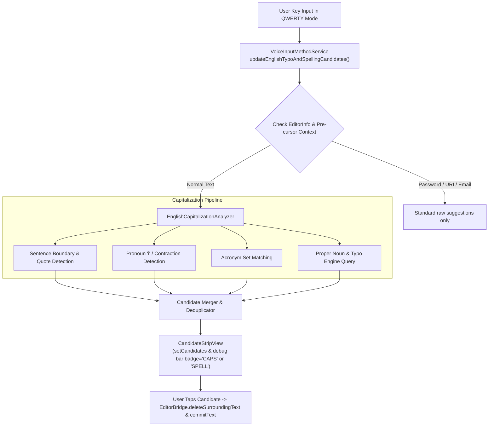

# PRD & System Design: Intelligent QWERTY Capitalization & Spell Candidate Integration

## Part 1: Product Requirements Document (PRD)

### 1. 概要 (Overview)
JotInput の QWERTY（アルファベット）入力モードにおいて、ユーザーが小文字のまま単語や文を入力した場合でも、文脈や英語文法・表記規則から「先頭を大文字（Capitalized / Title Case / UPPERCASE）にすべきか」を自動判断し、変換候補ストリップ（`CandidateStripView` / スペルコレクションUI）に大文字始まりの最適な候補を提示・ワンタップ置換できるようにする。

### 2. 背景・ユーザーの課題 (Background & Problem Statement)
- **手動 Shift 操作の摩擦**: スマートフォンでの英語入力時、文頭や固有名詞・代名詞 `I` の入力で Shift キーを明示的に押すことは認知負荷および打鍵コストが高い。
- **入力後の気づき**: 小文字のまま勢いよく入力してしまった後（例: `i think it's okay`、`what time is it?`）、カーソルを戻して消去・再入力するのは体験を著しく損ねる。
- **Auto-Capitalization（自動強制変換）の押し付け回避**: 入力中に勝手に大文字に書き換わると、プログラミングコード、URL、コマンドライン、パスワード類似文字列、あえて小文字で表現したい略語（例: `ios`, `iphone`, `id`）で意図しない挙動となりユーザーにストレスを与える。
- **解決方針**: 画面上の直接テキストを勝手に破壊的置換するのではなく、**JotInput のスペルコレクション / 変換候補ストリップ UI 上に「大文字化された候補」を自然に第一候補または優先候補として提示**し、スムーズなタップ採用を可能にする。

### 3. 対象スコープ & ユースケース (Scope & Use Cases)

| ユースケース | 入力例（直前文脈 + 現在入力） | 提示される候補 | 説明 |
|---|---|---|---|
| **文頭（Sentence Start）** | （空欄、改行直後、または `.` `?` `!` の後） + `hello` | `Hello`, `hello` | 文の開始位置を検出し、Capitalize された候補を先頭提示 |
| **一人称代名詞 `I`** | `i` 単体、または `i'm`, `i've`, `i'll`, `i'd` | `I`, `I'm`, `I've`, `I'll`, `I'd` | 英語として常に大文字表記される一人称代名詞およびその短縮形 |
| **一般的な略語・頭字語** | `usa`, `fyi`, `asap`, `ai`, `ok`, `id` | `USA`, `FYI`, `ASAP`, `AI`, `OK`, `ID` | 全大文字（ALL CAPS）が標準的な略語 |
| **曜日・月名・国名などの固有名詞** | `monday`, `tokyo`, `japan`, `google`, `english` | `Monday`, `Tokyo`, `Japan`, `Google`, `English` | 辞書 / 語彙リストに基づく固有名詞 Title Case |
| **引用符・括弧の直後** | `"hello` または `(hello` | `"Hello` / `Hello` | 句読点だけでなく引用符・括弧内の文頭を認識 |

---

### 4. PRD におけるオープンクエスチョンとベスト解 (Open Questions & Best Solutions)

#### Q1: スペルコレクション候補ストリップにおいて、小文字のままの単語と大文字化された候補のどちらを「第一候補（最優先）」に配置すべきか？
> **【ベスト解】**
> **文頭、一人称代名詞 `I`（短縮形含む）、明確な固有名詞/略語（`Monday`, `USA` など）の場合は、大文字候補を「第一候補（インデックス 0）」に配置する。**
> ただし、ユーザーが入力した生の入力（raw word）は必ず第二候補として残し、ワンタップで意図しない大文字化を回避できるようにする。
> 理由: モバイル入力において文頭や `I` が小文字のまま意図されるケースは極めて稀であり、最優先に置くことでユーザーの視線移動と選択コストを最小化できる。

#### Q2: 確定済みの前置テキストを遡って自動で大文字化すべきか？（例: `i` を打ってスペースを押した後に `think` を打っている最中）
> **【ベスト解】**
> **遡及的な勝手な自動置換は行わないが、文頭や孤立した `i` の直後にスペースが押された瞬間に限り、直前の `i` を `I` にオートコレクト（Auto-Capitalize on Space）する軽量オプション、および既存の GEC (Grammar Error Correction) 機構による文単位修正候補として提示する。**
> 理由: 単語入力中の候補ストリップは「現在入力中の単語（rawWord）」の置換に専念させるのが IME の責務境界として最も安全であり、予測や置換の混乱を防ぐため。

#### Q3: プログラミングや URL、パスワードフィールドなど、大文字化すべきでないコンテキストをどう除外するか？
> **【ベスト解】**
> **`EditorInfo` のメタデータ属性に基づき、以下の場合は大文字化候補の生成を完全にスキップ（バイパス）する:**
> 1. `TYPE_TEXT_VARIATION_PASSWORD` / `VISIBLE_PASSWORD` / `WEB_PASSWORD`
> 2. `TYPE_TEXT_VARIATION_EMAIL_ADDRESS`
> 3. `TYPE_TEXT_VARIATION_URI`
> 4. `TYPE_TEXT_FLAG_NO_SUGGESTIONS`
> 5. 直前の文字が `@` や `/`, `$` などの記号である場合（URLパス、メンション、プログラミング識別子）

#### Q4: 単語の先頭だけでなく、全大文字（ALL CAPS）にすべき略語の判定はどう管理するか？
> **【ベスト解】**
> **小容量（約 300〜500 語）の静的ビルトイン頻出頭字語セット（`HashSet<String>`）でメモリ上に O(1) 判定を行う。**
> 例: `{"ai", "usa", "uk", "fyi", "asap", "ok", "api", "url", "ui", "ime", "id", "cpu", "gpu", "faq", "ceo", "cto", "vip", "atm", "dna", "nasa", ...}`
> これにより、重い推論モデルを使わずに瞬時（< 0.1ms）に `AI`, `USA`, `FYI` を最優先候補として生成可能。

---

## Part 2: システム設計 (System Design)

### 1. アーキテクチャ全体像 (Architecture Overview)



### 2. 詳細コンポーネント設計 (Component Details)

#### 2.1 `EnglishCapitalizationAnalyzer` (新規コアコンポーネント)
入力中の単語（`rawWord`）およびカーソル前のテキスト文脈（`textBeforeCursor`）を受け取り、大文字化の種別（`CapType`）を瞬時に判定する。

```kotlin
enum class CapitalizationType {
    NONE,           // 小文字のまま
    SENTENCE_START, // 文頭: 先頭文字を大文字化 (Title Case)
    PRONOUN_I,      // 一人称代名詞: I または I'm, I've, I'll, I'd
    ALL_CAPS,       // 頭字語: USA, FYI, ASAP など
    PROPER_NOUN     // 固有名詞辞書マッチ: Monday, Tokyo など
}
```

#### 2.2 境界判定ロジック (Boundary Heuristics)
文頭（`SENTENCE_START`）の判定条件:
1. `textBeforeCursor` のうち、現在入力中の `rawWord` を除いた部分（`prefix`）を取得。
2. `prefix.trimEnd()` が空文字列（テキストの真の先頭、または改行直後）。
3. `prefix.trimEnd()` の末尾文字が文末約物（`.`, `!`, `?`）。
4. 引用符・括弧の開始直後（`"` `“` `'` `‘` `(` `[` `{` `<`）。
   - 例: `"hello` → `hello` の直前は `"` であり、その前が文頭または空なら文頭扱い。

代名詞（`PRONOUN_I`）の判定条件:
- `rawWord.equals("i", ignoreCase = true)`
- または `rawWord.lowercase() in ["i'm", "im", "i've", "ive", "i'll", "ill", "i'd", "id"]`
  - ※ `id` は頭字語 `ID` と競合するため、コンテキストおよび複数候補提示で吸収。

頭字語（`ALL_CAPS`）の判定条件:
- 頻出頭字語リスト（`ACRONYMS` set）に含まれる場合（例: `rawWord.lowercase() in ACRONYMS`）。

#### 2.3 候補生成・統合パイプライン (Candidate Merger Pipeline)
既存の `EnglishSpellEngine.suggestTypo(rawWord)` との統合手順:
1. **Capitalize 変換適用**:
   - `SENTENCE_START` / `PROPER_NOUN`: `rawWord.replaceFirstChar { it.uppercase() }`
   - `PRONOUN_I`: `I` または正規の短縮形（`I'm`, `I've`, `I'll`, `I'd`）
   - `ALL_CAPS`: `rawWord.uppercase()`
2. **スペルエンジン候補への伝播**:
   - `EnglishSpellEngine.suggestTypo(rawWord)` から得られた補正候補（例: `helo` → `hello`, `help`）に対しても、文頭であれば先頭を大文字化したバリエーション（`Hello`, `Help`）を生成。
3. **重複排除と順序付け (De-duplication & Ordering)**:
   - Rank 1: 大文字化された単語（例: `Hello`）
   - Rank 2: 入力通りの小文字単語（例: `hello`）
   - Rank 3+: スペル補正候補（文頭なら大文字化されたスペル補正候補）
   - 既存の `CandidateStripView` の最大表示数（4〜5個）に収まるよう切り詰め。

---

### 3. システム設計におけるオープンクエスチョンとベスト解 (Open Questions & Best Solutions)

#### Q1: スペル補正エンジン（C++ native `suggestTypo`）側で大文字小文字を処理すべきか、Kotlin IME 層で処理すべきか？
> **【ベスト解】**
> **Kotlin IME 側（`EnglishCapitalizationAnalyzer`）で処理・装飾する。**
> 理由:
> 1. 文頭判定や `EditorInfo`（入力タイプ）、引用符判定などの文脈情報（`textBeforeCursor`）は Android IME 層に集約されており、JNI 境界を越えて文字列コンテキストを毎打鍵やり取りするオーバーヘッドを排除できる。
> 2. C++ 側の SymSpell / Edit-Distance 辞書はすべて小文字正規化された語彙インデックスとして維持する方がメモリ・キャッシュ効率が高く、単語の表面形大文字化はプレゼンテーション・ポストプロセスとして Kotlin 側で $O(1)$ で行うのが最も責務分離としてクリーンである。

#### Q2: ユーザーが Shift キーを押して明示的に小文字/大文字を入力した場合、このサジェストと競合しないか？
> **【ベスト解】**
> **`FlickKeyboardView.shiftState != ShiftState.OFF` の間、またはユーザーがすでに 1 文字目を大文字で手動入力している場合は、文頭大文字化ルールの強制介入を抑制し、ユーザーの手動意図を 100% 尊重する。**
> 理由: ユーザーが自発的に Shift を押して `h` を大文字 `H` で開始した場合、すでに `Hello` が形成されているため二重処理は不要。また、あえて小文字のまま入力を継続した場合でも、第二候補に小文字を残すことでユーザーのコントロール権を奪わない。

#### Q3: `i` のアポストロフィ省略入力（例: `im` や `ive`）に対して、`I'm` や `I've` を候補に出すべきか？
> **【ベスト解】**
> **積極的に候補として提示する（`im` → `I'm`, `im` / `ive` → `I've`, `ive`）。**
> 理由: モバイル英語入力においてアポストロフィキー（`'`）をわざわざ記号ビューに切り替えて入力するのは最も打鍵コストが高い操作の一つである。Gboard や iOS キーボードでも `im` から `I'm` への補正はデファクトスタンダードであり、ユーザー体験を飛躍的に向上させる。

#### Q4: パフォーマンス予算（Latency Budget）はどう保証するか？
> **【ベスト解】**
> **カーソル前 32〜64 文字のローカル文字列解析とし、正規表現の事前コンパイル、および頭字語セットの `HashSet` ルックアップにより、メインスレッド判定コストを 0.2ms 未満に抑える。**
> 重い GEC Transformer モデル（20ms）とは完全に分離し、毎打鍵（Typo & Capitalization）の候補更新を 60fps / 120fps のフレームレートを阻害することなく完結させる。

---

### 4. 今後の実装ステップ（Implementation Plan Overview ※実装は次回以降）
1. `EnglishCapitalizationAnalyzer.kt` の設計とユニットテスト作成（文頭、約物、代名詞、頭字語判定）。
2. `VoiceInputMethodService.kt` の `updateEnglishTypoAndSpellingCandidates()` にアナライザーを統合。
3. `CandidateStripView` への候補配置と、選択時の置換ロジック整合性確認。
4. 単体テスト（`EnglishCapitalizationTest`）および実機・ARCVM 上での結合検証。
