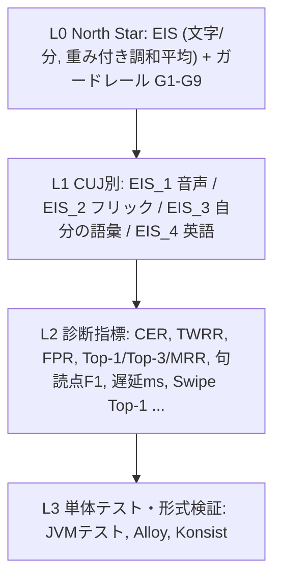

# JotInput トップレベル PRD — プロダクトビジョン・最重要 CUJ・North Star Metric

> **ステータス**: v1 提案（2026-11-15）
> **位置づけ**: 本書は JotInput の **最上位 PRD** です。機能別 PRD（`docs/prd_and_design_*.md`）、評価レポート、評価セットはすべて本書の CUJ とトップレベルメトリックに従属します。
> **前身**: これまで単一のトップレベル PRD は存在せず、評価基準は [`evaluation_suites_and_methods.md`](evaluation_suites_and_methods.md) の 7 ドメインに分散していました（TWRR、CER、Top-1、MRR、合格率、レイテンシ ms、mAh など 20 種以上）。本書はそれらを **1 つの North Star Metric** の下に再編します。

---

## 1. 問題提起: なぜトップレベルメトリックが必要か

現在の評価指標は、それぞれ部分最適化の向きが異なります。

| 現状の指標の例 | 局所的に最適化すると起きうること |
| :--- | :--- |
| かな漢字 Top-1 / MRR | Top-1 は上がるが、遅延が増え、確定までの時間がむしろ悪化する |
| ASR TWRR（登録語再現率） | 登録語は通るが、誤爆（FPR）で通常の文の修正コストが増える |
| 句読点テスト合格率 100% | テストは通るが、実際の文で句読点を直す回数は測っていない |
| SLM レイテンシ ms / mAh | 速く省電力になるが、変換精度の劣化を見ていない |
| Swipe Top-1 | 英語は改善するが、日本語ユーザーの総入力体験に占める割合が見えない |

いずれも **「ユーザーが意図した文章を、どれだけ少ない時間と労力で書けたか」** の一部分しか見ていません。そのため改善の優先順位が指標ごとにばらつきます。

---

## 2. プロダクトビジョン

> **「思ったことを、端末の外に一切出さずに、最短の時間で、意図どおりの日本語テキストにする。」**

- **J**apanese **O**n-device **T**ext **Input**: 完全オフライン・プライバシー保護の日本語 IME（音声 + フリック + QWERTY）
- 差別化要素: (1) オンデバイスの高精度な日本語音声入力（句読点・文境界込み）、(2) SLM 文脈リランキングによるかな漢字変換、(3) 音声とタッチをシームレスに混ぜられること

### 2.1 ターゲットユーザー
- 主ユーザー: スマートフォンや ChromeOS で、日本語のメッセージ・メモ・メール・ドキュメントを書く人。プライバシーを重視し、クラウド IME を使いたくない人。
- 副ユーザー: 英語や英日混在のテキストを書く人、固有名詞・専門用語を多く使う人。

### 2.2 プロダクト原則（全機能 PRD が従う優先順位）
1. **Privacy First（不可侵）**: 入力テキストや音声を端末外に送らない。これはトレードオフの対象にしない。
2. **意図到達の速さが価値**: 機能の数ではなく、「意図したテキストができあがるまでの総時間」で価値を判断する。
3. **壊さないことは速さより優先**: 誤爆（保護語彙の破壊、未確定文字の消失、辞書の消失）はゲートとして扱い、スコアと相殺させない。
4. **最適なデフォルトを選び、設定項目を増やさない**（[`ui_design_and_simplicity_guidelines.md`](ui_design_and_simplicity_guidelines.md)）。

---

## 3. Jobs to be Done (JTBD)

| ID | JTBD（状況 → 動機 → 期待成果） |
| :--- | :--- |
| **J1** | 移動中や手が離せないときに、**考えをまとまった文章として素早く書き留めたい**。そうすれば、あとで手直しせずにそのまま送信・保存できる。 |
| **J2** | 短いメッセージや返信を書くときに、**フリックで打ったかなが、文脈に合った漢字にすぐ変換されてほしい**。そうすれば、候補を探したり打ち直したりしなくて済む。 |
| **J3** | 人名・社名・専門用語を書くときに、**自分の語彙を一度教えたら、二度と間違えないでほしい**。そうすれば、相手に失礼な誤字を送らずに済む。 |
| **J4** | 英単語や英文を混ぜて書くときに、**日本語 IME のまま英語も速く正確に打ちたい**。そうすれば、キーボードを切り替える手間がかからない。 |
| **J0** | アプリを入れたら、**迷わずすぐに使い始めたい**。そうすれば、設定で挫折しない。 |

---

## 4. 最重要 CUJ（優先度順）

| 優先度 | CUJ | 対応 JTBD | 主なモダリティ | 重み $w_c$（v1 提案） |
| :---: | :--- | :---: | :--- | :---: |
| **Gate** | **CUJ-0: インストール → 最初の意図どおりの入力** | J0 | オンボーディング | ゲート（合否） |
| **P0** | **CUJ-1: 音声で日本語の文章を書く**（句読点・文境界・ストリーミング確定込み） | J1 | 音声 (+修正はタッチ) | **0.40** |
| **P0** | **CUJ-2: フリックで日本語を書く**（かな漢字変換・文脈同音異義語・長文節・予測） | J2 | フリック | **0.35** |
| **P1** | **CUJ-3: 自分の語彙（固有名詞・専門用語）を書く**（ユーザー辞書・修正学習。音声とタッチの両方） | J3 | 音声 + フリック | **0.15** |
| **P2** | **CUJ-4: 英語・英日混在を書く**（英語音声入力〔Parakeet〕・QWERTY タップ・Swipe・スペル訂正・大文字化） | J4 | 英語音声 / QWERTY / Swipe | **0.10** |

### 4.1 各 CUJ のステップと失敗モード

**CUJ-0（Gate）**: インストール → オンボーディング → IME 有効化 → モデル・辞書のダウンロード → テスト欄で最初の確定。
- 失敗モード: 権限失効、ダウンロードの中断、IME 未選択のまま放置。
- 根拠となる仕様: [`prd_and_design_onboarding_flow.md`](prd_and_design_onboarding_flow.md), [`prd_and_design_main_app_ui.md`](prd_and_design_main_app_ui.md)

**CUJ-1（P0）**: 🎙 をタップ → 話す（息継ぎなし、または「まる」「てん」「かいぎょう」と言う）→ 逐次確定される → 誤りがあればタッチで直す → 完了。
- 失敗モード: 認識誤り、句読点の欠落・過剰挿入、保護語彙の破壊（天気→天、、など）、確定の遅延、フィラーの残留、プレフィックスのちらつき、タッチとの競合でテキストが壊れる。
- 根拠となる仕様: [`punctuation_and_voice_boundary_evaluation_criteria.md`](punctuation_and_voice_boundary_evaluation_criteria.md), [`streaming_voice_input_architecture_and_deliberation.md`](streaming_voice_input_architecture_and_deliberation.md), [`voice_and_touch_interaction_corner_cases.md`](voice_and_touch_interaction_corner_cases.md)

**CUJ-2（P0）**: かなをフリック入力 → 候補ストリップを見る → Top-1 を確定（または k 位をタップ）→ 次の文節・予測候補へ。
- 失敗モード: 正解が Top-1 にない、候補にまったく出ない、長文節で区切りを誤る、候補がちらつく・遅れる、タイポ（濁点漏れ）を救済できない。
- 根拠となる仕様: [`slm_mandatory_rerank_evaluation_report.md`](slm_mandatory_rerank_evaluation_report.md), [`long_phrase_conversion_headroom_report.md`](long_phrase_conversion_headroom_report.md), [`prd_and_design_flick_typo_hiragana_candidates.md`](prd_and_design_flick_typo_hiragana_candidates.md)

**CUJ-3（P1）**: 単語を登録する、または音声認識結果を一度タッチで修正する → 次回以降、音声でもフリックでも Top-1 で出る。
- 失敗モード: 登録語が音声で出ない、修正が学習されない（例: 描いて→書いて）、過学習による誤爆。
- 根拠となる仕様: [`prd_and_design_custom_dictionary_ui.md`](prd_and_design_custom_dictionary_ui.md), [`voice_correction_learning_design_and_evaluation.md`](voice_correction_learning_design_and_evaluation.md), [`context_aware_evaluation_report.md`](context_aware_evaluation_report.md)

**CUJ-4（P2）**: 英語を入力する。経路は (a) 英語音声入力（Parakeet TDT-CTC、自動句読点・大文字化込み）、(b) QWERTY に切り替えてタップまたはスワイプ。必要ならスペル候補・大文字候補を選ぶ → 自動スペース・ピリオド。
- 内訳の重み（EIS-v1 方針）: 英語音声 0.5 / タッチ（タップ・スワイプ）0.5。英語音声評価セット（300件、Piper TTS合成 + Parakeet TDT-CTC 110M推論）を構築し、50:50文字比重みで統合完了。
- 失敗モード: スワイプが Top-1 で外れる、タイポを救済できない、大文字化を誤る。
- 根拠となる仕様: [`futo_swipe_phase1_evaluation_report.md`](futo_swipe_phase1_evaluation_report.md), [`prd_and_system_design_qwerty_capitalization_and_spell_candidates.md`](prd_and_system_design_qwerty_capitalization_and_spell_candidates.md)

### 4.2 重み付けの根拠（v1 提案）
- 重み $w_c$ は **「ユーザーが書く意図テキスト全体のうち、その CUJ で生まれる文字の割合（想定利用構成）」** と定義します。重要度の主観ではなく、利用構成として解釈できるようにするためです。
- CUJ-1 (0.40): プロダクト名と差別化の中心であり、長文を生む主な経路。
- CUJ-2 (0.35): IME として最も頻度が高い入力経路。音声が使えない場面（静かな場所・公共の場）の受け皿。
- CUJ-3 (0.15): 文字数の割合は小さい（実際には 5% 前後）ものの、誤ったときの社会的コストが大きいので、利用割合より多めに配分しています。
- CUJ-4 (0.10): 日本語 IME の付加価値。英単語の混在は頻繁に起きる。英語音声入力を含む（プロダクトオーナー確定）。
- **重みはプロダクトオーナーが決める方針値**です。変更する場合は本書を改訂し、版番号（`EIS-v1` → `v2`）を上げてください。過去のスコアとの比較は同じ版どうしでのみ行います。

---

## 5. トップレベルメトリック（North Star）: EIS — 有効入力速度

### 5.1 定義

> **EIS (Effective Intended-text Speed, 有効入力速度)**
> **= 1 分あたりに、ユーザーが「意図どおりの最終テキスト」を何文字生み出せるか（文字/分, CPM）**

ここで消費する時間には、次のすべてを含めます。

$$
T_{\text{actual}} = T_{\text{produce}} + T_{\text{wait}} + T_{\text{select}} + T_{\text{correct}}
$$

| 項 | 意味 | 吸収する既存指標 |
| :--- | :--- | :--- |
| $T_{\text{produce}}$ | 発話・フリック・スワイプなど、入力そのものにかかる物理時間 | 予測・補完によるキーストローク削減 |
| $T_{\text{wait}}$ | システムを待つ時間（音声の確定遅延、候補表示の遅延など、知覚閾値を超えた分） | レイテンシ ms、Cold/Warm、タイムアウト、ペーシング |
| $T_{\text{select}}$ | 候補を探して選ぶ時間（順位 $k$ に応じて増える） | Top-1 / Top-3 / MRR、N-Best 多様性 |
| $T_{\text{correct}}$ | 誤りを見つけ、消し、打ち直す時間 | CER、TWRR、FPR、句読点誤り、フィラー残留、学習による再発防止 |

CUJ ごとの値は次のとおりです。

$$
\mathrm{EIS}_c = \frac{60 \cdot \sum_{i \in c} |t_i|}{\sum_{i \in c} T_{\text{actual}}(i)}
$$

（$|t_i|$ は意図テキスト $t_i$ の文字数、時間の単位は秒）

**全体スコア（トップレベル）** は、利用構成 $w_c$ による重み付き調和平均です。

$$
\mathrm{EIS} = \left( \sum_{c} \frac{w_c}{\mathrm{EIS}_c} \right)^{-1}
$$

調和平均を使うのは、$w_c$ を文字の割合と定義した場合に、これが「全文字数 ÷ 全所要時間」と **数学的に一致する** からです。したがって EIS は「想定利用構成で 1 分あたりに書ける意図どおりの文字数」という、物理的に解釈できる 1 つの数値になります。また、遅い経路（修正やフリック）ほどスコアへの影響が大きくなり、ユーザーの時間を最も多く奪っている箇所の改善が自然に優先されます。

### 5.2 EIS を選んだ理由（他候補との比較）

| 候補 | 長所 | 不採用の理由 |
| :--- | :--- | :--- |
| 文字誤り率（CER）の加重平均 | 単純 | 遅延・候補順位・修正の手間を反映できない。音声とフリックを同じ尺度で比べられない |
| Top-1 精度の加重平均 | 既存資産が多い | 2 位と圏外の差、遅延、誤爆の深刻さが見えない |
| 修正なし確定率 | 直感的 | 「速いが少し直す」と「遅いが完璧」を区別できない |
| 複合スコア（各指標の加重和） | 柔軟 | 係数が恣意的になり、指標が増えるたびに方向がぶれる（まさに現状の課題） |
| **EIS（時間に換算した統一尺度）** | **すべての誤り・遅延・候補順位を「ユーザーの秒数」という共通の単位に変換できる** | — |

### 5.3 ユーザー行動モデル（KLM ベースの決定論的シミュレータ, `EIS-v1` 定数）

EIS は、システムの出力（ASR 結果、候補リストと順位、遅延）を **固定のユーザー行動モデル** に入力して算出します。モデルは Keystroke-Level Model (Card, Moran & Newell, 1980) をモバイル IME 向けに簡略化したものです。定数は v1 の仮定値であり、§8 の Phase 3 で実測により較正します。**定数を変えるときは必ず版番号を上げます。**

| 操作 | 記号 | v1 定数 |
| :--- | :--- | :--- |
| フリック 1 打（濁点・小書きなどの修飾も 1 打と数える） | $K_f$ | 0.40 s |
| QWERTY タップ 1 打 | $K_q$ | 0.30 s |
| スワイプ 1 語 | $G_s$ | 0.80 s |
| 日本語の発話 | $S$ | 7.0 モーラ/s |
| 候補の確定（Top-1、変換・確定キー） | $C_1$ | 0.40 s |
| 候補ストリップの $k$ 位をタップ ($2 \le k \le 5$) | $C_k$ | $0.40 + 0.30(k-1)$ s |
| 展開リストの $k$ 位 ($k > 5$) | $C_k$ | $2.0 + 0.30(k-5)$ s |
| 候補にない場合（区切り直して打ち直す） | $C_\varnothing$ | $1.5 + K_f \cdot |\text{よみ}| + 2C_1$ s |
| 誤りの発見と位置決め（1 スパンあたり） | $L$ | 1.5 s |
| 削除（1 文字あたり） | $D$ | 0.20 s |
| 打ち直し | — | 正解スパンを CUJ-2 のモデル（実際の変換エンジン出力を使う）で入力した時間 |
| 待ち時間 | $T_{\text{wait}}$ | $\max(0,\ \text{遅延} - 0.10\text{ s})$（キー操作時）、$\max(0,\ \text{遅延} - 0.20\text{ s})$（音声確定時） |

- 音声の誤りは、出力と正解を文字単位で整列し、隣接する誤りを 1 スパンにまとめて $L + D \cdot |\text{誤スパン}| + T_{\text{retype}}$ を加算します。句読点の誤り、フィラーの残留、保護語彙の破壊もすべて同じ方法でコスト化します。
- CUJ-3 には **反復系列**（登録または修正 → 同じ語を再入力）を含め、2 回目以降の $T_{\text{correct}}$ が学習によって消えることを測ります。

### 5.4 ガードレール（スコアと相殺しないリリースゲート）

以下のいずれかを満たさない場合、EIS の値にかかわらず **BLOCKED**（リリース不可）とします。

| ガードレール | 基準 | 既存の検証手段 |
| :--- | :--- | :--- |
| G1. 完全オフライン | ネットワーク送信 0（モデル・辞書のダウンロードを除く） | コードレビュー / マニフェスト |
| G2. 音声句読点の非回帰 | `JapanesePunctuationEvaluationTest` 100%、保護語彙 FPR 0% | `./gradlew testDebugUnitTest` |
| G3. テキストを壊さない | 音声とタッチの調停で未確定文字の破壊 0、順序整合 100%、Alloy 不変条件 100% | `VoiceInputArbitratorTest`, `AlloyVerificationTest` |
| G4. ユーザーデータの永続性 | `custom_dictionary.json` を消去・上書き 0 | 辞書永続性テスト |
| G5. 安定性 | クラッシュ / ANR 0（両ターゲット） | `deploy.sh` + logcat |
| G6. CUJ-0 の成立 | 新規インストールから最初の確定までを両ターゲットで完走 | オンボーディング DMN / Alloy + 実機確認 |
| G7. 応答性の上限 | キー操作から候補表示まで P95 ≤ 100 ms、マイクロポーズ ≤ 200 ms、ペーシング ≤ 2400 ms | レイテンシテスト群 |
| G8. リソース | APK ≤ 110 MB、SLM の電力が [`slm_battery_and_power_consumption_report.md`](slm_battery_and_power_consumption_report.md) の基準以内 | CI / ODPM |
| G9. アーキテクチャ | `DddArchitectureKonsistTest` 100% | CI |

> [!NOTE]
> 遅延は EIS の $T_{\text{wait}}$ にも含まれます。G7 は、平均値としては目立たない「たまに固まる」体験を防ぐための上限です。

### 5.5 メトリック階層

- **意思決定には L0 と L1 を使います。** L2 は原因を調べるための診断指標であり、L2 だけを根拠に機能を採否してはなりません。
- **新しい評価セットを作るときは、どの CUJ バケットに入り、どの $T$ 項を通じて EIS に影響するかを明記します。** 明記できない評価セットはトップレベルの判断に使いません。

### 5.6 リリース判定ルール
1. ガードレール G1〜G9 がすべて合格していること。
2. 全体 EIS が、ベースラインに対してブートストラップ 95% 信頼区間で **有意に悪化していない** こと。
3. どの $\mathrm{EIS}_c$ も 2% を超えて悪化していないこと（特定の CUJ を犠牲にした改善を防ぐため）。
4. チューニングは dev 分割だけで行い、test 分割（凍結）で報告すること（Anti-Anecdotal Tuning Policy に準拠）。

---

## 6. EIS-Bench v1: 既存評価資産の CUJ へのマッピング

新しいデータを一から作らず、既存の評価セットを CUJ ごとに層化抽出して **EIS-Bench v1** を構成します。

| CUJ | 意図テキストと入力の素材（既存資産） | EIS に入る主な項 |
| :--- | :--- | :--- |
| CUJ-1 音声 | `eval/dataset.json` + `eval/audio/*.wav`（1,000 文、文全体が正解）、句読点評価文（67+）、フィラー評価仕様（120）、ストリーミング評価 | $T_{\text{correct}}$（CER スパン・句読点・フィラー）、$T_{\text{wait}}$（確定遅延） |
| CUJ-2 フリック | `tools/eval_1000_cases.tsv`（文脈あり 1,000）、`tools/eval_500_natural_empty.tsv`（文脈なし 500）、`eval/lm_first_eval_dataset.json`（247）、長文節セット、`FlickTypoAndMozcCorrectionEvaluationTest` | $T_{\text{select}}$（順位 $k$）、$C_\varnothing$、$T_{\text{wait}}$（SLM 遅延） |
| CUJ-3 自分の語彙 | `eval/dataset.json` の人名 250・地名 150・技術用語 200 + 辞書登録、`eval/dataset_with_context.json`、音声修正学習の評価（`eval/voice_correction_eval_results.json` の系列）、`lm_first` の user_dict カテゴリ | 1 回目と 2 回目以降の $T_{\text{correct}}$ の差、負例による誤爆コスト |
| CUJ-4 英語 | `eval/english_voice/dataset.json` (300件) + `eval/english_voice/audio/*.wav`（Parakeet ASR）、`eval/futo_swipe/swipe_eval_1000.jsonl`、`eval/english_completion/completion_eval_100.json`、大文字化 60 ケース、`EnglishTypoRerankTest` | $T_{\text{select}}$、打ち直し、補完による $T_{\text{produce}}$ の削減 |

> [!IMPORTANT]
> 現状の音声データ（`eval/audio`）は合成音声に由来します。CUJ-1 の EIS は合成音声上の値であることを明記し、Phase 3 で実録音サブセット（少数でもよい）を追加して乖離を測ります。

### 6.1 既存の診断指標の参考値（L2, 各レポートより）
ベースライン EIS は [`eis_baseline_report.md`](eis_baseline_report.md)（`python3 eval/eis/run_eis.py --report` で再生成）を参照。以下は参考として、各レポートに記載されている L2 指標を示します。
- CUJ-1/3: 文脈認識 ASR の登録語再現率 84.5%、負例 FPR 0.0%（[`context_aware_evaluation_report.md`](context_aware_evaluation_report.md)）
- CUJ-2: LM-First 247 件で Top-1 90.3% / Top-3 99.2% / MRR 0.946（`eval/lm_first_tuning_results.json`）。長文節 Top-1 は 33.1%、SLM で到達可能な上限は 92.4%（[`long_phrase_conversion_headroom_report.md`](long_phrase_conversion_headroom_report.md)）
- CUJ-4: Swipe Top-1 90.3%（4.19 ms）、大文字化 Top-1 93.3%

これらの数値から、**現時点で EIS 上の最大の伸びしろは CUJ-2 の長文節変換と、CUJ-1 の認識誤りに対する修正コスト** にあると推定します。Phase 1 の結果では、CUJ別EISは CUJ-2（フリック）が最も低い（約93文字/分、音声CUJ-1は約204）。ただしこれは主に打鍵時間によるもので、候補品質の伸びしろは Phase 2（実エンジン評価）で測る。

---

## 7. 非目標 (Non-Goals)
- 各機能の L2 指標を個別に最大化すること。
- クラウドを使う精度向上（Privacy First に反する）。
- 利用データの収集を前提としたオンライン A/B 計測。端末上の匿名ローカル統計を使う場合でも、送信はしません。

---

## 8. ロードマップ

| フェーズ | 内容 | 成果物 |
| :--- | :--- | :--- |
| **Phase 1（実装済み）** | EIS-Bench v1 の構築（層化抽出、dev/test 分割、test を凍結）と、オフライン KLM シミュレータの実装。キャッシュ済みの出力 JSON を利用し、ベースラインの EIS と $\mathrm{EIS}_c$ を算出 | `eval/eis/`（ビルダー、シミュレータ、`eis_results.json`）、本書 §6.1 の更新 |
| **Phase 1.5（実装完了）** | 英語音声（Parakeet 110M）300件データセット・ローカルPiper TTS合成・推論キャッシュを構築し、$\mathrm{EIS}_4$ を完全実測化 | `eval/english_voice/`、`eval/eis/adapters.py` |
| **Phase 2** | CUJ-2 と CUJ-3 を JVM の実エンジン（`KanaKanjiEngine` + リランカー）で回す回帰テストを CI に追加し、EIS の悪化を CI で検知 | `EisRegressionTest.kt`、CI での EIS レポート |
| **Phase 3** | 両ターゲットの実機で、遅延の実測値を $T_{\text{wait}}$ に投入。少数の実ユーザーで操作時間を計測して KLM 定数を較正（`EIS-v2`）。実録音の音声サブセットを追加 | 較正レポート、`EIS-v2` 定数 |

---

## 9. ガバナンス
- 本書は `docs/index.md` と [`evaluation_suites_and_methods.md`](evaluation_suites_and_methods.md) の最上位から参照されます。
- 機能別 PRD には、「対象 CUJ」と「期待する EIS への影響（どの $T$ 項を減らすか）」を記載します。
- 重み $w_c$、KLM 定数、ガードレールを変更するときは、本書の改訂と版番号の更新を同じコミットで行います。

## 10. 未決事項（プロダクトオーナーの判断が必要）
1. **CUJ の重み $w_c$**（0.40 / 0.35 / 0.15 / 0.10）: 想定利用構成として妥当か。特に、音声とフリックのどちらを主経路と位置づけるか。
2. ~~CUJ-4 英語のスコープ~~ → **確定: 英語音声入力（Parakeet）を CUJ-4 に含める。**
3. **KLM 定数の較正方法**: Phase 3 で、開発者自身の計測で足りるか、少人数のユーザーテストを行うか。
