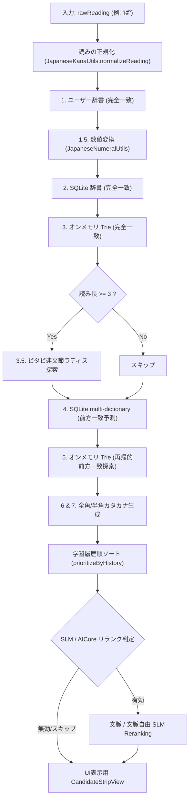

# 前方一致予測変換（Predictive Prefix Matching）の探索ロジック

## 1. 概要
入力途中の読み（例: `「ぱ」`）に対して、その読みから始まる語彙（例: `「パン」`（読み: `ぱん`）、`「パンダ」`、`「パンツ」`など、**入力文字数より長い読みを持つ単語**）が変換・予測候補（サジェスト）として提示される仕組みについての調査結果です。

本アプリ（JotInput）では、[`KanaKanjiEngine.kt`](file:///home/kenichikurihara/repos/myasr/app/src/main/java/com/example/myasr/KanaKanjiEngine.kt) および [`DictionaryDatabaseHelper.kt`](file:///home/kenichikurihara/repos/myasr/app/src/main/java/com/example/myasr/DictionaryDatabaseHelper.kt) により、完全一致変換に続いて**二重のインフラ（SQLite multi-dictionary DB ＋ オンメモリ Trie 木）**を用いた前方一致（Prefix Search）探索が実行されています。

---

## 2. 探索のパイプラインと呼び出し順序

[`KanaKanjiEngine.kt`](file:///home/kenichikurihara/repos/myasr/app/src/main/java/com/example/myasr/KanaKanjiEngine.kt) の `getBaseCandidates(rawReading)` では、以下の順序で候補が生成・集約されます。



入力より長い候補（「パン」など）は、主に **ステップ4（SQLite前方一致）** および **ステップ5（オンメモリTrie再帰探索）** によって探索・抽出されます。

---

## 3. 具体的な前方一致（サジェスト）探索ロジック

### ① SQLite multi-dictionary による前方一致検索
大容量辞書（拡張辞書等）は SQLite データベース（[`mozc_dictionaries.db`](file:///home/kenichikurihara/repos/myasr/app/src/main/java/com/example/myasr/DictionaryDatabaseHelper.kt)）に格納されており、以下の前方一致クエリが発行されます。

```kotlin
// DictionaryDatabaseHelper.kt: getPrefixMatches
fun getPrefixMatches(reading: String, limit: Int = 30): List<ConversionCandidate> {
    val db = readableDatabase
    val result = mutableListOf<ConversionCandidate>()
    val upper = reading + "\uffff"
    val cursor = db.rawQuery(
        "SELECT reading, surface, cost, source_type FROM dictionary_entries WHERE reading > ? AND reading <= ? ORDER BY cost DESC LIMIT ?",
        arrayOf(reading, upper, limit.toString())
    )
    ...
}
```

- **境界走査ロジック**: `reading > "ぱ"` かつ `reading <= "ぱ\uffff"` の範囲を走査します。
  - `"ぱ"` より辞書順で後ろで、かつ先頭が `"ぱ"` で始まるすべての文字列（`"ぱあ"`, `"ぱん"`, `"ぱんだ"` など）が抽出対象となります。
  - 完全一致（`"ぱ"` 自体）は `>` により除外され、厳密に**入力より長い語彙**のみが選定されます。
- **インデックス活用**: `CREATE INDEX idx_dict_reading_cost ON dictionary_entries(reading, cost DESC)` により、インデックスレンジスキャンで高速に取得されます。

### ② オンメモリ Trie 木による再帰的探索（Prefix Collection）
基本辞書（`base_dictionary.tsv`）やユーザー辞書からビルドされたオンメモリ Trie 木構造でも、接頭辞から下位ノードを深さ優先探索（DFS）で収集します。

```kotlin
// KanaKanjiEngine.kt: getBaseCandidates (ステップ5)
if (exactNode != null) {
    val prefixWords = mutableListOf<Pair<String, WordEntry>>()
    collectPrefixWords(exactNode, StringBuilder(normalized), prefixWords, maxCount = 30)
    for ((reading, entry) in prefixWords) {
        addCandidate(ConversionCandidate(surface = entry.surface, reading = reading, isPrediction = true, source = entry.source))
    }
}
```

```kotlin
// KanaKanjiEngine.kt: collectPrefixWords
private fun collectPrefixWords(
    node: TrieNode,
    currentReading: StringBuilder,
    outList: MutableList<Pair<String, WordEntry>>,
    maxCount: Int
) {
    if (outList.size >= maxCount) return

    for (childEntry in node.children) {
        val ch = childEntry.key
        val childNode = childEntry.value
        currentReading.append(ch)

        for (w in childNode.words) {
            outList.add(Pair(currentReading.toString(), w))
            if (outList.size >= maxCount) {
                currentReading.deleteCharAt(currentReading.length - 1)
                return
            }
        }

        collectPrefixWords(childNode, currentReading, outList, maxCount)
        currentReading.deleteCharAt(currentReading.length - 1)
    }
}
```

- **探索の挙動**:
  1. 入力 `"ぱ"` に対応するノード（`exactNode`）に到達します。
  2. `exactNode` の子ノード群（`children`）を再帰探索します。
  3. 子ノードとして `'ん'`（`"ぱん"`）が見つかると、登録されている単語（`WordEntry(surface="パン", cost=3765)` など）を候補に追加します。
  4. さらにその下のノード（例: `'だ'` -> `"パンダ"`）も走査され、最大30件まで先読み候補を収集します。
  5. これらの候補には `isPrediction = true` フラグが付与されます。

---

## 4. 候補のフィルタリングと順位付け

1. **全ひらがな候補の除外**:
   - `!JapaneseKanaUtils.isAllHiragana(cand.surface)` により、「ぱん」等の全ひらがな語は除外されます（確定キー押下で直接未変換ひらがなが確定できるIME設計のため）。カタカナの「パン」や漢字表記の語がサジェストに残ります。
2. **重複排除**:
   - `seenSurfaces.add(cand.surface)` により、同一表記の候補は最初にヒットした高スコアなものが保持されます。
3. **確定履歴（History Cache）による優先順位付け**:
   - `prioritizeByHistory` により、過去に入力・選択された確定回数（`reading:surface`）が多い候補が前方に昇格します。
4. **SLM / AICore によるリランク（オプション）**:
   - 文脈（前後の入力テキスト）または文脈自由リランク設定（`isSlmContextFreeRerankEnabled`）が有効な場合、小規模言語モデル（SLM）や Gemini Nano により尤度計算（PPL）に基づく順位補正が適用されます。

---

## 5. まとめ
「ぱ」と打った際に「パン」が表示されるのは、**オンメモリ Trie の子ノード再帰探索（`collectPrefixWords`）** および **SQLite 辞書の前方一致レンジスキャン（`getPrefixMatches`）** という2段階の Prefix 探索アルゴリズムが、完全一致の後に自動実行されているためです。
これにより、タイピングのキーストロークを削減し、高速かつ自然なサジェスト体験が実現されています。
