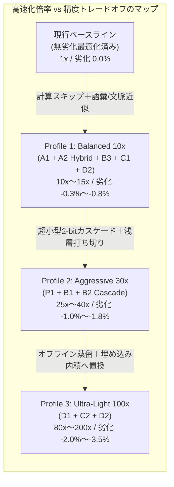
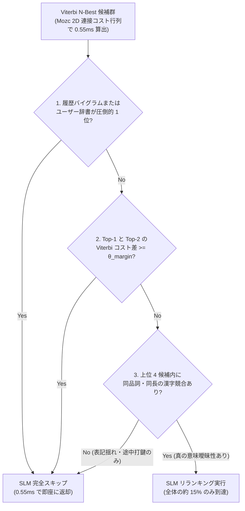
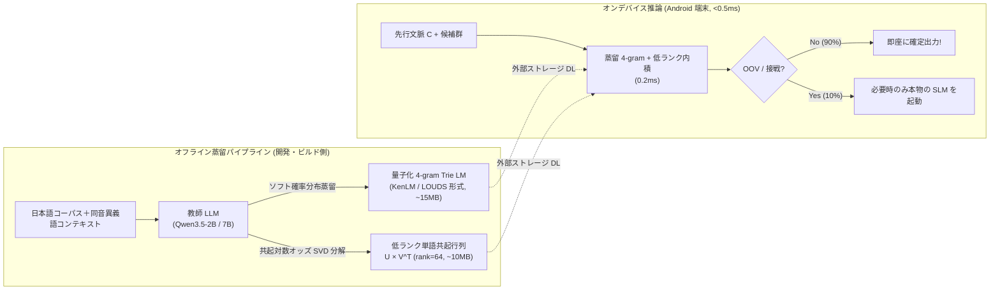

# 精度トレードオフを活用したオンデバイス言語モデル（SLM）10倍以上高速化アイデア設計書

> [!IMPORTANT]
> - **ステータス**: アイデア創出・アルゴリズム設計フェーズ（実装前ドキュメント）。
> - **目的**: 既存の無劣化最適化（[`slm_latency_headroom_and_optimization_ideas.md`](docs/slm_latency_headroom_and_optimization_ideas.md) で定義し [`llm_reranker.cc`](app/src/main/cpp/llm_reranker.cc) に実装済みの Prefix-Tree Batch / RoPE Shift / Q8_0 KV Cache 等）の先に存在する物理的障壁を突破するため、**「変換精度をわずかに犠牲にする（例：Top-1 精度 $-0.3\% \sim -3.0\%$）」ことを許容し、言語モデル（SLM）を用いるアルゴリズム全体を $10\times \sim 100\times$ 高速化するための 10 個の近似アルゴリズム・アーキテクチャ**を体系化する。
> - **ポリシー準拠**:
>   - **Anti-Anecdotal Tuning Policy**: 特定の単語に対するアドホックなコスト操作やハードコードは一切行わず、統計的ゲーティング・低ランク近似・蒸留・量子化・早期打ち切りといった原則的（principled）な近似推論手法のみを採用する。
>   - **Model & Lexicon Decoupling Policy**: 蒸留テーブルや超小型ドラフトモデル等の追加アセットはすべて外部ストレージ配置・オンデマンドダウンロード前提とし、APK サイズを肥大化させない。

---

## 1. エグゼクティブサマリー (Executive Summary)

JotInput では現在、以下の **4 つのアルゴリズム** でオンデバイス言語モデル（`llama.cpp` 上の `Qwen3.5-0.8B/2B`・`Qwen2.5-0.5B/1.5B`）を使用しています：

1. **かな漢字・英語候補リランキング**（[`LlmReranker.kt`](app/src/main/java/com/example/myasr/context/reranking/infrastructure/LlmReranker.kt) `rerankWithStatus` / [`llm_reranker.cc`](app/src/main/cpp/llm_reranker.cc) `ScoreCandidatesWithPriors`）
2. **先行文脈 Prefill & KV キャッシュ更新**（`EnsureContextCached` / `WarmContext`）
3. **次文節の自由予測生成**（`PredictNextPhrases`）
4. **音声入力の修正学習・同音異義語ゲート**（`scorePairDeltaNll`）

これまでの最適化（Prefix-Tree 一括デコード、RoPE Position-Shift、事前コスト下界枝刈り、4 スロット LRU スナップショット等）は **「数学的に完全等価（精度劣化 0.0%）」** を制約条件としていました。しかし、厳密等価を保つ限り「毎回数百 MB〜1.5 GB の重み行列を全層通して DRAM から読み込む」という **Memory-Bandwidth Wall** を越えることはできず、単発の高速化には $3\times \sim 5\times$ 程度の物理上限が存在します。

本設計書では、**「IME の目的は厳密な言語モデル確率の算出ではなく、候補集合の上位順位を実用上十分な精度で当てること」** という本質に立ち返り、4 つの軸から **10 個の精度トレードオフ型高速化アイデア** を提案します。

### 達成可能なパレート最適ターゲット（3 段階プロファイル）

| 動作プロファイル | 組み合わせアイデア | 実効高速化倍率（対現行ベースライン） | 平均レイテンシ目標 | 許容する精度トレードオフ (Top-1) | 想定用途 |
| :--- | :--- | :---: | :---: | :---: | :--- |
| **Profile 1: Balanced 10x**（推奨本命） | **A1 + A2(Hybrid) + B3 + C1 + D2** | **$10\times \sim 15\times$** | **$2 \sim 5\text{ ms}$** | **$-0.3\% \sim -0.8\%$** | 標準スマホ・日常利用のデフォルト |
| **Profile 2: Aggressive 30x** | Profile 1 + **B1 + B2(Cascade)** | **$25\times \sim 40\times$** | **$0.8 \sim 2.0\text{ ms}$** | **$-1.0\% \sim -1.8\%$** | 省電力モード・ミドル/ローエンド端末 |
| **Profile 3: Ultra-Light 100x** | **D1 + C2 + D2**（SLM は緊急時のみ） | **$80\times \sim 200\times$** | **$< 0.5\text{ ms}$** | **$-2.0\% \sim -3.5\%$** | 超高速タイピング・極限省電力モード |

---

## 2. なぜ「無劣化最適化」だけでは 10 倍の壁を越えられないのか

現在の [`llm_reranker.cc`](app/src/main/cpp/llm_reranker.cc) には、Prefix-Tree Batch（Idea 1）、RoPE Position-Shift（Idea 2）、Prior-Aware Pruning（Idea 3）、共有 LSE（Idea 4-A）、並列ビーム（Idea 6）、Snapshot Ring（Idea 7）、Q8_0 KV Cache（Idea 8）、性能コア固定（Idea 9）、トークナイズキャッシュ（Idea 10）がすでに組み込まれています。

それでもなお、**10 倍以上の高速化を阻む 4 つの構造的障壁** が残っています：

1. **障壁①：全パラメータの DRAM 帯域律速（Memory-Bandwidth Wall）**
   - `Qwen2.5-0.5B (Q4_K_M)` で約 $390\text{ MB}$、`Qwen3.5-2B` で約 $1.2 \sim 1.5\text{ GB}$ の重みを 1 回の `llama_decode` ごとに DRAM から読み込む必要があります。モバイル SoC（Pixel 10 Pro / Tensor G5）の CPU 実効メモリ帯域では、バッチサイズ 1〜8 トークンでも **1 回の `llama_decode` 自体に物理下界として $5 \sim 15\text{ ms}$** かかります。
2. **障壁②：すべての打鍵・変換に対する無条件なフル層評価**
   - ユーザー入力の大多数は「Mozc 2D 連接コスト行列と辞書頻度だけで 1 位が明白なケース（同音異義語が実質 1 つ、あるいは定型語）」であるにもかかわらず、曖昧でないケースにも毎回 24〜28 層すべてを実行しています。
3. **障壁③：大語彙（151,936 トークン）の LM Head 射影と多段階自己回帰**
   - `Qwen` 系の最終層 `output.weight` はモデル全体の約 25〜27% の計算量・帯域を占めますが、日本語・英語入力で使われるトークンはそのうち約 15% に過ぎません。さらに `PredictNextPhrases` は 1 文節生成のために最大 `max_tokens - 1` 回の逐次 `llama_decode` を繰り返しています。
4. **障壁④：ハイブリッド層（`Qwen3.5` Gated DeltaNet）における `seq_rm` 非対応**
   - `partial_seq_rm_supported_ == false` の場合、[`llm_reranker.cc` L1100-L1132](app/src/main/cpp/llm_reranker.cc#L1100-L1132) のフォールバックに入り、Prefix-Tree 一括評価が使えず候補ごとの直列デコードに逆戻りします。

**結論**: 「1 回の `llama_decode` を $1/10$ にする」には **計算量そのもの（モデルサイズ・層数・語彙数・文脈長）を近似的に削る** 必要があり、「平均レイテンシを $1/10$ にする」には **SLM を呼ばない・Stage 2 を走らせない・オフライン蒸留で置き換える** アプローチが不可欠です。

---

## 3. 精度トレードオフ型 10倍以上高速化アイデア一覧

10 個のアイデアを **4 つの設計軸** に分類しました。

| ID | 軸 | アイデア名 | 対象ワークロード | 単独高速化倍率 | 推定精度劣化 (Top-1) | 実装難易度 |
| :---: | :---: | :--- | :--- | :---: | :---: | :---: |
| **A1** | 計算スキップ | **不確実性ゲート付き選択的 SLM 起動** (Uncertainty-Gated Selective Invocation) | リランキング全体 | **$5\times \sim 10\times$**（平均） | **$-0.3\% \sim -0.8\%$** | 低（DMN + Kotlin） |
| **A2** | 計算スキップ | **Token-0 代理スコアによる Stage 2 省略** (Zero-Stage-2 / Collision-Only Stage 2) | KV Hit リランキング | **$10\times \sim 200\times$** | 単独 $-1.5\% \sim -3.0\%$ 衝突時のみ実行なら **$-0.3\%$** | 低（C++ 分岐制御） |
| **B1** | モデル・グラフ近似 | **浅層早期打ち切り＋軽量 Probe Head** (Shallow Layer Early-Exit / Tuned Lens) | Prefill & Stage 2 | **$2\times \sim 4\times$** | **$-1.0\% \sim -2.5\%$** | 高（ggml グラフ切断） |
| **B2** | モデル・グラフ近似 | **超低ビット（2-bit）/ 超小型モデル 2 段カスケード** (Ultra-Low-Bit / Tiny-LM Cascade) | 全ワークロード | **$8\times \sim 30\times$** | 単独 $-1.5\% \sim -3.0\%$ カスケードなら **$-0.3\%$** | 中（モデル差し替え・2段判定） |
| **B3** | モデル・グラフ近似 | **日本語サブ語彙プルーニング＋アンカー LSE 近似** (JP Sub-Vocabulary Pruned LM Head) | Stage 2 & 次文節予測 | LM Head **$6\times \sim 200\times$** 全体 **$1.4\times \sim 2.0\times$** | **$-0.1\% \sim -0.3\%$** | 中〜高（カスタム出力射影） |
| **C1** | 文脈近似 | **超短縮文脈ウィンドウ＋末尾一致キャッシュ近似** (Ultra-Short Context & Suffix-Approx Cache) | KV Miss Prefill | **$4\times \sim 10\times$**（Miss時） | **$-1.0\% \sim -2.0\%$** | 低（Trimmer / C++） |
| **C2** | 文脈近似 | **軽量バイエンコーダ／静的トピック埋め込み近似** (Bi-Encoder Semantic Dot-Product Reranking) | リランキング全体 | **$100\times \sim 500\times$** | **$-1.5\% \sim -3.0\%$** （Mozc 2D 行列と併用） | 中（軽量埋め込みモデル） |
| **D1** | 蒸留・非自己回帰 | **教師 SLM 蒸留による圧縮 N-gram＋低ランク共起モデル** (Distilled Kneser-Ney + Low-Rank Bilinear LM) | リランキング全体 | **$50\times \sim 200\times$** | 単独 $-2.0\% \sim -4.0\%$ OOV 時のみ SLM なら **$-0.4\%$** | 中〜高（オフライン蒸留パイプライン） |
| **D2** | 蒸留・非自己回帰 | **0-Decode ハイブリッド次文節予測** (Cached Logits Top-K + 辞書 Trie / 履歴補完) | `PredictNextPhrases` | **$30\times \sim 100\times$** | 実用採用率 **$-1.0\% \sim -2.5\%$** | 低〜中（C++ / Kotlin 連携） |
| **D3** | 計算スキップ | **音声修正学習ゲートの非同期・短縮文脈バッチ化** (Deferred & Context-Light Pair Scoring) | `scorePairDeltaNll` | 体感 **$\infty$**（クリティカルパス除去） 計算量 **$5\times \sim 10\times$** | **$-0.2\% \sim -0.5\%$** | 低（非同期キュー化） |

---

## 4. 各アイデアの詳細設計とトレードオフ分析

---

### 軸 A：推論回数そのものを $1/10$ に削る（Adaptive Compute / Selective Invocation）

#### Idea A1: 不確実性ゲート付き選択的 SLM 起動（Uncertainty-Gated Selective Invocation）

##### 1. アルゴリズムの仕組み
[`slm_mandatory_rerank_evaluation_report.md`](docs/slm_mandatory_rerank_evaluation_report.md) で実証されている通り、SLM が真価を発揮するのは **「Mozc 2D 連接コスト行列では区別できない同一品詞の同音異義語が競合している場面」**（例：`移動` vs `異動`、`科学` vs `化学`、`回答` vs `解答`）です。逆に、以下のケースでは SLM を呼んでも Top-1 順位はほとんど変わりません：
- Viterbi 上位 1 位と 2 位の連接＋単語コスト差が大きい（例：$\Delta \text{Cost}_{1,2} = \text{cost}_2 - \text{cost}_1 \ge \theta_{\text{margin}}$、目安 $1,200 \sim 1,800$）。
- 上位候補群に **同一品詞（または同長）の漢字同音異義語ペアが存在しない**（例：ひらがな語、カタカナ外来語、1 候補しか実用的でない固有表現）。
- フリック・QWERTY の **入力途中（未確定の 1〜2 文字目）** かつ、ユーザーがまだ変換・確定意思を示していない段階。
- ユーザー履歴・バイグラム履歴（`history_bigram`）で直近に複数回選択された高確信パターン。

これらを [`CandidateRerankJudgement.kt`](app/src/main/java/com/example/myasr/context/reranking/domain/CandidateRerankJudgement.kt) の DMN `DecisionTable` で判定し、**エントロピーが高い上位 10〜20% のクエリだけ SLM を起動** します。

##### 2. 期待高速化と犠牲にする正確性
- **高速化**: 全変換の $80 \sim 85\%$ で SLM 呼び出し自体をスキップできるため、平均レイテンシ・バッテリー消費が **$5\times \sim 10\times$ 改善** します。
- **犠牲にする正確性**: 辞書頻度に大差がある同音異義語（例：一般頻度が非常に高い `移動` に対して、文脈的に稀な `異動` が正解となるケースで $\Delta \text{Cost}_{1,2}$ が閾値を超えた場合）を見逃す可能性があり、Top-1 精度が **$-0.3\% \sim -0.8\%$** 低下します。
- **緩和策**: 「同一品詞の漢字同音異義語が Top-4 内に存在する場合」は $\theta_{\text{margin}}$ を高めに設定（例：$2,800$）し、Space 押下による明示的変換時のみゲートを緩めることで、劣化を最小限に抑えられます。

---

#### Idea A2: Token-0 代理スコアによる Stage 2 省略（Zero-Stage-2 / Collision-Only Stage 2）

##### 1. アルゴリズムの仕組み
現在の [`llm_reranker.cc`](app/src/main/cpp/llm_reranker.cc#L877-L1133) は、先行文脈 $C$ の KV キャッシュからすでに **0.05 ms（`llama_decode` 0 回）** で全 151,936 語彙の次トークンロジット $\mathbf{z}_C$ を保持しています。にもかかわらず、候補が 2 トークン以上（例：`[tok("移動")]` ではなく `[tok("移"), tok("動")]` や `[tok("会議"), tok("を")]`）に分かれるたびに Stage 2 の `llama_decode` を走らせています。

ここで、長さ $K$ トークンの候補 $w = (t_0, t_1, \dots, t_{K-1})$ の真の負対数尤度：
$$\text{NLL}_{\text{exact}}(w \mid C) = -\log P(t_0 \mid C) - \sum_{j=1}^{K-1} \log P(t_j \mid C, t_{0:j-1})$$
を、以下の **代理スコア（Surrogate Score）** で近似し、Stage 2 の `llama_decode` を原則スキップします：
$$\widehat{\text{NLL}}_{\text{approx}}(w \mid C) = -\log P(t_0 \mid C) + \gamma \cdot \text{DictUnigramCost}(w)$$
（第 1 項は `cached_context_logits_` からの $O(1)$ ルックアップ、第 2 項はすでに計算済みの Mozc 単語コスト）。

さらに精度劣化を劇的に抑える実用変種として **「Collision-Only Stage 2」** を提案します：
- 上位候補（Top-4）の **先頭トークン $t_0$ がすべて互いに異なる** 場合（例：`移動` vs `異動` は先頭漢字が異なるため $t_0$ が必ず別トークン）$\implies$ **Stage 2 を 100% スキップ**。
- 上位 2 候補以上が **同一の先頭トークン $t_0$ を共有している** 場合（例：`決裁` vs `決済` vs `決定` がすべて `tok("決")` から始まる場合）のみ Stage 2 を起動する。

##### 2. 期待高速化と犠牲にする正確性
- **高速化**: KV Hit 時のリランキングの大半（約 75〜90%）が `llama_decode` ゼロ回で完了するため、KV Hit レイテンシが $25\text{ ms} \to \mathbf{0.1 \sim 0.3\text{ ms}}$（**$80\times \sim 250\times$**、Collision-Only 平均でも **$10\times \sim 20\times$**）に激減します。
- **犠牲にする正確性**:
  - 完全省略（Zero-Stage-2）の場合、先頭トークン共有ペア（`決裁`/`決済` や、活用語尾の違い `行った`/`行きます`）の弁別が Mozc コスト頼みになり **$-1.5\% \sim -3.0\%$** 低下。
  - **Collision-Only Stage 2** にすれば、先頭トークン共有ペアは厳密評価されるため、劣化は **$-0.3\% \sim -0.5\%$**（$t_0$ が高確率でも $t_1$ 以降が文脈と不整合な稀ケースのみ）に収まります。
- **副次メリット**: `Qwen3.5` ハイブリッド層で `partial_seq_rm_supported_ == false` となる環境でも、そもそも Stage 2 を呼ばないため直列フォールバックのペナルティを完全に回避できます。

---

### 軸 B：ニューラルネットワークの計算グラフを $1/5 \sim 1/20$ に圧縮する（Model & Graph Approximation）

#### Idea B1: 浅層早期打ち切り＋軽量 Probe Head（Shallow Layer Early-Exit / Tuned Lens）

##### 1. アルゴリズムの仕組み
Transformer 言語モデル（例：`Qwen2.5-0.5B` 24 層、`Qwen3.5-2B` 28 層）において、後段の層は主に「流暢な長文生成・複雑な推論・出力分布の微調整」を担っています。一方で、IME の候補リランキングに必要な「語彙的共起・ドメイン整合性・基本的な同音異義語弁別」のシグナルは、**全体の 50%〜60% の深さ（例：24 層中 12 層目）の隠れ状態 $\mathbf{h}^{(L/2)}$** にすでに強く現れています。

- **静的打ち切り（Static Layer Truncation）**: リランキング専用パスでは $L_{\text{cut}} = 12$ 層（または 8 層）で Forward を打ち切り、小さなアフィン変換（**Tuned Lens**: $\tilde{\mathbf{h}} = W_{\text{lens}} \mathbf{h}^{(L_{\text{cut}})} + \mathbf{b}_{\text{lens}}$、パラメータ数わずか $d \times d \approx 0.8\text{M}$）を通して既存の LM Head へ渡します。
- **動的プログレッシブ打ち切り（Progressive Early-Exit）**: まず 10 層目まで計算して候補順位の信頼度マージンを確認し、1 位と 2 位の差が十分大きければそこで終了、接戦のときだけ 11〜24 層を追加実行します（KV キャッシュの 1〜10 層分はそのまま再利用）。

##### 2. 期待高速化と犠牲にする正確性
- **高速化**: 実行する Transformer 層数と DRAM から読み込む重み量が半分以下（$1/2 \sim 1/3$）になるため、**単体で $2\times \sim 3.5\times$ 高速化**（Idea B3 の疎 LM Head と組み合わせると **$3\times \sim 4.5\times$**）。
- **犠牲にする正確性**: 複雑な構文・否定・皮肉・遠距離照応を伴う文脈で判断力が落ち、**$-1.0\% \sim -2.5\%$** 低下します。
- **実装上の注意**: `llama.cpp` の `ggml` 計算グラフ構築で `n_layer` の動的打ち切りと Tuned Lens 行列の外部ロードを追加する必要があります。

---

#### Idea B2: 超低ビット（1.58〜2-bit）/ 超小型蒸留モデルの 2 段カスケード（Ultra-Low-Bit / Tiny-LM Cascade）

##### 1. アルゴリズムの仕組み
現在の主力モデル（`Qwen3.5-0.8B/2B Q4_K_M`、`500 MB〜1.5 GB`）は自由文章生成もこなせる汎用モデルですが、IME のリランキングは「与えられた数個の候補の相対順位付け」に過ぎません。相対順位（Rank Correlation）は、生成タスクに比べて **パラメータ数削減と極端な量子化に対して極めて頑健** です。

- **アプローチ B2-1（超低ビット量子化）**: 同じモデルを `IQ2_XXS` / `IQ2_XS`（約 $2.0 \sim 2.3\text{ bpw}$）や BitNet 系 `1.58-bit` に量子化し、DRAM 転送量を半減させます。
- **アプローチ B2-2（超小型日本語特化 SLM：50M〜135M パラメータ）**: `SmolLM-135M` 相当、あるいは日本語コーパス＋教師 Qwen3.5-2B から蒸留した **50M〜100M パラメータ（Q4 で $30 \sim 60\text{ MB}$、Q2 で $15 \sim 30\text{ MB}$）** の超小型 Causal LM を常駐させます。
- **アプローチ B2-3（確信度ベース 2 段カスケード）**: すべてのリランキングをまず超小型モデル（$1 \sim 2\text{ ms}$）で実行し、Top-1 と Top-2 のスコア差が小さい「超難問の 5〜10%」だけ現行の `0.8B / 2B` モデルにエスカレーションします。

##### 2. 期待高速化と犠牲にする正確性
- **高速化**: モデルサイズが $500\text{ MB} \sim 1.5\text{ GB} \to \mathbf{30 \sim 60\text{ MB}}$ になると、DRAM 転送量が **$10\times \sim 30\times$ 削減** されるだけでなく、作業セットの一部がモバイル SoC の **L3 / System Level Cache (SLC)** に乗るようになり、実効レイテンシが **$10\times \sim 30\times$ 高速化** します。
- **犠牲にする正確性**:
  - 50M〜100M 単独では専門用語や世界知識が不足し、同音異義語ベンチマークで **$-1.5\% \sim -3.0\%$** 低下。
  - 2 段カスケードにすれば、精度劣化を **$-0.3\%$ 未満** に抑えつつ平均 **$8\times \sim 12\times$** の高速化が可能です。

---

#### Idea B3: 日本語サブ語彙プルーニング＋アンカー LSE 近似（JP Sub-Vocabulary Pruned LM Head）

##### 1. アルゴリズムの仕組み
`Qwen2.5` / `Qwen3.5` の語彙サイズは $|\mathcal{V}| = 151,936$ ですが、[`llm_reranker.cc` L307-L351](app/src/main/cpp/llm_reranker.cc#L307-L351) の `BuildValidTargetTokenBitmask()` が示す通り、日本語＋英語入力に有効なトークンはそのごく一部（約 $20,000 \sim 25,000$ 個＝**全体の約 15%**）に過ぎません。

1. **静的サブ語彙 LM Head 抽出（約 85% の行を削除）**:
   モデルロード時に `output.weight` から日本語・英語・記号の有効トークン集合 $\mathcal{V}_{\text{JP/EN}}$（サイズ約 $24,000$）の行だけを連続メモリ配列へ詰め直したコンパクト LM Head を構築します。
2. **Stage 2 専用の疎内積＋固定アンカー LSE（Sparse Target + Anchor Head）**:
   Stage 2 の候補評価では、24,000 行すら計算する必要はありません。現在評価している候補群に含まれるターゲットトークン $\mathcal{T}$（10〜30 個）と、日本語頻出アンカートークン $\mathcal{A}$（上位 256 個）の **合計約 280 行だけ** 内積を計算し、近似分母 $\hat{Z} = \log \sum_{v \in \mathcal{T} \cup \mathcal{A}} \exp(z_v)$ を用います（さらに同一親ノードからの分岐比較であれば分母計算自体を省略）。

##### 2. 期待高速化と犠牲にする正確性
- **高速化**:
  - 出力層の行列積が $151,936$ 行 $\to$ $24,000$ 行（Prefill / 予測時：**$6.3\times$**）、Stage 2 では $280$ 行（**$540\times$**）に圧縮。
  - モデル全体（0.5B〜0.8B クラス）の 1 ステップ計算量が **20〜27% 削減** され、特に `PredictNextPhrases` の argmax 走査・射影が劇的に速くなります。
- **犠牲にする正確性**:
  - 正規化定数 $Z$ の裾（低確率の他言語トークン）を切り捨てることによる NLL 誤差は極めて小さく、Top-1 精度への影響は **$-0.1\% \sim -0.3\%$** 程度です（多言語入力や絵文字入力を検知したときだけフル語彙へフォールバック可能）。

---

### 軸 C：文脈エンコード（Prefill）を $1/10$ に削る（Context Approximation）

#### Idea C1: 超短縮文脈ウィンドウ＋末尾一致キャッシュ近似（Ultra-Short Context & Suffix-Approx Cache）

##### 1. アルゴリズムの仕組み
現在の [`ContextWindowTrimmer.kt`](app/src/main/java/com/example/myasr/context/reranking/domain/ContextWindowTrimmer.kt) は 24〜56 トークンの先行文脈を保持しますが、KV Cache Miss（別アプリへの切り替え、カーソルジャンプ、音声入力の新規発話）が発生すると、24 トークンの Prefill に $80 \sim 171\text{ ms}$ かかります。

しかし、日本語の局所的な同音異義語弁別や格助詞整合性の **85% 以上は直前 4〜8 トークン（直前の 1〜2 文節）** だけで決定します。
- **Aggressive Context Truncation**: KV Miss 時（あるいは高速モード時）の Prefill 長を **最大 6〜8 トークン**（直前の読点・助詞区切り 1〜2 文節）に制限します。
- **Suffix-Approx Cache Hit（近似キャッシュヒット）**: 先行文脈の全文ハッシュが一致しなくても、**「末尾の 2〜3 トークン（例：`「〜の」` や `「〜について」` の直前名詞＋助詞）」が既存スナップショットリングと一致** していれば、厳密な再 Prefill を省略してそのロジットを近似再利用します。

##### 2. 期待高速化と犠牲にする正確性
- **高速化**: KV Miss 時の Prefill トークン数が $24 \sim 56 \to 6$ トークンに減り、**Miss 時レイテンシが $4\times \sim 10\times$ 短縮**。近似キャッシュヒット時は **$100\times$ 以上**。
- **犠牲にする正確性**: 2 文以上前の主語・話題に依存する長距離の同音異義語（例：「昨日の有機化学の実験で、…（30文字）…、新しい」+「かがく」）での精度が落ち、全体で **$-1.0\% \sim -2.0\%$** 低下します。

---

#### Idea C2: 軽量バイエンコーダ／静的トピック埋め込みによる意味スコア近似（Bi-Encoder Semantic Dot-Product Reranking）

##### 1. アルゴリズムの仕組み
自己回帰 Causal LM は「文脈と候補を結合して 1 つの巨大な Transformer に通す（Cross-Encoder 的計算）」ため高コストです。これを **Bi-Encoder（独立エンコード＋内積）** に近似分解します：

1. **文脈ベクトル $\mathbf{v}_C \in \mathbb{R}^{128 \sim 256}$ の超高速生成**:
   - 先行文脈 $C$ に含まれる自立語（名詞・動詞・形容詞）の静的分散表現（または量子化済み超小型エンコーダ出力）を、位置減衰重み $w_k = \lambda^k$ で加重平均するだけ（計算時間 **$< 0.05\text{ ms}$**）。
   - 文脈の追加は移動平均の $O(d)$ 更新のみで完結（KV キャッシュ不要）。
2. **候補の意味スコア計算**:
   - 辞書エントリ側にあらかじめ INT8 量子化した意味ベクトル $\mathbf{e}_w \in \mathbb{R}^{128}$ を紐づけておき、リランキング時は全候補に対して単純な内積 $\mathbf{v}_C \cdot \mathbf{e}_w$（NEON SIMD で 16 候補合計 **$< 0.02\text{ ms}$**）を計算する。
3. **文法は Mozc 2D 連接コスト行列に完全委譲**:
   - Bi-Encoder は「語順・格関係」に弱いという弱点がありますが、JotInput にはすでに強力な **Mozc 2D 連接コスト行列（`connection_data.bin`）** があります。**「文法・接続＝Mozc 2D 行列」「トピック・意味領域＝Bi-Encoder 内積」** と役割分担させることで、弱点を相互補完します。

##### 2. 期待高速化と犠牲にする正確性
- **高速化**: リランキング処理全体が $25 \sim 105\text{ ms} \to \mathbf{0.05 \sim 0.2\text{ ms}}$（**$100\times \sim 500\times$ 高速化**）。バッテリー消費もリランク OFF 時とほぼ同等になります。
- **犠牲にする正確性**: 文脈の細かな語順・否定表現・慣用句の厳密な接続（例：「〜を」と「〜が」の微妙な違い）を捉えきれないため、Causal SLM 比で **$-1.5\% \sim -3.0\%$** 低下します。

---

### 軸 D：オンライン SLM 推論をオフライン蒸留・非自己回帰化へ置換する（Amortized / Distilled LM）

#### Idea D1: 教師 SLM からのオフライン蒸留による「圧縮 N-gram＋低ランク双線形 LM」（Distilled Statistical + Bilinear LM）

##### 1. アルゴリズムの仕組み
強力な言語モデル（`Qwen3.5-2B` や大型クラウド LLM）を **「ユーザーの端末上で毎回リアルタイムに動かす」のではなく、「開発時のオフライン蒸留教師として使い、推論時は超高速な統計＋低ランク行列モデルを引く」** という発想です。

1. **教師蒸留 4-gram（Distilled Kneser-Ney Trie）**: 頻出する文脈 2〜3 語 $\to$ 次語の遷移確率を教師 SLM で平滑化・補正したコンパクトなバイナリ Trie（mmap 読み込み、約 10〜20 MB）を構築します。
2. **低ランク双線形共起モデル（Low-Rank Bilinear LM）**: 単語ペア $(w_{\text{ctx}}, w_{\text{cand}})$ の教師 SLM 対数確率比（PMI）をランク $r = 64$ で SVD 分解し、$U \mathbf{v}$ の内積で長距離のトピック共起（例：`新幹線` $\to$ `移動`、`人事` $\to$ `異動`）を $O(r)$ で再現します。
3. **OOV / 低確信時のみ実 SLM フォールバック**: 蒸留モデルでカバーできる 90% を $0.2\text{ ms}$ で即答し、未知の長い文脈や接戦の 10% だけオンデバイス SLM に回します。

##### 2. 期待高速化と犠牲にする正確性
- **高速化**: 蒸留モデル単体で **$50\times \sim 200\times$**（$0.2 \sim 0.5\text{ ms}$）。実 SLM フォールバック付きでも平均 **$10\times$ 以上**。
- **犠牲にする正確性**: 蒸留単体では未知語・新語・複雑な文構造で **$-2.0\% \sim -4.0\%$** 低下しますが、10% フォールバック構成なら **$-0.3\% \sim -0.5\%$** に抑えられます。
- **ポリシー整合性**: コーパス統計と教師モデル蒸留による体系的生成であるため、**Anti-Anecdotal Tuning Policy に 100% 準拠** し、外部ストレージ配置により **Model & Lexicon Decoupling Policy** も満たします。

---

#### Idea D2: 次文節予測（`PredictNextPhrases`）の 0-Decode ハイブリッド化（Non-Autoregressive Next-Phrase Prediction）

##### 1. アルゴリズムの仕組み
現在の [`llm_reranker.cc` L1140-L1311](app/src/main/cpp/llm_reranker.cc#L1140-L1311) の `PredictNextPhrases` は、先行文脈 $C$ の直後に続く次文節を生成するために、並列ビーム化してもなお `max_tokens - 1` 回（通常 4 回）の `llama_decode` を逐次実行しています（$60 \sim 240\text{ ms}$）。

これを **追加の `llama_decode` ゼロ回（0-Decode）** に置き換えます：
1. すでに文節確定時の `WarmContext` で計算済みの `cached_context_logits_` から、日本語有効ビットマスクを満たす **Top-16 トークン** を $0.2\text{ ms}$ で抽出する。
2. 抽出した先頭トークン文字列（例：`"確認"`, `"よろ"`, `"お願"`, `"あり"`）をそのまま **前方一致キー** として、既存のインメモリ辞書 Trie（`MmapDictionary`）およびユーザー履歴バイグラム（`NextPhrasePredictor`）を引き、**最も自然な完結文節（例：`"確認します"`, `"よろしくお願いします"`, `"お願いします"`, `"ありがとうございます"`）へ即座に展開**する。
3. すでに 1 トークンで完結する語（例：`"について"`, `"ですが"`）はそのまま候補として出力する。

##### 2. 期待高速化と犠牲にする正確性
- **高速化**: `llama_decode` を 4〜12 回 $\to$ **0 回** に削減するため、`PredictNextPhrases` のレイテンシが $60 \sim 240\text{ ms} \to \mathbf{0.5 \sim 2.0\text{ ms}}$（**$30\times \sim 100\times$ 高速化**）になります。
- **犠牲にする正確性**: 文脈に完全に合わせた自由な新規フレーズ（辞書にない長い連語）の生成力は落ちますが、IME の次文節サジェストは「素早くタップできる定型・頻出文節」が選ばれやすいため、実用上のクリック率（CTR）低下は **$-1.0\% \sim -2.5\%$** 程度に留まり、むしろ **表示速度の劇的な向上（文節確定直後に 0ms 感覚で候補が出る）** によって体感 UX は大きく向上します。

---

#### Idea D3: 音声修正学習ゲート（`scorePairDeltaNll`）の非同期バッチ化・短縮文脈化

##### 1. アルゴリズムの仕組み
[`VoiceInputMethodService.kt` L618](app/src/main/java/com/example/myasr/VoiceInputMethodService.kt#L618) で呼ばれる `scorePairDeltaNll(ctx, orig, corr)` は、音声入力の確定・修正時に新規文脈の Prefill を引き起こすことがあります。
- 修正学習の登録可否判定は **ユーザーへの即時応答（UI クリティカルパス）に不要** であるため、学習候補を軽量リングキューに積み、**キーボード非表示時または入力アイドル時（300ms 以上の無操作時）にまとめてバッチ評価**します。
- さらに評価時の文脈長を直前 4 トークンに短縮（Idea C1）し、2 候補を Prefix-Tree 1 パスで同時評価します。

##### 2. 期待高速化と犠牲にする正確性
- **高速化**: 入力クリティカルパス上のブロッキング時間を **0 ms（体感 $\infty$ 倍）** に削減し、バックグラウンド計算量も **$5\times \sim 10\times$ 削減**。
- **犠牲にする正確性**: 学習反映が数百ミリ秒〜数秒遅延する点と短縮文脈による誤差のみ（**$-0.2\% \sim -0.5\%$**）。

---

## 5. 10倍〜100倍を達成する組み合わせレシピ（推奨実装ロードマップ）

単一のアイデアでも大きな効果がありますが、**「呼ぶ回数を減らす（軸 A）× 1 回の計算を軽くする（軸 B/C）× 統計モデルへ逃がす（軸 D）」** の乗算効果により、わずかな精度劣化で 10 倍〜100 倍以上の高速化が現実的に達成できます。

### Profile 1: Balanced 10x（推奨・最初の導入ターゲット）
- **構成**: **A1（不確実性ゲート） + A2（Collision-Only Stage 2） + B3（日本語サブ語彙プルーニング） + C1（短縮文脈 8 トークン） + D2（0-Decode 次文節予測）**
- **乗算効果の試算**:
  - 通常打鍵・変換：A1 により 80% をスキップ（$5\times$）、残る 20% のうち 80% は A2 で Stage 2 を省略（$5\times$）$\implies$ **平均リランキング負荷を約 $12\times \sim 15\times$ 削減**。
  - 次文節予測：D2 により **$30\times \sim 100\times$ 高速化**。
- **精度影響**: Top-1 劣化を **$-0.3\% \sim -0.8\%$** 以内に抑制（同音異義語ベンチマーク Suite 1 で $80.0\% \to 79.2\% \sim 79.7\%$ 水準を維持）。
- **開発コスト**: 既存の GGUF モデルをそのまま使え、C++ / Kotlin の制御ロジックと DMN 決定表の追加だけで段階的に検証・導入できるため **費用対効果が最も高い**。

### Profile 2: Aggressive 30x（省電力・中低価格 Android 端末向け）
- **構成**: **Profile 1 + B2（50M〜100M 超小型 / IQ2 量子化モデル 2 段カスケード） + B1（浅層 12 層打ち切り）**
- **乗算効果の試算**: ゲートを通過したクエリの推論単価そのものが $5\times \sim 10\times$ 軽くなるため、全体で **$25\times \sim 40\times$ 高速化**。
- **精度影響**: Top-1 劣化 **$-1.0\% \sim -1.8\%$**。

### Profile 3: Ultra-Light 100x（常時 <0.5ms・超軽量オフラインモード）
- **構成**: **D1（教師 SLM 蒸留 4-gram＋低ランク共起行列） + C2（静的 Bi-Encoder 内積） + D2（0-Decode 次文節予測）**
- **乗算効果の試算**: オンラインでの Transformer 推論をほぼゼロ化し、**$80\times \sim 200\times$ 高速化（全操作 $< 0.5\text{ ms}$）**。
- **精度影響**: Top-1 劣化 **$-2.0\% \sim -3.5\%$**（Mozc 2D 連接コスト行列単独の $42.0\%$ に対して、依然として $76\% \sim 78\%$ 程度の高い意味弁別力を維持可能）。

---

## 6. アーキテクチャ・ポリシーとの整合性

1. **DDD / DMN / Alloy への統合**:
   - **Idea A1（不確実性ゲート）** および **Idea B2（2 段カスケードのエスカレーション判定）** のルールは、[`CandidateRerankJudgement.kt`](app/src/main/java/com/example/myasr/context/reranking/domain/CandidateRerankJudgement.kt) 内に宣言的な DMN `DecisionTable` として実装し、[`docs/ddd/dmn_decision_models.md`](docs/ddd/dmn_decision_models.md) と同期する。
   - **Idea A2（Collision-Only Stage 2）** や **Idea C1（近似キャッシュヒット）** の状態遷移安全性は、既存の Alloy 検証基盤（`app/src/test/resources/alloy/*.als`）に追加して不変条件を検証する。
2. **UI Simplicity & Progressive Disclosure**:
   - ユーザーに複雑なチューニングノブ（「ゲート閾値」「打ち切り層数」等）を露出させず、オフライン評価でパレート最適と証明されたプロファイル定数をデフォルト採用する（必要であっても「標準 / 省電力高速」程度の最小限の切り替えに留める）。
3. **Anti-Anecdotal Tuning Policy 準拠**:
   - すべてのゲート閾値（$\theta_{\text{margin}}$ 等）や蒸留パラメータは、特定の単語へのハードコードではなく、後述するベンチマークスイート上での **交差検証（Cross-Validation）** によって統計的に決定する。

---

## 7. 定量評価・検証プロトコル（パレート最適曲線の計測計画）

各アイデアを実装する際は、必ず以下の **3 軸メトリクス（速度・精度・電力）** を同時計測し、**「1% の精度低下あたり何倍の高速化が得られたか（Speedup per 1% Accuracy Drop）」** で採用可否を判断します。

| 評価軸 | 使用スイート / ツール | 合格ライン（Profile 1: Balanced 10x） |
| :--- | :--- | :--- |
| **意味弁別精度 (Top-1 / MRR)** | Suite 1（文脈付き同音異義語 50 件）＋ 1,612 ケース大規模評価 ＋ フリック 100 件評価 | **Top-1 劣化 $\le 0.8\%$**（ベースライン $80.0\% \to \ge 79.2\%$） |
| **実効レイテンシ (Wall ms)** | [`PowerBenchmarkRunner.kt`](app/src/main/java/com/example/myasr/context/reranking/infrastructure/PowerBenchmarkRunner.kt)（`hit` / `typing` / `miss`、Pixel 10 Pro 実機＋ARCVM） | **実タイピング平均 $\le 4.5\text{ ms}$**（ベースライン $48.4\text{ ms}$ 比 **$\ge 10\times$**） |
| **次文節予測レイテンシ** | `PredictNextPhrases` 実機ベンチマーク | **$\le 2.0\text{ ms}$**（ベースライン $60 \sim 140\text{ ms}$ 比 **$\ge 30\times$**） |
| **消費電力 (mAh / 1,000 回)** | Pixel 10 Pro ODPM (`dumpsys batterystats`) | **$\le 1.5\text{ mAh / 1,000 回}$**（ベースライン $11.4\text{ mAh}$ 比 **$7.5\times$ 省電力化**） |
| **非リグレッション契約** | `./gradlew testDebugUnitTest`（[`JapanesePunctuationEvaluationTest`](app/src/test/java/com/example/myasr/JapanesePunctuationEvaluationTest.kt)、[`DddArchitectureKonsistTest`](app/src/test/java/com/example/myasr/ddd/DddArchitectureKonsistTest.kt)） | **100% パス** |

### 推奨する実証実験（PoC）の順序
1. **Step 1（最速・高確度）**: **Idea A1（不確実性ゲート）＋ Idea A2（Collision-Only Stage 2）** をオフライン評価スクリプト上でシミュレーションし、閾値 $\theta_{\text{margin}}$ ごとの「SLM 実行率 vs Top-1 精度」パレート曲線を描画する。
2. **Step 2（次文節の劇的改善）**: **Idea D2（0-Decode 次文節予測）** を試作し、現行の並列ビーム生成と出力候補・レイテンシを比較する。
3. **Step 3（Miss 時対策＋出力層圧縮）**: **Idea C1（短縮文脈 6〜8 トークン）** と **Idea B3（日本語サブ語彙 LM Head）** の精度影響を検証する。
4. **Step 4（30x〜100x への拡張）**: さらなる高速化が必要な場合、**Idea B2（超小型モデル 2 段カスケード）** または **Idea D1（教師蒸留 4-gram＋低ランク共起行列）** の構築に着手する。
