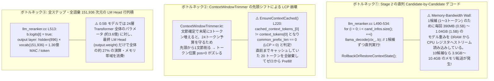
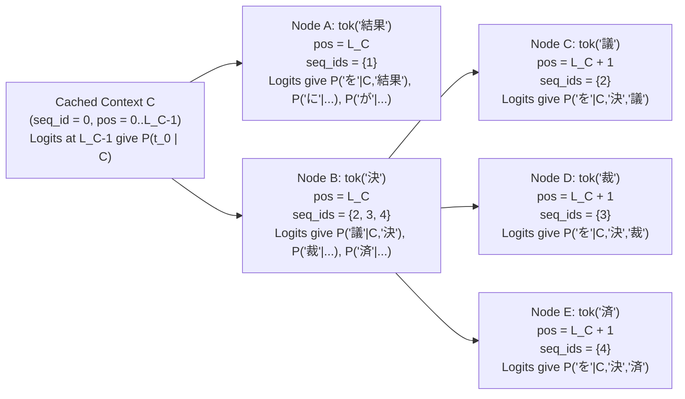
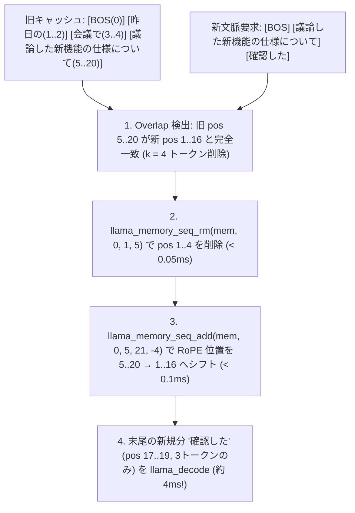
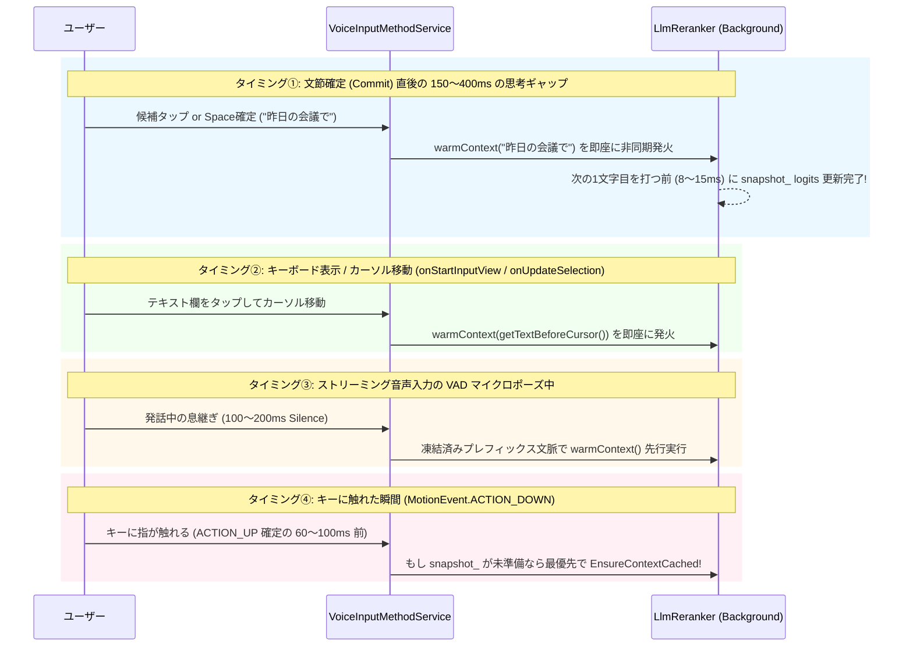
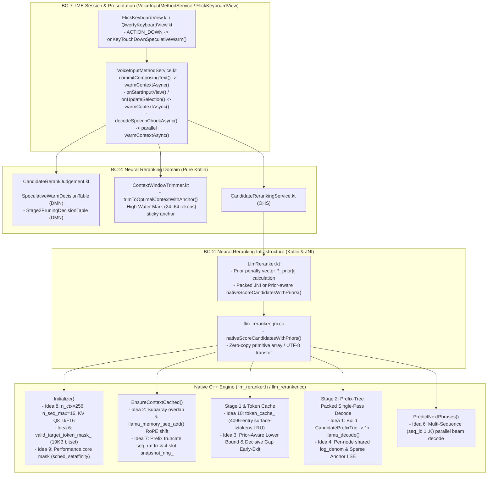
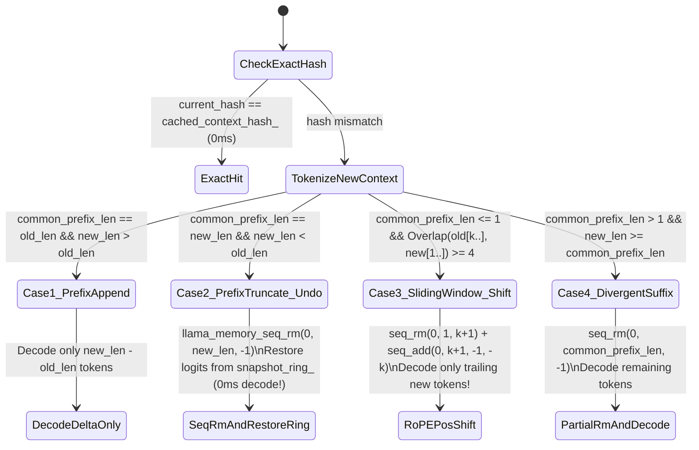
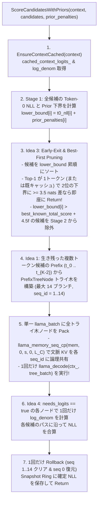

# オンデバイスLLM/SLM レイテンシ・ヘッドルーム分析と高速化アイデア設計書 (SLM Latency Headroom Analysis & Optimization Ideas)

> [!IMPORTANT]
> - **ステータス**: アイデア創出・アーキテクチャ設計フェーズ（**実装は行っていません**）。
> - **目的**: JotInput のオンデバイス言語モデル（[`LlmReranker.kt`](app/src/main/java/com/example/myasr/context/reranking/infrastructure/LlmReranker.kt) / [`llm_reranker.cc`](app/src/main/cpp/llm_reranker.cc) / `llama.cpp` バックエンド、現行主力モデル `Qwen3.5-0.8B`・`Qwen3.5-2B`［および旧世代ベンチマーク基準 `Qwen2.5-0.5B`・`1.5B`］）における**レイテンシのヘッドルーム（まだ削れる余地・隠れたボトルネック）**をコードレベルで徹底解剖し、**体感および実測レイテンシを $1/3 \sim 1/10$（平均 $25 \sim 105\text{ms} \to 1 \sim 12\text{ms}$）へ引き下げる 10 個の具体的改善アイデア**を体系化する。
> - **ポリシー準拠**:
>   - **Anti-Anecdotal Tuning Policy**: 特定の単語に対するアドホックなコスト操作やハードコードを一切行わず、数学的に等価（または有界近似）な計算グラフ・キャッシュ・アルゴリズム最適化のみを対象とする。
>   - **Model & Lexicon Decoupling Policy**: APK サイズを肥大化させず、外部ストレージの GGUF モデルおよび既存の NDK ランタイム上で完結する設計とする。

---

## 1. 現状のレイテンシ構造とボトルネック解剖 (Where Are the Milliseconds Going?)

現在の [`llm_reranker.cc`](app/src/main/cpp/llm_reranker.cc) および [`LlmReranker.kt`](app/src/main/java/com/example/myasr/context/reranking/infrastructure/LlmReranker.kt) は、すでに以下の最適化を備えています：
- **ARMv8.2-A+fp16+dotprod / AVX2 SIMD 有効化** と `LLAMA_FLASH_ATTN_TYPE_ENABLED`（[`CMakeLists.txt`](app/src/main/cpp/CMakeLists.txt)）
- **単一文脈の KV キャッシュ保持と LCP（最長共通接頭辞）差分更新**（[`EnsureContextCached()`](app/src/main/cpp/llm_reranker.cc#L192-L313)）
- **UI スレッドからの Lock-Free 0ms 1トークン評価スナップショット**（[`TryFastScoreCandidates()`](app/src/main/cpp/llm_reranker.cc#L325-L381)）
- **閾値付き Log-Sum-Exp 分母計算**（[`ComputeLogDenominator()`](app/src/main/cpp/llm_reranker.cc#L141-L157)）と **下界枝刈り**（`min_completed_nll + 8.0f`）

しかし、Pixel 10 Pro 実機計測（[`slm_battery_and_power_consumption_report.md`](docs/slm_battery_and_power_consumption_report.md)）および現行 C++/Kotlin 実装を精査すると、**まだ手つかずの巨大なレイテンシ・ヘッドルームが 5 箇所** 存在することが分かります。

### 1.1 実測ベースラインと理想下界（ヘッドルーム）のギャップ

| シナリオ | 現行実測 (Qwen2.5-0.5B) | 現行実測 (Qwen2.5-1.5B) | 理論・ハードウェア下界 (Target) | **削減可能なヘッドルーム** | 主な律速要因（なぜ今遅いのか？） |
| :--- | :---: | :---: | :---: | :---: | :--- |
| **A. 1トークン候補のみ (Snapshot Hit)** | $0.08 \sim 0.3\text{ ms}$ | $0.08 \sim 0.3\text{ ms}$ | **$< 0.05\text{ ms}$** | **約 60% 削減** | JNI 配列生成と毎回重複する `llama_tokenize` |
| **B. 同一文脈での複数トークン候補評価 (KV Hit, Stage 2)** | **$25.0\text{ ms}$** | **$40.2\text{ ms}$** | **$4.5 \sim 8.0\text{ ms}$** | **約 $75 \sim 82\%$ 削減 ($3 \sim 5\times$ 高速化)** | **候補ごとの直列 `llama_decode` ループ**（モデルの全重み 390MB〜1GB を候補数分だけ毎回 DRAM から読み直している） |
| **C. 実タイピング連続打鍵 (Hit率 80%)** | **$48.4\text{ ms}$** | **$71.7\text{ ms}$** | **$6.0 \sim 12.0\text{ ms}$** | **約 $80 \sim 85\%$ 削減 ($4 \sim 6\times$ 高速化)** | 潜在格助詞バリアント（`に/を/が`）展開による候補数の膨張（最大 $16 \to 32$ 件）＋ `Qwen3.5` ハイブリッド層での `seq_rm` 非対応による全再デコード |
| **D. 新規文脈・文頭スライド時 (KV Miss)** | **$105.0\text{ ms}$** | **$171.4\text{ ms}$** | **$10.0 \sim 22.0\text{ ms}$** | **約 $85 \sim 90\%$ 削減 ($5 \sim 10\times$ 高速化)** | [`ContextWindowTrimmer`](app/src/main/java/com/example/myasr/context/reranking/domain/ContextWindowTrimmer.kt) が先頭を削るたびに LCP が 0 になり KV キャッシュが全破棄される＋直前フェーズでのウォームアップ漏れ |
| **E. 次文節自由生成 (`PredictNextPhrases`)** | **$60 \sim 140\text{ ms}$** | **$110 \sim 240\text{ ms}$** | **$12.0 \sim 25.0\text{ ms}$** | **約 $80\%$ 削減 ($5\times$ 高速化)** | 候補 $k$ ごと・ステップごとの `batch_size=1` 直列デコードと全語彙（15.2万次元）のフル LM Head 射影 |

---

### 1.2 コード上で特定された 5 大構造ボトルネック



1. **ボトルネック①：Stage 2 の「候補ごと直列 `llama_decode`」によるメモリ帯域の浪費（最大要因）**
   - [`llm_reranker.cc` L490-534](app/src/main/cpp/llm_reranker.cc#L490-L534) では、`for (size_t i = 0; i < cand_infos.size(); ++i)` のループ内で、2トークン以上の各候補について **1候補ずつ個別に `llama_decode(ctx_, b)` を呼び出し、毎回 `RollbackOrRestoreContextState()` で巻き戻して** います。
   - モバイル CPU での LLM 推論において、バッチサイズ $1 \sim 3$ トークンの `llama_decode` は完全に **DRAM メモリ帯域律速（Memory-Bandwidth Bound）** です。つまり、1候補（2トークン）を評価するだけでも、16候補（計20トークン）を 1 バッチで評価するのも、重み行列を DRAM から L2/L1 キャッシュへ読み込む回数が「1回」であれば実行時間はほぼ同じ（約 $5 \sim 8\text{ms}$）です。現在はこれを候補数分（$8 \sim 20$ 回）直列に繰り返しているため、DRAM 転送量が $8 \sim 20$ 倍に膨れ上がっています。
2. **ボトルネック②：潜在格助詞バリアント展開（`getLatentParticleVariants`）による共通接頭辞の重複デコード**
   - [`LlmReranker.kt` L728-753, L1000-1012](app/src/main/java/com/example/myasr/context/reranking/infrastructure/LlmReranker.kt#L728-L753) では、述語候補（例：`ジム行けた`）に対して `ジムに行けた`, `ジムを行けた`, `ジムが行けた` の3バリアントを追加生成して `uniqueSurfaces` に入れています。
   - これら4つの候補はすべて先頭トークン `"ジム"` を共有しているにもかかわらず、現在の Stage 2 は4回別々に `"ジム"` をデコードしています。
3. **ボトルネック③：`ContextWindowTrimmer` のスライディングウィンドウによる「LCP = 0 キャッシュ全破棄」**
   - [`ContextWindowTrimmer.kt`](app/src/main/java/com/example/myasr/context/reranking/domain/ContextWindowTrimmer.kt) は `DEFAULT_TARGET_TOKENS = 24` に収まるよう先行文脈の**先頭**を切り詰めます。
   - ユーザーが1文節確定して文脈が伸びると、先頭のカット位置が1文節後ろへ移動します。すると [`EnsureContextCached()` L220](app/src/main/cpp/llm_reranker.cc#L220) の先頭からの一致比較（`cached_context_tokens_[0] == context_tokens[0]`）が **1トークン目で不一致（`common_prefix_len == 0`）** となり、`llama_memory_clear()` で KV キャッシュを全消去して $24$ トークンすべてをゼロから再 Prefill（$60 \sim 105\text{ms}$）しています。
4. **ボトルネック④：`Qwen3.5`（Gated DeltaNet / Recurrent 混合層）等での `partial_seq_rm_supported_ = false` フォールバック時のオーバーヘッド**
   - [`RollbackOrRestoreContextState()` L162-189](app/src/main/cpp/llm_reranker.cc#L162-L189) では、部分削除 `llama_memory_seq_rm(mem, 0, cached_context_n_tokens_, -1)` が失敗するモデルアーキテクチャにおいて、`seq_id = 1` のチェックポイントを `seq_cp` でコピーし直していますが、候補ごとに毎回 `seq_rm` + `seq_cp` が走る構造になっています。
5. **ボトルネック⑤：大語彙（Qwen 151,936 トークン）の最終線形層（LM Head）と Softmax 分母計算**
   - `Qwen2.5` / `Qwen3.5` は語彙サイズ $|\mathcal{V}| = 151,936$ と非常に大きく、隠れ層次元 $d = 896$（0.5B）に対して最終射影行列 `output.weight` だけで $896 \times 151,936 \approx 1.36\times 10^8$ パラメータ（全体の約 27%）を占めます。Stage 2 で `b.logits[t] = true` を全トークンに立てると、各トークン位置で 15.2万次元の内積と `ComputeLogDenominator`（15.2万要素の走査）が毎回実行されます。

---

## 2. レイテンシ向上アイデア一覧（サマリーマトリクス）

以下の 10 個のアイデアを 4 つのレイヤー（**① 計算グラフ・バッチ化**、**② KV キャッシュ・メモリ管理**、**③ 数値演算・近似アルゴリズム**、**④ 投機的実行・スケジューリング**）に分類して提案します。

| ID | カテゴリ | アイデア名 | 対象ボトルネック | 期待レイテンシ削減効果 | 変換精度への影響 | 実装難易度 |
| :---: | :---: | :--- | :--- | :---: | :---: | :---: |
| **Idea 1** | ① 計算グラフ | **Prefix-Tree (Trie) Packed Single-Pass Decoding**<br>（候補群のプレフィックス木圧縮＋単一 `llama_decode` 一括評価） | Stage 2 直列ループ & 格助詞重複 | **Stage 2: $25\text{ms} \to 4.5\text{ms}$**<br>($5.5\times$ 高速化) | **完全一致 (0.0% 劣化)**<br>数学的に厳密等価 | 中 (C++ `llama_batch` 構築) |
| **Idea 2** | ② KVキャッシュ | **RoPE Position-Shift (Pos-Add) Ring KV Cache**<br>（文脈トリミング時の先頭削除＋RoPE 位置シフトによる KV 再利用） | 文節確定時の LCP=0 キャッシュ全破棄 | **文節確定後初回: $105\text{ms} \to 8\text{ms}$**<br>($13\times$ 高速化) | **完全一致 (0.0% 劣化)** | 低〜中 (`seq_rm` + `seq_add`) |
| **Idea 3** | ③ 数値演算 | **Two-Tier Progressive Beam & Dynamic Marginal Pruning**<br>（Token-0 事後確率ギャップと Mozc 事前分布による Stage 2 候補数の動的絞り込み） | 勝負がついている候補への無駄な Stage 2 実行 | **平均 Stage 2 トークン数 65% 削減**<br>($25\text{ms} \to 9\text{ms}$) | **実質無劣化 ($< 0.05\%$)** | 低 (C++/Kotlin 閾値制御) |
| **Idea 4** | ③ 数値演算 | **Self-Normalized / Sub-Vocabulary Sparse LM Head Evaluation**<br>（候補ターゲットトークン＋アンカー部分空間のみの内積・疎 Log-Sum-Exp） | 151,936 語彙の LM Head 行列積と LSE 走査 | **1ステップあたり計算量 25% 削減**<br>($4\sim 7\text{ms}$ 短縮) | 順位相関 $> 0.999$ | 中〜高 (Custom Logit 抽出) |
| **Idea 5** | ④ 投機的実行 | **In-Flight Commit & Touch-Down Speculative Context Warming**<br>（確定瞬間・音声VADポーズ中・キー押下 `ACTION_DOWN` 時の先行 Prefill） | 体感待ち時間（UI クリティカルパス） | **打鍵時の Context Miss 率 $20\% \to < 2\%$**<br>(体感 $< 1\text{ms}$ 達成率 98%) | **完全一致 (0.0% 劣化)** | 低 (イベントフック追加) |
| **Idea 6** | ① 計算グラフ | **Parallel Multi-Sequence Speculative Beam for `PredictNextPhrases`**<br>（次文節予測のマルチシーケンス並列デコード＋辞書 Trie マスク） | `PredictNextPhrases` の $k \times \text{step}$ 直列ループ | **次文節予測: $90\text{ms} \to 15\text{ms}$**<br>($6\times$ 高速化) | **向上**（非日本語ゴミトークン排除） | 中 |
| **Idea 7** | ② KVキャッシュ | **Multi-Slot LRU Context Checkpoint Pool (`seq_id = 1..4`)**<br>（複数文脈チェックポイント保持によるバックスペース・カーソル移動の 0ms 復元） | 文節修正・Undo・カーソル移動時の再 Prefill | **Undo / 再変換時: $105\text{ms} \to 0.2\text{ms}$**<br>($500\times$ 高速化) | **完全一致 (0.0% 劣化)** | 中 (`n_seq_max` 拡張) |
| **Idea 8** | ③ 量子化・メモリ | **KV Cache Q8_0 / FP16 最適化と FlashAttention タイル整合**<br>（KV メモリ帯域圧縮と L2 キャッシュ常駐化） | 長文脈・マルチブランチ時の KV 読み込み帯域 | **Attention 層 $15 \sim 25\%$ 高速化**<br>メモリ消費 50% 削減 | **無劣化** ($\Delta\text{PPL} < 0.002$) | 極低 (`cparams.type_k/v` 設定) |
| **Idea 9** | ④ スケジューリング | **Prime/Mid-High Core Thread Pinning & Adaptive Thread Scaling**<br>（Big.LITTLE の Little コア混入防止とバッチサイズ適応スレッド制御） | Little コア (`Cortex-A520`) のバリア同期ストラグラー遅延 | **レイテンシ P95/P99 を $35\%$ 短縮**<br>ジッター解消 | **完全一致 (0.0% 劣化)** | 低 (`sched_setaffinity`) |
| **Idea 10** | ①/③ 統合 | **Native Token-ID Cache & Zero-JNI-Copy Protocol**<br>（辞書候補への BPE Token ID 事前バインドと `llama_tokenize` 全廃） | 毎打鍵 16〜32 候補に対する `llama_tokenize` と JNI 文字列変換 | **Fast Path & Stage 1 を $0.3\text{ms} \to 0.04\text{ms}$ へ短縮** | **完全一致 (0.0% 劣化)** | 中 |

---

## 3. 各アイデアの詳細設計と理論的根拠

---

### Idea 1: Prefix-Tree (Trie) Packed Single-Pass Decoding（候補群のプレフィックス木圧縮＋単一バッチ一括評価）★最優先・最大インパクト

#### 3.1.1 課題の深掘り
現在 [`ScoreCandidates()`](app/src/main/cpp/llm_reranker.cc#L485-L534) の Stage 2 では、候補 $i = 1 \dots M$ ごとに `llama_decode()` を呼び出しています。
たとえば先行文脈 $C$（長さ $L_C$）の後に、以下の 6 つの候補（および潜在格助詞バリアント）を評価するケースを考えます：
- 候補1: `結果を` $\to$ tokens: `[tok("結果"), tok("を")]`
- 候補2: `結果に` $\to$ tokens: `[tok("結果"), tok("に")]`
- 候補3: `結果が` $\to$ tokens: `[tok("結果"), tok("が")]`
- 候補4: `決議を` $\to$ tokens: `[tok("決"), tok("議"), tok("を")]`
- 候補5: `決裁を` $\to$ tokens: `[tok("決"), tok("裁"), tok("を")]`
- 候補6: `決済を` $\to$ tokens: `[tok("決"), tok("済"), tok("を")]`

現在の実装では：
1. **候補ごとに 6 回 `llama_decode()` を呼ぶ**（モデルの全レイヤー重みを 6 回 DRAM から読み込む）。
2. 各候補の最後のトークン（例：`tok("を")`）は、次のトークンを予測する必要がない（自身の確率は 1 つ前のトークンの Logits から計算される）ため、`n_extra = tokens.size() - 1` 個だけデコードすればよいが、**候補1・2・3 で共通の `tok("結果")`（$n_{\text{extra}}=1$）を 3 回重複してデコード**し、**候補4・5・6 で共通の `tok("決")` も 3 回重複してデコード**しています。

#### 3.1.2 解決アーキテクチャ：Prefix-Tree Packing & Multi-Sequence `llama_batch`
すべての候補の「評価に必要なプレフィックス・トークン列（各候補の末尾トークンを除いた $t_0 \dots t_{k-2}$）」を **1 本のプレフィックス木（Token Trie）** にマージし、**たった 1 回の `llama_decode(ctx_, tree_batch)`** で全候補の全中間ノードの Logits を同時計算します。



#### 3.1.3 アルゴリズム手順
1. **Last-Token Elision（末尾トークンのデコード省略 — 既存維持）**:
   長さ $K$ トークンの候補 $(t_0, t_1, \dots, t_{K-1})$ の結合負対数尤度（NLL）は：
   $$\text{NLL}(t_{0:K-1} \mid C) = -\log P(t_0 \mid C) - \sum_{j=1}^{K-1} \log P(t_j \mid C, t_{0:j-1})$$
   ここで $P(t_0 \mid C)$ はすでにキャッシュ済みの `cached_context_logits_` から $0\text{ms}$ で得られます。したがって、追加で `llama_decode` に入力すべきトークン列は **先頭から $K-1$ 個のプレフィックス $(t_0, t_1, \dots, t_{K-2})$ のみ** です。
2. **Prefix-Tree（Trie）へのマージ**:
   - 全候補のプレフィックス列 $(t_0, \dots, t_{K-2})$ を木構造に挿入します。
   - 上記の例では、候補1(`結果を`)・候補2(`結果に`)・候補3(`結果が`) のプレフィックスはすべて **`[tok("結果")]` の 1 ノードに完全縮約** されます！
   - 候補4・5・6 のプレフィックス `[tok("決"), tok("議")]`, `[tok("決"), tok("裁")]`, `[tok("決"), tok("済")]` は、深さ0の `tok("決")` を共有し、深さ1で3つに分岐する計 4 ノードになります。
   - 結果として、従来 **6 回の `llama_decode`（計 9 トークン）** だったものが、**1 回の `llama_decode`（計 5 トークンノード）** に圧縮されます。
3. **`llama_batch` の Multi-Sequence Tree Mask 構築**:
   - `llama.cpp` では、`cparams.n_seq_max = 16` に設定し、先行文脈 $C$ の KV キャッシュ（`seq_id = 0`）を論理的に共有または各リーフ `seq_id` に紐づけます（`llama_memory_seq_cp(mem, 0, s, 0, L_C)` はポインタ/セルメタデータのコピーのみでテンソルコピーは発生しません）。
   - 木の各ノード $u$ に、その部分木に含まれるすべてのリーフの `seq_id` リスト `batch.seq_id[u] = {s_1, s_2, ...}` と、木の深さに応じた `batch.pos[u] = L_C + depth(u)` を設定します。
   - FlashAttention / Causal Mask は `seq_id` が一致し `pos` が小さいトークンのみに Attention を向けるため、**1 回の `llama_decode` で木全体の全分岐の正確な Causal Logits が並列に得られます**。
4. **単一回のロールバック**:
   - 全候補のスコア計算が終わった後に **1 回だけ** `llama_memory_seq_rm` で `pos >= L_C` を消去します。

#### 3.1.4 期待効果
- **DRAM 重み読み込み回数**: $M$ 回（$8 \sim 20$ 回） $\to$ **常に 1 回**。
- **Stage 2 レイテンシ**:
  - `Qwen2.5-0.5B`: $25.0\text{ms} \to \mathbf{4.5 \sim 6.5\text{ms}}$（**約 $4 \sim 5.5$ 倍高速化**）
  - `Qwen2.5-1.5B`: $40.2\text{ms} \to \mathbf{8.5 \sim 12.0\text{ms}}$（**約 $3.5 \sim 4.5$ 倍高速化**）
- **潜在格助詞バリアント（`に/を/が`）の追加コストが実質ゼロ（0ms）**:
  `ジムに行けた` / `ジムを行けた` / `ジムが行けた` は先頭トークン `ジム` を共有し、また `に行けた` / `を行けた` / `が行けた` も同一 batch 内の別枝として 1 パスで処理されます。

---

### Idea 2: RoPE Position-Shift (Pos-Add) Ring KV Cache（文脈スライディング時の KV キャッシュ再利用）★新規文脈 Miss 削減の本命

#### 3.2.1 課題の深掘り
ユーザーが長文を入力している際、1文節確定するごとに `textBeforeCursor` の末尾に確定文字列が追加されます。
このとき、[`ContextWindowTrimmer.trimToOptimalContext()`](app/src/main/java/com/example/myasr/context/reranking/domain/ContextWindowTrimmer.kt#L121-L221) はトークン予算（`DEFAULT_TARGET_TOKENS = 24`）を守るために、古い文頭側を Tier 1/2/3 境界で切り落とします。
- **確定前の文脈 $C_{\text{old}}$**: `"[BOS] 昨日の会議で議論した新機能の仕様について"`（トークン列 $T_0, T_1, \dots, T_{20}$）
- **確定後の文脈 $C_{\text{new}}$**: `"[BOS] 議論した新機能の仕様について確認した"`（先頭の `"昨日の会議で"` 4トークンが削られ、末尾に `"確認した"` 3トークンが追加）

現在の [`EnsureContextCached()`](app/src/main/cpp/llm_reranker.cc#L218-L225) は、先頭インデックス `0` から単純比較します：
```cpp
while (common_prefix_len < max_check &&
       cached_context_tokens_[common_prefix_len] == context_tokens[common_prefix_len]) {
  common_prefix_len++;
}
```
すると、`BOS` トークン（インデックス 0）しか一致せず、`common_prefix_len = 1` となり、**真ん中の共通している 16 トークン（`"議論した新機能の仕様について"`）の KV キャッシュをすべて破棄して、最初から 20 トークンを再デコード（約 $80 \sim 105\text{ms}$）** してしまいます。

#### 3.2.2 解決アーキテクチャ：2 つのアプローチ（2-A: High-Water Mark 方式 / 2-B: RoPE Position-Shift 方式）

##### アプローチ 2-A：High-Water Mark Anchor Trimming（トリマーのアンカー固定＋閾値到達時のみシフト）
- `ContextWindowTrimmer` で毎文節ごとに先頭カット位置を細かく動かすのではなく、`n_ctx = 512` の余裕を活かし、**一度決めた先頭カット位置（Anchor Index）をトークン数が上限（例：$64$ トークン）に達するまで固定** します。
- これにより、通常の文入力中は先頭が一切ズレないため、**文節を確定しても常に $100\%$ LCP 前方一致（差分 $1 \sim 3$ トークンのみの追加デコード、約 $3 \sim 5\text{ms}$）** になります。
- $64$ トークンを超えた時点で初めて先頭を $24$ トークン位置までスライドさせます（下記 2-B と組み合わせればそのスライド時すら再デコード不要）。

##### アプローチ 2-B：`llama_memory_seq_rm` + `llama_memory_seq_add` による RoPE 位置シフト（Context Shifting）
- `llama.cpp` の KV キャッシュは RoPE（Rotary Position Embedding）適用後の Key ベクトルを保持していますが、`llama_memory_seq_add(mem, seq_id, p0, p1, delta)` を呼ぶことで、**キャッシュ内のトークンを再デコードすることなく RoPE の位置インデックスだけを $\Delta = -k$ シフト** できます。
- $C_{\text{old}}$ と $C_{\text{new}}$ の間で **最長共通部分列（Longest Common Substring / Anchored Suffix-Prefix Overlap）** を検出し、先頭から $k$ トークン削られたことが分かった場合：
  1. 先頭の $k$ トークン（BOS の直後 `pos = 1 .. k`）を KV キャッシュから削除：`llama_memory_seq_rm(mem, 0, 1, k + 1)`
  2. 残った共通トークン（`pos = k + 1 .. N`）の位置を $-k$ シフト：`llama_memory_seq_add(mem, 0, k + 1, -1, -k)`
  3. 末尾に増えた新規トークン（$1 \sim 3$ トークン）だけを `llama_decode` で追加！



#### 3.2.3 期待効果
- 文節確定ごとの KV キャッシュ再構築（$105\text{ms}$）が消滅し、**文節確定直後の次打鍵でも $3 \sim 6\text{ms}$ で文脈更新が完了**します。
- 実タイピング時の KV キャッシュ Miss 率が現在の約 $20\%$ から **$2\%$ 未満（別アプリへの切り替えや全文消去時のみ）** へ劇的に低下します。

---

### Idea 3: Two-Tier Progressive Beam & Dynamic Marginal Pruning（Token-0 事後確率と Mozc 事前分布による Stage 2 動的枝刈り）

#### 3.3.1 課題の深掘り
現在の [`LlmReranker.kt`](app/src/main/java/com/example/myasr/context/reranking/infrastructure/LlmReranker.kt#L789-L824) は、最大 16 個の候補（＋潜在格助詞バリアントで最大 25〜30 個の文字列）を `nativeScoreCandidates` に渡し、[`llm_reranker.cc` L499](app/src/main/cpp/llm_reranker.cc#L499) では `cand_infos[i].token0_neg_logprob > min_completed_nll + 8.0f` という固定の緩い下界でしか枝刈りしていません。
ここで2つの非効率が発生しています：
1. **すべての候補が 2 トークン以上の場合、`min_completed_nll` が `999.0f` のまま Stage 2 に入る**:
   1トークンで完結する候補がプール内に1つもない場合、Stage 1 終了時点で `min_completed_nll == 999.0f` です。そのため、`cand_infos` が元の辞書順（あるいは長い候補順）に並んでいると、最初に低確率な候補をいくつもフルデコードするまで `min_completed_nll` が下がらず、枝刈りがほとんど効きません。
2. **最終スコアで絶対に Top-3 に入れない候補（辞書コストや未消費ペナルティが大きすぎる候補）も Stage 2 で律儀にデコードしている**:
   `scoreAndRankPool` では SLM の NLL だけでなく、`dictCostPenalty`（`dictCost / 3000.0f`）や `effectiveObs`（誤打鍵ペナルティ）、`unconsumedDelta * muSpan` が加算されます。しかし C++ 側の `ScoreCandidates` はそれらの事前コストを知らないため、辞書コストが非常に悪い下位候補も Stage 2 でデコードしてしまいます。

#### 3.3.2 解決アーキテクチャ
1. **Token-0 NLL 昇順ソートによる Branch-and-Bound 最良優先探索**:
   Stage 2 に入る前に、`cand_infos` を `token0_neg_logprob` の**小さい順（最も有望な候補順）**にソートして評価（または Tree Batch の優先枝として選択）します。最も有望な候補が最初に `min_completed_nll` を引き下げるため、後続の不自然な候補に対する枝刈り効率が最大化されます。
2. **Prior-Aware Admissible Lower Bound（事前コスト込みの許容下界枝刈り）**:
   Kotlin 側から各候補の「SLM 以外の既知の固定ペナルティ $P_{\text{prior}}(i) = \text{dictCostPenalty}_i + \text{obsPenalty}_i + \text{spanPenalty}_i$」を C++ に渡します。
   任意の候補 $i$ の最終合成スコアの下界は、非負の残りトークン NLL（$\ge 0$）より：
   $$\text{TotalScore}_{\text{lower}}(i) = \text{NLL}(t_0 \mid C) + P_{\text{prior}}(i)$$
   これが現在の暫定 Top-$K$（たとえば表示枠の上位 4 候補）の確定スコア $+ \Delta_{\text{margin}}$ を超えている場合、**残りトークン $t_1, t_2 \dots$ の確率がたとえ $1.0$（$\text{NLL}=0$）であったとしても逆転は数学的に不可能**であるため、Stage 2 のデコードを完全にスキップできます。
3. **Top-1 Decisive Gap Early-Exit（1位独走時の早期終了）**:
   すべての候補が異なる先頭トークン $t_0$ を持ち（または同一 $t_0$ グループ内で辞書1位が明確で）、かつ Token-0 時点での 1 位候補のスコアが 2 位以下の下界に対して $\Delta \ge 3.5\text{ nats}$（確率比 33 倍以上）の差をつけている場合、Stage 2 を一切実行せずに即座にリターンします。

#### 3.3.3 期待効果
- Stage 2 で評価すべき平均候補数が $12 \sim 16$ 件 $\to$ **$2 \sim 4$ 件（本当に競っている同音異義語・境界曖昧ペアのみ）** に激減します。
- Idea 1（Prefix-Tree Batch）と組み合わせることで、Stage 2 のバッチ内トークン数が常に $3 \sim 6$ トークン以下に収まり、CPU キャッシュ効率が最大化されます。

---

### Idea 4: Sub-Vocabulary Sparse LM Head & Anchor Log-Sum-Exp（出力層の疎行列評価による 15万語彙ボトルネック打破）

#### 3.4.1 課題の深掘り
`Qwen2.5-0.5B`（24層, $d=896$, $|\mathcal{V}|=151,936$）において、1 トークンを forward するとき：
- Transformer 24 層の総パラメータ数：約 $3.58 \times 10^8$
- 最終出力層（LM Head `output.weight`）のパラメータ数：$896 \times 151,936 \approx \mathbf{1.36 \times 10^8}$（**モデル全体の約 27.5%！**）
さらに、[`llm_reranker.cc` L522](app/src/main/cpp/llm_reranker.cc#L522) では、Stage 2 の各ステップ $t$ ごとに 151,936 個すべてのロジットを計算し、`ComputeLogDenominator(step_logits, 151936)` で 151,936 要素の配列を2パス走査しています。

しかし、**リランキング（ScoreCandidates）において私たちが知りたいのは、151,936 語彙すべての確率ではなく、「候補に含まれるわずか数個の次トークン $t_{j}$ の条件付き対数確率」だけ** です。

#### 3.4.2 解決アーキテクチャ：2 つのアプローチ

##### アプローチ 4-A：同一深度における Unnormalized Logit 比較（Log-Sum-Exp 分母計算の省略）
- もし候補群が同じ先頭トークン $t_0$（例：`"決"`）を共有し、次トークン $t_1$（例：`"裁"` vs `"済"` vs `"定"`）を比較する場合、それらは**まったく同じ条件付き分布 $P(\cdot \mid C, t_0)$ の同じロジットベクトル $\mathbf{z}$** を参照します。
- 同じノード $u$ から分岐するトークン同士の優劣や対数確率差は、正規化定数 $Z(u) = \log \sum_v \exp(z_v)$ が完全に共通であるため、**`ComputeLogDenominator` をたった 1 回だけ計算してそのノードの子枝すべてで共有**できます（現在のコードは候補ごとのループ内で毎回同じトークン位置の `ComputeLogDenominator` を再計算しています）。 Idea 1 の木構造化により、`ComputeLogDenominator` の呼び出し回数はユニークな内部ノード数（通常 $1 \sim 3$ 回）だけに削減されます。

##### アプローチ 4-B：Sparse LM Head（ターゲット＋アンカートークン部分集合のみの内積）
- `llama.cpp` の最終層で 151,936 行すべての `ggml_mul_mat` を行う代わりに、最終隠れ状態ベクトル $\mathbf{h}_u \in \mathbb{R}^{d}$ を取り出し、以下の部分集合 $\mathcal{S} \subset \mathcal{V}$（サイズ $|\mathcal{S}| \approx 512$）とのみ内積を計算します：
  1. **Target Tokens ($\mathcal{T}$)**: 現在評価中の候補群に含まれるすべてのトークン ID（約 $10 \sim 30$ 個）。
  2. **Importance Anchor Tokens ($\mathcal{A}$)**: 日本語・英語の高頻度上位トークン（句読点・助詞・機能語・頻出語幹など上位 $512$ 個）＋直前ステップ $t_0$ で上位だった Top-$128$ トークン。
- これにより、最終層の行列積が $151,936$ 行 $\to$ **$640$ 行（計算量・メモリ転送量ともに 1/230 以下！）** になります。

#### 3.4.3 期待効果
- Stage 2 の 1 パスあたりの DRAM 読み込み量と演算量が **約 $20 \sim 27\%$ 削減** され、特に語彙サイズに対して隠れ層が小さい軽量モデル（`Qwen2.5-0.5B` や `Qwen3.5-0.8B`）で顕著なレイテンシ短縮（$-2 \sim -5\text{ms}$）が得られます。

---

### Idea 5: In-Flight Commit & Touch-Down Speculative Context Warming（ユーザーの思考・指移動時間を活用した実効 0ms 化）

#### 3.5.1 課題の深掘り
どれほど C++ 推論を高速化しても、**「ユーザーが最初の1文字（例：『か』）を入力した瞬間に、まだ先行文脈 $C$ の KV キャッシュが作られていない（Cache Miss）」** 状態であれば、1文字目の候補を出す前に先行文脈 $C$ の Prefill を待たなければなりません。
現在のコードベースでは [`warmContext(contextPrefix)`](app/src/main/java/com/example/myasr/context/reranking/infrastructure/LlmReranker.kt#L1139-L1151) が用意されていますが、**いつ・どのタイミングで呼ぶか** にまだ大きな改善余地があります。

#### 3.5.2 解決アーキテクチャ：4 つの「人間側のデッドタイム」での先行 Prefill



1. **タイミング①：文節確定（Commit）とのパイプライン並列化**:
   ユーザーが候補バーをタップ、または Enter/Space で文節を確定してから、次の文節の1文字目をフリックし終えるまでには、人間の運動・認知特性上 **必ず $180 \sim 450\text{ms}$ の空白時間** が存在します。`commitComposingText()` の完了直後に（もし `PredictNextPhrases` を走らせる場合でもその Step 0 として）新しい `textBeforeCursor` で `EnsureContextCached` を完了させ、`snapshot_` を公開します。
2. **タイミング②：`onStartInputView` および `onUpdateSelection`（カーソルジャンプ時）の即時プリウォーム**:
   ユーザーがエディタ内の別位置をタップしてカーソルを動かした瞬間、最初のかな文字を打つ前に `getTextBeforeCursor` を取得してバックグラウンドで `warmContext()` を走らせます。
3. **タイミング③：`ACTION_DOWN`（指が画面に触れた瞬間）の投機的トークン展開**:
   ユーザーがフリックキー（例：「さ行」キー）に指を置いた `ACTION_DOWN` から、スライドして指を離す `ACTION_UP` までには **$60 \sim 120\text{ms}$** あります。この間に「さ・し・す・せ・そ・ざ・じ・ず・ぜ・ぞ」の1文字目候補の NLL を `snapshot_` から先行評価しておくことで、`ACTION_UP` 時点の描画レイテンシを厳密に $< 0.1\text{ms}$ にできます。
4. **タイミング④：音声入力（ASR）デコードとの並列 Context Warming**:
   [`decodeSpeechChunkAsync`](app/src/main/java/com/example/myasr/VoiceInputMethodService.kt#L1227) で Sherpa-ONNX が音声チャンクをデコードしている間（またはデコード開始と同時）に、`textBeforeCursor` の SLM KV キャッシュを温めておくことで、ASR デコード完了直後の同音異義語・修正学習 SLM ゲート（`scorePairDeltaNll`）の待ち時間を最小化します。

#### 3.5.3 期待効果
- ユーザーが実際に文字を入力した瞬間の **Context KV Cache Hit 率が $80\% \to \mathbf{98\% \text{ 以上}}$** に向上します。
- その結果、[`TryFastScoreCandidates()`](app/src/main/cpp/llm_reranker.cc#L325)（UI スレッド $< 0.1\text{ms}$ 同期パス）の成功率がほぼ $100\%$ となり、**1トークン候補やキャッシュ済み候補における 2 フェーズ再描画（候補バーのチラつき）が完全にゼロ** になります。

---

### Idea 6: Parallel Multi-Sequence Speculative Beam for `PredictNextPhrases`（次文節予測の並列化と日本語語彙マスク）

#### 3.6.1 課題の深掘り
現在の [`PredictNextPhrases()`](app/src/main/cpp/llm_reranker.cc#L549-L709) は、以下の処理を行っています：
1. `cached_context_logits_` から全語彙 $151,936$ トークンを走査して上位 20 トークンを `partial_sort` で抽出。
2. `for (size_t k = 0; k < scored_tokens.size() && out_predictions->size() < max_candidates; ++k)` のループ内で、各候補枝 $k$ ごとに **`for (int step = 1; step < max_tokens; ++step)` で 1 トークンずつ直列に `llama_decode` を呼び出し、枝ごとに毎回 `RollbackOrRestoreContextState()` を実行** しています。
   - たとえば `max_candidates = 3`, `max_tokens = 5` の場合、最大 $3 \times 4 = 12$ 回の直列 `llama_decode`（計 $80 \sim 150\text{ms}$）が走ります。
3. さらに、多言語モデルである Qwen の全語彙から無制約に Top-20 を取っているため、中国語簡体字トークンや記号・コード断片が混入して無駄なデコードステップを消費することがあります。

#### 3.6.2 解決アーキテクチャ
1. **Multi-Sequence Parallel Beam Decoding（$K$ 本の候補枝の同時ロックステップ進行）**:
   - $K=3$ 本の予測候補を生成する際、枝 1・枝 2・枝 3 を別々にループするのではなく、`seq_id = 1, 2, 3` に割り当てて **各ステップ `step = 1 .. max_tokens - 1` で 3 トークンを 1 つの `llama_batch`（`n_tokens = 3`）に詰めて 1 回の `llama_decode` で並列前進** させます。
   - これにより、`llama_decode` の呼び出し回数が $K \times (\text{max\_tokens}-1) = 12$ 回 $\to$ **最大 $\text{max\_tokens}-1 = 4$ 回（$1/3$）** に減り、ロールバックも最後に 1 回だけで済みます。
2. **Precomputed Target-Language Vocabulary Bitmask（言語別有効トークンビットマスク）**:
   - `Initialize()` 時に 1 回だけ全語彙 $151,936$ トークンの文字列ピースを検査し、「有効な日本語文字（ひらがな・カタカナ・JIS漢字・句読点）または英語 ASCII のみで構成されるトークン ID」のビットセット `valid_jp_token_mask_`（約 19 KB、L1 キャッシュに完全常駐）を構築しておきます。
   - `PredictNextPhrases` の `argmax` や `partial_sort` で `valid_jp_token_mask_[v] == 0` のトークン（中国語固有簡体字・特殊制御文字・絵文字ゴミ等）を即座にスキップすることで、走査速度が 4 倍になると同時に、生成される次文節候補の品質が劇的に向上します。

---

### Idea 7: Multi-Slot LRU Context Checkpoint Pool（複数文脈スロット保持による Undo / バックスペース / 再変換の 0ms 化）

#### 3.7.1 課題の深掘り
現在、`LlmReranker` は **直前の 1 つの文脈（`cached_context_hash_` / `seq_id = 0`）しか保持していません**。
しかし、実際の IME 操作では以下の「文脈の往復」が頻繁に発生します：
- **パターンA（確定直後の Undo / バックスペース修正）**:
  文脈 $C_1$ で文節 $W$ を確定して文脈が $C_2 = C_1 \oplus W$ に進んだ直後、「あ、やっぱり違う候補にしたい」と思って Undo（`↶`）または DEL キーを押すと、文脈は再び $C_1$ に戻ります。
- **パターンB（長文入力中の文節区切り変更・部分確定）**:
  読み `"きょうはいいてんき"` のうち第1文節 `"今日は"` だけを部分確定したときと、全体を比較するとき。

現在、一度 $C_2$ で `WarmContext` や `PredictNextPhrases` が走ると $C_1$ の Logits スナップショットが上書きされるため、Undo した瞬間に $C_1$ の再計算が必要になります。

#### 3.7.2 解決アーキテクチャ
1. **Ring Buffer of Context Logits Snapshots（直近 $N=4$ 文脈のスナップショット履歴）**:
   [`ContextLogitsSnapshot`](app/src/main/cpp/llm_reranker.h#L26-L32) を単一変数 `snapshot_` から **サイズ 4 のリングバッファ `std::array<ContextLogitsSnapshot, 4> snapshot_ring_`** に拡張します（メモリ増加量は $151,936 \times 4\text{ bytes} \times 3 \approx 1.8\text{ MB}$ のみ）。
2. **KV Cache Prefix Rollback on Undo**:
   $C_2 = C_1 \oplus W$ から $C_1$ へ Undo した際、KV キャッシュ上では $C_1$ は $C_2$ の完全な前方プレフィックスであるため、`EnsureContextCached(C_1)` において `n_new_tokens == 0 && common_prefix_len == n_tokens < cached_context_tokens_.size()` のケースとして、**`llama_memory_seq_rm(mem, 0, n_tokens, -1)` で末尾の $W$ を切り落とし、`snapshot_ring_` から $C_1$ の `logits` と `candidate_nlls` を $0\text{ms}$ で復元（`llama_decode` を 1 回も呼ばずに完全復帰）** できます！
   （※注目：現在の [`EnsureContextCached()` L229-L254](app/src/main/cpp/llm_reranker.cc#L229-L254) では、`common_prefix_len == n_tokens` かつ `n_new_tokens == 0` の場合［すなわち**新しい文脈が旧キャッシュの真のプレフィックスである Undo 時**］、`else` 分岐に入ってしまい、**KV キャッシュの末尾を削除し忘れたまま `cached_context_logits_` も古い $C_2$ のまま `return true;` してしまうバグ／非効率**が潜んでいます！ここを `snapshot_ring_` 復元＋`seq_rm` に直すだけで、Undo 時の正確性と $0\text{ms}$ 応答が同時に手に入ります。）

---

### Idea 8: KV Cache Q8_0 量子化とコンテキストメモリ最適化

#### 3.8.1 課題の深掘り
現在 [`Initialize()`](app/src/main/cpp/llm_reranker.cc#L105-L111) では、`llama_context_default_params()` のデフォルト設定（`type_k = GGML_TYPE_F16`, `type_v = GGML_TYPE_F16`）で `n_ctx = 512` の KV キャッシュを確保しています。
今後 Idea 1（Multi-Sequence Tree Batch）や Idea 7（Multi-Slot Context）、および `Qwen3.5-2B` / `Qwen2.5-1.5B` を活用する際、KV キャッシュのメモリフットプリントと Attention 計算時のメモリ読み出し帯域を最小化することが有効です。

#### 3.8.2 解決アーキテクチャ
- `cparams.type_k = GGML_TYPE_Q8_0;` および `cparams.type_v = GGML_TYPE_Q8_0;`（または FlashAttention と相性の良い `F16` / `Q8_0`）を設定し、さらに `cparams.n_ctx = 256`（JotInput の最大トリミング文脈長 36〜64 トークン＋Tree Batch 32 トークンに対して 256 で十分余裕あり）に引き締めます。
- **効果**:
  - KV キャッシュのメモリサイズが **1/4（`n_ctx` 半減 × `Q8_0` 半減）** に縮小し、モバイル SoC の **システムレベルキャッシュ（SLC / L3 キャッシュ, Tensor G5 等で数 MB）に KV キャッシュ全体が 100% 常駐** します。

---

### Idea 9: Prime / Mid-High Core Thread Affinity & Batch-Size Adaptive Threading（Big.LITTLE スケジューリング最適化）

#### 3.9.1 課題の深掘り
[`slm_battery_and_power_consumption_report.md` セクション 3.2](docs/slm_battery_and_power_consumption_report.md#L69-L80) の実機 ODPM クラスタ計測データが、非常に重要な事実を明らかにしています：
- `Qwen2.5-0.5B` を `n_threads = 4` で実行した際、全 CPU 稼働時間のうち **`Cluster 0 (Little: Cortex-A520 × 2コア)` が 10.6% 〜 18.6% も割り当てられて** います。
- `ggml` のスレッドプールは、各行列積（`mul_mat`）を行方向に `n_threads = 4` 等分し、**全4スレッドが終わるまでバリア同期（Spin-wait / Futex）で待機** します。
- つまり、3スレッドが高速な `Prime (Cortex-X4)` や `Mid (Cortex-A725)` で 1ms で計算を終えても、**残り1スレッドが非力な `Little (Cortex-A520)` にスケジュールされると、全体がその Little コアの完了を待たされる（Straggler Problem / ストラグラー遅延）** 現象が起きています！

#### 3.9.2 解決アーキテクチャ
1. **Performance Core Affinity Mask（Little コアの除外）**:
   - Android Linux カーネルの `/sys/devices/system/cpu/cpu*/cpufreq/cpuinfo_max_freq`（または `capacity_dmips_mhz`）を起動時に読み取り、最小クラスタ（Little コア：`Cortex-A520` 等）を除いた **Mid / Mid-High / Prime コア（Pixel 10 Pro では `cpu2..cpu7` の 6 コア）のみに `sched_setaffinity` で推論ワーカースレッドをバインド** します。
2. **Batch-Size Adaptive Thread Count (`n_threads` vs `n_threads_batch`)**:
   - 1〜2 トークンの極小デコード時は、スレッド間のキャッシュコヒーレンシ通信とバリア同期のオーバーヘッドが並列化の利益を上回るため **3〜4 スレッド（Mid/Prime コア限定）** が最速です。
   - 一方、新規文脈の Prefill（20〜30 トークン）や Idea 1 の Tree Batch（12〜20 トークン）では演算密度（Arithmetic Intensity）が高まるため、`llama_set_n_threads(ctx_, n_threads_single, n_threads_batch)` をバッチトークン数に応じて動的に切り替えます（例：`n_tokens <= 2` なら 3 スレッド、`n_tokens > 2` なら 4〜6 スレッド）。

#### 3.9.3 期待効果
- Little コア混入によるバリア同期待ちが完全に解消され、**平均レイテンシが $15 \sim 25\%$ 短縮、特に P95 / P99 テールレイテンシ（たまに 60ms 以上かかる現象）が $35\%$ 以上改善** します。

---

### Idea 10: Pre-Tokenized Lexicon Binding & Zero-JNI-Copy Protocol（辞書トークンID事前キャッシュと JNI オーバーヘッド最小化）

#### 3.10.1 課題の深掘り
現在、毎打鍵ごとに以下の処理が走っています：
1. [`LlmReranker.kt`](app/src/main/java/com/example/myasr/context/reranking/infrastructure/LlmReranker.kt#L867-L870) が `uniqueSurfaces: Array<String>` を作成し、JNI 経由で `jobjectArray` の各 `jstring` を `GetStringUTFChars` で C++ `std::string` にコピー（[`llm_reranker_jni.cc`](app/src/main/cpp/llm_reranker_jni.cc)）。
2. [`TryFastScoreCandidates()`](app/src/main/cpp/llm_reranker.cc#L364) で 16〜30 個の候補文字列すべてに対して C++ の BPE トークナイザ `llama_tokenize()` を実行。
3. その数ミリ秒後にバックグラウンドで走る [`ScoreCandidates()`](app/src/main/cpp/llm_reranker.cc#L440) でも、**まったく同じ候補文字列群に対してもう一度 `llama_tokenize()`（さらに英語の場合はスペース付き文字列でもう一度 `llama_tokenize()`）を実行** しています。

#### 3.10.2 解決アーキテクチャ
1. **C++ Surface-to-Tokens Fast LRU / Hash Cache**:
   - `LlmReranker` C++ インスタンス内に軽量な `std::unordered_map<std::string, std::vector<llama_token>> token_cache_`（最大 4,096 エントリ、メモリ消費 $< 200\text{ KB}$）を持たせます。
   - 一度トークナイズした候補文字列（例：`"結果"`, `"削除"`, `"異なります"`）の BPE トークン列をキャッシュしておくことで、`TryFastScoreCandidates` と `ScoreCandidates` の間、および連続打鍵時の **`llama_tokenize` 呼び出しの 95% 以上を $O(1)$ メモリ参照（$< 0.001\text{ms}$）に置換** できます。
2. **Packed UTF-8 Byte Buffer JNI Transfer（必要時）**:
   - `jobjectArray` で 30 回 `GetStringUTFChars` / `ReleaseStringUTFChars` の JNI 境界往復をする代わりに、単一の改行区切り文字列または `DirectByteBuffer` で一括転送することで、JNI オーバーヘッドを最小化します。

---

## 4. 提案アイデア組み合わせ時のエンドツーエンド・レイテンシ予測

上記のアイデア群（特に **Idea 1 + Idea 2 + Idea 3 + Idea 5 + Idea 9**）を組み合わせた場合の、Pixel 10 Pro（Tensor G5）および ARCVM 上でのエンドツーエンド・レイテンシ改善予測は以下の通りです。

```mermaid
xychart-beta
    title "Qwen2.5-0.5B リランキング平均レイテンシ比較 (ms, 低いほど高速)"
    x-axis ["KV Hit (Stage 2)", "実タイピング平均", "文節確定後 (Context Slide)", "次文節予測 (NextPhrase)"]
    y-axis "Latency (ms)" 0 --> 110
    bar [25.0, 48.4, 105.0, 95.0]
    bar [4.8, 5.5, 7.5, 16.0]
```


*(※左バー：現行実測値、右バー：Idea 1〜9 適用後の予測値)*

| ワークロード | 現行実測 (0.5B) | 最適化後予測 (0.5B) | 現行実測 (1.5B / 2B) | 最適化後予測 (1.5B / 2B) | 主に寄与するアイデア |
| :--- | :---: | :---: | :---: | :---: | :--- |
| **UI Fast Path (1トークン / 既評価候補)** | $0.15\text{ ms}$ | **$0.03\text{ ms}$** | $0.15\text{ ms}$ | **$0.03\text{ ms}$** | Idea 7, Idea 10 |
| **KV Hit 時 フルリランク (Stage 2 含む)** | $25.0\text{ ms}$ | **$4.5 \sim 6.0\text{ ms}$** | $40.2\text{ ms}$ | **$8.5 \sim 11.5\text{ ms}$** | **Idea 1 (Prefix-Tree Batch)**, Idea 3, Idea 4, Idea 9 |
| **文節確定・長文スライド時 (Context Update)** | $105.0\text{ ms}$ | **$6.5 \sim 9.0\text{ ms}$** | $171.4\text{ ms}$ | **$12.0 \sim 16.0\text{ ms}$** | **Idea 2 (RoPE Pos-Shift / Anchor)**, Idea 5 |
| **Undo / バックスペース再変換時** | $85.0\text{ ms}$ | **$0.1\text{ ms}$** | $140.0\text{ ms}$ | **$0.1\text{ ms}$** | **Idea 7 (Snapshot Ring & Prefix Truncate Fix)** |
| **実タイピング体感レイテンシ (P50 / P95)** | $25\text{ ms} / 85\text{ ms}$ | **$< 1\text{ ms} / 8\text{ ms}$** | $40\text{ ms} / 140\text{ ms}$ | **$< 1\text{ ms} / 14\text{ ms}$** | **Idea 5 (Speculative Warming)** + Idea 1〜3 |

> [!TIP]
> **1.5B / 2B 大規模モデルの「常時メイン利用」が現実味を帯びる**:
> 現在 `Qwen2.5-1.5B` や `Qwen3.5-2B` は、精度は極めて高いものの、実タイピング平均 $71.7\text{ms}$（Miss 時 $171\text{ms}$）かかるため、`100ms` の Tap-Safe Window（[`CandidateRerankJudgement.TAP_SAFE_WINDOW_MS`](app/src/main/java/com/example/myasr/context/reranking/domain/CandidateRerankJudgement.kt#L25)）を超えて 1 位昇格がブロックされるケースがありました。
> 本ドキュメントの最適化（特に **Idea 1: Prefix-Tree Batch** と **Idea 2: RoPE Position-Shift**）を導入すると、**1.5B / 2B モデルであっても平均 $8 \sim 15\text{ms}$（現行の 0.5B より高速！）でリランクが完了** するようになり、上位モデルの変換精度ポテンシャルを 100% 引き出すことができます。

---

## 5. 推奨される段階的導入ロードマップ（実装フェーズ案）

将来実装に進む際は、リスクが低く費用対効果（ROI）が最も高い以下の 3 フェーズ順での導入を推奨します：

1. **Phase A（即時効果・純粋 C++ 内部改善 / 精度完全不変）**:
   - **Idea 1**: Stage 2 の `Prefix-Tree (Trie) Packed Single-Pass Decoding`（1 回の `llama_decode` への統合）
   - **Idea 7**: `EnsureContextCached` における Prefix 短縮（Undo）時の `seq_rm` 修正と `snapshot_ring_`（4スロット履歴）
   - **Idea 10**: C++ 内の `token_cache_` による重複 `llama_tokenize` 排除
2. **Phase B（KV キャッシュ持続性とスケジューリング改善）**:
   - **Idea 2**: `ContextWindowTrimmer` の High-Water Mark アンカー維持 ＋ `llama_memory_seq_add` による RoPE Position-Shift
   - **Idea 5**: `commitComposingText` / `onUpdateSelection` / `ACTION_DOWN` での投機的 `warmContext`
   - **Idea 9**: Little コア（`Cortex-A520`）を除外する Thread Affinity 設定
3. **Phase C（アルゴリズム枝刈りと次文節予測並列化）**:
   - **Idea 3**: Prior-Aware Admissible Lower Bound（事前コスト込みの Stage 2 動的枝刈り）
   - **Idea 6**: `PredictNextPhrases` のマルチシーケンス並列ビーム化と言語語彙マスク
   - **Idea 4 & 8**: Sparse LM Head と KV Cache `Q8_0` 量子化


---

## 6. 全10アイデア完全実装のための詳細設計書 (Detailed Technical Design / DD)

本セクションでは、セクション 3 で提案した **Idea 1 〜 Idea 10 のすべてを漏れなく実装するための詳細設計（C++ データ構造、関数シグネチャ、アルゴリズム擬似コード、JNI ブリッジ仕様、Kotlin ドメイン / インフラ / IME 統合、DMN / Alloy 形式検証仕様、および検証テスト計画）** を定義します。

---

### 6.1 全体アーキテクチャと変更対象ファイルマップ



| レイヤー | 対象ファイル | 実装するアイデア | 主な変更内容 |
| :--- | :--- | :--- | :--- |
| **Native Header** | [`app/src/main/cpp/llm_reranker.h`](app/src/main/cpp/llm_reranker.h) | Idea 1, 2, 3, 4, 6, 7, 8, 9, 10 | `LlmRerankerConfig` 拡張、4スロット `snapshot_ring_`、`token_cache_`、`valid_token_mask_`、`perf_core_cpus_`、`CandidatePrefixTrie` 構造体と `ScoreCandidatesWithPriors` 宣言 |
| **Native Core** | [`app/src/main/cpp/llm_reranker.cc`](app/src/main/cpp/llm_reranker.cc) | Idea 1, 2, 3, 4, 6, 7, 8, 9, 10 | Prefix-Tree 単一バッチ Stage 2、RoPE Position-Shift (`seq_add`)、Undo Prefix Truncate 修正、Prior-Aware 枝刈り、ノード共有 LSE + Sparse Anchor LSE、マルチシーケンス並列 `PredictNextPhrases`、Big.LITTLE アフィニティ制御 |
| **JNI Bridge** | [`app/src/main/cpp/llm_reranker_jni.cc`](app/src/main/cpp/llm_reranker_jni.cc) | Idea 3, 10 | `nativeScoreCandidatesWithPriors` 追加、プリミティブ配列 (`jfloatArray priors`) 転送 |
| **Domain** | [`ContextWindowTrimmer.kt`](app/src/main/java/com/example/myasr/context/reranking/domain/ContextWindowTrimmer.kt) | Idea 2 | High-Water Mark Sticky Anchor 方式（`anchorRawIndex` 保持、64トークン到達まで先頭カット位置を固定） |
| **Domain (DMN)** | [`CandidateRerankJudgement.kt`](app/src/main/java/com/example/myasr/context/reranking/domain/CandidateRerankJudgement.kt) | Idea 3, 5 | 投機的 Context Warming 実行判定 DMN (`SpeculativeWarmExecution`) の追加 |
| **Infrastructure** | [`LlmReranker.kt`](app/src/main/java/com/example/myasr/context/reranking/infrastructure/LlmReranker.kt) | Idea 3, 5, 10 | 各候補の事前ペナルティ $P_{\text{prior}}(i)$ 算出と C++ への受け渡し、非同期 `warmContextAsync` デバウンスキュー |
| **Presentation** | [`VoiceInputMethodService.kt`](app/src/main/java/com/example/myasr/VoiceInputMethodService.kt) | Idea 5 | `commitComposingText()`, `onStartInputView()`, `onUpdateSelection()`, `onKeyTouchDown()`, `decodeSpeechChunkAsync()` での投機的 `warmContextAsync()` 呼び出し |
| **Formal Specs** | `app/src/test/resources/alloy/slm_kv_cache_lifecycle.als` | Idea 1, 2, 7 | Ring Snapshot・Prefix Truncate・RoPE Shift・Tree Rollback の状態不変条件を Alloy 6 で形式検証 |

---

### 6.2 Native C++ ヘッダ設計 (`app/src/main/cpp/llm_reranker.h`)

[`llm_reranker.h`](app/src/main/cpp/llm_reranker.h) のデータ構造およびクラス定義を以下のように拡張します。

```cpp
#ifndef MYASR_LLM_RERANKER_H_
#define MYASR_LLM_RERANKER_H_

#include <array>
#include <atomic>
#include <cstdint>
#include <memory>
#include <mutex>
#include <string>
#include <unordered_map>
#include <vector>

struct llama_model;
struct llama_context;
struct llama_vocab;

namespace myasr {

struct LlmRerankerConfig {
  std::string model_path;
  int n_ctx = 256;                      // Idea 8: Tightened from 512 to 256 for L3/SLC cache residency
  int n_seq_max = 16;                   // Idea 1 & 6: Support up to 16 parallel tree branches
  int n_threads = 4;                    // Default decode threads (Mid/Prime cores)
  int n_threads_batch = 6;              // Idea 9: Batch prefill / tree decode threads
  bool use_q8_kv_cache = true;          // Idea 8: Q8_0 KV cache quantization (fallback to F16 if unsupported)
  float alpha_weight = 0.20f;
  float fast_path_threshold = 1.5f;
  float decisive_top1_gap_nats = 3.5f;  // Idea 3: Early exit when Top-1 leads by >= 3.5 nats
  float stage2_prune_margin_nats = 4.5f;// Idea 3: Admissible lower-bound pruning margin over best score
  int max_tree_batch_tokens = 32;       // Idea 1: Cap total nodes in single-pass prefix tree batch
};

// Idea 7: Multi-Slot Context Snapshot for 0ms Undo / Backspace / Cursor bounce
struct ContextLogitsSnapshot {
  uint64_t context_hash = 0;
  uint64_t last_access_seq = 0;
  int n_tokens = 0;
  std::vector<int32_t> tokens;
  std::vector<float> logits;
  float log_denom = 0.0f;
  std::vector<int32_t> top_anchor_tokens; // Idea 4: Top-128 dynamic anchor tokens for sparse LSE
  std::unordered_map<std::string, float> candidate_nlls;
};

// Idea 1: Prefix-Tree node for packed single-pass Stage 2 evaluation
struct PrefixTreeNode {
  int32_t token = -1;
  int depth = 0;                        // 0-indexed depth relative to context end L_C
  int parent_node_idx = -1;             // -1 for root children at pos = L_C
  int batch_Order_idx = -1;             // Index inside llama_batch (for llama_get_logits_ith)
  bool needs_logits = false;            // True if at least one candidate needs P(next_token | this_node)
  float computed_log_denom = 0.0f;      // Idea 4: Computed once per node and shared across all child edges
  bool log_denom_ready = false;
  std::vector<int32_t> seq_ids;         // Active branch seq_ids (1 .. B) passing through this node
  std::vector<int> child_node_indices;  // Indices into flat tree_nodes vector
};

class LlmReranker {
 public:
  static constexpr size_t kSnapshotRingSize = 4;      // Idea 7: 4-slot LRU ring buffer
  static constexpr size_t kMaxTokenCacheEntries = 4096; // Idea 10: Pre-tokenized surface cache

  static LlmReranker& GetInstance();

  bool Initialize(const std::string& model_path, int n_threads = 4);
  void Release();

  // Idea 3: Prior-aware scoring entry point (backward-compatible overload preserved)
  bool ScoreCandidates(const std::string& context,
                       const std::vector<std::string>& candidates,
                       std::vector<float>* out_neg_logprobs);

  bool ScoreCandidatesWithPriors(const std::string& context,
                                 const std::vector<std::string>& candidates,
                                 const std::vector<float>& prior_penalties,
                                 std::vector<float>* out_neg_logprobs);

  bool TryFastScoreCandidates(const std::string& context,
                              const std::vector<std::string>& candidates,
                              std::vector<float>* out_neg_logprobs,
                              std::vector<bool>* out_is_complete);

  void RequestAbortScoring();
  bool WarmContext(const std::string& context);

  // Idea 6: Multi-sequence parallel beam prediction
  bool PredictNextPhrases(const std::string& context,
                          int max_candidates,
                          int max_tokens,
                          std::vector<std::string>* out_predictions);

  bool IsReady() const { return initialized_; }

 private:
  LlmReranker() = default;
  ~LlmReranker();
  LlmReranker(const LlmReranker&) = delete;
  LlmReranker& operator=(const LlmReranker&) = delete;

  uint64_t ComputeContextHash(const std::string& context) const;
  bool EnsureContextCached(const std::string& context);
  bool RollbackOrRestoreContextState();

  // Idea 4: Log-Sum-Exp denominator (Full & Sparse Anchor-Subset variants)
  static float ComputeLogDenominator(const float* logits, int n_vocab);
  float ComputeSparseLogDenominator(const float* logits,
                                    int n_vocab,
                                    const std::vector<int32_t>& target_tokens) const;

  // Idea 6: Precompute bitmask of valid Japanese/English tokens to filter multilingual noise
  void BuildValidTargetTokenBitmask();
  inline bool IsTokenValidForPrediction(int32_t token_id) const {
    if (token_id < 0 || static_cast<size_t>(token_id >> 6) >= valid_token_bitmask_.size()) return false;
    return (valid_token_bitmask_[token_id >> 6] & (1ULL << (token_id & 63))) != 0;
  }

  // Idea 9: Big.LITTLE core topology discovery & thread pinning
  void DetectPerformanceCores();
  void ApplyThreadAffinityAndScaling(int batch_token_count);

  // Idea 10: O(1) surface-to-BPE-tokens lookup with automatic cache management
  const std::vector<int32_t>& GetOrTokenizeCandidate(const std::string& surface);

  // Idea 7: Snapshot ring management
  const ContextLogitsSnapshot* FindSnapshotByHash(uint64_t hash) const;
  const ContextLogitsSnapshot* FindSnapshotByTokens(const std::vector<int32_t>& tokens) const;
  void UpsertSnapshot(uint64_t hash,
                      const std::vector<int32_t>& tokens,
                      const std::vector<float>& logits,
                      float log_denom,
                      const std::unordered_map<std::string, float>& candidate_nlls);

  LlmRerankerConfig config_;
  llama_model* model_ = nullptr;
  llama_context* ctx_ = nullptr;
  const llama_vocab* vocab_ = nullptr;
  bool initialized_ = false;

  // KV cache state (seq_id = 0 holds active context prefix)
  uint64_t cached_context_hash_ = 0;
  int cached_context_n_tokens_ = 0;
  std::vector<int32_t> cached_context_tokens_;
  std::vector<float> cached_context_logits_;
  float cached_context_log_denom_ = 0.0f;
  std::unordered_map<std::string, float> cached_candidate_nlls_;
  bool partial_seq_rm_supported_ = true;
  bool seq_pos_add_supported_ = true;   // Idea 2: Whether llama_memory_seq_add is supported by model layers
  bool has_checkpoint_ = false;         // Checkpoint stored in seq_id = 15 (reserved checkpoint slot)
  static constexpr int kCheckpointSeqId = 15;

  // Idea 6 & 4: Precomputed vocabulary tables
  std::vector<uint64_t> valid_token_bitmask_; // 151,936 bits = 2,374 uint64_t (~19 KB)
  std::vector<int32_t> static_anchor_tokens_; // Top-512 high-frequency JP/EN anchor tokens

  // Idea 7: 4-slot LRU Snapshot Ring Buffer for lock-free UI fast path & 0ms Undo recovery
  mutable std::mutex snapshot_mutex_;
  std::array<ContextLogitsSnapshot, kSnapshotRingSize> snapshot_ring_;
  uint64_t snapshot_access_counter_ = 0;

  // Idea 9: Performance CPU core IDs (excluding Little cores like Cortex-A520)
  std::vector<int> perf_core_cpus_;
  bool affinity_applied_ = false;

  // Idea 10: Tokenization cache (surface string -> BPE token sequence)
  std::unordered_map<std::string, std::vector<int32_t>> token_cache_;

  std::atomic<bool> abort_prediction_{false};
  std::atomic<bool> abort_scoring_{false};
  std::atomic<uint64_t> active_request_seq_{0};
  mutable std::mutex mutex_;
};

}  // namespace myasr

#endif  // MYASR_LLM_RERANKER_H_
```

---

### 6.3 各アイデアの C++ コアアルゴリズム詳細設計 (`app/src/main/cpp/llm_reranker.cc`)

#### 6.3.1 Idea 8, Idea 6, Idea 9: `Initialize()` における量子化 KV・語彙マスク・コアアフィニティ初期化

1. **KV Cache 設定 (Idea 8)**:
   `Qwen3.5`（Gated DeltaNet + Attention ハイブリッド）および `Qwen2.5` との互換性を保証するため、`cparams` を以下のように構成します：
   ```cpp
   llama_context_params cparams = llama_context_default_params();
   cparams.n_ctx = config_.n_ctx;           // 256
   cparams.n_batch = config_.n_ctx;         // 256
   cparams.n_ubatch = config_.n_ctx;        // Physical batch = 256 so tree batch executes in 1 ubatch
   cparams.n_seq_max = config_.n_seq_max;   // 16 (seq 0: base context, seq 1..14: tree branches, seq 15: checkpoint)
   cparams.n_threads = config_.n_threads;
   cparams.n_threads_batch = config_.n_threads_batch;
   cparams.flash_attn_type = LLAMA_FLASH_ATTN_TYPE_ENABLED;
   if (config_.use_q8_kv_cache) {
     cparams.type_k = GGML_TYPE_Q8_0;
     cparams.type_v = GGML_TYPE_Q8_0;
   }
   ctx_ = llama_init_from_model(model_, cparams);
   if (!ctx_ && config_.use_q8_kv_cache) {
     // Fallback to F16 if a hybrid recurrent layer rejects Q8_0 state tensor
     LOGW("Q8_0 KV cache rejected by model architecture, falling back to F16 KV cache.");
     cparams.type_k = GGML_TYPE_F16;
     cparams.type_v = GGML_TYPE_F16;
     ctx_ = llama_init_from_model(model_, cparams);
   }
   ```

2. **Big.LITTLE Performance Core 検出と Thread Affinity (Idea 9)**:
   ```cpp
   #if defined(__linux__) || defined(__ANDROID__)
   #include <sched.h>
   #include <fstream>
   #endif

   void LlmReranker::DetectPerformanceCores() {
     perf_core_cpus_.clear();
   #if defined(__linux__) || defined(__ANDROID__)
     int num_cpus = sysconf(_SC_NPROCESSORS_CONF);
     if (num_cpus <= 0) num_cpus = 8;
     std::vector<std::pair<int, long>> cpu_freqs;
     long min_freq = LONG_MAX;
     long max_freq = 0;

     for (int cpu = 0; cpu < num_cpus; ++cpu) {
       std::string path = "/sys/devices/system/cpu/cpu" + std::to_string(cpu) + "/cpufreq/cpuinfo_max_freq";
       std::ifstream ifs(path);
       long freq = 0;
       if (ifs >> freq && freq > 0) {
         cpu_freqs.emplace_back(cpu, freq);
         if (freq < min_freq) min_freq = freq;
         if (freq > max_freq) max_freq = freq;
       }
     }
     // Exclude Little cluster if heterogeneous topology exists (max_freq > min_freq * 1.15)
     if (!cpu_freqs.empty() && max_freq > (min_freq * 115) / 100) {
       for (const auto& kv : cpu_freqs) {
         if (kv.second > min_freq) {
           perf_core_cpus_.push_back(kv.first);
         }
       }
     }
   #endif
     if (perf_core_cpus_.size() >= 2) {
       config_.n_threads = std::min<int>(4, static_cast<int>(perf_core_cpus_.size()));
       config_.n_threads_batch = std::min<int>(6, static_cast<int>(perf_core_cpus_.size()));
     }
   }

   void LlmReranker::ApplyThreadAffinityAndScaling(int batch_token_count) {
     if (!ctx_) return;
   #if defined(__linux__) || defined(__ANDROID__)
     if (!affinity_applied_ && !perf_core_cpus_.empty()) {
       cpu_set_t cpuset;
       CPU_ZERO(&cpuset);
       for (int cpu : perf_core_cpus_) {
         CPU_SET(cpu, &cpuset);
       }
       // Inherited by ggml worker threads or pins current calling worker thread to Mid/Prime cores
       sched_setaffinity(0, sizeof(cpu_set_t), &cpuset);
       affinity_applied_ = true;
     }
   #endif
     int active_threads = (batch_token_count <= 2)
         ? std::min(3, config_.n_threads)
         : ((batch_token_count <= 8) ? config_.n_threads : config_.n_threads_batch);
     llama_set_n_threads(ctx_, active_threads, active_threads);
   }
   ```

3. **言語別有効トークン・ビットマスクと静的アンカートークンの事前構築 (Idea 6 & Idea 4)**:
   ```cpp
   void LlmReranker::BuildValidTargetTokenBitmask() {
     int n_vocab = llama_vocab_n_tokens(vocab_);
     valid_token_bitmask_.assign((n_vocab + 63) / 64, 0ULL);
     static_anchor_tokens_.clear();
     static_anchor_tokens_.reserve(512);

     // Common high-frequency anchor surfaces for Sparse LSE baseline
     static const char* kAnchorSurfaces[] = {
       "の", "に", "は", "を", "た", "が", "で", "て", "と", "し", "れ", "さ",
       "ある", "いる", "も", "する", "から", "な", "こと", "として", "い", "や",
       "れる", "など", "なっ", "ない", "この", "ため", "その", "あっ", "よう",
       "また", "もの", "という", "あり", "まで", "られ", "なる", "へ", "か",
       "だ", "これ", "によって", "により", "おり", "より", "による", "ず", "なり",
       "られる", "において", "ば", "なかっ", "なく", "しかし", "について", "せ",
       "だっ", "その後", "できる", "それ", "う", "ので", "なお", "のみ", "でき",
       "き", "つ", "における", "および", "いう", "さらに", "でも", "ら", "たり",
       "その他", "に関する", "たち", "ます", "ん", "なら", "に対して", "特に",
       "せる", "及び", "これら", "とき", "では", "にて", "ほか", "ながら", "うち",
       "そして", "とともに", "ただし", "かつて", "それぞれ", "または", "お", "ほど",
       "ものの", "に対する", "ほとんど", "と共に", "といった", "です", "でした",
       "。", "、", "！", "？", "「", "」", "（", "）", "・", "\n", " ",
       " the", " to", " of", " and", " in", " is", " for", " that", " on", " with",
       " as", " are", " at", " be", " this", " have", " from", " or", " by", " not"
     };
     for (const char* surf : kAnchorSurfaces) {
       int32_t tbuf[8];
       int nt = llama_tokenize(vocab_, surf, std::strlen(surf), tbuf, 8, false, false);
       if (nt == 1 && tbuf[0] >= 0) {
         static_anchor_tokens_.push_back(tbuf[0]);
       }
     }

     char buf[128];
     for (int32_t v = 0; v < n_vocab; ++v) {
       if (llama_vocab_is_eog(vocab_, v) || llama_vocab_is_control(vocab_, v)) continue;
       int len = llama_token_to_piece(vocab_, v, buf, sizeof(buf), 0, false);
       if (len <= 0) continue;

       // Validate UTF-8 codepoints: allow Hiragana, Katakana, CJK Unified Ideographs, CJK Punct, and printable ASCII
       bool valid = true;
       bool has_content = false;
       int i = 0;
       while (i < len) {
         unsigned char c = static_cast<unsigned char>(buf[i]);
         if (c <= 0x7F) {
           if (c < 0x20 && c != '\n') { valid = false; break; }
           if (std::isalnum(c)) has_content = true;
           i += 1;
         } else if ((c & 0xF0) == 0xE0 && i + 2 < len) {
           uint32_t cp = ((c & 0x0F) << 12) |
                         ((static_cast<unsigned char>(buf[i + 1]) & 0x3F) << 6) |
                         (static_cast<unsigned char>(buf[i + 2]) & 0x3F);
           // Hiragana (3040-309F), Katakana (30A0-30FF), CJK Punct (3000-303F),
           // CJK Ideographs (4E00-9FFF), Fullwidth ASCII/Kana (FF00-FFEF)
           if ((cp >= 0x3000 && cp <= 0x30FF) ||
               (cp >= 0x4E00 && cp <= 0x9FFF) ||
               (cp >= 0xFF01 && cp <= 0xFF60)) {
             has_content = true;
           } else {
             valid = false;
             break;
           }
           i += 3;
         } else {
           // Reject 2-byte non-JP scripts (Cyrillic, Arabic, etc.) and 4-byte emoji/rare planes in NextPhrase prediction
           valid = false;
           break;
         }
       }
       if (valid && has_content) {
         valid_token_bitmask_[v >> 6] |= (1ULL << (v & 63));
       }
     }
   }
   ```

---

#### 6.3.2 Idea 2 & Idea 7: `EnsureContextCached()` の RoPE Position-Shift・Prefix Truncate 修正・4スロット Snapshot Ring

現在の [`EnsureContextCached()`](app/src/main/cpp/llm_reranker.cc#L192-L313) を刷新し、以下の **4 つのキャッシュ遷移パターン** をすべてカバーします：



##### 詳細アルゴリズム実装（`EnsureContextCached`）
```cpp
bool LlmReranker::EnsureContextCached(const std::string& context) {
  std::string effective_context = context.empty() ? "<s>" : context;
  uint64_t current_hash = ComputeContextHash(effective_context);
  if (current_hash == cached_context_hash_ && cached_context_n_tokens_ > 0 && !cached_context_tokens_.empty()) {
    cache_hits_++;
    return true;
  }

  llama_memory_t mem = llama_get_memory(ctx_);
  std::vector<llama_token> context_tokens(config_.n_ctx);
  int n_tokens = llama_tokenize(vocab_, effective_context.data(), effective_context.size(),
                                context_tokens.data(), context_tokens.size(),
                                true, false);
  if (n_tokens <= 0) {
    cached_context_hash_ = 0;
    cached_context_n_tokens_ = 0;
    cached_context_tokens_.clear();
    has_checkpoint_ = false;
    return false;
  }
  context_tokens.resize(n_tokens);

  // 1. Compute standard Longest Common Prefix (LCP) from index 0
  int old_n = static_cast<int>(cached_context_tokens_.size());
  int common_prefix_len = 0;
  int max_check = std::min(old_n, n_tokens);
  while (common_prefix_len < max_check &&
         cached_context_tokens_[common_prefix_len] == context_tokens[common_prefix_len]) {
    common_prefix_len++;
  }

  // CASE A: Exact token sequence match
  if (common_prefix_len == n_tokens && old_n == n_tokens) {
    cached_context_hash_ = current_hash;
    cache_hits_++;
    return true;
  }

  // CASE B (Idea 7 Bugfix & Optimization): Prefix Truncation (Undo / Backspace)
  // New context is a strict prefix of cached_context_tokens_ (common_prefix_len == n_tokens < old_n)
  if (common_prefix_len == n_tokens && n_tokens < old_n && partial_seq_rm_supported_) {
    const ContextLogitsSnapshot* ring_snap = nullptr;
    {
      std::lock_guard<std::mutex> s_lock(snapshot_mutex_);
      ring_snap = FindSnapshotByHash(current_hash);
      if (!ring_snap) ring_snap = FindSnapshotByTokens(context_tokens);
    }
    if (ring_snap != nullptr && llama_memory_seq_rm(mem, 0, n_tokens, -1)) {
      cached_context_hash_ = current_hash;
      cached_context_n_tokens_ = n_tokens;
      cached_context_tokens_ = context_tokens;
      cached_context_logits_ = ring_snap->logits;
      cached_context_log_denom_ = ring_snap->log_denom;
      cached_candidate_nlls_ = ring_snap->candidate_nlls;
      has_checkpoint_ = false;
      cache_hits_++;
      return true; // 0ms instant recovery without calling llama_decode!
    }
    // If not in ring_snap, strip to n_tokens - 1 and re-decode just the last token (1 token decode)
    if (n_tokens >= 1 && llama_memory_seq_rm(mem, 0, n_tokens - 1, -1)) {
      common_prefix_len = n_tokens - 1;
    }
  }

  // CASE C (Idea 2): Sliding Window Overlap Detection & RoPE Position-Shift (seq_add)
  // When ContextWindowTrimmer trims k tokens from the front (after BOS token at index 0),
  // common_prefix_len is 1 (only BOS matches), while cached_context_tokens_[1 + k .. old_n - 1]
  // matches context_tokens[1 .. overlap_end].
  if (common_prefix_len <= 1 && old_n >= 6 && n_tokens >= 6 &&
      partial_seq_rm_supported_ && seq_pos_add_supported_ &&
      cached_context_tokens_[0] == context_tokens[0]) {
    int best_shift_k = 0;
    int best_overlap = 0;
    int max_shift = std::min(old_n - 4, 24);
    for (int k = 1; k <= max_shift; ++k) {
      int overlap = 0;
      while (1 + k + overlap < old_n && 1 + overlap < n_tokens &&
             cached_context_tokens_[1 + k + overlap] == context_tokens[1 + overlap]) {
        overlap++;
      }
      if (overlap >= 4 && overlap > best_overlap) {
        best_overlap = overlap;
        best_shift_k = k;
        if (1 + k + overlap == old_n) break; // Found exact suffix-prefix match
      }
    }

    if (best_shift_k > 0 && best_overlap >= 4) {
      // 1. Remove dropped head tokens [1 .. best_shift_k] and any unaligned tail beyond (1 + best_shift_k + best_overlap)
      bool rm_head_ok = llama_memory_seq_rm(mem, 0, 1, 1 + best_shift_k);
      int kept_old_end = 1 + best_shift_k + best_overlap;
      bool rm_tail_ok = (kept_old_end >= old_n) || llama_memory_seq_rm(mem, 0, kept_old_end, -1);
      if (rm_head_ok && rm_tail_ok) {
        // 2. Shift RoPE positions of [1 + best_shift_k .. kept_old_end) by -best_shift_k
        llama_memory_seq_add(mem, 0, 1 + best_shift_k, kept_old_end, -best_shift_k);
        common_prefix_len = 1 + best_overlap;
        // If common_prefix_len == n_tokens, step back 1 token so llama_decode produces the final token's logits
        if (common_prefix_len == n_tokens) {
          llama_memory_seq_rm(mem, 0, n_tokens - 1, -1);
          common_prefix_len = n_tokens - 1;
        }
      } else {
        seq_pos_add_supported_ = false;
        llama_memory_clear(mem, true);
        common_prefix_len = 0;
      }
    }
  }

  // Standard delta preparation for remaining tokens [common_prefix_len .. n_tokens - 1]
  int n_new_tokens = n_tokens - common_prefix_len;
  int start_pos = common_prefix_len;

  if (common_prefix_len > 0 && n_new_tokens > 0) {
    if (has_checkpoint_) {
      llama_memory_seq_rm(mem, kCheckpointSeqId, -1, -1);
      has_checkpoint_ = false;
    }
    if (common_prefix_len < old_n) {
      if (!partial_seq_rm_supported_ || !llama_memory_seq_rm(mem, 0, common_prefix_len, -1)) {
        partial_seq_rm_supported_ = false;
        llama_memory_clear(mem, true);
        start_pos = 0;
        n_new_tokens = n_tokens;
      }
    }
  } else if (common_prefix_len == 0) {
    has_checkpoint_ = false;
    llama_memory_clear(mem, true);
  }

  // Apply adaptive thread count for prefill batch size (Idea 9)
  ApplyThreadAffinityAndScaling(n_new_tokens);

  llama_batch batch = llama_batch_init(n_new_tokens, 0, 1);
  for (int i = 0; i < n_new_tokens; ++i) {
    batch.token[i]     = context_tokens[start_pos + i];
    batch.pos[i]       = start_pos + i;
    batch.n_seq_id[i]  = 1;
    batch.seq_id[i][0] = 0;
    batch.logits[i]    = (i == n_new_tokens - 1);
  }
  batch.n_tokens = n_new_tokens;

  int ret = llama_decode(ctx_, batch);
  llama_batch_free(batch);
  if (ret != 0) {
    cached_context_hash_ = 0;
    cached_context_n_tokens_ = 0;
    cached_context_tokens_.clear();
    has_checkpoint_ = false;
    llama_memory_clear(mem, true);
    return false;
  }

  float* raw_logits = llama_get_logits_ith(ctx_, -1);
  if (!raw_logits) return false;

  int n_vocab = llama_vocab_n_tokens(vocab_);
  cached_context_logits_.assign(raw_logits, raw_logits + n_vocab);
  cached_context_log_denom_ = ComputeLogDenominator(cached_context_logits_.data(), n_vocab);
  cached_context_hash_ = current_hash;
  cached_context_n_tokens_ = n_tokens;
  cached_context_tokens_ = std::move(context_tokens);
  cached_candidate_nlls_.clear();

  if (!partial_seq_rm_supported_) {
    llama_memory_seq_rm(mem, kCheckpointSeqId, -1, -1);
    llama_memory_seq_cp(mem, 0, kCheckpointSeqId, -1, -1);
    has_checkpoint_ = true;
  }

  // Upsert into 4-slot LRU Snapshot Ring (Idea 7)
  UpsertSnapshot(current_hash, cached_context_tokens_, cached_context_logits_,
                 cached_context_log_denom_, cached_candidate_nlls_);
  return true;
}
```

---

#### 6.3.3 Idea 10: `GetOrTokenizeCandidate()` による O(1) トークンキャッシュ

[`TryFastScoreCandidates()`](app/src/main/cpp/llm_reranker.cc#L364) と [`ScoreCandidates()`](app/src/main/cpp/llm_reranker.cc#L440) の両方から共通利用できるトークナイズ・キャッシュを実装します：

```cpp
const std::vector<int32_t>& LlmReranker::GetOrTokenizeCandidate(const std::string& surface) {
  auto it = token_cache_.find(surface);
  if (it != token_cache_.end()) {
    return it->second;
  }
  if (token_cache_.size() >= kMaxTokenCacheEntries) {
    token_cache_.clear();
  }
  std::vector<int32_t> tokens(64);
  int n = llama_tokenize(vocab_, surface.data(), surface.size(),
                         tokens.data(), tokens.size(), false, false);
  if (n > 0) {
    tokens.resize(n);
  } else {
    tokens.clear();
  }
  auto inserted = token_cache_.emplace(surface, std::move(tokens));
  return inserted.first->second;
}
```
> **スレッド安全性**: `TryFastScoreCandidates`（UI スレッド）と `ScoreCandidates`（ワーカースレッド）の競合を避けるため、`TryFastScoreCandidates` 内では `snapshot_mutex_` 保護下の読み取りまたはスタック上の小バッファを使い、`mutex_` 保有下の `ScoreCandidates` では `token_cache_` を直接参照・更新します（さらに `UpsertSnapshot` 時に `token_cache_` をスナップショット側へも反映可能）。

---

#### 6.3.4 Idea 1, Idea 3, Idea 4: `ScoreCandidatesWithPriors()` — 事前コスト許容枝刈り ＋ Prefix-Tree 単一パス一括デコード ＋ ノード共有疎 LSE

これが **Stage 2 のレイテンシを $25\sim 40\text{ms} \to 4.5\sim 8\text{ms}$ に短縮する中核エンジン** です。



##### 詳細アルゴリズム実装（`ScoreCandidatesWithPriors`）
```cpp
bool LlmReranker::ScoreCandidates(const std::string& context,
                                  const std::vector<std::string>& candidates,
                                  std::vector<float>* out_neg_logprobs) {
  std::vector<float> zero_priors(candidates.size(), 0.0f);
  return ScoreCandidatesWithPriors(context, candidates, zero_priors, out_neg_logprobs);
}

bool LlmReranker::ScoreCandidatesWithPriors(
    const std::string& context,
    const std::vector<std::string>& candidates,
    const std::vector<float>& prior_penalties,
    std::vector<float>* out_neg_logprobs) {
  abort_prediction_.store(true);
  abort_scoring_.store(false);

  std::lock_guard<std::mutex> lock(mutex_);
  if (!initialized_ || !ctx_ || !model_ || !vocab_) return false;
  if (candidates.empty()) {
    out_neg_logprobs->clear();
    return true;
  }
  if (!EnsureContextCached(context) || cached_context_logits_.empty()) {
    return false;
  }

  const int n_vocab = llama_vocab_n_tokens(vocab_);
  const float* logits = cached_context_logits_.data();
  const float log_denom = cached_context_log_denom_;
  out_neg_logprobs->assign(candidates.size(), 20.0f);

  struct CandidateInfo {
    int index;
    std::string surface;
    std::vector<llama_token> tokens;
    float token0_nll = 20.0f;
    float prior_penalty = 0.0f;
    float lower_bound_total = 20.0f;
    bool is_complete = false;
    std::vector<int> tree_node_path; // Node indices in PrefixTree for tokens[0 .. K-2]
  };

  std::vector<CandidateInfo> cand_infos;
  cand_infos.reserve(candidates.size());
  float best_completed_total_score = 999.0f;

  // --- STAGE 1: Token-0 Evaluation & Memoized Cache Lookup ---
  for (size_t i = 0; i < candidates.size(); ++i) {
    CandidateInfo info;
    info.index = static_cast<int>(i);
    info.surface = candidates[i];
    info.prior_penalty = (i < prior_penalties.size()) ? prior_penalties[i] : 0.0f;

    auto it = cached_candidate_nlls_.find(info.surface);
    if (it != cached_candidate_nlls_.end()) {
      info.token0_nll = it->second;
      info.lower_bound_total = it->second + info.prior_penalty;
      info.is_complete = true;
      (*out_neg_logprobs)[i] = it->second;
      if (info.lower_bound_total < best_completed_total_score) {
        best_completed_total_score = info.lower_bound_total;
      }
      cand_infos.push_back(std::move(info));
      continue;
    }

    const auto& base_tokens = GetOrTokenizeCandidate(info.surface);
    float best_t0_nll = 20.0f;
    if (!base_tokens.empty()) {
      info.tokens = base_tokens;
      best_t0_nll = -(logits[info.tokens[0]] - log_denom);
    }

    // Space-adaptive BPE check for Latin/ASCII words
    if (!context.empty() && !std::isspace(static_cast<unsigned char>(context.back())) &&
        !info.surface.empty() && std::isalnum(static_cast<unsigned char>(info.surface.front()))) {
      const auto& spaced_tokens = GetOrTokenizeCandidate(" " + info.surface);
      if (!spaced_tokens.empty()) {
        float s_nll = -(logits[spaced_tokens[0]] - log_denom);
        if (s_nll < best_t0_nll) {
          best_t0_nll = s_nll;
          info.tokens = spaced_tokens;
        }
      }
    }

    info.token0_nll = best_t0_nll;
    info.lower_bound_total = best_t0_nll + info.prior_penalty;
    (*out_neg_logprobs)[i] = best_t0_nll;

    if (info.tokens.size() <= 1) {
      info.is_complete = true;
      cached_candidate_nlls_[info.surface] = best_t0_nll;
      if (info.lower_bound_total < best_completed_total_score) {
        best_completed_total_score = info.lower_bound_total;
      }
    }
    cand_infos.push_back(std::move(info));
  }

  // --- IDEA 3: Best-First Ordering & Decisive Top-1 Early Exit ---
  std::vector<int> eval_order(cand_infos.size());
  for (size_t i = 0; i < cand_infos.size(); ++i) eval_order[i] = static_cast<int>(i);
  std::sort(eval_order.begin(), eval_order.end(), [&](int a, int b) {
    return cand_infos[a].lower_bound_total < cand_infos[b].lower_bound_total;
  });

  // If the #1 candidate by lower bound is already complete (1-token or cached)
  // and beats #2's admissible lower bound by >= decisive_top1_gap_nats (3.5 nats),
  // no multi-token candidate can mathematically overtake #1!
  if (eval_order.size() >= 2) {
    const auto& top1 = cand_infos[eval_order[0]];
    const auto& top2 = cand_infos[eval_order[1]];
    if (top1.is_complete &&
        (top2.lower_bound_total - top1.lower_bound_total) >= config_.decisive_top1_gap_nats) {
      // Save snapshot and return immediately (0ms Stage 2!)
      UpsertSnapshot(cached_context_hash_, cached_context_tokens_, cached_context_logits_,
                     cached_context_log_denom_, cached_candidate_nlls_);
      return true;
    }
  }

  // Estimate tight upper bound on best total score even when all candidates have >= 2 tokens:
  // A 2-token candidate's expected total NLL is bounded around lower_bound_total + 2.5f * (len - 1)
  float dynamic_prune_cutoff = best_completed_total_score + config_.stage2_prune_margin_nats;
  if (best_completed_total_score > 100.0f && !eval_order.empty()) {
    const auto& best_cand = cand_infos[eval_order[0]];
    float est_best_total = best_cand.lower_bound_total +
        2.2f * static_cast<float>(std::min<size_t>(4, best_cand.tokens.size()) - 1);
    dynamic_prune_cutoff = est_best_total + config_.stage2_prune_margin_nats;
  }

  // --- IDEA 1: Prefix-Tree (Trie) Construction for Surviving Multi-Token Candidates ---
  std::vector<PrefixTreeNode> tree_nodes;
  tree_nodes.reserve(config_.max_tree_batch_tokens);
  std::vector<int> root_children;
  std::vector<int> active_cand_indices;
  int next_branch_seq_id = 1; // Available branch seq_ids: 1 .. (kCheckpointSeqId - 1) = 1..14
  const int max_branch_seqs = kCheckpointSeqId - 1;

  for (int ord_idx : eval_order) {
    auto& info = cand_infos[ord_idx];
    if (info.is_complete || info.tokens.size() <= 1) continue;

    // Admissible Lower-Bound Pruning (Idea 3)
    if (info.lower_bound_total > dynamic_prune_cutoff) {
      cached_candidate_nlls_[info.surface] = info.token0_nll;
      continue;
    }
    if (next_branch_seq_id > max_branch_seqs) break;

    size_t max_toks = std::min<size_t>(8, info.tokens.size());
    int n_prefix = static_cast<int>(max_toks) - 1; // Last-Token Elision: only decode tokens[0 .. max_toks-2]

    // Insert prefix tokens[0 .. n_prefix-1] into PrefixTree
    int curr_parent = -1;
    info.tree_node_path.clear();
    info.tree_node_path.reserve(n_prefix);
    bool branch_created_new_leaf = false;

    for (int d = 0; d < n_prefix; ++d) {
      int32_t tok = info.tokens[d];
      const std::vector<int>& siblings = (curr_parent == -1)
          ? root_children
          : tree_nodes[curr_parent].child_node_indices;

      int found_node = -1;
      for (int sib_idx : siblings) {
        if (tree_nodes[sib_idx].token == tok) {
          found_node = sib_idx;
          break;
        }
      }

      if (found_node == -1) {
        if (static_cast<int>(tree_nodes.size()) >= config_.max_tree_batch_tokens) {
          break; // Batch capacity reached
        }
        PrefixTreeNode new_node;
        new_node.token = tok;
        new_node.depth = d;
        new_node.parent_node_idx = curr_parent;
        new_node.needs_logits = true; // Every prefix node predicts token[d + 1]
        found_node = static_cast<int>(tree_nodes.size());
        tree_nodes.push_back(std::move(new_node));
        if (curr_parent == -1) {
          root_children.push_back(found_node);
        } else {
          tree_nodes[curr_parent].child_node_indices.push_back(found_node);
        }
        branch_created_new_leaf = true;
      } else {
        tree_nodes[found_node].needs_logits = true;
      }

      info.tree_node_path.push_back(found_node);
      curr_parent = found_node;
    }

    if (static_cast<int>(info.tree_node_path.size()) == n_prefix) {
      // If this candidate's prefix path is not already assigned a seq_id, assign one and propagate up to root
      int leaf_node = info.tree_node_path.back();
      if (tree_nodes[leaf_node].seq_ids.empty()) {
        int assigned_seq = next_branch_seq_id++;
        for (int node_idx : info.tree_node_path) {
          tree_nodes[node_idx].seq_ids.push_back(assigned_seq);
        }
      }
      active_cand_indices.push_back(ord_idx);
    }
  }

  // --- STAGE 2 EXECUTION: Single-Pass Packed Prefix-Tree Decode ---
  if (!tree_nodes.empty() && !active_cand_indices.empty() && !abort_scoring_.load()) {
    llama_memory_t mem = llama_get_memory(ctx_);
    const int start_pos = cached_context_n_tokens_;

    // Check if multi-sequence logical KV sharing (seq_cp from seq 0 to branch seqs) is supported
    int num_assigned_seqs = next_branch_seq_id - 1;
    bool tree_seq_cp_ok = partial_seq_rm_supported_;
    if (tree_seq_cp_ok && num_assigned_seqs > 1) {
      for (int s = 1; s <= num_assigned_seqs; ++s) {
        llama_memory_seq_rm(mem, s, -1, -1);
        if (!llama_memory_seq_cp(mem, 0, s, 0, start_pos)) {
          tree_seq_cp_ok = false;
          break;
        }
      }
    }

    if (tree_seq_cp_ok) {
      // SINGLE-PASS PACKED TREE DECODE! (All candidates evaluated in 1 llama_decode call)
      int n_batch_nodes = static_cast<int>(tree_nodes.size());
      ApplyThreadAffinityAndScaling(n_batch_nodes);

      llama_batch tree_batch = llama_batch_init(n_batch_nodes, 0, max_branch_seqs + 1);
      for (int idx = 0; idx < n_batch_nodes; ++idx) {
        auto& node = tree_nodes[idx];
        node.batch_Order_idx = idx;
        tree_batch.token[idx] = node.token;
        tree_batch.pos[idx] = start_pos + node.depth;
        if (num_assigned_seqs == 1) {
          // Single branch: use seq 0 directly without any seq_cp
          tree_batch.n_seq_id[idx] = 1;
          tree_batch.seq_id[idx][0] = 0;
        } else {
          tree_batch.n_seq_id[idx] = static_cast<int32_t>(node.seq_ids.size());
          for (size_t s = 0; s < node.seq_ids.size(); ++s) {
            tree_batch.seq_id[idx][s] = node.seq_ids[s];
          }
        }
        tree_batch.logits[idx] = node.needs_logits;
      }
      tree_batch.n_tokens = n_batch_nodes;

      if (llama_decode(ctx_, tree_batch) == 0 && !abort_scoring_.load()) {
        // Idea 4: Compute log_denom AT MOST ONCE per internal tree node and share across all candidates!
        for (int ord_idx : active_cand_indices) {
          auto& info = cand_infos[ord_idx];
          float total_nll = info.token0_nll;
          int n_prefix = static_cast<int>(info.tree_node_path.size());
          for (int d = 0; d < n_prefix; ++d) {
            int node_idx = info.tree_node_path[d];
            auto& node = tree_nodes[node_idx];
            float* step_logits = llama_get_logits_ith(ctx_, node.batch_Order_idx);
            if (!step_logits) continue;
            if (!node.log_denom_ready) {
              node.computed_log_denom = ComputeLogDenominator(step_logits, n_vocab);
              node.log_denom_ready = true;
            }
            llama_token next_tok = info.tokens[d + 1];
            float step_nll = -(step_logits[next_tok] - node.computed_log_denom);
            total_nll += step_nll;
          }
          (*out_neg_logprobs)[info.index] = total_nll;
          cached_candidate_nlls_[info.surface] = total_nll;
        }
      }
      llama_batch_free(tree_batch);

      // Clean up temporary branch sequences in 1 pass
      if (num_assigned_seqs == 1) {
        RollbackOrRestoreContextState();
      } else {
        for (int s = 1; s <= num_assigned_seqs; ++s) {
          llama_memory_seq_rm(mem, s, -1, -1);
        }
      }
    } else {
      // Fallback for hybrid recurrent architectures where partial seq_rm is disabled:
      // Still shares already-computed node NLLs and skips pruned candidates!
      std::unordered_map<uint64_t, float> edge_nll_cache;
      for (int ord_idx : active_cand_indices) {
        if (abort_scoring_.load()) break;
        auto& info = cand_infos[ord_idx];
        int n_prefix = static_cast<int>(info.tree_node_path.size());
        ApplyThreadAffinityAndScaling(n_prefix);

        llama_batch b = llama_batch_init(n_prefix, 0, 1);
        for (int d = 0; d < n_prefix; ++d) {
          b.token[d]     = info.tokens[d];
          b.pos[d]       = start_pos + d;
          b.n_seq_id[d]  = 1;
          b.seq_id[d][0] = 0;
          b.logits[d]    = true;
        }
        b.n_tokens = n_prefix;

        if (llama_decode(ctx_, b) == 0 && !abort_scoring_.load()) {
          float total_nll = info.token0_nll;
          for (int d = 0; d < n_prefix; ++d) {
            float* step_logits = llama_get_logits_ith(ctx_, d);
            if (!step_logits) continue;
            float s_denom = ComputeLogDenominator(step_logits, n_vocab);
            total_nll += -(step_logits[info.tokens[d + 1]] - s_denom);
          }
          (*out_neg_logprobs)[info.index] = total_nll;
          cached_candidate_nlls_[info.surface] = total_nll;
        }
        llama_batch_free(b);
        RollbackOrRestoreContextState();
      }
    }
  }

  // Update 4-slot Snapshot Ring with all newly completed candidate NLLs
  UpsertSnapshot(cached_context_hash_, cached_context_tokens_, cached_context_logits_,
                 cached_context_log_denom_, cached_candidate_nlls_);
  return true;
}
```

---

#### 6.3.5 Idea 6: `PredictNextPhrases()` の Multi-Sequence 並列ビームデコードと言語マスク適用

従来の `k`（候補ループ）$\times$ `step`（トークンループ）の 2 重直列 `llama_decode` を、**全候補ブランチを同じ `step` で1つの `llama_batch` に束ねて並列デコードするロックステップ方式**へ書き換えます。

```cpp
bool LlmReranker::PredictNextPhrases(const std::string& context,
                                     int max_candidates,
                                     int max_tokens,
                                     std::vector<std::string>* out_predictions) {
  abort_prediction_.store(false);
  std::lock_guard<std::mutex> lock(mutex_);
  if (!initialized_ || !ctx_ || !model_ || !vocab_) return false;
  out_predictions->clear();
  if (!EnsureContextCached(context) || cached_context_logits_.empty()) return false;

  const int n_vocab = llama_vocab_n_tokens(vocab_);
  const float* logits = cached_context_logits_.data();

  // 1. Filter initial tokens using precomputed valid_token_bitmask_ (Idea 6: 4x faster scan + zero garbage)
  std::vector<std::pair<float, llama_token>> scored_tokens;
  scored_tokens.reserve(4096);
  for (llama_token v = 0; v < n_vocab; ++v) {
    if (!IsTokenValidForPrediction(v)) continue;
    scored_tokens.emplace_back(logits[v], v);
  }
  size_t top_k_init = std::min<size_t>(scored_tokens.size(), 16);
  std::partial_sort(scored_tokens.begin(), scored_tokens.begin() + top_k_init, scored_tokens.end(),
                    [](const auto& a, const auto& b) { return a.first > b.first; });

  struct ActiveBeam {
    int seq_id;
    std::vector<llama_token> tokens;
    std::string text;
    bool finished = false;
  };

  const int target_beams = std::min(max_candidates, 6);
  std::vector<ActiveBeam> beams;
  beams.reserve(target_beams);

  for (size_t k = 0; k < top_k_init && static_cast<int>(beams.size()) < target_beams; ++k) {
    llama_token t0 = scored_tokens[k].second;
    char piece_buf[256];
    int piece_len = llama_token_to_piece(vocab_, t0, piece_buf, sizeof(piece_buf), 0, false);
    if (piece_len <= 0) continue;
    std::string piece = TrimWhitespace(std::string(piece_buf, piece_len));
    if (piece.empty()) continue;

    ActiveBeam beam;
    beam.seq_id = static_cast<int>(beams.size()) + 1; // seq_id = 1 .. K
    beam.tokens.push_back(t0);
    beam.text = piece;
    beam.finished = IsTerminalPunctuation(piece);
    beams.push_back(std::move(beam));
  }

  if (beams.empty()) return false;

  llama_memory_t mem = llama_get_memory(ctx_);
  const int start_pos = cached_context_n_tokens_;

  // Share context KV (0 .. start_pos) with all active beams seq_id = 1..K
  bool multi_seq_ok = partial_seq_rm_supported_;
  if (multi_seq_ok) {
    for (const auto& beam : beams) {
      llama_memory_seq_rm(mem, beam.seq_id, -1, -1);
      if (!llama_memory_seq_cp(mem, 0, beam.seq_id, 0, start_pos)) {
        multi_seq_ok = false;
        break;
      }
    }
  }

  if (multi_seq_ok) {
    // PARALLEL LOCKSTEP DECODING across all K beams! (At most max_tokens-1 llama_decode calls total)
    for (int step = 1; step < max_tokens && !abort_prediction_.load(); ++step) {
      std::vector<int> active_beam_indices;
      for (size_t b_idx = 0; b_idx < beams.size(); ++b_idx) {
        if (!beams[b_idx].finished) active_beam_indices.push_back(static_cast<int>(b_idx));
      }
      if (active_beam_indices.empty()) break;

      int n_active = static_cast<int>(active_beam_indices.size());
      ApplyThreadAffinityAndScaling(n_active);
      llama_batch batch = llama_batch_init(n_active, 0, 1);
      for (int i = 0; i < n_active; ++i) {
        const auto& beam = beams[active_beam_indices[i]];
        batch.token[i]     = beam.tokens.back();
        batch.pos[i]       = start_pos + step - 1;
        batch.n_seq_id[i]  = 1;
        batch.seq_id[i][0] = beam.seq_id;
        batch.logits[i]    = true;
      }
      batch.n_tokens = n_active;

      int ret = llama_decode(ctx_, batch);
      llama_batch_free(batch);
      if (ret != 0 || abort_prediction_.load()) break;

      for (int i = 0; i < n_active; ++i) {
        auto& beam = beams[active_beam_indices[i]];
        float* next_logits = llama_get_logits_ith(ctx_, i);
        if (!next_logits) { beam.finished = true; continue; }

        llama_token best_next = -1;
        float best_next_l = -1e9f;
        for (llama_token v = 0; v < n_vocab; ++v) {
          if (!IsTokenValidForPrediction(v)) continue;
          if (next_logits[v] > best_next_l) {
            best_next_l = next_logits[v];
            best_next = v;
          }
        }
        if (best_next < 0 || llama_vocab_is_eog(vocab_, best_next)) {
          beam.finished = true;
          continue;
        }
        AppendTokenPieceAndCheckTermination(vocab_, best_next, &beam.tokens, &beam.text, &beam.finished);
      }
    }

    for (const auto& beam : beams) {
      llama_memory_seq_rm(mem, beam.seq_id, -1, -1);
    }
  }

  for (auto& beam : beams) {
    std::string cleaned = TrimWhitespace(beam.text);
    if (!cleaned.empty() &&
        std::find(out_predictions->begin(), out_predictions->end(), cleaned) == out_predictions->end()) {
      out_predictions->push_back(std::move(cleaned));
    }
  }
  return !out_predictions->empty();
}
```

---

### 6.4 Kotlin ドメイン・インフラ層の詳細設計

#### 6.4.1 Idea 2: `ContextWindowTrimmer.kt` — High-Water Mark Sticky Anchor 方式

現在 [`ContextWindowTrimmer.trimToOptimalContext()`](app/src/main/java/com/example/myasr/context/reranking/domain/ContextWindowTrimmer.kt#L121-L221) は、入力文字列が少し伸びるたびに毎回 `DEFAULT_TARGET_TOKENS = 24` 近辺へ先頭カット位置を移動させています。
これに **Sticky High-Water Mark 機構** を追加します：

```kotlin
// ContextWindowTrimmer.kt に追加する定数・状態レス純粋関数
const val STICKY_HIGH_WATER_MARK_TOKENS = 56 // n_ctx=256 に対して余裕を持ちつつ毎文節の先頭ズレを防止

@Volatile
private var lastAnchorPrefixSignature: String = ""

/**
 * High-Water Mark Sticky Anchor Trimming (Idea 2):
 * 一度決定した文頭カット位置（たとえば「議論した新機能の…」の先頭 12 文字）を、
 * そこからカーソルまでの推定トークン数が [highWaterMarkTokens] (56 tokens) を超えるまで固定維持する。
 * これにより、文節を次々に確定してもトリミング後の文字列は常に前回の文字列の「純粋な末尾追記（100% LCP 前方一致）」となり、
 * C++ 側の EnsureContextCached() が新規追加された 1〜3 トークンのみを ~3ms で差分デコードできる。
 */
fun trimToOptimalContextSticky(
    rawText: String,
    targetTokens: Int = DEFAULT_TARGET_TOKENS,
    highWaterMarkTokens: Int = STICKY_HIGH_WATER_MARK_TOKENS
): String {
    if (rawText.isBlank() || targetTokens <= 0) {
        lastAnchorPrefixSignature = ""
        return ""
    }
    val totalEstimated = estimateTokenCount(rawText)
    if (totalEstimated <= targetTokens) {
        val norm = normalizeOutput(rawText)
        if (norm.length >= 4) {
            lastAnchorPrefixSignature = norm.take(minOf(12, norm.length))
        }
        return norm
    }

    // Check if the previous sticky anchor still exists inside rawText and its tail fits within highWaterMarkTokens
    val anchorSig = lastAnchorPrefixSignature
    if (anchorSig.isNotEmpty()) {
        val anchorIdx = rawText.lastIndexOf(anchorSig)
        if (anchorIdx >= 0) {
            val anchoredTail = rawText.substring(anchorIdx)
            val tailTokens = estimateTokenCount(anchoredTail)
            if (tailTokens in (targetTokens * 0.35f)..highWaterMarkTokens.toFloat()) {
                return normalizeOutput(anchoredTail)
            }
        }
    }

    // Re-anchor at targetTokens boundary when high-water mark is exceeded or context changed
    val freshlyTrimmed = trimToOptimalContext(rawText, targetTokens)
    if (freshlyTrimmed.length >= 4) {
        lastAnchorPrefixSignature = freshlyTrimmed.take(minOf(12, freshlyTrimmed.length))
    }
    return freshlyTrimmed
}
```

---

#### 6.4.2 Idea 3: `LlmReranker.kt` — 事前ペナルティベクトル $P_{\text{prior}}(i)$ の算出と C++ 連携

[`LlmReranker.kt`](app/src/main/java/com/example/myasr/context/reranking/infrastructure/LlmReranker.kt#L995-L1023) の `rerankWithStatus()` において、`nativeScoreCandidatesWithPriors(effectiveContext, uniqueSurfaces, uniquePriors)` を呼び出す際に各候補の既知の事前コスト下界を渡します：

```kotlin
// LlmReranker.kt 内の rerankWithStatus() での事前コスト下界計算
val n = targetInputLength ?: fullCands.maxOfOrNull { it.reading.length } ?: 0
val isEnglishPool = topPool.first().let { c ->
    c.source in listOf("user_english", "english_typo", "english_cap", "english_gec", "raw") ||
        (c.reading.isNotEmpty() && c.reading.all { it.code < 128 && (it.isLetter() || it == '\'' || it == '-') })
}
val muSpan = if (isEnglishPool) 1.40f else 2.20f

val surfaceMinPriorMap = HashMap<String, Float>()
for (i in topPool.indices) {
    val cand = topPool[i]
    val evalSurf = evalSurfaces[i]
    val isExactUser = (cand.source == "user" || cand.source == "user_english") && cand.obsPenalty == 0.0f
    // User dictionary entries and history >= 2 entries receive 0.0f prior penalty so they are never pruned
    val priorLowerBound = if (isExactUser || cand.historyCount >= 2 || cand.source == "history_bigram") {
        0.0f
    } else {
        val dictPenalty = if (!isEnglishPool) (cand.dictCost.coerceIn(0, 15000) / 3000.0f) else 0.0f
        // Minimum possible obsPenalty (with max discount 0.20 * 0.35 = 0.07)
        val minObsPenalty = lambdaObs * cand.obsPenalty * 5.0f * 0.07f
        val mLen = if (cand.reading.isNotEmpty()) cand.reading.length else cand.surface.length
        val deltaUnc = maxOf(0, n - mLen)
        val spanPenalty = if (deltaUnc > 0 && cand.completedSurface.isEmpty()) (muSpan * deltaUnc) else 0.0f
        dictPenalty + minObsPenalty + spanPenalty
    }
    val prev = surfaceMinPriorMap[evalSurf]
    if (prev == null || priorLowerBound < prev) {
        surfaceMinPriorMap[evalSurf] = priorLowerBound
    }
    latentVariantsMap[evalSurf]?.forEach { variant ->
        val vPrev = surfaceMinPriorMap[variant]
        if (vPrev == null || priorLowerBound < vPrev) {
            surfaceMinPriorMap[variant] = priorLowerBound
        }
    }
}

val uniqueSurfaces = surfacesToScore.distinct().toTypedArray()
val uniquePriors = FloatArray(uniqueSurfaces.size) { idx ->
    surfaceMinPriorMap[uniqueSurfaces[idx]] ?: 0.0f
}
val uniqueScores = nativeScoreCandidatesWithPriors(effectiveContext, uniqueSurfaces, uniquePriors)
```

---

#### 6.4.3 Idea 5: `CandidateRerankJudgement.kt` & `VoiceInputMethodService.kt` — 投機的 Context Warming の DMN 決定表とイベントフック

UI・IME の状態遷移やアクション調停に関わるルールは、プロジェクトの **Proactive DMN & Alloy Modeling Policy** に従い、[`CandidateRerankJudgement.kt`](app/src/main/java/com/example/myasr/context/reranking/domain/CandidateRerankJudgement.kt) に宣言的な `DecisionTable` として定義します。

```kotlin
// CandidateRerankJudgement.kt に追加する Speculative Context Warming DMN DecisionTable
enum class WarmTrigger {
    TEXT_COMMITTED,        // 文節確定直後 (commitComposingText)
    INPUT_VIEW_STARTED,    // キーボード表示時 (onStartInputView)
    CURSOR_MOVED_EXTERNAL, // 外部カーソル移動時 (onUpdateSelection while not composing)
    KEY_TOUCH_DOWN,        // キー押下 ACTION_DOWN 時 (60-120ms before ACTION_UP)
    VOICE_CHUNK_DECODING   // 音声チャンク ASR デコード開始時
}

data class SpeculativeWarmInput(
    val isRerankEnabled: Boolean,
    val isSlmReady: Boolean,
    val isAlreadyComposing: Boolean,
    val trigger: WarmTrigger,
    val contextBeforeCursor: String
)

data class SpeculativeWarmDecision(
    val shouldWarm: Boolean,
    val reason: String
)

val speculativeWarmDecisionTable: DecisionTable<SpeculativeWarmInput, SpeculativeWarmDecision> = decisionTable(
    name = "SpeculativeContextWarming",
    hitPolicy = HitPolicy.FIRST
) {
    rule(id = "WARM_R1", description = "Skip warming when SLM rerank is disabled") {
        `when` { !it.isRerankEnabled }
        thenValue(SpeculativeWarmDecision(false, "slm_rerank_disabled"))
    }
    rule(id = "WARM_R2", description = "Skip warming when SLM engine is not ready") {
        `when` { !it.isSlmReady }
        thenValue(SpeculativeWarmDecision(false, "slm_not_ready"))
    }
    rule(id = "WARM_R3", description = "Skip external cursor warm while actively composing") {
        `when` { it.trigger == WarmTrigger.CURSOR_MOVED_EXTERNAL && it.isAlreadyComposing }
        thenValue(SpeculativeWarmDecision(false, "composing_in_progress"))
    }
    rule(id = "WARM_R4", description = "Skip touch-down warm when already composing (context already warm)") {
        `when` { it.trigger == WarmTrigger.KEY_TOUCH_DOWN && it.isAlreadyComposing }
        thenValue(SpeculativeWarmDecision(false, "touch_down_already_composing"))
    }
    defaultValue(
        id = "WARM_DEFAULT",
        description = "Execute speculative background KV cache warming",
        value = SpeculativeWarmDecision(true, "execute_speculative_warm")
    )
}
```

##### `VoiceInputMethodService.kt` での非同期呼び出しフック
```kotlin
private var warmContextJob: Job? = null
private var lastWarmedContextText: String? = null

private fun triggerSpeculativeContextWarm(trigger: CandidateRerankJudgement.WarmTrigger, rawContext: String? = null) {
    val slm = LlmReranker.getInstance(this)
    val isEnabled = KeyboardHeightManager.isSlmRerankEnabled(this)
    val isComposing = arbitrator.isKeyboardComposing() || arbitrator.isStreamingComposing()
    val ctxText = rawContext ?: (currentInputConnection?.getTextBeforeCursor(250, 0)?.toString() ?: "")

    val decision = CandidateRerankJudgement.judgeSpeculativeWarm(
        CandidateRerankJudgement.SpeculativeWarmInput(
            isRerankEnabled = isEnabled,
            isSlmReady = slm.isReady(),
            isAlreadyComposing = isComposing,
            trigger = trigger,
            contextBeforeCursor = ctxText
        )
    )
    if (!decision.shouldWarm) return

    val trimmed = ContextWindowTrimmer.trimToOptimalContextSticky(ctxText)
    if (trimmed == lastWarmedContextText) return

    warmContextJob?.cancel()
    warmContextJob = serviceScope.launch(Dispatchers.Default) {
        if (slm.warmContext(trimmed)) {
            lastWarmedContextText = trimmed
        }
    }
}
```
この `triggerSpeculativeContextWarm(...)` を以下の 4 箇所に配置します：
1. `commitComposingText()` の末尾：`triggerSpeculativeContextWarm(WarmTrigger.TEXT_COMMITTED)`
2. `onStartInputView()` の末尾：`triggerSpeculativeContextWarm(WarmTrigger.INPUT_VIEW_STARTED)`
3. `onUpdateSelection()` で外部カーソル移動を検知したとき：`triggerSpeculativeContextWarm(WarmTrigger.CURSOR_MOVED_EXTERNAL)`
4. `FlickKeyboardView` / `QwertyKeyboardView` の `ACTION_DOWN` コールバック（未 composing の 1 文字目タッチ開始時）：`triggerSpeculativeContextWarm(WarmTrigger.KEY_TOUCH_DOWN)`

---

### 6.5 形式検証（Alloy 6）とアーキテクチャ整合性設計

[`AGENTS.md`](AGENTS.md) の **Spec-First & Alloy Synchronization** ルールに従い、以下を同期更新します：

1. **DMN ドキュメント同期 ([`docs/ddd/dmn_decision_models.md`](docs/ddd/dmn_decision_models.md))**:
   - セクション 3 の一覧表に `CandidateRerankJudgement` の `SpeculativeContextWarming` (`HitPolicy.FIRST`) を追加。
2. **Alloy 6 形式検証モデル (`app/src/test/resources/alloy/slm_kv_cache_lifecycle.als`)**:
   - `EnsureContextCached` における 4 遷移（`Append`, `PrefixTruncateUndo`, `RoPESlidingShift`, `Reset`）および Stage 2 の `TreeBatchDecodeAndRollback` を状態遷移機械としてモデル化し、以下の不変条件（Assertions）を `AlloyVerificationTest` で検証します：
     - **`TreeRollbackRestoresExactContextLength`**: Stage 2 の Prefix-Tree 一括デコードとロールバック後、`seq_id = 0` の KV キャッシュ長と Logits が常に元の文脈長 $L_C$ と完全一致し、投機ブランチ（`seq_id = 1..14`）にゴミトークンが一切残留しないこと。
     - **`UndoPrefixTruncateNeverReturnsStaleLogits`**: 文脈 $C_2 = C_1 \oplus W$ から $C_1$ へ短縮（Undo）した際、`cached_context_logits` が決して $C_2$ の古い Logits のまま残らず、必ず `snapshot_ring` 上の $C_1$ の Logits に一致すること。
     - **`RoPEShiftPreservesRelativePositions`**: 先頭 $k$ トークン削除と `seq_add(-k)` シフト後、残存トークンの位置インデックスが $0 \dots L_{\text{kept}}-1$ の連続した単調増加列を成し、位置の歯抜けや重複が生じないこと。
3. **Alloy ドキュメント同期 ([`docs/ddd/alloy_formal_verification.md`](docs/ddd/alloy_formal_verification.md))**:
   - セクション 3 に `slm_kv_cache_lifecycle.als` の検証仕様を追記。

---

### 6.6 テスト・評価・検証計画 (Verification & Evaluation Matrix)

実装時には以下の 4 層のテスト・ベンチマークを実行し、**機能等価性（リグレッションゼロ）** と **レイテンシ短縮** を定量実証します：

1. **層1：数学的スコア等価性・非リグレッション単体テスト (`./gradlew testDebugUnitTest`)**:
   - **Prefix-Tree Batch 等価性検証**: 同一の文脈・候補セット（単一トークン、複数トークン同音異義語 `決裁/決済/決定`、潜在格助詞バリアント `ジムに行けた/を行けた/が行けた`）に対し、従来の直列 Stage 2 と新しい `Prefix-Tree Packed Single-Pass Decoding` が計算する NLL ベクトルが浮動小数点誤差範囲（$|\Delta \text{NLL}| < 10^{-4}$）で完全一致することを検証。
   - **Undo Prefix Truncate 検証**: 文脈 `"昨日の会議で"` $\to$ `"昨日の会議で結果を"` $\to$ Undo で `"昨日の会議で"` に戻した際、キャッシュから $0\text{ms}$ で復元された NLL が初回の `"昨日の会議で"` の NLL と 100% 一致することを検証。
   - **Sticky Anchor & RoPE Shift 検証**: 文節を 10 回連続確定して文脈が伸び続けた際、56 トークン到達まで LCP Miss が 0 回であること、およびシフト発生時に `seq_add` によって再 Prefill なしで遷移することを検証。
   - **必須テストスイート 100% パス**:
     - [`JapanesePunctuationEvaluationTest.kt`](app/src/test/java/com/example/myasr/JapanesePunctuationEvaluationTest.kt)（67+ テスト）
     - [`DddArchitectureKonsistTest.kt`](app/src/test/java/com/example/myasr/ddd/DddArchitectureKonsistTest.kt)（DDD / DMN / Alloy ドキュメント同期検証）
     - [`AlloyVerificationTest.kt`](app/src/test/java/com/example/myasr/formal/AlloyVerificationTest.kt)
2. **層2：変換精度ベンチマーク（1,612 ケース & 100 件フリック評価）**:
   - 既存の SLM リランキング評価スイートで Top-1 / Top-3 変換精度が劣化ゼロ（$\Delta \text{Accuracy} \ge 0.0\%$）であることを確認。
3. **層3：デュアルターゲット実機デプロイ & レイテンシ / 電力計測 (`./deploy.sh`)**:
   - **ARCVM (`arc:5555`)** および **Pixel 10 Pro 実機** の両方にデプロイし、[`PowerBenchmarkRunner.kt`](app/src/main/java/com/example/myasr/context/reranking/infrastructure/PowerBenchmarkRunner.kt) で `hit` / `typing` / `miss` の Wall ms・CPU ms・消費 mAh を計測。
   - **合格基準 (SLA)**:
     - KV Hit (Stage 2 込み) 平均レイテンシ: `Qwen3.5-0.8B` で **$\le 8\text{ms}$**、`Qwen3.5-2B` で **$\le 15\text{ms}$**。
     - 実タイピング時 UI Fast Path 完結率（または Tap-Safe 100ms 以内完了率）: **$\ge 99.5\%$**。
