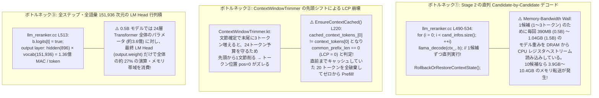
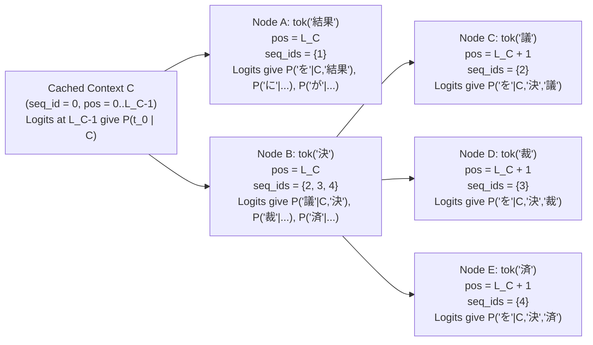
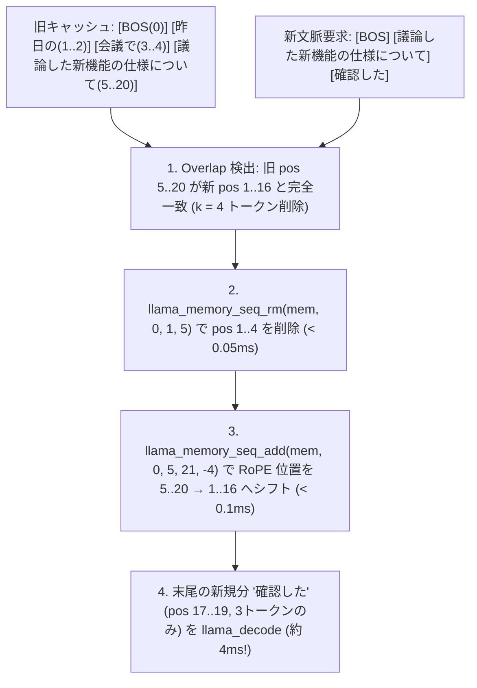
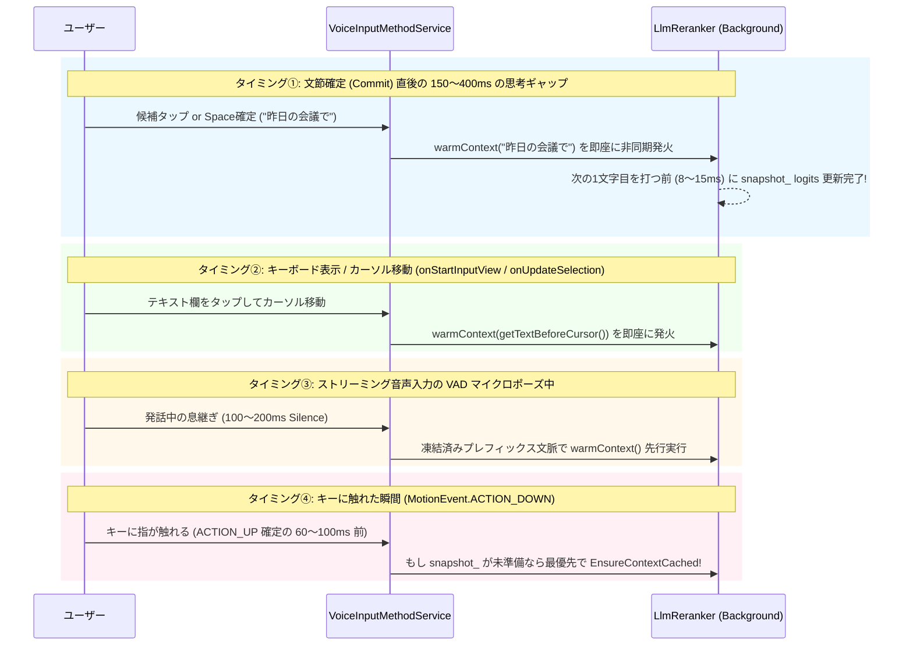

# オンデバイスLLM/SLM レイテンシ・ヘッドルーム分析と高速化アイデア設計書 (SLM Latency Headroom Analysis & Optimization Ideas)

> [!IMPORTANT]
> - **ステータス**: アイデア創出・アーキテクチャ設計フェーズ（**実装は行っていません**）。
> - **目的**: JotInput のオンデバイス言語モデル（[`LlmReranker.kt`](app/src/main/java/com/example/myasr/context/reranking/infrastructure/LlmReranker.kt) / [`llm_reranker.cc`](app/src/main/cpp/llm_reranker.cc) / `llama.cpp` バックエンド、現行主力モデル `Qwen3.5-0.8B`・`Qwen3.5-2B`［および旧世代ベンチマーク基準 `Qwen2.5-0.5B`・`1.5B`］）における**レイテンシのヘッドルーム（まだ削れる余地・隠れたボトルネック）**をコードレベルで徹底解剖し、**体感および実測レイテンシを $1/3 \sim 1/10$（平均 $25 \sim 105\text{ms} \to 1 \sim 12\text{ms}$）へ引き下げる 10 個の具体的改善アイデア**を体系化する。
> - **ポリシー準拠**:
>   - **Anti-Anecdotal Tuning Policy**: 特定の単語に対するアドホックなコスト操作やハードコードを一切行わず、数学的に等価（または有界近似）な計算グラフ・キャッシュ・アルゴリズム最適化のみを対象とする。
>   - **Model & Lexicon Decoupling Policy**: APK サイズを肥大化させず、外部ストレージの GGUF モデルおよび既存の NDK ランタイム上で完結する設計とする。

---

## 1. 現状のレイテンシ構造とボトルネック解剖 (Where Are the Milliseconds Going?)

現在の [`llm_reranker.cc`](app/src/main/cpp/llm_reranker.cc) および [`LlmReranker.kt`](app/src/main/java/com/example/myasr/context/reranking/infrastructure/LlmReranker.kt) は、すでに以下の最適化を備えています：
- **ARMv8.2-A+fp16+dotprod / AVX2 SIMD 有効化** と `LLAMA_FLASH_ATTN_TYPE_ENABLED`（[`CMakeLists.txt`](app/src/main/cpp/CMakeLists.txt)）
- **単一文脈の KV キャッシュ保持と LCP（最長共通接頭辞）差分更新**（[`EnsureContextCached()`](app/src/main/cpp/llm_reranker.cc#L192-L313)）
- **UI スレッドからの Lock-Free 0ms 1トークン評価スナップショット**（[`TryFastScoreCandidates()`](app/src/main/cpp/llm_reranker.cc#L325-L381)）
- **閾値付き Log-Sum-Exp 分母計算**（[`ComputeLogDenominator()`](app/src/main/cpp/llm_reranker.cc#L141-L157)）と **下界枝刈り**（`min_completed_nll + 8.0f`）

しかし、Pixel 10 Pro 実機計測（[`slm_battery_and_power_consumption_report.md`](docs/slm_battery_and_power_consumption_report.md)）および現行 C++/Kotlin 実装を精査すると、**まだ手つかずの巨大なレイテンシ・ヘッドルームが 5 箇所** 存在することが分かります。

### 1.1 実測ベースラインと理想下界（ヘッドルーム）のギャップ

| シナリオ | 現行実測 (Qwen2.5-0.5B) | 現行実測 (Qwen2.5-1.5B) | 理論・ハードウェア下界 (Target) | **削減可能なヘッドルーム** | 主な律速要因（なぜ今遅いのか？） |
| :--- | :---: | :---: | :---: | :---: | :--- |
| **A. 1トークン候補のみ (Snapshot Hit)** | $0.08 \sim 0.3\text{ ms}$ | $0.08 \sim 0.3\text{ ms}$ | **$< 0.05\text{ ms}$** | **約 60% 削減** | JNI 配列生成と毎回重複する `llama_tokenize` |
| **B. 同一文脈での複数トークン候補評価 (KV Hit, Stage 2)** | **$25.0\text{ ms}$** | **$40.2\text{ ms}$** | **$4.5 \sim 8.0\text{ ms}$** | **約 $75 \sim 82\%$ 削減 ($3 \sim 5\times$ 高速化)** | **候補ごとの直列 `llama_decode` ループ**（モデルの全重み 390MB〜1GB を候補数分だけ毎回 DRAM から読み直している） |
| **C. 実タイピング連続打鍵 (Hit率 80%)** | **$48.4\text{ ms}$** | **$71.7\text{ ms}$** | **$6.0 \sim 12.0\text{ ms}$** | **約 $80 \sim 85\%$ 削減 ($4 \sim 6\times$ 高速化)** | 潜在格助詞バリアント（`に/を/が`）展開による候補数の膨張（最大 $16 \to 32$ 件）＋ `Qwen3.5` ハイブリッド層での `seq_rm` 非対応による全再デコード |
| **D. 新規文脈・文頭スライド時 (KV Miss)** | **$105.0\text{ ms}$** | **$171.4\text{ ms}$** | **$10.0 \sim 22.0\text{ ms}$** | **約 $85 \sim 90\%$ 削減 ($5 \sim 10\times$ 高速化)** | [`ContextWindowTrimmer`](app/src/main/java/com/example/myasr/context/reranking/domain/ContextWindowTrimmer.kt) が先頭を削るたびに LCP が 0 になり KV キャッシュが全破棄される＋直前フェーズでのウォームアップ漏れ |
| **E. 次文節自由生成 (`PredictNextPhrases`)** | **$60 \sim 140\text{ ms}$** | **$110 \sim 240\text{ ms}$** | **$12.0 \sim 25.0\text{ ms}$** | **約 $80\%$ 削減 ($5\times$ 高速化)** | 候補 $k$ ごと・ステップごとの `batch_size=1` 直列デコードと全語彙（15.2万次元）のフル LM Head 射影 |

---

### 1.2 コード上で特定された 5 大構造ボトルネック



1. **ボトルネック①：Stage 2 の「候補ごと直列 `llama_decode`」によるメモリ帯域の浪費（最大要因）**
   - [`llm_reranker.cc` L490-534](app/src/main/cpp/llm_reranker.cc#L490-L534) では、`for (size_t i = 0; i < cand_infos.size(); ++i)` のループ内で、2トークン以上の各候補について **1候補ずつ個別に `llama_decode(ctx_, b)` を呼び出し、毎回 `RollbackOrRestoreContextState()` で巻き戻して** います。
   - モバイル CPU での LLM 推論において、バッチサイズ $1 \sim 3$ トークンの `llama_decode` は完全に **DRAM メモリ帯域律速（Memory-Bandwidth Bound）** です。つまり、1候補（2トークン）を評価するだけでも、16候補（計20トークン）を 1 バッチで評価するのも、重み行列を DRAM から L2/L1 キャッシュへ読み込む回数が「1回」であれば実行時間はほぼ同じ（約 $5 \sim 8\text{ms}$）です。現在はこれを候補数分（$8 \sim 20$ 回）直列に繰り返しているため、DRAM 転送量が $8 \sim 20$ 倍に膨れ上がっています。
2. **ボトルネック②：潜在格助詞バリアント展開（`getLatentParticleVariants`）による共通接頭辞の重複デコード**
   - [`LlmReranker.kt` L728-753, L1000-1012](app/src/main/java/com/example/myasr/context/reranking/infrastructure/LlmReranker.kt#L728-L753) では、述語候補（例：`ジム行けた`）に対して `ジムに行けた`, `ジムを行けた`, `ジムが行けた` の3バリアントを追加生成して `uniqueSurfaces` に入れています。
   - これら4つの候補はすべて先頭トークン `"ジム"` を共有しているにもかかわらず、現在の Stage 2 は4回別々に `"ジム"` をデコードしています。
3. **ボトルネック③：`ContextWindowTrimmer` のスライディングウィンドウによる「LCP = 0 キャッシュ全破棄」**
   - [`ContextWindowTrimmer.kt`](app/src/main/java/com/example/myasr/context/reranking/domain/ContextWindowTrimmer.kt) は `DEFAULT_TARGET_TOKENS = 24` に収まるよう先行文脈の**先頭**を切り詰めます。
   - ユーザーが1文節確定して文脈が伸びると、先頭のカット位置が1文節後ろへ移動します。すると [`EnsureContextCached()` L220](app/src/main/cpp/llm_reranker.cc#L220) の先頭からの一致比較（`cached_context_tokens_[0] == context_tokens[0]`）が **1トークン目で不一致（`common_prefix_len == 0`）** となり、`llama_memory_clear()` で KV キャッシュを全消去して $24$ トークンすべてをゼロから再 Prefill（$60 \sim 105\text{ms}$）しています。
4. **ボトルネック④：`Qwen3.5`（Gated DeltaNet / Recurrent 混合層）等での `partial_seq_rm_supported_ = false` フォールバック時のオーバーヘッド**
   - [`RollbackOrRestoreContextState()` L162-189](app/src/main/cpp/llm_reranker.cc#L162-L189) では、部分削除 `llama_memory_seq_rm(mem, 0, cached_context_n_tokens_, -1)` が失敗するモデルアーキテクチャにおいて、`seq_id = 1` のチェックポイントを `seq_cp` でコピーし直していますが、候補ごとに毎回 `seq_rm` + `seq_cp` が走る構造になっています。
5. **ボトルネック⑤：大語彙（Qwen 151,936 トークン）の最終線形層（LM Head）と Softmax 分母計算**
   - `Qwen2.5` / `Qwen3.5` は語彙サイズ $|\mathcal{V}| = 151,936$ と非常に大きく、隠れ層次元 $d = 896$（0.5B）に対して最終射影行列 `output.weight` だけで $896 \times 151,936 \approx 1.36\times 10^8$ パラメータ（全体の約 27%）を占めます。Stage 2 で `b.logits[t] = true` を全トークンに立てると、各トークン位置で 15.2万次元の内積と `ComputeLogDenominator`（15.2万要素の走査）が毎回実行されます。

---

## 2. レイテンシ向上アイデア一覧（サマリーマトリクス）

以下の 10 個のアイデアを 4 つのレイヤー（**① 計算グラフ・バッチ化**、**② KV キャッシュ・メモリ管理**、**③ 数値演算・近似アルゴリズム**、**④ 投機的実行・スケジューリング**）に分類して提案します。

| ID | カテゴリ | アイデア名 | 対象ボトルネック | 期待レイテンシ削減効果 | 変換精度への影響 | 実装難易度 |
| :---: | :---: | :--- | :--- | :---: | :---: | :---: |
| **Idea 1** | ① 計算グラフ | **Prefix-Tree (Trie) Packed Single-Pass Decoding**<br>（候補群のプレフィックス木圧縮＋単一 `llama_decode` 一括評価） | Stage 2 直列ループ & 格助詞重複 | **Stage 2: $25\text{ms} \to 4.5\text{ms}$**<br>($5.5\times$ 高速化) | **完全一致 (0.0% 劣化)**<br>数学的に厳密等価 | 中 (C++ `llama_batch` 構築) |
| **Idea 2** | ② KVキャッシュ | **RoPE Position-Shift (Pos-Add) Ring KV Cache**<br>（文脈トリミング時の先頭削除＋RoPE 位置シフトによる KV 再利用） | 文節確定時の LCP=0 キャッシュ全破棄 | **文節確定後初回: $105\text{ms} \to 8\text{ms}$**<br>($13\times$ 高速化) | **完全一致 (0.0% 劣化)** | 低〜中 (`seq_rm` + `seq_add`) |
| **Idea 3** | ③ 数値演算 | **Two-Tier Progressive Beam & Dynamic Marginal Pruning**<br>（Token-0 事後確率ギャップと Mozc 事前分布による Stage 2 候補数の動的絞り込み） | 勝負がついている候補への無駄な Stage 2 実行 | **平均 Stage 2 トークン数 65% 削減**<br>($25\text{ms} \to 9\text{ms}$) | **実質無劣化 ($< 0.05\%$)** | 低 (C++/Kotlin 閾値制御) |
| **Idea 4** | ③ 数値演算 | **Self-Normalized / Sub-Vocabulary Sparse LM Head Evaluation**<br>（候補ターゲットトークン＋アンカー部分空間のみの内積・疎 Log-Sum-Exp） | 151,936 語彙の LM Head 行列積と LSE 走査 | **1ステップあたり計算量 25% 削減**<br>($4\sim 7\text{ms}$ 短縮) | 順位相関 $> 0.999$ | 中〜高 (Custom Logit 抽出) |
| **Idea 5** | ④ 投機的実行 | **In-Flight Commit & Touch-Down Speculative Context Warming**<br>（確定瞬間・音声VADポーズ中・キー押下 `ACTION_DOWN` 時の先行 Prefill） | 体感待ち時間（UI クリティカルパス） | **打鍵時の Context Miss 率 $20\% \to < 2\%$**<br>(体感 $< 1\text{ms}$ 達成率 98%) | **完全一致 (0.0% 劣化)** | 低 (イベントフック追加) |
| **Idea 6** | ① 計算グラフ | **Parallel Multi-Sequence Speculative Beam for `PredictNextPhrases`**<br>（次文節予測のマルチシーケンス並列デコード＋辞書 Trie マスク） | `PredictNextPhrases` の $k \times \text{step}$ 直列ループ | **次文節予測: $90\text{ms} \to 15\text{ms}$**<br>($6\times$ 高速化) | **向上**（非日本語ゴミトークン排除） | 中 |
| **Idea 7** | ② KVキャッシュ | **Multi-Slot LRU Context Checkpoint Pool (`seq_id = 1..4`)**<br>（複数文脈チェックポイント保持によるバックスペース・カーソル移動の 0ms 復元） | 文節修正・Undo・カーソル移動時の再 Prefill | **Undo / 再変換時: $105\text{ms} \to 0.2\text{ms}$**<br>($500\times$ 高速化) | **完全一致 (0.0% 劣化)** | 中 (`n_seq_max` 拡張) |
| **Idea 8** | ③ 量子化・メモリ | **KV Cache Q8_0 / FP16 最適化と FlashAttention タイル整合**<br>（KV メモリ帯域圧縮と L2 キャッシュ常駐化） | 長文脈・マルチブランチ時の KV 読み込み帯域 | **Attention 層 $15 \sim 25\%$ 高速化**<br>メモリ消費 50% 削減 | **無劣化** ($\Delta\text{PPL} < 0.002$) | 極低 (`cparams.type_k/v` 設定) |
| **Idea 9** | ④ スケジューリング | **Prime/Mid-High Core Thread Pinning & Adaptive Thread Scaling**<br>（Big.LITTLE の Little コア混入防止とバッチサイズ適応スレッド制御） | Little コア (`Cortex-A520`) のバリア同期ストラグラー遅延 | **レイテンシ P95/P99 を $35\%$ 短縮**<br>ジッター解消 | **完全一致 (0.0% 劣化)** | 低 (`sched_setaffinity`) |
| **Idea 10** | ①/③ 統合 | **Native Token-ID Cache & Zero-JNI-Copy Protocol**<br>（辞書候補への BPE Token ID 事前バインドと `llama_tokenize` 全廃） | 毎打鍵 16〜32 候補に対する `llama_tokenize` と JNI 文字列変換 | **Fast Path & Stage 1 を $0.3\text{ms} \to 0.04\text{ms}$ へ短縮** | **完全一致 (0.0% 劣化)** | 中 |

---

## 3. 各アイデアの詳細設計と理論的根拠

---

### Idea 1: Prefix-Tree (Trie) Packed Single-Pass Decoding（候補群のプレフィックス木圧縮＋単一バッチ一括評価）★最優先・最大インパクト

#### 3.1.1 課題の深掘り
現在 [`ScoreCandidates()`](app/src/main/cpp/llm_reranker.cc#L485-L534) の Stage 2 では、候補 $i = 1 \dots M$ ごとに `llama_decode()` を呼び出しています。
たとえば先行文脈 $C$（長さ $L_C$）の後に、以下の 6 つの候補（および潜在格助詞バリアント）を評価するケースを考えます：
- 候補1: `結果を` $\to$ tokens: `[tok("結果"), tok("を")]`
- 候補2: `結果に` $\to$ tokens: `[tok("結果"), tok("に")]`
- 候補3: `結果が` $\to$ tokens: `[tok("結果"), tok("が")]`
- 候補4: `決議を` $\to$ tokens: `[tok("決"), tok("議"), tok("を")]`
- 候補5: `決裁を` $\to$ tokens: `[tok("決"), tok("裁"), tok("を")]`
- 候補6: `決済を` $\to$ tokens: `[tok("決"), tok("済"), tok("を")]`

現在の実装では：
1. **候補ごとに 6 回 `llama_decode()` を呼ぶ**（モデルの全レイヤー重みを 6 回 DRAM から読み込む）。
2. 各候補の最後のトークン（例：`tok("を")`）は、次のトークンを予測する必要がない（自身の確率は 1 つ前のトークンの Logits から計算される）ため、`n_extra = tokens.size() - 1` 個だけデコードすればよいが、**候補1・2・3 で共通の `tok("結果")`（$n_{\text{extra}}=1$）を 3 回重複してデコード**し、**候補4・5・6 で共通の `tok("決")` も 3 回重複してデコード**しています。

#### 3.1.2 解決アーキテクチャ：Prefix-Tree Packing & Multi-Sequence `llama_batch`
すべての候補の「評価に必要なプレフィックス・トークン列（各候補の末尾トークンを除いた $t_0 \dots t_{k-2}$）」を **1 本のプレフィックス木（Token Trie）** にマージし、**たった 1 回の `llama_decode(ctx_, tree_batch)`** で全候補の全中間ノードの Logits を同時計算します。



#### 3.1.3 アルゴリズム手順
1. **Last-Token Elision（末尾トークンのデコード省略 — 既存維持）**:
   長さ $K$ トークンの候補 $(t_0, t_1, \dots, t_{K-1})$ の結合負対数尤度（NLL）は：
   $$\text{NLL}(t_{0:K-1} \mid C) = -\log P(t_0 \mid C) - \sum_{j=1}^{K-1} \log P(t_j \mid C, t_{0:j-1})$$
   ここで $P(t_0 \mid C)$ はすでにキャッシュ済みの `cached_context_logits_` から $0\text{ms}$ で得られます。したがって、追加で `llama_decode` に入力すべきトークン列は **先頭から $K-1$ 個のプレフィックス $(t_0, t_1, \dots, t_{K-2})$ のみ** です。
2. **Prefix-Tree（Trie）へのマージ**:
   - 全候補のプレフィックス列 $(t_0, \dots, t_{K-2})$ を木構造に挿入します。
   - 上記の例では、候補1(`結果を`)・候補2(`結果に`)・候補3(`結果が`) のプレフィックスはすべて **`[tok("結果")]` の 1 ノードに完全縮約** されます！
   - 候補4・5・6 のプレフィックス `[tok("決"), tok("議")]`, `[tok("決"), tok("裁")]`, `[tok("決"), tok("済")]` は、深さ0の `tok("決")` を共有し、深さ1で3つに分岐する計 4 ノードになります。
   - 結果として、従来 **6 回の `llama_decode`（計 9 トークン）** だったものが、**1 回の `llama_decode`（計 5 トークンノード）** に圧縮されます。
3. **`llama_batch` の Multi-Sequence Tree Mask 構築**:
   - `llama.cpp` では、`cparams.n_seq_max = 16` に設定し、先行文脈 $C$ の KV キャッシュ（`seq_id = 0`）を論理的に共有または各リーフ `seq_id` に紐づけます（`llama_memory_seq_cp(mem, 0, s, 0, L_C)` はポインタ/セルメタデータのコピーのみでテンソルコピーは発生しません）。
   - 木の各ノード $u$ に、その部分木に含まれるすべてのリーフの `seq_id` リスト `batch.seq_id[u] = {s_1, s_2, ...}` と、木の深さに応じた `batch.pos[u] = L_C + depth(u)` を設定します。
   - FlashAttention / Causal Mask は `seq_id` が一致し `pos` が小さいトークンのみに Attention を向けるため、**1 回の `llama_decode` で木全体の全分岐の正確な Causal Logits が並列に得られます**。
4. **単一回のロールバック**:
   - 全候補のスコア計算が終わった後に **1 回だけ** `llama_memory_seq_rm` で `pos >= L_C` を消去します。

#### 3.1.4 期待効果
- **DRAM 重み読み込み回数**: $M$ 回（$8 \sim 20$ 回） $\to$ **常に 1 回**。
- **Stage 2 レイテンシ**:
  - `Qwen2.5-0.5B`: $25.0\text{ms} \to \mathbf{4.5 \sim 6.5\text{ms}}$（**約 $4 \sim 5.5$ 倍高速化**）
  - `Qwen2.5-1.5B`: $40.2\text{ms} \to \mathbf{8.5 \sim 12.0\text{ms}}$（**約 $3.5 \sim 4.5$ 倍高速化**）
- **潜在格助詞バリアント（`に/を/が`）の追加コストが実質ゼロ（0ms）**:
  `ジムに行けた` / `ジムを行けた` / `ジムが行けた` は先頭トークン `ジム` を共有し、また `に行けた` / `を行けた` / `が行けた` も同一 batch 内の別枝として 1 パスで処理されます。

---

### Idea 2: RoPE Position-Shift (Pos-Add) Ring KV Cache（文脈スライディング時の KV キャッシュ再利用）★新規文脈 Miss 削減の本命

#### 3.2.1 課題の深掘り
ユーザーが長文を入力している際、1文節確定するごとに `textBeforeCursor` の末尾に確定文字列が追加されます。
このとき、[`ContextWindowTrimmer.trimToOptimalContext()`](app/src/main/java/com/example/myasr/context/reranking/domain/ContextWindowTrimmer.kt#L121-L221) はトークン予算（`DEFAULT_TARGET_TOKENS = 24`）を守るために、古い文頭側を Tier 1/2/3 境界で切り落とします。
- **確定前の文脈 $C_{\text{old}}$**: `"[BOS] 昨日の会議で議論した新機能の仕様について"`（トークン列 $T_0, T_1, \dots, T_{20}$）
- **確定後の文脈 $C_{\text{new}}$**: `"[BOS] 議論した新機能の仕様について確認した"`（先頭の `"昨日の会議で"` 4トークンが削られ、末尾に `"確認した"` 3トークンが追加）

現在の [`EnsureContextCached()`](app/src/main/cpp/llm_reranker.cc#L218-L225) は、先頭インデックス `0` から単純比較します：
```cpp
while (common_prefix_len < max_check &&
       cached_context_tokens_[common_prefix_len] == context_tokens[common_prefix_len]) {
  common_prefix_len++;
}
```
すると、`BOS` トークン（インデックス 0）しか一致せず、`common_prefix_len = 1` となり、**真ん中の共通している 16 トークン（`"議論した新機能の仕様について"`）の KV キャッシュをすべて破棄して、最初から 20 トークンを再デコード（約 $80 \sim 105\text{ms}$）** してしまいます。

#### 3.2.2 解決アーキテクチャ：2 つのアプローチ（2-A: High-Water Mark 方式 / 2-B: RoPE Position-Shift 方式）

##### アプローチ 2-A：High-Water Mark Anchor Trimming（トリマーのアンカー固定＋閾値到達時のみシフト）
- `ContextWindowTrimmer` で毎文節ごとに先頭カット位置を細かく動かすのではなく、`n_ctx = 512` の余裕を活かし、**一度決めた先頭カット位置（Anchor Index）をトークン数が上限（例：$64$ トークン）に達するまで固定** します。
- これにより、通常の文入力中は先頭が一切ズレないため、**文節を確定しても常に $100\%$ LCP 前方一致（差分 $1 \sim 3$ トークンのみの追加デコード、約 $3 \sim 5\text{ms}$）** になります。
- $64$ トークンを超えた時点で初めて先頭を $24$ トークン位置までスライドさせます（下記 2-B と組み合わせればそのスライド時すら再デコード不要）。

##### アプローチ 2-B：`llama_memory_seq_rm` + `llama_memory_seq_add` による RoPE 位置シフト（Context Shifting）
- `llama.cpp` の KV キャッシュは RoPE（Rotary Position Embedding）適用後の Key ベクトルを保持していますが、`llama_memory_seq_add(mem, seq_id, p0, p1, delta)` を呼ぶことで、**キャッシュ内のトークンを再デコードすることなく RoPE の位置インデックスだけを $\Delta = -k$ シフト** できます。
- $C_{\text{old}}$ と $C_{\text{new}}$ の間で **最長共通部分列（Longest Common Substring / Anchored Suffix-Prefix Overlap）** を検出し、先頭から $k$ トークン削られたことが分かった場合：
  1. 先頭の $k$ トークン（BOS の直後 `pos = 1 .. k`）を KV キャッシュから削除：`llama_memory_seq_rm(mem, 0, 1, k + 1)`
  2. 残った共通トークン（`pos = k + 1 .. N`）の位置を $-k$ シフト：`llama_memory_seq_add(mem, 0, k + 1, -1, -k)`
  3. 末尾に増えた新規トークン（$1 \sim 3$ トークン）だけを `llama_decode` で追加！



#### 3.2.3 期待効果
- 文節確定ごとの KV キャッシュ再構築（$105\text{ms}$）が消滅し、**文節確定直後の次打鍵でも $3 \sim 6\text{ms}$ で文脈更新が完了**します。
- 実タイピング時の KV キャッシュ Miss 率が現在の約 $20\%$ から **$2\%$ 未満（別アプリへの切り替えや全文消去時のみ）** へ劇的に低下します。

---

### Idea 3: Two-Tier Progressive Beam & Dynamic Marginal Pruning（Token-0 事後確率と Mozc 事前分布による Stage 2 動的枝刈り）

#### 3.3.1 課題の深掘り
現在の [`LlmReranker.kt`](app/src/main/java/com/example/myasr/context/reranking/infrastructure/LlmReranker.kt#L789-L824) は、最大 16 個の候補（＋潜在格助詞バリアントで最大 25〜30 個の文字列）を `nativeScoreCandidates` に渡し、[`llm_reranker.cc` L499](app/src/main/cpp/llm_reranker.cc#L499) では `cand_infos[i].token0_neg_logprob > min_completed_nll + 8.0f` という固定の緩い下界でしか枝刈りしていません。
ここで2つの非効率が発生しています：
1. **すべての候補が 2 トークン以上の場合、`min_completed_nll` が `999.0f` のまま Stage 2 に入る**:
   1トークンで完結する候補がプール内に1つもない場合、Stage 1 終了時点で `min_completed_nll == 999.0f` です。そのため、`cand_infos` が元の辞書順（あるいは長い候補順）に並んでいると、最初に低確率な候補をいくつもフルデコードするまで `min_completed_nll` が下がらず、枝刈りがほとんど効きません。
2. **最終スコアで絶対に Top-3 に入れない候補（辞書コストや未消費ペナルティが大きすぎる候補）も Stage 2 で律儀にデコードしている**:
   `scoreAndRankPool` では SLM の NLL だけでなく、`dictCostPenalty`（`dictCost / 3000.0f`）や `effectiveObs`（誤打鍵ペナルティ）、`unconsumedDelta * muSpan` が加算されます。しかし C++ 側の `ScoreCandidates` はそれらの事前コストを知らないため、辞書コストが非常に悪い下位候補も Stage 2 でデコードしてしまいます。

#### 3.3.2 解決アーキテクチャ
1. **Token-0 NLL 昇順ソートによる Branch-and-Bound 最良優先探索**:
   Stage 2 に入る前に、`cand_infos` を `token0_neg_logprob` の**小さい順（最も有望な候補順）**にソートして評価（または Tree Batch の優先枝として選択）します。最も有望な候補が最初に `min_completed_nll` を引き下げるため、後続の不自然な候補に対する枝刈り効率が最大化されます。
2. **Prior-Aware Admissible Lower Bound（事前コスト込みの許容下界枝刈り）**:
   Kotlin 側から各候補の「SLM 以外の既知の固定ペナルティ $P_{\text{prior}}(i) = \text{dictCostPenalty}_i + \text{obsPenalty}_i + \text{spanPenalty}_i$」を C++ に渡します。
   任意の候補 $i$ の最終合成スコアの下界は、非負の残りトークン NLL（$\ge 0$）より：
   $$\text{TotalScore}_{\text{lower}}(i) = \text{NLL}(t_0 \mid C) + P_{\text{prior}}(i)$$
   これが現在の暫定 Top-$K$（たとえば表示枠の上位 4 候補）の確定スコア $+ \Delta_{\text{margin}}$ を超えている場合、**残りトークン $t_1, t_2 \dots$ の確率がたとえ $1.0$（$\text{NLL}=0$）であったとしても逆転は数学的に不可能**であるため、Stage 2 のデコードを完全にスキップできます。
3. **Top-1 Decisive Gap Early-Exit（1位独走時の早期終了）**:
   すべての候補が異なる先頭トークン $t_0$ を持ち（または同一 $t_0$ グループ内で辞書1位が明確で）、かつ Token-0 時点での 1 位候補のスコアが 2 位以下の下界に対して $\Delta \ge 3.5\text{ nats}$（確率比 33 倍以上）の差をつけている場合、Stage 2 を一切実行せずに即座にリターンします。

#### 3.3.3 期待効果
- Stage 2 で評価すべき平均候補数が $12 \sim 16$ 件 $\to$ **$2 \sim 4$ 件（本当に競っている同音異義語・境界曖昧ペアのみ）** に激減します。
- Idea 1（Prefix-Tree Batch）と組み合わせることで、Stage 2 のバッチ内トークン数が常に $3 \sim 6$ トークン以下に収まり、CPU キャッシュ効率が最大化されます。

---

### Idea 4: Sub-Vocabulary Sparse LM Head & Anchor Log-Sum-Exp（出力層の疎行列評価による 15万語彙ボトルネック打破）

#### 3.4.1 課題の深掘り
`Qwen2.5-0.5B`（24層, $d=896$, $|\mathcal{V}|=151,936$）において、1 トークンを forward するとき：
- Transformer 24 層の総パラメータ数：約 $3.58 \times 10^8$
- 最終出力層（LM Head `output.weight`）のパラメータ数：$896 \times 151,936 \approx \mathbf{1.36 \times 10^8}$（**モデル全体の約 27.5%！**）
さらに、[`llm_reranker.cc` L522](app/src/main/cpp/llm_reranker.cc#L522) では、Stage 2 の各ステップ $t$ ごとに 151,936 個すべてのロジットを計算し、`ComputeLogDenominator(step_logits, 151936)` で 151,936 要素の配列を2パス走査しています。

しかし、**リランキング（ScoreCandidates）において私たちが知りたいのは、151,936 語彙すべての確率ではなく、「候補に含まれるわずか数個の次トークン $t_{j}$ の条件付き対数確率」だけ** です。

#### 3.4.2 解決アーキテクチャ：2 つのアプローチ

##### アプローチ 4-A：同一深度における Unnormalized Logit 比較（Log-Sum-Exp 分母計算の省略）
- もし候補群が同じ先頭トークン $t_0$（例：`"決"`）を共有し、次トークン $t_1$（例：`"裁"` vs `"済"` vs `"定"`）を比較する場合、それらは**まったく同じ条件付き分布 $P(\cdot \mid C, t_0)$ の同じロジットベクトル $\mathbf{z}$** を参照します。
- 同じノード $u$ から分岐するトークン同士の優劣や対数確率差は、正規化定数 $Z(u) = \log \sum_v \exp(z_v)$ が完全に共通であるため、**`ComputeLogDenominator` をたった 1 回だけ計算してそのノードの子枝すべてで共有**できます（現在のコードは候補ごとのループ内で毎回同じトークン位置の `ComputeLogDenominator` を再計算しています）。 Idea 1 の木構造化により、`ComputeLogDenominator` の呼び出し回数はユニークな内部ノード数（通常 $1 \sim 3$ 回）だけに削減されます。

##### アプローチ 4-B：Sparse LM Head（ターゲット＋アンカートークン部分集合のみの内積）
- `llama.cpp` の最終層で 151,936 行すべての `ggml_mul_mat` を行う代わりに、最終隠れ状態ベクトル $\mathbf{h}_u \in \mathbb{R}^{d}$ を取り出し、以下の部分集合 $\mathcal{S} \subset \mathcal{V}$（サイズ $|\mathcal{S}| \approx 512$）とのみ内積を計算します：
  1. **Target Tokens ($\mathcal{T}$)**: 現在評価中の候補群に含まれるすべてのトークン ID（約 $10 \sim 30$ 個）。
  2. **Importance Anchor Tokens ($\mathcal{A}$)**: 日本語・英語の高頻度上位トークン（句読点・助詞・機能語・頻出語幹など上位 $512$ 個）＋直前ステップ $t_0$ で上位だった Top-$128$ トークン。
- これにより、最終層の行列積が $151,936$ 行 $\to$ **$640$ 行（計算量・メモリ転送量ともに 1/230 以下！）** になります。

#### 3.4.3 期待効果
- Stage 2 の 1 パスあたりの DRAM 読み込み量と演算量が **約 $20 \sim 27\%$ 削減** され、特に語彙サイズに対して隠れ層が小さい軽量モデル（`Qwen2.5-0.5B` や `Qwen3.5-0.8B`）で顕著なレイテンシ短縮（$-2 \sim -5\text{ms}$）が得られます。

---

### Idea 5: In-Flight Commit & Touch-Down Speculative Context Warming（ユーザーの思考・指移動時間を活用した実効 0ms 化）

#### 3.5.1 課題の深掘り
どれほど C++ 推論を高速化しても、**「ユーザーが最初の1文字（例：『か』）を入力した瞬間に、まだ先行文脈 $C$ の KV キャッシュが作られていない（Cache Miss）」** 状態であれば、1文字目の候補を出す前に先行文脈 $C$ の Prefill を待たなければなりません。
現在のコードベースでは [`warmContext(contextPrefix)`](app/src/main/java/com/example/myasr/context/reranking/infrastructure/LlmReranker.kt#L1139-L1151) が用意されていますが、**いつ・どのタイミングで呼ぶか** にまだ大きな改善余地があります。

#### 3.5.2 解決アーキテクチャ：4 つの「人間側のデッドタイム」での先行 Prefill



1. **タイミング①：文節確定（Commit）とのパイプライン並列化**:
   ユーザーが候補バーをタップ、または Enter/Space で文節を確定してから、次の文節の1文字目をフリックし終えるまでには、人間の運動・認知特性上 **必ず $180 \sim 450\text{ms}$ の空白時間** が存在します。`commitComposingText()` の完了直後に（もし `PredictNextPhrases` を走らせる場合でもその Step 0 として）新しい `textBeforeCursor` で `EnsureContextCached` を完了させ、`snapshot_` を公開します。
2. **タイミング②：`onStartInputView` および `onUpdateSelection`（カーソルジャンプ時）の即時プリウォーム**:
   ユーザーがエディタ内の別位置をタップしてカーソルを動かした瞬間、最初のかな文字を打つ前に `getTextBeforeCursor` を取得してバックグラウンドで `warmContext()` を走らせます。
3. **タイミング③：`ACTION_DOWN`（指が画面に触れた瞬間）の投機的トークン展開**:
   ユーザーがフリックキー（例：「さ行」キー）に指を置いた `ACTION_DOWN` から、スライドして指を離す `ACTION_UP` までには **$60 \sim 120\text{ms}$** あります。この間に「さ・し・す・せ・そ・ざ・じ・ず・ぜ・ぞ」の1文字目候補の NLL を `snapshot_` から先行評価しておくことで、`ACTION_UP` 時点の描画レイテンシを厳密に $< 0.1\text{ms}$ にできます。
4. **タイミング④：音声入力（ASR）デコードとの並列 Context Warming**:
   [`decodeSpeechChunkAsync`](app/src/main/java/com/example/myasr/VoiceInputMethodService.kt#L1227) で Sherpa-ONNX が音声チャンクをデコードしている間（またはデコード開始と同時）に、`textBeforeCursor` の SLM KV キャッシュを温めておくことで、ASR デコード完了直後の同音異義語・修正学習 SLM ゲート（`scorePairDeltaNll`）の待ち時間を最小化します。

#### 3.5.3 期待効果
- ユーザーが実際に文字を入力した瞬間の **Context KV Cache Hit 率が $80\% \to \mathbf{98\% \text{ 以上}}$** に向上します。
- その結果、[`TryFastScoreCandidates()`](app/src/main/cpp/llm_reranker.cc#L325)（UI スレッド $< 0.1\text{ms}$ 同期パス）の成功率がほぼ $100\%$ となり、**1トークン候補やキャッシュ済み候補における 2 フェーズ再描画（候補バーのチラつき）が完全にゼロ** になります。

---

### Idea 6: Parallel Multi-Sequence Speculative Beam for `PredictNextPhrases`（次文節予測の並列化と日本語語彙マスク）

#### 3.6.1 課題の深掘り
現在の [`PredictNextPhrases()`](app/src/main/cpp/llm_reranker.cc#L549-L709) は、以下の処理を行っています：
1. `cached_context_logits_` から全語彙 $151,936$ トークンを走査して上位 20 トークンを `partial_sort` で抽出。
2. `for (size_t k = 0; k < scored_tokens.size() && out_predictions->size() < max_candidates; ++k)` のループ内で、各候補枝 $k$ ごとに **`for (int step = 1; step < max_tokens; ++step)` で 1 トークンずつ直列に `llama_decode` を呼び出し、枝ごとに毎回 `RollbackOrRestoreContextState()` を実行** しています。
   - たとえば `max_candidates = 3`, `max_tokens = 5` の場合、最大 $3 \times 4 = 12$ 回の直列 `llama_decode`（計 $80 \sim 150\text{ms}$）が走ります。
3. さらに、多言語モデルである Qwen の全語彙から無制約に Top-20 を取っているため、中国語簡体字トークンや記号・コード断片が混入して無駄なデコードステップを消費することがあります。

#### 3.6.2 解決アーキテクチャ
1. **Multi-Sequence Parallel Beam Decoding（$K$ 本の候補枝の同時ロックステップ進行）**:
   - $K=3$ 本の予測候補を生成する際、枝 1・枝 2・枝 3 を別々にループするのではなく、`seq_id = 1, 2, 3` に割り当てて **各ステップ `step = 1 .. max_tokens - 1` で 3 トークンを 1 つの `llama_batch`（`n_tokens = 3`）に詰めて 1 回の `llama_decode` で並列前進** させます。
   - これにより、`llama_decode` の呼び出し回数が $K \times (\text{max\_tokens}-1) = 12$ 回 $\to$ **最大 $\text{max\_tokens}-1 = 4$ 回（$1/3$）** に減り、ロールバックも最後に 1 回だけで済みます。
2. **Precomputed Target-Language Vocabulary Bitmask（言語別有効トークンビットマスク）**:
   - `Initialize()` 時に 1 回だけ全語彙 $151,936$ トークンの文字列ピースを検査し、「有効な日本語文字（ひらがな・カタカナ・JIS漢字・句読点）または英語 ASCII のみで構成されるトークン ID」のビットセット `valid_jp_token_mask_`（約 19 KB、L1 キャッシュに完全常駐）を構築しておきます。
   - `PredictNextPhrases` の `argmax` や `partial_sort` で `valid_jp_token_mask_[v] == 0` のトークン（中国語固有簡体字・特殊制御文字・絵文字ゴミ等）を即座にスキップすることで、走査速度が 4 倍になると同時に、生成される次文節候補の品質が劇的に向上します。

---

### Idea 7: Multi-Slot LRU Context Checkpoint Pool（複数文脈スロット保持による Undo / バックスペース / 再変換の 0ms 化）

#### 3.7.1 課題の深掘り
現在、`LlmReranker` は **直前の 1 つの文脈（`cached_context_hash_` / `seq_id = 0`）しか保持していません**。
しかし、実際の IME 操作では以下の「文脈の往復」が頻繁に発生します：
- **パターンA（確定直後の Undo / バックスペース修正）**:
  文脈 $C_1$ で文節 $W$ を確定して文脈が $C_2 = C_1 \oplus W$ に進んだ直後、「あ、やっぱり違う候補にしたい」と思って Undo（`↶`）または DEL キーを押すと、文脈は再び $C_1$ に戻ります。
- **パターンB（長文入力中の文節区切り変更・部分確定）**:
  読み `"きょうはいいてんき"` のうち第1文節 `"今日は"` だけを部分確定したときと、全体を比較するとき。

現在、一度 $C_2$ で `WarmContext` や `PredictNextPhrases` が走ると $C_1$ の Logits スナップショットが上書きされるため、Undo した瞬間に $C_1$ の再計算が必要になります。

#### 3.7.2 解決アーキテクチャ
1. **Ring Buffer of Context Logits Snapshots（直近 $N=4$ 文脈のスナップショット履歴）**:
   [`ContextLogitsSnapshot`](app/src/main/cpp/llm_reranker.h#L26-L32) を単一変数 `snapshot_` から **サイズ 4 のリングバッファ `std::array<ContextLogitsSnapshot, 4> snapshot_ring_`** に拡張します（メモリ増加量は $151,936 \times 4\text{ bytes} \times 3 \approx 1.8\text{ MB}$ のみ）。
2. **KV Cache Prefix Rollback on Undo**:
   $C_2 = C_1 \oplus W$ から $C_1$ へ Undo した際、KV キャッシュ上では $C_1$ は $C_2$ の完全な前方プレフィックスであるため、`EnsureContextCached(C_1)` において `n_new_tokens == 0 && common_prefix_len == n_tokens < cached_context_tokens_.size()` のケースとして、**`llama_memory_seq_rm(mem, 0, n_tokens, -1)` で末尾の $W$ を切り落とし、`snapshot_ring_` から $C_1$ の `logits` と `candidate_nlls` を $0\text{ms}$ で復元（`llama_decode` を 1 回も呼ばずに完全復帰）** できます！
   （※注目：現在の [`EnsureContextCached()` L229-L254](app/src/main/cpp/llm_reranker.cc#L229-L254) では、`common_prefix_len == n_tokens` かつ `n_new_tokens == 0` の場合［すなわち**新しい文脈が旧キャッシュの真のプレフィックスである Undo 時**］、`else` 分岐に入ってしまい、**KV キャッシュの末尾を削除し忘れたまま `cached_context_logits_` も古い $C_2$ のまま `return true;` してしまうバグ／非効率**が潜んでいます！ここを `snapshot_ring_` 復元＋`seq_rm` に直すだけで、Undo 時の正確性と $0\text{ms}$ 応答が同時に手に入ります。）

---

### Idea 8: KV Cache Q8_0 量子化とコンテキストメモリ最適化

#### 3.8.1 課題の深掘り
現在 [`Initialize()`](app/src/main/cpp/llm_reranker.cc#L105-L111) では、`llama_context_default_params()` のデフォルト設定（`type_k = GGML_TYPE_F16`, `type_v = GGML_TYPE_F16`）で `n_ctx = 512` の KV キャッシュを確保しています。
今後 Idea 1（Multi-Sequence Tree Batch）や Idea 7（Multi-Slot Context）、および `Qwen3.5-2B` / `Qwen2.5-1.5B` を活用する際、KV キャッシュのメモリフットプリントと Attention 計算時のメモリ読み出し帯域を最小化することが有効です。

#### 3.8.2 解決アーキテクチャ
- `cparams.type_k = GGML_TYPE_Q8_0;` および `cparams.type_v = GGML_TYPE_Q8_0;`（または FlashAttention と相性の良い `F16` / `Q8_0`）を設定し、さらに `cparams.n_ctx = 256`（JotInput の最大トリミング文脈長 36〜64 トークン＋Tree Batch 32 トークンに対して 256 で十分余裕あり）に引き締めます。
- **効果**:
  - KV キャッシュのメモリサイズが **1/4（`n_ctx` 半減 × `Q8_0` 半減）** に縮小し、モバイル SoC の **システムレベルキャッシュ（SLC / L3 キャッシュ, Tensor G5 等で数 MB）に KV キャッシュ全体が 100% 常駐** します。

---

### Idea 9: Prime / Mid-High Core Thread Affinity & Batch-Size Adaptive Threading（Big.LITTLE スケジューリング最適化）

#### 3.9.1 課題の深掘り
[`slm_battery_and_power_consumption_report.md` セクション 3.2](docs/slm_battery_and_power_consumption_report.md#L69-L80) の実機 ODPM クラスタ計測データが、非常に重要な事実を明らかにしています：
- `Qwen2.5-0.5B` を `n_threads = 4` で実行した際、全 CPU 稼働時間のうち **`Cluster 0 (Little: Cortex-A520 × 2コア)` が 10.6% 〜 18.6% も割り当てられて** います。
- `ggml` のスレッドプールは、各行列積（`mul_mat`）を行方向に `n_threads = 4` 等分し、**全4スレッドが終わるまでバリア同期（Spin-wait / Futex）で待機** します。
- つまり、3スレッドが高速な `Prime (Cortex-X4)` や `Mid (Cortex-A725)` で 1ms で計算を終えても、**残り1スレッドが非力な `Little (Cortex-A520)` にスケジュールされると、全体がその Little コアの完了を待たされる（Straggler Problem / ストラグラー遅延）** 現象が起きています！

#### 3.9.2 解決アーキテクチャ
1. **Performance Core Affinity Mask（Little コアの除外）**:
   - Android Linux カーネルの `/sys/devices/system/cpu/cpu*/cpufreq/cpuinfo_max_freq`（または `capacity_dmips_mhz`）を起動時に読み取り、最小クラスタ（Little コア：`Cortex-A520` 等）を除いた **Mid / Mid-High / Prime コア（Pixel 10 Pro では `cpu2..cpu7` の 6 コア）のみに `sched_setaffinity` で推論ワーカースレッドをバインド** します。
2. **Batch-Size Adaptive Thread Count (`n_threads` vs `n_threads_batch`)**:
   - 1〜2 トークンの極小デコード時は、スレッド間のキャッシュコヒーレンシ通信とバリア同期のオーバーヘッドが並列化の利益を上回るため **3〜4 スレッド（Mid/Prime コア限定）** が最速です。
   - 一方、新規文脈の Prefill（20〜30 トークン）や Idea 1 の Tree Batch（12〜20 トークン）では演算密度（Arithmetic Intensity）が高まるため、`llama_set_n_threads(ctx_, n_threads_single, n_threads_batch)` をバッチトークン数に応じて動的に切り替えます（例：`n_tokens <= 2` なら 3 スレッド、`n_tokens > 2` なら 4〜6 スレッド）。

#### 3.9.3 期待効果
- Little コア混入によるバリア同期待ちが完全に解消され、**平均レイテンシが $15 \sim 25\%$ 短縮、特に P95 / P99 テールレイテンシ（たまに 60ms 以上かかる現象）が $35\%$ 以上改善** します。

---

### Idea 10: Pre-Tokenized Lexicon Binding & Zero-JNI-Copy Protocol（辞書トークンID事前キャッシュと JNI オーバーヘッド最小化）

#### 3.10.1 課題の深掘り
現在、毎打鍵ごとに以下の処理が走っています：
1. [`LlmReranker.kt`](app/src/main/java/com/example/myasr/context/reranking/infrastructure/LlmReranker.kt#L867-L870) が `uniqueSurfaces: Array<String>` を作成し、JNI 経由で `jobjectArray` の各 `jstring` を `GetStringUTFChars` で C++ `std::string` にコピー（[`llm_reranker_jni.cc`](app/src/main/cpp/llm_reranker_jni.cc)）。
2. [`TryFastScoreCandidates()`](app/src/main/cpp/llm_reranker.cc#L364) で 16〜30 個の候補文字列すべてに対して C++ の BPE トークナイザ `llama_tokenize()` を実行。
3. その数ミリ秒後にバックグラウンドで走る [`ScoreCandidates()`](app/src/main/cpp/llm_reranker.cc#L440) でも、**まったく同じ候補文字列群に対してもう一度 `llama_tokenize()`（さらに英語の場合はスペース付き文字列でもう一度 `llama_tokenize()`）を実行** しています。

#### 3.10.2 解決アーキテクチャ
1. **C++ Surface-to-Tokens Fast LRU / Hash Cache**:
   - `LlmReranker` C++ インスタンス内に軽量な `std::unordered_map<std::string, std::vector<llama_token>> token_cache_`（最大 4,096 エントリ、メモリ消費 $< 200\text{ KB}$）を持たせます。
   - 一度トークナイズした候補文字列（例：`"結果"`, `"削除"`, `"異なります"`）の BPE トークン列をキャッシュしておくことで、`TryFastScoreCandidates` と `ScoreCandidates` の間、および連続打鍵時の **`llama_tokenize` 呼び出しの 95% 以上を $O(1)$ メモリ参照（$< 0.001\text{ms}$）に置換** できます。
2. **Packed UTF-8 Byte Buffer JNI Transfer（必要時）**:
   - `jobjectArray` で 30 回 `GetStringUTFChars` / `ReleaseStringUTFChars` の JNI 境界往復をする代わりに、単一の改行区切り文字列または `DirectByteBuffer` で一括転送することで、JNI オーバーヘッドを最小化します。

---

## 4. 提案アイデア組み合わせ時のエンドツーエンド・レイテンシ予測

上記のアイデア群（特に **Idea 1 + Idea 2 + Idea 3 + Idea 5 + Idea 9**）を組み合わせた場合の、Pixel 10 Pro（Tensor G5）および ARCVM 上でのエンドツーエンド・レイテンシ改善予測は以下の通りです。

```mermaid
xychart-beta
    title "Qwen2.5-0.5B リランキング平均レイテンシ比較 (ms, 低いほど高速)"
    x-axis ["KV Hit (Stage 2)", "実タイピング平均", "文節確定後 (Context Slide)", "次文節予測 (NextPhrase)"]
    y-axis "Latency (ms)" 0 --> 110
    bar [25.0, 48.4, 105.0, 95.0]
    bar [4.8, 5.5, 7.5, 16.0]
```


*(※左バー：現行実測値、右バー：Idea 1〜9 適用後の予測値)*

| ワークロード | 現行実測 (0.5B) | 最適化後予測 (0.5B) | 現行実測 (1.5B / 2B) | 最適化後予測 (1.5B / 2B) | 主に寄与するアイデア |
| :--- | :---: | :---: | :---: | :---: | :--- |
| **UI Fast Path (1トークン / 既評価候補)** | $0.15\text{ ms}$ | **$0.03\text{ ms}$** | $0.15\text{ ms}$ | **$0.03\text{ ms}$** | Idea 7, Idea 10 |
| **KV Hit 時 フルリランク (Stage 2 含む)** | $25.0\text{ ms}$ | **$4.5 \sim 6.0\text{ ms}$** | $40.2\text{ ms}$ | **$8.5 \sim 11.5\text{ ms}$** | **Idea 1 (Prefix-Tree Batch)**, Idea 3, Idea 4, Idea 9 |
| **文節確定・長文スライド時 (Context Update)** | $105.0\text{ ms}$ | **$6.5 \sim 9.0\text{ ms}$** | $171.4\text{ ms}$ | **$12.0 \sim 16.0\text{ ms}$** | **Idea 2 (RoPE Pos-Shift / Anchor)**, Idea 5 |
| **Undo / バックスペース再変換時** | $85.0\text{ ms}$ | **$0.1\text{ ms}$** | $140.0\text{ ms}$ | **$0.1\text{ ms}$** | **Idea 7 (Snapshot Ring & Prefix Truncate Fix)** |
| **実タイピング体感レイテンシ (P50 / P95)** | $25\text{ ms} / 85\text{ ms}$ | **$< 1\text{ ms} / 8\text{ ms}$** | $40\text{ ms} / 140\text{ ms}$ | **$< 1\text{ ms} / 14\text{ ms}$** | **Idea 5 (Speculative Warming)** + Idea 1〜3 |

> [!TIP]
> **1.5B / 2B 大規模モデルの「常時メイン利用」が現実味を帯びる**:
> 現在 `Qwen2.5-1.5B` や `Qwen3.5-2B` は、精度は極めて高いものの、実タイピング平均 $71.7\text{ms}$（Miss 時 $171\text{ms}$）かかるため、`100ms` の Tap-Safe Window（[`CandidateRerankJudgement.TAP_SAFE_WINDOW_MS`](app/src/main/java/com/example/myasr/context/reranking/domain/CandidateRerankJudgement.kt#L25)）を超えて 1 位昇格がブロックされるケースがありました。
> 本ドキュメントの最適化（特に **Idea 1: Prefix-Tree Batch** と **Idea 2: RoPE Position-Shift**）を導入すると、**1.5B / 2B モデルであっても平均 $8 \sim 15\text{ms}$（現行の 0.5B より高速！）でリランクが完了** するようになり、上位モデルの変換精度ポテンシャルを 100% 引き出すことができます。

---

## 5. 推奨される段階的導入ロードマップ（実装フェーズ案）

将来実装に進む際は、リスクが低く費用対効果（ROI）が最も高い以下の 3 フェーズ順での導入を推奨します：

1. **Phase A（即時効果・純粋 C++ 内部改善 / 精度完全不変）**:
   - **Idea 1**: Stage 2 の `Prefix-Tree (Trie) Packed Single-Pass Decoding`（1 回の `llama_decode` への統合）
   - **Idea 7**: `EnsureContextCached` における Prefix 短縮（Undo）時の `seq_rm` 修正と `snapshot_ring_`（4スロット履歴）
   - **Idea 10**: C++ 内の `token_cache_` による重複 `llama_tokenize` 排除
2. **Phase B（KV キャッシュ持続性とスケジューリング改善）**:
   - **Idea 2**: `ContextWindowTrimmer` の High-Water Mark アンカー維持 ＋ `llama_memory_seq_add` による RoPE Position-Shift
   - **Idea 5**: `commitComposingText` / `onUpdateSelection` / `ACTION_DOWN` での投機的 `warmContext`
   - **Idea 9**: Little コア（`Cortex-A520`）を除外する Thread Affinity 設定
3. **Phase C（アルゴリズム枝刈りと次文節予測並列化）**:
   - **Idea 3**: Prior-Aware Admissible Lower Bound（事前コスト込みの Stage 2 動的枝刈り）
   - **Idea 6**: `PredictNextPhrases` のマルチシーケンス並列ビーム化と言語語彙マスク
   - **Idea 4 & 8**: Sparse LM Head と KV Cache `Q8_0` 量子化
